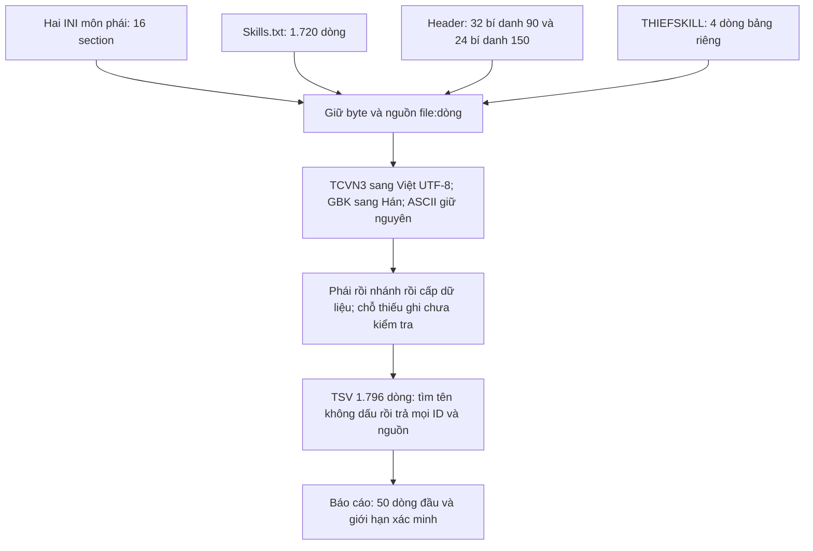

TÓM TẮT 1: [NGUỒN] DONE trong phạm vi bảng tra tĩnh: tiếp tục TSV có sẵn, đối chiếu đủ 1.796 dòng; không sửa kết luận báo cáo cũ.
TÓM TẮT 2: [NGUỒN] Gồm 16 môn phái, 1.720 dòng Skills.txt, 56 bí danh header và 4 dòng THIEFSKILL; giữ riêng tên trùng, ID trùng và nguồn.
TÓM TẮT 3: [NGUỒN] Bảng mẫu 50 dòng ở dưới; TSV đầy đủ tại D:/JX-wt/K-03d/JX1_OPS/REPORTS/_CHIMUC/K-03d.tsv, UTF-8 không BOM, 25 cột.
TÓM TẮT 4: [CHƯA KIỂM] 1.773 ô tên Hán và 12 ô TCVN3 gốc ghi “chưa kiểm tra”; ghi nhịp ngoài worktree bị từ chối truy cập.
TÓM TẮT 5: [CHƯA KIỂM] Không build, chạy game/exe/VM/mạng; không commit/push theo chỉ đạo, Tổng quan nhận bàn giao để commit.

# K-03d — Bảng ánh xạ tên kỹ năng, môn phái TCVN3 – UTF-8 – Hán

Loại: tổng hợp  
Chủ đề: Tra tên kỹ năng và môn phái từ chữ Việt hoặc tên không dấu đến tên gốc, mã/ID và dòng định nghĩa.  
Từ khóa: kỹ năng, môn phái, TCVN3, UTF-8, GBK, SkillId, FactionSection, Skills.txt, factionhead.lua, An Bang  
Trạng thái: DONE — hoàn tất bảng tra và báo cáo tĩnh trong tập nguồn kê khai; riêng file NHỊP ngoài worktree BỊ CHẶN.  
Độ phủ: 1.796/1.796 dòng tên trong tập nguồn; 16/16 section môn phái; không đồng nghĩa phủ mọi tên trong client, PAK hoặc mọi Lua.  
Liên quan: JX1_OPS/TASKS/K-03d.md; JX1_OPS/TASKS/K-03.md; JX1_OPS/TASKS/K-02.md; JX1_OPS/REPORTS/A-08a-mon-phai-ky-nang.md; JX1_OPS/REPORTS/K-01-ban-do-truyen-tin-hieu.md; JX1_OPS/DESIGN/CHUAN-BAO-CAO.md; JX1_OPS/DESIGN/MUC-LUC-TRI-THUC.md.  
Cần tôi quyết định: không — các ô chưa kiểm và bất nhất dữ liệu đã giữ nguyên, đủ để Tổng quan tiếp nhận bảng tra.

## Sơ đồ quan hệ chính



## Phạm vi và độ phủ

[ĐÃ XÁC MINH] Chỉ tiếp tục phần còn thiếu. Lúc vào việc, `git status --short --branch` cho nhánh `task/K-03d`, chỉ có `?? JX1_OPS/REPORTS/_CHIMUC/K-03d.tsv`; báo cáo K-03d chưa tồn tại và task chưa có mục Kết quả. Giữ nguyên TSV có sẵn, không dựng lại hoặc sửa bảng tên. Task cho phép hai đầu ra ở `JX1_OPS/TASKS/K-03d.md:10`; yêu cầu trực tiếp trong phiên cho phép ghi thêm mục Kết quả cuối file task.

### Gốc nguồn và cách đọc

| Ký hiệu | Gốc tuyệt đối và vai trò |
|---|---|
| `G/` | `C:/Jx1CocoV3/Folder/ServerNew-20260116T043145Z-3-001/ServerNew/_bin_v2_/gs/` — dữ liệu rời, chỉ đọc, đúng gốc đã dùng ở `JX1_OPS/REPORTS/A-08a-mon-phai-ky-nang.md:20`. |
| `S/` | `C:/Jx1CocoV3/SwordOnline/SwordOnline/jxOnline/gameserver/Sources/Core/Src/` — đối chiếu cách server dùng SkillId, không xác nhận binary đang vận hành. |
| `C/` | `C:/Jx1CocoV3/Folder/Client2912-20260116T044348Z-3-001/Client2912/Client/Classes/` — đối chiếu cùng cơ chế bên client gốc được dẫn ở `JX1_OPS/REPORTS/K-01-ban-do-truyen-tin-hieu.md:28`. |

`G/` của báo cáo này là **gói dữ liệu gs**, theo A-08a; khác ký hiệu `G/` gateway trong K-01. Số sau dấu `:` là dòng vật lý, bắt đầu từ 1; SkillId đọc từ cột, không tính từ số dòng. Không đồng nhất client Folder với một root client khác, không xác nhận đây là dữ liệu đang nạp trong VM. Các đường dẫn chỉ là bằng chứng cục bộ, không phải thông tin kết nối.

| Phần tử nguồn | Đã phủ / tổng | Trạng thái và bằng chứng |
|---|---:|---|
| Tên môn phái ở `faction.ini`, ghép Hán theo cùng section `MonPhai.ini` | 16/16 section [0]–[15] | Đã phủ tên; `G/Settings/faction/faction.ini:6`, `:8`, `:104`; `G/Settings/faction/MonPhai.ini:6`, `:7`, `:82`. Không đếm section `[Name]`. |
| Tên + SkillId ở `Skills.txt` | 1.720/1.720 dòng dữ liệu | Đã phủ từng dòng từ `G/Settings/Skills.txt:2` đến dòng cuối `:1721`; 1.719 ID phân biệt vì ID 521 có hai dòng. Header cột ở `:1`. |
| Bí danh `SKILL90_ARRAY` | 32/32 dòng tên | Đã phủ; `G/script/header/factionhead.lua:338`, `:340`, `:395`. |
| Bí danh `SKILL150_ARRAY` | 24/24 dòng tên | Đã phủ; `G/script/header/factionhead.lua:404`, `:406`, `:447`. |
| Tên bảng riêng `THIEFSKILL.txt` | 4/4 dòng tên | Đã phủ ID 400–403; `G/Settings/THIEFSKILL.txt:1`, `:2`, `:5`. Không gộp với Skills.txt cùng ID. |
| Bảng vũ khí → ID | 0 tên mới đưa vào bảng | Đã xem header `G/Settings/ClientWeaponSkill.txt:1`, `G/Settings/clientweaponskill_.txt:1`, `G/Settings/Weapon_PhysicsSkillFile.txt:1`; không phải bảng định nghĩa SkillName. |
| Mẫu khai báo cột | 0 tên game đưa vào bảng | Đã xem `G/Settings/skilltemplate.txt:5`, `:7`; đây là nhãn trường SkillName, không phải tên kỹ năng. |
| Bản nén lưu trong Settings, PAK, dữ liệu client và mọi chuỗi trong Lua khác | Chưa đếm được | Chưa phủ; `Settings_skills_V1.rar` chưa giải nén, PAK/client/Lua khác chưa kiểm tra. Không nhận độ phủ toàn bộ game từ tập nguồn rời này. |

### Độ phủ theo cấu trúc môn phái

[ĐÃ XÁC MINH] Số “kỹ năng” dưới đây là số dòng liên hệ qua `LvlSetScript`, kể cả tên nhãn kỹ thuật và script NPC; không phải danh sách chiêu người chơi học được. “0” là không có dòng **được gán trong bảng tra**, không phải bằng chứng phái không có kỹ năng. Căn cứ gom nhóm xem mục Sắp theo cấu trúc game.

| Phái/nhóm | Mục phái | Skills | Bí danh | THIEFSKILL | Tổng | Độ phủ và nguồn |
|---|---:|---:|---:|---:|---:|---|
| Thiếu Lâm | 1 | 51 | 6 | 0 | 58 | Đã phủ dòng tên; danh sách học chưa kiểm tra; G/Settings/faction/faction.ini:8 |
| Thiên Vương | 1 | 55 | 6 | 0 | 62 | Đã phủ dòng tên; danh sách học chưa kiểm tra; G/Settings/faction/faction.ini:15 |
| Đường Môn | 1 | 61 | 8 | 0 | 70 | Đã phủ dòng tên; danh sách học chưa kiểm tra; G/Settings/faction/faction.ini:22 |
| Ngũ Độc | 1 | 41 | 5 | 0 | 47 | Đã phủ dòng tên; danh sách học chưa kiểm tra; G/Settings/faction/faction.ini:29 |
| Nga My | 1 | 56 | 5 | 0 | 62 | Đã phủ dòng tên; danh sách học chưa kiểm tra; G/Settings/faction/faction.ini:36 |
| Thúy Yên | 1 | 56 | 4 | 0 | 61 | Đã phủ dòng tên; danh sách học chưa kiểm tra; G/Settings/faction/faction.ini:43 |
| Cái Bang | 1 | 34 | 4 | 0 | 39 | Đã phủ dòng tên; danh sách học chưa kiểm tra; G/Settings/faction/faction.ini:50 |
| Thiên Nhẫn | 1 | 42 | 5 | 0 | 48 | Đã phủ dòng tên; danh sách học chưa kiểm tra; G/Settings/faction/faction.ini:57 |
| Võ Đang | 1 | 45 | 4 | 0 | 50 | Đã phủ dòng tên; danh sách học chưa kiểm tra; G/Settings/faction/faction.ini:64 |
| Côn Lôn | 1 | 52 | 5 | 0 | 58 | Đã phủ dòng tên; danh sách học chưa kiểm tra; G/Settings/faction/faction.ini:71 |
| Hoa Sơn | 1 | 47 | 2 | 0 | 50 | Đã phủ dòng tên; danh sách học chưa kiểm tra; G/Settings/faction/faction.ini:78 |
| Lý Tầm Hoan | 1 | 0 | 0 | 0 | 1 | Đã phủ tên phái; bộ kỹ năng chưa kiểm tra; G/Settings/faction/faction.ini:84 |
| Đào Hoa Đảo | 1 | 0 | 0 | 0 | 1 | Đã phủ tên phái; bộ kỹ năng chưa kiểm tra; G/Settings/faction/faction.ini:89 |
| Minh Giáo | 1 | 0 | 0 | 0 | 1 | Đã phủ tên phái; bộ kỹ năng chưa kiểm tra; G/Settings/faction/faction.ini:94 |
| Đoàn Thị | 1 | 0 | 0 | 0 | 1 | Đã phủ tên phái; bộ kỹ năng chưa kiểm tra; G/Settings/faction/faction.ini:99 |
| Tự sáng môn phái | 1 | 0 | 0 | 0 | 1 | Đã phủ tên phái; bộ kỹ năng chưa kiểm tra; G/Settings/faction/faction.ini:104 |
| Dùng chung/chưa gán phái | 0 | 1180 | 2 | 4 | 1186 | Đã phủ dòng tên; danh sách học chưa kiểm tra; G/script/header/factionhead.lua:395 |
| **Tổng** | **16** | **1.720** | **56** | **4** | **1.796** | Đã phủ tên trong tập nguồn, không đếm kỹ năng vận hành |

## Giải mã tên

### Quy ước giữ tên gốc

[Đà XÁC MINH] Có 1.189 dòng mang tên TCVN3, 595 dòng ASCII và 12 dòng GBK. Dùng byte của từng trường, không giải mã cả file trộn Việt/Hán bằng một bộ mã. Biểu diễn byte TCVN3 bằng Windows-1252 để giữ dạng đọc kiểm lại như `§¹t Ma §é Giang`; sau đó ánh xạ TCVN3 sang Unicode. Bằng chứng: `G/script/header/factionhead.lua:340`, `G/Settings/Skills.txt:319`; phương pháp kế thừa `JX1_OPS/REPORTS/A-08a-mon-phai-ky-nang.md:24`.

`ten_goc` giữ chuỗi theo mã hóa được nhận diện; `byte_hex` giữ byte tên gốc, kể cả byte khó nhìn trong biểu diễn TCVN3. `tcvn3_goc` chứa tên TCVN3/ASCII thật, không mã hóa ngược tên Việt quy ước để giả làm dữ liệu gốc. Với 12 dòng nguồn GBK, ô này là `chưa kiểm tra`. Tên UTF-8 của bảy kỹ năng GBK giữ Hán tự; tên Việt tương ứng chưa kiểm tra. Với năm môn phái chỉ có Hán, tên Việt kế thừa A-08a là tên tra quy ước, không phải chuỗi Việt có tại nguồn.

[ĐÃ XÁC MINH] Cột `ten_han` có 23 dòng đối chiếu trực tiếp: 16 môn phái + 3 kỹ năng GBK trong Skills.txt + 4 kỹ năng THIEFSKILL. 1.773 dòng còn lại ghi `chưa kiểm tra`. Cột `nhan_han_duong_dan` có 174 dòng ghi nhãn từ đường dẫn tài nguyên; đây là gợi ý riêng, **chưa kiểm tra đồng nhất với tên kỹ năng**, không nâng thành `ten_han` và không dịch đoán Hán tự.

### Môn phái: đủ 16 mục

Tên ngắn dùng để gom nhóm là dạng rút gọn của tên ở bảng này; giữ nguyên hậu tố “phái”, “Bang”, “Giáo”, “môn” và chữ hoa/thường trong `ten_utf8` khi tra tên gốc.

| Tên gốc | Mã hóa | Chữ đúng UTF-8 / tên nhóm | Hán | Mã/ID | Nguồn tên; nguồn Hán |
|---|---|---|---|---|---|
| ThiÕu L©m ph¸i | TCVN3 | Thiếu Lâm phái / Thiếu Lâm | 少林派 | FactionSection=0 | G/Settings/faction/faction.ini:8; G/Settings/faction/MonPhai.ini:7 |
| Thiªn V­¬ng Bang | TCVN3 | Thiên Vương Bang / Thiên Vương | 天王帮 | FactionSection=1 | G/Settings/faction/faction.ini:15; G/Settings/faction/MonPhai.ini:12 |
| §­êng M«n | TCVN3 | Đường Môn / Đường Môn | 唐门 | FactionSection=2 | G/Settings/faction/faction.ini:22; G/Settings/faction/MonPhai.ini:17 |
| Ngò §éc Gi¸o | TCVN3 | Ngũ Độc Giáo / Ngũ Độc | 五毒教 | FactionSection=3 | G/Settings/faction/faction.ini:29; G/Settings/faction/MonPhai.ini:22 |
| Nga My ph¸i | TCVN3 | Nga My phái / Nga My | 峨嵋派 | FactionSection=4 | G/Settings/faction/faction.ini:36; G/Settings/faction/MonPhai.ini:27 |
| Thóy Yªn m«n | TCVN3 | Thúy Yên môn / Thúy Yên | 翠烟门 | FactionSection=5 | G/Settings/faction/faction.ini:43; G/Settings/faction/MonPhai.ini:32 |
| C¸i Bang | TCVN3 | Cái Bang / Cái Bang | 丐帮 | FactionSection=6 | G/Settings/faction/faction.ini:50; G/Settings/faction/MonPhai.ini:37 |
| Thiªn NhÉn Gi¸o | TCVN3 | Thiên Nhẫn Giáo / Thiên Nhẫn | 天忍教 | FactionSection=7 | G/Settings/faction/faction.ini:57; G/Settings/faction/MonPhai.ini:42 |
| Vâ §ang ph¸i | TCVN3 | Võ Đang phái / Võ Đang | 武当派 | FactionSection=8 | G/Settings/faction/faction.ini:64; G/Settings/faction/MonPhai.ini:47 |
| C«n L«n ph¸i | TCVN3 | Côn Lôn phái / Côn Lôn | 昆仑派 | FactionSection=9 | G/Settings/faction/faction.ini:71; G/Settings/faction/MonPhai.ini:52 |
| Hoa S¬n ph¸i | TCVN3 | Hoa Sơn phái / Hoa Sơn | 华山派 | FactionSection=10 | G/Settings/faction/faction.ini:78; G/Settings/faction/MonPhai.ini:57 |
| 李寻欢 | GBK | Lý Tầm Hoan / Lý Tầm Hoan | 李寻欢 | FactionSection=11 | G/Settings/faction/faction.ini:84; G/Settings/faction/MonPhai.ini:62 |
| 桃花岛 | GBK | Đào Hoa Đảo / Đào Hoa Đảo | 桃花岛 | FactionSection=12 | G/Settings/faction/faction.ini:89; G/Settings/faction/MonPhai.ini:67 |
| 明教 | GBK | Minh Giáo / Minh Giáo | 明教 | FactionSection=13 | G/Settings/faction/faction.ini:94; G/Settings/faction/MonPhai.ini:72 |
| 段氏 | GBK | Đoàn Thị / Đoàn Thị | 段氏 | FactionSection=14 | G/Settings/faction/faction.ini:99; G/Settings/faction/MonPhai.ini:77 |
| 自创门派 | GBK | Tự sáng môn phái / Tự sáng môn phái | 自创门派 | FactionSection=15 | G/Settings/faction/faction.ini:104; G/Settings/faction/MonPhai.ini:82 |

### Bảng đầu 50 dòng của TSV

[ĐÃ XÁC MINH] Đây là đúng 50 bản ghi đầu, tương ứng `JX1_OPS/REPORTS/_CHIMUC/K-03d.tsv:2` đến `:51`, theo nguyên thứ tự sẵn có. Một tên lặp ở hai nguồn vẫn là hai bản ghi; “bí danh kỹ năng” dùng tên header, không ghi đè tên SkillName. Cột “Tên gốc” của các dòng này đồng thời là dạng TCVN3/ASCII gốc; mã hóa nêu riêng. Cấp ở đây là dữ liệu ReqLevel hoặc nhãn mảng, chưa xác minh cấp học thực tế.

| STT | Tên UTF-8 | Tên gốc TCVN3/ASCII | Mã hóa | Hán | Mã/ID | Nhóm; nhánh | Cấp dữ liệu | Nguồn file:dòng |
|---:|---|---|---|---|---|---|---|---|
| 1 | Thiếu Lâm phái | ThiÕu L©m ph¸i | TCVN3 | 少林派 | FactionSection=0 | môn phái; không áp dụng | không áp dụng | G/Settings/faction/faction.ini:8 |
| 2 | Hoành Tảo Thiên Quân | Hoµnh T¶o Thiªn Qu©n | TCVN3 | chưa kiểm tra | SkillId=319 | kỹ năng; Côn pháp | ReqLevel=80 | G/Settings/Skills.txt:320 |
| 3 | Hoành Tảo Thiên Quân | Hoµnh T¶o Thiªn Qu©n | TCVN3 | chưa kiểm tra | SkillId=319 | bí danh kỹ năng; Côn pháp | Nhãn SKILL90_ARRAY; không thay ReqLevel | G/script/header/factionhead.lua:341 |
| 4 | Vô Tướng Trảm | V« T­íng Tr¶m | TCVN3 | chưa kiểm tra | SkillId=321 | kỹ năng; Đao pháp | ReqLevel=80 | G/Settings/Skills.txt:322 |
| 5 | Vô Tướng Trảm | V« T­íng Tr¶m | TCVN3 | chưa kiểm tra | SkillId=321 | bí danh kỹ năng; Đao pháp | Nhãn SKILL90_ARRAY; không thay ReqLevel | G/script/header/factionhead.lua:342 |
| 6 | Đạt Ma Độ Giang | §¹t Ma §é Giang | TCVN3 | chưa kiểm tra | SkillId=318 | kỹ năng; Quyền pháp | ReqLevel=80 | G/Settings/Skills.txt:319 |
| 7 | Đạt Ma Độ Giang | §¹t Ma §é Giang | TCVN3 | chưa kiểm tra | SkillId=318 | bí danh kỹ năng; Quyền pháp | Nhãn SKILL90_ARRAY; không thay ReqLevel | G/script/header/factionhead.lua:340 |
| 8 | Kim Cang Phục Ma | Kim Cang Phôc Ma | TCVN3 | chưa kiểm tra | SkillId=216 | kỹ năng; chưa kiểm tra; EqtLimit=-2 | ReqLevel=0 | G/Settings/Skills.txt:217 |
| 9 | Hoành Tảo Lục Hợp | Hoµnh T¶o Lôc Hîp | TCVN3 | chưa kiểm tra | SkillId=217 | kỹ năng; chưa kiểm tra; EqtLimit=-2 | ReqLevel=0 | G/Settings/Skills.txt:218 |
| 10 | Long Trảo Hổ Trảo | Long Tr¶o Hæ Tr¶o | TCVN3 | chưa kiểm tra | SkillId=218 | kỹ năng; chưa kiểm tra; EqtLimit=-2 | ReqLevel=0 | G/Settings/Skills.txt:219 |
| 11 | Kỹ năng phụ - Sư Tử Hống | Kü n¨ng phô - S­ Tö Hèng | TCVN3 | chưa kiểm tra | SkillId=734 | kỹ năng; chưa kiểm tra; EqtLimit=-2 | ReqLevel=0 | G/Settings/Skills.txt:736 |
| 12 | abc123 | abc123 | ASCII | chưa kiểm tra | SkillId=900 | kỹ năng; chưa kiểm tra; EqtLimit=-2 | ReqLevel=1 | G/Settings/Skills.txt:900 |
| 13 | Thiếu Lâm Kiếm pháp | ThiÕu L©m KiÕm ph¸p | TCVN3 | chưa kiểm tra | SkillId=3 | kỹ năng; chưa kiểm tra; EqtLimit=-2 | ReqLevel=10 | G/Settings/Skills.txt:4 |
| 14 | Thiếu Lâm thương pháp (##) | ThiÕu L©m th­¬ng ph¸p (##) | TCVN3 | chưa kiểm tra | SkillId=5 | kỹ năng; chưa kiểm tra; EqtLimit=-2 | ReqLevel=10 | G/Settings/Skills.txt:6 |
| 15 | Thiếu Lâm Chùy pháp (##) | ThiÕu L©m Chïy ph¸p (##) | TCVN3 | chưa kiểm tra | SkillId=7 | kỹ năng; chưa kiểm tra; EqtLimit=-2 | ReqLevel=10 | G/Settings/Skills.txt:8 |
| 16 | Hỗn Nguyên Nhất Khí công | Hçn Nguyªn NhÊt KhÝ c«ng | TCVN3 | chưa kiểm tra | SkillId=9 | kỹ năng; chưa kiểm tra; EqtLimit=-2 | ReqLevel=10 | G/Settings/Skills.txt:10 |
| 17 | Kim Cang Phục Ma | Kim Cang Phôc Ma | TCVN3 | chưa kiểm tra | SkillId=10 | kỹ năng; chưa kiểm tra; EqtLimit=-2 | ReqLevel=10 | G/Settings/Skills.txt:11 |
| 18 | Kim Cang Hộ Thể | Kim Cang Hé ThÓ | TCVN3 | chưa kiểm tra | SkillId=12 | kỹ năng; chưa kiểm tra; EqtLimit=-2 | ReqLevel=20 | G/Settings/Skills.txt:13 |
| 19 | Bất động Minh Vương | BÊt ®éng Minh V­¬ng | TCVN3 | chưa kiểm tra | SkillId=15 | kỹ năng; chưa kiểm tra; EqtLimit=-2 | ReqLevel=20 | G/Settings/Skills.txt:16 |
| 20 | Lam Ba | Lam Ba | ASCII | chưa kiểm tra | SkillId=185 | kỹ năng; chưa kiểm tra; EqtLimit=-2 | ReqLevel=20 | G/Settings/Skills.txt:186 |
| 21 | Lập Địa Thành Phật | LËp §Þa Thµnh PhËt | TCVN3 | chưa kiểm tra | SkillId=13 | kỹ năng; chưa kiểm tra; EqtLimit=-2 | ReqLevel=30 | G/Settings/Skills.txt:14 |
| 22 | La Hán Trận | La H¸n TrËn | TCVN3 | chưa kiểm tra | SkillId=16 | kỹ năng; chưa kiểm tra; EqtLimit=-2 | ReqLevel=30 | G/Settings/Skills.txt:17 |
| 23 | Hồng Ba | Hång Ba | TCVN3 | chưa kiểm tra | SkillId=186 | kỹ năng; chưa kiểm tra; EqtLimit=-2 | ReqLevel=30 | G/Settings/Skills.txt:187 |
| 24 | La Hán Trận | La H¸n TrËn | TCVN3 | chưa kiểm tra | SkillId=202 | kỹ năng; chưa kiểm tra; EqtLimit=-2 | ReqLevel=30 | G/Settings/Skills.txt:203 |
| 25 | Bất động Minh Vương | BÊt ®éng Minh V­¬ng | TCVN3 | chưa kiểm tra | SkillId=213 | kỹ năng; chưa kiểm tra; EqtLimit=-2 | ReqLevel=30 | G/Settings/Skills.txt:214 |
| 26 | Long Trảo Hổ Trảo | Long Tr¶o Hæ Tr¶o | TCVN3 | chưa kiểm tra | SkillId=272 | kỹ năng; chưa kiểm tra; EqtLimit=-2 | ReqLevel=30 | G/Settings/Skills.txt:273 |
| 27 | Kim Phật Xuất Kích | Kim PhËt XuÊt KÝch | TCVN3 | chưa kiểm tra | SkillId=317 | kỹ năng; chưa kiểm tra; EqtLimit=-2 | ReqLevel=30 | G/Settings/Skills.txt:318 |
| 28 | Long Thừa Bát Nhã Thủ | Long Thõa B¸t Nh· Thñ | TCVN3 | chưa kiểm tra | SkillId=1083 | kỹ năng; chưa kiểm tra; EqtLimit=-2 | ReqLevel=30 | G/Settings/Skills.txt:1083 |
| 29 | Long Trảo Hổ Trảo (##) | Long Tr¶o Hæ Tr¶o (##) | TCVN3 | chưa kiểm tra | SkillId=17 | kỹ năng; chưa kiểm tra; EqtLimit=-2 | ReqLevel=40 | G/Settings/Skills.txt:18 |
| 30 | Huệ Nhãn chú | HuÖ Nh·n chó | TCVN3 | chưa kiểm tra | SkillId=18 | kỹ năng; chưa kiểm tra; EqtLimit=-2 | ReqLevel=40 | G/Settings/Skills.txt:19 |
| 31 | Sư Tử Hống | S­ Tö Hèng | TCVN3 | chưa kiểm tra | SkillId=20 | kỹ năng; chưa kiểm tra; EqtLimit=-2 | ReqLevel=40 | G/Settings/Skills.txt:21 |
| 32 | Huệ Nhãn chú | HuÖ Nh·n chó | TCVN3 | chưa kiểm tra | SkillId=214 | kỹ năng; chưa kiểm tra; EqtLimit=-2 | ReqLevel=40 | G/Settings/Skills.txt:215 |
| 33 | Sư Tử hựu Hống | S­ Tö hùu Hèng | TCVN3 | chưa kiểm tra | SkillId=255 | kỹ năng; chưa kiểm tra; EqtLimit=-2 | ReqLevel=50 | G/Settings/Skills.txt:256 |
| 34 | Hoành Tảo Lục Hợp 111 | Hoµnh T¶o Lôc Hîp 111 | TCVN3 | chưa kiểm tra | SkillId=320 | kỹ năng; chưa kiểm tra; EqtLimit=-2 | ReqLevel=50 | G/Settings/Skills.txt:321 |
| 35 | abc171 | abc171 | ASCII | chưa kiểm tra | SkillId=986 | kỹ năng; chưa kiểm tra; EqtLimit=-2 | ReqLevel=50 | G/Settings/Skills.txt:986 |
| 36 | Dịch Cân kinh | DÞch C©n kinh | TCVN3 | chưa kiểm tra | SkillId=21 | kỹ năng; chưa kiểm tra; EqtLimit=-2 | ReqLevel=60 | G/Settings/Skills.txt:22 |
| 37 | Như Lai Thiên Diệp | Nh­ Lai Thiªn DiÖp | TCVN3 | chưa kiểm tra | SkillId=273 | kỹ năng; chưa kiểm tra; EqtLimit=-2 | ReqLevel=60 | G/Settings/Skills.txt:274 |
| 38 | ncp1 | ncp1 | ASCII | chưa kiểm tra | SkillId=1146 | kỹ năng; chưa kiểm tra; EqtLimit=-2 | ReqLevel=80 | G/Settings/Skills.txt:1146 |
| 39 | ncp2 | ncp2 | ASCII | chưa kiểm tra | SkillId=1147 | kỹ năng; chưa kiểm tra; EqtLimit=-2 | ReqLevel=80 | G/Settings/Skills.txt:1147 |
| 40 | ncp3 | ncp3 | ASCII | chưa kiểm tra | SkillId=1148 | kỹ năng; chưa kiểm tra; EqtLimit=-2 | ReqLevel=80 | G/Settings/Skills.txt:1148 |
| 41 | Đại Thừa Như Lai Chú | §¹i Thõa Nh­ Lai Chó | TCVN3 | chưa kiểm tra | SkillId=709 | kỹ năng; chưa kiểm tra; EqtLimit=-2 | ReqLevel=120 | G/Settings/Skills.txt:711 |
| 42 | Đại Thừa Như Lai Chú_Phản đòn bùa chú | §¹i Thõa Nh­ Lai Chó_Ph¶n ®ßn bïa chó | TCVN3 | chưa kiểm tra | SkillId=725 | kỹ năng; chưa kiểm tra; EqtLimit=-2 | ReqLevel=120 | G/Settings/Skills.txt:727 |
| 43 | Thiếu Lâm Quyền Pháp | ThiÕu L©m QuyÒn Ph¸p | TCVN3 | chưa kiểm tra | SkillId=8 | kỹ năng; chưa kiểm tra; EqtLimit=-1 | ReqLevel=10 | G/Settings/Skills.txt:9 |
| 44 | Hàng Long Bất Vũ | Hµng Long BÊt Vò | TCVN3 | chưa kiểm tra | SkillId=14 | kỹ năng; chưa kiểm tra; EqtLimit=-1 | ReqLevel=10 | G/Settings/Skills.txt:15 |
| 45 | Long Trảo Hổ Trảo | Long Tr¶o Hæ Tr¶o | TCVN3 | chưa kiểm tra | SkillId=271 | kỹ năng; chưa kiểm tra; EqtLimit=-1 | ReqLevel=50 | G/Settings/Skills.txt:272 |
| 46 | Đại Lực Kim Cang Chưởng | §¹i Lùc Kim Cang Ch­ëng | TCVN3 | chưa kiểm tra | SkillId=1055 | kỹ năng; chưa kiểm tra; EqtLimit=-1 | ReqLevel=150 | G/Settings/Skills.txt:1055 |
| 47 | Thiếu Lâm Đao pháp | ThiÕu L©m §ao ph¸p | TCVN3 | chưa kiểm tra | SkillId=6 | kỹ năng; chưa kiểm tra; EqtLimit=1 | ReqLevel=10 | G/Settings/Skills.txt:7 |
| 48 | Ma Ha Vô Lượng | Ma Ha V« L­îng | TCVN3 | chưa kiểm tra | SkillId=19 | kỹ năng; chưa kiểm tra; EqtLimit=1 | ReqLevel=50 | G/Settings/Skills.txt:20 |
| 49 | Tam Giới Quy Thiền | Tam Giíi Quy ThiÒn | TCVN3 | chưa kiểm tra | SkillId=1057 | kỹ năng; chưa kiểm tra; EqtLimit=1 | ReqLevel=150 | G/Settings/Skills.txt:1057 |
| 50 | abc215 | abc215 | ASCII | chưa kiểm tra | SkillId=1085 | kỹ năng; chưa kiểm tra; EqtLimit=1 | ReqLevel=150 | G/Settings/Skills.txt:1085 |

### Tên được dẫn thêm ngoài 50 dòng đầu

Các dòng dưới bảo đảm tên trong phần giải thích cũng có tên gốc và bằng chứng; bản ghi đầy đủ vẫn nằm trong TSV.

| Tên gốc | Mã hóa | Chữ đúng UTF-8 | Hán | Mã/ID; nhóm | Nguồn file:dòng |
|---|---|---|---|---|---|
| Hé ThÓ Hµn B¨ng | TCVN3 | Hộ Thể Hàn Băng | chưa kiểm tra | SkillId=100; kỹ năng | G/Settings/Skills.txt:101 |
| Nghªnh PhËt T©y Thiªn | TCVN3 | Nghênh Phật Tây Thiên | chưa kiểm tra | SkillId=1702; bí danh kỹ năng | G/script/header/factionhead.lua:395 |
| bachchienbachthang | ASCII | bachchienbachthang | chưa kiểm tra | SkillId=1661; kỹ năng | G/Settings/Skills.txt:1649 |
| Th¸nh Háa Liªu Nguyªn | TCVN3 | Thánh Hỏa Liêu Nguyên | chưa kiểm tra | SkillId=1661; bí danh kỹ năng | G/script/header/factionhead.lua:392 |
| Gi¶m B¨ng hoµn (kü n¨ng) | TCVN3 | Giảm Băng hoàn (kỹ năng) | chưa kiểm tra | SkillId=521; kỹ năng | G/Settings/Skills.txt:522 |
| kh¸ng tÊn c«ng khÝ mÖnh (kü n¨ng) | TCVN3 | kháng tấn công khí mệnh (kỹ năng) | chưa kiểm tra | SkillId=521; kỹ năng | G/Settings/Skills.txt:523 |
| Tèng Kim An Bang §¹i T­íng Qu©n | TCVN3 | Tống Kim An Bang Đại Tướng Quân | chưa kiểm tra | SkillId=833; kỹ năng | G/Settings/Skills.txt:833 |

### Bảy tên kỹ năng nguồn GBK

Giữ nguyên Hán tự sau giải mã GBK, không đặt tên Việt khi nguồn chưa chứng minh. `tcvn3_goc` của cả bảy dòng là `chưa kiểm tra`.

| Tên gốc / Hán UTF-8 | Mã hóa | Mã/ID; nhóm | Byte tên gốc (hex) | Nguồn file:dòng |
|---|---|---|---|---|
| 生命百分比_IB | GBK | SkillId=746; kỹ năng | c9 fa c3 fc b0 d9 b7 d6 b1 c8 5f 49 42 | G/Settings/Skills.txt:748 |
| 内力百分比_IB | GBK | SkillId=747; kỹ năng | c4 da c1 a6 b0 d9 b7 d6 b1 c8 5f 49 42 | G/Settings/Skills.txt:749 |
| 全抗_IB | GBK | SkillId=748; kỹ năng | c8 ab bf b9 5f 49 42 | G/Settings/Skills.txt:750 |
| 劫富济贫 | GBK | SkillId=400; kỹ năng THIEFSKILL | bd d9 b8 bb bc c3 c6 b6 | G/Settings/THIEFSKILL.txt:2 |
| 显示生命 | GBK | SkillId=401; kỹ năng THIEFSKILL | cf d4 ca be c9 fa c3 fc | G/Settings/THIEFSKILL.txt:3 |
| 显示内力 | GBK | SkillId=402; kỹ năng THIEFSKILL | cf d4 ca be c4 da c1 a6 | G/Settings/THIEFSKILL.txt:4 |
| 显示金钱 | GBK | SkillId=403; kỹ năng THIEFSKILL | cf d4 ca be bd f0 c7 ae | G/Settings/THIEFSKILL.txt:5 |

## Sắp theo cấu trúc game

[ĐÃ XÁC MINH] TSV đã có thứ tự: môn phái theo section INI 0→15; trong mỗi nhóm, tên phái đứng trước kỹ năng; kỹ năng theo nhánh đã có trong header hoặc nhóm `chưa kiểm tra; EqtLimit=...`, tiếp đến ReqLevel tăng dần và ID. Nhóm dùng chung/chưa gán phái đứng sau 16 mục; bảng THIEFSKILL giữ nhóm nguồn riêng ở cuối. Vì vậy 50 dòng đầu tập trung vào một phái, không phải mẫu đại diện của cả 16 phái.

[ĐÃ XÁC MINH] Liên hệ phái bám tên file/thư mục `LvlSetScript`: `shaolin` và biến thể `saolin`, `tangmen` và `tangmeng`, cùng các token phái ở `G/script/header/factionhead.lua:6` đến `:16`. Ví dụ `G/Settings/Skills.txt:319` dùng `shaolin.lua`; `:4` dùng thư mục `saolin`; `:306` dùng thư mục `tangmeng`; `:900`, `:930`, `:931` dùng script dưới `npc`. Đây là quan hệ đường dẫn đã kiểm, không chứng minh quyền học hoặc phái hiện hành của người chơi. 1.180 dòng Skills.txt chưa có liên hệ theo tiêu chí này ở nhóm chung, không ép vào một phái.

[ĐÃ XÁC MINH] Nhánh ghi rõ chỉ lấy từ `SKILL90_ARRAY`; ví dụ Quyền pháp/Côn pháp/Đao pháp tại `G/script/header/factionhead.lua:340`, `:341`, `:342`. Với nhánh chưa biết, giữ EqtLimit làm khóa nhóm dữ liệu, không tự gán tên nhánh bằng mã vũ khí. Các dòng `SKILL150_ARRAY` không có tên nhánh riêng, nên nhánh của bí danh vẫn ghi `chưa kiểm tra`. Nhãn 90/150 không thay ReqLevel: ba kỹ năng ở header 90 trên có ReqLevel=80 trong `G/Settings/Skills.txt:319`, `:320`, `:322`.

[CHƯA XÁC MINH] Không thể sắp thành cây **phái → nhánh → cấp học thực tế** đầy đủ khi nguồn chưa xác nhận nhánh và điều kiện học cho mọi dòng. TSV chỉ sắp theo quan hệ phái/nhánh/cấp dữ liệu đã nêu; các ô thiếu giữ nguyên `chưa kiểm tra`. Không gán hai nhóm header mở rộng [12]/[13] sang phái INI theo vị trí, vì FACTION_INFO chỉ có 11 mục (`G/script/header/factionhead.lua:5`, `:16`, `:392`, `:395`).

## Cách tra cứu và cấu trúc TSV

Đường dẫn đầy đủ: [K-03d.tsv](D:/JX-wt/K-03d/JX1_OPS/REPORTS/_CHIMUC/K-03d.tsv). Đường dẫn trong repository: `JX1_OPS/REPORTS/_CHIMUC/K-03d.tsv`. File có một hàng tiêu đề và 1.796 hàng dữ liệu, mỗi hàng 25 cột, phân cách TAB; giữ nguyên các cột chỉ mục chuẩn ở đầu.

| Nhóm cột | Nội dung |
|---|---|
| `file`, `loai`, `chu_de`, `tu_khoa`, `trang_thai`, `do_phu`, `lien_quan` | Bảy cột chỉ mục theo chuẩn; trạng thái DONE ở đây chỉ áp dụng bảng tra tĩnh, không khẳng định runtime. |
| `nhom`, `ten_utf8`, `ten_khong_dau`, `tcvn3_goc`, `ten_han`, `ma_id` | Loại bản ghi, tên đọc được, khóa tra không dấu, tên gốc và ID. |
| `phai`, `nhanh`, `cap_du_lieu`, `ma_hoa` | Quan hệ gom nhóm và cấp dữ liệu có giới hạn như mục trên. |
| `ten_goc`, `byte_hex`, `nguon_ten`, `nguon_han` | Chuỗi/byte gốc, vị trí tên và bằng chứng Hán tách riêng. |
| `co_so_phai`, `nhan_han_duong_dan`, `nguon_lien_ket`, `ghi_chu` | Căn cứ liên hệ, nhãn đường dẫn chưa đồng nhất tên, liên kết định nghĩa/bí danh và giới hạn. |

[ĐÃ XÁC MINH] `ten_khong_dau` bỏ dấu Unicode, đổi đ/Đ thành d/D, chuyển chữ thường, gộp khoảng trắng liên tiếp và bỏ khoảng trắng đầu/cuối. Nó phục vụ tìm kiếm; `ten_utf8` và `ten_goc` không bị rút gọn. Tìm tên trùng phải trả **mọi** bản ghi; khóa đối chiếu là nhóm nguồn + file:dòng, không phải chỉ tên hoặc chỉ ID.

Ví dụ tìm cụm từ “An Bang”, dùng ranh giới từ để tránh trả cả các tên có “Hàn Băng”:

```powershell
Import-Csv -LiteralPath 'JX1_OPS/REPORTS/_CHIMUC/K-03d.tsv' -Delimiter "`t" -Encoding UTF8 |
  Where-Object { $_.ten_khong_dau -match '(^| )an bang( |$)' } |
  Select-Object ten_utf8, tcvn3_goc, ten_han, ma_id, nhom, nguon_ten
```

[ĐÃ XÁC MINH] Lệnh đã chạy cho **một** kết quả: Tống Kim An Bang Đại Tướng Quân, `SkillId=833`, `G/Settings/Skills.txt:833`. Không có bản ghi tên chính xác chỉ là `an bang` trong tập này. Đây là tên ở bảng kỹ năng, không đồng nhất với vật phẩm/NPC cùng hoặc gần tên ngoài phạm vi K-03d. Tên gốc có tại bảng giải mã bổ sung.

## Điểm cần giữ khi đọc dữ liệu

| Điểm | Bằng chứng tĩnh và giới hạn |
|---|---|
| ID 521 lặp trong cùng bảng | `G/Settings/Skills.txt:522` và `:523` có hai tên khác nhau. Giữ cả hai; không chọn ngầm một tên, không suy tên có hiệu lực lúc chạy. |
| ID 1661 có hai tên theo hai nguồn | Header tại `G/script/header/factionhead.lua:392` và Skills.txt tại `G/Settings/Skills.txt:1649` khác tên. Giữ riêng định nghĩa và bí danh, không đổi kết luận A-08a (`JX1_OPS/REPORTS/A-08a-mon-phai-ky-nang.md:109`). |
| Bí danh ID 1702 chưa có định nghĩa trong Skills.txt | Tên có ở `G/script/header/factionhead.lua:395`; quét cột SkillId của 1.720 dòng Skills.txt trả 0 dòng ID 1702. Chỉ kết luận với file rời này, không suy vắng trong PAK hoặc bản khác. |
| THIEFSKILL có bốn dòng, chưa xác nhận bốn kỹ năng vận hành | Dữ liệu tại `G/Settings/THIEFSKILL.txt:2`, `:3`, `:4`, `:5`. Đoạn đã đọc trong `S/KSkillManager.cpp:84`, `:87` và `C/gamecore/KSkillManager.cpp:84`, `:87` lấy SkillId của dòng 2; không dùng số dòng dữ liệu để suy cả bốn được nạp/hoạt động. |
| ID và dòng file là hai loại số | `S/KSkillManager.cpp:65`, `:73` và `C/gamecore/KSkillManager.cpp:62`, `:73` đọc SkillId rồi lưu số hàng riêng. Ví dụ SkillId 1661 ở Skills.txt:1649. |
| Năm phái chỉ có Hán trong INI | `G/Settings/faction/faction.ini:84`, `:89`, `:94`, `:99`, `:104` không có ShowName Việt tại các mục này. Tên Việt là quy ước kế thừa A-08a; TCVN3 gốc vẫn `chưa kiểm tra`. |

## Mục sổ thông số

| Nhóm | Tên/hằng số | file:dòng | Giá trị | Đơn vị | Ảnh hưởng | Đổi an toàn (CÓ/CẨN THẬN/KHÔNG) | Nguồn đo |
|---|---|---|---|---|---|---|---|
| Định danh | FactionSection | G/Settings/faction/MonPhai.ini:6; :81 | 0–15, đủ 16 mục | ID section | Ghép tên Việt/Hán trong hai INI; không đếm phái chơi được | KHÔNG — task chỉ đọc | Đọc tĩnh |
| Định danh | SkillId | G/Settings/Skills.txt:1; :522; :523 | 1.720 dòng; 1.719 ID phân biệt; ID 521 lặp | dòng/ID | Tránh dùng riêng ID hoặc số dòng làm khóa duy nhất | KHÔNG — task chỉ đọc | Đọc tĩnh toàn cột |
| Cấp dữ liệu | ReqLevel của ID 318 | G/Settings/Skills.txt:319 | 80 | cấp dữ liệu | Sắp dữ liệu; không đổi thành 90 theo tên mảng header | KHÔNG — chưa xác minh điều kiện học | Đọc tĩnh, chưa đo runtime |
| Bí danh | SKILL90_ARRAY / SKILL150_ARRAY | G/script/header/factionhead.lua:338; :404 | 32 / 24 | dòng tên | Tra bí danh riêng; không thay tên định nghĩa hoặc cấp học | KHÔNG — task chỉ đọc | Đọc tĩnh |
| Bảng riêng | THIEFSKILL | G/Settings/THIEFSKILL.txt:2; :5 | 400–403, bốn dòng | ID | Giữ khác namespace nguồn khi trùng Skills.txt | KHÔNG — chưa kiểm runtime | Đọc tĩnh |
| Bộ mã | TCVN3 / ASCII / GBK | JX1_OPS/REPORTS/_CHIMUC/K-03d.tsv:1 | 1.189 / 595 / 12 | dòng tên | Chọn cách đọc từng trường, không ghi lại byte nguồn | KHÔNG — chỉ ghi tài liệu tra cứu | Đếm TSV, đối chiếu byte gốc |

## Đã xác minh / Chưa xác minh

### ĐÃ XÁC MINH

| Phép kiểm thực chạy trong lượt tiếp tục | Kết quả |
|---|---|
| `Import-Csv` TAB; kiểm số cột; đọc UTF-8 strict và BOM | 1.796 bản ghi + một header; 25 cột ở mọi hàng; UTF-8 hợp lệ, không BOM. |
| Ghép `nguon_ten` → file thật/dòng vật lý, chuyển `byte_hex` thành byte tên và đối chiếu ID | 1.796/1.796 dòng có tên gốc khớp nguồn; 1.720 Skills + 56 bí danh + 16 tên phái + 4 THIEFSKILL. Không có khóa nhóm + nguồn bị lặp. |
| Ánh xạ TCVN3 → Unicode; ASCII giữ nguyên | 1.189/1.189 dòng TCVN3 khớp `ten_utf8`; 595/595 dòng ASCII giữ nguyên. |
| GBK → chuỗi gốc và `nguon_han` → trường tên | 12/12 dòng GBK đúng giải mã; 23/23 tên Hán có bằng chứng trực tiếp. Không kiểm đồng nhất 174 nhãn Hán đường dẫn với tên kỹ năng. |
| Chuẩn hóa khóa tìm kiếm với bỏ dấu, đ→d, chữ thường và gộp khoảng trắng | 1.796/1.796 khóa `ten_khong_dau` khớp. |
| Đếm lại Skills và hai mảng bí danh trong file thật | 1.720 dòng Skills có ID; 32 + 24 dòng tên trong header, khớp số bản ghi TSV tương ứng. |
| So ReqLevel toàn bộ Skills; EqtLimit tại các nhánh chưa rõ; liên hệ LvlSetScript | Khớp giá trị dữ liệu; 1.720/1.720 phép đối chiếu liên hệ phái khớp tiêu chí đã mô tả. Script NPC vẫn giữ giới hạn chưa kiểm danh sách học. |
| Tìm “An Bang” bằng ranh giới từ | Một bản ghi, SkillId 833 tại Skills.txt:833; tìm tên chính xác chỉ “an bang” trả 0. |
| So số hàng với ID, kiểm trùng và ID 1702 | Hai dòng ID 521 được giữ riêng; 0 định nghĩa ID 1702 trong Skills.txt; tên header ID 1661 giữ riêng. |
| Kiểm cấu trúc báo cáo và liên kết nguồn sau khi điền bảng | Đúng 5 dòng tóm tắt, 1 sơ đồ Mermaid, 50 dòng mẫu khớp TSV; 146 tham chiếu G/S/C có file thật và số dòng hợp lệ; không còn chỗ giữ chỗ trong bản cuối. |

TSV được giữ nguyên byte khi tiếp tục. SHA-256 trước và sau: `4D1C88ECE8986137B8984F17236D89CD01438CCA834E03AAC5D3E43B9AF4B56E`.

### CHƯA XÁC MINH

- Tên Việt/TCVN3 của bảy kỹ năng GBK và TCVN3 gốc của năm mục phái chỉ có Hán: `chưa kiểm tra`.
- Tên Hán của 1.773 dòng chưa có bằng chứng trực tiếp; 174 nhãn Hán đường dẫn chưa được xem là tên chính thức tương ứng.
- Nhánh/cấp học, danh sách kỹ năng người chơi dùng được, mọi tên trong Lua khác, PAK, client và bản nén lưu: `chưa kiểm tra`. Số phái/kỹ năng đang vận hành không suy từ số dòng khai báo.
- Binary, dữ liệu nạp thực, giao diện/font hiển thị và cách xử lý ID trùng lúc chạy: `chưa kiểm tra`. Không build/test game, chạy exe/VM hoặc truy cập mạng theo phạm vi cấm của task.
- Đây là kiểm chứng dữ liệu và nguồn tĩnh bằng PowerShell/.NET; không gọi kết quả này là test game/build đạt.

## Đề xuất tối ưu

Tổng quan/K-02 có thể dùng cột `ten_khong_dau` làm chỉ mục tra từ và luôn trả `nhom`, `ma_id`, `nguon_ten` cùng tên. Khi một ID/tên có nhiều kết quả, hiển thị đủ nguồn và ghi chú. Phần Hán chưa kiểm và điều kiện học nên là đợt xác minh riêng; không sinh thêm tên Hán hoặc TCVN3 giả để lấp ô trống.

## Bàn giao

- Đầu ra: báo cáo này và [TSV đầy đủ](D:/JX-wt/K-03d/JX1_OPS/REPORTS/_CHIMUC/K-03d.tsv); Kết quả được ghi cuối `JX1_OPS/TASKS/K-03d.md` theo yêu cầu trực tiếp.
- Không stage/commit/push. Chưa có SHA commit mới; Tổng quan commit hộ theo chỉ đạo của người dùng. Không có lỗi Git ghi/push trong lượt này.
- Đề xuất hàng cho `JX1_OPS/DESIGN/MUC-LUC-TRI-THUC.md` để PM gộp, chưa sửa mục lục: `Tra tên kỹ năng/môn phái TCVN3 – UTF-8 – Hán, tìm không dấu | K-03d.md; _CHIMUC/K-03d.tsv | 1.796 dòng nguồn tĩnh; các ô thiếu ghi chưa kiểm tra`.
- NHỊP: `D:/JX-wt/K-03d.nhip` **BỊ CHẶN**. Một lần thử `[System.IO.File]::AppendAllText` tại mốc bắt đầu trả `Access to the path 'D:\JX-wt\K-03d.nhip' is denied.` Root ghi của phiên chỉ cho `D:/JX-wt/K-03d`; không đổi quyền hoặc thử đường vòng. Các mốc đối chiếu xong và sắp xong được báo trong hội thoại, không nhận đã ghi file nhịp. Tổng quan cần ghi/bổ sung nhịp ngoài sandbox nếu còn cần cho giám sát.

## Phát hiện khi chuẩn hóa

| Lỗi/phát hiện | Cách thử và kết quả | Xử lý/bước tiếp theo |
|---|---|---|
| Lần đọc đầu hiện chữ Việt lỗi trên console | `Get-Content` mặc định mã hóa đọc tài liệu UTF-8 thành chữ lỗi; đọc lại với `-Encoding UTF8` hiển thị đúng. | Chỉ sửa cách đọc, không đổi nội dung nguồn. Tài liệu đầu ra dùng UTF-8 không BOM. |
| Không có `rg` | Thử một lần trả `The term 'rg' is not recognized`. | Dùng `Select-String`, `Get-ChildItem` giới hạn thư mục và đọc trường trực tiếp; không cài công cụ/parser phụ. |
| Gom phái có biến thể đường dẫn và script NPC | Đối chiếu ban đầu chỉ xét tên file Lua ở gốc nên bỏ các thư mục; đọc giá trị LvlSetScript thật thấy `saolin`, `tangmeng`, `npc`. | Hoàn chỉnh tiêu chí đối chiếu, không sửa TSV. Kết quả cuối khớp toàn bộ 1.720 dòng; không suy khả năng học. |
| Khóa tìm kiếm có gộp khoảng trắng | So bỏ dấu đơn thuần thấy 31 dòng khác do khoảng trắng; thêm quy tắc gộp/trimming khớp 1.796/1.796. | Giữ tên gốc và khóa đã có; ghi đủ quy tắc tra cứu ở trên. |
| Mẫu kiểm tham chiếu ban đầu nhận nhầm chữ S cuối JX1_OPS | Phép kiểm ghép nhầm đường dẫn dưới `Core/Src/TASKS`; thêm ranh giới token G/S/C rồi kiểm lại. | Không sửa bằng chứng; 146 tham chiếu source trong báo cáo cuối đều có file thật và số dòng trong phạm vi. |
| ID trùng/bí danh chưa khớp định nghĩa | Đọc thật thấy ID 521 lặp, 1661 khác tên, 1702 thiếu định nghĩa trong Skills.txt. | Ghi rõ trong báo cáo, giữ nguyên mọi hàng và kết luận cũ; không sửa dữ liệu game. |
| Thiếu quyền ghi NHỊP ngoài worktree | Một lần ghi tại đường dẫn yêu cầu bị UnauthorizedAccessException. | Giữ nguyên sandbox/quyền; báo Tổng quan qua báo cáo, các đầu ra nội bộ worktree tiếp tục hoàn tất. |

Kỹ năng đã dùng: jx1-retrofit; jx1-read-server; jx1-read-client; jx1-parameters; jx1-knowledge; jx1-report.
