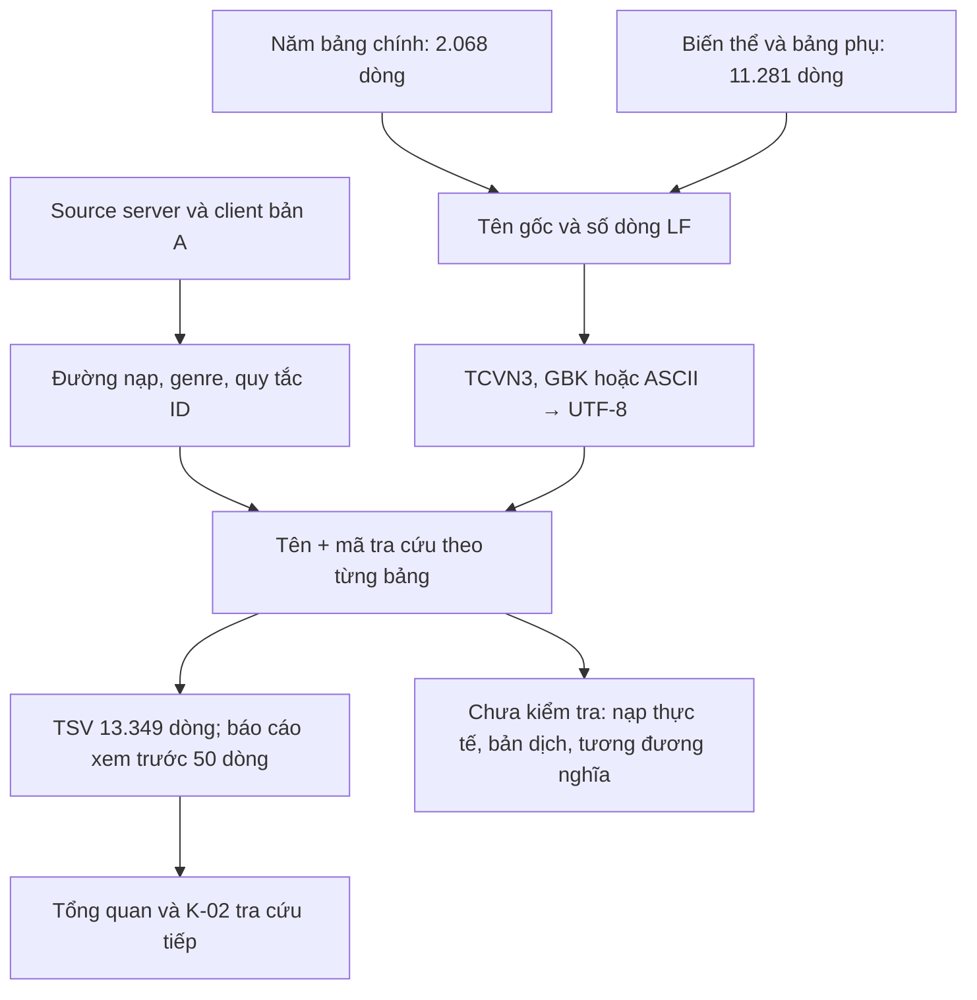

TÓM TẮT 1/5: [NGUỒN] PARTIAL — bảng tra tĩnh bốn nhóm vật phẩm đã hoàn tất; ghi nhịp ngoài worktree bị sandbox từ chối.
TÓM TẮT 2/5: [NGUỒN] Có 13.349 dòng từ 19 bảng tên: 2.068 dòng ở năm bảng chính, 4.357 dòng biến thể và 6.924 dòng bảng phụ.
TÓM TẮT 3/5: [NGUỒN] Báo cáo có 50 dòng đầu; TSV đầy đủ có 31 cột, giữ tên gốc, byte hex, tên UTF-8, chữ Hán/tham chiếu, mã và file:dòng.
TÓM TẮT 4/5: [CHƯA KIỂM] Tên Việt của nguồn chỉ có chữ Hán, tương đương nghĩa giữa biến thể, nội dung đóng gói và vật phẩm đang được nạp chưa kiểm tra.
TÓM TẮT 5/5: [CHƯA KIỂM] Không chạy build, game/exe, VM hoặc mạng; không commit/push theo yêu cầu, Tổng quan nhận bàn giao để commit.

# K-03e — Bảng ánh xạ tên TCVN3, UTF-8 và Hán cho vật phẩm khác

Loại: khảo sát
Chủ đề: Tra tên thuốc, nguyên liệu, vật phẩm nhiệm vụ và vật phẩm còn lại về mã trong đúng bảng dữ liệu.
Từ khóa: vật phẩm, TCVN3, UTF-8, GBK, An Bang, potion, mine, questkey, fusion, magicscript
Trạng thái: PARTIAL — hoàn tất báo cáo và TSV; riêng nhịp `D:/JX-wt/K-03e.nhip` bị từ chối ghi ngoài sandbox.
Độ phủ: 13.349/13.349 dòng tên trong 19/19 bảng có dữ liệu; 1/1 bảng dược liệu rỗng được kiểm kích thước; tên Việt của các dòng GBK và runtime chưa kiểm tra.
Liên quan: [Chuẩn báo cáo](../DESIGN/CHUAN-BAO-CAO.md), [K-01](K-01-ban-do-truyen-tin-hieu.md), [I-02](I-02-vat-pham-ban.md), [R-01](R-01.md), [R-04a](R-04a.md).
Cần tôi quyết định: không — phần thiếu chỉ là ghi nhịp ở đường dẫn ngoài vùng được cấp quyền.

## Sơ đồ quan hệ chính

## Phạm vi và độ phủ

[ĐÃ XÁC MINH] Nguồn được chọn từ các gốc đã dùng trong K-01 và R-01/R-04a, rồi kiểm trực tiếp file hiện có. Đây là số **dòng định nghĩa tên trong từng bảng**, có giữ bản trùng, biến thể và tên giữ chỗ. Số đếm chưa thể dùng làm tổng số vật phẩm khác nhau đang hoạt động.

| Ký hiệu | Gốc tuyệt đối, chỉ đọc | Bằng chứng định vị và đối chiếu |
|---|---|---|
| G | `C:/Jx1CocoV3/Folder/ServerNew-20260116T043145Z-3-001/ServerNew/_bin_v2_/gs` | `JX1_OPS/REPORTS/R-01.md:49`; đọc bảng thật dưới `Settings/item` |
| A | `D:/JX-build/qh9A` | `JX1_OPS/REPORTS/R-04a.md:57`; `A/Classes/gamecore/KBasPropTbl.CPP:16` |
| S | `D:/JX-source/server/jxOnline/gameserver/Sources/Core/Src` | `JX1_OPS/REPORTS/K-01-ban-do-truyen-tin-hieu.md:25` định vị cây Sources; `S/KBasPropTbl.cpp:16` kiểm đường nạp hiện tại |

Mọi ký hiệu `G/...:dòng`, `A/...:dòng`, `S/...:dòng` dưới đây nối với đúng gốc trong bảng này. Dòng tính bằng LF vật lý, bắt đầu từ 1, tính cả header.

| Bảng nguồn, dòng đầu có tên | Vai trò trong bộ tra | Độ phủ dòng tên | Mức kiểm tra |
|---|---|---:|---|
| `G/Settings/item/004/fusion.txt:2` | Chính theo source server | 371/371 | 0 dòng GBK; đã phủ tên/ID tĩnh |
| `G/Settings/item/004/mine.txt:2` | Chính theo source server | 321/321 | 0 dòng GBK; đã phủ tên/ID tĩnh |
| `G/Settings/item/004/potion.txt:2` | Chính theo source server | 49/49 | 5 dòng GBK; đã phủ tên/ID tĩnh |
| `G/Settings/item/004/questkey.txt:2` | Chính theo source server | 1.326/1.326 | 0 dòng GBK; đã phủ tên/ID tĩnh |
| `G/Settings/item/004/TownPortal.txt:2` | Chính theo source server | 1/1 | 0 dòng GBK; đã phủ tên/ID tĩnh |
| `G/Settings/item/004/fusion__.txt:2` | Biến thể tham khảo | 371/371 | 371 dòng GBK; đã phủ tên và chỉ số bảng; nạp thực tế chưa kiểm tra |
| `G/Settings/item/004/mine - Copy.txt:2` | Biến thể tham khảo | 237/237 | 0 dòng GBK; đã phủ tên và chỉ số bảng; nạp thực tế chưa kiểm tra |
| `G/Settings/item/004/mine_bk.txt:2` | Biến thể tham khảo | 202/202 | 0 dòng GBK; đã phủ tên và chỉ số bảng; nạp thực tế chưa kiểm tra |
| `G/Settings/item/004/mine_goc.txt:2` | Biến thể tham khảo | 218/218 | 0 dòng GBK; đã phủ tên và chỉ số bảng; nạp thực tế chưa kiểm tra |
| `G/Settings/item/004/mine_NEW.txt:2` | Biến thể tham khảo | 235/235 | 0 dòng GBK; đã phủ tên và chỉ số bảng; nạp thực tế chưa kiểm tra |
| `G/Settings/item/004/mine-bak.txt:2` | Biến thể tham khảo | 214/214 | 0 dòng GBK; đã phủ tên và chỉ số bảng; nạp thực tế chưa kiểm tra |
| `G/Settings/item/004/questkey_.txt:2` | Biến thể tham khảo | 1.326/1.326 | 0 dòng GBK; đã phủ tên và chỉ số bảng; nạp thực tế chưa kiểm tra |
| `G/Settings/item/004/questkey_cu.txt:2` | Biến thể tham khảo | 202/202 | 0 dòng GBK; đã phủ tên và chỉ số bảng; nạp thực tế chưa kiểm tra |
| `G/Settings/item/004/questkey_new.txt:2` | Biến thể tham khảo | 1.326/1.326 | 0 dòng GBK; đã phủ tên và chỉ số bảng; nạp thực tế chưa kiểm tra |
| `G/Settings/item/potion.txt:2` | Biến thể tham khảo | 25/25 | 0 dòng GBK; đã phủ tên và chỉ số bảng; nạp thực tế chưa kiểm tra |
| `G/Settings/item/TownPortal.txt:2` | Biến thể tham khảo | 1/1 | 0 dòng GBK; đã phủ tên và chỉ số bảng; nạp thực tế chưa kiểm tra |
| `G/Settings/item/004/brokenequip.txt:2` | Bảng phụ, loader chưa kiểm tra | 1/1 | 1 dòng GBK; đã phủ tên và chỉ số bảng; nạp thực tế chưa kiểm tra |
| `G/Settings/item/004/magicscript.txt:2` | Bảng phụ, loader chưa kiểm tra | 5.546/5.546 | 5545 dòng GBK; đã phủ tên và chỉ số bảng; nạp thực tế chưa kiểm tra |
| `G/Settings/item/magicscript.txt:2` | Bảng phụ, loader chưa kiểm tra | 1.377/1.377 | 1377 dòng GBK; đã phủ tên và chỉ số bảng; nạp thực tế chưa kiểm tra |
| `G/Settings/item/004/medmaterialbase.txt` — 0 byte, không có dòng | Dược liệu, genre 3 | 0/0 | Đã kiểm kích thước; `S/KBasPropTbl.cpp:21`, `:694` xác nhận tên bảng và hàm lấy dược liệu trả 0 |
| Dữ liệu đóng gói của client bản A | Nội dung thực được APK nạp | chưa phủ | Chưa giải nén/đối chiếu; đường source A có tiền tố `update10` |
| Công thức `atlas_compound.txt`, `004/atlas_compound.txt`, `other_compound.txt` | Bảng tham chiếu công thức, có tên vật phẩm làm nhãn | Ngoài danh sách bảng định nghĩa tên | Đã xem header tại dòng 1; chưa kiểm toàn bộ tham chiếu/công dụng |
| Trang bị genre 0, bảng thuộc tính/SPR và bảng stack | Các nhóm ngoài danh mục vật phẩm khác | Ngoài phạm vi bảng tên của K-03e | Đã phân biệt schema; không xuất tên trang bị hoặc lấy ID thuộc tính làm ID vật phẩm |

[ĐÃ XÁC MINH] Năm bảng chính được gọi từ danh sách nạp tại `S/KBasPropTbl.cpp:163`, `:164`, `:165`, `:166`, `:168`; tên bảng ở `:17`, `:18`, `:19`, `:20`, `:33`. Client A dùng `A/Classes/gamecore/KBasPropTbl.CPP:16` với gốc `\\update10\\settings\\item\\004`; server S dùng `S/KBasPropTbl.cpp:16` với gốc `\\settings\\item\\004`. Các biến thể, `magicscript` và `brokenequip` được giữ riêng theo nguồn; việc chúng có được binary hoặc script khác nạp **chưa kiểm tra**.

## Giải mã tên

[ĐÃ XÁC MINH] TSV có **5.939 dòng TCVN3, 7.299 dòng GBK/CP936 và 111 dòng ASCII tương thích TCVN3**. Mã hóa được xác định theo từng dòng tên; header Hán không dùng để áp GBK cho mọi tên Việt trong cùng file. Ví dụ `G/Settings/item/004/potion.txt:45` là TCVN3, còn `:46` là GBK.

[ĐÃ XÁC MINH] Tên gốc được giữ dưới dạng hiển thị Latin-1 một byte tương ứng một mã ký tự, cùng cột `ten_goc_hex` để khôi phục byte chính xác. Với nguồn TCVN3/ASCII, `tcvn3_goc` giữ dạng gốc; với nguồn GBK, cột đó ghi “không áp dụng”. `ten_utf8` chuyển sang Unicode NFC và bỏ khoảng trắng ASCII ở hai đầu để tra cứu; chữ hoa, dấu câu, khoảng trắng giữa tên và cách viết gốc được giữ. Trong Markdown, ký tự soft hyphen của tên gốc được biểu diễn bằng `­`; TSV giữ mã ký tự và hex.

[ĐÃ XÁC MINH] Cơ sở chuyển mã của bản A: `A/Classes/engine/KGbktoUtf8.h:25` khai báo `V2U`; `:139` chuyển từ `TCVN` sang `utf-8`. Đã đọc tĩnh hai bảng `tcvn_2uni_1` và `tcvn_2uni_2` trong thành viên `iconv.o` của `A/cocos2d/external/iconv/prebuilt/android/arm64-v8a/libiconv.a`, tổng 152 phần tử ánh xạ; các vùng ASCII còn lại giữ mã. Đây là đọc byte thư viện, không nạp hoặc chạy thư viện. SHA-256 thư viện: `771e259029cd60267d28945365c82c6b8bae9f09de7232a07ec4b3a44a0ea974`. Các tên GBK dùng CP936 nghiêm ngặt; mọi tên đã kiểm chuyển ngược khớp byte gốc. Hiển thị trên APK chưa kiểm tra.

[CHƯA XÁC MINH] “Chữ Hán” có thể là tên trực tiếp trong dòng nguồn hoặc tên tham chiếu của biến thể, được phân biệt bằng `nguon_han` và `muc_doi_chieu_han`. Có **370 tham chiếu** từ `fusion.txt` sang `fusion__.txt`: mọi cột ngoài Name/Intro khớp byte ở cùng chỉ số. Tương đương nghĩa của tên giữa hai biến thể **chưa kiểm tra**. Dòng số 2 bị loại khỏi phép ghép tên vì tên Hán là vật phẩm dự phòng trong khi tên Việt là văn cương; cả hai bản ghi vẫn có riêng trong TSV.

### Bảng đầu 50 dòng

Đây là đúng 50 dòng dữ liệu đầu của TSV, sau khi sắp theo nhóm game. `g/d/p/l/i` lần lượt là genre/detail/particular/level/record_index; “—” là không có cột. Với dòng GBK, tên UTF-8 giữ chữ Hán nguồn; tên Việt tương ứng **chưa kiểm tra**.

| STT | Tên UTF-8 | TCVN3 gốc / tên gốc | Mã hóa | Chữ Hán | Mã tra trong bảng | Nguồn file:dòng |
|---:|---|---|---|---|---|---|
| 1 | Kim Sáng Dược (tiểu) | Kim S¸ng D­îc (tiÓu)  | TCVN3 | chưa kiểm tra | g=1; d=0; p=0; l=1; i=0 | G/Settings/item/004/potion.txt:2 |
| 2 | Kim Sáng Dược (trung) | Kim S¸ng D­îc (trung)  | TCVN3 | chưa kiểm tra | g=1; d=0; p=0; l=2; i=1 | G/Settings/item/004/potion.txt:3 |
| 3 | Kim Sáng Dược (đại) | Kim S¸ng D­îc (®¹i)  | TCVN3 | chưa kiểm tra | g=1; d=0; p=0; l=3; i=2 | G/Settings/item/004/potion.txt:4 |
| 4 | Hồi Thiên đan | Håi Thiªn ®an | TCVN3 | chưa kiểm tra | g=1; d=0; p=0; l=4; i=3 | G/Settings/item/004/potion.txt:5 |
| 5 | Cửu Chuyển Hoàn Hồn đan | Cöu ChuyÓn Hoµn Hån ®an | TCVN3 | chưa kiểm tra | g=1; d=0; p=0; l=5; i=4 | G/Settings/item/004/potion.txt:6 |
| 6 | Ngưng Thần đan (tiểu) | Ng­ng ThÇn ®an (tiÓu)  | TCVN3 | chưa kiểm tra | g=1; d=1; p=0; l=1; i=5 | G/Settings/item/004/potion.txt:7 |
| 7 | Ngưng Thần đan (trung) | Ng­ng ThÇn ®an (trung)  | TCVN3 | chưa kiểm tra | g=1; d=1; p=0; l=2; i=6 | G/Settings/item/004/potion.txt:8 |
| 8 | Ngưng Thần đan (đại) | Ng­ng ThÇn ®an (®¹i)  | TCVN3 | chưa kiểm tra | g=1; d=1; p=0; l=3; i=7 | G/Settings/item/004/potion.txt:9 |
| 9 | Đại Bổ tán | §¹i Bæ t¸n | TCVN3 | chưa kiểm tra | g=1; d=1; p=0; l=4; i=8 | G/Settings/item/004/potion.txt:10 |
| 10 | Ô đầu Hoàn thần đan | ¤ ®Çu Hoµn thÇn ®an | TCVN3 | chưa kiểm tra | g=1; d=1; p=0; l=5; i=9 | G/Settings/item/004/potion.txt:11 |
| 11 | Thừa Tiên Mật (tiểu) | Thõa Tiªn MËt (tiÓu)  | TCVN3 | chưa kiểm tra | g=1; d=2; p=0; l=1; i=10 | G/Settings/item/004/potion.txt:12 |
| 12 | Thừa Tiên Mật (trung) | Thõa Tiªn MËt (trung)  | TCVN3 | chưa kiểm tra | g=1; d=2; p=0; l=2; i=11 | G/Settings/item/004/potion.txt:13 |
| 13 | Thừa Tiên Mật (đại) | Thõa Tiªn MËt (®¹i)  | TCVN3 | chưa kiểm tra | g=1; d=2; p=0; l=3; i=12 | G/Settings/item/004/potion.txt:14 |
| 14 | Thất Khiếu Bổ tâm đan | ThÊt KhiÕu Bæ t©m ®an | TCVN3 | chưa kiểm tra | g=1; d=2; p=0; l=4; i=13 | G/Settings/item/004/potion.txt:15 |
| 15 | Ngũ Hoa Ngọc Lộ Hoàn | Ngò Hoa Ngäc Lé Hoµn | TCVN3 | chưa kiểm tra | g=1; d=2; p=0; l=5; i=14 | G/Settings/item/004/potion.txt:16 |
| 16 | Tam Hoa Tán | Tam Hoa T¸n  | TCVN3 | chưa kiểm tra | g=1; d=3; p=0; l=1; i=15 | G/Settings/item/004/potion.txt:17 |
| 17 | Đùi gà | §ïi gµ  | TCVN3 | chưa kiểm tra | g=1; d=3; p=0; l=2; i=16 | G/Settings/item/004/potion.txt:18 |
| 18 | Bánh Trung Thu hư | B¸nh Trung Thu h­  | TCVN3 | chưa kiểm tra | g=1; d=3; p=0; l=3; i=17 | G/Settings/item/004/potion.txt:19 |
| 19 | Toàn Quả hoàn | Toµn Qu¶ hoµn | TCVN3 | chưa kiểm tra | g=1; d=3; p=0; l=4; i=18 | G/Settings/item/004/potion.txt:20 |
| 20 | Toàn Quả hoàn | Toµn Qu¶ hoµn | TCVN3 | chưa kiểm tra | g=1; d=3; p=0; l=5; i=19 | G/Settings/item/004/potion.txt:21 |
| 21 | Thanh Ngưu Giải độc tán | Thanh Ng­u Gi¶i ®éc t¸n | TCVN3 | chưa kiểm tra | g=1; d=4; p=0; l=1; i=20 | G/Settings/item/004/potion.txt:22 |
| 22 | Hoắc Hương Chính khí hoàn | Ho¾c H­¬ng ChÝnh khÝ hoµn | TCVN3 | chưa kiểm tra | g=1; d=4; p=0; l=2; i=21 | G/Settings/item/004/potion.txt:23 |
| 23 | Tam Thuận tán | Tam ThuËn t¸n | TCVN3 | chưa kiểm tra | g=1; d=4; p=0; l=3; i=22 | G/Settings/item/004/potion.txt:24 |
| 24 | Ngân Kiều Khứ độc đan | Ng©n KiÒu Khø ®éc ®an | TCVN3 | chưa kiểm tra | g=1; d=4; p=0; l=4; i=23 | G/Settings/item/004/potion.txt:25 |
| 25 | Long Đàm Hóa Độc đan | Long §µm Hãa §éc ®an | TCVN3 | chưa kiểm tra | g=1; d=4; p=0; l=5; i=24 | G/Settings/item/004/potion.txt:26 |
| 26 | Trường Mệnh hoàn | Tr­êng MÖnh hoµn | TCVN3 | chưa kiểm tra | g=1; d=5; p=0; l=1; i=25 | G/Settings/item/004/potion.txt:27 |
| 27 | Gia Bào hoàn | Gia Bµo hoµn | TCVN3 | chưa kiểm tra | g=1; d=5; p=0; l=2; i=26 | G/Settings/item/004/potion.txt:28 |
| 28 | Đại Lực hoàn | §¹i Lùc hoµn | TCVN3 | chưa kiểm tra | g=1; d=5; p=0; l=3; i=27 | G/Settings/item/004/potion.txt:29 |
| 29 | Cao Thiểm hoàn | Cao ThiÓm hoµn | TCVN3 | chưa kiểm tra | g=1; d=5; p=0; l=4; i=28 | G/Settings/item/004/potion.txt:30 |
| 30 | Cao Trung hoàn | Cao Trung hoµn | TCVN3 | chưa kiểm tra | g=1; d=5; p=0; l=5; i=29 | G/Settings/item/004/potion.txt:31 |
| 31 | Phi Tốc hoàn | Phi Tèc hoµn | TCVN3 | chưa kiểm tra | g=1; d=6; p=0; l=1; i=30 | G/Settings/item/004/potion.txt:32 |
| 32 | Băng Phòng hoàn | B¨ng Phßng hoµn | TCVN3 | chưa kiểm tra | g=1; d=6; p=0; l=2; i=31 | G/Settings/item/004/potion.txt:33 |
| 33 | Lôi Phòng hoàn | L«i Phßng hoµn | TCVN3 | chưa kiểm tra | g=1; d=6; p=0; l=3; i=32 | G/Settings/item/004/potion.txt:34 |
| 34 | Hỏa Phòng hoàn | Háa Phßng hoµn | TCVN3 | chưa kiểm tra | g=1; d=6; p=0; l=4; i=33 | G/Settings/item/004/potion.txt:35 |
| 35 | Độc Phòng hoàn | §éc Phßng hoµn | TCVN3 | chưa kiểm tra | g=1; d=6; p=0; l=5; i=34 | G/Settings/item/004/potion.txt:36 |
| 36 | Bánh chưng Nhân táo | B¸nh ch­ng Nh©n t¸o | TCVN3 | chưa kiểm tra | g=1; d=7; p=0; l=1; i=35 | G/Settings/item/004/potion.txt:37 |
| 37 | Thiên sơn  Hồi Thần đan | Thiªn s¬n  Håi ThÇn ®an | TCVN3 | chưa kiểm tra | g=1; d=7; p=0; l=2; i=36 | G/Settings/item/004/potion.txt:38 |
| 38 | Bánh chưng Nhân táo | B¸nh ch­ng Nh©n t¸o | TCVN3 | chưa kiểm tra | g=1; d=7; p=0; l=3; i=37 | G/Settings/item/004/potion.txt:39 |
| 39 | Bánh chưng Nhân táo | B¸nh ch­ng Nh©n t¸o | TCVN3 | chưa kiểm tra | g=1; d=7; p=0; l=4; i=38 | G/Settings/item/004/potion.txt:40 |
| 40 | Bánh chưng Nhân táo | B¸nh ch­ng Nh©n t¸o | TCVN3 | chưa kiểm tra | g=1; d=7; p=0; l=5; i=39 | G/Settings/item/004/potion.txt:41 |
| 41 | Ngũ hoa ngọc lộ hoàn đặc biệt | Ngò hoa ngäc lé hoµn ®Æc biÖt | TCVN3 | chưa kiểm tra | g=1; d=8; p=0; l=1; i=40 | G/Settings/item/004/potion.txt:42 |
| 42 | Cửu chuyển hoàn hồn đan đặc biệt | Cöu chuyÓn hoµn hån ®an ®Æc biÖt | TCVN3 | chưa kiểm tra | g=1; d=8; p=0; l=2; i=41 | G/Settings/item/004/potion.txt:43 |
| 43 | Túc cân tiếp mạch tán | Tóc c©n tiÕp m¹ch t¸n | TCVN3 | chưa kiểm tra | g=1; d=8; p=0; l=3; i=42 | G/Settings/item/004/potion.txt:44 |
| 44 | Hồi Thiên Tái Tạo Đơn | Håi Thiªn T¸i T¹o §¬n | TCVN3 | chưa kiểm tra | g=1; d=8; p=0; l=4; i=43 | G/Settings/item/004/potion.txt:45 |
| 45 | 回天再造丹 | »ØÌìÔÙÔ쵤 | GBK/CP936 | 回天再造丹 | g=1; d=8; p=0; l=5; i=44 | G/Settings/item/004/potion.txt:46 |
| 46 | 跨服行军丹 | ¿ç·þÐоüµ¤ | GBK/CP936 | 跨服行军丹 | g=1; d=9; p=0; l=1; i=45 | G/Settings/item/004/potion.txt:47 |
| 47 | 宋金行军丹 | ËνðÐоüµ¤ | GBK/CP936 | 宋金行军丹 | g=1; d=9; p=0; l=2; i=46 | G/Settings/item/004/potion.txt:48 |
| 48 | 特效回天再造丹 | ÌØЧ»ØÌìÔÙÔ쵤 | GBK/CP936 | 特效回天再造丹 | g=1; d=9; p=0; l=3; i=47 | G/Settings/item/004/potion.txt:49 |
| 49 | 联赛专用药 | ÁªÈüרÓÃÒ© | GBK/CP936 | 联赛专用药 | g=1; d=9; p=0; l=4; i=48 | G/Settings/item/004/potion.txt:50 |
| 50 | Huyền Thiết Nguyên Khoáng | HuyÒn ThiÕt Nguyªn Kho¸ng | TCVN3 | chưa kiểm tra | g=2; d=1; p=149; l=1; i=149 | G/Settings/item/004/mine.txt:151 |

### Các tên được dẫn thêm ngoài bảng đầu

Bảng này giữ đủ dạng gốc cho các tên dùng trong ví dụ tra cứu, khoáng/thạch và đối chiếu văn cương. Nguồn Hán tham chiếu của dòng văn cương số 3 là `G/Settings/item/004/fusion__.txt:3`; mức tương đương nghĩa vẫn chưa kiểm tra.

| Tên gốc | Mã hóa | Chữ đúng UTF-8 | Chữ Hán / tham chiếu | Nguồn file:dòng |
|---|---|---|---|---|
| Khæng T­íc Nguyªn Th¹ch | TCVN3 | Khổng Tước Nguyên Thạch | chưa kiểm tra | `G/Settings/item/004/mine.txt:152` |
| MËt Ng©n Nguyªn Kho¸ng | TCVN3 | Mật Ngân Nguyên Khoáng | chưa kiểm tra | `G/Settings/item/004/mine.txt:153` |
| Phï Dung Nguyªn Th¹ch | TCVN3 | Phù Dung Nguyên Thạch | chưa kiểm tra | `G/Settings/item/004/mine.txt:154` |
| Chu Sa Nguyªn Kho¸ng | TCVN3 | Chu Sa Nguyên Khoáng | chưa kiểm tra | `G/Settings/item/004/mine.txt:155` |
| Chung Nhò Nguyªn Th¹ch | TCVN3 | Chung Nhũ Nguyên Thạch | chưa kiểm tra | `G/Settings/item/004/mine.txt:156` |
| Th­¬ng Long V¨n C­¬ng- Gi¸p [CÊp 1] | TCVN3 | Thương Long Văn Cương- Giáp [Cấp 1] | chưa kiểm tra | `G/Settings/item/004/fusion.txt:2` |
| Th­¬ng Long V¨n C­¬ng- Gi¸p [CÊp 1] | TCVN3 | Thương Long Văn Cương- Giáp [Cấp 1] | 苍龙纹钢·甲[1级] | `G/Settings/item/004/fusion.txt:3` |
| B¶o R­¬ng - An Bang | TCVN3 | Bảo Rương - An Bang | chưa kiểm tra | `G/Settings/item/004/mine.txt:222` |
| B¶o R­¬ng - An Bang 7 ngµy | TCVN3 | Bảo Rương - An Bang 7 ngày | chưa kiểm tra | `G/Settings/item/004/mine.txt:224` |
| M¶nh trang bÞ - An Bang | TCVN3 | Mảnh trang bị - An Bang | chưa kiểm tra | `G/Settings/item/004/mine.txt:274` |
| ÈÝ´íÎïÆ·(ÎÞÓÃ) | GBK/CP936 | 容错物品(无用) | 容错物品(无用) | `G/Settings/item/004/fusion__.txt:2` |
| ²ÔÁúÎƸ֡¤¼×[1¼¶] | GBK/CP936 | 苍龙纹钢·甲[1级] | 苍龙纹钢·甲[1级] | `G/Settings/item/004/fusion__.txt:3` |
| New Item | ASCII (tương thích TCVN3) | New Item | chưa kiểm tra | `G/Settings/item/004/mine.txt:146` |

## Sắp theo cấu trúc game

[ĐÃ XÁC MINH] Thứ tự TSV gồm bộ chính theo source server, tiếp đến biến thể và bảng phụ. Trong mỗi bộ, dữ liệu theo **thuốc → nguyên liệu → vật phẩm nhiệm vụ → vật phẩm còn lại**; các bản cùng tên vẫn có mã tra và nguồn riêng.

| Nhóm game | Năm bảng chính | Toàn TSV, gồm biến thể/phụ | Cách sắp và giới hạn |
|---|---:|---:|---|
| Thuốc | 49 | 74 | detail → level → chỉ số dòng; công dụng và thời gian hiệu lực chưa kiểm tra |
| Nguyên liệu | 377 | 754 | 6 khoáng/thạch trong mine theo tên và Intro, sau đó văn cương theo nhánh tên → detail → cấp; đây là phân nhóm dữ liệu tĩnh |
| Vật phẩm nhiệm vụ (quest) | 1.326 | 4.180 | detail → chỉ số; gồm cả vật phẩm hoạt động/tiêu hao có genre 4, chưa gán vào từng tuyến nhiệm vụ |
| Vật phẩm còn lại | 316 | 8.341 | Nhánh mine hỗn hợp, hồi thành, magicscript và đồ hỏng; theo detail/cấp/chỉ số trong từng nhánh |
| Tổng | 2.068 | 13.349 | Đếm từng dòng nguồn; giữ phân biệt phiên bản |

[ĐÃ XÁC MINH] Sáu khoáng/thạch nằm tại `G/Settings/item/004/mine.txt:151`, `:152`, `:153`, `:154`, `:155`, `:156`; tên và Intro ghi tính chất khoáng/thạch. Việc dùng chúng trong thao tác chế tạo/cường hóa thực tế **chưa kiểm tra**. Nhóm mine hỗn hợp chưa được phân công dụng chi tiết theo mọi script. Phân loại theo phái/bản đồ không có khóa tương ứng trong các bảng tên này; chưa suy ra vị trí nhận hoặc nhiệm vụ từ tên.

## Bảng TSV đầy đủ và cách tra

Đầu ra: [JX1_OPS/REPORTS/_CHIMUC/K-03e.tsv](_CHIMUC/K-03e.tsv), **13.349 dòng dữ liệu và một dòng header, 31 cột, UTF-8 không BOM**.

Bảy cột đầu là chỉ mục báo cáo theo chuẩn: `file, loai, chu_de, tu_khoa, trang_thai, do_phu, lien_quan`. Chúng lặp cho từng dòng tên để gói đủ chỉ mục và bảng ánh xạ trong đúng một TSV được task chỉ định. Khi gộp mục lục, Tổng quan chọn bảy cột đầu và loại dòng trùng; khi tra tên cho K-02, dùng các cột còn lại.

| Nhóm cột | Nội dung |
|---|---|
| `nhom_game, nhanh, bo_du_lieu` | Nhóm game, nhánh tra và nguồn chính/biến thể/phụ |
| `ten_utf8, ten_khong_dau` | Tên giải mã; khóa tìm bỏ dấu và không phân biệt hoa/thường, ví dụ `an bang` |
| `ten_goc, ma_hoa, tcvn3_goc, ten_goc_hex` | Dạng gốc, mã hóa và byte để kiểm lại; giữ nguyên tên tại nguồn |
| `chu_han, nguon_han, muc_doi_chieu_han` | Hán trực tiếp/tham chiếu; “chưa kiểm tra” khi chưa có đối chiếu |
| `ten_viet_tham_chieu, nguon_viet_tham_chieu` | Tên Việt ở biến thể cùng dữ liệu ngoài Name/Intro; chưa xác nhận tương đương nghĩa |
| `genre, detail, particular, level, series` | Giá trị cột gốc; ô rỗng là không có cột/không có giá trị, không tự gán 0 |
| `record_index, ma_tra_cuu, nguon` | Chỉ số 0-based trong bảng, mã tra duy nhất và nguồn file:dòng |
| `kiem_tra_id, trang_thai_ten` | Mức kiểm chỉ số và tên; bảng phụ có giới hạn loader riêng |

[ĐÃ XÁC MINH] `record_index = dòng LF - 2` theo `S/KBasPropTbl.cpp:95`. `ma_tra_cuu` mang cả đường bảng và chỉ số để tránh nhập nhiều bản dữ liệu. Đây là mã tra template, chưa phải ID instance của món đồ trong hành trang.

Ví dụ tìm `an bang` trong `ten_khong_dau`, rồi lọc `bo_du_lieu = 004/chính theo source server`, cho đúng ba dòng:

| Tên UTF-8 | TCVN3 gốc | Genre | Detail | Particular / record_index | Nguồn |
|---|---|---:|---:|---:|---|
| Bảo Rương - An Bang | B¶o R­¬ng - An Bang | 2 | 1 | 220 | `G/Settings/item/004/mine.txt:222` |
| Bảo Rương - An Bang 7 ngày | B¶o R­¬ng - An Bang 7 ngµy | 2 | 1 | 222 | `G/Settings/item/004/mine.txt:224` |
| Mảnh trang bị - An Bang | M¶nh trang bÞ - An Bang | 2 | 1 | 272 | `G/Settings/item/004/mine.txt:274` |

[CHƯA XÁC MINH] Ba dòng trên là rương/mảnh trong phạm vi vật phẩm khác. Tên từng món trang bị của bộ cùng tên cần bảng trang bị tương ứng; số lượng phần thưởng, thời hạn và thao tác ghép thực tế chưa kiểm tra.

## Mục sổ thông số

Các giá trị dưới đây là cấu trúc dữ liệu/source, đơn vị là mã/chỉ số hoặc dòng. “Đổi an toàn” đánh giá việc tự ý đổi ID/cấu trúc trong task chỉ đọc; không cấp quyền sửa.

| Nhóm | Tên/hằng số | file:dòng | Giá trị | Đơn vị | Ảnh hưởng | Đổi an toàn | Nguồn đo |
|---|---|---|---|---|---|---|---|
| Genre | Thuốc, mine, dược liệu, quest, hồi thành, fusion | `S/KItem.h:64`, `:65`, `:66`, `:67`, `:68`, `:69` | 1, 2, 3, 4, 5, 6 | mã enum | Chọn họ vật phẩm; không đồng nhất mine với nguyên liệu | KHÔNG | Đọc tĩnh |
| Dòng bảng | `LoadRecord` | `S/KBasPropTbl.cpp:95`; `A/Classes/gamecore/KBasPropTbl.CPP:95` | dòng = record_index + 2 | dòng LF, 1-based | Tên phải trỏ đúng header và chỉ số | KHÔNG | Đọc tĩnh và kiểm đủ 13.349 dòng |
| Thuốc | `Gen_Medicine` | `S/KItemGenerator.cpp:125`; `A/Classes/gamecore/KItemGenerator.cpp:130` | i = detail × 5 + level − 1 | chỉ số 0-based | Ghép detail và cấp thành template thuốc | KHÔNG | 74/74 dòng thuốc khớp công thức |
| Mine | `GetMine` | `S/KItemGenerator.cpp:3741`; `A/Classes/gamecore/KItemSet.cpp:397`, `:398` | Chọn bằng particular truyền qua Gen_Mine | chỉ số bảng | Không lấy detail 1 làm ID của rương An Bang | KHÔNG | Đọc tĩnh; các bảng mine khớp particular với chỉ số |
| Quest | `GetQuestRecord` | `S/KItemGenerator.cpp:3609`; `A/Classes/gamecore/KItemGenerator.cpp:3736` | detail = chỉ số | chỉ số bảng | Tra đúng vật phẩm nhiệm vụ | KHÔNG | 4.180/4.180 dòng quest khớp |
| Văn cương | `GetFusionRecord` | `S/KItemGenerator.cpp:3685`; `A/Classes/gamecore/KItemGenerator.cpp:3818` | particular = chỉ số | chỉ số bảng | Giữ riêng mã cùng tên/cấp | KHÔNG | 742/742 dòng hai bảng fusion khớp |
| Hồi thành | `Gen_TownPortal` | `S/KItemGenerator.cpp:3887`; `A/Classes/gamecore/KItemGenerator.cpp:4037` | Chọn record 0 | chỉ số bảng | Chỉ có một dòng tên ở mỗi biến thể | KHÔNG | 2/2 dòng dữ liệu khớp |
| Dược liệu | `GetMedMaterial` | `S/KBasPropTbl.cpp:694` | Trả 0; file dược liệu 0 byte | giá trị source / byte | Chưa có tên để ánh xạ trong bảng rời này | KHÔNG | Đọc tĩnh và kiểm kích thước |
| Bảng phụ | Genre của đồ hỏng | `G/Settings/item/004/brokenequip.txt:2`; `S/KItem.h:70` | Dữ liệu ghi 7; enum tại vị trí 7 là item_number | mã | Chưa xác nhận loader hỗ trợ như một loại item hiệu lực | KHÔNG | Đọc tĩnh; runtime chưa kiểm tra |

## Đã xác minh / Chưa xác minh

### Đã xác minh

- Đã kiểm Git một lần trước ghi: nhánh `task/K-03e`, sạch; hai đầu ra K-03e chưa tồn tại. Không có phần dở để tạo lại.
- Đã đọc chuẩn báo cáo trước task, mục lục tri thức, các đoạn định vị trong K-01/R-01/R-04a/R-04c/I-02 và sáu skill được yêu cầu. Chỉ dùng báo cáo cũ để định vị, rồi kiểm byte/dòng thật.
- Đã đọc 19 bảng tên, có 13.349 mã tra duy nhất theo bảng và chỉ số. TSV giữ đủ 2.068 dòng chính, 4.357 dòng biến thể và 6.924 dòng bảng phụ. Ví dụ nguồn thực: `G/Settings/item/004/potion.txt:2`, `G/Settings/item/004/mine.txt:222`, `G/Settings/item/004/questkey.txt:2`, `G/Settings/item/004/fusion.txt:3`, `G/Settings/item/004/magicscript.txt:2`.
- Đã kiểm 13.349/13.349 cặp byte hex và tên gốc so với đúng dòng LF nguồn; các phép chuyển mã TCVN3/GBK kiểm ngược khớp byte. Đã kiểm đủ 6.425 chỉ số của 16 bảng thuộc các họ thuốc/mine/quest/fusion/hồi thành; 6.924 dòng bảng phụ chỉ nhận chỉ số dòng, chưa nhận ID hiệu lực.
- Đã so SHA-256 trước/sau đọc: 19/19 bảng nguồn giữ nguyên. Đã kiểm TSV UTF-8 nghiêm ngặt, không BOM/U+FFFD, đúng 31 cột và 13.349 dòng dữ liệu; không xuất các cột script/giá/tài khoản hoặc nội dung truy cập.
- Đã phân biệt 371 cặp dòng fusion khớp dữ liệu ngoài Name/Intro; 370 dòng có tham chiếu Hán/Việt và một dòng mâu thuẫn bị loại khỏi phép ghép tên.

**Kiểm tra tài liệu thực chạy bằng Python inline: PASS.** Ba đầu ra đọc UTF-8 nghiêm ngặt, không BOM/U+FFFD; đúng năm dòng tóm tắt, bảy trường thông tin và một khối Mermaid; 10 bảng Markdown với 142 dòng có số cột đồng nhất, 10 liên kết cục bộ tồn tại; bảng xem trước đúng 50 dòng đầu TSV. Đã kiểm đủ 13.349 tên/hex theo dòng nguồn, 7.669 nguồn Hán trực tiếp/tham chiếu và 19 hash nguồn. Phần task trước mục Kết quả khớp nguyên văn HEAD sau chuẩn hóa kiểu xuống dòng. Kiểm tra khoảng trắng bằng Git đạt. Mermaid mới kiểm cấu trúc khối, chưa render bằng engine.

SHA-256 TSV sau khi thống nhất trạng thái bàn giao PARTIAL: `7abb955886540360c314e889f8650bedc838f7aa61d22a1c65f7531af4d1aa41`.

### Chưa xác minh

- Tên Việt của những dòng chỉ có chữ Hán, Hán tương ứng của các tên TCVN3 ngoài phép tham chiếu fusion, và nghĩa tương đương của 370 cặp fusion: **chưa kiểm tra**. Tên chỉ có ASCII được giữ nguyên; tên giữ chỗ chưa được gán công dụng.
- Bản dữ liệu thực được APK/server binary chọn, lớp ghi đè `update10`, nội dung đóng gói, ánh xạ công thức, tuyến nhiệm vụ, nơi nhận/rơi đồ, tác dụng thuốc, thời gian và giá runtime: **chưa kiểm tra**.
- `magicscript` dùng genre 2 ở gốc và genre 6 ở thư mục 004; quan hệ với generator hiện tại **chưa kiểm tra**. Không nhập chúng vào 2.068 dòng chính.
- Không chạy build, unit/integration test game, exe/DLL, VM, APK, mạng hoặc dịch vụ. Kiểm tra thực chạy chỉ là đọc/chuyển mã/đối chiếu tài liệu tại máy.
- Nhịp `D:/JX-wt/K-03e.nhip` không ghi được: lệnh `Set-Content` trả `UnauthorizedAccessException / PermissionDenied`. Vùng ghi phiên này chỉ gồm `D:/JX-wt/K-03e`; các mốc tiếp theo không được thử vượt rào. Đây là lý do trạng thái tổng thể PARTIAL; bảng tra đã hoàn tất.
- Không commit/push theo chỉ định; chưa có SHA mới và không có bằng chứng GitHub.

## Lỗi, cách thử và kết quả

| Lỗi/giới hạn thực gặp | Cách xử lý trong lượt | Kết quả |
|---|---|---|
| `rg` không có, CommandNotFoundException | Dùng Get-ChildItem/Select-String giới hạn các thư mục dữ liệu và file nguồn liên quan | Đã định vị đủ 19 bảng; không cài công cụ |
| Nhịp nằm ngoài vùng ghi | Thử Set-Content một lần ở mốc bắt đầu, nhận Access denied | BỊ CHẶN riêng thao tác ghi nhịp; giữ nguyên rào sandbox, bàn giao Tổng quan |
| Đầu ra đọc gộp bị cắt | Thu hẹp file/đoạn đọc; trích/đếm và kiểm đầy đủ trong bộ nhớ | Không dùng phần bị cắt làm tổng số; 13.349 dòng được kiểm trực tiếp |
| Lệnh trích xuất đầu tiên chưa khởi chạy do bộ điều phối không có `btoa` | Mã hóa chuỗi lệnh UTF-8 bằng hàm trong bộ nhớ rồi gọi Python inline | Lượt kế tiếp tạo TSV và kiểm đạt; không tạo script/parser phụ trên đĩa |
| Mẫu rà soát phụ trong bộ nhớ bị lặp hoặc bộ lọc tên không khớp | Đọc lại TSV theo file:dòng và lọc bộ chính bằng tiền tố ASCII | Đối chiếu đúng 13 mẫu bổ sung và tên giữ chỗ; TSV chính đã kiểm byte trước đó |
| Diff phát hiện một dòng trắng thừa cuối báo cáo | Giữ đúng một LF cuối file; đọc mã thoát 1 của no-index là có khác biệt và kiểm thông báo khoảng trắng riêng | Đã kiểm lại, không còn lỗi khoảng trắng |
| Tên Hán/Việt cùng chỉ số fusion không tương đương rõ ràng | Giữ cả hai nguồn, ghi mức tham chiếu; loại dòng dự phòng số 2 khỏi phép ghép tên | Không sửa tên hoặc kết luận cũ, không tự dịch để lấp chỗ thiếu |

## Đề xuất tối ưu và bàn giao

[ĐỀ XUẤT] Tổng quan/K-02 dùng `ten_khong_dau` để tìm tên, giữ bộ dữ liệu và `ma_tra_cuu` khi chọn kết quả. Ưu tiên lọc bộ chính cho câu hỏi về bản đang khảo sát, rồi kiểm source/loader tương ứng trước thao tác game. Nếu cần tên Việt chuẩn cho các dòng GBK hoặc xác nhận bản đang nạp, giao phần đối chiếu riêng; bảng đã ghi rõ các ô “chưa kiểm tra”.

[ĐÃ XÁC MINH] Đầu ra được phép gồm báo cáo này và [TSV đầy đủ](_CHIMUC/K-03e.tsv). Mục `Kết quả` được ghi cuối [task K-03e](../TASKS/K-03e.md) theo yêu cầu trực tiếp của người dùng; metadata/phạm vi task giữ nguyên. Các báo cáo cũ, source game và cấu hình không được sửa.

Commit: không tạo theo yêu cầu “Tổng quan commit hộ”; không stage/push. Bước tiếp theo: Tổng quan kiểm hai đầu ra và mục Kết quả, lưu commit; nếu cần nhật ký nhịp tại đường dẫn đã yêu cầu thì ghi từ phiên có quyền phù hợp. Không cần thay quyền hoặc credential của phiên hiện tại.

Dòng đề xuất cho PM gộp vào `JX1_OPS/DESIGN/MUC-LUC-TRI-THUC.md`:

| Chủ đề | Báo cáo / tài liệu | File, hàm chính | Độ chắc |
|---|---|---|---|
| Tra tên vật phẩm khác: thuốc, nguyên liệu, nhiệm vụ, vật phẩm còn lại; TCVN3/UTF-8/GBK | K-03e; _CHIMUC/K-03e.tsv | Settings/item; KBasPropTbl; Gen_Medicine/GetMine/GetQuestRecord/GetFusionRecord | Đã đối chiếu tĩnh 13.349 dòng; bản dịch/loader/runtime có giới hạn riêng |

## Phát hiện khi chuẩn hóa

1. [NGUỒN] **Hai bảng thuốc khác phạm vi:** `G/Settings/item/potion.txt:2` và `G/Settings/item/004/potion.txt:2` thuộc hai bảng 25/49 dòng, được giữ riêng trong TSV. Không đổi kết luận I-02 về bảng thuốc được source chọn.
2. [NGUỒN] **TCVN3 và GBK cùng file:** `G/Settings/item/004/potion.txt:45` và `:46` cho hai mã hóa khác nhau. Chuyển cả file bằng một mã hóa sẽ làm sai nhóm tên còn lại.
3. [NGUỒN] **Không ghép chỉ bằng ID:** `G/Settings/item/004/fusion.txt:2` và `G/Settings/item/004/fusion__.txt:2` có dữ liệu ngoài tên/Intro giống nhau nhưng tên khác mục đích rõ rệt. Tên dự phòng Hán được giữ nguyên; không xem là bản dịch của tên Việt.
4. [NGUỒN] **Cần giữ các bảng phụ:** `G/Settings/item/magicscript.txt:2` và `G/Settings/item/004/magicscript.txt:2` ghi genre 2/6 cho cùng kiểu bảng; `G/Settings/item/004/brokenequip.txt:2` ghi genre 7. Chỉ số/tên đọc được chưa chứng minh các bảng này đang được nạp.
5. [NGUỒN] **Không thay kết luận cũ:** K-03e bổ sung bảng tra tên và nguồn hiện có; không sửa bất kỳ báo cáo cũ hoặc tự nâng kết quả khảo sát tĩnh thành runtime.
6. [NGUỒN] **Ngoại lệ schema theo task:** TSV gồm bảy cột chỉ mục chuẩn cùng 24 cột ánh xạ để đáp ứng đầu ra đầy đủ trong đúng đường dẫn được chỉ định; Tổng quan tách/lấy duy nhất bảy cột khi gộp mục lục.

Kỹ năng đã dùng: jx1-retrofit, jx1-read-server, jx1-read-client, jx1-parameters, jx1-knowledge, jx1-report.
