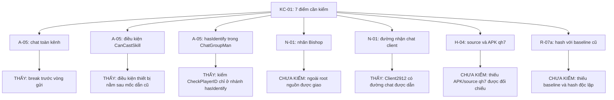

TÓM TẮT 1 [NGUỒN] PARTIAL: đã đối chiếu trực tiếp 4/7 điểm; danh mục gồm H-04, A-05 và N-01 tại `KIEM-CHEO-01.md:50,60,62,64,80,82,91`.
TÓM TẮT 2 [NGUỒN] THẤY: nhánh chat toàn kênh dừng ở `break` trước vòng gửi (`KPlayerChat.cpp:444-470`); câu cần sửa nằm tại `A-05-diem-tuong-tac-gs001.md:164`.
TÓM TẮT 3 [NGUỒN] THẤY: điều kiện thiết bị và `hasIdentify` nằm ở `KSkills.cpp:267-313`, `KSOServer.cpp:2801-2834`; dẫn cũ A-05 ở `:97,171-172`.
TÓM TẮT 4 [NGUỒN] THẤY: client Client2912 có đường nhận chat tại `KProtocolProcess.cpp:4305-4312`, `KgameWorld.cpp:13130-13184`, `Kuiplayerfun.cpp:3338-3359`; CHƯA KIỂM: Bishop, qh7/APK và baseline (`KIEM-CHEO-01.md:78-80,50,91`).
TÓM TẮT 5 [CHƯA KIỂM] Không build, chạy exe, VM, mạng hay runtime; không commit/push. Ghi `.nhip` ngoài worktree bị từ chối quyền; xem mục `Kết quả` cuối `JX1_OPS/TASKS/KC-01b.md`.

# KC-01b — Kiểm lại các điểm trong KC-01

Loại: tổng hợp
Chủ đề: Đối chiếu các nhận định sai, điều kiện còn thiếu và điểm chưa xác minh trong báo cáo KC-01.
Từ khóa: kiểm chéo, A-05, N-01, chat toàn kênh, Bishop, Announcer, Client2912, hasIdentify, CHƯA KIỂM
Trạng thái: PARTIAL — đã xác minh trực tiếp bốn điểm; các giới hạn về root Bishop và tài liệu lịch sử chưa giải quyết được.
Độ phủ: đã đối chiếu trực tiếp 4/7 điểm trong phạm vi; ba điểm còn lại cần nguồn khác với root/file được mở trong task.
Liên quan: `JX1_OPS/REPORTS/KIEM-CHEO-01.md`, `JX1_OPS/REPORTS/A-05-diem-tuong-tac-gs001.md`, `JX1_OPS/REPORTS/N-01.md`, `JX1_OPS/REPORTS/H-04.md`, `JX1_OPS/REPORTS/R-07a.md`, `JX1_OPS/DESIGN/CHUAN-BAO-CAO.md`.
Cần tôi quyết định: có — cần xác định có mở rộng vùng file để sửa A-05/N-01 và có bổ sung nguồn cho các điểm còn lại hay không.

## Phạm vi và độ phủ

Đơn vị là bảy nhận định nêu trong `JX1_OPS/REPORTS/KIEM-CHEO-01.md:50,60,62,64,80,82,91`. Kết quả được đối chiếu theo root client/server ghi trong task KC-01b; không lấy kết luận của một root khác để thay cho root được giao.

| Điểm cần kiểm | Kết quả | Bằng chứng / giới hạn |
|---|---|---|
| A-05: chat toàn kênh đang gửi qua PlayerSet | Đã phủ — THẤY: nhánh dừng ở `break`; phần đóng gói và gửi ở dưới không chạy theo nhánh này | `KPlayerChat.cpp:444-470`; báo cáo cũ `A-05-diem-tuong-tac-gs001.md:164` |
| A-05: điều kiện thiết bị của CanCastSkill | Đã phủ — THẤY: phần quan hệ ở dòng 239-260; kiểm tra giới hạn thiết bị ở dòng 267-313 | `KSkills.cpp:239-260,267-313`; báo cáo cũ `A-05-diem-tuong-tac-gs001.md:97` |
| A-05: điều kiện xác thực ChatGroupMan | Đã phủ — THẤY: `CheckPlayerID` ở nhánh `hasIdentify`; nhánh còn lại chỉ có blacklist trước khi gửi | `KSOServer.cpp:2801-2834`; báo cáo cũ `A-05-diem-tuong-tac-gs001.md:171-172` |
| N-01: mốc nhãn trong Bishop.rc | Chưa phủ trực tiếp theo root được giao — TÀI LIỆU: KIEM-CHEO nêu vị trí nhãn khác với vị trí báo cáo cũ, nhưng file resource nằm ngoài root `gameserver/Sources` | `KIEM-CHEO-01.md:78-80`; báo cáo cũ `N-01.md:82-85` |
| N-01: dẫn dòng nhận chat/UI | Đã phủ theo root Client2912 — THẤY: đoạn protocol gọi ChannelMessageArrival, KgameWorld chuyển tiếp tới UI và UI thêm tin vào các danh sách | `KProtocolProcess.cpp:4305-4312`; `KgameWorld.cpp:13130-13132,13180-13184`; `Kuiplayerfun.cpp:3338-3359`; báo cáo cũ `N-01.md:110` |
| H-04: liên hệ source native qh7 với APK qh7 | Chưa phủ — CHƯA KIỂM: các source được giao không chứng minh nội dung APK hoặc nguồn qh7 tương ứng | `KIEM-CHEO-01.md:50`; mục được dẫn lại tại `H-04.md:134-140` |
| R-07a: so hash với baseline lịch sử | Chưa phủ — CHƯA KIỂM: không có baseline cũ hay phép lấy hash độc lập trong nguồn được giao | `KIEM-CHEO-01.md:91`; mục được dẫn lại tại `R-07a.md:49-50` |

## Kết quả đối chiếu

### A-05 — chat toàn kênh

**THẤY:** Mô tả ở `A-05-diem-tuong-tac-gs001.md:164` nói channel all duyệt PlayerSet và gửi trực tiếp. Trong root server được task giao, nhánh `CHAT_CUR_CHANNEL_ALL` thoát bằng `break` tại `KPlayerChat.cpp:444-447`. Phần kiểm timer ở `:449-451`, đóng gói tại `:453-463`, và vòng PlayerSet/gọi `PackDataToClient` ở `:464-470` nằm sau `break`, nên không được thực thi qua nhánh này. Câu đúng để thay thế nếu được mở quyền sửa báo cáo gốc: “Nhánh channel all hiện dừng tại `break` trước phần timer và vòng gửi; mã vòng gửi còn hiện diện bên dưới nhưng không chạy theo nhánh này.”

### A-05 — hai phần thiếu điều kiện/dẫn dòng

**THẤY:** Dòng `A-05-diem-tuong-tac-gs001.md:97` gắn `CanCastSkill` với quan hệ mục tiêu và giới hạn trang bị, nhưng dẫn `KSkills.cpp:221-265` chỉ bao trùm phần chọn mục tiêu/quan hệ. Phần xử lý người chơi và điều kiện thiết bị bắt đầu ở `KSkills.cpp:267-291`, đọc loại vũ khí tại `:292-310`, rồi so giới hạn loại trang bị tại `:311-313`. Vì vậy cần thêm dẫn dòng `KSkills.cpp:267-313` cho điều kiện thiết bị; đây là thiếu dẫn chứng, không phải kết luận rằng hàm không có điều kiện đó.

**THẤY:** Dòng `A-05-diem-tuong-tac-gs001.md:171-172` nói relay nhóm kiểm danh tính và blacklist mà chưa nêu phạm vi của `hasIdentify`. `KSOServer.cpp:2801-2805` đọc cờ này; khi cờ bật, vòng ở `:2814-2824` gọi `CheckPlayerID` rồi kiểm blacklist trước gửi. Khi cờ tắt, nhánh `:2825-2834` chỉ kiểm blacklist rồi gọi `PackDataToClient`. Câu đúng cần nói rõ kiểm `CheckPlayerID` chỉ áp dụng ở nhánh `hasIdentify`.

### N-01 — nhãn Bishop và đường client

**TÀI LIỆU:** `KIEM-CHEO-01.md:78-80` báo rằng bảng giải mã ở `N-01.md:82-85` trỏ tới vùng `Bishop.rc` không chứa nhãn. Tuy nhiên, `Bishop.rc` nằm ở cây gateway, ngoài root server `gameserver/Sources` được liệt kê trong task; không thể xác nhận lại điểm này từ các root được phép. Cần nguồn gateway được giao riêng nếu muốn nâng lên THẤY và sửa dẫn dòng.

**THẤY:** Nhận định “đường chat qua `ChannelMessageArrival` rồi tới danh sách UI” được hỗ trợ trong root Client2912 được giao. `KProtocolProcess.cpp:4305-4312` xử lý `chat_channelchat` và gọi `ChannelMessageArrival`; `KgameWorld.cpp:13130-13132,13180-13184` định nghĩa và chuyển tiếp lời gọi; `Kuiplayerfun.cpp:3338-3359` phân loại rồi thêm tin vào danh sách chat/thông báo. Các dòng này nằm ở Client2912, nên kết quả gắn với root đó. Nhận định sai dòng của báo cáo kiểm chéo về `D:/JX-build/qh9A/Classes` không lặp lại trên root Client2912; không dùng hai root thay thế lẫn nhau. Có thể thu hẹp dẫn chứng N-01 dòng 110 về các đoạn trên để người đọc thấy đúng đường đi.

### Hai điểm chưa xác minh

**CHƯA KIỂM — H-04:** Báo cáo kiểm chéo ghi source native qh7 và APK qh7 chưa có quan hệ được chứng minh tại `KIEM-CHEO-01.md:50`, dẫn giới hạn cũ ở `H-04.md:134-140`. Các nguồn client/server của task không bao gồm APK qh7 hay bằng chứng ghép source với APK. Không thể kết luận điểm này chỉ bằng source Client2912.

**CHƯA KIỂM — R-07a:** Báo cáo kiểm chéo ghi chưa có baseline cũ và hash độc lập tại `KIEM-CHEO-01.md:91`, dẫn mục `R-07a.md:49-50`. Tập nguồn được giao không cung cấp baseline để so sánh; không thực hiện lấy hash hoặc suy ra kết quả lịch sử.

## Giải mã tên

Các tên riêng/identifier trong báo cáo này là mã báo cáo, tên ứng dụng hoặc symbol ASCII; không có tên Hán hay tên Việt cũ cần giải mã GBK/TCVN3.

| Tên gốc | Mã hóa | Chữ đúng / ý nghĩa | Nguồn file:dòng |
|---|---|---|---|
| `A-05`, `N-01`, `H-04`, `R-07a` | ASCII, mã báo cáo | Giữ nguyên mã nhận diện báo cáo | `KIEM-CHEO-01.md:35-37,50,82,91` |
| Bishop, Announcer | Chuỗi giao diện tiếng Anh theo tài liệu kiểm chéo | Tên chương trình và chức năng gửi thông báo; nhãn cụ thể CHƯA KIỂM trực tiếp trong root task | `KIEM-CHEO-01.md:78-80`; `N-01.md:82-85` |
| `Client2912`, `CHAT_CUR_CHANNEL_ALL`, `hasIdentify` | Tên root hoặc identifier ASCII | Giữ nguyên để tra đúng client/server và nhánh mã | `KProtocolProcess.cpp:4305-4312`; `KPlayerChat.cpp:444-447`; `KSOServer.cpp:2801-2825` |

## Mục sổ thông số

Không có thông số gameplay hoặc cấu hình cần ghi sổ trong task này. Các số dòng là vị trí source; không được coi là số đo hoặc tham số runtime.

## Sắp theo cấu trúc game

Đây là đối chiếu luồng chat và thông báo, không phải dữ liệu kỹ năng, trang bị, quái, NPC hay bản đồ. Sắp theo kiến trúc: server nhận lệnh → kiểm nhánh và người nhận → gửi gói → client nhận protocol → cập nhật danh sách UI. Các điểm H-04/R-07a đứng riêng vì liên quan source/binary và baseline lịch sử, không thuộc luồng chat.

## Đã xác minh / Chưa xác minh

**ĐÃ XÁC MINH — source tĩnh trong các root được giao:** server `KPlayerChat.cpp:423-470`, `KSkills.cpp:221-313`, `KSOServer.cpp:2801-2834`; client `KProtocolProcess.cpp:4305-4312`, `KgameWorld.cpp:13130-13132,13180-13184`, `Kuiplayerfun.cpp:3338-3359`. Kết quả giới hạn ở nội dung source trên đĩa, không suy ra hành vi runtime.

**TÀI LIỆU:** các kết quả chưa tái kiểm trong báo cáo kiểm chéo được giữ ở mức tài liệu tại `KIEM-CHEO-01.md:50,78-80,91`; đã mở các đoạn được dẫn tại `H-04.md:134-140` và `R-07a.md:49-50`, nhưng các đoạn này không thay thế APK qh7 hay baseline/hash độc lập.

**CHƯA KIỂM:** nhãn trong Bishop.rc theo root được giao; quan hệ source qh7–APK qh7; hash so với baseline cũ; source/binary correspondence; mọi hành vi runtime. Không build, chạy exe, VM, mạng hay kiểm thử runtime theo phạm vi.

## Bàn giao

Đã tạo `JX1_OPS/REPORTS/KC-01b.md` và thêm mục `Kết quả` cuối file task theo yêu cầu. Không sửa A-05/N-01 hoặc tạo TSV chỉ mục vì `vung_file` chỉ định đầu ra KC-01b; nội dung thay thế đúng cho A-05 và hướng thu hẹp dẫn Client2912 đã ghi ở trên để PM xử lý nếu mở rộng phạm vi. Không commit/push.

Trong khi làm, một lần đọc `Bishop.rc` ở cây gateway ngoài root `gameserver/Sources` được giao; không dùng nội dung đó làm căn cứ xác minh trong báo cáo. Ghi `.nhip` tại `D:\JX-wt\KC-01b.nhip` bị hệ thống từ chối quyền ghi, nên chưa có mốc tiến độ ngoài worktree. `rg` không có trong môi trường; chuyển sang PowerShell giới hạn đúng file/đoạn. Không chạy test/build/runtime.

Kỹ năng đã dùng: jx1-retrofit, jx1-read-server, jx1-read-client, jx1-parameters, jx1-knowledge, jx1-report.
