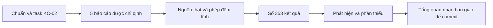

TÓM TẮT 1 [NGUỒN] [THẤY]: DONE — kiểm chéo đủ 5 báo cáo I-03, I-05, A-15b, A-16 và K-02-ban-do theo KC-02.
TÓM TẮT 2 [NGUỒN] [THẤY]: Có 353 đơn vị trong sổ: 341 ĐÚNG, 6 SAI thuộc 5 phát hiện và 6 THIẾU bằng chứng/điều kiện.
TÓM TẮT 3 [NGUỒN] [THẤY]: Đã ghi JX1_OPS/REPORTS/KIEM-CHEO-02.md và báo cáo bàn giao này; bổ sung mục Kết quả cuối task.
TÓM TẮT 4 [CHƯA KIỂM]: Nhịp ngoài worktree bị giới hạn ghi; đã giữ các mốc bên dưới. Giới hạn chuyên môn nêu tại KIEM-CHEO-02.md:126–135.
TÓM TẮT 5 [CHƯA KIỂM]: Không chạy build, exe game/server, Lua game, VM, mạng hoặc test trong game; không stage/commit/push theo yêu cầu Tổng quan commit hộ, chưa có SHA mới.

# KC-02 — Báo cáo thực hiện và bàn giao

Loại: tổng hợp
Chủ đề: Bàn giao kết quả kiểm chéo tĩnh và các mốc tiến độ KC-02.
Từ khóa: KC-02, kiểm chéo, chất lượng, NPC, SkillId, AIParam10, JoinMission, PAK
Trạng thái: DONE — hoàn thành nội dung kiểm chéo và sổ từng đơn vị.
Độ phủ: 5/5 báo cáo, 353/353 đơn vị có phán định; 188/188 dòng catalog đã đối chiếu; 6 đơn vị THIẾU được chỉ rõ.
Liên quan: JX1_OPS/TASKS/KC-02.md; JX1_OPS/TASKS/KC-01.md; JX1_OPS/REPORTS/KIEM-CHEO-02.md; JX1_OPS/DESIGN/CHUAN-BAO-CAO.md.
Cần tôi quyết định: không.

## Phạm vi và độ phủ

| Hệ thống / báo cáo | Độ phủ | Kết quả đúng / sai / thiếu | Nguồn sổ kiểm |
|---|---|---|---|
| Quái vật / I-03 | [THẤY] Đã phủ 48/48 đơn vị | 45 / 2 / 1 | KIEM-CHEO-02.md:181–232 |
| NPC chức năng / I-05 | [THẤY] Đã phủ 26/26 đơn vị | 23 / 1 / 2 | KIEM-CHEO-02.md:234–263 |
| Kỹ năng hảo hữu / A-15b | [THẤY] Đã phủ 212/212 đơn vị, có 188 bản ghi catalog | 210 / 0 / 2 | KIEM-CHEO-02.md:265–292,371–602 |
| Tống Kim / A-16 | [THẤY] Đã phủ 28/28 đơn vị | 26 / 1 / 1 | KIEM-CHEO-02.md:294–325 |
| Bản đồ / K-02-ban-do | [THẤY] Đã phủ 39/39 đơn vị | 37 / 2 / 0 | KIEM-CHEO-02.md:327–369 |

[THẤY] Cách tính đơn vị và phần không chấm lặp nêu tại `KIEM-CHEO-02.md:44–52`. Sổ đủ 353 hàng, mỗi hàng có nhãn THẤY/TÀI LIỆU/CHƯA KIỂM, vị trí trong báo cáo gốc và đầu mối nguồn hiện tại. Đây không phải tỷ lệ 341/353 tính năng game đã chạy đúng.

## Giải mã tên

| Tên gốc | Mã hóa | Chữ đúng | Nguồn file:dòng |
|---|---|---|---|
| 宋金 / battlesongjin | GBK / ASCII | Tống Kim (宋金) | G/script/battles/battlehead.lua:244; G/settings/Task/missions.txt:12, root G giải thích tại KIEM-CHEO-02.md:54–65 |

[THẤY] Báo cáo bàn giao này dùng ID của báo cáo và nhóm hệ thống; các tên phái, map, NPC của phần kiểm chéo có bảng đầy đủ tại `KIEM-CHEO-02.md:83–98`, không tự phục dựng tên hỏng.

## Sắp theo cấu trúc game

[THẤY] Bảng phạm vi xếp quái vật → NPC chức năng → kỹ năng hảo hữu → Tống Kim → bản đồ. Catalog chi tiết giữ phân nhóm phái của A-15b, tách bản ghi chính/phụ và sắp style, ReqLevel, ID; giới hạn luật học tại `KIEM-CHEO-02.md:100–102`.

## Kết quả

[THẤY] Năm phát hiện ở `KIEM-CHEO-02.md:104–124`:
- F01: I-03 nói đọc AIParam10 nhưng dòng đó đang comment.
- F02: Dẫn E-05b của I-03 đã lệch vị trí hiện tại.
- F03: I-05 ghi tên callback cường hóa thiếu hậu tố “hua”.
- F04: A-16 chép lời gọi JoinMission thiếu bước BT_GetGameData.
- F05: Hai hàng bàn giao K-02 dùng tên tệp K-02c.md không tồn tại.

[THẤY] Các tổng chính tái lập được: Npcs 2435×106, 188 bản ghi kỹ năng, 94098 bản ghi quái trong PAK, 956/993 ID có .wor khi tính tệp rời, 479 tệp vùng rời và 249 bảng/tệp Tống Kim. Chi tiết nguồn và giới hạn tại `KIEM-CHEO-02.md:137–163`. Đã giữ nguyên kết luận và byte của cả năm báo cáo được kiểm.

## Mục sổ thông số

| Tên | Giá trị | Đơn vị | Nguồn | Đổi an toàn | Nguồn đo |
|---|---:|---|---|---|---|
| Báo cáo được kiểm | 5 | tệp | KIEM-CHEO-02.md:35–42 | KHÔNG | Sổ phạm vi |
| Đơn vị có phán định | 353 | dòng/khối đối chiếu | KIEM-CHEO-02.md:44–52,181–602 | KHÔNG | Kiểm cấu trúc và mã kiểm duy nhất |
| Ô số catalog khớp | 2444 | ô, 13×188 | KIEM-CHEO-02.md:150,371–602 | KHÔNG | So TAB với từng ID/dòng nguồn |

## Đã xác minh / Chưa xác minh

[THẤY] ĐÃ XÁC MINH: đọc chuẩn và task, dùng đủ sáu skill; kiểm dữ liệu nguồn tĩnh, hash và cấu trúc các đầu ra. Phạm vi thao tác/nguồn và lỗi đã khắc phục ghi tại `KIEM-CHEO-02.md:54–81,619–636`.

[CHƯA KIỂM] Chưa chạy game, client/server, Lua game, build/unit test, exe, VM hoặc mạng. Chưa chứng minh nguồn trùng binary hoặc các hành vi runtime. Sáu đơn vị thiếu được giữ trong sổ, không đổi thành PASS.

[THẤY] Test thực chạy là kiểm tĩnh bảng, byte/PAK/ZIP và Markdown. Không có test game PASS. Không tạo script/parser phụ trên đĩa; công cụ PAK chỉ gọi hàm đọc/giải nén trong bộ nhớ.

## Lỗi, cách xử lý và giới hạn nhịp

[THẤY] Không có rg, chuyển tìm đúng tệp bằng PowerShell. Đã xử lý encoding terminal, đầu ra bị cắt, hai đường định vị nhầm, cách chọn cột khóa Lua, định dạng World%02d và chuẩn hóa hash theo ASCII; kết quả cuối nêu tại `KIEM-CHEO-02.md:627–636`.

[THẤY] Đường `D:\JX-wt\KC-02.nhip` nằm ngoài vùng được ghi `D:\JX-wt\KC-02`. Không ghi ra ngoài sandbox và không đổi quyền; các mốc được giữ ngay trong báo cáo này.

## Nhịp tiến độ

| Giờ máy (UTC+07:00), ngày 19/11/2026 | Bước đang làm / vừa hoàn thành | Ước tính |
|---|---|---:|
| 00:09 | Bắt đầu, xác nhận nhánh task/KC-02 và cây làm việc sạch, đọc chuẩn/task/skill | 5% |
| 00:20 | Xong kiểm kê bảng và nhánh nguồn cốt lõi của quái vật, NPC chức năng | 40% |
| 00:20 | Xong đủ 188 dòng catalog, tên TCVN3 và 13 trường số mỗi dòng | 55% |
| 00:20 | Xong đối chiếu nhánh Tống Kim và rủi ro chiến báo | 70% |
| 00:20 | Xong số liệu PAK, vùng rời, danh mục hai APK; chốt đúng/sai/thiếu | 85% |
| 00:41 | Sắp xong: ghi sổ 353 hàng, đọc lại và chuẩn hóa các đường dẫn nguồn viết tắt | 95% |
| 00:41 | Hoàn tất tài liệu, bàn giao Tổng quan kiểm diff và commit | 100% |

## Đề xuất tối ưu và bàn giao

[THẤY] Ưu tiên sửa dẫn chứng và đường bàn giao của F01–F05 trong nhiệm vụ có vùng sửa phù hợp; bổ sung điều kiện client cho ActionScript. Chi tiết và hàng chỉ mục đề nghị đã đặt trong `KIEM-CHEO-02.md:638–657`. Không tự tạo tệp _CHIMUC ngoài vùng được cấp.

[THẤY] Chỉ ghi ba tệp: báo cáo chính KIEM-CHEO-02.md, báo cáo KC-02.md này và mục Kết quả của task KC-02.md. Không sửa BAI_HOC, source, cấu hình game hoặc các báo cáo gốc.

[THẤY] Không stage/commit/push theo yêu cầu; SHA mới: chưa có; bằng chứng GitHub: không có. Tổng quan nhận đúng ba tệp để commit. Trạng thái nội dung: DONE. Giới hạn nhịp ngoài worktree được ghi rõ, không phải lý do để bỏ dở phần kiểm chéo.

Kỹ năng đã dùng: jx1-retrofit, jx1-read-server, jx1-read-client, jx1-parameters, jx1-knowledge, jx1-report.
