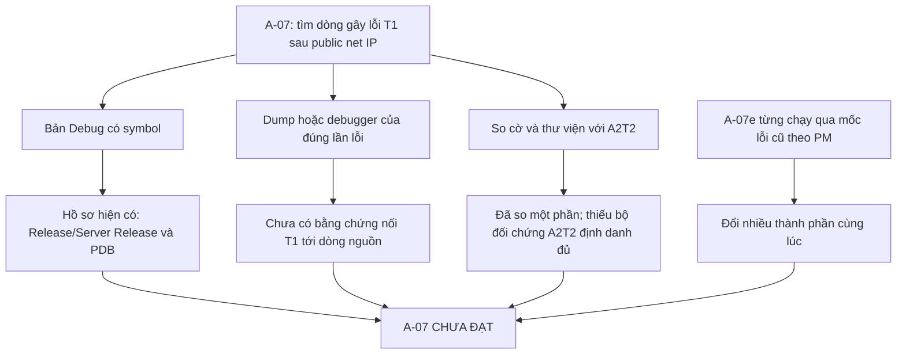

TÓM TẮT 1: [NGUỒN] DONE việc kiểm KV-06; A-07 CHƯA ĐẠT tiêu chí gốc tại JX1_OPS/TASKS/BACKLOG.md:30.
TÓM TẮT 2: [NGUỒN] Đã đối chiếu 6 yêu cầu con: 1 ĐẠT về tệp symbol hiện có, 5 CHƯA ĐẠT; chưa có dòng lỗi T1 được chứng minh.
TÓM TẮT 3: [NGUỒN] Đầu ra bảng kiểm là JX1_OPS/REPORTS/KIEM-A-07.md; biên bản bàn giao theo prompt là JX1_OPS/REPORTS/KV-06.md.
TÓM TẮT 4: [CHƯA KIỂM] Chưa xác thực EXE/DLL/PDB của lần T1 bằng dump/debugger; kết quả VM lịch sử được giữ nguyên mức chắc.
TÓM TẮT 5: [CHƯA KIỂM] KV-06 không build/chạy exe/VM/mạng; không commit/push theo prompt; nhịp ngoài worktree bị từ chối quyền, PM tổng quan nhận bàn giao.

# KIỂM A-07 — Đã tìm được dòng mã gây crash gs001 tự dựng chưa?

Loại: khảo sát
Chủ đề: Kiểm bằng chứng hoàn thành A-07, phân biệt lỗi T1 sau public net IP với lỗi A2T2 và breakpoint của bản dựng sau.
Từ khóa: gs001, crash, T1, A2T2, Debug, Release, PDB, HighEntropyVA, /RTC1, dòng lỗi
Trạng thái: DONE — hoàn tất kiểm hồ sơ và đối chiếu tĩnh; đối tượng được kiểm A-07 vẫn CHƯA ĐẠT.
Độ phủ: đã xem xét 6/6 yêu cầu con; 1 ĐẠT, 5 CHƯA ĐẠT; không tính việc chạy VM là phạm vi KV-06.
Liên quan: JX1_OPS/TASKS/KV-06.md; JX1_OPS/TASKS/BACKLOG.md:30; JX1_OPS/REPORTS/A-07-goc-re-crash-gs001.md; JX1_OPS/REPORTS/A-07b-ep-con-tro.md; JX1_OPS/REPORTS/A-07c-link-gs001.md; JX1_OPS/REPORTS/A-07d-breakpoint.md; JX1_OPS/REPORTS/A-07e-rtc.md; JX1_OPS/REPORTS/KV-06.md.
Cần tôi quyết định: không — việc còn thiếu cần được giao bằng task vận hành riêng, không nằm trong quyền chỉ đọc của KV-06.

## Sơ đồ chính

## Phạm vi, nguồn cần đọc và độ phủ

**ĐÃ XÁC MINH:** Tiêu chí lấy đúng từ BACKLOG.md:30. Danh sách đọc được giới hạn vào chuẩn báo cáo, task KV-06, dòng A-07 của BACKLOG, năm báo cáo A-07…A-07e và những tệp nguồn/kết quả cụ thể mà chúng dẫn. Mục lục tri thức chỉ dùng dòng 18; bản đồ GS001 chỉ dùng chỉ dẫn build ở dòng 8. Không quét đệ quy source hay thư mục worktree, không sửa báo cáo cũ.

| Yêu cầu con của A-07 | Độ phủ | Đánh giá | Bằng chứng và điều còn thiếu |
|---|---|---|---|
| 1. Dựng Debug cho gs001 tự dựng | Đã phủ | CHƯA ĐẠT | A-07-goc-re-crash-gs001.md:188 ghi MSBuild A-07 chưa chạy; A-07b-ep-con-tro.md:150 ghi chuyển từ Debug sang Release vì inline asm x64. BC/logs/commands.jsonl:1–5 và E/logs/commands.jsonl:1–5 xác nhận Release/Server Release. Tệp script đặt Debug ở JX1_OPS/TOOLS/a07/build-debug-a07.ps1:84–85 chỉ chứng minh có lệnh chuẩn bị, chưa chứng minh dựng thành công Debug. |
| 2. Có symbol để tra vị trí trong bản dựng | Đã phủ | ĐẠT, ở mức tệp trên đĩa | BC/out/GameServer.pdb có thật, 14.413.824 byte; BC/out/gs001-headers.txt:101 ghi đường PDB GameServer.pdb. E/a07e/GameServer.pdb có thật, 14.471.168 byte, hash khớp E/a07e/SHA256SUMS.txt:9. Không lấy việc có PDB làm bằng chứng đã ghép đúng module của T1; việc ghép với lần chạy vẫn CHƯA KIỂM. |
| 3. Thu crash dump hoặc chạy dưới debugger trong VM thử cho lỗi đang xét | Đã phủ hồ sơ | CHƯA ĐẠT | A-07-goc-re-crash-gs001.md:188 chưa có dump T1; A-07d-breakpoint.md:73 cũng thiếu dump/địa chỉ ngoại lệ/module của lần dừng sau. Báo cáo 29 có dump lỗi khác; báo cáo 44:44–48 nói tới A2T2, không chứng minh dump T1. Thiếu kết quả ngoại lệ, ngăn xếp và module của đúng lần T1. |
| 4. So cờ biên dịch với A2T2 chạy được | Đã phủ phần có bằng chứng | CHƯA ĐẠT | A-07-goc-re-crash-gs001.md:110–125 đã so PE, cờ ASLR và cấu hình nguồn. Chính dòng 123 ghi cờ compiler của exe gốc chưa kiểm. Báo cáo 44:17–18 phân biệt T1/T2 nhưng chưa cung cấp bộ cờ thực tế đầy đủ, gắn đúng EXE/DLL đã chạy. Release có /Zi không được tự đổi tên thành Debug để cho đạt. |
| 5. So thư viện với A2T2 chạy được | Đã phủ phần có bằng chứng | CHƯA ĐẠT | A-07-goc-re-crash-gs001.md:115–121 so DLL/import/export giữa O và R, song chưa kiểm hash/module T1/T2 trong VM. KV-06 đối chiếu được hash binary tĩnh O, R và A-07e; chưa có danh sách DLL thực nạp kèm hash của A2T2 để chốt đối chứng. E/a07e/verification.json:129–156 chỉ mô tả bộ E. |
| 6. Chỉ ra dòng mã thực sự gây crash T1 sau public net IP | Đã phủ | CHƯA ĐẠT | S/MultiServer/GameServer/KSOServer.cpp:916,944,952,960 xác nhận các mốc và vị trí nghi vấn. Chưa có RIP/stack/PDB đúng lần lỗi để chọn một dòng. A-07-goc-re-crash-gs001.md:204 chỉ nói “rất có thể”; A-07e-rtc.md:163–167 là chạy qua các mốc sau nhiều thay đổi, chưa cô lập một dòng. |

Quy ước: **CHƯA ĐẠT** là hồ sơ được giao chưa đáp ứng điều kiện đóng mục, không khẳng định không tồn tại bằng chứng ở mọi nơi. **CHƯA KIỂM** dùng cho việc ghép symbol với module đã chạy, thử vận hành và những tệp không được cung cấp tại đường dẫn dẫn chứng. KV-06 không mở VM để bù các mục này.

## Giải mã tên

| Tên gốc | Mã hóa | Chữ đúng UTF-8 | Nguồn file:dòng |
|---|---|---|---|
| gs001 / GameServer | ASCII | Tiến trình máy chủ trò chơi; tệp symbol có thể mang tên GameServer.pdb | BACKLOG.md:30; BC/out/gs001-headers.txt:101 |
| T1 / T2 / A2T2 | ASCII | T1: exe tự dựng và DLL gốc; T2: exe gốc và DLL A2; A2T2 là tên phép thử lịch sử | C:/Jx1CocoV3/docs-analysis/reports/44-dieu-tra-a2-thoat-som.md:7,17–18,44–45 |
| CoreServer / Engine / LuaLibDll | ASCII | Các thư viện lõi trò chơi, bộ máy và Lua trong bộ dựng | E/a07e/build-results.json:2–6 |
| HighEntropyVA / HEVA | ASCII | Tên cờ được dùng để phân biệt các bản exe trong hồ sơ | A-07-goc-re-crash-gs001.md:114,201–204; A-07e-rtc.md:166–167 |

Không có tên riêng kỹ năng, trang bị, quái, NPC hay bản đồ cần giải mã GBK/TCVN3 trong kết quả này. Báo cáo 44 có đoạn chữ lỗi ở dòng 42–48; chỉ đối chiếu được định danh ASCII, số và kết luận được A-07-goc-re-crash-gs001.md:102 dẫn lại. Không tự phục hồi chữ rồi coi là nguyên văn.

## Sắp theo cấu trúc game

Báo cáo sắp theo chuỗi khởi động máy chủ: bản dựng và symbol → mạng → khởi tạo lõi trò chơi → gọi bắt đầu trò chơi → bắt ngoại lệ → so bộ đối chứng. Đây là khảo sát tiến trình server, không có danh mục theo phái, món đồ hay bản đồ để phân nhóm.

## Ký hiệu đường dẫn và danh sách bằng chứng

Ngày kiểm: 19/11/2026, múi giờ +07:00. Các đường dẫn sau chỉ là nguồn đọc tĩnh, không là chỉ dẫn triển khai.

| Ký hiệu | Đường dẫn đầy đủ |
|---|---|
| S | C:/Jx1CocoV3/SwordOnline/SwordOnline/jxOnline/gameserver/Sources |
| B | D:/JX-build/src18/jxOnline/gameserver/Sources |
| O | C:/Jx1CocoV3/Folder/ServerNew-20260116T043145Z-3-001/ServerNew/_bin_v2_/gs |
| R | D:/JX-build/_bin_v2_/gs |
| BC | D:/JX-wt/A-07c/server/jxOnline/gameserver/Sources/A07b/checkpoint-a07c-final |
| E | D:/JX-wt/A-07c/server/jxOnline/gameserver/Sources/A07b/checkpoint-a07e-final |
| EB | D:/JX-build/a07e |
| BB | D:/JX-wt/A-07b/server/jxOnline/gameserver/Sources/A07b/checkpoint-2 |

Tên báo cáo A-07…A-07e viết tắt trong bảng đều thuộc JX1_OPS/REPORTS/. “Báo cáo 29”, “35”, “44” lần lượt là 29-dieu-tra-gs001-crash.md, 35-bien-dich-server-tu-nguon.md, 44-dieu-tra-a2-thoat-som.md dưới C:/Jx1CocoV3/docs-analysis/reports/.

### 1. Đường khởi động đã đối chiếu với source thật

**ĐÃ XÁC MINH, đọc tĩnh:** S/MultiServer/GameServer/KSOServer.cpp:916 in public net IP. Nhánh không _STANDALONE ở :942–944 gọi QueryInterface để lấy pCloneServer; :951–958 gọi CoreGetServerShell và kiểm NULL sau khi trả về; :960 truyền pCloneServer qua unsigned int. S/Core/Src/CoreServerShell.cpp:227–230 gọi g_InitCore trước khi trả shell; :2048 nhận uParam unsigned int và :2059–2060 chuyển uParam thành LPVOID.

**GIẢ THUYẾT, giữ nguyên mức chắc:** các điểm trên có thể liên quan đến con trỏ hoặc biên DLL; không điểm nào tự chứng minh là lệnh đã gây T1. Việc truyền ở :960 nằm sau khi khởi tạo lõi trả về. S/Core/Src/KCore.cpp:256 mở package.ini, :264 ghi gamesettings, :618 gọi nạp script; phải có dấu vết của lần lỗi mới xác định đã đi đến đâu. Nguồn tĩnh không phải ngăn xếp của tiến trình đã chết.

**ĐÃ XÁC MINH, khác phiên bản:** S/Core/Src/KSortScript.cpp:328 còn long dir; B/Core/Src/KSortScript.cpp:328 dùng intptr_t dir. Đây là hai cây khác nhau. Không lấy sửa _findfirst trong B để khẳng định mã tại S đã được sửa, hoặc khẳng định T1 có cùng nguyên nhân với A2T2.

### 2. Bản dựng có kết quả thật, nhưng chưa đáp ứng nguyên văn Debug

**ĐÃ XÁC MINH:** BB/logs/GameServer.log:202–203 có LNK2001 __imp___iob_func và LNK1120; không thấy BB/out/gs001.exe. BC/logs/results.json:2–6 và E/a07e/build-results.json:2–6 đều ghi năm project trả 0. Đó là đọc lại kết quả build cũ, không phải chạy build trong KV-06.

**ĐÃ XÁC MINH:** BC/logs/commands.jsonl:1–5 và E/logs/commands.jsonl:1–5 dùng Release; riêng Core dùng Server Release, đều x64. E/gameserver/Sources/MultiServer/GameServer/GameServer.vcxproj:186,203,212 có thông tin PDB và đường GameServer.pdb; hash PDB E khớp manifest. Bản Debug dự kiến D:/JX-build/a07/out/gs001.exe và logs/GameServer-debug.log không có tại đường dẫn kiểm; không tìm sang ổ khác. Không kết luận thiếu symbol chỉ vì không thấy tên gs001.pdb.

**CHƯA KIỂM:** GUID/age bên trong PDB so với EXE thực chạy trong VM, và ánh xạ dòng của đúng lần T1. BC/out/gs001-headers.txt:101 chỉ là bản xuất PE lịch sử; KV-06 kiểm tệp hiện có và hash, không chạy dumpbin hoặc debugger.

### 3. Bảng nhận diện artifact, không trộn các lần thử

**ĐÃ XÁC MINH:** Get-Item và Get-FileHash -Algorithm SHA256 đã đọc trực tiếp các tệp dưới đây. Hash dùng để nhận diện nội dung trên đĩa, không xác nhận nội dung nào đã được VM nạp.

| Tệp đã đọc | Byte | SHA-256 |
|---|---:|---|
| O/gs001.exe | 543232 | dd44d425e205fd482fd287144bdc3d95ad90f42bda92556a66c1214a463d4295 |
| R/gs001.exe | 1267200 | 2c2e0a8c9a9724377e41092e5617c59ca1cfdd20403932819dea503cd6f02571 |
| BC/out/gs001.exe | 1346560 | 0c14250622f79ee2db90653ce769afb3f48d5005641662cc880f451f6dbfbe5c |
| E/a07e/gs001.exe | 1286656 | 988175a79c24c57b07d24d62b5f43e7acdd135e03e911bf347b123d92ff48a91 |
| EB/gs001.exe | 1286656 | 91bc8eb670582480071c213e91b0dd8235bc5431a379d3981d0e686a8c60f9ad |
| E/a07e/GameServer.pdb | 14471168 | 01f5dd00f56a15a1e037c6c35df45e9198dc602e3828cc5ea31a72d741d79b41 |

**ĐÃ XÁC MINH:** E/a07e/SHA256SUMS.txt:9–10 khớp hash PDB và exe E đo lại. Ba DLL EB có hash khớp A-07e-rtc.md:138–140; exe EB khác hash exe E, nên không dùng tên thư mục a07e để khẳng định HEVA bật hay tắt. **NGUỒN GIÁN TIẾP:** A-07e-rtc.md:163 gắn tiền tố 91BC8EB67058 với bản tắt HEVA, :167 gắn 988175A79C24 với bản nguyên gốc bật HEVA; KV-06 chưa đọc PE mới hay kiểm VM để xác nhận cờ tại runtime.

### 4. Vì sao các lần chạy được chưa khép được A-07?

| Nhánh sự kiện | Bằng chứng lịch sử | Điều được giữ nguyên và giới hạn |
|---|---|---|
| T1 thoát sớm sau public net IP | Báo cáo 44:5,16–21,38; A-07-goc-re-crash-gs001.md:188 | Ghi lỗi 0xC0000005, chưa có dump T1 để gán dòng. Đây là mục tiêu cần đóng. |
| A2T2 lỗi khi nạp script | Báo cáo 44:44–48; A-07-goc-re-crash-gs001.md:102 | Ghi lỗi _findfirst tại KSortScript.cpp:328 và sửa intptr_t; báo cáo 44:45 nói T1 vẫn là lỗi riêng. Không chuyển kết luận A2T2 sang T1. |
| Dump luồng mạng ở báo cáo 29 | Báo cáo 29:18,36–42,57,76 | Có thông tin dump và địa chỉ NULL; chưa có tên hàm được xác thực bằng PDB. Báo cáo 44:27 phân biệt thời điểm với T1. |
| Thử tắt HEVA ban đầu | A-07-goc-re-crash-gs001.md:200–205 | Giữ kết luận lịch sử “rất có thể” cắt con trỏ. Dump full ở :203 thuộc bản chạy được và đã xóa; không thay cho dump ngoại lệ T1. |
| Bộ A-07c dừng khoảng 225 giây | A-07c-link-gs001.md:138–142; A-07d-breakpoint.md:73,97–106 | Là breakpoint 0x80000003 được điều tra riêng. BC/out/GameServer.map:867,887–888 có symbol kiểm runtime; có symbol không chứng minh nhánh đó đã chạy. |
| Bộ A-07e qua mốc lỗi cũ | A-07e-rtc.md:80–92,162–167 | PM ghi chạy trên 10 phút với HEVA bật sau bỏ /RTC1, sửa bốn lỗi P1 và đổi lựa chọn CRT Engine. Chưa tách riêng yếu tố nào quyết định T1. |

**ĐÃ XÁC MINH, đọc tĩnh:** E/gameserver/Sources/Core/Src/KPlayer.cpp:1377 và ScriptFuns.cpp:1068 dùng [5]; KItemList.cpp:4141 chỉ khởi tạo [0] đến [5]; ScriptFuns.cpp:9440 trả nItemIdx. Các sửa này khớp mô tả A-07e-rtc.md:81–84, nhưng không chứng minh bốn đường đó đã gây lần lỗi sớm.

**NGUỒN GIÁN TIẾP:** E/a07e/verification.json:12–120 ghi 239 lệnh compile, 240 object và các danh sách rtc_flags/object_rtc_undefined_references rỗng; :159 vẫn ghi literal_no_rtc_in_all_maps=false. Không chạy lại verifier, không đổi “exit 0” thành “mọi tiêu chí đều đạt”, và không thêm điều kiện xóa hết tên _RTC_ khỏi map vào tiêu chí A-07.

## Mục sổ thông số

| Nhóm | Tên/hằng số | file:dòng | Giá trị | Đơn vị | Ảnh hưởng | Đổi an toàn | Nguồn đo |
|---|---|---|---|---|---|---|---|
| Bản dựng | Configuration thực ghi trong lệnh | BC/logs/commands.jsonl:1–5; E/logs/commands.jsonl:1–5 | Release / Server Release, x64 | Cấu hình | Không đáp ứng nguyên văn Debug | KHÔNG trong KV-06 | Đọc nhật ký cũ; không build |
| Bản dựng | BasicRuntimeChecks của snapshot E | E/gameserver/Sources/MultiServer/GameServer/GameServer.vcxproj:186 | Default | Giá trị cấu hình | Khác bản A-07c có /RTC1 theo A-07d-breakpoint.md:97 | KHÔNG trong KV-06 | Đọc project snapshot |
| Ngoại lệ | Mã lỗi T1 | Báo cáo 44:17,20–21 | 0xC0000005 | Mã ngoại lệ | Cần địa chỉ lệnh và stack để tra dòng | KHÔNG — dữ liệu quan sát | Nguồn gián tiếp; chưa tái hiện |
| Ngoại lệ | Mã lỗi bộ A-07c sau khoảng 225 giây | A-07c-link-gs001.md:139 | 0x80000003 | Mã ngoại lệ | Phân biệt với T1 thoát sớm | KHÔNG — dữ liệu quan sát | Nguồn gián tiếp; chưa tái hiện |
| Symbol | GameServer.pdb bộ E | E/a07e/SHA256SUMS.txt:9 | 14471168 | Byte | Có tệp tra cứu; chưa ghép module T1 | KHÔNG trong KV-06 | Get-Item/Get-FileHash, ngày 19/11/2026 |

## Phát hiện khi đối chiếu, giữ nguyên kết luận cũ

- **ĐÃ XÁC MINH:** A-07e-rtc.md:148 ghi tại thời điểm cũ chưa có bộ D:/JX-build/a07e. Hiện EB/gs001.exe và ba DLL có thật, nhưng EB không có GameServer.pdb/gs001.pdb, build-results.json, verification.json, SHA256SUMS.txt tại những đường đã kiểm. Đây là thay đổi tình trạng trên đĩa giữa hai mốc, không sửa phát biểu lịch sử.
- **ĐÃ XÁC MINH:** Tên symbol thật là GameServer.pdb, không phải luôn gs001.pdb. Tìm sai tên rồi kết luận không có PDB sẽ sai; bảng tiêu chí đã ghi ĐẠT phần có tệp.
- **CHƯA XÁC MINH:** Các đường Graphify đã thử tại S/graphify-out/GRAPH_REPORT.md và C:/Jx1CocoV3/graphify-out/GRAPH_REPORT.md không có. Đã đối chiếu trực tiếp symbol trong source được báo cáo dẫn, không tự tạo lại graph.
- **GIẢ THUYẾT cần giữ mức chắc:** nhận định con trỏ ở phụ lục A-07 và nhận định /RTC1 hoặc P1 ở A-07e nói về các bước/bộ dựng khác nhau. Không hợp nhất thành một dòng gây T1 đã xác nhận.

## Đã xác minh / Chưa xác minh và kiểm tra thực chạy

**ĐÃ XÁC MINH:** nhánh task/KV-06, Git sạch lúc bắt đầu; chưa có KIEM-A-07.md hay KV-06.md tại lúc tiếp nhận. Đã dùng Get-Content theo đoạn và Select-String trên danh sách tệp xác định; Get-Item/Test-Path kiểm đường dẫn; Get-FileHash nhận diện artifact. Đã đọc kết quả build cũ, hash lại exe/PDB và đối chiếu các dòng nguồn nêu trong báo cáo. Không suy runtime từ source.

**CHƯA XÁC MINH:** chưa thu/đọc dump T1, chưa có mapping RIP → module đúng hash → PDB đúng GUID/age → dòng nguồn; chưa có nhật ký debugger của lần lỗi; chưa xác minh bộ cờ và DLL thực nạp của đúng A2T2; chưa chạy lại kết quả VM hay kiểm tải. Không tuyên bố mọi nơi đều không có dump.

**Test trong KV-06:** chỉ kiểm tài liệu/đường dẫn/hash và diff; không build, không chạy exe/DLL sản phẩm, không verifier, không VM, không mạng, không đổi cấu hình. Lệnh lịch sử nằm trong các báo cáo nguồn không được thực thi lại.

| Lỗi/giới hạn khi làm | Cách thử | Kết quả và xử lý |
|---|---|---|
| Không có rg | Thử một lệnh rg trên ba tệp định danh | CommandNotFoundException; chuyển Select-String, không cài công cụ |
| Nhịp ngoài worktree | Một lần Set-Content D:/JX-wt/KV-06.nhip ở mốc bắt đầu | UnauthorizedAccessException / Access denied; không đổi quyền hoặc thử vượt sandbox; các mốc sau thông báo trong hội thoại |
| Đường dẫn artifact dự kiến không có | Test-Path đúng đường ghi trong hồ sơ; đường snapshot suy theo lệnh build | Dùng đường có bằng chứng commands.jsonl; ghi rõ tệp thiếu tại đường kiểm, không quét rộng |
| Chưa có bằng chứng quyết định T1 trong bộ nguồn được giao | Đối chiếu bảng A-07 và các phụ lục PM | Giữ A-07 CHƯA ĐẠT; không tạo phép thử vận hành ngoài quyền |

## Đề xuất tối ưu và bàn giao

Ưu tiên hoàn thiện bằng chứng cho đúng vụ T1 thay vì tiếp tục sửa hàng loạt ứng viên. Task tiếp theo cần được duyệt riêng: dựng Debug có symbol thành công hoặc xin chủ duyệt thay đổi tiêu chí; nhận diện đúng bộ EXE/DLL/PDB đối chứng A2T2; bắt ngoại lệ của T1 trong VM thử; lưu địa chỉ lệnh, thread, stack, module/hash và dòng nguồn. Nếu bộ mới không còn tái hiện T1, phải chứng minh quan hệ với sửa đổi cụ thể thay vì coi việc chạy lâu hơn là xác định dòng lỗi. KV-06 không thực hiện các thao tác này.

Không thay tiêu chí A-07 bằng yêu cầu bot/người chơi hay nhiều giờ uptime: các phép đó là kiểm ổn định bổ sung, không thay dòng mã gây lỗi mà BACKLOG yêu cầu. Không sửa khuyến nghị lịch sử trong A-07…A-07e.

Bàn giao PM tổng quan: nhận KIEM-A-07.md, KV-06.md và mục Kết quả cuối JX1_OPS/TASKS/KV-06.md. Prompt trực tiếp yêu cầu KV-06.md, task chỉ định KIEM-A-07.md; hai tệp phục vụ bảng kiểm và biên bản bàn giao, không đụng báo cáo cũ. Không lập TSV hay sửa mục lục ngoài phạm vi; đề xuất hàng mục lục để PM gộp: “Kiểm điều kiện đóng A-07 | KIEM-A-07.md | gs001, T1, Debug, PDB | A-07 chưa đạt, thiếu dòng lỗi và bằng chứng tương ứng”.

Commit: không tạo theo prompt; chưa có SHA mới. Push: chưa thực hiện, không được yêu cầu. Hạn chế nhịp: PM cần dùng phiên được phép ghi ngoài worktree nếu vẫn cần tệp D:/JX-wt/KV-06.nhip.

Kỹ năng đã dùng: jx1-retrofit (khuôn và bảo toàn kết luận), jx1-read-server (đối chiếu source), jx1-parameters (sổ thông số), jx1-knowledge (mức chắc và liên kết), jx1-report (bàn giao). Đã nạp jx1-read-client theo prompt; không áp dụng đọc client vì task không có câu hỏi client.

KẾT LUẬN: A-07 CHƯA ĐẠT, thiếu: bản Debug dựng thành công theo tiêu chí gốc; dump hoặc nhật ký debugger của đúng lỗi T1 kèm bộ EXE/DLL/PDB được nhận diện; đối chiếu đủ cờ biên dịch và thư viện của đúng A2T2 chạy được; dòng mã gây crash T1 được chứng minh bằng các bằng chứng đó.
