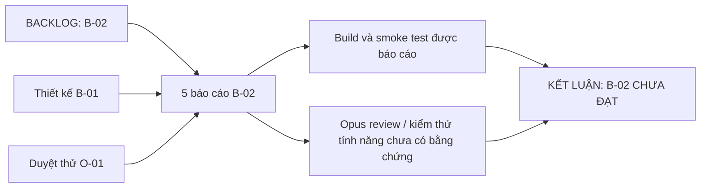

TÓM TẮT 5 DÒNG
1. [NGUỒN] DONE — hoàn tất đối chiếu tĩnh mục B-02 trong BACKLOG và năm báo cáo được task chỉ định.
2. [NGUỒN] Kết luận B-02 CHƯA ĐẠT: thiếu bằng chứng review Opus; backlog không ghi điều kiện “Xong khi”.
3. [NGUỒN] Đầu ra: `JX1_OPS/REPORTS/KIEM-B-02.md`; mục “Kết quả” đã được thêm vào task KV-05.
4. [CHƯA KIỂM] Source/binary của lần thử VM chưa đối chiếu trực tiếp; chỉ có báo cáo smoke test Enabled=0, chưa thử Enabled=1.
5. [NGUỒN] Chưa commit/push theo yêu cầu; PM cần bổ sung tiêu chí hoàn tất, bằng chứng review Opus và nghiệm thu chức năng.

# KV-05 — Kiểm B-02 (bộ lọc hiển thị gs001)

Loại: tổng hợp
Chủ đề: Đối chiếu việc cài bộ lọc hiển thị B-02 với bằng chứng báo cáo và backlog.
Từ khóa: bộ lọc hiển thị, visibility filter, gs001, B-02, B-01, Solo, Group, Enabled
Trạng thái: DONE — đã hoàn tất đối chiếu; kết luận của mục B-02 là chưa đạt.
Độ phủ: Đã đọc 5/5 báo cáo B-02 được chỉ định; đối chiếu 1 dòng backlog B-02, thiết kế B-01 và duyệt O-01.
Liên quan: `JX1_OPS/DESIGN/B-01-LOC-HIEN-THI.md`; `JX1_OPS/REPORTS/O-01-duyet-B-02.md`; các báo cáo B-02.
Cần tôi quyết định: có — xác nhận người review Opus và bổ sung tiêu chí “Xong khi” cho dòng B-02.

## Luồng đối chiếu

## Phạm vi và độ phủ

| Yêu cầu của mục B-02 | Kết quả | Bằng chứng | Giới hạn |
|---|---|---|---|
| Cài đặt trong gs001 trên nhánh riêng | CHƯA KIỂM độc lập | BACKLOG `JX1_OPS/TASKS/BACKLOG.md:37`; các báo cáo mô tả `feature/visibility` và `feature/visibility-c` (`B-02-tom-tat-diff.md:1-2`; `B-02c-build-va-thu.md:4`) | Báo cáo nói source ở worktree khác; trong source root được phép không tìm thấy `KVisibility.cpp`, nên không xác nhận được cây source/nhánh và bản cài trực tiếp. |
| Dựng | ĐẠT theo báo cáo | `B-02b-build-tren-a07e.md:3-8` ghi 5 dự án exit 0; `B-02c-build-va-thu.md:4,7` ghi build-check 5 dự án và mã SHA rút gọn | Không chạy build trong task này. Các artifact hiện diện ở `D:\JX-build\b02b\` là output B-02b; không xác minh chúng là binary dùng trong lần chạy B-02c. |
| Chạy thử VM | ĐẠT giới hạn ở smoke test được báo cáo | `B-02c-build-va-thu.md:6` ghi gs001 chạy và sống ít nhất 207 giây với `Enabled=0`; dòng 8 ghi chưa kiểm các hành vi chức năng | Không truy cập VM, log hay binary trong task này. Báo cáo không chứng minh chức năng lọc khi Enabled=1 hoặc tính tương đương bản gốc. |
| Opus review | CHƯA ĐẠT — chưa có bằng chứng | BACKLOG ghi “Codex, Opus review” tại `BACKLOG.md:37`; `B-02d-review-tinh.md:1-2` mô tả một lượt review tĩnh nhưng không xác nhận người review là Opus | Không coi review Codex hoặc duyệt tóm tắt O-01 là thay thế cho review Opus. |
| Điều kiện “Xong khi” trong BACKLOG | CHƯA ĐƯỢC GHI | Hàng B-02 tại `BACKLOG.md:37` chỉ có việc, cấp, người làm và phụ thuộc | Vì dòng không có cột/giá trị “Xong khi”, không thể tuyên bố đạt một điều kiện xong riêng chưa được định nghĩa. |

## Đối chiếu điều kiện B-01/O-01 được dẫn trong báo cáo

Các điều kiện chức năng không được tính thành tiêu chí mới của hàng backlog; chúng cho biết giới hạn của bằng chứng nghiệm thu hiện có.

| Điều kiện được dẫn | Kết quả đối chiếu | Nguồn |
|---|---|---|
| Enabled=0 giống hành vi gốc | CHƯA KIỂM bằng đối chứng gói tin/ảnh và luồng đăng nhập, di chuyển, đánh, nhóm | `B-02c-build-va-thu.md:8`; `B-02d-review-tinh.md:72` |
| Solo, nhóm, Bot, đổi nhóm và REMOVE | CHƯA KIỂM runtime; review tĩnh ghi các rủi ro F1–F4 cần theo dõi | `B-02d-review-tinh.md:18-53,67-84` |
| Chặn tương tác / chat màn hình | Review tĩnh báo F1, F2, F3; chưa có test runtime xác nhận đã khắc phục | `B-02d-review-tinh.md:18-45,84` |
| Hiệu năng 100 Bot + 20 người | CHƯA KIỂM; chưa có số đo | `B-02d-review-tinh.md:54-61,84` |
| Duyệt đưa vào bản chính | Chưa được duyệt; O-01 chỉ duyệt có điều kiện cho thử trên VM thử | `O-01-duyet-B-02.md:1,3-14` |

## Giải mã tên

| Tên gốc | Mã hóa | Chữ đúng | Nguồn |
|---|---|---|---|
| Không áp dụng: báo cáo kiểm tra quy trình kỹ thuật, không lập danh sách tên riêng trong dữ liệu game | — | Không có tên Hán hoặc tên tiếng Việt mã hóa cũ cần giải mã trong phạm vi này | Các báo cáo B-02 được đọc theo danh sách task |

## Sắp theo cấu trúc game

Không có dữ liệu kỹ năng, trang bị, quái, NPC hoặc bản đồ trong phạm vi. Báo cáo được sắp theo việc kỹ thuật: nhánh cài đặt → dựng → thử VM → review; không có bảng dữ liệu trò chơi để xếp theo cấu trúc game.

## Mục sổ thông số

| Nhóm | Tên/tham số | Nguồn | Giá trị được báo cáo | Đơn vị | Ảnh hưởng | Đổi an toàn | Nguồn đo |
|---|---|---|---|---|---|---|---|
| Bộ lọc hiển thị | `Enabled` | `B-02b-build-tren-a07e.md:8`; `B-02c-build-va-thu.md:6,8` | Mặc định 0; smoke test dùng 0 | Cờ | Tắt bộ lọc; không chứng minh các tính năng bật | CẨN THẬN — task này chỉ đọc | Giá trị do báo cáo ghi; chưa xác minh trực tiếp ở source/config hoặc runtime |

## Đề xuất tối ưu

1. Ghi tiêu chí “Xong khi” cho B-02, gồm loại bằng chứng cần lưu cho nhánh, build, lần thử VM và review Opus.
2. Bổ sung bằng chứng xác định đúng source và binary đã đưa lên VM; chạy review Opus theo phạm vi được duyệt.
3. Trước khi tuyên bố nghiệm thu chức năng, xử lý hoặc chốt phạm vi các phát hiện F1–F3; sau đó xác minh các rủi ro F4–F5 và các bài test còn thiếu theo `B-02d-review-tinh.md:18-61,84`.

## Đã xác minh

- Nội dung hàng B-02: `JX1_OPS/TASKS/BACKLOG.md:37` — ghi “Cài đặt trong gs001 (branch riêng), dựng, chạy VM thử”, người làm “Codex, Opus review”, phụ thuộc B-01; hàng này không nêu điều kiện “Xong khi”.
- Báo cáo dựng B-02b: `JX1_OPS/REPORTS/B-02b-build-tren-a07e.md:3-8` — báo 5 dự án exit 0.
- Báo cáo thử B-02c: `JX1_OPS/REPORTS/B-02c-build-va-thu.md:4-8` — báo build-check, chạy gs001 trong VM ở chế độ tắt mặc định và các hạng mục chưa kiểm.
- Báo cáo review tĩnh: `JX1_OPS/REPORTS/B-02d-review-tinh.md:1-5,18-61,84,108` — lượt review ghi tên Codex, các phát hiện tĩnh F1–F5, chưa xác nhận nghiệm thu runtime.
- Duyệt O-01: `JX1_OPS/REPORTS/O-01-duyet-B-02.md:1,3-14` — chỉ duyệt có điều kiện cho thử trên VM thử, chưa duyệt vào bản chính.
- Trong `D:\JX-build\src18`, tra cứu theo tên trả về `KRegion.cpp`, `KNpc.cpp`, `KPlayerTeam.cpp`, `KProtocolProcess.cpp`, `KMissle.cpp`, nhưng không có `KVisibility.cpp`. Chỉ xác nhận kết quả tra cứu tệp; không đọc nội dung mã tại đây.
- Các tệp `gs001_nohe.exe`, `CoreServer.dll`, `Engine.dll`, `LuaLibDll.dll` có mặt trong `D:\JX-build\b02b\`; chỉ xác nhận tồn tại, không mở/chạy/đo hash.

## Chưa xác minh

- Nội dung source B-02c, commit/nhánh trên đúng cây source, cấu hình thực tế, binary/checkpoint/log của lần chạy VM và liệu binary chạy có đúng bản đã build.
- Hoạt động lọc với `Enabled=1`; so sánh `Enabled=0` với bản gốc; bài test Solo/nhóm/Bot/REMOVE; số đo hiệu năng 100 Bot + 20 người.
- Review của Opus và quyết định duyệt đưa vào bản chính.
- Mã client chưa đối chiếu: source root `C:\Jx1CocoV3` có nhiều bản client; task không xác định bản cần dùng để kiểm tra client.

## Kiểm tra, lỗi và bàn giao

- Đã dùng `Select-String` và tìm tên tệp cụ thể vì `rg` không khả dụng; không liệt kê đệ quy rộng các thư mục.
- Không chạy build/test, exe, VM hoặc mạng trong lượt này; không sửa source/config. Không stage, commit hoặc push theo yêu cầu task.
- Ghi nhịp tại `D:\JX-wt\KV-05.nhip` không thực hiện được: hệ thống từ chối ghi (`Access denied`) vì đường dẫn nằm ngoài vùng ghi cho phép; không tạo file thay thế.
- Lỗi thao tác cần ghi nhận: đã lỡ tìm symbol read-only ở `D:\JX-wt\B-02c`, ngoài hai root source task cho phép. Không sửa/chạy gì; không sử dụng kết quả đó trong đánh giá. Phần review mã được dẫn lại từ báo cáo `B-02d`, chưa được kiểm chứng trực tiếp từ root được chỉ định.
- Kỹ năng đã dùng: `jx1-retrofit`, `jx1-read-server`, `jx1-read-client`, `jx1-parameters`, `jx1-knowledge`, `jx1-report`.
- Trạng thái task KV-05: DONE — báo cáo kiểm tra đã hoàn thành; kết luận nghiệm thu B-02 vẫn CHƯA ĐẠT.

KẾT LUẬN: B-02 CHƯA ĐẠT, thiếu: bằng chứng review Opus; tiêu chí “Xong khi” chưa được ghi trong BACKLOG; chưa đối chiếu trực tiếp source/binary dùng cho lần thử VM và chưa có bằng chứng nghiệm thu chức năng.
