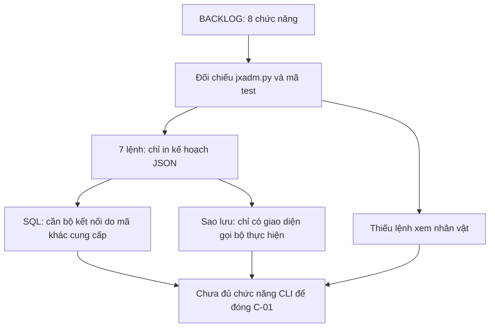

TÓM TẮT 1: [NGUỒN] DONE — đã kiểm tra tĩnh đủ 8/8 yêu cầu C-01; kết quả C-01 CHƯA ĐẠT.
TÓM TẮT 2: [NGUỒN] Có 7 lệnh, đều chỉ in kế hoạch; thiếu lệnh xem nhân vật, chưa có đường thực hiện từ dòng lệnh.
TÓM TẮT 3: [NGUỒN] Online chưa xác định người đang chơi; cờ bot chưa có bảng được triển khai; sao lưu chưa có bộ thực hiện thật.
TÓM TẮT 4: [CHƯA KIỂM] Kết quả 22 test đạt là ghi nhận của C-01 cũ; lượt này chỉ đọc mã test, không chạy lại.
TÓM TẮT 5: [CHƯA KIỂM] Không build, chạy công cụ/game/exe, VM, SQL hoặc mạng; không commit/push theo yêu cầu giao Tổng quan.

# KV-01 — Kiểm C-01: công cụ dòng lệnh quản lý tài khoản

Loại: kiểm thử
Chủ đề: Đối chiếu từng chức năng C-01 trong BACKLOG với công cụ jxadm và bằng chứng hiện có.
Từ khóa: tài khoản, account, jxadm, C-01, nhân vật, online, is_bot, sao lưu, dry-run
Trạng thái: DONE — hoàn tất đánh giá tĩnh; đây là trạng thái việc kiểm tra KV-01, C-01 chưa đạt.
Độ phủ: đã phủ 8 trên tổng 8 yêu cầu bằng đọc tĩnh; 0/8 đủ bằng chứng hoàn thành chức năng từ CLI; kiểm chứng vận hành mới 0/8.
Liên quan: `JX1_OPS/TASKS/KV-01.md`; `JX1_OPS/TASKS/BACKLOG.md`; `JX1_OPS/REPORTS/C-01-jxadm.md`; `JX1_OPS/REPORTS/A-02-luong-dang-nhap.md`; `JX1_OPS/REPORTS/KV-01.md`.
Cần tôi quyết định: không — Tổng quan có thể dùng kết quả để giao phần triển khai còn thiếu; lượt này không đề nghị mở quyền vận hành.

## Sơ đồ chính

## Phạm vi và độ phủ

**[ĐÃ XÁC MINH] Tiêu chí gốc:** `JX1_OPS/TASKS/BACKLOG.md:44-46` có cột **Việc** và **Phụ thuộc**, không có cột “Xong khi” riêng cho C-01. Vì vậy dùng đúng tám việc liệt kê ở dòng 46, được task kiểm tra nhắc lại tại `JX1_OPS/TASKS/KV-01.md:19-22`; không tự bổ sung mục tiêu khác.

**Cách đọc kết quả:** “ĐẠT” là đã có đủ bằng chứng chức năng được yêu cầu; “CHƯA ĐẠT” là mã được giao còn thiếu phần chức năng xác định được; “CHƯA KIỂM” dành cho hiệu lực vận hành chưa được thử. Mỗi hàng dưới đây đều **đã phủ ở mức đọc tĩnh**, nhưng chưa đạt vì CLI chỉ sinh kế hoạch. Không biến việc chưa chạy server thành kết luận rằng server chắc chắn lỗi.

Đường dẫn ngắn: `TOOL/` = `JX1_OPS/TOOLS/jxadm/`; `C01` = `JX1_OPS/REPORTS/C-01-jxadm.md`; `A02` = `JX1_OPS/REPORTS/A-02-luong-dang-nhap.md`. Số dòng là dòng hiện tại của các tệp đã đọc.

| Nhóm trong game | Yêu cầu C-01 | Độ phủ | Kết quả | Có gì và thiếu gì | Bằng chứng trực tiếp / giới hạn |
|---|---|---|---|---|---|
| Tài khoản → vòng đời | Tạo tài khoản | Đã phủ tĩnh | **CHƯA ĐẠT** | Đã sinh lệnh thêm vào hai bảng, kiểm trùng và yêu cầu ngày bắt đầu/kết thúc. CLI chưa thực hiện việc thêm tài khoản; còn cần bộ kết nối thật và đối chiếu cấu trúc bảng. Hiệu lực đăng nhập: **CHƯA KIỂM**. | `TOOL/jxadm.py:114-130,202-219,271-293,314-321`; `C01:31,67`. |
| Tài khoản → vòng đời | Khóa tài khoản | Đã phủ tĩnh | **CHƯA ĐẠT** | Đã có kế hoạch thay trường mật khẩu bằng dấu khóa không phải MD5. CLI chưa ghi thay đổi; tác dụng chặn đăng nhập thường chưa được chứng minh. Không tự đặt thêm yêu cầu ngắt phiên đang chơi. | `TOOL/jxadm.py:23,131-136,314-321`; `C01:32`. |
| Tài khoản → vòng đời | Mở tài khoản | Đã phủ tĩnh | **CHƯA ĐẠT** | Đã có kế hoạch mở bằng việc đặt mật khẩu mới, không phục hồi mật khẩu cũ. CLI chưa thực hiện; mở rồi đăng nhập lại: **CHƯA KIỂM**. | `TOOL/jxadm.py:65-72,131-136,314-321`; `C01:33`. |
| Tài khoản → vòng đời | Đặt lại mật khẩu | Đã phủ tĩnh | **CHƯA ĐẠT** | Đã có kế hoạch cập nhật theo tài khoản và che giá trị nhạy cảm. CLI chưa cập nhật thật; mật khẩu mới có dùng được với bộ server hiện hành hay không: **CHƯA KIỂM**. | `TOOL/jxadm.py:65-85,131-134,296-321`; `C01:34,43-45`. |
| Tài khoản → phân loại | Đánh dấu bot | Đã phủ tĩnh | **CHƯA ĐẠT** | Đã sinh kế hoạch bật/tắt `is_bot`. CLI chưa ghi; bảng `Account_BotMetadata` vẫn được ghi là đề xuất, chưa có bằng chứng đã tạo. C-01 chỉ yêu cầu đánh dấu, không buộc server có chính sách bot mới thuộc mục khác. | `TOOL/jxadm.py:143-154,314-321`; `C01:36,63,67`; `A02:153-162`. |
| Phiên chơi → quan sát | Xem online | Đã phủ tĩnh | **CHƯA ĐẠT** | Chỉ sinh câu đọc bốn cột quan sát phiên; chưa có quy tắc xác định tài khoản nào đang online và CLI chưa trả kết quả truy vấn thật. Không lấy `iClientID` khác 0 làm tiêu chí khi chưa có căn cứ. | `TOOL/jxadm.py:137-142,229-232,314-321`; `TOOL/test_jxadm.py:114-118,177-180`; `PAY/S3PAccount.cpp:62-85`. |
| Nhân vật → tra cứu | Xem nhân vật | Đã phủ tĩnh | **CHƯA ĐẠT** | Không có lệnh xem/danh sách nhân vật trong danh sách lệnh và đường xử lý hiện tại. Chưa có phần đọc nhân vật trả về cho người dùng CLI. | `TOOL/jxadm.py:102-155,271-293,296-332`; `TOOL/test_jxadm.py:238-248`. Đường nguồn game có `GetRoleListOfAccount`: `GOD/IDBRoleServer.cpp:923-962`, chưa được jxadm nối vào. |
| Nhân vật → bảo toàn dữ liệu | Sao lưu nhân vật | Đã phủ tĩnh | **CHƯA ĐẠT** | Chỉ tạo yêu cầu sao lưu; bộ thực hiện là giao diện chưa có triển khai đi kèm. CLI không chép dữ liệu; chưa có bản sao hay kết quả kiểm phục hồi do công cụ tạo ra. | `TOOL/jxadm.py:167-190,244-258,314-321`; `TOOL/test_jxadm.py:196-211` chỉ dùng đối tượng giả; `C01:37,55`. |

## Giải mã tên

Không đưa tên người chơi, tài khoản thật, tên NPC, kỹ năng, trang bị hoặc bản đồ vào báo cáo. Các định danh cần hiểu đều là ASCII, không cần chuyển GBK/TCVN3; chữ giải thích tiếng Việt của báo cáo là UTF-8.

| Tên gốc | Mã hóa | Chữ đúng / nghĩa đọc được | Nguồn file:dòng |
|---|---|---|---|
| `jxadm` | ASCII | Công cụ quản lý tài khoản bằng dòng lệnh | `TOOL/jxadm.py:271-274` |
| `Account_Info`, `Account_Habitus` | ASCII | Hai bảng thông tin tài khoản và quyền/thời hạn chơi | `TOOL/jxadm.py:123-128`; `PAY/S3PAccount.cpp:50,593` |
| `Account_BotMetadata`, `is_bot` | ASCII | Bảng đề xuất để đánh dấu tài khoản bot | `TOOL/jxadm.py:147-154` |
| `PaySys`, `Goddess` | ASCII | Thành phần tài khoản; thành phần dữ liệu nhân vật | `A02:70-72,107-109` — vai trò tổng quát dẫn lại báo cáo |
| `GetRoleListOfAccount`, `DATA_KIND_SQL` | ASCII | Lấy danh sách nhân vật; nhánh backend khác trong mã nhân vật | `GOD/IDBRoleServer.cpp:923-947` |
| `roledb`, `Berkeley DB`, `.bak` | ASCII | DB nhân vật và dạng dump được tài liệu nguồn phân biệt | `TOOL/jxadm.py:174-180`; `GOD/DBBackup.cpp:405-424`; định dạng đầy đủ dẫn gián tiếp `A02:130-151` |
| `C-01`, `KV-01` | ASCII | Mã việc triển khai; mã việc kiểm tra này | `JX1_OPS/TASKS/BACKLOG.md:46`; `JX1_OPS/TASKS/KV-01.md:2,20` |

## Sắp theo cấu trúc game

Bảng kết quả đi theo **tài khoản → phiên chơi → nhân vật**, trong tài khoản chia vòng đời và phân loại bot. Không sắp theo thứ tự tệp nguồn. Đây là kiểm công cụ quản trị nên không có dữ liệu phái/nhánh kỹ năng, bộ trang bị hoặc quái theo bản đồ để sắp.

## Bằng chứng nguồn thật và mức chắc

Các gốc chỉ đọc trong lượt ngày 19/11/2026:

| Ký hiệu | Gốc nguồn đã dùng | Phiên bản / giới hạn |
|---|---|---|
| `PAY/` | `C:/Jx1CocoV3/SwordOnline/SwordOnline/jxOnline/gateway/Sources/Sword3PaySys/S3AccServer/` | Đọc tệp hiện có trên đĩa, không có commit ghim trong task; không xác nhận khớp binary đang chạy. |
| `GOD/` | `C:/Jx1CocoV3/SwordOnline/SwordOnline/jxOnline/gateway/Sources/MultiServer/Goddess/` | Chỉ `IDBRoleServer.cpp` và `DBBackup.cpp`, không mở DB/dump/log. |
| `CA/` | `D:/JX-build/qh9A/Classes/` | Chỉ `gameui/Klogin.cpp:471-495`; không thay thế bằng cây client khác. |

- **[ĐÃ XÁC MINH — đọc tĩnh] Đường CLI:** `parser()` khai báo bảy lệnh, `--dry-run` là chế độ duy nhất; `main()` chỉ dựng kế hoạch rồi `json.dumps(plan.preview())`. Không gọi `execute_sql()` hay `execute_backup()` trong đường CLI (`TOOL/jxadm.py:271-332`). Vì thế có API cho mã khác nhúng vào chưa đồng nghĩa người dùng đã làm được các việc từ dòng lệnh.
- **[ĐÃ XÁC MINH — đọc tĩnh] API SQL:** `execute_sql(plan, connect)` nhận bộ tạo kết nối từ bên ngoài, có kiểm số dòng, hoàn tác khi lỗi và đóng tài nguyên (`TOOL/jxadm.py:202-241`). Trong tệp đã giao không có triển khai kết nối SQL thật; các kiểm thử tương ứng dùng `FakeConnection`/`Mock` (`TOOL/test_jxadm.py:22-59,142-180`).
- **[ĐÃ XÁC MINH — đọc tĩnh] Đăng nhập và online:** PaySys so trường mật khẩu trong câu truy vấn phân biệt hoa/thường tại `PAY/S3PAccount.cpp:35-50`; các nhánh thành công đọc điều kiện chơi và ghi `iClientID` về 0 tại `:62-85,120-124`. Client có lời gọi băm ở `CA/gameui/Klogin.cpp:480-485`. Các đoạn này không chứng minh dấu khóa, cách nhận diện online hoặc mật khẩu mới đã hoạt động với binary hiện hành.
- **[ĐÃ XÁC MINH — đọc tĩnh] Nhân vật:** `GetRoleListOfAccount` chuyển tài khoản về chữ thường; có nhánh `DATA_KIND_SQL` và nhánh tìm chỉ mục DB, rồi đọc tên/giới tính/ngũ hành/cấp (`GOD/IDBRoleServer.cpp:923-962`). Không suy rằng backend hiện hành chắc chắn là Berkeley DB. Việc xem nhân vật chưa xuất hiện trong công cụ được kiểm tra.
- **[ĐÃ XÁC MINH — đọc tĩnh] Sao lưu:** nguồn game có đường tạo tệp `.bak`, mở `CDBDump` và đưa từng cặp khóa/dữ liệu vào dump (`GOD/DBBackup.cpp:405-424`). Đây là mã game riêng, không phải bằng chứng `backup-characters` của jxadm đã sao lưu. CLI hiện chỉ in yêu cầu, API gọi bộ thực hiện do bên ngoài cấp (`TOOL/jxadm.py:173-180,244-258`).
- **[CHƯA XÁC MINH] Mã hóa chú thích C++:** lần đọc UTF-8 cho thấy chú thích cũ không giải mã đúng; chỉ dùng câu lệnh/định danh ASCII làm bằng chứng. Chưa xác định toàn bộ tệp là GBK hay bảng mã khác; không đoán tên game từ chữ lỗi. Không sửa tệp nguồn.

## Mục sổ thông số

Các giá trị dưới đây là **giá trị trong mã**, không phải số đo server. “CẨN THẬN” không cấp quyền sửa.

| Nhóm | Tên/hằng số | file:dòng | Giá trị | Đơn vị | Ảnh hưởng | Đổi an toàn | Nguồn đo |
|---|---|---|---|---|---|---|---|
| Phạm vi | Chức năng C-01 | `JX1_OPS/TASKS/BACKLOG.md:46` | 8 | chức năng | Mẫu số của bảng kiểm | KHÔNG — không tự nới tiêu chí | Đọc tĩnh |
| Giao diện | Lệnh trong `parser()` | `TOOL/jxadm.py:274` | 7 | lệnh | Thiếu đường xem nhân vật | CẨN THẬN | Đếm trực tiếp danh sách mã |
| Giao diện | `--dry-run` | `TOOL/jxadm.py:277-278,320` | Mặc định true; chỉ xuất kế hoạch | chế độ | CLI chưa áp dụng tác vụ | CẨN THẬN | Đọc tĩnh, chưa chạy |
| Tạo tài khoản | `iFlag` | `TOOL/jxadm.py:125-130`; `PAY/S3PAccount.cpp:593-638` | 0 trong kế hoạch | loại tính phí | Profile theo thời gian, không phải cờ bot | CẨN THẬN | Đọc tĩnh; schema/runtime chưa kiểm |
| Bot | `is_bot` | `TOOL/jxadm.py:144-154` | false/true đổi thành 0/1 | cờ logic | Nhãn bot ở bảng đề xuất | CẨN THẬN | Đọc tĩnh; chưa có bằng chứng lưu thật |
| Kiểm thử | Hàm `test_*` | `TOOL/test_jxadm.py:62-299` | 22 | ca kiểm thử khai báo | Phạm vi kiểm ngoại tuyến, không phải 22 chức năng vận hành | CẨN THẬN | Đếm định nghĩa; không thực chạy |

## Đã xác minh / Chưa xác minh

### Đã xác minh

- Đọc đủ mã công cụ `TOOL/jxadm.py:1-332` và mã test `TOOL/test_jxadm.py:1-303`; đối chiếu đủ tám yêu cầu tại `BACKLOG.md:46`.
- Kiểm thử về online cố ý chỉ kiểm dữ liệu quan sát (`TOOL/test_jxadm.py:114-118`); sao lưu dùng bộ giả (`:200-211`); test CLI chỉ xác nhận `mode=dry-run` (`:238-248`). Những test đó không chứng minh chức năng thật đã hoàn tất.
- Báo cáo cũ tự ghi **PARTIAL**, không xác nhận hiệu lực server (`C01:3,67,78`). Kết quả kiểm tra này phù hợp với giới hạn đó; báo cáo cũ được giữ nguyên.

### Chưa xác minh

- Không thực chạy unit test, CLI, build, exe, VM, mạng, SQL, migration, sao lưu hoặc phục hồi. Task chỉ cho phép đọc tĩnh (`JX1_OPS/TASKS/KV-01.md:24-27`).
- C01 ghi 22 test đạt trong 0,097 giây tại `C01:69-73`: đây là **nguồn gián tiếp**, không có lượt chạy/log độc lập mới trong KV-01; không gọi là test đạt của lượt này.
- Chưa kiểm cấu trúc bảng đang dùng, độ dài/kiểu/ràng buộc, backend nhân vật, binary thực tế, khóa/mở/đặt lại mật khẩu hoặc trạng thái online thật. Không đọc tài khoản, mật khẩu, khóa, DB nhân vật, dump hoặc log có dữ liệu thật.

## Phát hiện khi chuẩn hóa

- **[ĐÃ XÁC MINH] Lệch số dòng lịch sử:** C01 dẫn `A02:58-60,70-80,86-114,120` tại `C01:61-63`, nhưng A02 hiện đã thêm phần chuẩn hóa: bảng SQL ở `A02:116-128`, DB/sao lưu ở `:130-151`, bot ở `:153-162`. Báo cáo này dùng số dòng hiện tại và nguồn thật; không sửa trích dẫn/kết luận cũ.
- **[ĐÃ XÁC MINH] Khác mức hoàn thành:** “phần mã offline hoàn tất” ở `C01:3` không bao trùm tám chức năng sử dụng được trong BACKLOG. Việc kiểm tra giữ nguyên nhận định cũ và đánh giá riêng theo tiêu chí KV-01.

## Lỗi / cách thử / kết quả

| Vấn đề | Cách xử lý trong lượt | Kết quả / bước tiếp |
|---|---|---|
| PowerShell lần đọc đầu hiển thị sai UTF-8 của chuẩn/task | Chỉ đọc lại hai tệp đó bằng UTF-8 và đặt output UTF-8 | Đọc được tiếng Việt; nội dung gốc không bị đổi. |
| `rg` không có trong PATH | Ghi nhận một lần; chuyển sang `Select-String` và đoạn đọc có giới hạn | Đã lấy được tiêu chí, đường dẫn và dòng nguồn; không cài công cụ. |
| Đường dẫn nhịp `D:/JX-wt/KV-01.nhip` nằm ngoài writable root | Tuân thủ sandbox; không thử đổi quyền hoặc ghi vòng qua đường dẫn khác | Chưa ghi được tệp nhịp; các mốc tiến độ đã báo trong hội thoại. |

## Đề xuất tối ưu và bàn giao

1. Tổng quan giao phần triển khai còn thiếu: nối đường thực hiện đã được duyệt vào CLI cho các kế hoạch SQL; thêm xem nhân vật đúng backend; xác định nguồn online đáng tin; triển khai nơi lưu cờ bot; bổ sung bộ sao lưu thực. Tách rõ việc viết mã và việc vận hành cần duyệt sau, không mở kết nối trong KV-01.
2. Đối chiếu cấu trúc dữ liệu và thu bằng chứng cho từng chức năng sau khi có phạm vi vận hành được duyệt. Kiểm phục hồi là cách tăng độ tin cậy bản sao, không được ghi đã đạt khi chưa thử.
3. Không yêu cầu trang web C-03, chính sách bot trong game hoặc phục hồi mật khẩu cũ để đóng tám việc gốc. Không dùng kết quả kiểm tra ngoại tuyến để thay bằng chứng chức năng.

Không stage/commit/push theo prompt; chưa có SHA mới của KV-01, Tổng quan phụ trách commit. Chỉ thêm báo cáo kiểm tra này, báo cáo bàn giao `JX1_OPS/REPORTS/KV-01.md` và mục Kết quả trong task. Không tạo `_CHIMUC` hay sửa mục lục vì ngoài vùng sửa được giao; hàng đề xuất để PM gộp: **KIEM-C-01.md | kiểm thử | 8 chức năng quản lý tài khoản | C-01, jxadm, online, is_bot, nhân vật, sao lưu | DONE (kiểm tĩnh), C-01 CHƯA ĐẠT | 8/8 đã đối chiếu | C-01-jxadm.md; A-02-luong-dang-nhap.md; KV-01.md**.

Kỹ năng đã dùng: `jx1-retrofit`, `jx1-read-server`, `jx1-read-client`, `jx1-parameters`, `jx1-knowledge`, `jx1-report` — nạp từ `.agents/skills`, chỉ áp dụng phần thuộc phạm vi task.

KẾT LUẬN: C-01 CHƯA ĐẠT, thiếu: đường thực hiện từ CLI cho tạo/khóa/mở/đặt lại mật khẩu và đánh dấu bot; lệnh xem nhân vật; xem online có kết quả và quy tắc xác định đã kiểm chứng; nơi lưu cờ bot được triển khai; bộ sao lưu nhân vật thực và bằng chứng đầu ra; bằng chứng hiệu lực thực tế của các chức năng còn chưa kiểm.
