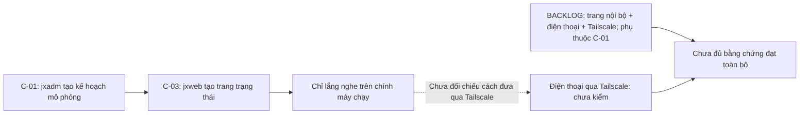

TÓM TẮT 1: [NGUỒN] Đã hoàn tất kiểm tĩnh C-03 theo BACKLOG; chưa đủ bằng chứng để công nhận C-03 ĐẠT.
TÓM TẮT 2: [NGUỒN] Có mã trang quản trị, giao diện cho màn hình hẹp và nguồn C-01 mô phỏng; nguồn: JX1_OPS/TOOLS/jxweb/app.py:73–105,198–264,301–315.
TÓM TẮT 3: [CHƯA KIỂM] Chưa xác minh mở trang trên điện thoại qua Tailscale và nghiệm thu đầy đủ phụ thuộc C-01; nguồn giới hạn: JX1_OPS/REPORTS/C-03-jxweb.md:53–57.
TÓM TẮT 4: [NGUỒN] Đầu ra kiểm tra là báo cáo này; bàn giao KV-02 tại JX1_OPS/REPORTS/KV-02.md. Không commit/push theo yêu cầu, Tổng quan tiếp nhận.
TÓM TẮT 5: [CHƯA KIỂM] Không chạy build, kiểm thử mã, exe, VM hoặc mạng trong KV-02; kết quả 6/6 chỉ dẫn lại báo cáo cũ, chưa chạy lại.
# KIEM-C-03 — Kiểm tiêu chí trang quản trị web nội bộ

Loại: kiểm thử
Chủ đề: Đối chiếu bằng chứng hiện có với yêu cầu C-03 trong BACKLOG, bằng đọc tĩnh.
Từ khóa: C-03, C-01, KV-02, trang quản trị, jxweb, jxadm, điện thoại, Tailscale, dry-run
Trạng thái: DONE — hoàn tất việc kiểm tĩnh; hạng mục được kiểm C-03 còn thiếu bằng chứng hoàn thành.
Độ phủ: đã đối chiếu 4/4 phần tử của yêu cầu và phụ thuộc; 1 ĐẠT về mã hiện có, 3 CHƯA KIỂM về nghiệm thu thực tế/phụ thuộc.
Liên quan: JX1_OPS/TASKS/BACKLOG.md; JX1_OPS/TASKS/KV-02.md; JX1_OPS/TASKS/C-03.md; JX1_OPS/REPORTS/C-03-jxweb.md; JX1_OPS/REPORTS/KV-02.md
Cần tôi quyết định: có — cần phạm vi vận hành được chủ máy duyệt riêng nếu muốn kiểm điện thoại/Tailscale; KV-02 không cấp quyền này.

Ngày kiểm: 19/11/2026. Nguồn hiện tại là các tệp trong worktree `D:\JX-wt\KV-02`, nhánh `task/KV-02`; không đồng nhất chúng với bản đang triển khai.

## Phạm vi và độ phủ

Chuẩn chấm là nguyên văn cột “Việc” và “Phụ thuộc” ở `JX1_OPS/TASKS/BACKLOG.md:48`: “Trang quản trị web nội bộ, xem được trên điện thoại qua Tailscale”, phụ thuộc C-01. Bốn hàng dưới tách câu này để tránh bỏ sót; không thêm điều kiện về dữ liệu thật, thao tác ghi hoặc tải.

“ĐẠT” trong hàng về mã nghĩa đã tìm thấy phần triển khai tương ứng. “CHƯA KIỂM” nghĩa chưa có đủ bằng chứng nghiệm thu trong nguồn đã đọc và không được chạy xác nhận ở KV-02. Không coi mã giao diện là bằng chứng đã dùng thành công trên điện thoại.

| Phần tử yêu cầu | Độ phủ | Kết quả | Bằng chứng và giới hạn |
|---|---|---|---|
| Có trang quản trị web nội bộ | Đã phủ bằng đọc tĩnh | ĐẠT về mã hiện có | `JX1_OPS/TOOLS/jxweb/app.py:198–264` dựng trang trạng thái máy chủ/tài khoản; `:301–315` xử lý trang chính và dữ liệu trạng thái. Chưa xác nhận tiến trình đang phục vụ. |
| Xem được trên điện thoại | Đã phủ phần thiết kế; chưa phủ sử dụng thực tế | CHƯA KIỂM | `JX1_OPS/TOOLS/jxweb/app.py:227–239` có khai báo khung nhìn, chữ 18 px, bố cục co giãn. `JX1_OPS/TOOLS/jxweb/test_jxweb.py:70–75` chỉ kiểm phản hồi HTML có khai báo khung nhìn, không mở trình duyệt điện thoại. |
| Điện thoại truy cập qua Tailscale | Đã đối chiếu giới hạn; chưa phủ đường truy cập thực tế | CHƯA KIỂM | `JX1_OPS/REPORTS/C-03-jxweb.md:39,55–56` ghi đưa qua Tailscale là việc riêng và chưa kiểm. `JX1_OPS/TOOLS/jxweb/app.py:40–53,368–386` chỉ cho lắng nghe trên địa chỉ của chính máy chạy; chưa có bằng chứng về thành phần chuyển tiếp trong nguồn được dẫn. |
| Phụ thuộc C-01 | Đã đối chiếu chỗ gọi; chưa phủ nghiệm thu toàn C-01 | CHƯA KIỂM | Phụ thuộc được nêu tại `JX1_OPS/TASKS/BACKLOG.md:48` và `JX1_OPS/TASKS/C-03.md:9`. `JX1_OPS/TOOLS/jxweb/app.py:56–65,76–103` nạp công cụ `jxadm` và gọi chức năng xem online dưới dạng kế hoạch mô phỏng; `JX1_OPS/TOOLS/jxadm/jxadm.py:95–99,137–142,155` trả kế hoạch, chưa xác nhận đầy đủ các yêu cầu C-01 ở BACKLOG dòng 46. |

Không mở rộng việc kiểm thành sửa mã, triển khai mạng hoặc nghiệm thu toàn bộ C-01. Kết quả CHƯA KIỂM của C-01 không phải kết luận C-01 bị lỗi.

## Giải mã tên

Không có tên kỹ năng, trang bị, quái, NPC hay bản đồ trong phạm vi này; không có tên game cần giải mã GBK/TCVN3. Các tên công cụ/ID được giữ nguyên:

| Tên gốc | Mã hóa | Chữ đúng UTF-8 / ý nghĩa | Nguồn file:dòng |
|---|---|---|---|
| C-03 / Tailscale | UTF-8 trong văn bản nguồn | Hạng mục trang quản trị, xem trên điện thoại qua Tailscale | `JX1_OPS/TASKS/BACKLOG.md:48` |
| C-01 | UTF-8 trong văn bản nguồn | Công cụ dòng lệnh quản lý tài khoản; phụ thuộc của C-03 | `JX1_OPS/TASKS/BACKLOG.md:46,48` |
| jxweb | UTF-8 trong báo cáo nguồn | Trang quản trị web nội bộ | `JX1_OPS/REPORTS/C-03-jxweb.md:1,14–18` |
| jxadm | UTF-8 trong mã nguồn | Công cụ tạo kế hoạch thao tác tài khoản, đang được trang web gọi ở chế độ mô phỏng | `JX1_OPS/TOOLS/jxweb/app.py:56–65,73–103` |

## Sắp theo cấu trúc game

Phạm vi là công cụ vận hành tài khoản, không phải dữ liệu phái/kỹ năng/trang bị/bản đồ. Báo cáo sắp theo chuỗi quản trị tài khoản: C-01 cung cấp kế hoạch → C-03 hiển thị trang → người dùng mở trên điện thoại qua Tailscale; sơ đồ và bảng phạm vi dùng cùng chuỗi này. Không đọc thêm dữ liệu game ngoài nguồn cần kiểm.

## Đối chiếu phần triển khai và báo cáo cũ

| Nội dung hỗ trợ đánh giá | Bằng chứng hiện tại | Mức xác minh |
|---|---|---|
| Trang có khu vực máy chủ, tài khoản và ghi chú | `JX1_OPS/TOOLS/jxweb/app.py:243–255,301–315` | ĐÃ XÁC MINH bằng đọc tĩnh; chưa kiểm trang đang chạy. |
| Dữ liệu là mô phỏng, không phải số người đang online thật | `JX1_OPS/TOOLS/jxweb/app.py:81–104` đặt trạng thái chưa xác minh; `JX1_OPS/TOOLS/jxadm/jxadm.py:95–99,137–142` chỉ tạo kế hoạch truy vấn | ĐÃ XÁC MINH giới hạn trong mã; không yêu cầu dữ liệu thật để thay đổi tiêu chí BACKLOG. |
| Giao diện có thiết kế cho màn hình hẹp | `JX1_OPS/TOOLS/jxweb/app.py:227–239` | ĐÃ XÁC MINH mã HTML/CSS; CHƯA XÁC MINH khả năng đọc/thao tác trên điện thoại thật. |
| Địa chỉ mặc định chỉ dùng trên chính máy chạy | `JX1_OPS/TOOLS/jxweb/app.py:32–33,40–53,368–386,392–403` | ĐÃ XÁC MINH bằng đọc tĩnh. Không thể chỉ nhập địa chỉ mặc định đó trên điện thoại để truy cập máy chạy trang web. |
| Điều kiện xác nhận khi gắn bộ thực hiện thao tác ghi | `JX1_OPS/TOOLS/jxweb/app.py:148–170,338–353` | ĐÃ XÁC MINH cấu trúc kiểm tra token và hai bước; mặc định chưa có bộ thực hiện ghi. Không kiểm giá trị token và không ghi token vào báo cáo. |
| Có sáu ca kiểm thử trong mã | `JX1_OPS/TOOLS/jxweb/test_jxweb.py:33,40,47,58,93,109` | ĐÃ XÁC MINH sự hiện diện; ca HTTP và IPv6 khởi tạo máy chủ nên không chạy trong task cấm mạng. |
| Báo cáo cũ ghi đã chạy sáu ca đạt | `JX1_OPS/REPORTS/C-03-jxweb.md:43–51`; `JX1_OPS/TASKS/C-03.md:31–35` | NGUỒN GIÁN TIẾP: kết quả lịch sử do báo cáo/task ghi lại; KV-02 không chạy lại và không có nhật ký chạy độc lập trong nguồn này. |

**Diễn giải giới hạn truy cập:** mã chỉ lắng nghe trên địa chỉ vòng nội bộ của chính máy. Đọc tĩnh chưa chứng minh đã có cách chuyển tiếp được duyệt để điện thoại tới trang qua Tailscale. Điều này không chứng minh Tailscale không thể dùng với thiết kế hiện tại; nó cho thấy còn thiếu bằng chứng về đường truy cập và việc mở trang thành công. Nguồn: `JX1_OPS/TOOLS/jxweb/app.py:40–53,368–386`; `JX1_OPS/REPORTS/C-03-jxweb.md:39,56`.

## Sổ thông số

Các giá trị dưới là mặc định/thiết kế trong mã, không phải số đo vận hành. Đánh giá “CẨN THẬN” không cấp quyền thay đổi cấu hình.

| Nhóm | Tên/hằng số | file:dòng | Giá trị | Đơn vị | Ảnh hưởng | Đổi an toàn | Nguồn đo |
|---|---|---|---|---|---|---|---|
| Truy cập | DEFAULT_BIND_HOST | `JX1_OPS/TOOLS/jxweb/app.py:32,40–53` | 127.0.0.1 | Địa chỉ IP vòng nội bộ | Chỉ dùng trên chính máy chạy; mọi địa chỉ không vòng nội bộ bị hàm kiểm tra từ chối | CẨN THẬN | Đọc tĩnh, chưa chạy |
| Truy cập | DEFAULT_PORT | `JX1_OPS/TOOLS/jxweb/app.py:33,371–372,394–395` | 8765 | Cổng TCP | Cổng mặc định của trang; chưa chứng minh đang lắng nghe | CẨN THẬN | Đọc tĩnh, chưa đo |
| Giao diện | min-width / font-size | `JX1_OPS/TOOLS/jxweb/app.py:233` | 280 / 18 | px | Bề rộng tối thiểu thân trang / cỡ chữ cơ sở; cần xem trên điện thoại | CẨN THẬN | Đọc CSS, chưa đo thực tế |
| Xác nhận ghi | ttl_seconds | `JX1_OPS/TOOLS/jxweb/app.py:127–139,158–170` | 300 | Giây | Thời hạn mặc định cho mã xác nhận dùng một lần | CẨN THẬN | Đọc tĩnh, chưa chạy |

## Đã xác minh / Chưa xác minh

**ĐÃ XÁC MINH:** câu yêu cầu và phụ thuộc trong BACKLOG; tệp triển khai tồn tại; mã tạo trang, thiết kế màn hình hẹp, chỗ gọi C-01 mô phỏng, giới hạn địa chỉ và sáu ca kiểm thử như dẫn ở các bảng trên. Mã/báo cáo đọc bằng UTF-8; không cần suy diễn tên mã hóa cũ.

**CHƯA XÁC MINH:** trang đang chạy; việc mở và đọc trang bằng trình duyệt điện thoại; cấu hình/đường truy cập Tailscale đã được duyệt và hoạt động; nghiệm thu đầy đủ C-01; kết quả kiểm thử mới của phiên bản hiện tại. Trạng thái tài khoản/máy chủ thật, thao tác ghi, tải và triển khai cũng chưa kiểm, nhưng không tự biến các mục này thành điều kiện bổ sung của C-03.

**Lệnh/test thực chạy trong KV-02:** chỉ Git status/branch một lần trước ghi, đọc tệp và tìm dòng bằng PowerShell, kiểm tra tài liệu sau ghi và xem diff. Không import/chạy mã Python, không khởi tạo máy chủ HTTP, không dùng trình duyệt, không kết nối SQL/Tailscale/VM; không chạy build/exe hay kiểm thử mã. Kết quả lịch sử 6/6 không thay thế nghiệm thu điện thoại/Tailscale.

## Phát hiện khi đối chiếu, giữ nguyên kết luận cũ

- Task C-03 ban đầu cho phép hoàn tất phần mã với kiểm thử offline và để việc đưa qua Tailscale cho chủ máy duyệt (`JX1_OPS/TASKS/C-03.md:21–28`). BACKLOG vẫn yêu cầu xem được trên điện thoại qua Tailscale (`JX1_OPS/TASKS/BACKLOG.md:48`). Vì vậy không dùng việc hoàn tất phần mã/offline để công nhận toàn bộ mục BACKLOG đã đạt.
- Báo cáo cũ tự ghi PARTIAL, 6/6 kiểm thử lịch sử và chưa kiểm Tailscale (`JX1_OPS/REPORTS/C-03-jxweb.md:3,43–57`). KV-02 giữ nguyên toàn bộ báo cáo/mã/task C-03, chỉ thêm kết quả đối chiếu riêng này.
- Nguồn dẫn tới mã `JX1_OPS/TOOLS/jxweb/app.py`, `test_jxweb.py` và `JX1_OPS/TOOLS/jxadm/jxadm.py` đã có trong worktree. Không cần dò các cây nguồn ngoài worktree, đọc dữ liệu tài khoản hoặc mở cấu hình bí mật.

## Đề xuất tối ưu và bước còn thiếu

Ưu tiên bổ sung bằng chứng thay vì thay thiết kế trong KV-02: sau khi chủ máy duyệt phạm vi vận hành riêng, ghi lại ngày kiểm, phiên bản mã, đường truy cập Tailscale đã che thông tin nhạy cảm và kết quả mở/đọc trang trên điện thoại. Đối chiếu thêm kết quả nghiệm thu C-01 theo phụ thuộc đã nêu; không suy nghiệm thu đầy đủ từ một lời gọi mô phỏng. Chỉ đóng C-03 khi có đủ bằng chứng cho từng yêu cầu còn CHƯA KIỂM.

## Bàn giao

- Hoàn tất nội dung kiểm tĩnh ngày 19/11/2026. Báo cáo kết thúc task: `JX1_OPS/REPORTS/KV-02.md`; mục Kết quả được bổ sung ở task KV-02. Không sửa nguồn hoặc kết luận cũ.
- Không stage, commit hoặc push theo yêu cầu; chưa có SHA của KV-02. Tổng quan nhận tài liệu để kiểm tra và commit hộ. Lỗi Git lịch sử của C-03 chỉ là thông tin trong báo cáo cũ, không phải lỗi Git vừa phát sinh ở KV-02.
- Lỗi công cụ: `rg` không có trong PATH, đã chuyển sang PowerShell; lần đầu hiển thị sai dấu do giải mã mặc định đã được đọc lại bằng UTF-8. Lỗi nhịp: thử ghi `D:\JX-wt\KV-02.nhip` ở mốc bắt đầu bị `Access to the path ... is denied`; đường dẫn nằm ngoài vùng sandbox cho phép ghi. Không đổi quyền, không thử vượt sandbox và không ghi được các mốc nhịp tiếp theo.
- Không tạo TSV ngoài vùng_file; đề xuất chỉ mục được ghi trong báo cáo bàn giao KV-02 để Tổng quan gộp nếu cần.
- Kỹ năng đã dùng: jx1-retrofit, jx1-read-server, jx1-read-client, jx1-parameters, jx1-knowledge, jx1-report. Đã nạp đủ sáu tệp `.agents/skills/*/SKILL.md`; áp dụng bảo toàn kết luận, đối chiếu tệp thật, giới hạn đọc tĩnh, sơ đồ, nhãn xác minh, sổ thông số và bàn giao. Không phát sinh nhu cầu đọc server/client game hoặc Graphify.

KẾT LUẬN: C-03 CHƯA ĐẠT, thiếu: bằng chứng mở và đọc được trang trên điện thoại qua Tailscale; bằng chứng nghiệm thu đầy đủ phụ thuộc C-01.
