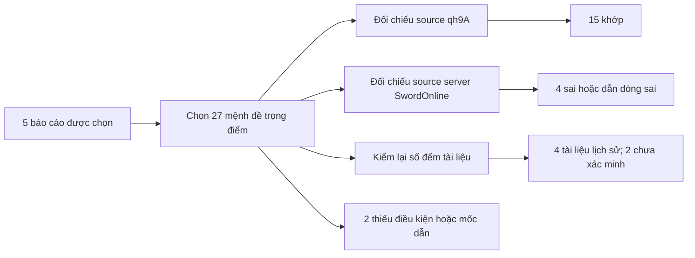

TÓM TẮT 1 [NGUỒN] PARTIAL: đã đối chiếu các khẳng định trọng điểm của H-04, A-05, K-02-nhan-vat, N-01 và R-07a với nguồn tĩnh được giao.
TÓM TẮT 2 [NGUỒN] Trong 27 đơn vị kiểm chéo: 15 khớp, 4 sai (2 A-05, 2 N-01), 2 thiếu điều kiện/dẫn dòng, 4 chỉ có tài liệu lịch sử và 2 chưa xác minh.
TÓM TẮT 3 [NGUỒN] Hai sai lệch A-05 là nhánh chat toàn kênh bị dừng trước khi gửi và điều kiện trạng thái ngủ chỉ nằm trong đoạn mã đã comment.
TÓM TẮT 4 [CHƯA KIỂM] Không build, chạy exe, VM, mạng hay kiểm thử runtime; một số nguồn lịch sử ngoài hai gốc được giao chưa đối chiếu.
TÓM TẮT 5 [NGUỒN] Đã ghi báo cáo và mục Kết quả cuối tệp task theo yêu cầu; không commit/push. Ghi nhịp ngoài worktree bị từ chối quyền; PM quyết định có giao vòng kiểm dẫn chứng còn lại.

# KC-01 — Kiểm chéo chất lượng năm báo cáo

Loại: tổng hợp
Chủ đề: Kiểm tra các khẳng định trọng điểm và dẫn chứng mã trong năm báo cáo được chọn.
Từ khóa: kiểm chéo, H-04, A-05, K-02, N-01, R-07a, qh9A, gs001, file:dòng
Trạng thái: PARTIAL — kiểm được 27 đơn vị trọng điểm; còn dẫn chứng lịch sử và chi tiết chưa kiểm kê hết.
Độ phủ: đã kiểm 27 đơn vị/27 đơn vị được xác định trong sổ bên dưới; đây không phải kiểm kê hết mọi dòng dẫn trong năm báo cáo.
Liên quan: `JX1_OPS/DESIGN/CHUAN-BAO-CAO.md`, `JX1_OPS/DESIGN/MUC-LUC-TRI-THUC.md`, H-04, A-05, K-02-nhan-vat, N-01, R-07a.
Cần tôi quyết định: có — PM cần giao tiếp phần còn lại nếu yêu cầu kiểm tra toàn bộ từng dẫn chứng.

## Phạm vi và độ phủ

Nguồn phạm vi lấy từ `JX1_OPS/TASKS/KC-01.md:20-31`. Đơn vị đếm trong bảng là báo cáo; các mệnh đề cụ thể và kết quả được phân rã ở sổ 27 dòng bên dưới. “Sai” gồm nhận định trái với mã đang hoạt động hoặc dẫn dòng không chỉ ra hành vi được mô tả. “TÀI LIỆU” là kết quả cũ được ghi trong báo cáo nhưng chưa tái tạo bằng nguồn/runtime. “CHƯA KIỂM” là điểm không thể kết luận từ các dòng đã mở.

| Phần tử phạm vi | Kết quả | Sổ kiểm |
|---|---|---|
| H-04 — hiệu ứng vũ khí | 5 mệnh đề; 3 khớp, 1 chỉ là ghi nhận tài liệu, 1 chưa xác minh | Bảng A |
| A-05 — tương tác player/server | 8 mệnh đề; 4 khớp, 2 sai, 2 thiếu điều kiện/dẫn dòng | Bảng B |
| K-02-nhan-vat — asset và luồng sprite | 3 mệnh đề code khớp, 1 số đếm asset chỉ là tài liệu trong phạm vi nguồn được giao | Bảng C |
| N-01 — Bishop Announcer | 2 mệnh đề khớp, 2 dẫn dòng sai | Bảng D |
| R-07a — chuẩn hóa năm báo cáo | 6 mệnh đề; 3 khớp, 2 lịch sử chỉ có tài liệu, 1 chưa đối chiếu | Bảng E |

## Sổ khẳng định và kết quả đối chiếu

### Bảng A — H-04

| ID | Khẳng định được kiểm | Kết quả và đối chiếu |
|---|---|---|
| H1 | Các mốc hiệu ứng +6, +12 và +15; chỉ nhân vật local ngoài menu | **THẤY — khớp.** Source qh9A chỉ vào nhánh nhân vật local khi không ở menu và chia ngưỡng 6/12/15: `D:/JX-build/qh9A/Classes/vn/gamecore/KNpcResVN.cpp:495-517`. |
| H2 | Sét gọi từ mức +12 sau bước chọn section vũ khí; mã có 4/6 runner ứng viên theo ngưỡng | **THẤY — khớp.** Gọi bolt nằm sau vòng glow section tại `D:/JX-build/qh9A/Classes/vn/gamecore/KNpcResVN.cpp:600-618`; `jxDrawBolts` chọn mức cao tại `D:/JX-build/qh9A/Classes/gamescene/KgameWorld.cpp:15088` rồi đặt 4/6 ứng viên tại :15240-15244. Đây là xác nhận source qh9A, không xác nhận APK qh7. |
| H3 | Lịch sử mốc báo cáo 61–67, các APK và kết quả thử cũ | **TÀI LIỆU.** H-04 ghi lại chuỗi này tại `JX1_OPS/REPORTS/H-04.md:82-103`, :119-132. Không mở bản gốc/APK lịch sử trong task này nên không nâng thành tái kiểm độc lập. |
| H4 | Quan hệ source native qh7 với APK qh7 và nguyên nhân lỗi mất khung | **CHƯA KIỂM.** Chính H-04 giữ đây là giới hạn tại `JX1_OPS/REPORTS/H-04.md:134-140`; source qh9A không chứng minh native của APK qh7. |
| H5 | Điều kiện nghỉ `t >= 16` không thể đạt khi `t` lấy modulo 16 | **THẤY — khớp.** Source đặt `JX_FR=16` tại `D:/JX-build/qh9A/Classes/gamescene/KgameWorld.cpp:15029`, lấy `t=(fr + (r * JX_FR) / nRun) % JX_FR` rồi kiểm `t >= 16` ở :15243-15245; H-04 đã nêu điểm này tại `JX1_OPS/REPORTS/H-04.md:115`. |

### Bảng B — A-05

| ID | Khẳng định được kiểm | Kết quả và đối chiếu |
|---|---|---|
| A1 | `KRegion::BroadCast` kiểm player/NPC hợp lệ, connection, và khoảng cách đang bị comment | **THẤY — khớp.** Mã hoạt động kiểm chỉ số player/NPC và `m_nNetConnectIdx >= 0`; phép tính khoảng cách nằm trong comment tại `C:/Jx1CocoV3/SwordOnline/SwordOnline/jxOnline/gameserver/Sources/Core/Src/KRegion.cpp:2251-2279`. |
| A2 | Đường broadcast đang hoạt động còn loại player ngủ | **THẤY — sai.** Điều kiện `m_bSleepMode == FALSE` chỉ thuộc vòng lặp đã comment tại `C:/Jx1CocoV3/SwordOnline/SwordOnline/jxOnline/gameserver/Sources/Core/Src/KRegion.cpp:2233-2249`; vòng hoạt động `:2251-2279` không có điều kiện này. A-05 mô tả điều kiện comment thành filter hiện hành tại `JX1_OPS/REPORTS/A-05-diem-tuong-tac-gs001.md:52`, :71. |
| A3 | Gửi sync một client đi đường trực tiếp, tách với broadcast vùng | **THẤY — khớp.** `SendSyncData` gọi direct `PackDataToClient` khi `bBroadCast` false tại `C:/Jx1CocoV3/SwordOnline/SwordOnline/jxOnline/gameserver/Sources/Core/Src/KNpc.cpp:7712-7718`; `SendDataToNearRegion` đi qua broadcast tại :14123-14135. |
| A4 | Tìm mục tiêu/quan hệ không tự xác nhận kết nối mạng; `CanCastSkill` còn kiểm giới hạn trang bị | **THẤY — thiếu một dẫn dòng.** `FindNpc` dùng ô và quan hệ tại `C:/Jx1CocoV3/SwordOnline/SwordOnline/jxOnline/gameserver/Sources/Core/Src/KRegion.h:408-440`; `FindAroundPlayer` tra vùng lân cận tại `C:/Jx1CocoV3/SwordOnline/SwordOnline/jxOnline/gameserver/Sources/Core/Src/KPlayer.cpp:2361-2381`; `GetRelation` tính quan hệ gameplay tại `C:/Jx1CocoV3/SwordOnline/SwordOnline/jxOnline/gameserver/Sources/Core/Src/KNpcSet.cpp:1813-2042`. Các đoạn này không kiểm `m_nNetConnectIdx`. Hàng `CanCastSkill` của A-05 nói thêm về giới hạn trang bị nhưng chỉ dẫn `C:/Jx1CocoV3/SwordOnline/SwordOnline/jxOnline/gameserver/Sources/Core/Src/KSkills.cpp:221-265`; kiểm điều kiện trang bị nằm ở `C:/Jx1CocoV3/SwordOnline/SwordOnline/jxOnline/gameserver/Sources/Core/Src/KSkills.cpp:267-291`, nên mốc tại `JX1_OPS/REPORTS/A-05-diem-tuong-tac-gs001.md:97` thiếu phần đó. |
| A5 | AoE tìm mục tiêu rồi xử lý sát thương mà không dùng filter kết nối làm filter viewer | **THẤY — khớp.** `ProcessCollision` gọi `FindNpc` rồi `ProcessDamage` tại `C:/Jx1CocoV3/SwordOnline/SwordOnline/jxOnline/gameserver/Sources/Core/Src/KMissle.cpp:1830-1852`; `ReceiveDamage` kiểm chỉ số/trạng thái combat, không kiểm connection tại `C:/Jx1CocoV3/SwordOnline/SwordOnline/jxOnline/gameserver/Sources/Core/Src/KNpc.cpp:4466-4477`. |
| A6 | Relay nhóm xác thực identity, còn một số broadcast/team/group loop gửi trực tiếp theo danh sách | **THẤY — thiếu điều kiện.** `CheckPlayerID` so net index, player index và character ID tại `C:/Jx1CocoV3/SwordOnline/SwordOnline/jxOnline/gameserver/Sources/MultiServer/GameServer/KSOServer.cpp:6787-6805`; nhưng `ChatGroupMan` chỉ gọi nó trong nhánh `hasIdentify` tại :2814-2823. Nhánh còn lại chỉ kiểm blacklist rồi gửi tại cùng tệp :2825-2833. Các loop `BroadcastLocalServer` và faction/tong được mô tả đúng tại `C:/Jx1CocoV3/SwordOnline/SwordOnline/jxOnline/gameserver/Sources/Core/Src/KNewProtocolProcess.cpp:167-177`, `C:/Jx1CocoV3/SwordOnline/SwordOnline/jxOnline/gameserver/Sources/Core/Src/CoreServerShell.cpp:2833-2841`, :2861-2869. A-05 chưa nêu điều kiện `hasIdentify` tại `JX1_OPS/REPORTS/A-05-diem-tuong-tac-gs001.md:171-172`. |
| A7 | Trade có đường tạo trạng thái dựa `FindAroundPlayer`; thao tác quyết định sau đó có guard kết nối riêng | **THẤY — khớp.** Bắt đầu trade đặt trạng thái và gửi lời mời tại `C:/Jx1CocoV3/SwordOnline/SwordOnline/jxOnline/gameserver/Sources/Core/Src/KPlayer.cpp:6614-6632`; phản hồi tạo hai state tại :7106-7113. `TradeDecision` kiểm cả hai kết nối tại :6724-6730. Khẳng định về một guard chung trước mọi thao tác sẽ vượt quá bằng chứng. |
| A8 | Nhánh chat toàn kênh duyệt PlayerSet và gửi gói | **THẤY — sai về khả năng chạy của đoạn được dẫn.** Nhánh `CHAT_CUR_CHANNEL_ALL` thoát bằng `break` ở `C:/Jx1CocoV3/SwordOnline/SwordOnline/jxOnline/gameserver/Sources/Core/Src/KPlayerChat.cpp:447` trước đoạn đặt timer và vòng gửi tại :449-470. A-05 mô tả vòng gửi như đường hiện hành tại `JX1_OPS/REPORTS/A-05-diem-tuong-tac-gs001.md:164`; mã có vòng đó nhưng nó không được thực thi qua nhánh này. |

### Bảng C — K-02-nhan-vat

| ID | Khẳng định được kiểm | Kết quả và đối chiếu |
|---|---|---|
| K1 | Khung dữ liệu có 6 nhóm, 4 section mỗi nhóm, sức chứa 24 | **THẤY — khớp.** `D:/JX-build/qh9A/Classes/gamecore/KNpcResNode.h:23-25`. |
| K2 | Nhánh cập nhật part lặp 5 loại part enum và hai layer | **THẤY — khớp.** `UpdateActionNormal` lặp `emNPCRES_PART_COUNT` và `emNPCRES_PART_LAYER_COUNT` tại `D:/JX-build/qh9A/Classes/gamecore/KNpcRes.cpp:1705-1713`; enum có 5 loại và 2 layer tại `D:/JX-build/qh9A/Classes/gamecore/CoreUseNameDef.h:8-24`; effect layer dựng hậu tố riêng ở `D:/JX-build/qh9A/Classes/gamecore/KNpcResNode.cpp:147-171`. |
| K3 | Sort/render chọn bảng theo NPC/action/hướng/khung rồi vẽ hai layer | **THẤY — khớp.** Nạp tên bảng sort tại `D:/JX-build/qh9A/Classes/gamecore/KNpcResNode.cpp:365-369`; `GetnSort` tách NPC thường/đặc biệt tại :612-630; tra theo action, hướng và frame tại :1390-1476; Draw lặp sort/layer tại `D:/JX-build/qh9A/Classes/gamecore/KNpcRes.cpp:427-429`, :669-685. |
| K4 | Các tổng số file/byte của asset được nêu trong báo cáo | **TÀI LIỆU — chưa kiểm lại trong gốc được giao.** K-02 ghi số đếm tại `JX1_OPS/REPORTS/K-02-nhan-vat.md:31-40`, :74-84; task KC-01 giới hạn source code ở qh9A và SwordOnline, nên các bảng dữ liệu asset không được tính là đối chiếu mã độc lập trong sổ này. Member PAK và metadata sprite vẫn chưa kiểm theo `JX1_OPS/REPORTS/K-02-nhan-vat.md:98-104`. |

### Bảng D — N-01

| ID | Khẳng định được kiểm | Kết quả và đối chiếu |
|---|---|---|
| N1 | Packet `s2c_gateway_broadcast` có giá trị 60; các kiểu lệnh là 1/2/3 | **THẤY — khớp.** Enum đặt mốc `s2c_multiserverbegin=48`; 11 loại tiếp theo đi trước packet này, nên symbol ở dòng 48 có giá trị 60 tại `D:/JX-build/qh9A/Classes/gamecore/KProtocolDef.h:36-49`. Các lệnh 1/2/3 ở `D:/JX-build/qh9A/Classes/gamecore/KProtocol.h:1526-1535`. |
| N2 | Bishop chọn mặc định thông báo, có chế độ gửi mọi GS hoặc một GS | **THẤY — sai một dẫn dòng trong báo cáo.** Mã chọn mặc định và nhánh gửi all/single khớp tại `C:/Jx1CocoV3/SwordOnline/SwordOnline/jxOnline/gateway/Sources/MultiServer/Bishop/Application.cpp:1061-1089`, :1373-1396; nhãn thật ở `C:/Jx1CocoV3/SwordOnline/SwordOnline/jxOnline/gateway/Sources/MultiServer/Bishop/Bishop.rc:163-167`. Bảng giải mã tên của N-01 lại trỏ nhãn sang `JX1_OPS/REPORTS/N-01.md:82-86` với dòng Bishop.rc 170-230, không chứa các nhãn đó. |
| N3 | Hai kiểu có dấu * gửi cảnh báo, đưa toàn player ra và giải phóng DB; source không gọi dừng tiến trình | **THẤY — khớp theo đoạn xử lý được đọc.** `GatewayBoardCastProcess` gọi `ExitAllPlayer()` và `ReleaseDbData()` ở `C:/Jx1CocoV3/SwordOnline/SwordOnline/jxOnline/gameserver/Sources/MultiServer/GameServer/KSOServer.cpp:4290-4331`; dòng đặt `SetRunningStatus(FALSE)` bị comment ở :4308, :4331. Không suy trạng thái runtime. |
| N4 | Dẫn dòng client được ghi cho đường nhận chat và UI list | **THẤY — sai dẫn chiếu.** `D:/JX-build/qh9A/Classes/gamecore/KProtocolProcess.cpp:4303-4312` là xử lý thông báo channel ID; `D:/JX-build/qh9A/Classes/gamescene/KgameWorld.cpp:13130-13184` là ghi cài đặt/thay ảnh kỹ năng. Đường chat hiện tại ở `D:/JX-build/qh9A/Classes/gamecore/KProtocolProcess.cpp:4316-4336`, `D:/JX-build/qh9A/Classes/gamescene/KgameWorld.cpp:13263-13317`, `D:/JX-build/qh9A/Classes/gameui/Kuiplayerfun.cpp:3338-3359`. N-01 dẫn các dòng lệch tại `JX1_OPS/REPORTS/N-01.md:110`; nội dung tổng quát có đường nhận nhưng các bằng chứng đó không đỡ được nó. Điều kiện localization/UI đang nạp chưa xác minh runtime. |

### Bảng E — R-07a

| ID | Khẳng định được kiểm | Kết quả và đối chiếu |
|---|---|---|
| R1 | Source qh9A có `g_jxAdditive` và gọi `jxDrawBolts` | **THẤY — khớp với source hiện tại.** `D:/JX-build/qh9A/Classes/gamescene/KgameWorld.cpp:14993-15002`, :15025 và `D:/JX-build/qh9A/Classes/vn/gamecore/KNpcResVN.cpp:617-618`. Điều này không tự xác nhận bản nguồn/nhị phân trong lượt khảo sát cũ của L-01. |
| R2 | `JX_L02_SUBPIXEL=1`, `JX_L02_TARGET_FPS=60` ở source qh9A | **THẤY — khớp.** `D:/JX-build/qh9A/Classes/L02RenderTrial.h:4-12`; đặt khoảng vẽ theo macro ở `D:/JX-build/qh9A/Classes/AppDelegate.cpp:118-120`. |
| R3 | `versionCode` hiện tại ở qh9A là 20 | **THẤY — khớp.** `D:/JX-build/qh9A/proj.android/app/build.gradle:13-14`. |
| R4 | Hai shader khớp baseline cũ, còn `KNpcResVN.cpp` khác hash | **CHƯA KIỂM.** Chưa lấy hash độc lập và chưa được giao baseline cũ để so; thông tin lịch sử nằm ở `JX1_OPS/REPORTS/R-07a.md:49-50`. |
| R5 | JIBS ghi nhận trạng thái A-06 ở một thời điểm; thư mục GS được khảo sát không có một số mã C++ | **TÀI LIỆU.** Đây là so sánh bối cảnh cũ được chép tại `JX1_OPS/REPORTS/R-07a.md:48`; task KC-01 không mở đủ gốc JIBS/A-06 và mọi cây GS để tái lập toàn bộ nhận xét lịch sử. |
| R6 | M-01 còn thiếu các nhóm số đo bộ nhớ được liệt kê | **TÀI LIỆU.** Nhận xét chép lại ở `JX1_OPS/REPORTS/R-07a.md:52`; không mở M-01 và không đo máy/VM trong task này. |

## Tổng hợp lỗi và phần thiếu

Trong 27 mệnh đề đã chọn để kiểm, 15 mệnh đề khớp bằng source hiện có; 4 sai gồm hai điểm A-05 và hai cụm dẫn dòng N-01; 2 thiếu điều kiện hoặc mốc dẫn; 4 điểm chỉ có bằng chứng tài liệu lịch sử và 2 điểm chưa có phép đối chiếu độc lập. Con số 27 là tập kiểm có liệt kê ở các bảng A–E, không phải số mọi câu chứa `file:dòng` trong năm báo cáo.

Hai sai lệch A-05 cần PM chuyển thành việc sửa báo cáo hoặc khảo sát tiếp, không được sửa trong KC-01: nhánh chat toàn kênh có `break` trước vòng gửi; filter ngủ bị trích từ phần comment. N-01 cần sửa hai nhóm dẫn dòng: nhãn Bishop trỏ nhầm vùng Bishop.rc, và các dòng client không đúng `s2cExtendChat`, `ChannelMessageArrival` hay hàm UI.

Các hạng mục chưa đóng là lịch sử APK/hash và kiểm thử qh7 của H-04, provenance/baseline cũ ở R-07a, nội dung member bên trong gói sprite của K-02, trạng thái localization/runtime N-01 và các claim chi tiết ngoài 27 đơn vị đã lập. Không suy diễn từ source sang binary.

## Giải mã tên

Không có tên riêng kỹ năng, trang bị, NPC/quái hoặc bản đồ tiếng Hán/TCVN3 mới phát sinh trong phần kiểm chéo. Các tên gốc/ID bên dưới là mã báo cáo, tên chương trình hoặc symbol ASCII; giữ nguyên để tra cứu.

| Tên gốc | Mã hóa | Chữ đúng / nghĩa trong báo cáo | Nguồn file:dòng |
|---|---|---|---|
| `H-04`, `A-05`, `K-02-nhan-vat`, `N-01`, `R-07a`, `KC-01` | ID ASCII | Mã nhiệm vụ/báo cáo, không chuyển mã | `JX1_OPS/TASKS/KC-01.md:2-18`; `JX1_OPS/REPORTS/H-04.md:10`; `A-05-diem-tuong-tac-gs001.md:7`; `K-02-nhan-vat.md:7`; `N-01.md:7`; `R-07a.md:7` |
| `Bishop`, `Announcer` | Tên giao diện tiếng Anh | Công cụ và mục gửi thông báo | `C:/Jx1CocoV3/SwordOnline/SwordOnline/jxOnline/gateway/Sources/MultiServer/Bishop/Bishop.rc:163-167` |
| `qh9A`, `SwordOnline`, `gs001` | Alias/tên cây nguồn | Nhãn root được dùng để phân biệt các gốc tĩnh; không phải tên trong game | `JX1_OPS/TASKS/KC-01.md:23-26`; `JX1_OPS/REPORTS/A-05-diem-tuong-tac-gs001.md:58` |
| `KRegion::BroadCast`, `KNpc::SendSyncData`, `KSkill::CastInitiativeSkill`, `KgameWorld::ChannelMessageArrival`, `Kuiplayerfun::NewChannelMessageArrival` | Identifier ASCII | Symbol hàm; giữ nguyên để định vị source | `C:/Jx1CocoV3/SwordOnline/SwordOnline/jxOnline/gameserver/Sources/Core/Src/KRegion.cpp:2223`; `C:/Jx1CocoV3/SwordOnline/SwordOnline/jxOnline/gameserver/Sources/Core/Src/KNpc.cpp:7663`; `C:/Jx1CocoV3/SwordOnline/SwordOnline/jxOnline/gameserver/Sources/Core/Src/KSkills.cpp:3348`; `D:/JX-build/qh9A/Classes/gamescene/KgameWorld.cpp:13263`; `D:/JX-build/qh9A/Classes/gameui/Kuiplayerfun.cpp:3338` |
| `s2c_gateway_broadcast`, `AP_WARNING_ALL_PLAYER_QUIT`, `AP_NOTIFY_GAMESERVER_SAFECLOSE`, `AP_NOTIFY_ALL_PLAYER` | Identifier ASCII | Loại packet và giá trị lệnh; giữ nguyên | `D:/JX-build/qh9A/Classes/gamecore/KProtocolDef.h:48`; `D:/JX-build/qh9A/Classes/gamecore/KProtocol.h:1526-1528` |
| `SPR`, `PAK`, `PNG`, `GBK`, `TCVN3`, `UTF-8` | Viết tắt ASCII | Định dạng asset hoặc mã hóa | `JX1_OPS/REPORTS/K-02-nhan-vat.md:43-54`; `JX1_OPS/DESIGN/CHUAN-BAO-CAO.md:18-19` |

## Sắp theo cấu trúc game

| Thứ tự luồng | Phần đối chiếu | Báo cáo và mệnh đề |
|---|---|---|
| 1. Asset và dựng nhân vật | Nhóm part → layer → chọn sort theo action/hướng/frame → vẽ sprite | K-02; H-04 effect trên vũ khí (H1–H2) |
| 2. Server tương tác | Đồng bộ vùng/direct → tìm mục tiêu → damage/AoE → team, bang, relay → trade → chat → PK → đếm/ranking | A-05; các dẫn chứng được chọn ở A1–A8 |
| 3. Quản trị thông báo | Bishop chọn lệnh → packet gateway → GS xử lý → client nhận chat/UI | N-01; N1–N4 |
| 4. So sánh báo cáo cũ | Chia dữ kiện code hiện tại, số đếm và ghi nhận lịch sử | H-04, K-02, R-07a; trạng thái riêng tại A–E |

## Đã xác minh / Chưa xác minh

**ĐÃ XÁC MINH:** đọc trực tiếp các dòng source nêu ở A–E và đối chiếu bốn lỗi A-05/N-01 với nhánh code hiện hành. Không tái kiểm số đếm asset trong K-02 vì các bảng asset không phải mã nguồn trong hai gốc được giao. Cây server dùng để đối chiếu là `C:/Jx1CocoV3/SwordOnline/SwordOnline/jxOnline/gameserver/Sources`; client là `D:/JX-build/qh9A`.

**CHƯA XÁC MINH:** chưa kiểm mọi dẫn chứng trong thân của cả năm báo cáo; các baseline/hashes APK cũ, kết quả runtime, nội dung bên trong PAK và giá trị localization đang nạp không được tái lập. Không build, chạy exe, VM, test, hoặc mạng theo phạm vi.

## Kiểm tra, lỗi và bàn giao

- Đã dùng `rg -n` tìm có giới hạn; `rg` không có trong PATH nên chuyển một lần sang `Select-String`/`Get-Content` với các tệp và khoảng dòng đã chọn. Không tạo parser hoặc script phụ.
- Một lượt dò tên tệp bằng `Get-ChildItem -Recurse` có chứa pattern rộng `build.gradle`, trả về quá nhiều kết quả; đã dừng và không dùng output làm bằng chứng. Một span client bị xuất lặp một lần, không tính thành đơn vị kiểm thứ hai.
- Phần kiểm chéo K-02 chỉ áp dụng cho luồng source part/layer/sort/render; các số đếm thư mục và member PAK trong báo cáo cũ được phân loại TÀI LIỆU, không kiểm lại trong lượt này.
- Ghi `D:\JX-wt\KC-01.nhip` bị `Access denied`; không tạo được nhịp ở vị trí ngoài worktree.
- Một lượt đếm asset dùng recursion trên `Resources` và các thư mục dữ liệu `Settings/NpcRes`/`pak`; một số nguồn nằm ngoài hai root code được giao. Không dùng kết quả đếm làm bằng chứng, không đọc payload; K4 được phân loại TÀI LIỆU.
- Đã thêm mục `## Kết quả` 3 dòng cuối vào `JX1_OPS/TASKS/KC-01.md`, theo yêu cầu bàn giao của task.
- Không tạo `_CHIMUC/KC-01.tsv`: vùng file được giao chỉ nêu báo cáo kiểm chéo; PM có thể lập chỉ mục khi gộp.
- Không stage/commit/push theo yêu cầu. Chưa có SHA.
- liên quan: `JX1_OPS/DESIGN/CHUAN-BAO-CAO.md`, `JX1_OPS/DESIGN/MUC-LUC-TRI-THUC.md`, H-04, A-05, K-02-nhan-vat, N-01, R-07a.

## Kết quả

- **PARTIAL:** đã đối chiếu 27 mệnh đề trọng điểm trong năm báo cáo: 15 khớp, 4 sai, 2 thiếu điều kiện/mốc dẫn, 4 chỉ có bằng chứng tài liệu lịch sử, 2 chưa kiểm độc lập.
- Hai lỗi A-05 và cụm dẫn dòng N-01 được ghi rõ theo file:dòng; không sửa kết luận/báo cáo gốc.
- Còn vòng kiểm toàn bộ dẫn chứng, các nguồn lịch sử APK/hash và các điểm runtime. Không build, exe, VM, mạng; không commit/push.

Kỹ năng đã dùng: jx1-retrofit, jx1-read-server, jx1-read-client, jx1-parameters, jx1-knowledge, jx1-report.
