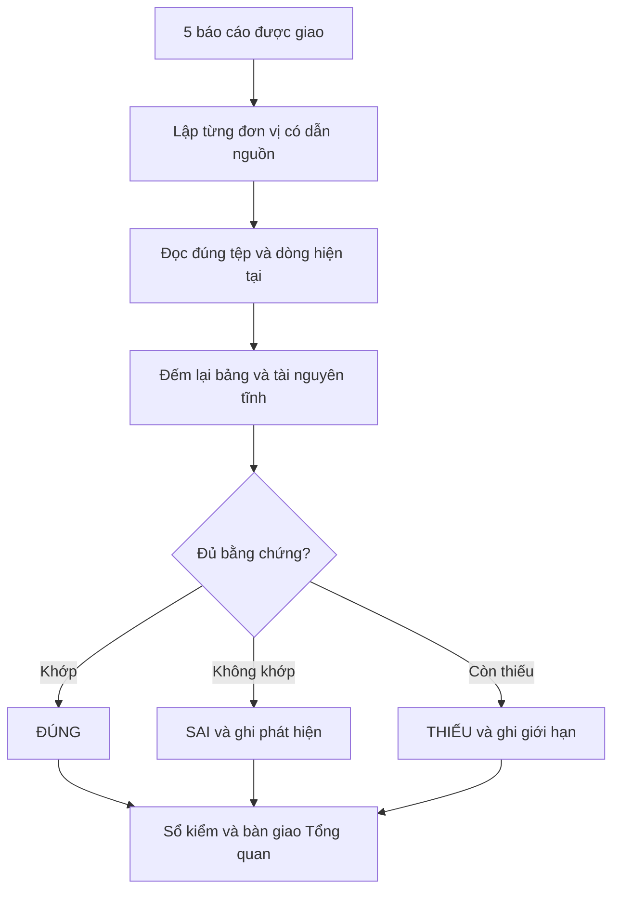

TÓM TẮT 1 [NGUỒN] [THẤY]: DONE — đã kiểm chéo đủ 5 báo cáo, lập sổ 353 đơn vị đối chiếu; cách đếm và từng vị trí nằm bên dưới.
TÓM TẮT 2 [NGUỒN] [THẤY]: 341 đơn vị ĐÚNG, 6 đơn vị SAI và 6 đơn vị THIẾU; 6 dòng sai thuộc 5 phát hiện, không phải 6 lỗi gameplay.
TÓM TẮT 3 [NGUỒN] [THẤY]: Tái lập được các tổng NPC, 188 bản ghi kỹ năng, dữ liệu Tống Kim và bản đồ; giữ nguyên cả 5 báo cáo gốc.
TÓM TẮT 4 [CHƯA KIỂM]: Các phần thiếu gồm điều kiện biên dịch, nguồn dẫn tiếp và lịch sử khảo sát; xem mục “Sáu đơn vị thiếu bằng chứng/điều kiện”.
TÓM TẮT 5 [CHƯA KIỂM]: Không chạy build, exe game/server, Lua game, VM, mạng hay test trong game; không commit/push, Tổng quan nhận bàn giao.

# KC-02 — Kiểm chéo chất lượng 5 báo cáo

Loại: kiểm thử
Chủ đề: Đối chiếu khẳng định và dẫn chứng của I-03, I-05, A-15b, A-16, K-02-ban-do với nguồn tĩnh hiện có.
Từ khóa: kiểm chéo, chất lượng, NPC, AIParam10, ActionScript, SkillId, JoinMission, MapList, WorldSet, PAK
Trạng thái: DONE — hoàn tất sổ kiểm và nêu riêng phần thiếu; kết quả là kiểm chéo tĩnh.
Độ phủ: 5/5 báo cáo; 353/353 đơn vị đã có kết quả chấm, gồm 188/188 dòng catalog kỹ năng; 6 đơn vị còn thiếu bằng chứng hoặc thiếu điều kiện trong lời giải thích.
Liên quan: JX1_OPS/TASKS/KC-02.md; JX1_OPS/TASKS/KC-01.md; JX1_OPS/DESIGN/CHUAN-BAO-CAO.md; JX1_OPS/REPORTS/KC-02.md.
Cần tôi quyết định: không.



## Phạm vi và độ phủ

[THẤY] Năm tệp được chọn đúng danh sách KC-02. Các báo cáo của KC-01 là nhóm khác theo `JX1_OPS/TASKS/KC-01.md:19`. Đơn vị “đã phủ” ở bảng này nghĩa là đã có phán định trong sổ, kể cả phán định THIẾU; không có nghĩa mọi lời khẳng định đều được chứng minh đúng.

| Báo cáo trong JX1_OPS/REPORTS | Đơn vị | ĐÚNG | SAI | THIẾU | Độ phủ sổ kiểm |
|---|---:|---:|---:|---:|---|
| I-03-khao-sat-quai-vat.md | 48 | 45 | 2 | 1 | [THẤY] Đã phủ 48/48; vị trí chi tiết ở sổ I-03 |
| I-05-npc-chuc-nang.md | 26 | 23 | 1 | 2 | [THẤY] Đã phủ 26/26; vị trí chi tiết ở sổ I-05 |
| A-15b-ky-nang-phai-5-8.md | 212 | 210 | 0 | 2 | [THẤY] Đã phủ 212/212, có 188 dòng catalog |
| A-16-tong-kim.md | 28 | 26 | 1 | 1 | [THẤY] Đã phủ 28/28; có khối kết quả tìm âm |
| K-02-ban-do.md | 39 | 37 | 2 | 0 | [THẤY] Đã phủ 39/39; có hai hàng bàn giao |
| Tổng | 353 | 341 | 6 | 6 | [THẤY] Có đủ 353 hàng trong hai sổ bên dưới |

### Cách đếm để không nhầm mẫu số

[THẤY] Một đơn vị chấm là một dòng văn bản hoặc một hàng bảng có dẫn `file:dòng` trong phần chuyên môn của bản gốc. Dòng có nhiều ý được chấm SAI nếu có ít nhất một ý/dẫn chứng sai; nếu chưa sai nhưng còn thiếu bằng chứng hoặc điều kiện quan trọng thì chấm THIẾU. Không đổi một dòng thành hàng chục điểm chỉ vì nó chứa nhiều trường.

[THẤY] Có 350 dòng dẫn nguồn thuộc các đoạn đã lập sổ: I-03 dòng 29–43, 65–182, 186–188, 194–201, 224–260, 264–266; I-05 dòng 28–42, 57–90, 124–125; A-15b dòng 21–55, 59–241, 251–304, 308–309; A-16 dòng 23–90; K-02 dòng 41–47, 55–68, 76–88, 96–111, 115–168. Chỉ lấy dòng có dẫn tệp và số dòng; loại hàng tiêu đề bảng I-03:79 vì không phải một khẳng định. Thêm 3 đơn vị có ý nghĩa bàn giao: khối tìm âm A-16:60–68 và hai hàng K-02:188,194. Tổng là 353. Nguồn định danh là đúng năm tệp ở bảng phạm vi; số dòng bắt đầu từ 1.

[THẤY] Tóm tắt, khối thông tin và bảng nhắc lại được kiểm với phần thân tương ứng; không chấm lặp phần tóm tắt. Các số tổng không có dẫn riêng ở từng hàng được đếm lại trong mục “Đối chứng số liệu”. Câu mô tả một ca thử tương lai không được nhận là kết quả test đã chạy. Hai hàng bàn giao cùng sai một đường dẫn được tính thành hai dòng sai nhưng chỉ một phát hiện F05.

[THẤY] Mỗi hàng sổ có nhãn độ chắc và hai đầu đối chiếu. Tên báo cáo ở cột “Vị trí gốc” là tệp nằm trong `JX1_OPS/REPORTS/`. ĐÚNG chỉ xác nhận nội dung tĩnh và những giới hạn đã nói rõ. [TÀI LIỆU] là thông tin dẫn lại/lịch sử chưa có bằng chứng độc lập trong KC-02. [CHƯA KIỂM] là việc chưa tái lập trong lượt này.

## Gốc nguồn, danh sách đọc và phiên bản

[THẤY] Dùng đúng các nguồn mà năm báo cáo dẫn. Không dùng một root client để thay cho root khác. Nguồn dẫn theo các tiền tố sau:

| Tiền tố trong KC-02 | Gốc chỉ đọc |
|---|---|
| G/ | C:/Jx1CocoV3/Folder/ServerNew-20260116T043145Z-3-001/ServerNew/_bin_v2_/gs/ |
| S/ | D:/JX-source/server/jxOnline/gameserver/Sources/Core/Src/ |
| E/ | D:/JX-source/server/jxOnline/gameserver/Sources/Engine/Src/ |
| H/ | D:/JX-source/server/jxOnline/header/ |
| SH/ | D:/JX-source/server/jxOnline/gameserver/Headers/ |
| T/ | D:/JX-build/src18/jxOnline/gameserver/Sources/ |
| A/ | D:/JX-build/qh9A/ |
| C/ | C:/Jx1CocoV3/Folder/Client2912-20260116T044348Z-3-001/Client2912/Client/Classes/ |

[THẤY] Danh sách đọc xuất phát từ năm báo cáo: `Npcs.txt`, `Skills.txt`, `MapList.ini`, `WorldSet_gs001.ini`, bảng golden, buysell/goods/Station, faction/MonPhai, mission/timer/rank; đúng các Lua và C++ có tên trong sổ. Đọc/đếm riêng hai thư mục bảng rơi, `settings/battles/maps`, `maps/fongkieu`, các thư mục bản đồ phụ client được dẫn và danh mục hai APK. Với `script.pak`/`skill.pak` chỉ đọc header/chỉ mục để dò mã .wor. Các RAR chỉ đọc 8 byte chữ ký và metadata. Không quét toàn Folder, SwordOnline hay ổ D:.

[THẤY] Nguồn bổ trợ đọc hẹp: E-05b dòng 28–33 và các dòng tìm đúng SKILL/verify_kill/persistence; K-03c:54,63 và _CHIMUC/K-03c.tsv:994; TASKS/I-05.md:11; TASKS/BACKLOG.md:89. Chỉ kiểm sự tồn tại TASKS/H-09.md, không đọc nội dung. Hai context/index của skill chỉ tìm mục liên quan; không đọc toàn kho.

[THẤY] Đã so SHA-256 giữa hai bản server cho 12 tệp KCore.cpp, KSubWorldSet.cpp, KSubWorld.cpp, KRegion.cpp, KRegion.h, Scene/SceneDataDef.h và 6 tệp Engine KFilePath.cpp, XPackFile.h, XPackFile.cpp, KPakList.cpp, KIniFile.cpp, KPakFile.cpp: từng cặp giống byte. Điều này cho phép kiểm lại những đoạn trùng mà vẫn giữ root T/ cho dẫn chứng K-02. Các tệp client được kiểm riêng: KProtocolProcess.cpp ở A/ và C/ khác byte; không trộn dòng 2527 của A với dòng 2522 của C. Bằng chứng chức năng tại `A/Classes/gamecore/KProtocolProcess.cpp:2527` và `C/gamecore/KProtocolProcess.cpp:2522`.

[THẤY] Ba bảng gốc khớp byte/hash mà I-03 ghi tại `I-03-khao-sat-quai-vat.md:55–59`:

| Tệp | Byte | SHA-256 đọc lại |
|---|---:|---|
| G/Settings/Npcs.txt | 753810 | c4aaa27fb06811effb23d7f8d12fef1f9d9f82164e74e00f86ac4bf5119389e7 |
| G/Settings/MapList.ini | 198453 | 46c4a3d27a1fe7bcdea73d294b255ed84d9d0ed9c236afe856effe62fd1702a9 |
| G/Settings/npc/NpcGoldTemplate.txt | 3117 | 406ea5e701c57b0d4129b3732ebe2d4248ca850a7e9e0749db22da24632f9c28 |

## Giải mã tên

[THẤY] Tài liệu này chỉ gọi đích danh các phái, hai bản đồ và mẫu NPC dưới đây; sổ kỹ năng dùng ID để không sao chép lại catalog. Giữ tên gốc và số ID. Nguồn Hán đọc GBK/CP936, tên Việt cũ đọc TCVN3, tài liệu mới ghi UTF-8 không BOM.

| Tên gốc | Mã hóa | Chữ đúng | Nguồn file:dòng |
|---|---|---|---|
| emei / 峨嵋派 | ASCII / GBK | Nga My, cũng ghi Nga Mi (峨嵋派), faction 4 | G/Settings/faction/faction.ini:34–38; G/Settings/faction/MonPhai.ini:26–29 |
| cuiyan / 翠烟门 | ASCII / GBK | Thúy Yên (翠烟门), faction 5 | G/Settings/faction/faction.ini:41–45; G/Settings/faction/MonPhai.ini:31–34 |
| gaibang / 丐帮 | ASCII / GBK | Cái Bang (丐帮), faction 6 | G/Settings/faction/faction.ini:48–52; G/Settings/faction/MonPhai.ini:36–39 |
| tianren / 天忍教 | ASCII / GBK | Thiên Nhẫn (天忍教), faction 7 | G/Settings/faction/faction.ini:55–59; G/Settings/faction/MonPhai.ini:41–44 |
| 篝火 | GBK | Lửa trại (篝火), mẫu 2078 | G/Settings/Npcs.txt:2080 |
| Ph\xADîng T\xADêng / 凤翔 | TCVN3 / GBK; \xAD là byte gốc | Phượng Tường (凤翔), map 1 | G/Settings/MapList.ini:5–6 |
| KiÕm M«n Quan | TCVN3 | Kiếm Môn Quan, map 995 | G/Settings/MapList.ini:6684–6685 |
| 宋金 / battlesongjin | GBK / ASCII | Tống Kim (宋金) | G/script/battles/battlehead.lua:244; G/settings/Task/missions.txt:12 |

[THẤY] Các khóa đường dẫn `fongkieu`, `rongyuxitong` và tên tệp legacy trong sổ là khóa tài nguyên giữ nguyên. [CHƯA KIỂM] Không tự gán tên Việt hiển thị cho các khóa này; xem `K-02-ban-do.md:67–68`.

## Sắp theo cấu trúc game

[THẤY] Phần kết quả đi theo quái vật → NPC chức năng → kỹ năng hảo hữu → Tống Kim → bản đồ. Catalog được đặt riêng theo phái 5–8, tách bản catalog và phụ lục của chính A-15b, rồi xếp nhóm style → ReqLevel → ID. Đây là cách tra dữ liệu, không biến ReqLevel thành luật học cho hảo hữu; xem `A-15b-ky-nang-phai-5-8.md:49,59,245`. [CHƯA KIỂM] Chưa có ánh xạ nhánh học chính thức đủ chắc nên không tự chia chiêu thành nhánh học kiếm/chưởng.

## Năm phát hiện làm sáu dòng bị chấm SAI

### F01 — I-03 diễn giải thừa AIParam10

[THẤY] `I-03-khao-sat-quai-vat.md:107` nói đọc AIParam1..10. Trong mã thật, AIParam1..9 có lời gọi đang hoạt động tại `S/KNpcTemplate.cpp:677–685`, còn dòng AIParam10 tại `:686` bị comment. AIMaxTime vẫn được đọc ở `:728`. Sai ở phạm vi trường đang được đọc; chưa phải bằng chứng một lỗi AI khi game chạy.

### F02 — Dẫn E-05b của I-03 đã lệch dòng

[THẤY] `I-03-khao-sat-quai-vat.md:186` dẫn E-05b:28/29/33 cho thao tác SKILL, bỏ qua verify_kill và snapshot. Các dòng đó hiện thuộc cuối sơ đồ/cách trình bày. Nội dung tương ứng hiện nằm tại `JX1_OPS/REPORTS/E-05b-kich-ban-full-cycle.md:80–81,85`. Nội dung giới hạn vẫn có trong tài liệu E-05b, nhưng vị trí dẫn cũ không còn dẫn đúng chỗ. [CHƯA KIỂM] KC-02 không kiểm lại mã BOT hay gói runtime.

### F03 — I-05 ghi thiếu tên callback cường hóa

[THẤY] `I-05-npc-chuc-nang.md:78` ghi `sysqiang`. Lua mở giao diện gọi đúng chuỗi `sysqianghua` tại `G/script/System/opensysui.lua:26`, và định nghĩa hàm ở `G/script/System/qianghua.lua:10`. Sai tên có thể làm người tra tìm nhầm; đường chức năng cường hóa vẫn có bằng chứng tĩnh.

### F04 — A-16 chép thiếu bước lấy ID mission

[THẤY] Ô nhánh cũ tại `A-16-tong-kim.md:44` ghi `JoinMission(GAME_RULEID, bt_ncamp)`. Dòng thật là `JoinMission(BT_GetGameData(GAME_RULEID), bt_ncamp)` tại `G/script/battles/battlejoin.lua:268`. GAME_RULEID là đầu vào của bước lấy dữ liệu, không được chép thẳng thay biểu thức trả về. Nhận xét của A-16 về hai đường AddMSPlayer/JoinMission vẫn cần được giữ riêng như báo cáo gốc.

### F05 — Hai hàng bàn giao K-02 trỏ tệp không tồn tại

[THẤY] `K-02-ban-do.md:188` và `:194` đề nghị đường `JX1_OPS/REPORTS/K-02c.md`; kiểm tồn tại trả không có. Tệp thật của nhiệm vụ là `JX1_OPS/REPORTS/K-02-ban-do.md`, cũng đã được chính phần bàn giao dẫn đúng ở `K-02-ban-do.md:182`. Hai hàng bị chấm SAI cho cùng một phát hiện đường dẫn. Không tạo tệp tên khác hoặc sửa báo cáo gốc trong KC-02.

## Sáu đơn vị thiếu bằng chứng/điều kiện

| Vị trí gốc | Phán định và giới hạn | Bằng chứng/điểm tiếp tục |
|---|---|---|
| I-03-khao-sat-quai-vat.md:188 | [TÀI LIỆU] THIẾU: câu nói về checkout lịch sử, chưa có ảnh chụp/lịch sử độc lập để xác nhận | TASKS/H-09.md hiện tồn tại; TASKS/BACKLOG.md:89 vẫn ghi H-09 tổng hợp. Không lấy tình trạng hiện tại để sửa kết luận lịch sử. |
| I-05-npc-chuc-nang.md:57 | [THẤY] THIẾU ĐIỀU KIỆN: phần đọc ActionScript chưa nói chỉ thuộc nhánh client | S/KNpcTemplate.cpp:674 mở #ifdef _SERVER; :752 là #else; :759 đọc ActionScript. ID+2 và Kind vẫn khớp. |
| I-05-npc-chuc-nang.md:84 | [THẤY] THIẾU ĐIỀU KIỆN tương tự cho phần ActionScript được nhắc lại | S/KRegion.cpp:654,725,761–764 đúng đường vùng server; S/KNpcTemplate.cpp:752–761 là phần client. |
| A-15b-ky-nang-phai-5-8.md:241 | [TÀI LIỆU] THIẾU đối chứng độc lập cho kết luận player-only dẫn tiếp A-12/A-14 | Đã kiểm passive và comment G/script/skill/tianren.lua:133,196; chưa rà lại mọi handler của hai báo cáo dẫn tiếp. |
| A-15b-ky-nang-phai-5-8.md:309 | [TÀI LIỆU] THIẾU chứng cứ về lịch sử những đoạn tác giả đã đọc | Các Lua và khóa của catalog có thể đối chiếu tĩnh; không dùng sự tồn tại tệp để nhận đã kiểm chứng lịch sử gọi công cụ. |
| A-16-tong-kim.md:60–68 | [CHƯA KIỂM] THIẾU tái lập phép quét âm toàn ba cây và số tệp 2417/5253/6136 | Không quét lại cây lớn. Chỉ xác nhận đường JoinMission tại S/ScriptFuns.cpp:22708–22740; không kết luận JoinActivityGroup vắng khỏi binary/PAK. |

## Đối chứng số liệu

[THẤY] Các phép dưới đây đọc dữ liệu gốc và tính lại trong bộ nhớ; không chạy Lua game hoặc khởi động game. Dữ liệu nhị phân không có “dòng”: dùng tên PAK/UID/offset theo header, kèm `file:dòng` của bộ đọc để chỉ cách diễn giải.

| Nhóm | Kết quả tái lập | Nguồn/cách diễn giải |
|---|---|---|
| Quái/NPC | [THẤY] 2435 hàng × 106 cột, STT liên tiếp; Kind 0/3/4/5/trống = 1412/958/23/23/19 | G/Settings/Npcs.txt:1–2436; S/KNpcTemplate.cpp:642,654 |
| Ngũ hành/AI | [THẤY] Ngũ hành Kind=0: 803/99/185/155/163/7. Mode 7–10 có 97 mẫu, nhánh thường bị comment | G/Settings/Npcs.txt:1; H/GameDataDef.h:329–334; S/KNpcAI.cpp:119–130 |
| Script quái | [THẤY] 75 LevelScript trống; 4 hàng tham chiếu thiếu, chỉ 2 đường dẫn khác nhau: chinesebeast.lua và animal_userdef.lua | G/Settings/Npcs.txt:1144–1146,1551; S/KNpcSet.cpp:2202–2205. Chưa dò nội dung script.pak |
| HP/EXP | [THẤY] Các mẫu cấp 1/15/25/30/49/50/95 khớp số học I-03; animal nhân 4 từ 50, standard nhân 5 từ 30 | G/script/npclevelscript/animal.lua:392–568; standard.lua:359–535; S/KNpcTemplate.cpp:883–897 |
| Golden/rơi | [THẤY] 16 hàng golden; 201 và 496 INI, tổng Count 10734 và 30196; 331 tham chiếu dùng 22 đường dẫn, không thiếu tệp rời | G/Settings/npc/NpcGoldTemplate.txt:2–17; G/Settings/MapList.ini:1–6690; S/KNpcTemplate.cpp:303–340 |
| NPC chức năng | [THẤY] 958/958 mẫu Kind=3 trống ActionScript; buysell: 160 hàng vật lý, 105 hàng dùng được, 2649 ô/479 giá trị; chỉ ID số dương: 2644 ô/474 ID | G/Settings/Npcs.txt:1–2436; G/Settings/buysell.txt:2–161, nhất là :150,151,155–157 |
| Các bảng bổ trợ | [THẤY] goods 1464 dòng dữ liệu; Station 16; missions 33 khóa; TimerTask 47; RankSetting 100 khóa, 89 có nhãn | G/Settings/goods.txt:2–1465; Station.txt:2–17; Task/missions.txt:2–34; TimerTask.txt:2–48; RankSetting.txt:2–101 |
| Kỹ năng | [THẤY] Đủ 188 ID, chia catalog 49/35/30/35 và phụ lục 8/21/3/7. 2444 ô số (13 trường × 188) và khóa Lua/thuộc tính đầu đều khớp | G/Settings/Skills.txt:1; từng dòng gốc ghi trong sổ catalog. Tên TCVN3 khớp sau chuẩn hóa trình bày hoa/thường, khoảng trắng và dấu ## |
| Tống Kim | [THẤY] 249 TXT/16 thư mục: 171 XPOS với 13980 dòng, 62 TRAPX với 2926 dòng, 15 MapInfo, 1 bảng không tiêu đề có 19 dòng | G/settings/battles/maps/boss/bossµã2.txt:1–2; desert/´óÓª2.txt:1–2; boss/mapinfo.txt:1–3; lingyuguan/trap_1.txt:1–2; G/script/battles/battlehead.lua:345–371 |
| Bản đồ | [THẤY] 993 ID/324 đường dẫn; 955 ID có .wor trong hai PAK; thêm tệp rời map 995 thành 956 ID/296 đường dẫn; còn 37 ID | G/Settings/MapList.ini:1–6690; G/maps/fongkieu/kiem_mon_quan.wor:4; T/Core/Src/KSubWorld.cpp:935–969 |
| WorldSet | [THẤY] Count=800, có 872 khóa World; 772/800 ID trong phần Count có .wor | G/maps/WorldSet_gs001.ini:2,803,875; T/Core/Src/KSubWorldSet.cpp:448–464 |
| PAK và vùng | [THẤY] Hai PAK có 706/87245 mục, .wor nén 20 mục nguyên/274 NRV2B/1 NRV2E. 148672 tọa độ vùng → 84160 lượt region_s, 84156 UID riêng; 706 Region_C, 2 Ground, 11 obstacle, 5 trap | G/pak/maps01.pak, maps.pak: header/chỉ mục; T/Engine/Src/XPackFile.h:17–58; T/Engine/Src/XPackFile.cpp:236–278; S/Scene/SceneDataDef.h:12–35 |
| Bản ghi sinh quái | [THẤY] 95952 NPC = 94098 Kind=0 + 1854 Kind=3; 195 map có quái, 172 mẫu. Các tổng theo map và 10 dải cấp trong I-03 đều khớp | S/Scene/SceneDataDef.h:312–335; S/KRegion.cpp:639–725; I-03-khao-sat-quai-vat.md:228–260. Kiểm biên/đọc hết section, 0 lỗi ở lượt thành công |
| Va chạm/trap | [THẤY] Mẫu map 1 có rect 49×31 và 1031 lượt region_s; mẫu v_103/103 có 2048 byte va chạm và 36 byte trap | G/Settings/MapList.ini:5; T/Core/Src/KRegion.cpp:159–198; S/Scene/SceneDataDef.h:265–277 |
| Map 995 | [THẤY] 479/506 tọa độ có tệp rời; 462 phần nền, 351 va chạm, 292 vật dựng; trap/NPC/vật thể đều rỗng. 29568 ô nền, 231 vật phủ, 30840 ô va chạm khác 0 | G/maps/fongkieu/kiem_mon_quan.wor:4; A/Classes/gamescene/SceneDataDef.h:70–104; A/Classes/gamescene/KScenePlaceRegionC.cpp:562–597,645–704 |
| Metadata map | [THẤY] Các tổng tệp/byte của maps, maps/maps, fongkieu và bốn thư mục phụ client được đếm lại khớp; 6 Settings tổng 600104 byte, 4 package INI tổng 2353 byte | K-02-ban-do.md:96–109; A/Resources/package.ini:26–27; A/Resources/package_vn.ini:25–26; A/data/data/package.ini:28–29 |
| Hai APK/RAR | [THẤY] Mỗi APK có 85 mục assets/maps hoặc assets/map, 190249 byte sau giải nén; byte nén debug/release =147169/145463. Hai RAR mang chữ ký RAR5, tổng 1665413 byte; không giải nén RAR | K-02-ban-do.md:96,107,111; danh mục ZIP của đúng hai APK được dẫn ở :111; G/package.ini:1–4 |

[THẤY] Chênh 955/956 và 38/37 giữa I-03 và K-02 có lời giải về mẫu số: I-03 chỉ tính hai PAK; K-02 cộng thêm `G/maps/fongkieu/kiem_mon_quan.wor:1–6`. Không chấm đây là hai số liệu mâu thuẫn. Tương tự 479 “giá trị” buysell không đồng nghĩa 479 ID số dương; xem `I-05-npc-chuc-nang.md:124`.

[THẤY] Bốn rủi ro mã trong A-16 vẫn có bằng chứng tĩnh: truy cập end() khi quá 10 hạng, so sánh đồng hạng thiếu khóa cuối, gói ladder chưa gán đủ trường và hai đường chiến báo khác nhau; xem `S/ScriptFuns.cpp:24639–24643,24701–24745`, `S/KMission.h:174–198,281`, `C/gamecore/KProtocolProcess.cpp:2283–2306,5328–5346`. [CHƯA KIỂM] Chưa nhận là crash, mất người hoặc dữ liệu rác đã xảy ra trên binary đang chạy.

## Kiểm khuôn báo cáo gốc

[TÀI LIỆU] Bảng này ghi riêng chất lượng trình bày theo `JX1_OPS/DESIGN/CHUAN-BAO-CAO.md:6–32`, không cộng các thiếu mục trình bày vào 353 đơn vị kỹ thuật.

| Báo cáo | Khuôn đã có | Phần còn thiếu so với chuẩn hiện tại | Vị trí đối chiếu |
|---|---|---|---|
| I-03 | Khối thông tin, Mermaid, phạm vi, xác minh và bàn giao | Chưa có mục Giải mã tên, Sắp theo cấu trúc game và sổ thông số riêng | I-03-khao-sat-quai-vat.md:8–45,203–220,262–266 |
| I-05 | Khối thông tin, Mermaid và phạm vi 8 nhóm | Chưa có hai mục Giải mã tên/Sắp theo cấu trúc game và sổ thông số riêng | I-05-npc-chuc-nang.md:7–43,118–125 |
| A-15b | Có catalog theo phái, giới hạn cast/học và bàn giao | Thiếu khối thông tin chuẩn, Mermaid, bảng phạm vi và bảng tên gốc→chữ đúng riêng; tên Unicode trong catalog chưa thay thế bảng giải mã | A-15b-ky-nang-phai-5-8.md:7–59,61–304,306–317 |
| A-16 | Có phần xác minh, số liệu, rủi ro và ca thử | Thiếu tiêu đề # ID, khối thông tin, Mermaid, bảng độ phủ và hai mục 5b/5c theo chuẩn | A-16-tong-kim.md:1–19,21–90,92–129 |
| K-02 | Có khối thông tin, Mermaid, phạm vi, giải mã, cấu trúc game, sổ thông số, bàn giao | Hai hàng chỉ mục sai đường dẫn ở F05; tiêu đề dùng mã K-02c trong tệp được giao là K-02-ban-do | K-02-ban-do.md:7–29,49–88,159–194 |

## Sổ kiểm các dòng khẳng định

[THẤY] Cột nguồn ghi điểm vào chính; cần đọc đầy đủ các dẫn liên quan trong dòng báo cáo gốc nếu muốn lần hết chuỗi. Những bản ghi catalog A-15b được đặt riêng ngay sau sổ này và chỉ được tính một lần.

### I-03-khao-sat-quai-vat.md — phần ngoài catalog

| Mã kiểm | Kết quả | Vị trí gốc | Điều được đối chiếu | Nguồn chính hiện tại |
|---|---|---|---|---|
| U-I03-033 | [THẤY] **ĐÚNG** | `I-03-khao-sat-quai-vat.md:33` | Mẫu quái ghi rõ Kind=0 | G/Settings/Npcs.txt:1–2436 |
| U-I03-034 | [THẤY] **ĐÚNG** | `I-03-khao-sat-quai-vat.md:34` | Mẫu đối thoại, chim và chuột | G/Settings/Npcs.txt:1–2436 |
| U-I03-035 | [THẤY] **ĐÚNG** | `I-03-khao-sat-quai-vat.md:35` | Ô Kind trống và loại không có hàng tường minh | G/Settings/Npcs.txt:1716 |
| U-I03-036 | [THẤY] **ĐÚNG** | `I-03-khao-sat-quai-vat.md:36` | Số mẫu theo ngũ hành | G/Settings/Npcs.txt:1 |
| U-I03-037 | [THẤY] **ĐÚNG** | `I-03-khao-sat-quai-vat.md:37` | Đường tính chỉ số và hàng trống LevelScript | G/script/npclevelscript/animal.lua:392; G/script/npclevelscript/standard.lua:359 |
| U-I03-038 | [THẤY] **ĐÚNG** | `I-03-khao-sat-quai-vat.md:38` | Cấp cố định theo bản đồ | G/Settings/MapList.ini:2 |
| U-I03-039 | [THẤY] **ĐÚNG** | `I-03-khao-sat-quai-vat.md:39` | Mẫu golden và số tệp bảng rơi | G/Settings/npc/NpcGoldTemplate.txt:2–17; G/Settings/droprate/npcdroprate20.ini:2 |
| U-I03-040 | [THẤY] **ĐÚNG** | `I-03-khao-sat-quai-vat.md:40` | Độ phủ .wor trong hai PAK | G/Settings/MapList.ini:1–6690 |
| U-I03-042 | [THẤY] **ĐÚNG** | `I-03-khao-sat-quai-vat.md:42` | Mẫu quái dùng thiết kế ca thử | G/Settings/Npcs.txt:7 |
| U-I03-043 | [THẤY] **ĐÚNG** | `I-03-khao-sat-quai-vat.md:43` | Client A đọc và nhận HP | A/Classes/gamecore/KNpcTemplate.cpp:87; A/Classes/gamecore/KProtocolProcess.cpp:2527 |
| U-I03-065 | [THẤY] **ĐÚNG** | `I-03-khao-sat-quai-vat.md:65` | Enum loại NPC, tên bảng và bộ nạp | H/GameDataDef.h:364; H/CoreUseNameDef.h:141; S/KCore.cpp:626 |
| U-I03-075 | [THẤY] **ĐÚNG** | `I-03-khao-sat-quai-vat.md:75` | Đủ cột, STT tuần tự và mặc định Kind | S/KNpcTemplate.cpp:654; G/Settings/Npcs.txt:1716 |
| U-I03-077 | [THẤY] **ĐÚNG** | `I-03-khao-sat-quai-vat.md:77` | Quan hệ ID mẫu, STT và số dòng | S/KNpcTemplate.cpp:642 |
| U-I03-081 | [THẤY] **ĐÚNG** | `I-03-khao-sat-quai-vat.md:81` | Công thức HP và giá trị thay thế | S/KNpcTemplate.cpp:887 |
| U-I03-082 | [THẤY] **ĐÚNG** | `I-03-khao-sat-quai-vat.md:82` | Công thức EXP và giá trị thay thế | S/KNpcTemplate.cpp:877 |
| U-I03-083 | [THẤY] **ĐÚNG** | `I-03-khao-sat-quai-vat.md:83` | Hệ số chính xác, phòng thủ và giá trị thay thế | S/KNpcTemplate.cpp:904 |
| U-I03-084 | [THẤY] **ĐÚNG** | `I-03-khao-sat-quai-vat.md:84` | Sát thương cơ sở chưa phải sát thương cuối | S/KNpcTemplate.cpp:922 |
| U-I03-085 | [THẤY] **ĐÚNG** | `I-03-khao-sat-quai-vat.md:85` | Kháng đọc từ tham số Lua | S/KNpcTemplate.cpp:690 |
| U-I03-086 | [THẤY] **ĐÚNG** | `I-03-khao-sat-quai-vat.md:86` | Hồi máu, tốc độ, phạm vi và hồi sinh | S/KNpcTemplate.cpp:666 |
| U-I03-087 | [THẤY] **ĐÚNG** | `I-03-khao-sat-quai-vat.md:87` | Bốn skill, aura, passive và cấp qua Lua | S/KNpcTemplate.cpp:789 |
| U-I03-089 | [THẤY] **ĐÚNG** | `I-03-khao-sat-quai-vat.md:89` | Ô trống, ID skill và tham chiếu script thiếu | G/Settings/Npcs.txt:1144; S/KNpcSet.cpp:2204 |
| U-I03-093 | [THẤY] **ĐÚNG** | `I-03-khao-sat-quai-vat.md:93` | Enum ngũ hành | H/GameDataDef.h:329 |
| U-I03-099 | [THẤY] **ĐÚNG** | `I-03-khao-sat-quai-vat.md:99` | Ngũ hành và Kind bị ghi đè từ bản ghi vùng | S/KRegion.cpp:663; S/KNpcSet.cpp:569 |
| U-I03-105 | [THẤY] **ĐÚNG** | `I-03-khao-sat-quai-vat.md:105` | Nhánh AI thường và AI 7–10 đang comment | S/KNpcAI.cpp:61; S/KNpcTemplate.cpp:676 |
| U-I03-107 | [THẤY] **SAI** | `I-03-khao-sat-quai-vat.md:107` | Phát hiện F01: AIParam10 không được đọc | S/KNpcTemplate.cpp:677–686; S/KNpcTemplate.cpp:728; G/script/npclevelscript/animal.lua:120–122 |
| U-I03-111 | [THẤY] **ĐÚNG** | `I-03-khao-sat-quai-vat.md:111` | Cấp quái từ bản ghi và điều kiện ghi đè cấp | S/KNpcSet.cpp:535; S/KRegion.cpp:657; S/KRegion.cpp:341 |
| U-I03-113 | [THẤY] **ĐÚNG** | `I-03-khao-sat-quai-vat.md:113` | Lua trả chỉ số và công thức đa thức/tuyến tính | S/KNpcTemplate.cpp:1009; G/script/npclevelscript/makeboss.lua:160; G/script/npclevelscript/property.lua:4; G/script/npclevelscript/lib.lua:28; G/script/npclevelscript/property.lua:34; G/script/npclevelscript/lib.lua:23 |
| U-I03-115 | [THẤY] **ĐÚNG** | `I-03-khao-sat-quai-vat.md:115` | Hai mẫu animal/standard và ExpParam | G/Settings/Npcs.txt:2; G/Settings/Npcs.txt:171 |
| U-I03-127 | [THẤY] **ĐÚNG** | `I-03-khao-sat-quai-vat.md:127` | Ngưỡng nhân HP và bảng số học theo cấp | G/script/npclevelscript/animal.lua:392–568; G/script/npclevelscript/standard.lua:359–535 |
| U-I03-129 | [THẤY] **ĐÚNG** | `I-03-khao-sat-quai-vat.md:129` | EXP cuối còn qua đội và hệ số server | S/KNpcDeathCalcExp.cpp:138 |
| U-I03-133 | [THẤY] **ĐÚNG** | `I-03-khao-sat-quai-vat.md:133` | Count và số ID thật trong hai cấu hình | G/Settings/MapList.ini:2; G/maps/WorldSet_gs001.ini:2 |
| U-I03-150 | [THẤY] **ĐÚNG** | `I-03-khao-sat-quai-vat.md:150` | Phân nhóm MapType và 862 ID còn lại | S/KSubWorld.cpp:896 |
| U-I03-152 | [THẤY] **ĐÚNG** | `I-03-khao-sat-quai-vat.md:152` | GoldenType, bảng rơi và AutoGoldenNpc của map 1 | G/Settings/MapList.ini:5 |
| U-I03-156 | [THẤY] **ĐÚNG** | `I-03-khao-sat-quai-vat.md:156` | 16 mẫu golden khác giới hạn 30 của mã | G/Settings/npc/NpcGoldTemplate.txt:1; S/KNpcGold.cpp:644; S/KNpcGold.h:13 |
| U-I03-165 | [THẤY] **ĐÚNG** | `I-03-khao-sat-quai-vat.md:165` | Nhân HP/EXP, cấp skill và cột đang comment | S/KNpcGold.cpp:367–399,516–536,644–672,695–696; E/KTabFile.cpp:401–403 |
| U-I03-174 | [THẤY] **ĐÚNG** | `I-03-khao-sat-quai-vat.md:174` | Cột bảng rơi trống không chứng minh không rơi | S/KNpcTemplate.cpp:698; S/KNpcGold.cpp:264; S/KNpcSet.cpp:606 |
| U-I03-176 | [THẤY] **ĐÚNG** | `I-03-khao-sat-quai-vat.md:176` | 331 tham chiếu bảng rơi và hai bảng mẫu | G/Settings/MapList.ini:1–6690; G/Settings/droprate/npcdroprate20.ini:2–15; G/Settings/droprate/goldennpc/golden_lv10.ini:2–14; S/KNpcTemplate.cpp:303–340 |
| U-I03-180 | [THẤY] **ĐÚNG** | `I-03-khao-sat-quai-vat.md:180` | Client gốc nạp NPC và tính HP | C/gamecore/CoreUseNameDef.h:133; C/gamecore/KCore.cpp:398; C/gamecore/KNpcTemplate.cpp:24 |
| U-I03-182 | [THẤY] **ĐÚNG** | `I-03-khao-sat-quai-vat.md:182` | Đồng bộ HP bằng phần nghìn ở client gốc | C/gamecore/KProtocolProcess.cpp:2522 |
| U-I03-186 | [THẤY] **SAI** | `I-03-khao-sat-quai-vat.md:186` | Phát hiện F02: dẫn E-05b đã lệch dòng | JX1_OPS/REPORTS/E-05b-kich-ban-full-cycle.md:28–33; JX1_OPS/REPORTS/E-05b-kich-ban-full-cycle.md:80–85 |
| U-I03-188 | [TÀI LIỆU] **THIẾU** | `I-03-khao-sat-quai-vat.md:188` | H-09 là nhận xét về checkout lịch sử | JX1_OPS/TASKS/BACKLOG.md:89; I-03-khao-sat-quai-vat.md:47,188 |
| U-I03-194 | [THẤY] **ĐÚNG** | `I-03-khao-sat-quai-vat.md:194` | T01: ID mẫu, số bản ghi, HP/EXP dự kiến | G/Settings/Npcs.txt:7,153; G/Settings/MapList.ini:32,598–610; G/script/npclevelscript/animal.lua:509–538; S/Scene/SceneDataDef.h:312–335 |
| U-I03-195 | [THẤY] **ĐÚNG** | `I-03-khao-sat-quai-vat.md:195` | T02: ngưỡng HP 29/30 và 49/50 | G/Settings/Npcs.txt:171 |
| U-I03-196 | [THẤY] **ĐÚNG** | `I-03-khao-sat-quai-vat.md:196` | T03: đa thức, kháng âm và min lớn hơn max | G/Settings/Npcs.txt:463 |
| U-I03-197 | [THẤY] **ĐÚNG** | `I-03-khao-sat-quai-vat.md:197` | T04: HP lớn và giá trị thay thế khi bằng 0 | G/Settings/Npcs.txt:1757 |
| U-I03-199 | [THẤY] **ĐÚNG** | `I-03-khao-sat-quai-vat.md:199` | T06: mẫu AI mode 9, chưa nhận là lỗi runtime | G/Settings/Npcs.txt:1069 |
| U-I03-224 | [THẤY] **ĐÚNG** | `I-03-khao-sat-quai-vat.md:224` | Định dạng PAK/vùng, cấu trúc NPC và biên rect | E/KFilePath.cpp:444–456; S/Scene/SceneDataDef.h:312–335; S/KSubWorld.cpp:967–969; C:/Jx1CocoV3/docs-analysis/tools/pak_extract.py:136–169 |
| U-I03-265 | [THẤY] **ĐÚNG** | `I-03-khao-sat-quai-vat.md:265` | Khóa Maptype viết khác hoa thường vẫn được đếm | G/Settings/MapList.ini:522 |

### I-05-npc-chuc-nang.md — phần ngoài catalog

| Mã kiểm | Kết quả | Vị trí gốc | Điều được đối chiếu | Nguồn chính hiện tại |
|---|---|---|---|---|
| U-I05-028 | [THẤY] **ĐÚNG** | `I-05-npc-chuc-nang.md:28` | Tám nhóm chức năng theo task I-05 | JX1_OPS/TASKS/I-05.md:11; I-05-npc-chuc-nang.md:30–41 |
| U-I05-032 | [THẤY] **ĐÚNG** | `I-05-npc-chuc-nang.md:32` | Tổng mẫu và ô ActionScript trống | G/Settings/Npcs.txt:1 |
| U-I05-033 | [THẤY] **ĐÚNG** | `I-05-npc-chuc-nang.md:33` | Vị trí NPC thường trú còn thiếu ánh xạ | G/Settings/Npcs.txt:1; S/KRegion.cpp:654 |
| U-I05-034 | [THẤY] **ĐÚNG** | `I-05-npc-chuc-nang.md:34` | Ví dụ shop và hai bảng hàng | G/script/global/npcchucnang/thoren.lua:81; G/Settings/buysell.txt:2–161; G/Settings/goods.txt:2–1465 |
| U-I05-035 | [THẤY] **ĐÚNG** | `I-05-npc-chuc-nang.md:35` | Cột ActionScript chưa đủ gán NPC nhiệm vụ | G/Settings/Npcs.txt:1 |
| U-I05-036 | [THẤY] **ĐÚNG** | `I-05-npc-chuc-nang.md:36` | Nhánh truyền tống và 16 dòng Station | G/script/System/sysshop.lua:38; G/Settings/Station.txt:2–17 |
| U-I05-037 | [THẤY] **ĐÚNG** | `I-05-npc-chuc-nang.md:37` | Nhánh cường hóa và ghép | G/script/System/opensysui.lua:24–26; G/script/System/qianghua.lua:10; G/script/System/fusioncomp.lua:33 |
| U-I05-038 | [THẤY] **ĐÚNG** | `I-05-npc-chuc-nang.md:38` | Lời gọi mở kho | G/script/tnlteam/npc/ruongchuado.lua:10 |
| U-I05-039 | [THẤY] **ĐÚNG** | `I-05-npc-chuc-nang.md:39` | Hai điểm vào hoạt động | G/script/System/activity.lua:28 |
| U-I05-040 | [THẤY] **ĐÚNG** | `I-05-npc-chuc-nang.md:40` | Không gán mẫu lửa trại thành NPC hảo hữu | G/Settings/Npcs.txt:2080; G/script/task/gouhuo.lua:27 |
| U-I05-041 | [THẤY] **ĐÚNG** | `I-05-npc-chuc-nang.md:41` | Mẫu 2078 và các nhánh tạo động | G/Settings/Npcs.txt:2080; G/script/task/gouhuo.lua:27; G/script/task/dahuo.lua:22; G/script/item/huozhong.lua:76 |
| U-I05-042 | [THẤY] **ĐÚNG** | `I-05-npc-chuc-nang.md:42` | Điểm nhận đồng bộ NPC trên client A | A/Classes/gamecore/KProtocolProcess.cpp:2159 |
| U-I05-057 | [THẤY] **THIẾU** | `I-05-npc-chuc-nang.md:57` | Thiếu điều kiện: ActionScript nằm ở nhánh client | S/KNpcTemplate.cpp:642,654,674,752–761 |
| U-I05-058 | [THẤY] **ĐÚNG** | `I-05-npc-chuc-nang.md:58` | Enum loại NPC | H/GameDataDef.h:362 |
| U-I05-059 | [THẤY] **ĐÚNG** | `I-05-npc-chuc-nang.md:59` | Mẫu lửa trại và tài nguyên hiển thị | G/Settings/Npcs.txt:2080 |
| U-I05-077 | [THẤY] **ĐÚNG** | `I-05-npc-chuc-nang.md:77` | Các nhánh truyền tống theo nKind | G/script/System/sysshop.lua:25-38 |
| U-I05-078 | [THẤY] **SAI** | `I-05-npc-chuc-nang.md:78` | Phát hiện F03: tên callback ghi thiếu | G/script/System/opensysui.lua:24–26; G/script/System/qianghua.lua:10 |
| U-I05-079 | [THẤY] **ĐÚNG** | `I-05-npc-chuc-nang.md:79` | Kiểm tiền/đầu vào và nhánh ghép | G/script/System/qianghua.lua:10; G/script/System/fusioncomp.lua:33 |
| U-I05-080 | [THẤY] **ĐÚNG** | `I-05-npc-chuc-nang.md:80` | Nhóm hàng shop và điều kiện map mở kho | G/script/global/npcchucnang/thoren.lua:73-81; G/script/tnlteam/npc/ruongchuado.lua:3-13 |
| U-I05-081 | [THẤY] **ĐÚNG** | `I-05-npc-chuc-nang.md:81` | Điểm vào hoạt động, chưa nối NPC | G/script/System/activity.lua:28–36; G/script/System/sysshop.lua:111–115 |
| U-I05-084 | [THẤY] **THIẾU** | `I-05-npc-chuc-nang.md:84` | Thiếu điều kiện client ở phần đọc ActionScript | S/KRegion.cpp:654,725,761–764; S/KNpcTemplate.cpp:674,752–761 |
| U-I05-088 | [THẤY] **ĐÚNG** | `I-05-npc-chuc-nang.md:88` | Tọa độ, thời hạn thô và skill lửa trại | G/script/task/gouhuo.lua:14 |
| U-I05-089 | [THẤY] **ĐÚNG** | `I-05-npc-chuc-nang.md:89` | Biến thể tạo lửa trại với skill cấp 50 | G/script/task/dahuo.lua:16 |
| U-I05-090 | [THẤY] **ĐÚNG** | `I-05-npc-chuc-nang.md:90` | Điều kiện và vị trí tạo lửa trại từ vật phẩm | G/script/item/huozhong.lua:35 |
| U-I05-124 | [THẤY] **ĐÚNG** | `I-05-npc-chuc-nang.md:124` | Phân biệt ô chữ với ID hàng số dương | G/Settings/buysell.txt:2–161 |
| U-I05-125 | [THẤY] **ĐÚNG** | `I-05-npc-chuc-nang.md:125` | Giải mã tên GBK và 958 ô ActionScript trống | G/Settings/Npcs.txt:2080 |

### A-15b-ky-nang-phai-5-8.md — phần ngoài catalog

| Mã kiểm | Kết quả | Vị trí gốc | Điều được đối chiếu | Nguồn chính hiện tại |
|---|---|---|---|---|
| U-A15b-021 | [THẤY] **ĐÚNG** | `A-15b-ky-nang-phai-5-8.md:21` | SkillId riêng số dòng, tên giữ hậu tố | S/KSkillManager.cpp:65–74 |
| U-A15b-027 | [THẤY] **ĐÚNG** | `A-15b-ky-nang-phai-5-8.md:27` | Thứ tự và ngũ hành phái 1–4 | G/Settings/faction/faction.ini:5–31 |
| U-A15b-028 | [THẤY] **ĐÚNG** | `A-15b-ky-nang-phai-5-8.md:28` | Phái thứ 5, faction ID 4 | G/Settings/faction/faction.ini:33–38; G/Settings/faction/MonPhai.ini:26–29 |
| U-A15b-029 | [THẤY] **ĐÚNG** | `A-15b-ky-nang-phai-5-8.md:29` | Phái thứ 6, faction ID 5 | G/Settings/faction/faction.ini:40–45; G/Settings/faction/MonPhai.ini:31–34 |
| U-A15b-030 | [THẤY] **ĐÚNG** | `A-15b-ky-nang-phai-5-8.md:30` | Phái thứ 7, faction ID 6 | G/Settings/faction/faction.ini:47–52; G/Settings/faction/MonPhai.ini:36–39 |
| U-A15b-031 | [THẤY] **ĐÚNG** | `A-15b-ky-nang-phai-5-8.md:31` | Phái thứ 8, faction ID 7 | G/Settings/faction/faction.ini:54–59; G/Settings/faction/MonPhai.ini:41–44 |
| U-A15b-032 | [THẤY] **ĐÚNG** | `A-15b-ky-nang-phai-5-8.md:32` | Phái từ thứ 9 còn có dữ liệu | G/Settings/faction/faction.ini:61–106 |
| U-A15b-034 | [THẤY] **ĐÚNG** | `A-15b-ky-nang-phai-5-8.md:34` | Đường bảng và hàm học có thân bị comment | H/CoreUseNameDef.h:76; S/KPlayerFaction.cpp:107 |
| U-A15b-040 | [THẤY] **ĐÚNG** | `A-15b-ky-nang-phai-5-8.md:40` | C0: loại hảo hữu, chủ sở hữu và phe | S/KNpcSet.cpp:858–893 |
| U-A15b-041 | [THẤY] **ĐÚNG** | `A-15b-ky-nang-phai-5-8.md:41` | C1: ID skill, slot danh sách và cấp | S/KSkillList.cpp:406–416; S/KNpc.cpp:7337–7358 |
| U-A15b-042 | [THẤY] **ĐÚNG** | `A-15b-ky-nang-phai-5-8.md:42` | C2: trạng thái, hồi chiêu và kiểm quyền cast | S/KNpc.cpp:3609–3674; S/KSkillList.cpp:879–887 |
| U-A15b-043 | [THẤY] **ĐÚNG** | `A-15b-ky-nang-phai-5-8.md:43` | C3: quan hệ mục tiêu và cùng bản đồ con | S/KSkills.cpp:224–260 |
| U-A15b-044 | [THẤY] **ĐÚNG** | `A-15b-ky-nang-phai-5-8.md:44` | C4: điều kiện vũ khí/ngựa chỉ dành player | S/KSkills.cpp:267–358; S/KNpc.cpp:15465–15474 |
| U-A15b-045 | [THẤY] **ĐÚNG** | `A-15b-ky-nang-phai-5-8.md:45` | C5: Cost trả ngay với non-player | S/KNpc.cpp:3673–3674,7002–7005; G/script/skill/emei.lua:36; G/script/skill/cuiyan.lua:37; G/script/skill/gaibang.lua:41; G/script/skill/tianren.lua:24 |
| U-A15b-046 | [THẤY] **ĐÚNG** | `A-15b-ky-nang-phai-5-8.md:46` | C6: nhánh gọi cast chung | S/KNpc.cpp:3748–3761; S/KSkills.cpp:456–550 |
| U-A15b-047 | [THẤY] **ĐÚNG** | `A-15b-ky-nang-phai-5-8.md:47` | C7: đăng ký passive có điều kiện | S/KSkillList.cpp:477–488; S/KSkills.cpp:3462–3472 |
| U-A15b-048 | [THẤY] **ĐÚNG** | `A-15b-ky-nang-phai-5-8.md:48` | C8: style 4/14 không được chọn từ đường đã đọc | S/KNpc.cpp:3748–3761; S/KSkills.cpp:555–558; S/KSkillManager.cpp:165–190 |
| U-A15b-049 | [THẤY] **ĐÚNG** | `A-15b-ky-nang-phai-5-8.md:49` | ReqLevel phục vụ tăng skill player | S/KSkills.cpp:2981–2986; S/KPlayer.cpp:5510–5545 |
| U-A15b-053 | [THẤY] **ĐÚNG** | `A-15b-ky-nang-phai-5-8.md:53` | Quy ước E/H và cờ mục tiêu | S/KSkills.cpp:279–335 |
| U-A15b-055 | [THẤY] **ĐÚNG** | `A-15b-ky-nang-phai-5-8.md:55` | Hình phát đạn chưa chứng minh số mục tiêu trúng | S/SkillDef.h:118–128; S/KSkills.cpp:1596–1642 |
| U-A15b-235 | [THẤY] **ĐÚNG** | `A-15b-ky-nang-phai-5-8.md:235` | Các khóa giảm chỉ số của bốn skill Thiên Nhẫn | G/script/skill/tianren.lua:34–40 |
| U-A15b-239 | [THẤY] **ĐÚNG** | `A-15b-ky-nang-phai-5-8.md:239` | Alias dùng chung script không tự quyết định phái | G/Settings/Skills.txt:91 |
| U-A15b-241 | [TÀI LIỆU] **THIẾU** | `A-15b-ky-nang-phai-5-8.md:241` | Cảnh báo handler player-only dẫn lại A-12/A-14 | G/script/skill/tianren.lua:133,196; A-15b-ky-nang-phai-5-8.md:241 |
| U-A15b-309 | [TÀI LIỆU] **THIẾU** | `A-15b-ky-nang-phai-5-8.md:309` | Ghi chép lịch sử các đoạn Lua đã từng đọc | A-15b-ky-nang-phai-5-8.md:309; G/script/skill/emei.lua:36; G/script/skill/cuiyan.lua:37; G/script/skill/gaibang.lua:41; G/script/skill/tianren.lua:24 |

### A-16-tong-kim.md — phần ngoài catalog

| Mã kiểm | Kết quả | Vị trí gốc | Điều được đối chiếu | Nguồn chính hiện tại |
|---|---|---|---|---|
| U-A16-027 | [THẤY] **ĐÚNG** | `A-16-tong-kim.md:27` | Tệp tọa độ XPOS và mẫu dữ liệu | G/settings/battles/maps/boss/bossµã2.txt:1–2 |
| U-A16-028 | [THẤY] **ĐÚNG** | `A-16-tong-kim.md:28` | Tệp tọa độ TRAPX và mẫu dữ liệu | G/settings/battles/maps/desert/´óÓª2.txt:1–2 |
| U-A16-029 | [THẤY] **ĐÚNG** | `A-16-tong-kim.md:29` | MapInfo là INI, không phải bảng tọa độ | G/settings/battles/maps/boss/mapinfo.txt:1–3 |
| U-A16-032 | [THẤY] **ĐÚNG** | `A-16-tong-kim.md:32` | Cộng các loại tệp và tọa độ trùng | G/settings/battles/maps/lingyuguan/trap_1.txt:1–2; G/script/battles/battlehead.lua:345–371 |
| U-A16-034 | [THẤY] **ĐÚNG** | `A-16-tong-kim.md:34` | Lua bỏ hàng tiêu đề khi đọc bảng tọa độ | G/script/battles/battlehead.lua:345 |
| U-A16-040 | [THẤY] **ĐÚNG** | `A-16-tong-kim.md:40` | Mission 11 nối tới nhánh TNL | G/settings/Task/missions.txt:12; G/script/tnlteam/mission/battlesongjin/butcher/mission.lua:3; G/script/tnlteam/mission/battlesongjin/butcher/head.lua:5; S/KCore.cpp:908; S/ScriptFuns.cpp:22738 |
| U-A16-044 | [THẤY] **SAI** | `A-16-tong-kim.md:44` | Phát hiện F04: biểu thức JoinMission chép thiếu | G/script/tnlteam/mission/battlesongjin/butcher/head.lua:327,380; G/script/battles/battlejoin.lua:268 |
| U-A16-045 | [THẤY] **ĐÚNG** | `A-16-tong-kim.md:45` | Trần mỗi phe khác nhau giữa hai nhánh | G/script/tnlteam/mission/battlesongjin/battlehead.lua:180; G/script/tnlteam/mission/battlesongjin/butcher/head.lua:333; G/script/battles/marshal/head.lua:31,440; G/script/battles/butcher/head.lua:29,454; G/script/battles/guozhan/head.lua:33,418 |
| U-A16-046 | [THẤY] **ĐÚNG** | `A-16-tong-kim.md:46` | Chênh lệch quân và ngoại lệ quốc chiến | G/script/tnlteam/mission/battlesongjin/battlehead.lua:182; G/script/tnlteam/mission/battlesongjin/butcher/head.lua:345,351; G/script/battles/battlehead.lua:244–245; G/script/battles/battlejoin.lua:353–365 |
| U-A16-047 | [THẤY] **ĐÚNG** | `A-16-tong-kim.md:47` | Phí báo danh và kiểm tiền | G/script/tnlteam/mission/battlesongjin/butcher/head.lua:9,310,400; G/script/battles/battlejoin.lua:427 |
| U-A16-048 | [THẤY] **ĐÚNG** | `A-16-tong-kim.md:48` | Map báo danh và nhóm chiến trường | G/script/tnlteam/mission/battlesongjin/battlehead.lua:100,138–141; G/script/battles/battlehead.lua:273 |
| U-A16-049 | [THẤY] **ĐÚNG** | `A-16-tong-kim.md:49` | Phân cấp TNL khác nhánh cũ | G/script/tnlteam/mission/battlesongjin/battlehead.lua:236–245; G/script/battles/battlejoin.lua:39–48 |
| U-A16-050 | [THẤY] **ĐÚNG** | `A-16-tong-kim.md:50` | Thời lượng cấu hình báo danh/trận | G/script/tnlteam/mission/battlesongjin/battlehead.lua:13–14; G/script/servertimer.lua:149 |
| U-A16-052 | [THẤY] **ĐÚNG** | `A-16-tong-kim.md:52` | Biên cấp 40 và chỉ mở phần tử map thứ 3 | G/script/tnlteam/mission/battlesongjin/battlehead.lua:236–245; G/script/tnlteam/mission/battlesongjin/butcher/head.lua:71–103 |
| U-A16-056 | [THẤY] **ĐÚNG** | `A-16-tong-kim.md:56` | Một lời gọi timer bị comment chưa chứng minh tắt | G/script/servertimer.lua:52 |
| U-A16-060 | [CHƯA KIỂM] **THIẾU** | `A-16-tong-kim.md:60` | Kết quả âm quét JoinActivityGroup lịch sử | A-16-tong-kim.md:60–68; S/ScriptFuns.cpp:22708–22740 |
| U-A16-070 | [THẤY] **ĐÚNG** | `A-16-tong-kim.md:70` | Đường JoinMission qua C++ rồi callback Lua | G/script/battles/battlejoin.lua:268; S/ScriptFuns.cpp:22708–22740; S/KMission.cpp:86–107 |
| U-A16-076 | [THẤY] **ĐÚNG** | `A-16-tong-kim.md:76` | Mười slot chiến báo | C/gamecore/GameDataDef.h:428 |
| U-A16-077 | [THẤY] **ĐÚNG** | `A-16-tong-kim.md:77` | Kiểm chỉ số hạng mission ở client | C/gamecore/KProtocolProcess.cpp:2283 |
| U-A16-078 | [THẤY] **ĐÚNG** | `A-16-tong-kim.md:78` | Đường UI đọc mảng chiến báo | C/gamecore/CoreShell.cpp:1251; C/vn/gameui/KuiCometoMapVN.cpp:1396; C/gameui/KuiCometoMap.h:173 |
| U-A16-079 | [THẤY] **ĐÚNG** | `A-16-tong-kim.md:79` | Mười phần tử của gói ladder chung | SH/KProtocol.h:2535; C/gamecore/KProtocol.h:2393 |
| U-A16-080 | [THẤY] **ĐÚNG** | `A-16-tong-kim.md:80` | Client đọc đủ 10 phần tử ladder | C/gamecore/KProtocolProcess.cpp:5328 |
| U-A16-081 | [THẤY] **ĐÚNG** | `A-16-tong-kim.md:81` | Ngưỡng cắt top 10 phía server | S/ScriptFuns.cpp:24639 |
| U-A16-083 | [THẤY] **ĐÚNG** | `A-16-tong-kim.md:83` | Miền biểu diễn điểm 16 bit trong một đường | S/KMission.h:198; SH/KProtocol.h:2539; C/gamecore/KProtocol.h:2397 |
| U-A16-087 | [THẤY] **ĐÚNG** | `A-16-tong-kim.md:87` | Rủi ro dereference end() khi quá 10 hạng | S/ScriptFuns.cpp:24639; S/KMission.h:281 |
| U-A16-088 | [THẤY] **ĐÚNG** | `A-16-tong-kim.md:88` | Rủi ro gộp người đồng hạng trong std::set | S/KMission.h:174–198,281 |
| U-A16-089 | [THẤY] **ĐÚNG** | `A-16-tong-kim.md:89` | Các trường gói ladder chưa gán | S/ScriptFuns.cpp:24701–24745; C/gamecore/KProtocolProcess.cpp:5336–5345 |
| U-A16-090 | [THẤY] **ĐÚNG** | `A-16-tong-kim.md:90` | Hai đường chiến báo khác nhau và các API stub | S/ScriptFuns.cpp:24592–24614,24702,26876–26880; C/gamecore/KProtocolProcess.cpp:2283–2306,5328–5346 |

### K-02-ban-do.md — phần ngoài catalog

| Mã kiểm | Kết quả | Vị trí gốc | Điều được đối chiếu | Nguồn chính hiện tại |
|---|---|---|---|---|
| U-K02-041 | [THẤY] **ĐÚNG** | `K-02-ban-do.md:41` | 993 ID, 956 .wor đọc được, 37 ID chưa thấy | G/Settings/MapList.ini:1 |
| U-K02-047 | [THẤY] **ĐÚNG** | `K-02-ban-do.md:47` | Hai RAR và cấu hình thứ tự gói PAK | G/package.ini:1–4 |
| U-K02-055 | [THẤY] **ĐÚNG** | `K-02-ban-do.md:55` | Giải mã tên map ID 1 từ TCVN3/GBK | G/Settings/MapList.ini:5–6; JX1_OPS/REPORTS/K-03c.md:63 |
| U-K02-056 | [THẤY] **ĐÚNG** | `K-02-ban-do.md:56` | Giải mã tên map ID 995 từ TCVN3 | G/Settings/MapList.ini:6684–6685; JX1_OPS/REPORTS/_CHIMUC/K-03c.tsv:994 |
| U-K02-057 | [THẤY] **ĐÚNG** | `K-02-ban-do.md:57` | Khóa vùng thứ 1 | G/Settings/MapList.ini:5 |
| U-K02-058 | [THẤY] **ĐÚNG** | `K-02-ban-do.md:58` | Khóa vùng thứ 2 | G/Settings/MapList.ini:131 |
| U-K02-059 | [THẤY] **ĐÚNG** | `K-02-ban-do.md:59` | Khóa vùng thứ 3 | G/Settings/MapList.ini:428 |
| U-K02-060 | [THẤY] **ĐÚNG** | `K-02-ban-do.md:60` | Khóa vùng thứ 4 | G/Settings/MapList.ini:654 |
| U-K02-061 | [THẤY] **ĐÚNG** | `K-02-ban-do.md:61` | Khóa vùng thứ 5 | G/Settings/MapList.ini:968 |
| U-K02-062 | [THẤY] **ĐÚNG** | `K-02-ban-do.md:62` | Khóa vùng thứ 6 | G/Settings/MapList.ini:1391 |
| U-K02-063 | [THẤY] **ĐÚNG** | `K-02-ban-do.md:63` | Khóa vùng thứ 7 | G/Settings/MapList.ini:1846 |
| U-K02-064 | [THẤY] **ĐÚNG** | `K-02-ban-do.md:64` | Khóa vùng thứ 8 | G/Settings/MapList.ini:2108 |
| U-K02-065 | [THẤY] **ĐÚNG** | `K-02-ban-do.md:65` | Khóa vùng thứ 9 | G/Settings/MapList.ini:2526 |
| U-K02-066 | [THẤY] **ĐÚNG** | `K-02-ban-do.md:66` | Khóa vùng thứ 10 | G/Settings/MapList.ini:2982 |
| U-K02-067 | [THẤY] **ĐÚNG** | `K-02-ban-do.md:67` | Khóa ASCII rongyuxitong, chưa gán tên Việt | G/Settings/MapList.ini:6052 |
| U-K02-068 | [THẤY] **ĐÚNG** | `K-02-ban-do.md:68` | Khóa ASCII fongkieu, chưa gán tên Việt | G/Settings/MapList.ini:6684 |
| U-K02-109 | [THẤY] **ĐÚNG** | `K-02-ban-do.md:109` | Kích thước sáu cấu hình và hash MapList | JX1_OPS/REPORTS/K-03c.md:54 |
| U-K02-111 | [THẤY] **ĐÚNG** | `K-02-ban-do.md:111` | Vị trí hai APK, kích thước nén và tên gói map | A/Resources/package.ini:26–27; A/Resources/package_vn.ini:25–26; A/data/data/package.ini:28–29 |
| U-K02-115 | [THẤY] **ĐÚNG** | `K-02-ban-do.md:115` | Server nạp WorldSet, MapList, .wor và rect | T/Core/Src/KCore.cpp:609; D:/JX-build/src18/jxOnline/header/CoreUseNameDef.h:161; T/Core/Src/KSubWorldSet.cpp:441–464; T/Core/Src/KSubWorld.cpp:925–969; G/maps/WorldSet_gs001.ini:803 |
| U-K02-117 | [THẤY] **ĐÚNG** | `K-02-ban-do.md:117` | Client A mở .wor rồi ghép tên tệp vùng | A/Classes/gamecore/KSubWorld.cpp:751–771; A/Classes/gamescene/KScenePlaceC.cpp:525–550; A/Classes/gamescene/KScenePlaceRegionC.cpp:84–102 |
| U-K02-121 | [THẤY] **ĐÚNG** | `K-02-ban-do.md:121` | Hình chữ nhật .wor tính đủ hai biên | T/Core/Src/KSubWorld.cpp:935–969; A/Classes/gamescene/KScenePlaceC.cpp:583–602 |
| U-K02-122 | [THẤY] **ĐÚNG** | `K-02-ban-do.md:122` | Header PAK, mục chỉ mục và ưu tiên đọc tệp | T/Engine/Src/XPackFile.h:17–58; T/Engine/Src/XPackFile.cpp:34–82; T/Engine/Src/KIniFile.cpp:72–129; T/Engine/Src/KPakFile.cpp:245–274; A/Classes/engine/KPakFile.cpp:256–278 |
| U-K02-123 | [THẤY] **ĐÚNG** | `K-02-ban-do.md:123` | Nạp vùng server và nhánh tệp phần dự phòng | T/Core/Src/KRegion.cpp:147–206; T/Core/Src/KSubWorld.cpp:1045–1057 |
| U-K02-124 | [THẤY] **ĐÚNG** | `K-02-ban-do.md:124` | Bảng phần của vùng client và tệp dự phòng | A/Classes/gamescene/SceneDataDef.h:12–47; A/Classes/gamescene/KScenePlaceRegionC.cpp:84–194 |
| U-K02-125 | [THẤY] **ĐÚNG** | `K-02-ban-do.md:125` | Ô nền chứa tọa độ, sprite và frame | A/Classes/gamescene/SceneDataDef.h:70–104; A/Classes/gamescene/KScenePlaceRegionC.cpp:562–597 |
| U-K02-126 | [THẤY] **ĐÚNG** | `K-02-ban-do.md:126` | Mảng va chạm và cách giải mã kiểu cản | T/Core/Src/KRegion.h:22–23; T/Core/Src/KRegion.cpp:559–584; A/Classes/gamescene/KScenePlaceRegionC.h:441; A/Classes/gamescene/KScenePlaceRegionC.cpp:645–671 |
| U-K02-127 | [THẤY] **ĐÚNG** | `K-02-ban-do.md:127` | Bản ghi trap và điều kiện gọi script | T/Core/Src/Scene/SceneDataDef.h:265–277; T/Core/Src/KRegion.cpp:592–622; T/Core/Src/KNpc.cpp:15589–15616; A/Classes/gamescene/KScenePlaceRegionC.cpp:675–704 |
| U-K02-128 | [THẤY] **ĐÚNG** | `K-02-ban-do.md:128` | Map phụ client và nhánh CityMaps | A/Resources/maps/MapMenu.ini:1; A/Classes/vn/gamescence/KScenePlaceCVN.cpp:77–133 |
| U-K02-132 | [THẤY] **ĐÚNG** | `K-02-ban-do.md:132` | Hash byte GBK có dấu và đối chứng không dấu | T/Engine/Src/KFilePath.cpp:135–158; T/Engine/Src/KPakList.cpp:75–113; T/Engine/Src/XPackFile.cpp:289–305 |
| U-K02-141 | [THẤY] **ĐÚNG** | `K-02-ban-do.md:141` | Các loại nén .wor và hai PAK không có .wor | T/Engine/Src/XPackFile.cpp:236–278; T/Engine/Src/ucl/n2b_d.c:138–145; T/Engine/Src/ucl/n2e_d.c:147 |
| U-K02-147 | [THẤY] **ĐÚNG** | `K-02-ban-do.md:147` | Map ID 1 và mẫu vùng server | G/Settings/MapList.ini:5; T/Core/Src/KRegion.cpp:157–198 |
| U-K02-163 | [THẤY] **ĐÚNG** | `K-02-ban-do.md:163` | Count giới hạn vòng chọn WorldSet | G/maps/WorldSet_gs001.ini:2 |
| U-K02-164 | [THẤY] **ĐÚNG** | `K-02-ban-do.md:164` | Rect map ID 995 | T/Core/Src/KSubWorld.cpp:962–969 |
| U-K02-165 | [THẤY] **ĐÚNG** | `K-02-ban-do.md:165` | Kích thước lưới va chạm | T/Core/Src/KRegion.h:22–23; A/Classes/gamecore/KRegion.h:17–18 |
| U-K02-166 | [THẤY] **ĐÚNG** | `K-02-ban-do.md:166` | Kích thước cảnh mỗi vùng | A/Classes/gamescene/KScenePlaceRegionC.h:35–38; A/Classes/gamescene/KScenePlaceRegionC.cpp:93–96 |
| U-K02-167 | [THẤY] **ĐÚNG** | `K-02-ban-do.md:167` | Kích thước một ô va chạm | A/Classes/gamescene/KScenePlaceRegionC.h:199–203 |
| U-K02-168 | [THẤY] **ĐÚNG** | `K-02-ban-do.md:168` | Kích thước header và bản ghi trap | T/Core/Src/Scene/SceneDataDef.h:265–277 |
| U-K02-188 | [THẤY] **SAI** | `K-02-ban-do.md:188` | Phát hiện F05: hàng chỉ mục trỏ tệp không có | K-02-ban-do.md:182,188; kiểm tồn tại JX1_OPS/REPORTS/K-02c.md: không có |
| U-K02-194 | [THẤY] **SAI** | `K-02-ban-do.md:194` | Phát hiện F05: hàng tri thức trỏ tệp không có | K-02-ban-do.md:182,194; kiểm tồn tại JX1_OPS/REPORTS/K-02c.md: không có |

## Sổ catalog: kiểm đủ 188 bản ghi kỹ năng

[THẤY] Mỗi hàng dưới là một đơn vị chấm; đối chiếu SkillId, SkillStyle, IsAura, ReqLevel, MaxLevel, EqtLimit, HorseLimit, TargetEnemy/Ally/Self, MisslesForm, ChildSkillNum, ChildSkillId; thêm tên TCVN3 và khóa Lua/thuộc tính đầu. Không lấy ID bằng số dòng trừ 1. Nguồn cấu trúc bảng: G/Settings/Skills.txt:1; loader S/KSkillManager.cpp:65–74.

### 5 — Nga My (emei) — 49 bản ghi

| Mã kiểm | Kết quả | Vị trí gốc | Điều được đối chiếu | Nguồn chính hiện tại |
|---|---|---|---|---|
| U-A15b-081 | [THẤY] **ĐÚNG** | `A-15b-ky-nang-phai-5-8.md:81` | ID 94: 13 trường số, tên và khóa khớp | G/Settings/Skills.txt:95 |
| U-A15b-109 | [THẤY] **ĐÚNG** | `A-15b-ky-nang-phai-5-8.md:109` | ID 1089: 13 trường số, tên và khóa khớp | G/Settings/Skills.txt:1089 |
| U-A15b-113 | [THẤY] **ĐÚNG** | `A-15b-ky-nang-phai-5-8.md:113` | ID 1601: 13 trường số, tên và khóa khớp | G/Settings/Skills.txt:1590 |
| U-A15b-068 | [THẤY] **ĐÚNG** | `A-15b-ky-nang-phai-5-8.md:68` | ID 80: 13 trường số, tên và khóa khớp | G/Settings/Skills.txt:81 |
| U-A15b-073 | [THẤY] **ĐÚNG** | `A-15b-ky-nang-phai-5-8.md:73` | ID 85: 13 trường số, tên và khóa khớp | G/Settings/Skills.txt:86 |
| U-A15b-083 | [THẤY] **ĐÚNG** | `A-15b-ky-nang-phai-5-8.md:83` | ID 204: 13 trường số, tên và khóa khớp | G/Settings/Skills.txt:205 |
| U-A15b-080 | [THẤY] **ĐÚNG** | `A-15b-ky-nang-phai-5-8.md:80` | ID 93: 13 trường số, tên và khóa khớp | G/Settings/Skills.txt:94 |
| U-A15b-084 | [THẤY] **ĐÚNG** | `A-15b-ky-nang-phai-5-8.md:84` | ID 205: 13 trường số, tên và khóa khớp | G/Settings/Skills.txt:206 |
| U-A15b-088 | [THẤY] **ĐÚNG** | `A-15b-ky-nang-phai-5-8.md:88` | ID 212: 13 trường số, tên và khóa khớp | G/Settings/Skills.txt:213 |
| U-A15b-089 | [THẤY] **ĐÚNG** | `A-15b-ky-nang-phai-5-8.md:89` | ID 243: 13 trường số, tên và khóa khớp | G/Settings/Skills.txt:244 |
| U-A15b-100 | [THẤY] **ĐÚNG** | `A-15b-ky-nang-phai-5-8.md:100` | ID 333: 13 trường số, tên và khóa khớp | G/Settings/Skills.txt:334 |
| U-A15b-102 | [THẤY] **ĐÚNG** | `A-15b-ky-nang-phai-5-8.md:102` | ID 335: 13 trường số, tên và khóa khớp | G/Settings/Skills.txt:336 |
| U-A15b-111 | [THẤY] **ĐÚNG** | `A-15b-ky-nang-phai-5-8.md:111` | ID 1115: 13 trường số, tên và khóa khớp | G/Settings/Skills.txt:1115 |
| U-A15b-070 | [THẤY] **ĐÚNG** | `A-15b-ky-nang-phai-5-8.md:70` | ID 82: 13 trường số, tên và khóa khớp | G/Settings/Skills.txt:83 |
| U-A15b-085 | [THẤY] **ĐÚNG** | `A-15b-ky-nang-phai-5-8.md:85` | ID 206: 13 trường số, tên và khóa khớp | G/Settings/Skills.txt:207 |
| U-A15b-093 | [THẤY] **ĐÚNG** | `A-15b-ky-nang-phai-5-8.md:93` | ID 281: 13 trường số, tên và khóa khớp | G/Settings/Skills.txt:282 |
| U-A15b-104 | [THẤY] **ĐÚNG** | `A-15b-ky-nang-phai-5-8.md:104` | ID 385: 13 trường số, tên và khóa khớp | G/Settings/Skills.txt:386 |
| U-A15b-086 | [THẤY] **ĐÚNG** | `A-15b-ky-nang-phai-5-8.md:86` | ID 207: 13 trường số, tên và khóa khớp | G/Settings/Skills.txt:208 |
| U-A15b-090 | [THẤY] **ĐÚNG** | `A-15b-ky-nang-phai-5-8.md:90` | ID 246: 13 trường số, tên và khóa khớp | G/Settings/Skills.txt:247 |
| U-A15b-082 | [THẤY] **ĐÚNG** | `A-15b-ky-nang-phai-5-8.md:82` | ID 188: 13 trường số, tên và khóa khớp | G/Settings/Skills.txt:189 |
| U-A15b-087 | [THẤY] **ĐÚNG** | `A-15b-ky-nang-phai-5-8.md:87` | ID 208: 13 trường số, tên và khóa khớp | G/Settings/Skills.txt:209 |
| U-A15b-076 | [THẤY] **ĐÚNG** | `A-15b-ky-nang-phai-5-8.md:76` | ID 88: 13 trường số, tên và khóa khớp | G/Settings/Skills.txt:89 |
| U-A15b-078 | [THẤY] **ĐÚNG** | `A-15b-ky-nang-phai-5-8.md:78` | ID 91: 13 trường số, tên và khóa khớp | G/Settings/Skills.txt:92 |
| U-A15b-095 | [THẤY] **ĐÚNG** | `A-15b-ky-nang-phai-5-8.md:95` | ID 328: 13 trường số, tên và khóa khớp | G/Settings/Skills.txt:329 |
| U-A15b-096 | [THẤY] **ĐÚNG** | `A-15b-ky-nang-phai-5-8.md:96` | ID 329: 13 trường số, tên và khóa khớp | G/Settings/Skills.txt:330 |
| U-A15b-097 | [THẤY] **ĐÚNG** | `A-15b-ky-nang-phai-5-8.md:97` | ID 330: 13 trường số, tên và khóa khớp | G/Settings/Skills.txt:331 |
| U-A15b-098 | [THẤY] **ĐÚNG** | `A-15b-ky-nang-phai-5-8.md:98` | ID 331: 13 trường số, tên và khóa khớp | G/Settings/Skills.txt:332 |
| U-A15b-103 | [THẤY] **ĐÚNG** | `A-15b-ky-nang-phai-5-8.md:103` | ID 380: 13 trường số, tên và khóa khớp | G/Settings/Skills.txt:381 |
| U-A15b-106 | [THẤY] **ĐÚNG** | `A-15b-ky-nang-phai-5-8.md:106` | ID 718: 13 trường số, tên và khóa khớp | G/Settings/Skills.txt:720 |
| U-A15b-112 | [THẤY] **ĐÚNG** | `A-15b-ky-nang-phai-5-8.md:112` | ID 1234: 13 trường số, tên và khóa khớp | G/Settings/Skills.txt:1234 |
| U-A15b-107 | [THẤY] **ĐÚNG** | `A-15b-ky-nang-phai-5-8.md:107` | ID 1061: 13 trường số, tên và khóa khớp | G/Settings/Skills.txt:1061 |
| U-A15b-108 | [THẤY] **ĐÚNG** | `A-15b-ky-nang-phai-5-8.md:108` | ID 1062: 13 trường số, tên và khóa khớp | G/Settings/Skills.txt:1062 |
| U-A15b-110 | [THẤY] **ĐÚNG** | `A-15b-ky-nang-phai-5-8.md:110` | ID 1114: 13 trường số, tên và khóa khớp | G/Settings/Skills.txt:1114 |
| U-A15b-069 | [THẤY] **ĐÚNG** | `A-15b-ky-nang-phai-5-8.md:69` | ID 81: 13 trường số, tên và khóa khớp | G/Settings/Skills.txt:82 |
| U-A15b-071 | [THẤY] **ĐÚNG** | `A-15b-ky-nang-phai-5-8.md:71` | ID 83: 13 trường số, tên và khóa khớp | G/Settings/Skills.txt:84 |
| U-A15b-072 | [THẤY] **ĐÚNG** | `A-15b-ky-nang-phai-5-8.md:72` | ID 84: 13 trường số, tên và khóa khớp | G/Settings/Skills.txt:85 |
| U-A15b-101 | [THẤY] **ĐÚNG** | `A-15b-ky-nang-phai-5-8.md:101` | ID 334: 13 trường số, tên và khóa khớp | G/Settings/Skills.txt:335 |
| U-A15b-077 | [THẤY] **ĐÚNG** | `A-15b-ky-nang-phai-5-8.md:77` | ID 89: 13 trường số, tên và khóa khớp | G/Settings/Skills.txt:90 |
| U-A15b-092 | [THẤY] **ĐÚNG** | `A-15b-ky-nang-phai-5-8.md:92` | ID 280: 13 trường số, tên và khóa khớp | G/Settings/Skills.txt:281 |
| U-A15b-074 | [THẤY] **ĐÚNG** | `A-15b-ky-nang-phai-5-8.md:74` | ID 86: 13 trường số, tên và khóa khớp | G/Settings/Skills.txt:87 |
| U-A15b-079 | [THẤY] **ĐÚNG** | `A-15b-ky-nang-phai-5-8.md:79` | ID 92: 13 trường số, tên và khóa khớp | G/Settings/Skills.txt:93 |
| U-A15b-094 | [THẤY] **ĐÚNG** | `A-15b-ky-nang-phai-5-8.md:94` | ID 282: 13 trường số, tên và khóa khớp | G/Settings/Skills.txt:283 |
| U-A15b-099 | [THẤY] **ĐÚNG** | `A-15b-ky-nang-phai-5-8.md:99` | ID 332: 13 trường số, tên và khóa khớp | G/Settings/Skills.txt:333 |
| U-A15b-105 | [THẤY] **ĐÚNG** | `A-15b-ky-nang-phai-5-8.md:105` | ID 712: 13 trường số, tên và khóa khớp | G/Settings/Skills.txt:714 |
| U-A15b-065 | [THẤY] **ĐÚNG** | `A-15b-ky-nang-phai-5-8.md:65` | ID 77: 13 trường số, tên và khóa khớp | G/Settings/Skills.txt:78 |
| U-A15b-066 | [THẤY] **ĐÚNG** | `A-15b-ky-nang-phai-5-8.md:66` | ID 78: 13 trường số, tên và khóa khớp | G/Settings/Skills.txt:79 |
| U-A15b-067 | [THẤY] **ĐÚNG** | `A-15b-ky-nang-phai-5-8.md:67` | ID 79: 13 trường số, tên và khóa khớp | G/Settings/Skills.txt:80 |
| U-A15b-075 | [THẤY] **ĐÚNG** | `A-15b-ky-nang-phai-5-8.md:75` | ID 87: 13 trường số, tên và khóa khớp | G/Settings/Skills.txt:88 |
| U-A15b-091 | [THẤY] **ĐÚNG** | `A-15b-ky-nang-phai-5-8.md:91` | ID 252: 13 trường số, tên và khóa khớp | G/Settings/Skills.txt:253 |

### 6 — Thúy Yên (cuiyan) — 35 bản ghi

| Mã kiểm | Kết quả | Vị trí gốc | Điều được đối chiếu | Nguồn chính hiện tại |
|---|---|---|---|---|
| U-A15b-123 | [THẤY] **ĐÚNG** | `A-15b-ky-nang-phai-5-8.md:123` | ID 99: 13 trường số, tên và khóa khớp | G/Settings/Skills.txt:100 |
| U-A15b-125 | [THẤY] **ĐÚNG** | `A-15b-ky-nang-phai-5-8.md:125` | ID 101: 13 trường số, tên và khóa khớp | G/Settings/Skills.txt:102 |
| U-A15b-126 | [THẤY] **ĐÚNG** | `A-15b-ky-nang-phai-5-8.md:126` | ID 102: 13 trường số, tên và khóa khớp | G/Settings/Skills.txt:103 |
| U-A15b-148 | [THẤY] **ĐÚNG** | `A-15b-ky-nang-phai-5-8.md:148` | ID 398: 13 trường số, tên và khóa khớp | G/Settings/Skills.txt:399 |
| U-A15b-141 | [THẤY] **ĐÚNG** | `A-15b-ky-nang-phai-5-8.md:141` | ID 269: 13 trường số, tên và khóa khớp | G/Settings/Skills.txt:270 |
| U-A15b-129 | [THẤY] **ĐÚNG** | `A-15b-ky-nang-phai-5-8.md:129` | ID 105: 13 trường số, tên và khóa khớp | G/Settings/Skills.txt:106 |
| U-A15b-131 | [THẤY] **ĐÚNG** | `A-15b-ky-nang-phai-5-8.md:131` | ID 107: 13 trường số, tên và khóa khớp | G/Settings/Skills.txt:108 |
| U-A15b-137 | [THẤY] **ĐÚNG** | `A-15b-ky-nang-phai-5-8.md:137` | ID 113: 13 trường số, tên và khóa khớp | G/Settings/Skills.txt:114 |
| U-A15b-139 | [THẤY] **ĐÚNG** | `A-15b-ky-nang-phai-5-8.md:139` | ID 189: 13 trường số, tên và khóa khớp | G/Settings/Skills.txt:190 |
| U-A15b-134 | [THẤY] **ĐÚNG** | `A-15b-ky-nang-phai-5-8.md:134` | ID 110: 13 trường số, tên và khóa khớp | G/Settings/Skills.txt:111 |
| U-A15b-140 | [THẤY] **ĐÚNG** | `A-15b-ky-nang-phai-5-8.md:140` | ID 190: 13 trường số, tên và khóa khớp | G/Settings/Skills.txt:191 |
| U-A15b-136 | [THẤY] **ĐÚNG** | `A-15b-ky-nang-phai-5-8.md:136` | ID 112: 13 trường số, tên và khóa khớp | G/Settings/Skills.txt:113 |
| U-A15b-142 | [THẤY] **ĐÚNG** | `A-15b-ky-nang-phai-5-8.md:142` | ID 270: 13 trường số, tên và khóa khớp | G/Settings/Skills.txt:271 |
| U-A15b-146 | [THẤY] **ĐÚNG** | `A-15b-ky-nang-phai-5-8.md:146` | ID 381: 13 trường số, tên và khóa khớp | G/Settings/Skills.txt:382 |
| U-A15b-147 | [THẤY] **ĐÚNG** | `A-15b-ky-nang-phai-5-8.md:147` | ID 382: 13 trường số, tên và khóa khớp | G/Settings/Skills.txt:383 |
| U-A15b-132 | [THẤY] **ĐÚNG** | `A-15b-ky-nang-phai-5-8.md:132` | ID 108: 13 trường số, tên và khóa khớp | G/Settings/Skills.txt:109 |
| U-A15b-135 | [THẤY] **ĐÚNG** | `A-15b-ky-nang-phai-5-8.md:135` | ID 111: 13 trường số, tên và khóa khớp | G/Settings/Skills.txt:112 |
| U-A15b-143 | [THẤY] **ĐÚNG** | `A-15b-ky-nang-phai-5-8.md:143` | ID 336: 13 trường số, tên và khóa khớp | G/Settings/Skills.txt:337 |
| U-A15b-144 | [THẤY] **ĐÚNG** | `A-15b-ky-nang-phai-5-8.md:144` | ID 337: 13 trường số, tên và khóa khớp | G/Settings/Skills.txt:338 |
| U-A15b-145 | [THẤY] **ĐÚNG** | `A-15b-ky-nang-phai-5-8.md:145` | ID 338: 13 trường số, tên và khóa khớp | G/Settings/Skills.txt:339 |
| U-A15b-150 | [THẤY] **ĐÚNG** | `A-15b-ky-nang-phai-5-8.md:150` | ID 1063: 13 trường số, tên và khóa khớp | G/Settings/Skills.txt:1063 |
| U-A15b-151 | [THẤY] **ĐÚNG** | `A-15b-ky-nang-phai-5-8.md:151` | ID 1064: 13 trường số, tên và khóa khớp | G/Settings/Skills.txt:1064 |
| U-A15b-152 | [THẤY] **ĐÚNG** | `A-15b-ky-nang-phai-5-8.md:152` | ID 1065: 13 trường số, tên và khóa khớp | G/Settings/Skills.txt:1065 |
| U-A15b-153 | [THẤY] **ĐÚNG** | `A-15b-ky-nang-phai-5-8.md:153` | ID 1093: 13 trường số, tên và khóa khớp | G/Settings/Skills.txt:1093 |
| U-A15b-127 | [THẤY] **ĐÚNG** | `A-15b-ky-nang-phai-5-8.md:127` | ID 103: 13 trường số, tên và khóa khớp | G/Settings/Skills.txt:104 |
| U-A15b-124 | [THẤY] **ĐÚNG** | `A-15b-ky-nang-phai-5-8.md:124` | ID 100: 13 trường số, tên và khóa khớp | G/Settings/Skills.txt:101 |
| U-A15b-133 | [THẤY] **ĐÚNG** | `A-15b-ky-nang-phai-5-8.md:133` | ID 109: 13 trường số, tên và khóa khớp | G/Settings/Skills.txt:110 |
| U-A15b-149 | [THẤY] **ĐÚNG** | `A-15b-ky-nang-phai-5-8.md:149` | ID 713: 13 trường số, tên và khóa khớp | G/Settings/Skills.txt:715 |
| U-A15b-119 | [THẤY] **ĐÚNG** | `A-15b-ky-nang-phai-5-8.md:119` | ID 95: 13 trường số, tên và khóa khớp | G/Settings/Skills.txt:96 |
| U-A15b-120 | [THẤY] **ĐÚNG** | `A-15b-ky-nang-phai-5-8.md:120` | ID 96: 13 trường số, tên và khóa khớp | G/Settings/Skills.txt:97 |
| U-A15b-121 | [THẤY] **ĐÚNG** | `A-15b-ky-nang-phai-5-8.md:121` | ID 97: 13 trường số, tên và khóa khớp | G/Settings/Skills.txt:98 |
| U-A15b-122 | [THẤY] **ĐÚNG** | `A-15b-ky-nang-phai-5-8.md:122` | ID 98: 13 trường số, tên và khóa khớp | G/Settings/Skills.txt:99 |
| U-A15b-128 | [THẤY] **ĐÚNG** | `A-15b-ky-nang-phai-5-8.md:128` | ID 104: 13 trường số, tên và khóa khớp | G/Settings/Skills.txt:105 |
| U-A15b-138 | [THẤY] **ĐÚNG** | `A-15b-ky-nang-phai-5-8.md:138` | ID 114: 13 trường số, tên và khóa khớp | G/Settings/Skills.txt:115 |
| U-A15b-130 | [THẤY] **ĐÚNG** | `A-15b-ky-nang-phai-5-8.md:130` | ID 106: 13 trường số, tên và khóa khớp | G/Settings/Skills.txt:107 |

### 7 — Cái Bang (gaibang) — 30 bản ghi

| Mã kiểm | Kết quả | Vị trí gốc | Điều được đối chiếu | Nguồn chính hiện tại |
|---|---|---|---|---|
| U-A15b-188 | [THẤY] **ĐÚNG** | `A-15b-ky-nang-phai-5-8.md:188` | ID 1602: 13 trường số, tên và khóa khớp | G/Settings/Skills.txt:1591 |
| U-A15b-161 | [THẤY] **ĐÚNG** | `A-15b-ky-nang-phai-5-8.md:161` | ID 117: 13 trường số, tên và khóa khớp | G/Settings/Skills.txt:118 |
| U-A15b-162 | [THẤY] **ĐÚNG** | `A-15b-ky-nang-phai-5-8.md:162` | ID 118: 13 trường số, tên và khóa khớp | G/Settings/Skills.txt:119 |
| U-A15b-163 | [THẤY] **ĐÚNG** | `A-15b-ky-nang-phai-5-8.md:163` | ID 119: 13 trường số, tên và khóa khớp | G/Settings/Skills.txt:120 |
| U-A15b-166 | [THẤY] **ĐÚNG** | `A-15b-ky-nang-phai-5-8.md:166` | ID 122: 13 trường số, tên và khóa khớp | G/Settings/Skills.txt:123 |
| U-A15b-171 | [THẤY] **ĐÚNG** | `A-15b-ky-nang-phai-5-8.md:171` | ID 127: 13 trường số, tên và khóa khớp | G/Settings/Skills.txt:128 |
| U-A15b-164 | [THẤY] **ĐÚNG** | `A-15b-ky-nang-phai-5-8.md:164` | ID 120: 13 trường số, tên và khóa khớp | G/Settings/Skills.txt:121 |
| U-A15b-167 | [THẤY] **ĐÚNG** | `A-15b-ky-nang-phai-5-8.md:167` | ID 123: 13 trường số, tên và khóa khớp | G/Settings/Skills.txt:124 |
| U-A15b-170 | [THẤY] **ĐÚNG** | `A-15b-ky-nang-phai-5-8.md:170` | ID 126: 13 trường số, tên và khóa khớp | G/Settings/Skills.txt:127 |
| U-A15b-176 | [THẤY] **ĐÚNG** | `A-15b-ky-nang-phai-5-8.md:176` | ID 277: 13 trường số, tên và khóa khớp | G/Settings/Skills.txt:278 |
| U-A15b-169 | [THẤY] **ĐÚNG** | `A-15b-ky-nang-phai-5-8.md:169` | ID 125: 13 trường số, tên và khóa khớp | G/Settings/Skills.txt:126 |
| U-A15b-172 | [THẤY] **ĐÚNG** | `A-15b-ky-nang-phai-5-8.md:172` | ID 128: 13 trường số, tên và khóa khớp | G/Settings/Skills.txt:129 |
| U-A15b-178 | [THẤY] **ĐÚNG** | `A-15b-ky-nang-phai-5-8.md:178` | ID 358: 13 trường số, tên và khóa khớp | G/Settings/Skills.txt:359 |
| U-A15b-177 | [THẤY] **ĐÚNG** | `A-15b-ky-nang-phai-5-8.md:177` | ID 357: 13 trường số, tên và khóa khớp | G/Settings/Skills.txt:358 |
| U-A15b-179 | [THẤY] **ĐÚNG** | `A-15b-ky-nang-phai-5-8.md:179` | ID 359: 13 trường số, tên và khóa khớp | G/Settings/Skills.txt:360 |
| U-A15b-181 | [THẤY] **ĐÚNG** | `A-15b-ky-nang-phai-5-8.md:181` | ID 389: 13 trường số, tên và khóa khớp | G/Settings/Skills.txt:390 |
| U-A15b-183 | [THẤY] **ĐÚNG** | `A-15b-ky-nang-phai-5-8.md:183` | ID 720: 13 trường số, tên và khóa khớp | G/Settings/Skills.txt:722 |
| U-A15b-184 | [THẤY] **ĐÚNG** | `A-15b-ky-nang-phai-5-8.md:184` | ID 1072: 13 trường số, tên và khóa khớp | G/Settings/Skills.txt:1072 |
| U-A15b-185 | [THẤY] **ĐÚNG** | `A-15b-ky-nang-phai-5-8.md:185` | ID 1073: 13 trường số, tên và khóa khớp | G/Settings/Skills.txt:1073 |
| U-A15b-186 | [THẤY] **ĐÚNG** | `A-15b-ky-nang-phai-5-8.md:186` | ID 1074: 13 trường số, tên và khóa khớp | G/Settings/Skills.txt:1074 |
| U-A15b-187 | [THẤY] **ĐÚNG** | `A-15b-ky-nang-phai-5-8.md:187` | ID 1103: 13 trường số, tên và khóa khớp | G/Settings/Skills.txt:1103 |
| U-A15b-165 | [THẤY] **ĐÚNG** | `A-15b-ky-nang-phai-5-8.md:165` | ID 121: 13 trường số, tên và khóa khớp | G/Settings/Skills.txt:122 |
| U-A15b-174 | [THẤY] **ĐÚNG** | `A-15b-ky-nang-phai-5-8.md:174` | ID 130: 13 trường số, tên và khóa khớp | G/Settings/Skills.txt:131 |
| U-A15b-159 | [THẤY] **ĐÚNG** | `A-15b-ky-nang-phai-5-8.md:159` | ID 115: 13 trường số, tên và khóa khớp | G/Settings/Skills.txt:116 |
| U-A15b-160 | [THẤY] **ĐÚNG** | `A-15b-ky-nang-phai-5-8.md:160` | ID 116: 13 trường số, tên và khóa khớp | G/Settings/Skills.txt:117 |
| U-A15b-173 | [THẤY] **ĐÚNG** | `A-15b-ky-nang-phai-5-8.md:173` | ID 129: 13 trường số, tên và khóa khớp | G/Settings/Skills.txt:130 |
| U-A15b-168 | [THẤY] **ĐÚNG** | `A-15b-ky-nang-phai-5-8.md:168` | ID 124: 13 trường số, tên và khóa khớp | G/Settings/Skills.txt:125 |
| U-A15b-175 | [THẤY] **ĐÚNG** | `A-15b-ky-nang-phai-5-8.md:175` | ID 274: 13 trường số, tên và khóa khớp | G/Settings/Skills.txt:275 |
| U-A15b-180 | [THẤY] **ĐÚNG** | `A-15b-ky-nang-phai-5-8.md:180` | ID 360: 13 trường số, tên và khóa khớp | G/Settings/Skills.txt:361 |
| U-A15b-182 | [THẤY] **ĐÚNG** | `A-15b-ky-nang-phai-5-8.md:182` | ID 714: 13 trường số, tên và khóa khớp | G/Settings/Skills.txt:716 |

### 8 — Thiên Nhẫn (tianren) — 35 bản ghi

| Mã kiểm | Kết quả | Vị trí gốc | Điều được đối chiếu | Nguồn chính hiện tại |
|---|---|---|---|---|
| U-A15b-214 | [THẤY] **ĐÚNG** | `A-15b-ky-nang-phai-5-8.md:214` | ID 226: 13 trường số, tên và khóa khớp | G/Settings/Skills.txt:227 |
| U-A15b-198 | [THẤY] **ĐÚNG** | `A-15b-ky-nang-phai-5-8.md:198` | ID 135: 13 trường số, tên và khóa khớp | G/Settings/Skills.txt:136 |
| U-A15b-199 | [THẤY] **ĐÚNG** | `A-15b-ky-nang-phai-5-8.md:199` | ID 136: 13 trường số, tên và khóa khớp | G/Settings/Skills.txt:137 |
| U-A15b-208 | [THẤY] **ĐÚNG** | `A-15b-ky-nang-phai-5-8.md:208` | ID 145: 13 trường số, tên và khóa khớp | G/Settings/Skills.txt:146 |
| U-A15b-200 | [THẤY] **ĐÚNG** | `A-15b-ky-nang-phai-5-8.md:200` | ID 137: 13 trường số, tên và khóa khớp | G/Settings/Skills.txt:138 |
| U-A15b-202 | [THẤY] **ĐÚNG** | `A-15b-ky-nang-phai-5-8.md:202` | ID 139: 13 trường số, tên và khóa khớp | G/Settings/Skills.txt:140 |
| U-A15b-201 | [THẤY] **ĐÚNG** | `A-15b-ky-nang-phai-5-8.md:201` | ID 138: 13 trường số, tên và khóa khớp | G/Settings/Skills.txt:139 |
| U-A15b-203 | [THẤY] **ĐÚNG** | `A-15b-ky-nang-phai-5-8.md:203` | ID 140: 13 trường số, tên và khóa khớp | G/Settings/Skills.txt:141 |
| U-A15b-204 | [THẤY] **ĐÚNG** | `A-15b-ky-nang-phai-5-8.md:204` | ID 141: 13 trường số, tên và khóa khớp | G/Settings/Skills.txt:142 |
| U-A15b-210 | [THẤY] **ĐÚNG** | `A-15b-ky-nang-phai-5-8.md:210` | ID 147: 13 trường số, tên và khóa khớp | G/Settings/Skills.txt:148 |
| U-A15b-219 | [THẤY] **ĐÚNG** | `A-15b-ky-nang-phai-5-8.md:219` | ID 364: 13 trường số, tên và khóa khớp | G/Settings/Skills.txt:365 |
| U-A15b-206 | [THẤY] **ĐÚNG** | `A-15b-ky-nang-phai-5-8.md:206` | ID 143: 13 trường số, tên và khóa khớp | G/Settings/Skills.txt:144 |
| U-A15b-205 | [THẤY] **ĐÚNG** | `A-15b-ky-nang-phai-5-8.md:205` | ID 142: 13 trường số, tên và khóa khớp | G/Settings/Skills.txt:143 |
| U-A15b-211 | [THẤY] **ĐÚNG** | `A-15b-ky-nang-phai-5-8.md:211` | ID 148: 13 trường số, tên và khóa khớp | G/Settings/Skills.txt:149 |
| U-A15b-216 | [THẤY] **ĐÚNG** | `A-15b-ky-nang-phai-5-8.md:216` | ID 361: 13 trường số, tên và khóa khớp | G/Settings/Skills.txt:362 |
| U-A15b-217 | [THẤY] **ĐÚNG** | `A-15b-ky-nang-phai-5-8.md:217` | ID 362: 13 trường số, tên và khóa khớp | G/Settings/Skills.txt:363 |
| U-A15b-218 | [THẤY] **ĐÚNG** | `A-15b-ky-nang-phai-5-8.md:218` | ID 363: 13 trường số, tên và khóa khớp | G/Settings/Skills.txt:364 |
| U-A15b-220 | [THẤY] **ĐÚNG** | `A-15b-ky-nang-phai-5-8.md:220` | ID 378: 13 trường số, tên và khóa khớp | G/Settings/Skills.txt:379 |
| U-A15b-221 | [THẤY] **ĐÚNG** | `A-15b-ky-nang-phai-5-8.md:221` | ID 379: 13 trường số, tên và khóa khớp | G/Settings/Skills.txt:380 |
| U-A15b-222 | [THẤY] **ĐÚNG** | `A-15b-ky-nang-phai-5-8.md:222` | ID 391: 13 trường số, tên và khóa khớp | G/Settings/Skills.txt:392 |
| U-A15b-225 | [THẤY] **ĐÚNG** | `A-15b-ky-nang-phai-5-8.md:225` | ID 1075: 13 trường số, tên và khóa khớp | G/Settings/Skills.txt:1075 |
| U-A15b-226 | [THẤY] **ĐÚNG** | `A-15b-ky-nang-phai-5-8.md:226` | ID 1076: 13 trường số, tên và khóa khớp | G/Settings/Skills.txt:1076 |
| U-A15b-227 | [THẤY] **ĐÚNG** | `A-15b-ky-nang-phai-5-8.md:227` | ID 1131: 13 trường số, tên và khóa khớp | G/Settings/Skills.txt:1131 |
| U-A15b-209 | [THẤY] **ĐÚNG** | `A-15b-ky-nang-phai-5-8.md:209` | ID 146: 13 trường số, tên và khóa khớp | G/Settings/Skills.txt:147 |
| U-A15b-212 | [THẤY] **ĐÚNG** | `A-15b-ky-nang-phai-5-8.md:212` | ID 149: 13 trường số, tên và khóa khớp | G/Settings/Skills.txt:150 |
| U-A15b-213 | [THẤY] **ĐÚNG** | `A-15b-ky-nang-phai-5-8.md:213` | ID 150: 13 trường số, tên và khóa khớp | G/Settings/Skills.txt:151 |
| U-A15b-223 | [THẤY] **ĐÚNG** | `A-15b-ky-nang-phai-5-8.md:223` | ID 715: 13 trường số, tên và khóa khớp | G/Settings/Skills.txt:717 |
| U-A15b-228 | [THẤY] **ĐÚNG** | `A-15b-ky-nang-phai-5-8.md:228` | ID 1236: 13 trường số, tên và khóa khớp | G/Settings/Skills.txt:1236 |
| U-A15b-194 | [THẤY] **ĐÚNG** | `A-15b-ky-nang-phai-5-8.md:194` | ID 131: 13 trường số, tên và khóa khớp | G/Settings/Skills.txt:132 |
| U-A15b-195 | [THẤY] **ĐÚNG** | `A-15b-ky-nang-phai-5-8.md:195` | ID 132: 13 trường số, tên và khóa khớp | G/Settings/Skills.txt:133 |
| U-A15b-196 | [THẤY] **ĐÚNG** | `A-15b-ky-nang-phai-5-8.md:196` | ID 133: 13 trường số, tên và khóa khớp | G/Settings/Skills.txt:134 |
| U-A15b-197 | [THẤY] **ĐÚNG** | `A-15b-ky-nang-phai-5-8.md:197` | ID 134: 13 trường số, tên và khóa khớp | G/Settings/Skills.txt:135 |
| U-A15b-207 | [THẤY] **ĐÚNG** | `A-15b-ky-nang-phai-5-8.md:207` | ID 144: 13 trường số, tên và khóa khớp | G/Settings/Skills.txt:145 |
| U-A15b-215 | [THẤY] **ĐÚNG** | `A-15b-ky-nang-phai-5-8.md:215` | ID 254: 13 trường số, tên và khóa khớp | G/Settings/Skills.txt:255 |
| U-A15b-224 | [THẤY] **ĐÚNG** | `A-15b-ky-nang-phai-5-8.md:224` | ID 723: 13 trường số, tên và khóa khớp | G/Settings/Skills.txt:725 |

### Script emei — 8 bản ghi bổ sung

| Mã kiểm | Kết quả | Vị trí gốc | Điều được đối chiếu | Nguồn chính hiện tại |
|---|---|---|---|---|
| U-A15b-253 | [THẤY] **ĐÚNG** | `A-15b-ky-nang-phai-5-8.md:253` | ID 1091: 13 trường số, tên và khóa khớp | G/Settings/Skills.txt:1091 |
| U-A15b-255 | [THẤY] **ĐÚNG** | `A-15b-ky-nang-phai-5-8.md:255` | ID 1145: 13 trường số, tên và khóa khớp | G/Settings/Skills.txt:1145 |
| U-A15b-251 | [THẤY] **ĐÚNG** | `A-15b-ky-nang-phai-5-8.md:251` | ID 209: 13 trường số, tên và khóa khớp | G/Settings/Skills.txt:210 |
| U-A15b-254 | [THẤY] **ĐÚNG** | `A-15b-ky-nang-phai-5-8.md:254` | ID 1142: 13 trường số, tên và khóa khớp | G/Settings/Skills.txt:1142 |
| U-A15b-256 | [THẤY] **ĐÚNG** | `A-15b-ky-nang-phai-5-8.md:256` | ID 1152: 13 trường số, tên và khóa khớp | G/Settings/Skills.txt:1152 |
| U-A15b-257 | [THẤY] **ĐÚNG** | `A-15b-ky-nang-phai-5-8.md:257` | ID 1153: 13 trường số, tên và khóa khớp | G/Settings/Skills.txt:1153 |
| U-A15b-252 | [THẤY] **ĐÚNG** | `A-15b-ky-nang-phai-5-8.md:252` | ID 1090: 13 trường số, tên và khóa khớp | G/Settings/Skills.txt:1090 |
| U-A15b-258 | [THẤY] **ĐÚNG** | `A-15b-ky-nang-phai-5-8.md:258` | ID 1418: 13 trường số, tên và khóa khớp | G/Settings/Skills.txt:1418 |

### Script cuiyan — 21 bản ghi bổ sung

| Mã kiểm | Kết quả | Vị trí gốc | Điều được đối chiếu | Nguồn chính hiện tại |
|---|---|---|---|---|
| U-A15b-264 | [THẤY] **ĐÚNG** | `A-15b-ky-nang-phai-5-8.md:264` | ID 251: 13 trường số, tên và khóa khớp | G/Settings/Skills.txt:252 |
| U-A15b-274 | [THẤY] **ĐÚNG** | `A-15b-ky-nang-phai-5-8.md:274` | ID 687: 13 trường số, tên và khóa khớp | G/Settings/Skills.txt:689 |
| U-A15b-281 | [THẤY] **ĐÚNG** | `A-15b-ky-nang-phai-5-8.md:281` | ID 1172: 13 trường số, tên và khóa khớp | G/Settings/Skills.txt:1172 |
| U-A15b-283 | [THẤY] **ĐÚNG** | `A-15b-ky-nang-phai-5-8.md:283` | ID 1288: 13 trường số, tên và khóa khớp | G/Settings/Skills.txt:1288 |
| U-A15b-284 | [THẤY] **ĐÚNG** | `A-15b-ky-nang-phai-5-8.md:284` | ID 1471: 13 trường số, tên và khóa khớp | G/Settings/Skills.txt:1471 |
| U-A15b-277 | [THẤY] **ĐÚNG** | `A-15b-ky-nang-phai-5-8.md:277` | ID 1092: 13 trường số, tên và khóa khớp | G/Settings/Skills.txt:1092 |
| U-A15b-279 | [THẤY] **ĐÚNG** | `A-15b-ky-nang-phai-5-8.md:279` | ID 1154: 13 trường số, tên và khóa khớp | G/Settings/Skills.txt:1154 |
| U-A15b-280 | [THẤY] **ĐÚNG** | `A-15b-ky-nang-phai-5-8.md:280` | ID 1155: 13 trường số, tên và khóa khớp | G/Settings/Skills.txt:1155 |
| U-A15b-282 | [THẤY] **ĐÚNG** | `A-15b-ky-nang-phai-5-8.md:282` | ID 1263: 13 trường số, tên và khóa khớp | G/Settings/Skills.txt:1263 |
| U-A15b-278 | [THẤY] **ĐÚNG** | `A-15b-ky-nang-phai-5-8.md:278` | ID 1102: 13 trường số, tên và khóa khớp | G/Settings/Skills.txt:1102 |
| U-A15b-265 | [THẤY] **ĐÚNG** | `A-15b-ky-nang-phai-5-8.md:265` | ID 500: 13 trường số, tên và khóa khớp | G/Settings/Skills.txt:501 |
| U-A15b-266 | [THẤY] **ĐÚNG** | `A-15b-ky-nang-phai-5-8.md:266` | ID 501: 13 trường số, tên và khóa khớp | G/Settings/Skills.txt:502 |
| U-A15b-267 | [THẤY] **ĐÚNG** | `A-15b-ky-nang-phai-5-8.md:267` | ID 502: 13 trường số, tên và khóa khớp | G/Settings/Skills.txt:503 |
| U-A15b-268 | [THẤY] **ĐÚNG** | `A-15b-ky-nang-phai-5-8.md:268` | ID 503: 13 trường số, tên và khóa khớp | G/Settings/Skills.txt:504 |
| U-A15b-269 | [THẤY] **ĐÚNG** | `A-15b-ky-nang-phai-5-8.md:269` | ID 504: 13 trường số, tên và khóa khớp | G/Settings/Skills.txt:505 |
| U-A15b-270 | [THẤY] **ĐÚNG** | `A-15b-ky-nang-phai-5-8.md:270` | ID 509: 13 trường số, tên và khóa khớp | G/Settings/Skills.txt:510 |
| U-A15b-271 | [THẤY] **ĐÚNG** | `A-15b-ky-nang-phai-5-8.md:271` | ID 541: 13 trường số, tên và khóa khớp | G/Settings/Skills.txt:543 |
| U-A15b-272 | [THẤY] **ĐÚNG** | `A-15b-ky-nang-phai-5-8.md:272` | ID 548: 13 trường số, tên và khóa khớp | G/Settings/Skills.txt:550 |
| U-A15b-273 | [THẤY] **ĐÚNG** | `A-15b-ky-nang-phai-5-8.md:273` | ID 662: 13 trường số, tên và khóa khớp | G/Settings/Skills.txt:664 |
| U-A15b-275 | [THẤY] **ĐÚNG** | `A-15b-ky-nang-phai-5-8.md:275` | ID 764: 13 trường số, tên và khóa khớp | G/Settings/Skills.txt:766 |
| U-A15b-276 | [THẤY] **ĐÚNG** | `A-15b-ky-nang-phai-5-8.md:276` | ID 765: 13 trường số, tên và khóa khớp | G/Settings/Skills.txt:767 |

### Script gaibang — 3 bản ghi bổ sung

| Mã kiểm | Kết quả | Vị trí gốc | Điều được đối chiếu | Nguồn chính hiện tại |
|---|---|---|---|---|
| U-A15b-291 | [THẤY] **ĐÚNG** | `A-15b-ky-nang-phai-5-8.md:291` | ID 1161: 13 trường số, tên và khóa khớp | G/Settings/Skills.txt:1161 |
| U-A15b-292 | [THẤY] **ĐÚNG** | `A-15b-ky-nang-phai-5-8.md:292` | ID 1162: 13 trường số, tên và khóa khớp | G/Settings/Skills.txt:1162 |
| U-A15b-290 | [THẤY] **ĐÚNG** | `A-15b-ky-nang-phai-5-8.md:290` | ID 1101: 13 trường số, tên và khóa khớp | G/Settings/Skills.txt:1101 |

### Script tianren — 7 bản ghi bổ sung

| Mã kiểm | Kết quả | Vị trí gốc | Điều được đối chiếu | Nguồn chính hiện tại |
|---|---|---|---|---|
| U-A15b-298 | [THẤY] **ĐÚNG** | `A-15b-ky-nang-phai-5-8.md:298` | ID 283: 13 trường số, tên và khóa khớp | G/Settings/Skills.txt:284 |
| U-A15b-299 | [THẤY] **ĐÚNG** | `A-15b-ky-nang-phai-5-8.md:299` | ID 192: 13 trường số, tên và khóa khớp | G/Settings/Skills.txt:193 |
| U-A15b-301 | [THẤY] **ĐÚNG** | `A-15b-ky-nang-phai-5-8.md:301` | ID 931: 13 trường số, tên và khóa khớp | G/Settings/Skills.txt:931 |
| U-A15b-302 | [THẤY] **ĐÚNG** | `A-15b-ky-nang-phai-5-8.md:302` | ID 1104: 13 trường số, tên và khóa khớp | G/Settings/Skills.txt:1104 |
| U-A15b-303 | [THẤY] **ĐÚNG** | `A-15b-ky-nang-phai-5-8.md:303` | ID 1163: 13 trường số, tên và khóa khớp | G/Settings/Skills.txt:1163 |
| U-A15b-304 | [THẤY] **ĐÚNG** | `A-15b-ky-nang-phai-5-8.md:304` | ID 1164: 13 trường số, tên và khóa khớp | G/Settings/Skills.txt:1164 |
| U-A15b-300 | [THẤY] **ĐÚNG** | `A-15b-ky-nang-phai-5-8.md:300` | ID 876: 13 trường số, tên và khóa khớp | G/Settings/Skills.txt:876 |


## Mục sổ thông số

[THẤY] Các giá trị này là số đếm/hằng số phục vụ đối chiếu, không phải số đo khi chơi. “KHÔNG” ở cột cuối nghĩa là KC-02 không đề nghị thay giá trị game.

| Nhóm | Tên/hằng số | file:dòng | Giá trị | Đơn vị | Ảnh hưởng | Đổi an toàn | Nguồn đo |
|---|---|---|---|---|---|---|---|
| NPC | Kind=0 tường minh | G/Settings/Npcs.txt:1–2436 | 1412 | mẫu | Mẫu số kiểm quái, không phải quái đang sống | KHÔNG | Đếm bảng tĩnh |
| AI | AIParam đang đọc ở đoạn này | S/KNpcTemplate.cpp:677–686 | 1..9 | chỉ số trường | Trường số 10 đang comment | KHÔNG | Đọc mã tĩnh |
| Kỹ năng | Tập lọc bốn nhóm script | G/Settings/Skills.txt:1; A-15b-ky-nang-phai-5-8.md:308 | 188 | bản ghi | 149 catalog + 39 phụ lục | KHÔNG | So từng ID/dòng và cột TAB |
| Tống Kim TNL | MAX_MEMBERCOUNT | G/script/tnlteam/mission/battlesongjin/battlehead.lua:180 | 100 | người/phe | Khác trần bảng xếp hạng | KHÔNG | Cấu hình Lua, không thực thi |
| Chiến báo | MISSION_STATNUM | C/gamecore/GameDataDef.h:428 | 10 | hạng | Giới hạn mảng hiển thị | KHÔNG | Đọc mã tĩnh |
| WorldSet | Count | G/maps/WorldSet_gs001.ini:2 | 800 | mục chọn | Giới hạn vòng đọc | KHÔNG | INI và mã nạp |
| Bản đồ | .wor đọc được | G/Settings/MapList.ini:1; G/maps/fongkieu/kiem_mon_quan.wor:4 | 956/993 | ID | Có tính tệp rời map 995 | KHÔNG | Đọc .wor/PAK trong bộ nhớ |
| Trap | Header / bản ghi | S/Scene/SceneDataDef.h:265–277 | 12 / 8 | byte | Kiểm biên phần trap | KHÔNG | Đọc cấu trúc và mẫu 36 byte |

## Đã xác minh / Chưa xác minh

[THẤY] ĐÃ XÁC MINH: đã đọc đúng năm báo cáo, đối chiếu các đoạn nguồn của sổ, đếm bảng, so 188 bản ghi kỹ năng và 2444 ô số, kiểm hash ba bảng, đối chiếu .wor và chỉ mục vùng, giải nén dữ liệu bản đồ trong bộ nhớ bằng các hàm đọc/giải nén của công cụ sẵn có. Công cụ được xem tại `C:/Jx1CocoV3/docs-analysis/tools/pak_extract.py:136–169`; không gọi hàm main có chức năng xuất tệp. Đã kiểm bảng phần của 479 vùng rời, các bảng Tống Kim và danh mục ZIP của hai APK. Các giá trị/vị trí cụ thể có trong sổ và mục đối chứng.

[CHƯA KIỂM] Chưa chứng minh nguồn trùng binary, dữ liệu được chọn lúc chạy, số quái đang sống, đường AI/skill thực gọi, sát thương/rơi đồ, NPC thường trú thực xuất hiện, lịch hoạt động, lỗi chiến báo đã xảy ra hay tài nguyên ngoài gói đã kiểm. Không quét lại toàn bộ ba cây cho phép tìm âm JoinActivityGroup; không xác nhận lịch sử đọc nguồn của tác giả trước. Không rà hết handler A-12/A-14. Đây là các giới hạn đã đưa vào sáu đơn vị THIẾU, không có test game PASS.

[THẤY] Test thực chạy: các phép kiểm dữ liệu tĩnh và cấu trúc tài liệu trong lượt KC-02. [CHƯA KIỂM] Build/unit test của game, chạy Lua game, APK, đăng nhập, mạng, VM, exe game/server: CHƯA CHẠY, đúng quyền nhiệm vụ. Chỉ mở ZIP APK để đọc danh mục.

## Lỗi công cụ, cách thử và kết quả

- [THẤY] Lần đầu PowerShell hiển thị sai dấu UTF-8; đặt OutputEncoding và chỉ định đọc UTF-8, đọc lại đúng phần chưa hiểu được. Không coi mojibake trên terminal là lỗi byte của báo cáo.
- [THẤY] Không có rg; chuyển Select-String/Get-ChildItem theo đúng tên/phạm vi. Không cài công cụ, không đổi PATH.
- [THẤY] Hai phép định vị nhầm MonPhai.ini và header src18 trả ENOENT; sửa lần lượt thành G/Settings/faction/MonPhai.ini và D:/JX-build/src18/jxOnline/header/CoreUseNameDef.h, đọc được. Không quét root khác.
- [THẤY] Đầu ra A-15b có đoạn bị cắt; lấy riêng phần thiếu từ bản văn đã lưu trong bộ nhớ, không dùng phần bị cắt để kết luận.
- [THẤY] Phép so khóa đầu tiên mới nhìn LvlSetting1 nên chưa đủ định nghĩa cột “khóa Lua hoặc thuộc tính đầu”. Đổi sang so khóa định danh ở LvlData1, nếu không có mới dùng LvlSetting1: 188 dòng đều khớp, không giữ các cảnh báo sơ bộ.
- [THẤY] Lượt PAK đầu dừng ở KeyError world0, sau phần tính nhưng trước xuất tổng. Đối chiếu T/Core/Src/KSubWorldSet.cpp:460, sửa khóa thành World%02d, chạy lại một lần thành công. Chỉ dùng kết quả lượt thành công.
- [THẤY] Phép đối chứng hash phụ ban đầu dùng lowercase chuỗi Unicode, có thể làm đổi byte GBK. Sửa ngay thành chỉ đổi ASCII A–Z trên dữ liệu đã có trong bộ nhớ: 295 đường .wor khớp PAK, 324 UID riêng, đối chứng byte không dấu chỉ khớp 1; không sửa tên gốc.
- [THẤY] Nhịp D:/JX-wt/KC-02.nhip nằm ngoài vùng ghi sandbox; không thử vượt quyền. Các mốc được giữ tại JX1_OPS/REPORTS/KC-02.md. Không có lệnh commit/push được thử.

## Đề xuất tối ưu

[THẤY] Ưu tiên PM cập nhật các dẫn chứng và đường bàn giao ở F01–F05 trong một nhiệm vụ được cấp đúng vùng sửa. Với E-05b nên tra theo mục/bước kèm số dòng hiện tại để giảm lệch sau chuẩn hóa. Với ActionScript cần ghi điều kiện client ở hai chỗ; không mở rộng nhận định sang server. Nguồn: `I-03-khao-sat-quai-vat.md:107,186`, `I-05-npc-chuc-nang.md:57,78,84`, `A-16-tong-kim.md:44`, `K-02-ban-do.md:188,194`.

[TÀI LIỆU] Các thiếu mục theo khuôn được bàn giao riêng trong bảng trình bày; không dùng việc kiểm chéo làm quyền đổi kết luận hoặc chuẩn hóa lại năm báo cáo gốc.

## Bàn giao

[THẤY] Trạng thái chuyên môn: DONE cho kiểm chéo tĩnh. Ba tệp của lượt này là `JX1_OPS/REPORTS/KIEM-CHEO-02.md`, `JX1_OPS/REPORTS/KC-02.md` và mục Kết quả cuối `JX1_OPS/TASKS/KC-02.md`. Không sửa source, cấu hình game hoặc năm báo cáo được kiểm.

[THẤY] Chưa stage/commit/push theo yêu cầu “Tổng quan commit hộ”; không có SHA mới hoặc bằng chứng GitHub để bàn giao. Không có lỗi Git cần đổi quyền/credential/config.

[TÀI LIỆU] Chuẩn có yêu cầu tệp chỉ mục, nhưng vùng ghi của task chỉ cho đầu ra kiểm chéo; prompt cấp thêm báo cáo KC-02 và phần Kết quả của task. Không tự tạo _CHIMUC/KC-02.tsv ngoài ba tệp được phép. Hàng đề nghị để PM gộp:

```tsv
file	loại	chủ đề	từ khóa	trạng thái	độ phủ	liên quan
JX1_OPS/REPORTS/KIEM-CHEO-02.md	kiểm thử	Kiểm chéo 5 báo cáo JX1	kiểm chéo, NPC, SkillId, JoinMission, MapList, PAK	DONE	5/5 báo cáo; 353 đơn vị: 341 đúng, 6 sai, 6 thiếu	I-03; I-05; A-15b; A-16; K-02-ban-do
```

[THẤY] Bước tiếp theo cho Tổng quan: nhận đúng ba tệp, giữ năm báo cáo gốc; giao sửa dẫn chứng theo F01–F05 và bổ sung điều kiện/nguồn theo bảng THIẾU khi có vùng sửa phù hợp. Các phép runtime cần nhiệm vụ và quyền riêng.

Kỹ năng đã dùng: jx1-retrofit, jx1-read-server, jx1-read-client, jx1-parameters, jx1-knowledge, jx1-report.
