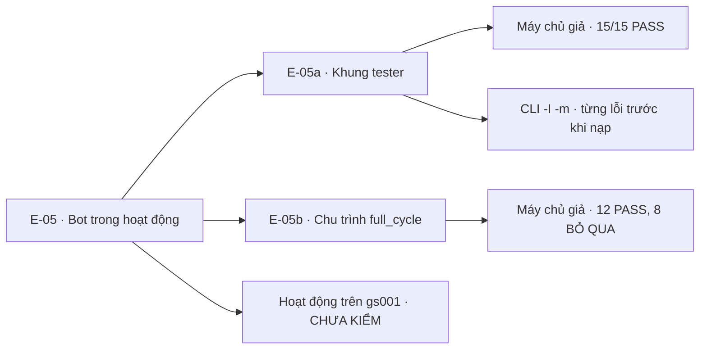

TÓM TẮT 5 DÒNG
1. [NGUỒN] KV-04 đã đối chiếu 20 mục. E-05 chưa đạt vì còn thiếu lệnh CLI đúng cú pháp E-05a và bằng chứng bot hoàn thành một hoạt động.
2. [NGUỒN] E-05a có khung kiểm thử, báo cáo và mẫu BUG. Tệp kết quả lưu đủ 15/15 bước PASS trên 5 bot với máy chủ giả.
3. [NGUỒN] E-05b chạy chu trình trên máy chủ giả. Lượt hai bot ghi 12 PASS và 8 BỎ QUA, gồm các bước thiếu giao thức hoặc bằng chứng lưu nhân vật.
4. [CHƯA KIỂM] Chưa có bằng chứng bot thực hiện một hoạt động cụ thể trên gs001. Ghi nhận kết quả tại báo cáo này và mục Kết quả của task KV-04.
5. [CHƯA KIỂM] Lượt KV-04 chỉ đọc tĩnh, chưa chạy test, build, exe, VM hay kết nối mạng. Tổng quan phụ trách commit.

# KV-04 — Kiểm E-05: Bot trong hoạt động

- Loại: khảo sát
- Chủ đề: Đối chiếu khung tester E-05a và kịch bản E-05b với mục Bot trong hoạt động.
- Từ khóa: Bot trong hoạt động, E-05, E-05a, E-05b, TESTER, smoke_login, full_cycle, BUG-NNN
- Trạng thái: DONE — đã hoàn tất đối chiếu KV-04. Kết luận của mục E-05 là CHƯA ĐẠT.
- Độ phủ: đã đối chiếu 20/20 mục trong bảng bên dưới, gồm 7 mục E-05a, 12 mục E-05b và 1 mục tổng E-05.
- Liên quan: [Backlog](../TASKS/BACKLOG.md), [E-05a](E-05a-khung-tester.md), [E-05b](E-05b-kich-ban-full-cycle.md), [Chuẩn báo cáo](../DESIGN/CHUAN-BAO-CAO.md).
- Cần tôi quyết định: không.

## Phạm vi và độ phủ

`JX1_OPS/TASKS/BACKLOG.md:59` chỉ có cột «Việc» cho nhóm E và dòng 65 ghi «Bot trong hoạt động». Dùng yêu cầu chi tiết tại `JX1_OPS/TASKS/E-05a.md:21`–`:30` và `JX1_OPS/TASKS/E-05b.md:15`–`:18`. E-05b cho phép ghi BỎ QUA có lý do khi BOT thiếu gói tin. Các dòng đánh giá thao tác bên dưới chấm kết quả của chính thao tác. Dòng chứng minh cách xử lý BỎ QUA đánh giá tiêu chí của task E-05b. Phạm vi máy chủ thật của E-09 là một việc riêng theo `JX1_OPS/TASKS/BACKLOG.md:67`.

| Mục | Yêu cầu con | Kết quả | Bằng chứng và giới hạn |
| --- | --- | --- | --- |
| E-05a.1 | Kịch bản gồm các bước có kỳ vọng và thời hạn, chạy bot độc lập, tuần tự hoặc song song | ĐẠT | `JX1_OPS/TESTER/core.py:14`, `:31`, `:201`, `:242`, `:252` và `:260`. Có tiến trình riêng, lỗi dừng bot đó và bộ giám sát dừng tiến trình khi quá hạn. Test cũ kiểm timeout ở `JX1_OPS/TESTER/test_tester.py:239`. |
| E-05a.2 | Báo cáo theo bot × bước, trạng thái, thời gian, log đã che và hex lỗi có hướng/ID, tối đa 256 byte | ĐẠT | `JX1_OPS/TESTER/reporting.py:111`–`:124` và `JX1_OPS/TESTER/core.py:119`–`:132`. Hex giữ ID, che phần thân, tối đa 256 byte/gói. Bảng thực đã lưu ở `JX1_OPS/REPORTS/TEST/2026-11-17-smoke_login-2.md:7`–`:13`. |
| E-05a.3 | Tự ghi BUG khi FAIL, tăng số, gộp BUG mở trùng và ghi lần tái hiện | ĐẠT | `JX1_OPS/TESTER/reporting.py:64`–`:92`, `:103`–`:106`. BUG tổng hợp có trạng thái OPEN và «tái hiện lần 2» tại `JX1_OPS/REPORTS/TEST/BUG-002.md:3` và `:34`. Test bao phủ tăng số và gộp BUG tại `JX1_OPS/TESTER/test_tester.py:292`. |
| E-05a.4 | Chạy mẫu `smoke_login` với máy chủ giả | ĐẠT | Ba bước tại `JX1_OPS/TESTER/scenarios.py:48`. Kết quả lưu ở `JX1_OPS/REPORTS/TEST/2026-11-17-smoke_login-2.md:9`–`:13` có 5 bot × 3 bước PASS. |
| E-05a.5 | CLI đúng cú pháp `python -I -m JX1_OPS.TESTER.run` và lỗi cấu hình thoát 2 | CHƯA ĐẠT | Lượt gốc lỗi `ModuleNotFoundError: No module named 'JX1_OPS'` trước khi nạp mô-đun. Tài liệu hiện hành vẫn ghi giới hạn này. Có bằng chứng chạy file trực tiếp với `-I`, và test kiểm lỗi cấu hình. Xem `JX1_OPS/REPORTS/E-05a-khung-tester.md:111`, `JX1_OPS/TESTER/README.md:36`–`:41`, `JX1_OPS/TESTER/run.py:8`–`:14`, `JX1_OPS/TESTER/test_tester.py:324`. |
| E-05a.6 | Bộ test TESTER và 41 test BOT đều qua | ĐẠT | Báo cáo lịch sử ghi TESTER 14/14 và BOT 41/41. `JX1_OPS/REPORTS/E-05a-khung-tester.md:77`–`:85`. |
| E-05a.7 | Có README TESTER và báo cáo E-05a mở đầu bằng 5 dòng | ĐẠT | `JX1_OPS/TESTER/README.md:1`, `:13` và `JX1_OPS/REPORTS/E-05a-khung-tester.md:1`–`:6`. |
| E-05b.1 | Chọn được `--scenario full_cycle` và có chu trình cho máy chủ giả | ĐẠT | Test CLI hai bot kiểm bốn phiên game và bảng 12 PASS/8 BỎ QUA. `JX1_OPS/TESTER/run.py:35`–`:38`, `JX1_OPS/TESTER/scenarios.py:171`–`:181`, `JX1_OPS/TESTER/test_full_cycle.py:148`–`:168`, `JX1_OPS/REPORTS/E-05b-kich-ban-full-cycle.md:119`–`:121`. |
| E-05b.2 | Đăng nhập và nhận danh sách nhân vật | ĐẠT | PASS trên máy chủ giả. `JX1_OPS/TESTER/scenarios.py:65` và `JX1_OPS/REPORTS/E-05b-kich-ban-full-cycle.md:76`. |
| E-05b.3 | Tạo nhân vật nếu chưa có | CHƯA ĐẠT | Chu trình ghi BỎ QUA vì thiếu yêu cầu tạo, phản hồi và mã kết quả. Tình huống chưa có nhân vật chỉ có 1 PASS/9 BỎ QUA. `JX1_OPS/TESTER/scenarios.py:86`–`:89`, `JX1_OPS/REPORTS/E-05b-kich-ban-full-cycle.md:122`. |
| E-05b.4 | Chọn nhân vật, vào game và đồng bộ | ĐẠT | PASS trên máy chủ giả khi đã có nhân vật. `JX1_OPS/TESTER/scenarios.py:92`, `JX1_OPS/REPORTS/E-05b-kich-ban-full-cycle.md:78`. |
| E-05b.5 | Đi 30 giây | ĐẠT | Phạm vi test giả là gửi một lệnh RUN rồi giữ phiên 30 giây. Kiểm vị trí và di chuyển liên tục vẫn CHƯA KIỂM. `JX1_OPS/TESTER/scenarios.py:126`–`:130`, `JX1_OPS/TESTER/test_full_cycle.py:161`–`:163`. |
| E-05b.6 | Gửi một đòn đánh quái | ĐẠT | Máy chủ giả nhận một lệnh SKILL. Xác nhận đòn trúng mục tiêu vẫn CHƯA KIỂM. `JX1_OPS/TESTER/scenarios.py:133`–`:135`, `JX1_OPS/TESTER/test_full_cycle.py:161`–`:162`. |
| E-05b.7 | Xác nhận quái chết | CHƯA ĐẠT | Chu trình ghi BỎ QUA vì thiếu giải mã trạng thái quái, sát thương và dấu hiệu quái chết. `JX1_OPS/TESTER/scenarios.py:138`–`:139`. |
| E-05b.8 | Thoát game ở cấp ứng dụng | CHƯA ĐẠT | Chu trình đóng kết nối TCP rồi ghi BỎ QUA tại bước logout. Thiếu yêu cầu thoát và phản hồi xác nhận. `JX1_OPS/TESTER/scenarios.py:142`–`:148`. |
| E-05b.9 | Đăng nhập, vào game lần hai | ĐẠT | PASS trên máy chủ giả khi đã có nhân vật. `JX1_OPS/TESTER/scenarios.py:151`–`:157`, `JX1_OPS/TESTER/test_full_cycle.py:157`. |
| E-05b.10 | Đối chiếu tên, giới tính, hệ và cấp sau khi vào lại | ĐẠT | So sánh danh sách nhân vật. Test đổi cấp ở lượt hai ghi FAIL. `JX1_OPS/TESTER/scenarios.py:160`–`:164`, `JX1_OPS/TESTER/test_full_cycle.py:181`–`:192`. |
| E-05b.11 | Xác minh toàn bộ trạng thái nhân vật sau vào lại | CHƯA ĐẠT | Chu trình ghi BỎ QUA. Chưa có bằng chứng về vị trí, máu, trang bị, hành trang và xác nhận lưu. `JX1_OPS/TESTER/scenarios.py:167`–`:168`. |
| E-05b.12 | Test TESTER/BOT qua, báo cáo 5 dòng nêu các bước BỎ QUA và phần giao thức còn thiếu | ĐẠT | Lượt gốc ghi TESTER 18/18, BOT 41/41. Bảng 10 bước có lý do BỎ QUA và đánh dấu gs001 thật CHƯA KIỂM. `JX1_OPS/REPORTS/E-05b-kich-ban-full-cycle.md:1`–`:7`, `:74`–`:85`, `:103`–`:130`. |
| E-05 | Bot tham gia và hoàn thành một hoạt động cụ thể | CHƯA KIỂM | Backlog chỉ nêu «Bot trong hoạt động», chưa đặt tên hoạt động hay điểm hoàn thành. Hai báo cáo dẫn bằng chứng chạy kịch bản chung trên máy chủ giả. `JX1_OPS/TASKS/BACKLOG.md:65`, `JX1_OPS/REPORTS/E-05a-khung-tester.md:97`–`:102`, `JX1_OPS/REPORTS/E-05b-kich-ban-full-cycle.md:119`–`:130`. |

## Giải mã tên

| Tên gốc | Mã hóa | Chữ đúng | Nguồn file:dòng |
| --- | --- | --- | --- |
| Không có tên riêng trong game | — | Không áp dụng. Bot, tên bước và tên lệnh là nhãn kiểm thử. | `JX1_OPS/TESTER/scenarios.py:48`, `:171` |

## Sắp theo cấu trúc game

Các bước đi theo trình tự người chơi: đăng nhập và chọn nhân vật → vào game → di chuyển và đánh quái → thoát, vào lại và kiểm dữ liệu. Máy chủ giả chỉ dùng mã kỹ năng và mục tiêu tổng hợp, nên các bước này không có tên phái, kỹ năng hoặc bản đồ để phân nhóm.

## Mục sổ thông số

| Nhóm | Tên/hằng số | file:dòng | Giá trị | Đơn vị | Ảnh hưởng | Đổi an toàn | Nguồn đo |
| --- | --- | --- | --- | --- | --- | --- | --- |
| Khung kiểm thử | `workers` | `JX1_OPS/TESTER/core.py:201`–`:209` | 1–5 | tiến trình bot song song | Mức song song của lượt kiểm thử | CẨN THẬN | Đọc tĩnh. Chưa đo tải thật. |
| Gói lỗi | Giới hạn hex | `JX1_OPS/TESTER/core.py:124`–`:132` | 256 | byte/gói | Lượng dữ liệu chẩn đoán đã che | CẨN THẬN | Đọc tĩnh. |
| Chu trình | Thời gian giữ phiên / thời hạn bước đi | `JX1_OPS/TESTER/scenarios.py:129`, `:175` | 30 / 35 | giây | Giữ phiên sau lệnh RUN, với thời hạn dài hơn cho cả bước | CẨN THẬN | Đọc tĩnh. Test lịch sử chấp nhận từ 29,9 giây tại `JX1_OPS/TESTER/test_full_cycle.py:163`. |

## Đã xác minh / Chưa xác minh

- **ĐÃ XÁC MINH:** Đối chiếu tĩnh các tệp UTF-8 trong worktree `task/KV-04`, gồm dòng Backlog, hai task con, hai báo cáo, mã TESTER và tệp kết quả smoke/BUG. E-05a giữ kết luận lịch sử PARTIAL (`JX1_OPS/REPORTS/E-05a-khung-tester.md:13`). E-05b giữ DONE trong phạm vi máy chủ giả và xử lý BỎ QUA theo yêu cầu (`JX1_OPS/REPORTS/E-05b-kich-ban-full-cycle.md:13`, `JX1_OPS/TASKS/E-05b.md:16`–`:18`).
- **CHƯA XÁC MINH:** Tất cả số PASS của hai task con là kết quả lịch sử. Test `full_cycle` lưu báo cáo CLI trong thư mục tạm và dọn sau test. Bằng chứng hiện có là mã kiểm và tường thuật lượt chạy đã lưu (`JX1_OPS/TESTER/test_full_cycle.py:148`–`:170`, `JX1_OPS/REPORTS/E-05b-kich-ban-full-cycle.md:128`–`:130`). Lượt KV-04 chỉ đọc tĩnh, chưa chạy test, build, exe, VM hoặc mạng. Hai báo cáo gốc dẫn tới mã BOT/TESTER trong worktree cho các kết quả này. Chưa đối chiếu mã/binary client và server ở các root ngoài worktree cho hành vi trên gs001.

## Đề xuất tối ưu

Ưu tiên có bằng chứng chạy đúng CLI của E-05a. Với mục «Bot trong hoạt động», chọn một hoạt động có điều kiện hoàn thành cụ thể rồi xác nhận các bước còn thiếu bằng kết quả thực trong một task được phép chạy.

## Bàn giao

- `rg` không có trong phiên. Đã dùng `Select-String` và `Get-Content` với tệp/phần được dẫn. Ghi `D:\JX-wt\KV-04.nhip` ở mốc đầu bị Windows từ chối (`Access to the path is denied`), vì đường dẫn nằm ngoài vùng ghi của phiên. Tiến độ được báo trong phiên làm việc.
- Tổng quan commit báo cáo và mục Kết quả của task. Chỉ mục đề xuất cho Tổng quan gộp vào `JX1_OPS/DESIGN/MUC-LUC-TRI-THUC.md:20`, tại nhóm «Bot, tester, điều phối».
- Kỹ năng đã dùng: jx1-retrofit, jx1-read-server, jx1-read-client, jx1-parameters, jx1-knowledge, jx1-report. Hai skill đọc nguồn được dùng để xác định phạm vi bằng chứng. Bằng chứng của cuộc kiểm này nằm ở BOT/TESTER và kết quả máy chủ giả.

| File | Loại | Chủ đề | Từ khóa | Trạng thái | Độ phủ | Liên quan |
| --- | --- | --- | --- | --- | --- | --- |
| `JX1_OPS/REPORTS/KIEM-E-05.md` | khảo sát | Kiểm E-05: Bot trong hoạt động | E-05, TESTER, smoke_login, full_cycle | DONE (KV-04), CHƯA ĐẠT (E-05) | 20/20 mục đối chiếu | Backlog E-05, E-05a, E-05b |

KẾT LUẬN: E-05 CHƯA ĐẠT, thiếu: bằng chứng chạy thành công CLI `python -I -m JX1_OPS.TESTER.run` theo E-05a và bằng chứng bot hoàn thành một hoạt động cụ thể. Chu trình hiện có chưa chứng minh tạo nhân vật khi chưa có, di chuyển liên tục đủ 30 giây, đánh trúng và hạ quái, thoát ở cấp ứng dụng và lưu toàn bộ trạng thái sau khi vào lại.
