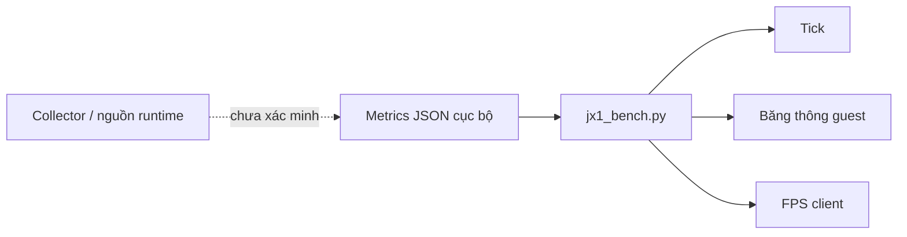

TÓM TẮT 1 [NGUỒN] Đã đối chiếu mục P-02: một lệnh gồm tick, băng thông và khung hình; backlog không có tiêu chí “Xong khi” chi tiết tại dòng mục này (JX1_OPS/TASKS/BACKLOG.md:74).
TÓM TẮT 2 [NGUỒN] Mã có phép tính tick, băng thông và FPS, cùng đầu ra CLI cho ba nhóm chỉ số (JX1_OPS/TOOLS/bench/jx1_bench.py:108).
TÓM TẮT 3 [NGUỒN] Báo cáo P-02 ghi 12 kiểm thử offline và kết quả lệnh trên dữ liệu giả lập (JX1_OPS/REPORTS/P-02-bench.md:60).
TÓM TẮT 4 [CHƯA KIỂM] Báo cáo nguồn ghi collector và đo trên runtime gs001/client chưa được xác minh (JX1_OPS/REPORTS/P-02-bench.md:98).
TÓM TẮT 5 [CHƯA KIỂM] Lượt này chỉ đọc tĩnh, không chạy test/build/exe/VM/mạng; không stage hoặc commit.

# KV-03 — Kiểm tra P-02: bộ đo chuẩn một lệnh

Loại: khảo sát
Chủ đề: Đối chiếu bằng chứng hiện có của bộ đo tick, băng thông và khung hình P-02.
Từ khóa: đo chuẩn, P-02, tick, băng thông, khung hình, FPS, CLI, JX-Test-36
Trạng thái: PARTIAL — phép tính và kiểm thử ngoại tuyến được ghi nhận; dữ liệu đo runtime chưa được xác minh.
Độ phủ: 1 trên 1 mục backlog đã kiểm tra; 3 trên 3 nhóm chỉ số có phép tính ngoại tuyến; 0 trên 3 nhóm có số đo runtime đã xác minh.
Liên quan: JX1_OPS/REPORTS/P-02-bench.md; JX1_OPS/TASKS/BACKLOG.md
Cần tôi quyết định: không

## Sơ đồ luồng

## Phạm vi và độ phủ

| Yêu cầu / phần việc | Trạng thái | Bằng chứng và giới hạn |
|---|---|---|
| Một lệnh xuất tick, băng thông, khung hình | ĐẠT cho xử lý fixture offline; CHƯA ĐẠT để khẳng định đo thật | CLI và bảng kết quả được mô tả tại JX1_OPS/REPORTS/P-02-bench.md:67; các nhóm chỉ số được xuất tại JX1_OPS/TOOLS/bench/jx1_bench.py:211. |
| Tick | ĐẠT cho phép tính offline; CHƯA KIỂM nguồn tick thật | Hàm tổng hợp tick: JX1_OPS/TOOLS/bench/jx1_bench.py:108. Báo cáo P-02 nêu collector và ý nghĩa trường tick chưa kiểm: JX1_OPS/REPORTS/P-02-bench.md:98. |
| Băng thông | ĐẠT cho phép tính offline; CHƯA KIỂM interface/counter runtime | Hàm tổng hợp mạng: JX1_OPS/TOOLS/bench/jx1_bench.py:120. Nguồn counter/interface thật chưa kiểm: JX1_OPS/REPORTS/P-02-bench.md:99. |
| Khung hình/FPS | ĐẠT cho phép tính offline; CHƯA KIỂM nguồn đếm frame/FPS runtime | Hàm tổng hợp FPS: JX1_OPS/TOOLS/bench/jx1_bench.py:160. Nguồn frame/FPS thật chưa kiểm: JX1_OPS/REPORTS/P-02-bench.md:99. |
| Đo trên môi trường runtime | CHƯA KIỂM | Báo cáo nguồn ghi chưa đo trên JX-Test-36, gs001/client, VM/SQL/server/mạng: JX1_OPS/REPORTS/P-02-bench.md:100. |

## Giải mã tên

| Tên gốc | Mã hóa | Chữ đúng | Nguồn |
|---|---|---|---|
| JX-Test-36 | ASCII (chuỗi tương thích UTF-8) | JX-Test-36 | JX1_OPS/TOOLS/bench/sample_metrics.json:3 |
| gs001 | ASCII (chuỗi tương thích UTF-8) | gs001 | JX1_OPS/TOOLS/bench/jx1_bench.py:214 |
| P-02 | ASCII (mã mục) | P-02 | JX1_OPS/TASKS/BACKLOG.md:74 |
| Không có tên riêng tiếng Hán hoặc tên Việt cũ trong các bằng chứng đã dùng | — | — | — |

## Sắp theo cấu trúc game

Các chỉ số được nhóm theo luồng đo: tick máy chủ (JX1_OPS/TOOLS/bench/jx1_bench.py:108), băng thông giao diện guest (JX1_OPS/TOOLS/bench/jx1_bench.py:120), rồi FPS client (JX1_OPS/TOOLS/bench/jx1_bench.py:160). Không có danh sách kỹ năng, trang bị, quái, NPC hay bản đồ để sắp theo cấu trúc game trong phạm vi P-02.

## Kết quả đối chiếu

Backlog mô tả mục P-02 là “Bộ đo chuẩn một lệnh (tick, băng thông, khung hình)” (JX1_OPS/TASKS/BACKLOG.md:74). Dòng đó không nêu tiêu chí hoàn thành chi tiết khác. Mã hiện có xử lý JSON cục bộ, tính ba nhóm chỉ số và dựng bảng; báo cáo P-02 ghi 12 unittest offline đã chạy (JX1_OPS/REPORTS/P-02-bench.md:60). Fixture được đánh dấu synthetic_offline (JX1_OPS/TOOLS/bench/sample_metrics.json:2). Các kết quả được lưu trong báo cáo nguồn: tick trung bình 51.00 ms và p95 53.70 ms (JX1_OPS/REPORTS/P-02-bench.md:73); RX 8.00 Mbps, TX 4.00 Mbps, tổng 12.00 Mbps (JX1_OPS/REPORTS/P-02-bench.md:75); FPS trung bình 59.00, thấp nhất 58.00, p05 58.10 (JX1_OPS/REPORTS/P-02-bench.md:78). Đây là kết quả từ fixture giả lập, không phải số đo runtime.

### Mục số thông số

| Nhóm | Tên/thông số | Nguồn file:dòng | Giá trị | Đơn vị | Ảnh hưởng | Đổi an toàn | Nguồn đo |
|---|---|---|---:|---|---|---|---|
| Tick | Trung bình / p95 | JX1_OPS/REPORTS/P-02-bench.md:73 | 51.00 / 53.70 | ms | Mô tả thời lượng tick trong fixture | CẨN THẬN — dữ liệu giả lập, không phải tham số chỉnh | Fixture giả lập; báo cáo ghi lệnh offline |
| Mạng | RX / TX / tổng | JX1_OPS/REPORTS/P-02-bench.md:75 | 8.00 / 4.00 / 12.00 | Mbps | Lưu lượng toàn interface guest trong fixture | CẨN THẬN — dữ liệu giả lập, không phải tham số chỉnh | Fixture giả lập; báo cáo ghi lệnh offline |
| Khung hình | Trung bình / thấp nhất / p05 | JX1_OPS/REPORTS/P-02-bench.md:78 | 59.00 / 58.00 / 58.10 | FPS | Thống kê cửa sổ FPS trong fixture | CẨN THẬN — dữ liệu giả lập, không phải tham số chỉnh | Fixture giả lập; báo cáo ghi lệnh offline |

## Đề xuất tối ưu

Chưa đề xuất thay đổi thuật toán hoặc thêm nguồn thu thập khi collector và schema đầu ra thực tế chưa được xác minh. Báo cáo P-02 ghi hai script collector được tìm theo đường dẫn nêu ở đó nhưng không tìm thấy trong lượt khảo sát, và adapter với output collector thật chưa kiểm (JX1_OPS/REPORTS/P-02-bench.md:89).

## Đã xác minh

- Backlog có mục P-02 với mục tiêu một lệnh cho tick, băng thông, khung hình: JX1_OPS/TASKS/BACKLOG.md:74.
- Mã hiện tại có hàm tính tick, mạng, FPS và dựng bảng CLI: JX1_OPS/TOOLS/bench/jx1_bench.py:108; JX1_OPS/TOOLS/bench/jx1_bench.py:120; JX1_OPS/TOOLS/bench/jx1_bench.py:160; JX1_OPS/TOOLS/bench/jx1_bench.py:211.
- Báo cáo P-02 ghi nhận 12 unittest offline và kết quả lệnh bằng fixture: JX1_OPS/REPORTS/P-02-bench.md:60; JX1_OPS/REPORTS/P-02-bench.md:67.
- Trong lượt KV-03, đã kiểm tra các đường dẫn collector được dẫn trong báo cáo P-02; chúng không tồn tại tại các vị trí đó. Chỉ kiểm tra tồn tại, không mở nội dung ngoài phạm vi.

## Chưa xác minh

- Collector cung cấp tick thật, interface/counter mạng guest và nguồn frame/FPS client: JX1_OPS/REPORTS/P-02-bench.md:98; JX1_OPS/REPORTS/P-02-bench.md:99.
- Kết quả đo runtime trên JX-Test-36: JX1_OPS/REPORTS/P-02-bench.md:100.
- Test, build, chạy exe, VM hoặc kết nối mạng trong lượt này: không thực hiện theo phạm vi chỉ đọc tĩnh.
- Tệp nhịp được yêu cầu nằm ngoài vùng ghi được của phiên; thao tác tạo/cập nhật bị hệ thống từ chối. Không đổi quyền hoặc cấu hình để vượt giới hạn.
- Báo cáo KV-03.md và việc ghi thêm vào tệp task nằm ngoài vung_file (nơi cho phép duy nhất JX1_OPS/REPORTS/KIEM-P-02.md); không sửa các tệp ngoài phạm vi.

## Bàn giao

Không stage, commit hoặc push; chưa có SHA. Báo cáo được ghi vào JX1_OPS/REPORTS/KIEM-P-02.md. Bước tiếp theo để xác nhận đủ P-02 là có bằng chứng collector/schema thật và kết quả đo được ủy quyền; không thực hiện trong phạm vi hiện tại.

## Phát hiện khi chuẩn hóa

Dòng P-02 hiện tại trong BACKLOG.md nêu mục tiêu tổng quát nhưng không có tiêu chí “Xong khi” riêng tại dòng đó (JX1_OPS/TASKS/BACKLOG.md:74). Không tự bổ sung tiêu chí. Báo cáo nguồn P-02 cũng phân định rõ phần offline đã chạy và phép đo runtime chưa kiểm (JX1_OPS/REPORTS/P-02-bench.md:96; JX1_OPS/REPORTS/P-02-bench.md:100).

Kỹ năng đã dùng: jx1-retrofit, jx1-read-server, jx1-read-client, jx1-parameters, jx1-knowledge, jx1-report.

KẾT LUẬN: P-02 CHƯA ĐẠT, thiếu: xác minh nguồn collector/schema thật và kết quả đo runtime cho tick, băng thông, khung hình.
