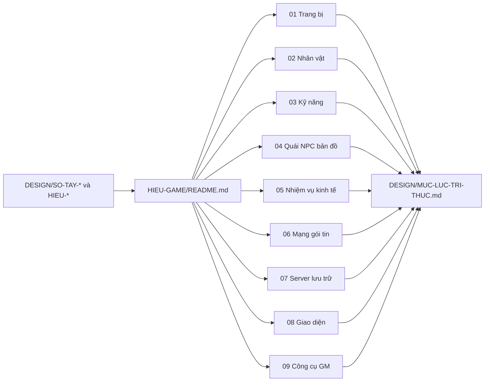

TÓM TẮT 1: [NGUỒN] PARTIAL — đã chia đủ 52 sổ tay `SO-TAY-*`/`HIEU-*` vào 9 nhánh `HIEU-GAME` và tạo README tra cứu.
TÓM TẮT 2: [NGUỒN] Đã viết lại mục lục với nhánh, sổ tay, báo cáo liên quan, hàm chính, độ chắc và câu hỏi người chơi.
TÓM TẮT 3: [NGUỒN] Nội dung 52 sổ tay không đổi; bảng ánh xạ tên cũ → đường dẫn mới nằm ở `HIEU-GAME/README.md`.
TÓM TẮT 4: [CHƯA KIỂM] `git mv` bị chặn bởi quyền ghi `.git/worktrees/KT-01/index.lock`; Graphify không có graph tại worktree; không chạy mã/game/VM/mạng.
TÓM TẮT 5: [CHƯA KIỂM] Không có SHA/commit trong lượt này; file nhịp ngoài worktree bị từ chối quyền ghi, tổng quản cần xử lý index và checkpoint.

# KT-01 — Chia thư mục HIEU-GAME và dựng lại mục lục tri thức

Loại: tổng hợp
Chủ đề: Tổ chức 52 sổ tay hiểu game thành 9 nhánh và dựng lại mục lục tra cứu.
Từ khóa: HIEU-GAME, SO-TAY, HIEU, mục lục, tri thức, Graphify, KT-01, README
Trạng thái: PARTIAL — nội dung tài liệu đã hoàn tất; thao tác `git mv` và nhịp ngoài worktree bị chặn quyền.
Độ phủ: đã phủ 52 trên tổng 52 sổ tay; 9 trên 9 nhánh; 0 thay đổi nội dung sổ tay.
Liên quan: `JX1_OPS/DESIGN/MUC-LUC-TRI-THUC.md`, `JX1_OPS/DESIGN/CHUAN-BAO-CAO.md`, `JX1_OPS/TASKS/KT-01.md`.
Cần tôi quyết định: không

## Phạm vi và độ phủ

| Phần tử vung_file | Kết quả | Bằng chứng |
|---|---|---|
| `JX1_OPS/HIEU-GAME/01-trang-bi-cuong-hoa/` | ĐÃ PHỦ 9: `HIEU-BANG-SORT-VA-ITEM`, `HIEU-CAP-CUONG-HOA-LUA`, `HIEU-CAP-CUONG-HOA-LUA-2`, `HIEU-DO-BEN-SUA-DO`, `HIEU-HIEU-UNG-VU-KHI`, `SO-TAY-GHEP-TACH-DO`, `SO-TAY-NGUA-PHI-PHONG`, `SO-TAY-THUOC-TINH-MA-PHAP`, `SO-TAY-TRANG-BI` | `HIEU-GAME/README.md:6-14` |
| `JX1_OPS/HIEU-GAME/02-nhan-vat-thuoc-tinh/` | ĐÃ PHỦ 5: `HIEU-CAP-KINH-NGHIEM`, `HIEU-MON-PHAI`, `HIEU-TAO-NHAN-VAT-MOI`, `SO-TAY-NHAN-VAT`, `SO-TAY-PK-CHET-HOI-SINH` | `HIEU-GAME/README.md:15-19` |
| `JX1_OPS/HIEU-GAME/03-ky-nang-chien-dau/` | ĐÃ PHỦ 7: `HIEU-BUFF-TRANG-THAI`, `HIEU-CONG-THUC-SAT-THUONG`, `HIEU-TRANG-THAI-CHIEN-DAU`, `SO-TAY-KY-NANG`, `SO-TAY-KY-NANG-CAP`, `SO-TAY-TO-DOI`, `SO-TAY-TONG-KIM-BANG-HOI` | `HIEU-GAME/README.md:20-26` |
| `JX1_OPS/HIEU-GAME/04-quai-npc-ban-do/` | ĐÃ PHỦ 8: `HIEU-BAN-DO-TRAP`, `HIEU-NAP-VA-CHUYEN-BAN-DO`, `HIEU-QUAI-HOI-SINH-VAT-PHAM-ROI`, `SO-TAY-AI-QUAI`, `SO-TAY-HOP-THOAI-NPC`, `SO-TAY-QUAI-NPC-BAN-DO`, `SO-TAY-QUAI-VANG`, `SO-TAY-ROI-DO` | `HIEU-GAME/README.md:27-34` |
| `JX1_OPS/HIEU-GAME/05-nhiem-vu-kinh-te/` | ĐÃ PHỦ 7: `HIEU-GIAO-DICH-KHO-DO`, `SO-TAY-CUA-HANG`, `SO-TAY-GIAO-DICH-KHO`, `SO-TAY-KINH-TE`, `SO-TAY-NHIEM-VU`, `SO-TAY-NHIEM-VU-LUA`, `SO-TAY-THOI-GIAN-SU-KIEN` | `HIEU-GAME/README.md:35-41` |
| `JX1_OPS/HIEU-GAME/06-mang-goi-tin/` | ĐÃ PHỦ 8: `HIEU-DANG-NHAP-VAO-GAME`, `SO-TAY-BAN-BE-ONLINE`, `SO-TAY-CHAT`, `SO-TAY-DONG-BAN`, `SO-TAY-GOI-TIN`, `SO-TAY-S3RELAY`, `SO-TAY-THONG-BAO-HE-THONG`, `SO-TAY-VONG-LAP-SERVER` | `HIEU-GAME/README.md:42-49` |
| `JX1_OPS/HIEU-GAME/07-server-luu-tru/` | ĐÃ PHỦ 3: `SO-TAY-GODDESS-LUU-NHAN-VAT`, `SO-TAY-TAI-KHOAN-PAYSYS`, `SO-TAY-TEP-CAU-HINH-GS` | `HIEU-GAME/README.md:50-52` |
| `JX1_OPS/HIEU-GAME/08-giao-dien/` | ĐÃ PHỦ 3: `HIEU-GAME-CHO-NGUOI-KHONG-LAP-TRINH`, `SO-TAY-GIAO-DIEN`, `SO-TAY-TAI-NGUYEN-CLIENT` | `HIEU-GAME/README.md:53-55` |
| `JX1_OPS/HIEU-GAME/09-cong-cu-gm/` | ĐÃ PHỦ 2: `HIEU-LENH-GM`, `SO-TAY-CHONG-GIAN-LAN` | `HIEU-GAME/README.md:56-57` |
| `JX1_OPS/DESIGN/MUC-LUC-TRI-THUC.md` | ĐÃ PHỦ: bảng 9 chủ đề, nhánh, sổ tay, REPORTS, hàm chính, độ chắc và câu hỏi tra | `MUC-LUC-TRI-THUC.md:5-21` |
| `JX1_OPS/DESIGN/TINH-NANG/*.md` | ĐÃ KIỂM: không có tham chiếu cũ `DESIGN/SO-TAY-*` hoặc `DESIGN/HIEU-*`; không cần sửa | kiểm tra giới hạn bằng PowerShell `Select-String`, 20/11/2026 |

## Giải mã tên

| Tên gốc | Mã hóa | Chữ đúng | Nguồn file:dòng |
|---|---|---|---|
| `HIEU-GAME` | ASCII/ID thư mục | HIEU-GAME — hiểu game | `HIEU-GAME/README.md:1` |
| `SO-TAY-*` | ASCII/tiền tố tên tệp | Sổ tay | `HIEU-GAME/README.md:3` |
| `HIEU-*` | ASCII/tiền tố tên tệp | Hiểu game | `HIEU-GAME/README.md:3` |
| `Graphify` | ASCII/tên công cụ | Graphify, chưa có graph trong worktree | `KT-01.md:4`, kết quả lệnh 20/11/2026 |
| `KItemList`, `KProtocolProcess` | ASCII/symbol mã nguồn | Giữ nguyên symbol; không giải mã sang tên Việt | `MUC-LUC-TRI-THUC.md:7,12` |
| Tên Hán/TCVN3 | Không xuất hiện trong báo cáo này | Không áp dụng | Phạm vi báo cáo chỉ là tên tệp/ID |

## Sắp theo cấu trúc game

| Tầng cấu trúc game | Nhánh tra cứu | Cách sắp |
|---|---|---|
| Nhân vật → trang bị → cường hóa/thuộc tính | `01`, `02` | Trang bị và thuộc tính nhân vật được tách trước; sổ tay liên quan giữ nguyên nội dung. |
| Nhân vật → kỹ năng → chiến đấu/đội | `03` | Kỹ năng, buff, sát thương, đội và Tống Kim nằm cùng nhánh chiến đấu. |
| Thế giới → map → NPC/quái → rơi đồ | `04` | Bản đồ là tầng trước; NPC/quái, hồi sinh và rơi đồ theo sau. |
| Nhiệm vụ → giao dịch → kinh tế/thời gian | `05` | Task/Lua, cửa hàng, kho và sự kiện được tra theo luồng kinh tế. |
| Kết nối → gói tin → lưu trữ server | `06`, `07` | Gói tin/vòng lặp tách khỏi hồ sơ tài khoản/cấu hình lưu trữ. |
| Client → giao diện → tài nguyên | `08` | UI và PAK/SPR cùng một nhánh để người chơi tra theo phần nhìn thấy. |
| Quản trị → GM → chống gian lận | `09` | Lệnh và công cụ quản trị là nhánh riêng, không trộn với luồng chơi. |

## Đã tra đồ thị

ĐÃ TRA ĐỒ THỊ: `graphify query "KItemList Equip"` tại `D:\JX-wt\KT-01` → **lỗi: graph file not found: `D:\JX-wt\KT-01\graphify-out\graph.json`**. Không có kết quả đồ thị dùng được; không đọc mã nguồn ngoài phạm vi tổ chức tài liệu.

## Đã đọc kiến thức

ĐÃ ĐỌC KIẾN THỨC: `JX1_OPS/DESIGN/CHUAN-BAO-CAO.md`, `JX1_OPS/TASKS/KT-01.md`, `JX1_OPS/DESIGN/MUC-LUC-TRI-THUC.md` bản trước khi thay, `JX1_OPS/MA-NGUON/README.md`, `ban-do-client.md`, `ban-do-server.md`, `goi-tin.md`, toàn bộ tên 52 sổ tay và phần đầu từng sổ tay để phân nhánh. Không đọc lại nội dung sổ tay sau khi chuyển.

## Đã xác minh / Chưa xác minh

### Đã xác minh

- Có đúng 52 tệp nguồn tên `SO-TAY-*`/`HIEU-*` trước khi chuyển; sau chuyển có 52 tệp dưới `HIEU-GAME/` và 10 README.
- Các nhánh có số lượng 9/5/7/8/7/8/3/3/2, tổng 52; ánh xạ chi tiết ở `HIEU-GAME/README.md`.
- `DESIGN/TINH-NANG/*.md` không chứa đường dẫn cũ cần sửa.
- Nội dung sổ tay không được chỉnh sửa; chỉ đổi vị trí tệp.

### Chưa xác minh

- Chưa chạy build, test, game, EXE, VM hoặc mạng theo phạm vi task.
- Chưa có Graphify graph trong worktree nên chưa có caller/callee mới.
- Chưa thể ghi `D:\JX-wt\KT-01.nhip` vì quyền ngoài workspace bị từ chối.
- Chưa thể tạo index/commit bằng `git mv` vì `.git/worktrees/KT-01/index.lock` không ghi được; không tự sửa quyền hoặc credential.

## Bàn giao

Tổng quản cần kiểm tra `git status`, stage/commit các tệp thuộc `vung_file`, tạo checkpoint nhịp ở `D:\JX-wt\KT-01.nhip` nếu quyền được cấp, và cập nhật SHA vào báo cáo sau commit. Không có push trong lượt này.

Kỹ năng đã dùng: `jx1-retrofit`, `jx1-read-server`, `jx1-read-client`, `jx1-parameters`, `jx1-knowledge`, `jx1-report`.

liên quan: `JX1_OPS/DESIGN/MUC-LUC-TRI-THUC.md`, `JX1_OPS/HIEU-GAME/README.md`, `JX1_OPS/DESIGN/CHUAN-BAO-CAO.md`.
