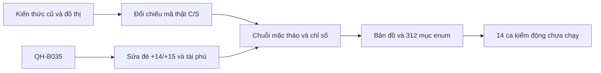

TÓM TẮT 1 — [NGUỒN] PARTIAL: đã tạo bản đồ chuỗi thuộc tính trang bị lên nhân vật theo KT-02, chỉ đọc tĩnh.
TÓM TẮT 2 — [NGUỒN] Có chuỗi mặc/tháo, kích hoạt, trường đích, sync/UI, +N, lưu/nạp; đủ 312 mục enum và 234 đăng ký handler.
TÓM TẮT 3 — [NGUỒN] Đầu ra tại JX1_OPS/HIEU-GAME/01-trang-bi-cuong-hoa/BAN-DO-THUOC-TINH-LEN-NHAN-VAT.md; phân biệt src18/qh9A với sửa QH-B035, giữ kết luận cũ.
TÓM TẮT 4 — [CHƯA KIỂM] Thiếu 73 key, 28 key rỗng, 3 key trùng cần kiểm parser; chưa có qhcuonghoa.lua, PAK/binary/runtime chưa kiểm.
TÓM TẮT 5 — [CHƯA KIỂM] Không build/game/exe game/VM/mạng; không commit/push, Tổng quản commit hộ; nhịp ngoài root chưa ghi được.

# KT-02 — Bàn giao bản đồ thuộc tính trang bị lên nhân vật

Loại: khảo sát
Chủ đề: Bổ sung bản đồ có thể tra từ item tới Npc/Player và hiển thị, không sửa mã/kết luận cũ.
Từ khóa: trang bị, magic attrib, Equip, UnEquip, EnChance, QhSetEnChance, m_nWealth, KT-02
Trạng thái: PARTIAL — có bản đồ C++/dữ liệu tĩnh; còn nguồn Việt/script dự án và diễn giải sâu handler mở rộng.
Độ phủ: 11 nhóm yêu cầu có bảng phủ; 312/312 enum/key, 234 đăng ký có thân, 211 mẫu tooltip không rỗng; 14 ca kiểm động chưa chạy.
Liên quan: JX1_OPS/HIEU-GAME/01-trang-bi-cuong-hoa/BAN-DO-THUOC-TINH-LEN-NHAN-VAT.md; JX1_OPS/DESIGN/CHUAN-BAO-CAO.md; JX1_OPS/DESIGN/MUC-LUC-TRI-THUC.md; JX1_OPS/REPORTS/H-01-ngu-hanh.md; H-02-magic-attrib.md; H-03-cuong-hoa.md; H-05-ui-cuong-hoa.md; H-06-he-thong-an.md; H-07-trang-suc-mat-na-phi-phong.md; H-08-tai-phu.md.
Cần tôi quyết định: không

liên quan: bản đồ KT-02 và các báo cáo H-01/02/03/05/06/07/08; không sửa các báo cáo đó.

## Phạm vi và độ phủ

| Nhóm | Kết quả | Bằng chứng |
|---|---|---|
| Enum, key, tiếng Việt |312 mục có hàng; 211 nội dung, 28 rỗng, 73 thiếu; 3 key trùng giữ hai mẫu | E:6–329; D:17; T:1; bản đồ:Phụ lục A |
| Mặc/tháo/kích hoạt | Nối client → request → server → Apply/Remove → tính lại → callback | S/KItemList.cpp:3026; S/KItem.cpp:140; chi tiết mục 1/2 bản đồ |
| Chỉ số và UI | Nhóm chính diễn giải; toàn 234 handler có điểm tra, chưa giải thích hết callee | H:322; C/gamecore/CoreShell.cpp:1565; C/gameui/KuiRoleState.cpp:2550 |
| Điều kiện mặc | Đã đọc requirement, còn giới hạn caller server | S/KItemList.cpp:1153, :1208, :1525 |
| +N/giá trị gốc | EnChance/backup và khác nhánh Rong/vàng | S/KItem.cpp:649, :3800; S/KItemList.cpp:5471 |
| Sửa đè dự án | +14/+15, special_point/tài phú, QhSetEnChance, phi phong | PS/KItem.cpp:184, :193; PS/KItemList.cpp:1176 |
| DB | Serializer game và nạp tái tạo; DB thật/RNG toàn tuyến chưa kiểm | S/KPlayerDBFuns.cpp:818, :1618 |
| Lua | qianghua.lua gói cũ + API dự án; thiếu qhcuonghoa.lua trong root giao | L/system/qianghua.lua:160; PS/ScriptFuns.cpp:10963 |
| Kiểm động |14 ca D01..D14 đủ đồ/nhân vật, thao tác, số đọc, kỳ vọng | Mục KỊCH BẢN KIỂM ĐỘNG bản đồ; tất cả chưa chạy |

Alias giống bản đồ: S=D:/JX-build/src18/jxOnline/gameserver/Sources/Core/Src; C=D:/JX-build/qh9A/Classes; PS=D:/JX-wt/QH-B035/server/jxOnline/gameserver/Sources/Core/Src. E=S/KMagicAttrib.h; H=S/KNpcAttribModify.cpp; D=C/gamecore/KMagicDesc.cpp. T=C:/Jx1CocoV3/Folder/ServerNew-20260116T043145Z-3-001/ServerNew/_bin_v2_/gs/Settings/MagicDesc_mobile.ini; L là script/ dưới cùng gs.

## Giải mã tên

Báo cáo bàn giao không nêu món/NPC/bản đồ riêng. Tên skill và nhóm đồ xuất hiện trong bản đồ đã có bảng chữ gốc GBK, pinyin, Việt và nguồn.312 dòng phụ lục giữ enum/key gốc, mẫu TCVN3 đã chuyển UTF-8 và T:file:dòng; không tự đặt tên cho 73 key thiếu hoặc 28 rỗng. T có 3 key trùng, chưa xác minh ưu tiên parser; chưa gọi các mẫu đó là câu đang dùng trong PAK.

## Sắp theo cấu trúc game

Bản đồ theo chọn đồ → requirement → mặc/tháo → kích hoạt → chỉ số → sync/UI → +N → DB. Phụ lục tách trang bị/yêu cầu, nhân vật, đòn đánh, skill/đạn. Không sắp theo thư mục hoặc gọi mọi enum là dòng trang bị.

## Đã đọc và phát hiện chính

ĐÃ ĐỌC KIẾN THỨC: chuẩn CHUAN-BAO-CAO; task KT-02; sáu skill .agents/skills; DESIGN/MUC-LUC-TRI-THUC.md:12; phần liên quan H-01/02/03/05/06/07/08; bản đồ MA-NGUON client/server/gói tin. Chỉ bù đường còn thiếu, không sửa kết luận cũ.

ĐÃ TRA ĐỒ THỊ: graphify.exe query ApplyMagicAttribToNPC (cwd D:/JX-build/src18/jxOnline) và query Equip (cwd D:/JX-build/qh9A/Classes) → timeout 15 giây. Lần đầu sai cwd báo thiếu graph. Đọc phần liên quan GRAPH_REPORT.md tại hai root để định vị; xác minh lại file thật. Không rebuild graph/hook. Lệnh/marker/nguồn chi tiết trong bản đồ mục Nguồn.

ĐÃ ĐỌC MÃ: S thưởng kỹ năng từ+12, PS từ+14; PS thêm tài phú100*N qua magic_special_point và dùng UnEquip → EnChance → Equip cho món đang mặc (S/KItem.cpp:184; PS/KItem.cpp:184, :193; PS/KItemList.cpp:1176). Đọc byte thấy các root khác nhau, không coi tương đương.

ĐÃ ĐỌC MÃ: phát hiện cần kiểm yin level5 có Apply>=5 nhưng Remove>5; còn recalculation nên chưa kết luận lỗi runtime (S/KItem.cpp:198, :335). Handler client tốc đánh/cast rỗng, số nhận qua sync riêng (C/gamecore/KNpcAttribModify.cpp:981, :985; S/KNpc.cpp:8231; C/gamecore/KProtocolProcess.cpp:2611). Kháng băng UI vượt trần vẫn có phép trừ cùng biến (C/gamecore/CoreShell.cpp:1638), đã được tài liệu cũ nhắc.

## MỤC SỔ THÔNG SỐ

| Nhóm | Tên/hằng số | file:dòng | Giá trị | Đơn vị | Ảnh hưởng | Đổi an toàn | Nguồn đo |
|---|---|---|---|---|---|---|---|
| Kích hoạt | nActive | S/KItemList.cpp:2703 | trần3 | dòng ẩn | Slot1/3/5 | CẨN THẬN | Đọc tĩnh |
| +N | công thức | S/KItem.cpp:3797 |5% nền/cấp, clamp0..30 ở:3805 | %/cấp | Chỉ allowlist EnChance | CẨN THẬN | Đọc tĩnh |
| Dự án | skill vũ khí | PS/KItem.cpp:184 |+14:+1,+15:+2 | cấp | Khác S+12 | CẨN THẬN | Đọc tĩnh |
| Dự án | tài phú | PS/KItem.cpp:198 |100 | điểm/cấp/món | m_nWealth | CẨN THẬN | Đọc tĩnh |

## ĐỀ XUẤT TỐI ƯU

Dùng bản đồ và điểm quan sát trong D01..D14 để phân biệt số gốc item/sau+N, handler, trường server/client và tooltip trước khi sửa. Chưa có đo hiệu năng, đề xuất không cấp quyền chạy/sửa.

## ĐÃ XÁC MINH / CHƯA XÁC MINH

ĐÃ XÁC MINH: kết quả đọc mã/file local và kiểm kê kể trên, đối chiếu enum hai đầu, số hàng312 không trùng ID. Không có test runtime PASS.

CHƯA XÁC MINH: 101 mẫu thiếu/rỗng và ưu tiên 3 key trùng; Lua dự án; PAK/APK/binary/cấu hình; mọi callee handler, DB/RNG toàn tuyến; D01..D14. Không build, VM, game/exe game/server, mạng. Graphify query không có kết quả cạnh.

## Lỗi, cách thử, kết quả

- Git status: hai lần exec treo đã dừng; lần3 execFile timeout 20 giây không stdout/stderr. Không lặp thêm, không thay config/quyền. Đọc HEAD file xác nhận branch task/KT-02; diff giới hạn sau ghi thành công, chưa xác nhận worktree sạch.
- rg: spawn ENOENT; chuyển tìm chuỗi trực tiếp file đã chọn, không cài.
- Query Graphify: sai cwd lần đầu báo thiếu graph, hai lần đúng cwd timeout; dùng graph report rồi đối chiếu source, không tái tạo.
- Nhịp D:/JX-wt/KT-02.nhip nằm ngoài writable root D:/JX-wt/KT-02. Không ghi ngoài root hoặc bypass; đã thông báo giới hạn. Các mốc đọc chuẩn/task, kiến thức/graph, mã, phụ lục/ca kiểm, rà cuối được ghi trong bản đồ.
- Khi tiếp tục: hai tệp đầu ra chưa tồn tại nên tạo mới; không làm lại báo cáo cũ. Không ghi mật khẩu/khóa, không đọc DB/tài khoản.

## Bàn giao

PARTIAL. Đã ghi bản đồ chính, báo cáo này và mục Kết quả cuối task theo lệnh trực tiếp. Không tạo _CHIMUC/sửa mục lục chung ngoài vung_file. Hàng đề xuất mục lục để Tổng quản gộp nằm cuối bản đồ.

Cần bổ sung đúng qhcuonghoa.lua và nguồn Việt/update/PAK được duyệt; diễn giải sâu handler mở rộng theo chỉ mục nếu cần; chạy D01..D14 ở đợt2 riêng. Không stage/commit/push, chưa có SHA; Tổng quản commit hộ. Git status ban đầu timeout; lần xem git diff giới hạn ba tệp sau ghi đã thành công. Không thử push và không có bằng chứng GitHub.

Kỹ năng đã dùng: jx1-retrofit, jx1-read-server, jx1-read-client, jx1-parameters, jx1-knowledge, jx1-report.
