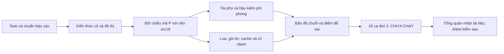

TÓM TẮT 1. [NGUỒN] DONE — hoàn thành bản đồ chuỗi đọc tĩnh KT-03A trong worktree đúng nhánh `task/KT-03A`, Git sạch trước khi ghi.
TÓM TẮT 2. [NGUỒN] Đã lần tài phú `magic_special_point → m_nWealth`, điều kiện reserve8, cổng GoldId, tự tháo, gói tin, Lua và đường tooltip/khung nhân vật.
TÓM TẮT 3. [NGUỒN] Đầu ra chính là `HIEU-GAME/01-trang-bi-cuong-hoa/BAN-DO-TAI-PHU-PHI-PHONG.md`, có 10 ô, 11 bậc, sổ thông số và 18 kịch bản kiểm động.
TÓM TẮT 4. [CHƯA KIỂM] Chưa kiểm game/binary/dữ liệu triển khai; ghi riêng xung đột đầy túi, hậu kiểm mobile và cache W/E; tệp nhịp ngoài worktree bị giới hạn vùng ghi.
TÓM TẮT 5. [CHƯA KIỂM] Không build, chạy game/exe server/VM hay mạng; không stage/commit/push theo yêu cầu, chưa có SHA mới, Tổng quản commit và giao A/bot chạy đợt 2.

# KT-03A — Bàn giao bản đồ tài phú và phi phong

Loại: tổng hợp
Chủ đề: Bù kiến thức chuỗi tài phú/phi phong cho A/B từ nguồn được giao, giữ nguyên tài liệu và kết luận cũ.
Từ khóa: tài phú, phi phong, 披风, pīfēng, magic_special_point, m_nWealth, magic_item_reserve8, EnoughAttrib, QhCheckPifeng, g_qhWealth
Trạng thái: DONE — đủ đầu ra khảo sát tĩnh; phần ghi nhịp ngoài workspace không thực hiện được trong sandbox, không chặn phần tài liệu.
Độ phủ: 8/8 nhóm phạm vi được lập bản đồ; 0/18 ca động đã chạy; không kiểm bảng item/PAK hoặc bộ binary đang triển khai.
Liên quan: `JX1_OPS/TASKS/KT-03A.md`; `JX1_OPS/DESIGN/CHUAN-BAO-CAO.md`; `JX1_OPS/DESIGN/MUC-LUC-TRI-THUC.md`; `JX1_OPS/DESIGN/QH-B039-tai-phu.patch`; `JX1_OPS/DESIGN/QH-B035-PHI-PHONG.md`; `JX1_OPS/HOP-THU/A-B.md`; `JX1_OPS/REPORTS/H-07-trang-suc-mat-na-phi-phong.md`; `JX1_OPS/REPORTS/H-08-tai-phu.md`.
Cần tôi quyết định: không — không xin quyền triển khai hoặc thay luật; A/B đối chiếu các mâu thuẫn khi nhận kiểm động.

## 1. Phạm vi và đầu ra

| Nhóm | Kết quả | Giới hạn |
|---|---|---|
| Kiến thức có sẵn | Đã đọc chuẩn trước, mục lục, H-07/H-08, thiết kế B-035, patch B-039 và hợp đồng v6/v7 liên quan | Không đổi kết luận, số liệu hay báo cáo cũ |
| 10 ô và điểm món | Đủ từng ô, loại đồ, hai nhẫn, Apply/Remove và handler field | Chưa đo tính bất biến qua các đường kích hoạt |
| Cấp và dữ liệu | Lua API, item sync, các dòng persist cấp +N | Không đọc DB, chưa kiểm record requirement |
| Điều kiện mặc | CanEquip/EnoughAttrib/reserve8 và tuyến mobile thực tế | Không coi cổng trước đã được mọi caller dùng |
| 11 bậc phi phong | Đủ ID chuẩn, nhóm biến thể, ngưỡng 6000…15000 | Không lấy Level làm bậc; chưa giải mã tên từng mẫu từ dữ liệu gốc |
| Tự tháo | Hậu kiểm ở hai nhánh mobile và đường đổi đồ cũ, chỗ túi/callback | Đầy túi giữ nguyên theo source; chưa chạy |
| Hiển thị | Hai tooltip, hai khung nhân vật, request W, chat/cache và tương tác E | Không xác nhận cặp Lua/APK/exe đang dùng |
| Kiểm động/bàn giao | 18 ca có fixture, thao tác, nơi đọc số, kỳ vọng | 0/18 đã chạy, không ghi PASS gameplay |

Tệp được sửa/tạo đúng quyền riêng của prompt: bản đồ trong `vung_file`, báo cáo này, và mục Kết quả cuối task. Không tạo chỉ mục riêng ngoài vùng; không sửa mã, Settings, BAI_HOC hoặc mục lục chung.

## 2. Nguồn và cách xác minh

Quy ước `P/`, `S/`, `C/`, `G/`, `D/` theo mục 2 của [bản đồ chuỗi](../HIEU-GAME/01-trang-bi-cuong-hoa/BAN-DO-TAI-PHU-PHI-PHONG.md). P là bản dự án QH-B035 hiện có trên đĩa, S là nền src18 do task giao, C là qh9A/Classes, G là script gốc dưới gói ServerNew. Không ghim SHA nguồn vì task không cung cấp; không suy mã trên đĩa thành binary đang chạy.

ĐÃ ĐỌC KIẾN THỨC: `DESIGN/CHUAN-BAO-CAO.md:1`; `DESIGN/MUC-LUC-TRI-THUC.md:13`; `REPORTS/H-07-trang-suc-mat-na-phi-phong.md:49,64,146,167`; `REPORTS/H-08-tai-phu.md:2,73,144,182`; `DESIGN/QH-B035-PHI-PHONG.md:3–32`; `DESIGN/QH-B039-tai-phu.patch:1–138`; `HOP-THU/A-B.md:149–161,335–375,440–489`. H-08 đã tách nhánh giàu có theo tiền; bản đồ mới bù hệ Q-90 của dự án, không phủ định kết luận lịch sử của H-08.

Đã dùng bản đồ tự sinh `MA-NGUON/ban-do-server.md` và `ban-do-client.md` để định vị symbol, sau đó mở file thật. Hai mẫu `SO-TAY-*/HIEU-*` và `JX1_OPS/SO-TAY-*/HIEU-*` không trả tệp tại worktree; không quét ổ đĩa hoặc tìm repo thay thế. Danh sách tệp mã/script đã khoanh được ghi ở mục 2 của bản đồ; mỗi lượt xuất đoạn mã tối đa khoảng 400 dòng, phần lớn nhỏ hơn 220 dòng.

ĐÃ TRA ĐỒ THỊ:

| Lệnh / nơi chạy | Kết quả thực | Cách dùng |
|---|---|---|
| `graphify explain '.QhCheckPifeng()'`, root src18 | Không có nút phù hợp | Không kết luận tính năng không tồn tại chỉ từ graph |
| Cùng lệnh, root P | Gợi ý `KItemList::QhCheckPifeng()`, KItemList.cpp L1206 | Kiểm lại `P/KItemList.cpp:1206–1220` |
| `graphify explain '.GetDesc()'`, root C | Mơ hồ 4 nút; có gamecore/KItem.h | Kiểm hàm thật `C/gamecore/KItem.cpp:1852` và hai đoạn tooltip |
| explain EnoughAttrib / định danh QhCheckPifeng / node KItem GetDesc; path LuaGive QiangHua | Không trả kết quả trong thời gian chờ; đã dừng bằng Ctrl-C | Không ghi rằng đã có kết quả/cạnh thành công |
| `graphify path 'KItemList::CanEquip()' 'KItemList::EnoughAttrib()'`, root P | Không khớp node CanEquip | Lần caller/callee trực tiếp bằng Select-String và đoạn mã |
| Đọc cục bộ GRAPH_REPORT/marker P và C | Marker `.`; nhóm KItemList và UI; src18 marker khớp root | Chỉ định vị; không update graph hoặc cài hook |

Graphify được gọi bằng đường task cho phép `D:/JX-tools/graphify-venv/Scripts/graphify.exe`. Không dùng kết quả chưa trả về làm bằng chứng. Không gọi web, dịch vụ mạng, game hay VM.

## 3. Kết quả nổi bật — ĐÃ ĐỌC MÃ, CHƯA KIỂM TRONG GAME

1. `P/KItem.cpp:194–201,293–300` phát ±100×+N qua `magic_special_point`; `P/KNpcAttribModify.cpp:3399–3408` cộng vào `m_nWealth` và chặn dưới 0; nền `S/KNpcAttribModify.cpp:3399–3402` còn rỗng. Dòng `P/KPlayer.h:386` là field dự án.
2. Hai overload `P/KItemList.cpp:1233,1267` có cổng GoldId; `:1349–1354` có requirement reserve8 tương tự kiểm sức mạnh ở `:1317–1322`. Tuy nhiên tuyến mobile `P/KProtocolProcess.cpp:8368,8487–8488,8577–8578` gọi AutoEquip rồi hậu kiểm; `GetEquPlace` chỉ chuyển loại sang ô (`P/KItemList.h:89`; `.cpp:2556–2607`). Không mô tả mọi đường là bị chặn trước bởi CanEquip.
3. `QhCheckPifeng` trả về khi túi không đủ chỗ (`P/KItemList.cpp:1217–1218`), trước thông báo D ở 1219. Khác lời v6 “đầy túi vẫn tháo” tại `HOP-THU/A-B.md:360`; để A/B chốt khi kiểm động.
4. Khung nhân vật client đọc `g_qhWealth` (`C/gameui/KuiRoleState.cpp:31,2646`; `C/vn/gameui/KuiRoleStateVN.cpp:395–402,962`). Handler `special_point` client còn rỗng (`C/gamecore/KNpcAttribModify.cpp:1987–1990`). Không nhận đã có tuyến sync thuộc tính nhị phân chỉ từ tên enum.
5. B-035 có `QhHandle(12)` và W cộng 10 ô (`D/QH-B035-deploy/opensysui.lua:22–26`; `qhcuonghoa.lua:24–31,67–69`). B-044 bỏ nhánh đó (`D/QH-B044-deploy/opensysui.lua:22–31`). Kết quả E của B-044 có trường cuối 0 (`qianghua.lua:58`), parser hiện gán trường cuối vào cache (`C/gameui/KuiChatList.cpp:338`). Hệ quả UI sai là giả thuyết có điều kiện cần đo trên đúng cặp phiên bản, chưa phải lỗi runtime tái hiện.
6. Helper hiện tại đổi cấp bằng UnEquip/EnChance/Equip (`P/KItemList.cpp:1176–1202`; `P/ScriptFuns.cpp:10975–10983`), không còn nguyên đoạn cộng delta tay trong patch B-039. Bảng điểm tách 11 bậc/biến thể và tổng cấp 60…150; không chép nhầm cột 6.0…15.0 từ thiết kế lịch sử.

## 4. Giải mã tên và tổ chức dữ liệu

| Tên gốc | Mã hóa | Chữ đúng / pinyin / nghĩa Việt | Nguồn |
|---|---|---|---|
| `披风` / `equip_pifeng` | GBK/CP936; ASCII | 披风, pīfēng — phi phong | `P/KItemList.cpp:2595–2596` |
| `Diem tai phu`, `Yeu cau tai phu` | ASCII nguyên văn mã | Điểm tài phú; yêu cầu tài phú | `C/gamecore/KItem.cpp:2440,2529` |
| `Điểm tài phú`, `Yêu cầu tài phú` | UTF-8 | Giữ nguyên chữ Việt | `C/vn/gameui/KuiItemdescVN.cpp:656,666` |

Bản đồ chính có bảng giải mã bổ sung tên các ô từ Hán gốc, pinyin và nghĩa Việt. Không đoán tên từng mẫu phi phong từ chuỗi Việt cũ hoặc từ Level. Sắp theo cấu trúc game: 10 ô đang mặc → 11 bậc phi phong/nhóm biến thể → hành động mặc/tháo → dữ liệu → giao diện. Không sắp theo thứ tự xuất hiện của tệp.

## 5. MỤC SỔ THÔNG SỐ

| Nhóm | Tên/hằng số | file:dòng | Giá trị | Đơn vị | Ảnh hưởng | Đổi an toàn | Nguồn đo |
|---|---|---|---|---|---|---|---|
| Điểm | `QH_WEALTH_X` | `P/KItemList.cpp:1146`; `P/KItem.cpp:198` | 100 | điểm / cấp | Apply/Remove, Lua và tooltip phải cùng hệ số | CẨN THẬN | Đọc tĩnh, chưa đo |
| Ô | `QH_WEALTH_N`, QH_PARTS | `P/KItemList.cpp:1147`; `D/QH-B035-deploy/qhcuonghoa.lua:7` | 10, ô 0…9 | ô | Nhẫn hai ô; phi phong không góp điểm | CẨN THẬN | Đọc tĩnh |
| Cổng | K, need | `P/KItemList.cpp:1148,1156–1163` | 11; 6000+900(k−1) | bậc; điểm | GoldId quyết định k, đủ bằng ngưỡng được chấp nhận | CẨN THẬN | Suy số học từ mã |
| Yêu cầu | `magic_item_reserve8` | `P/KItemList.cpp:1349–1354` | nValue[0] | điểm cần | Caller và record thật quyết định có qua nhánh | KHÔNG tự đổi enum | Chưa kiểm dữ liệu record |
| UI | Chu kỳ nhãn | `C/vn/gameui/KuiRoleStateVN.cpp:402` | 0,5 | giây | Chỉ vẽ lại cache, không xin W theo chu kỳ | CẨN THẬN | Đọc tĩnh |

## 6. ĐÃ XÁC MINH / CHƯA XÁC MINH

**ĐÃ XÁC MINH:** Git status trước ghi trả `## task/KT-03A`, không có thay đổi sẵn; hai đầu ra chưa tồn tại nên không làm lại checkpoint. Đã đọc các nguồn và đoạn mã hiện tại nêu trên; bảng nhóm/ID và các phép tính có file:dòng. Đã kiểm bản đồ được ghi thành UTF-8 không BOM, đủ 5 dòng tóm tắt, 1 Mermaid và 18 mã ca; không có ký tự thay thế U+FFFD trong bản đồ.

**CHƯA XÁC MINH:** chưa build/test chức năng, chạy game/exe server/VM, kết nối mạng; chưa xác định binary/APK và Lua nào đang triển khai; chưa kiểm DB, PAK, record requirement, fixture động hoặc tên từng mẫu từ byte gốc. Không dùng số liệu/ảnh do người khác ghi trong AB làm test do KT-03A chạy. Mọi ca KT03A-T01…T18 là **CHƯA CHẠY**, một số cần A/B có fixture/harness được duyệt mới thực hiện được.

Kiểm tra tài liệu thực chạy được ghi tại mục 8 sau khi hoàn tất lượt ghi; đây là kiểm tra định dạng/phạm vi, không phải PASS gameplay.

## 7. Lỗi, cách thử, kết quả và nhịp tiến độ

| Vấn đề | Đã thử / kết quả | Xử lý / còn lại |
|---|---|---|
| Shell mặc định chưa trả kết quả | Lượt đọc ban đầu chờ lâu, đã dừng; lượt Node đọc tệp timeout 30 giây | Chuyển PowerShell `login=false`, đọc thành công; không có write trong các lượt bị dừng |
| Mã hóa stdout | Lượt đọc task đầu hiển thị mojibake | Đặt stdout UTF-8, tài liệu đọc UTF-8 và Hán gốc đọc GBK; không sửa byte nguồn |
| Không có rg | Lệnh báo không nhận diện rg | Báo một lần, dùng Select-String giới hạn tên tệp/thư mục; không cài |
| Graphify | Có kết quả thiếu/mơ hồ node, một số lệnh chờ không trả kết quả | Dừng các session do lượt này mở; dùng GRAPH_REPORT và file thật; không retry mù hoặc dựng graph |
| Tìm tên client KPlayerChat.cpp | Một lượt báo file không tồn tại | Không tìm repo khác; tìm được tuyến thật ở KProtocolProcess → KgameWorld → KuiChatList |
| Output đọc kiến thức bị cắt | Lượt H-07/H-08 quá dài | Thu hẹp kết quả cần dùng theo chủ đề/số dòng; không dùng phần bị cắt làm bằng chứng mới |
| Câu lệnh kiểm tra cuối | Một lượt PowerShell báo ParserError thiếu dấu đóng khối, chưa thực thi diff | Tách câu lệnh nhiều dòng đơn giản; kiểm lại 18 hàng ca duy nhất và đọc lại cuối báo cáo thành công lúc 12:53:16; không có write trong lượt lỗi |
| Ghi nhịp ngoài workspace | `D:/JX-wt/KT-03A.nhip` không nằm trong writable root `D:/JX-wt/KT-03A` | BỊ CHẶN ghi nhịp theo cấu hình sandbox; không thử vượt quyền, không dựng giờ mốc bắt đầu đã mất; ghi các mốc quan sát được ngay dưới |

Nhịp thay thế trong báo cáo (giờ máy +07:00, không nhận đã ghi tệp .nhip): bắt đầu — không ghi được tệp nhịp ngoài workspace; 20/11/2026 12:41:48 — đã đối chiếu xong các chuỗi chính, 75%; 12:47:16 — bản đồ đã ghi/đọc lại và qua kiểm tra cấu trúc ban đầu, 90%; 12:50:38 — đã ghi đủ ba tệp, kiểm tra cấu trúc đạt, sắp xong 95%. Mốc giờ là thời điểm quan sát thực, không hồi tố giờ bắt đầu.

## 8. Bàn giao và kiểm tra tài liệu

- Đầu ra chính: [Bản đồ tài phú và phi phong](../HIEU-GAME/01-trang-bi-cuong-hoa/BAN-DO-TAI-PHU-PHI-PHONG.md); báo cáo này; kết quả ở cuối task. Không có thay đổi nguồn game hoặc kết luận cũ.
- Đề xuất mục lục để Tổng quản gộp, không sửa trực tiếp: `Tài phú thuộc tính / yêu cầu và tự tháo phi phong | HIEU-GAME/01-trang-bi-cuong-hoa/BAN-DO-TAI-PHU-PHI-PHONG.md; REPORTS/KT-03A.md | magic_special_point, m_nWealth, EnoughAttrib, QhCheckPifeng, g_qhWealth | khảo sát tĩnh; 0/18 ca động`.
- Hàng chỉ mục TSV đề xuất (không tạo file ngoài vùng): `JX1_OPS/HIEU-GAME/01-trang-bi-cuong-hoa/BAN-DO-TAI-PHU-PHI-PHONG.md\ttổng hợp\tTài phú và phi phong\tmagic_special_point,m_nWealth,magic_item_reserve8,QhCheckPifeng,g_qhWealth\tDONE-khảo sát tĩnh\t8/8 nhóm;0/18 ca động\tKT-03A;H-07;H-08;QH-B035;QH-B039;A-B v6/v7`. Các dấu `\t` trong dòng đề xuất biểu diễn dấu tab, chưa phải tệp TSV.
- ĐỀ XUẤT TỐI ƯU: thống nhất nguồn tổng điểm, tránh E ghi đè cache bằng0, chốt luật đầy túi và kiểm đủ caller trước khi sửa cổng. Chỉ đề xuất, không triển khai.
- Commit SHA: chưa có mới; không stage/commit/push theo yêu cầu “Tổng quản commit hộ”. Không có bằng chứng push GitHub, không nhận đã push.
- Bước tiếp: Tổng quản rà tài liệu/commit; A/B xác nhận cặp phiên bản và lần lượt chạy 18 ca trong mục KỊCH BẢN KIỂM ĐỘNG; lưu số đọc thật và phân xử các mâu thuẫn.
- Kết quả kiểm tra tài liệu thực chạy lúc 12:50:38 +07:00: cả ba tệp giải mã UTF-8 nghiêm ngặt thành công, không BOM/U+FFFD; hai đầu ra có đúng 5 dòng tóm tắt và 1 Mermaid/tệp, hàng rào code cân bằng; bản đồ đủ 18 mã ca duy nhất; task có đúng một mục Kết quả ở cuối. Mẫu tìm gán giá trị password/api-key/secret/token không có kết quả trong ba tệp; đây chỉ là phép kiểm mẫu, không phải phép quét bí mật toàn diện. Không có test gameplay nào đã chạy.
- Kỹ năng đã dùng: jx1-retrofit, jx1-read-server, jx1-read-client, jx1-parameters, jx1-knowledge, jx1-report; đã nạp đủ nội dung từ `.agents/skills`.
