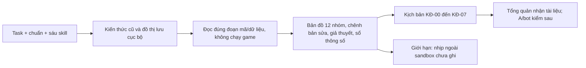

TÓM TẮT 1: [NGUỒN] PARTIAL ở thủ tục nhịp; đã hoàn tất bản đồ đọc tĩnh 12/12 nhóm trong đúng vung_file, báo cáo này và mục Kết quả của task theo yêu cầu trực tiếp.
TÓM TẮT 2: [NGUỒN] Đã nối nút/ô trái → tầm đánh → gói tin → CmdLane → điều kiện thi triển → Lua/dữ liệu → động tác/HP; chỉ rõ các nhánh và file:dòng trong bản đồ.
TÓM TẮT 3: [NGUỒN] Ba đoạn server S/Q giống nhau, hiện giữ skill trước MOVE; qh9A có fix33. Khác biệt với nhận định cũ được ghi riêng, không sửa kết luận/số liệu báo cáo cũ.
TÓM TẮT 4: [CHƯA KIỂM] Không thể ghi nhịp tại đường dẫn ngoài sandbox; đã tra bản xuất Graphify cục bộ thay CLI .exe theo lệnh cấm. Chưa xác minh nguyên nhân ca lỗi hoặc bản triển khai thực.
TÓM TẮT 5: [CHƯA KIỂM] Chưa build, chạy game/exe, VM, mạng hay bài động; không stage/commit/push theo phân công. Tổng quản nhận ba tệp và xử lý nhịp còn thiếu khi có quyền.

# KT-03B — Bàn giao bản đồ nút đánh thường và làn lệnh

Loại: khảo sát
Chủ đề: Bổ sung điểm nối phục vụ A/B sửa lỗi bấm đánh chỉ chạy tới quái.
Từ khóa: đánh thường, MainAttack, FollowPeople, CmdLane, fix33, AttackRadius, BufferBusy, Lua, kiểm động, KT-03B
Trạng thái: PARTIAL — bản đồ tĩnh đã xong; chưa ghi được tệp nhịp ngoài vùng ghi cho phép.
Độ phủ: 12/12 nhóm bản đồ tĩnh; đủ 5 nhóm nội dung mục tiêu; 0/8 ca kiểm động đã chạy theo đúng giới hạn task.
Liên quan: `JX1_OPS/TASKS/KT-03B.md`; `JX1_OPS/HIEU-GAME/03-ky-nang-chien-dau/BAN-DO-DANH-THUONG-LAN-LENH.md`; `JX1_OPS/REPORTS/LAN-LENH-KY-NANG.md`; `JX1_OPS/HOP-THU/A-B.md:266–276,343–352`; `JX1_OPS/DESIGN/CHUAN-BAO-CAO.md`.
Cần tôi quyết định: không về nội dung tĩnh; Tổng quản xử lý tệp nhịp ngoài sandbox và chốt lượt kiểm động riêng.



## Phạm vi và độ phủ

| Hạng mục được giao | Kết quả | Bằng chứng/giới hạn |
|---|---|---|
| Tóm tắt bằng lời thường | Đã phủ | Bản đồ mục 1 |
| Chuỗi thao tác/client/gói/server/Lua/dữ liệu/hiển thị | Đã phủ 12 nhóm, trình bày 14 bước | Bản đồ mục 2–4; phân biệt dữ liệu nạp/cache với một lần bấm |
| Chỗ dự án sửa đè so với nguồn gốc | Đã phủ những bản có thể đối chiếu | Bản đồ mục 5: fix33; A2-CMDLANE; ba đoạn S/Q; bản nháp qhcuonghoa so với qianghua trên đĩa. Không có diff nguyên thủy để nhận là đã xác minh gốc |
| Chỗ dễ sửa sai và giả thuyết | Đã phủ | Bản đồ mục 6,9–10; 10 giả thuyết có điểm kiểm, không kết luận nguyên nhân |
| KỊCH BẢN KIỂM ĐỘNG | Đã soạn 8 ca, chưa thực chạy | Bản đồ mục 8: đồ/nhân vật/quái cần, thao tác, nơi đọc số, kỳ vọng |
| Báo cáo này và Kết quả task | Đã ghi theo yêu cầu trực tiếp | Không đổi metadata/phạm vi của task, không sửa tài liệu cũ |
| Nhịp `D:\JX-wt\KT-03B.nhip` | Chưa ghi được | Nằm ngoài writable root `D:\JX-wt\KT-03B`; không thử vượt sandbox, không đổi quyền |
| Chỉ mục TSV/mục lục dùng chung | Chỉ đề nghị hàng để PM ghép | Ngoài vung_file; không tạo/sửa chỉ mục dùng chung |

## Giải mã tên

| Tên gốc | Mã hóa | Chữ đúng | Nguồn file:dòng |
|---|---|---|---|
| MainAttack, CmdLane, fix33 | ASCII identifier | Nút gọi kỹ năng ô trái; làn lệnh; nhãn bản sửa giữ di chuyển | `C/gamecore/CoreShell.cpp:457–459`; `S/KNpc.cpp:6730–6777`; `C/gamecore/KProtocol.cpp:192–197` |
| Hai tên kỹ năng TCVN3 và hai tên tệp script mojibake | TCVN3/byte GBK hiển thị Latin-1; giữ nguyên tên thật trên đĩa | Bảng đầy đủ chữ UTF-8, Hán và pinyin ở mục “Giải mã tên” của bản đồ; không đổi tên dữ liệu | `GS/Settings/Skills.txt:2–3`; hai script tại `GS/script/skill/special/`, mỗi file `1–36`, đường dẫn đầy đủ ở bản đồ |

## Sắp theo cấu trúc game

Theo người chơi → kỹ năng ô trái → địch → tiếp cận → thi triển → kết quả. Không mở rộng sang danh mục mọi môn phái. Mục 2–4 của bản đồ cung cấp bảng phạm vi, chuỗi và hai mẫu dùng chung, tránh tổ chức kết luận theo thứ tự tên file.

## Nguồn đã đọc và cách kiểm

Alias `C/`, `S/`, `Q/`, `GS/`, `D/` được định nghĩa bằng đường dẫn tuyệt đối tại mục 2 bản đồ. Chỉ đọc các file sau hoặc đoạn tìm ký hiệu liên quan; không quét toàn cây source/Folder/SwordOnline, không đọc credential.

| Nhóm từ Nguồn task | Tệp/đoạn đã chọn |
|---|---|
| Chuẩn, mục tiêu, kỹ năng | `D/CHUAN-BAO-CAO.md`; `JX1_OPS/TASKS/KT-03B.md`; sáu `.agents/skills/jx1-{retrofit,read-server,read-client,parameters,knowledge,report}/SKILL.md` |
| Kiến thức sẵn có | `D/MUC-LUC-TRI-THUC.md`; bốn file `JX1_OPS/MA-NGUON/{README,ban-do-client,ban-do-server,goi-tin}.md`; `JX1_OPS/REPORTS/LAN-LENH-KY-NANG.md`; `JX1_OPS/HOP-THU/A-B.md:266–276,343–352` |
| Sổ tay liên quan | `D/SO-TAY-KY-NANG.md`, `SO-TAY-KY-NANG-CAP.md`, `SO-TAY-GOI-TIN.md`, `SO-TAY-VONG-LAP-SERVER.md`, các dòng định vị `SO-TAY-AI-QUAI.md`; `D/HIEU-CONG-THUC-SAT-THUONG.md:74–98` |
| Định vị Graphify theo skill | Đoạn liên quan `JX1_OPS/CONTEXT-PACK/GS001-MAP.md`, `JX1_OPS/TOOLS/CONG-CU.md:9`; marker và bản xuất Graphify cục bộ ở hai root |
| Client | `C/gamescene/KgameWorld.cpp`; `C/gamecore/{CoreShell.cpp,KNpcAI.cpp,KNpc.cpp,KNpc.h,KNpcSet.cpp,KProtocol.cpp,KProtocolProcess.cpp,KPlayer.cpp,KSkills.cpp,KCore.cpp}`; chỉ các cửa sổ/ký hiệu của chuỗi |
| Server src18 | `S/{KNpc.cpp,KNpcAI.cpp,KProtocolProcess.cpp,KSkills.cpp,KSkillManager.cpp,KCore.cpp,KMissle.cpp}`; phần làn, thi triển, dữ liệu, sát thương, đồng bộ |
| Bản dự án QH-B035 | `Q/KNpc.cpp` để so ba đoạn; tìm ký hiệu giới hạn trong `Q/KProtocolProcess.cpp` và `Q/ScriptFuns.cpp`, không mở rộng sang tính năng khác |
| Dữ liệu/script | `GS/Settings/Skills.txt:1–7`, chỉ cột liên quan, trọng tâm dòng 2–3; hai tệp tên gốc `³¤±øÎïÀí¹¥»÷.lua` và `Ô¶³ÌÎïÀí¹¥»÷.lua` tại `GS/script/skill/special/`; định vị helper tại `GS/script/skill/shaolin.lua:594–610`; các hàm và đầu file `GS/script/system/qianghua.lua` |
| Bản nháp Lua dự án | `D/QH-B035-deploy/qhcuonghoa.lua:1–90`; không đọc/sửa dữ liệu tiền, đồ hay nhân vật runtime |

**ĐÃ ĐỌC KIẾN THỨC:** các tài liệu/sổ tay trong bảng trên, trước khi kết luận nguồn thật. Bản đồ bổ sung điểm nối và khác biệt; không thay các sổ tay hay báo cáo cũ.

**ĐÃ TRA ĐỒ THỊ:** tìm có lọc trên `GRAPH_REPORT.md` trước khi đọc code → định vị client CoreShell/KNpcAI và server CmdLane/DoSkill; sau đó `JSON.parse + lọc nodes/links` trực tiếp trên `D:/JX-build/qh9A/Classes/graphify-out/graph.json` và `D:/JX-build/src18/graphify-out/graph.json` → client có cạnh `ProcessPlayer → FollowPeople`, server có nút `CmdLaneReceive L6730`, `CmdLaneProc L6780`, `NpcSkillCommand L5581` và cạnh gọi cấu hình/feed. Dòng báo cáo có thể lệch hoặc trỏ header; đã đối chiếu file thật. Không chạy `graphify.exe query/explain/path` vì yêu cầu trực tiếp cấm exe; không tái sinh graph, không mạng.

## Kết quả chính và phát hiện khi chuẩn hóa

1. **[ĐÃ ĐỌC MÃ] Đầu vào là kỹ năng ô trái hiện chọn.** `C/gamecore/KNpcAI.cpp:1483–1491`, không tự gán một SkillId đòn thường.
2. **[ĐÃ ĐỌC MÃ] Điểm rẽ tầm là client.** `C/gamecore/KNpcAI.cpp:772,827–844`. `S/KNpcAI.cpp:771–779` không phải phép trừ offset 20. Nhận định khác trong `JX1_OPS/HOP-THU/A-B.md:347` được giữ nguyên và chú thích tại mục 10 bản đồ.
3. **[ĐÃ ĐỌC MÃ] MOVE không xóa kỹ năng ACT ở hai bản hiện đọc.** `S/KNpc.cpp:6752–6762`; `Q/KNpc.cpp:6757–6767`. So nội dung CmdLaneReceive, CmdLaneProc, DoSkill cho kết quả giống nhau, không chỉ cộng lệch 5 dòng.
4. **[ĐÃ ĐỌC MÃ] Guard đã có ở client.** `C/gamecore/KProtocol.cpp:197–257,324–343`; nhịp nhả tại `C/gamecore/KPlayer.cpp:241`. Không đề nghị thêm trễ như thể chưa có cơ chế này.
5. **[ĐÃ ĐỌC MÃ] Số thực hiện lệnh chưa phải số trúng.** `S/KNpc.cpp:6826–6829` tăng exec trước xử lý cổng; skillcast phát tại `3690–3749`, Cast theo khung ở `3984–4016`, HP thường trừ tại `5719`.
6. **[ĐÃ ĐỌC DỮ LIỆU] Không có căn cứ kết luận bán kính thật quá nhỏ.** Hai dòng mẫu có 100/320 tại `GS/Settings/Skills.txt:2–3`; chưa biết ID/R client của ca lỗi. Với R=30 ngưỡng là 10, không phải luôn bất khả thi.
7. **[ĐÃ ĐỌC MÃ] Bản nháp Lua không chứng minh đã deploy.** `D/QH-B035-deploy/qhcuonghoa.lua:67–90` có QhHandle; `GS/script/system/qianghua.lua:10,173,178` có bộ hàm khác. Không nối nhánh cường hóa vào đường MainAttack.
8. **[TÀI LIỆU]** Giữ nguyên số 525/80/291/154 và kết luận nguồn cũ `JX1_OPS/REPORTS/LAN-LENH-KY-NANG.md:8–11,29–35`. Không đọc log gốc và không nhận đó là số đo mới.

## MỤC SỔ THÔNG SỐ

Sổ đầy đủ có giá trị, đơn vị, ảnh hưởng, mức đổi và nguồn ở mục 7 bản đồ. Điểm cần bàn giao: offset 20; radius NPC khởi tạo 30 khác mặc định trường bảng 50; mẫu SkillId 1/2 có 100/320; guard 3 nhịp client; CmdLane mặc định Enable=1, BufferBusy=0, Stats=1, TTL ACT/MOVE=250/120 ms kẹp 30–1000; thống kê 60000 ms; khóa yêu cầu NPC >100 nhịp; thang HP 1000. Tất cả là nguồn tĩnh/dữ liệu mẫu, chưa đo runtime; không thay giá trị nào.

## Lỗi, cách thử và kết quả

| Vấn đề thực gặp | Cách xử lý an toàn | Kết quả/giới hạn |
|---|---|---|
| Đầu ra PowerShell mặc định lỗi chữ Việt | Đọc rõ UTF-8 và đặt OutputEncoding UTF-8 trong lệnh hiện tại | Đọc lại đúng chuẩn/task; không đổi cấu hình máy hoặc file nguồn |
| Không có rg | Chuyển Select-String/Get-ChildItem có lọc tên, sau đó đọc cửa sổ theo dòng | Không cài công cụ; không lặp thử rg |
| Task viết REPORTS/sổ tay dạng đường dẫn rút gọn | Đối chiếu vị trí trong `JX1_OPS/REPORTS`, `JX1_OPS/DESIGN` và bản đồ đã nêu | Tìm được nguồn liên quan; không tìm kho khác |
| Không có GRAPH_REPORT ở src18/graphify-out | Dùng bản xuất báo cáo ở src18/jxOnline; sau đó kiểm graph.json đúng root src18 | Định vị được các nút/cạnh; không đồng nhất mọi snapshot báo cáo |
| Một số đường dẫn gốc rút gọn không tồn tại | Dựa source_file trong graph để xác định src18/jxOnline/gameserver; bản Q ở QH-B035/server/jxOnline/gameserver | Đã kiểm lại file thật, không đổi root sang canonical ngoài task |
| Tên script giải GBK không trùng tên Unicode trên đĩa | Sau ENOENT, chỉ lọc tên trong đúng script/skill/special rồi mở nguyên tên mojibake | Đọc được cả hai file 36 dòng. Chưa kết luận engine/Pak có lỗi nạp tên |
| Một số chú thích source lỗi/mã hóa hỗn hợp | UTF-8 có kiểm tra và GBK cho file phù hợp; chỉ dùng ký hiệu ASCII/đoạn rõ nghĩa | Không sửa chữ source. Ví dụ vùng hỏng của S/KNpc.cpp ở 5727–5728 không dùng làm chứng cứ cho phép trừ HP tại 5719 |
| Thiếu patch lịch sử/header định vị dự đoán và CmdLane.ini tại root GS | Ghi thiếu, dùng hàm trực tiếp/giá trị mặc định có nguồn; không dò sang nơi khác | Không có bằng chứng diff nguyên thủy hay cấu hình runtime; không dựng kết luận thay |
| `D:\JX-wt\KT-03B.nhip` ở ngoài vùng ghi | Không ghi ngoài sandbox, không chuyển/giả mạo sang tệp khác | Thủ tục nhịp còn thiếu; không phải lỗi Git/push |

## ĐÃ XÁC MINH / CHƯA XÁC MINH

**ĐÃ XÁC MINH (DA XAC MINH):** Git đã kiểm một lần lúc bắt đầu: đúng `task/KT-03B`, không có thay đổi sẵn; hai đầu ra chưa tồn tại. Đã đọc trực tiếp các điểm nguồn dẫn trong bản đồ; so ba đoạn server bằng nội dung; tra graph cục bộ; đọc hai Lua mẫu theo tên thật; phân biệt thông số source với dữ liệu và runtime.

**CHƯA XÁC MINH (CHUA XAC MINH):** nguyên nhân người chơi gặp, bản binary/APK/dữ liệu đang nạp, cấu hình override, đường engine/Pak xử lý tên script, số đòn trúng và mọi số đo độ trễ/sát thương. Không build, chạy test game/exe, VM, kết nối mạng hay kiểm động; các thao tác này bị loại khỏi quyền task.

**Kiểm tài liệu đã chạy:** đọc lại ba tệp, đều giải mã UTF-8 chặt được, không BOM và không ký tự thay thế U+FFFD. Hai tài liệu đều có đúng 5 dòng tóm tắt và một Mermaid; bản đồ có 12 hàng phạm vi, 14 bước chuỗi, 10 giả thuyết, 8 ca kiểm. Hai hàng TSV nhúng đều đủ 7 cột. Rà 169 dẫn chiếu tường minh trên 32 tệp phát hiện hai khoảng dòng vượt báo cáo cũ; đã sửa về 1–37 và 34–37. Đây là kiểm nội dung tài liệu, không phải test game. Bước bàn giao cuối xem diff task một lần, không stage.

## Đề xuất tối ưu

Ưu tiên xác nhận bản chạy và probe đúng điểm đứt theo KĐ-00/01/04/06; dùng bộ đếm có sẵn, không sửa nhiều biến cùng lượt. Chưa đề nghị triển khai offset mới, thêm hàng đợi hoặc sửa Lua cường hóa để chữa lỗi đánh. Chi tiết rủi ro ở mục 9 bản đồ.

## Bàn giao và chỉ mục đề nghị

- Ba tệp giao Tổng quản: bản đồ trong vung_file; `JX1_OPS/REPORTS/KT-03B.md`; mục `Kết quả` trong `JX1_OPS/TASKS/KT-03B.md`.
- Không stage/commit/push theo phân công, chưa có SHA; không phải trạng thái “BỊ CHẶN – CHƯA PUSH” do lỗi Git. Tổng quản commit hộ khi nhận.
- Không sửa `BAI_HOC.md`, báo cáo cũ, source, Settings, đồ thị hay mục lục chung. Không tạo TSV ngoài vung_file; hàng dưới để PM ghép.
- Đề nghị mục lục: “Nút đánh thường và CmdLane | JX1_OPS/HIEU-GAME/03-ky-nang-chien-dau/BAN-DO-DANH-THUONG-LAN-LENH.md | MainAttack, FollowPeople, CmdLaneReceive, DoSkill | khảo sát tĩnh”.
- Hàng chỉ mục bảy cột, phân cách tab:

```tsv
file	loại	chủ đề	từ khóa	trạng thái	độ phủ	liên quan
JX1_OPS/HIEU-GAME/03-ky-nang-chien-dau/BAN-DO-DANH-THUONG-LAN-LENH.md	khảo sát	Nút đánh thường và làn lệnh kỹ năng	đánh thường;MainAttack;FollowPeople;CmdLane;fix33;AttackRadius	DONE (bản đồ tĩnh)	12/12 nhóm;0/8 ca động	JX1_OPS/REPORTS/KT-03B.md;JX1_OPS/REPORTS/LAN-LENH-KY-NANG.md;JX1_OPS/HOP-THU/A-B.md
```

Mốc cục bộ có giờ xác định: `20/11/2026 12:45:42` (Asia/Bangkok), chốt nguồn và khác biệt, ước tính 70%; `12:46:20`, xác nhận nhánh sát thương, ước tính 75%. Đây là ghi chú trong báo cáo, không nhận là đã ghi tệp nhịp bắt đầu/mỗi phần/sắp xong.

Kỹ năng đã dùng: jx1-retrofit, jx1-read-server, jx1-read-client, jx1-parameters, jx1-knowledge, jx1-report.
