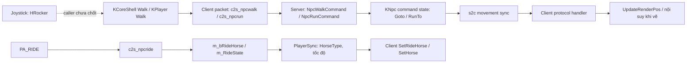

TÓM TẮT 1..5
1. [NGUỒN] PARTIAL: đã lập bản đồ tĩnh từ joystick, lệnh client, packet, server và nội suy hiển thị; caller joystick chưa chốt.
2. [NGUỒN] `NpcWalkCommand` / `NpcRunCommand` nhận đích và lưu lệnh; không thấy chúng so vị trí rồi gọi `SetPos`.
3. [NGUỒN] Đầu ra: bản đồ `BAN-DO-DI-CHUYEN-CUOI-NGUA.md` và kịch bản log cho A/B.
4. [CHƯA KIỂM] Chưa xác định nguyên nhân khựng 4–5 giây; cần đo cùng nhân vật khi cưỡi/không cưỡi và đối chiếu trace.
5. [CHƯA KIỂM] Không chạy game/VM/mạng; Graphify CLI query đã gọi hai lần và lỗi; không commit/push theo task (Tổng quản commit hộ); nhịp bị từ chối quyền.

# KT-03D — Bản đồ chuỗi di chuyển và cưỡi ngựa
Loại: khảo sát
Chủ đề: Lần theo lệnh di chuyển/cưỡi ngựa và các điểm đồng bộ/vẽ có thể tạo cảm giác khựng.
Từ khóa: di chuyển, joystick, đi bộ, chạy, cưỡi ngựa, `c2s_npcwalk`, `c2s_npcrun`, `c2s_npcride`, `UpdateRenderPos`
Trạng thái: PARTIAL — chưa xác nhận nguyên nhân 4–5 giây bằng kiểm động và còn cạnh gọi joystick → vòng gửi lệnh chưa được chỉ ra.
Độ phủ: 5/9 mảng đã phủ tĩnh; 4/9 mảng có giới hạn hoặc chờ kiểm động, xem bảng bên dưới.
Liên quan: `JX1_OPS/DESIGN/MUC-LUC-TRI-THUC.md`, `JX1_OPS/REPORTS/DO-MUOT-MOC-GOC.md`, H-13, B-04a, task `KT-03D`.
Cần tôi quyết định: không — A/B chạy kịch bản khi được giao.

## Phạm vi và độ phủ

| Mảng theo task | Kết quả | Bằng chứng chính |
|---|---|---|
| Touch joystick → đích điều khiển | Đã phủ tĩnh | `KHRocker.cpp:83-173,293-456`; `KgameWorld.cpp:1534-1538` |
| Cạnh gọi endpoint → vòng lệnh | Chưa chốt | `CoreShell.cpp:5147` gọi `KPlayer::Walk`; chưa tìm thấy lời gọi hoạt động nối trực tiếp từ `HRocker::onTouchMoved` |
| Client giới hạn nhịp và tạo lệnh | Đã phủ tĩnh | `KPlayer.cpp:183-254,609-708`; `GameDataDef.h:29` |
| Đóng gói / dispatch packet | Đã phủ tĩnh | Client `KProtocol.cpp:261-310`; server `KProtocolProcess.cpp:213-216,5437-5482` |
| Server nhận và thi hành đích | Đã phủ tĩnh | `KProtocolProcess.cpp:5437-5482`; `KNpc.cpp:939,1299-1406,4194-4280,6875-6896` |
| Đồng bộ kiểu ngựa/tốc độ và tài nguyên vẽ | Đã phủ tĩnh | Server `KNpc.cpp:8077-8087,8351-8375`; client `KProtocolProcess.cpp:3083-3097`, `KNpc.cpp:723-731,801,3975-4025` |
| Lua / bảng dữ liệu cấu hình | Một phần | Handler trực tiếp gọi C++; chưa xác định bảng tốc độ, `qhcuonghoa.lua` không có trong thư mục script được nêu |
| Đối chiếu vị trí/kéo lùi | Một phần | `c2splayersetpos` riêng tại server `KProtocolProcess.cpp:317,8342-8349`; không được gọi trong hai handler đi/chạy đã kiểm |
| Nguyên nhân 4–5 giây và đo kiểm | Chưa kiểm trong game | Báo cáo cũ `DO-MUOT-MOC-GOC.md:115,121` là dữ liệu độ trễ/đánh, không trùng tình huống cưỡi ngựa; cần kịch bản kiểm động |

## Giải mã tên

| Tên gốc / mã | Mã hóa | Chữ đúng | file:dòng |
|---|---|---|---|
| Không có tên nhân vật, NPC, bản đồ, trang bị hay kỹ năng riêng được đưa vào báo cáo; các tên còn lại là symbol/gói giao thức ASCII. | — | — | — |

## Sắp theo cấu trúc game

| Pha | Thành phần theo thứ tự chạy |
|---|---|
| Điều khiển client | `KgameWorld` tạo `HRocker` → `HRocker::onTouchMoved` tạo endpoint → `KCoreShell::Walk` / `KPlayer::Walk` (cạnh đầu vào chưa xác nhận) |
| Gửi lệnh | gom/giới hạn nhịp → `SendClientCmdWalk` / `SendClientCmdRun` → `c2s_npcwalk` / `c2s_npcrun` |
| Thực thi server | `KProtocolProcess` dispatch → handler kẹp tọa độ âm → `KNpc::SendSerCommand` → `KNpc::Activate` → `Goto` / `RunTo` / `DoWalk` / `DoRun` |
| Phản hồi và hiển thị | `s2c_npcwalk` / `s2c_npcrun` → `NetCommandWalk` / `NetCommandRun` → vị trí logic → `UpdateRenderPos` → `GetMpsPos` nội suy |
| Trạng thái cưỡi | `PA_RIDE` → `c2s_npcride` → `NpcRideCommand` → `HorseType`/tốc độ trong `PlayerSync` → `SyncPlayerMin` và tài nguyên `SetRideHorse`/`SetHorse` |

## Kết quả khảo sát

[NGUỒN] Client: `D:\JX-build\qh9A\Classes`; bản dự án đối chiếu: `D:\JX-wt\QH-B035\client\Classes`. Server: `D:\JX-build\src18\jxOnline`; bản dự án: `D:\JX-wt\QH-B035\server\jxOnline`.

[NGUỒN] Client gửi đích đi/chạy theo nhịp logic, có giữ một đích joystick chưa gửi, và có chặn ngắn lệnh di chuyển khi kỹ năng đang chờ (`KPlayer.cpp:183-254,684-708`; `KProtocol.cpp:192-329`). `SKILL_MOVE_GUARD_TICKS = 3` là bảo vệ xung đột lệnh, không phải chu kỳ 4–5 giây (`KProtocol.cpp:192-201`).

[NGUỒN] Server `NpcWalkCommand` / `NpcRunCommand` nhận tọa độ Mps, chặn tọa độ âm rồi lưu command; đích được tiến hành bởi `KNpc::Activate` và phát sync theo `Goto` / `RunTo`. `c2splayersetpos` là đường đặt vị trí tách biệt, chưa có chứng cứ nó chạy đều trong thao tác joystick.

[NGUỒN] Client nhận walk/run sync rồi lưu command tới NPC; `KNpc::UpdateRenderPos` snap nếu hụt nhịp logic hoặc bước tọa độ vượt ngưỡng; nếu không thì dựng lại điểm nội suy. Log `U` tại `KNpc.cpp:3983-3986` có `dtick`, `snap`, `dx/dy`, phù hợp để đối chiếu lúc khựng.

[NGUỒN] `m_RideState = 50` chỉ xuất hiện như bộ đếm hạn chế lặp thao tác cưỡi; mỗi lần xử lý NPC nó giảm một đơn vị (`KNpc.cpp:2165-2167`, `KProtocolProcess.cpp:6294-6322`). Chưa thấy logic này chặn lệnh chạy/đi hoặc tạo khựng định kỳ.

[NGUỒN] `MAX_SYNC_TIMES = 120` dùng để dọn NPC không phải người chơi thiếu sync (`KRegion.h:23`, `KNpc.cpp:636-646`), không áp dụng lên nhân vật người chơi trong điều kiện đó. Không dùng làm lời giải 4–5 giây cho người chơi cưỡi ngựa.

[NGUỒN] Báo cáo `JX1_OPS/REPORTS/DO-MUOT-MOC-GOC.md:115,121` ghi vấn đề tick/dữ liệu mạng trong phiên khác và chưa có SvrFPS tại thời điểm đó. Không chuyển kết luận về khựng do đánh/quái sang hiện tượng cưỡi ngựa của task.

### Bản dự án so với nguồn

[NGUỒN] Client QH-B035 và qh9A khác ở cấp toàn file. Các vùng đã đối chiếu đều có nhãn/logic fix33, tick-smooth, tick-smooth2 hoặc trace trong cả hai cây; các điểm liên quan nằm tại `KProtocol.cpp:192-329`, `KPlayer.cpp:183-254,684-708`, `KNpc.cpp:3959-4025`, `KProtocolProcess.cpp:890,2163,2317,2417,2570`. Các nhánh này không được xác nhận là qh9A-only. Khác hash toàn file không đủ quy kết nguyên nhân.

[NGUỒN] So sánh hẹp handler đi/chạy/cưỡi của `KProtocolProcess.cpp` và `KNpc.cpp` server không cho thấy hunk khác tại các symbol đã dò. Không khẳng định hai bản giống nhau toàn file.

[CHƯA KIỂM] Không tìm thấy `qhcuonghoa.lua` trong thư mục script được task chỉ ra; chưa lần tới script/bảng dữ liệu cấu hình tốc độ.

## MỤC SỔ THÔNG SỐ

| Nhóm | Tên/hằng số | file:dòng | Giá trị | Đơn vị | Ảnh hưởng | Đổi an toàn | Nguồn đo |
|---|---|---|---:|---|---|---|---|
| Gửi lệnh | `defMAX_PLAYER_SEND_MOVE_FRAME` | `GameDataDef.h:29` | 5 | bộ đếm nhịp di chuyển | ngưỡng chu kỳ gửi trong `KPlayer::Walk` | CẨN THẬN | Đọc tĩnh, chưa đo runtime |
| Chặn lệnh | `SKILL_MOVE_GUARD_TICKS` | `KProtocol.cpp:197` | 3 | nhịp client; comment mã nêu 167 ms | ngăn lệnh di chuyển ghi đè lệnh kỹ năng | CẨN THẬN | Comment mã, chưa đo lại |
| Cưỡi | `m_RideState` | `KProtocolProcess.cpp:6307`; `KNpc.cpp:2165-2167` | 50 | nhịp nội bộ, chu kỳ thực chưa xác minh | chặn toggle cưỡi liên tiếp | CẨN THẬN | Đọc tĩnh |
| Render | `NPC_RENDER_SNAP_DIST` | `KNpc.cpp:3959` | 96 | đơn vị tọa độ Mps đầu vào | ngưỡng chọn snap thay vì nội suy | CẨN THẬN | Đọc tĩnh |
| NPC sync | `MAX_SYNC_TIMES` | `KRegion.h:23` | 120 | nhịp đồng bộ | dọn NPC không phải người chơi khi thiếu sync | CẨN THẬN | Đọc tĩnh |
| Số liệu phiên khác | Tick 116 ms, max 864 ms; `gap_max=657 ms`, 62 gap >250 ms, `drain_max=16 ms` | `DO-MUOT-MOC-GOC.md:121` | như mô tả | ms / lần gap | mốc tham khảo độ trễ; không chứng minh lỗi cưỡi ngựa | KHÔNG suy đổi từ mốc này | Số đo trong báo cáo khác tình huống |

## Chỗ dễ làm sai khi sửa

- Không coi tọa độ `moveEndPoint` của joystick là tọa độ packet Mps; `KPlayer::Walk` còn tính tọa độ đích từ vị trí nhân vật và hướng.
- Không gọi packet `c2s_playersetpos` là bước mặc định của `c2s_npcwalk`/`c2s_npcrun`; hai handler đi/chạy đã kiểm không gọi `SetPos`.
- Không đổi `m_RideState=50` thành giây khi chưa biết nhịp server thực tế; không dùng `MAX_SYNC_TIMES=120` làm giải thích cho người chơi vì code chỉ áp dụng với NPC không phải người chơi.
- Không kết luận `UpdateRenderPos` là thủ phạm chỉ từ ngưỡng snap hoặc comment lịch sử; cần log `U` trùng thời điểm khựng.
## Đã tra đồ thị / Đã đọc kiến thức

ĐÃ TRA ĐỒ THỊ: `graphify.exe query "ClearJoystickPendingMove" --root D:\JX-build\qh9A\Classes` và lệnh query server tương ứng → cả hai báo không tìm thấy `graphify-out\graph.json` dưới worktree `D:\JX-wt\KT-03D`; không có kết quả query. Đồ thị sinh sẵn đã đọc ở `D:\JX-build\qh9A\Classes\graphify-out\GRAPH_REPORT.md:1209` (cộng đồng `KHRocker.cpp`) và `D:\JX-build\src18\jxOnline\graphify-out\GRAPH_REPORT.md:1793,1873` (`KProtocolProcess.cpp`, `KNpc.cpp`); dùng để định vị rồi kiểm source.

Lỗi/cách thử: ripgrep không có trong shell nên chuyển sang Select-String. Một lần tìm tên file đệ quy cho đầu ra quá rộng; dừng và từ đó chỉ truy vấn đường dẫn/tên file cụ thể. Lệnh đó chỉ liệt kê đường dẫn, không đọc nội dung file.

ĐÃ ĐỌC KIẾN THỨC: `JX1_OPS/DESIGN/MUC-LUC-TRI-THUC.md:7,14`, `JX1_OPS/MA-NGUON/ban-do-client.md`, `ban-do-server.md`, `goi-tin.md`, `JX1_OPS/REPORTS/DO-MUOT-MOC-GOC.md`; không thấy báo cáo `TU-SONNET` / `vc23` trong `JX1_OPS/REPORTS/`.

liên quan: `JX1_OPS/DESIGN/MUC-LUC-TRI-THUC.md` (H-13, B-04a); `JX1_OPS/REPORTS/DO-MUOT-MOC-GOC.md`; task `KT-03D`.
## Đã xác minh / Chưa xác minh

### Đã xác minh

- Client và server có các handler/packet đi, chạy, cưỡi; các symbol và dòng nguồn đã ghi ở bảng.
- Server movement handler lưu lệnh; packet đặt vị trí là một đường riêng.
- Client có xử lý đồng bộ trạng thái ngựa và bộ nội suy render.
- Task/source docs có sẵn và các bản đồ mã sinh được đọc ở phạm vi liên quan.

### Chưa xác minh

- Cạnh gọi trực tiếp từ sự kiện joystick tới `KCoreShell::Walk` / `KPlayer::Walk`.
- Một cơ chế so vị trí định kỳ rồi kéo nhân vật người chơi lùi trong luồng đi/chạy thông thường.
- Lua/bảng dữ liệu cụ thể cung cấp HorseType và tốc độ của nhân vật trong phép thử.
- Nguyên nhân runtime của khựng 4–5 giây; chưa chạy game, chưa đo lại, chưa đọc được SvrFPS đúng thời điểm.
- Báo cáo được task gọi `TU-SONNET` / `vc23` chưa thấy trong `JX1_OPS/REPORTS/`; `VK-04-vc22-doan-sua.txt:6` là thay đổi đồ họa vũ khí hai tay, không phải nguồn cho tuyến này.

## Đề xuất tối ưu

Chưa đề xuất sửa code hoặc cấu hình khi chưa tái hiện được hiện tượng. Ưu tiên thu đủ trace ở kịch bản cưỡi/không cưỡi, rồi khoanh đúng một nhánh trước khi điều chỉnh. Đề xuất PM thêm mục `Bản đồ chuỗi di chuyển/cưỡi ngựa — KT-03D` vào chỉ mục tri thức dưới nhóm di chuyển/tick.
## Bàn giao

- Kịch bản A/B kiểm động và điểm cần ghi log nằm trong `JX1_OPS/HIEU-GAME/02-nhan-vat-thuoc-tinh/BAN-DO-DI-CHUYEN-CUOI-NGUA.md`.
- Worker không chạy thử, không build, không sửa source. Chưa có kết quả runtime để xác nhận nguyên nhân.
- `graphify.exe query` không trả dữ liệu do tìm graph tại worktree task; đồ thị không được tạo lại. Đã dùng báo cáo Graphify sẵn có và kiểm tra symbol/dòng trực tiếp.
- Không ghi được `D:\JX-wt\KT-03D.nhip`: hệ thống từ chối quyền ghi ở đường dẫn này; không đổi quyền hoặc ghi sang đường dẫn khác.
- Không commit/push; Tổng quản commit hộ sau khi nhận bàn giao.
- Kỹ năng đã dùng: `jx1-retrofit`, `jx1-read-server`, `jx1-read-client`, `jx1-parameters`, `jx1-knowledge`, `jx1-report`.

Trạng thái cuối: PARTIAL — bản đồ và kịch bản đã có; nguyên nhân khựng 4–5 giây chưa xác định.
