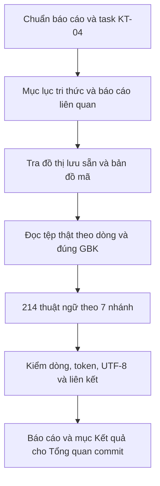

TÓM TẮT 1: [NGUỒN] DONE phần tài liệu KT-04: 214 thuật ngữ Hán–pinyin–token–Việt, vượt yêu cầu tối thiểu 150.
TÓM TẮT 2: [NGUỒN] Đã chia 7 nhánh hiểu game, dẫn từng dòng nguồn GBK và bổ sung hướng dẫn PowerShell/Python tra chữ Hán.
TÓM TẮT 3: [NGUỒN] Đầu ra THUAT-NGU.md; 214/214 mục khớp dòng, Hán từ và token đầu, không trùng; giữ kết luận cũ.
TÓM TẮT 4: [CHƯA KIỂM] Tooltip VN toàn tập, PAK/binary và runtime chưa kiểm; nhịp D:/JX-wt/KT-04.nhip bị sandbox chặn ghi.
TÓM TẮT 5: [NGUỒN] Không build, chạy exe game, VM hoặc dùng công cụ mạng; chưa commit/push/SHA mới, Tổng quan commit hộ.

# KT-04 — Bàn giao bảng thuật ngữ JX1

Loại: tổng hợp  
Chủ đề: Bù bảng tra Hán–pinyin–tên mã–Việt theo nhánh hiểu game từ dữ liệu và mã đọc tĩnh.  
Từ khóa: thuật ngữ, Hán, pinyin, GBK, TCVN3, HIEU-GAME, MonPhai, EnChance, Missle  
Trạng thái: DONE — bảng tra tĩnh hoàn tất; yêu cầu nhịp ngoài vùng ghi bị chặn được bàn giao riêng.  
Độ phủ: 214/214 mục, 7/7 nhánh chọn, 11 tên phái đối chiếu header Việt; chưa đếm toàn bộ thuật ngữ/tooltip game.  
Liên quan: [task KT-04](../TASKS/KT-04.md), [thuật ngữ](../HIEU-GAME/THUAT-NGU.md), [chuẩn báo cáo](../DESIGN/CHUAN-BAO-CAO.md), [mục lục tri thức](../DESIGN/MUC-LUC-TRI-THUC.md), [A-08a](A-08a-mon-phai-ky-nang.md), [H-03](H-03-cuong-hoa.md), [I-07](I-07-cac-loai-tien-te.md), [I-08](I-08-he-thong-nhiem-vu.md), [K-02 Lua](K-02-script-lua.md).  
Cần tôi quyết định: không cho đầu ra tài liệu; Tổng quan xử lý nhịp nếu hệ giám sát bắt buộc.



## Phạm vi và độ phủ

| Phần tử được giao | Kết quả | Độ phủ / nguồn |
|---|---|---|
| Nhân vật / môn phái | Đã phủ | 25 mục; THUAT-NGU.md, mục Môn phái → ngũ hành → phe |
| Nhân vật / chỉ số | Đã phủ | 25 mục; THUAT-NGU.md, mục Nhân vật → điểm phát triển → chiến đấu |
| Vật phẩm / trang bị | Đã phủ | 49 mục; THUAT-NGU.md, mục Vật phẩm → bộ phận → thuộc tính → cường hóa |
| Chiến đấu / kỹ năng | Đã phủ | 44 mục; THUAT-NGU.md, mục Kỹ năng → loại → đạn → mục tiêu → trạng thái |
| Thế giới / bản đồ / NPC | Đã phủ | 25 mục; THUAT-NGU.md, mục Thế giới → NPC → di chuyển → vật thể |
| Kinh tế / xã hội / nhiệm vụ | Đã phủ | 26 mục; THUAT-NGU.md, mục Kinh tế → túi kho → giao dịch; xã hội → nhiệm vụ |
| Tài nguyên / giao diện / hoạt ảnh | Đã phủ | 20 mục; THUAT-NGU.md, mục Hình ảnh → tài nguyên → bảng tra → lớp vẽ |
| Cách tìm chữ Hán trong mã GBK | Đã phủ | THUAT-NGU.md:352; PowerShell đã chạy, Python/rg chỉ minh họa |
| Nguồn, giải mã tên, Mermaid, nhãn chắc chắn | Đã phủ | THUAT-NGU.md:19,40,48,66 |
| Tooltip Việt toàn tập và bản chạy | Chưa phủ | Chỉ mẫu 11 tên phái TCVN3, không đọc PAK/chạy game |
| Nhịp đúng đường D:/JX-wt/KT-04.nhip | BỊ CHẶN | Set-Content bị UnauthorizedAccessException; sandbox chỉ cho ghi worktree |

## Giải mã tên

Bảng giải mã đầy đủ nằm tại THUAT-NGU.md:66 và các mục TN-001 đến TN-214 (bắt đầu :95). Mỗi mục có Hán gốc giải GBK, pinyin, Việt UTF-8 và file:dòng; giữ nguyên tên gốc. Mẫu TCVN3 của 11 phái ở THUAT-NGU.md:70. Không sao chép lại bảng 214 mục vào báo cáo này.

| Ví dụ gốc | Mã hóa | Chữ đúng / nghĩa tra cứu | Nguồn trực tiếp |
|---|---|---|---|
| 武当派 | GBK | Võ Đang; wǔdāng pài | G/Settings/faction/MonPhai.ini:47; G/script/header/factionhead.lua:14 |
| 强化 | GBK | Cường hóa; qiánghuà; nEnChance | CA/gamecore/KItem.h:117 |
| 纹钢 / 强纲石 | GBK | Văn Cương / đá cường hóa Cương; giữ khác chữ 钢/纲 | G/script/System/qianghua.lua:53,92 |
| Vâ §ang | TCVN3 qua Windows-1252 | Võ Đang | G/script/header/factionhead.lua:14 |

## Sắp theo cấu trúc game

Nhân vật/môn phái → chỉ số → vật phẩm/trang bị → chiến đấu/kỹ năng → thế giới/NPC → kinh tế/xã hội/nhiệm vụ → tài nguyên/giao diện/hoạt ảnh. Đây là các nhánh nội dung trong THUAT-NGU.md, không tạo thêm trang nhánh. Không xếp kỹ năng riêng theo cấp học hoặc quái theo bản đồ vì task là bảng thuật ngữ hệ thống.

## Nguồn đã chọn và đã đọc

ĐÃ ĐỌC KIẾN THỨC: CHUAN-BAO-CAO.md; DESIGN/MUC-LUC-TRI-THUC.md; MA-NGUON/README.md, ban-do-client.md, ban-do-server.md; đoạn liên quan trong DESIGN/THE-GIOI-TONG-QUAN.md. Đã tra trích đoạn theo từ khóa trong A-08a, A-15a/b/c, H-01/02/03/05/06/07/08, I-01/02/03/04/05/07/08; đọc các phần liên quan K-02-du-lieu-ini.md, K-02-script-lua.md, K-02-nhan-vat.md, K-02-quai-npc.md. Không coi đã đọc hết những tệp chỉ tra trích đoạn; không đọc toàn REPORTS.

Danh sách được lập từ mục Nguồn task trước khi đọc mã: bản đồ client/server → các header KItem, GameDataDef, KNpc, KSkills, SkillDef, CoreUseNameDef, KPlayer; dữ liệu MonPhai.ini và Lua qianghua.lua/factionhead.lua. Định vị bổ sung KItem.cpp::EnChance. Không thấy thư mục SO-TAY-* trực tiếp tại gốc repo hoặc JX1_OPS nên dùng các báo cáo được mục lục dẫn, không tìm kho khác.

Tra thêm đúng đoạn công cụ cần dùng: TOOLS/CONG-CU.md:9 và CONTEXT-PACK/GS001-MAP.md:2,5,7 theo skill đọc server. Các bản đồ chỉ để chọn tệp; nguồn cuối đã kiểm dòng hiện tại. Sáu skill được người dùng yêu cầu đều đã nạp từ .agents/skills; không đổi model/provider/reasoning hoặc CODEX_HOME.

Quy ước root: CA = D:/JX-build/qh9A/Classes; S = D:/JX-build/src18/jxOnline/gameserver/Sources/Core/Src; G = C:/Jx1CocoV3/Folder/ServerNew-20260116T043145Z-3-001/ServerNew/_bin_v2_/gs. Danh sách 9 tệp làm nguồn bảng ở THUAT-NGU.md:48; thêm KItem.cpp:3537 và factionhead.lua:6 đến :16. QH-B035 không dùng, không đánh đồng các root.

## Tra đồ thị

ĐÃ TRA ĐỒ THỊ: `D:/JX-tools/graphify-venv/Scripts/graphify.exe query "KItem KSkills KPlayer"` (cwd D:/JX-build/qh9A/Classes) → không có stdout trong các lần kiểm tiến trình; dừng Ctrl+C, exit 1. Không nhận query thành công.

ĐÃ TRA ĐỒ THỊ: cùng công cụ `query "KItem KSkills ScriptFuns"` (cwd D:/JX-build/src18) → không có stdout; dừng Ctrl+C, exit 1. Không suy nguyên nhân và không chạy lại/cập nhật đồ thị.

ĐÃ TRA ĐỒ THỊ: chuyển sang bản lưu sẵn, `Select-String -LiteralPath <root>/graphify-out/GRAPH_REPORT.md -Pattern KItem,KNpc,KSkills,ScriptFuns` → client có KNpc :14, KItem :39, KSkills.cpp :112. Client .graphify_root:1 là dấu chấm, phân giải về đúng Classes. Root src18 có .graphify_root:1 = D:/JX-build/src18 và graph.json nhưng không có GRAPH_REPORT.md; báo cáo đồ thị server thực có tại src18/jxOnline/graphify-out, .graphify_root:1 khớp D:/JX-build/src18/jxOnline; ScriptFuns.cpp :15, KItem :30, KPlayer :38. Đây là định vị tên, không xác minh caller/callee hoặc độ mới của đồ thị.

## DA XAC MINH / ĐÃ XÁC MINH

- Git trước ghi: `## task/KT-04`, không có local thay đổi. THUAT-NGU.md chưa tồn tại nên không có nội dung cũ cần làm lại; không sửa báo cáo nguồn hoặc kết luận của chúng.
- 214/214 Hán từ duy nhất, đủ 5 trường dữ liệu cho mỗi mục; kiểm Hán tự và token đầu có trên đúng dòng dẫn. Dùng TextDecoder GBK chế độ fatal cho từng dòng trích: 0 lỗi, 0 mục trùng. Pinyin là nội dung biên soạn, không phải trường trích từ mã hay kết quả kiểm ngữ âm tự động.
- Đối chiếu MonPhai.ini:7 đến :82 và factionhead.lua:6 đến :16: 16 mục INI, 11 mục header Việt. Giữ giới hạn A-08a, không kết luận số phái chơi được.
- Đã chạy PowerShell ví dụ tra 强化 trên 340 dòng đầu KItem.h: khớp 37,117,179,180,181. Dòng 181 là comment, không coi thuộc tính宝石 đang hoạt động. EnChance có định nghĩa tại KItem.cpp:3537.
- Kiểm cuối tài liệu: số mục, thứ tự ID, bảng 6 cột, nguồn dẫn, UTF-8 không BOM, liên kết tệp và diff được ghi ở mục kiểm cuối dưới đây.

## CHUA XAC MINH / CHƯA XÁC MINH

Chưa đối chiếu tất cả tooltip Việt, PAK/APK/binary thực nạp, tên Việt hiển thị ngoài mẫu 11 phái, mọi thuật ngữ game hoặc phát âm theo ngữ cảnh riêng. Không nhận mọi bản dịch chú thích là nguyên văn UI. Không chạy game, build, test gameplay, exe game/server, VM, kết nối server/DB hoặc công cụ mạng. Graphify CLI là công cụ tra tĩnh được task chỉ định; query chưa trả kết quả. Không có số đo runtime. Python/rg hướng dẫn chưa chạy nguyên văn.

## Mục sổ thông số

| Nhóm | Tên/hằng số | file:dòng | Giá trị | Đơn vị | Ảnh hưởng | Đổi an toàn | Nguồn đo |
|---|---|---|---|---|---|---|---|
| Đầu ra | Số thuật ngữ / tối thiểu | TASKS/KT-04.md:20; THUAT-NGU.md:95 | 214 / 150 | mục | Độ phủ bảng tra, không là quota game | KHÔNG áp dụng sửa game | Đếm tĩnh |
| Môn phái | Mục INI / mục header | G/Settings/faction/MonPhai.ini:6; G/script/header/factionhead.lua:5 | 16 / 11 | mục khai báo | Không đồng nhất số phái chơi được | KHÔNG tự chỉnh | Đọc tĩnh |
| Cường hóa | nSZe | G/script/System/qianghua.lua:89,92,95 | 403 / 404 / 405 | mã detail | Định vị ba nhóm đá, không là chỉ số cân bằng | KHÔNG tự đổi ID | Đọc tĩnh |

## Lỗi, cách thử và kết quả

| Lỗi / giới hạn | Cách xử lý trong lượt | Kết quả |
|---|---|---|
| Nhịp D:/JX-wt/KT-04.nhip ngoài writable root | Một lần Set-Content → Access denied / UnauthorizedAccessException; không sửa quyền hoặc vượt sandbox | Chưa ghi đúng đường. File nhịp thay thế vô tình tạo trong worktree đã xóa ngay, không đưa vào đầu ra |
| Thiếu rg | Báo một lần, dùng Select-String và Get-ChildItem giới hạn | Hoàn tất tra cứu, không cài rg |
| PowerShell mặc định làm chữ UTF-8 hiển thị sai | Các lượt đọc sau ghi rõ -Encoding utf8; không kết luận file nguồn hỏng | Giữ tệp Việt đúng UTF-8 |
| Graphify query không trả stdout; GRAPH_REPORT không có ở src18 | Dừng hai query; chọn đúng báo cáo lưu sẵn trong src18/jxOnline | Có định vị đồ thị, query không được tính đạt |
| Đường giả định script/global/npcchucnang/qianghua.lua không có | Theo H-03:48 xác nhận script/System/qianghua.lua | Dùng đúng tệp, không quét script toàn cây |
| Giải GBK nghiêm ngặt toàn tệp trộn thất bại | Chỉ giải nghiêm ngặt từng dòng nguồn của 214 mục | 214/214 dòng hợp lệ; lời thoại Việt đọc riêng qua Windows-1252 |
| Một lệnh soạn nội dung trong bộ nhớ lỗi cú pháp | Chuyển sang mảng chuỗi rồi kết xuất; không tạo parser/script phụ | Ghi tài liệu thành công |
| Một số lượt trích nhiều báo cáo làm output bị cắt | Không đọc lại toàn tệp; dùng dữ liệu gốc theo danh sách tệp chọn để xác minh bảng | Không nhận đã đọc đầy đủ phần bị cắt |

## Đề xuất tối ưu tra cứu

Tra theo nhánh → Hán/pinyin → token đúng chữ hoa → root và file:dòng. Dùng token ASCII khi encoding chưa rõ; không áp một bản giải GBK cho lời thoại Việt. Để mở rộng, chọn tooltip đúng bản phân phối, nối với mã thay vì chép lại catalog kỹ năng/quái đã có. Không đề xuất đổi thông số game trong KT-04.

## Bàn giao

Chỉ ghi ba tệp đã được giao trực tiếp: JX1_OPS/HIEU-GAME/THUAT-NGU.md, JX1_OPS/REPORTS/KT-04.md và mục Kết quả trong JX1_OPS/TASKS/KT-04.md. Không tạo REPORTS/_CHIMUC/KT-04.tsv vì nằm ngoài vung_file và các đầu ra được prompt chỉ định; chỉ mục để Tổng quan gộp bên dưới. Không sửa MUC-LUC-TRI-THUC.md, BAI_HOC.md hoặc nguồn.

Chưa commit, chưa có SHA mới và chưa push theo giao việc. Tổng quan commit hộ ba tệp; phiên này không đổi quyền/credential/config. **BỊ CHẶN — NHỊP CHƯA GHI ĐÚNG ĐƯỜNG** do ngoài vùng ghi; không phải lỗi Git/push.

Hàng đề xuất cho mục lục tri thức:

| Chủ đề | Báo cáo / tài liệu | File, hàm chính | Độ chắc |
|---|---|---|---|
| Thuật ngữ Hán–pinyin–tên mã–Việt theo 7 nhánh | HIEU-GAME/THUAT-NGU.md, REPORTS/KT-04.md | MonPhai.ini, KItem.h, KSkills.h, KPlayer.h, CoreUseNameDef.h | Đọc tĩnh; tooltip/runtime chưa kiểm |

```tsv
file	loại	chủ đề	từ khóa	trạng thái	độ phủ	liên quan
JX1_OPS/HIEU-GAME/THUAT-NGU.md	tổng hợp	Thuật ngữ Hán–pinyin–tên mã–Việt	thuật ngữ, GBK, TCVN3, pinyin, EnChance, Missle	DONE	214 mục / 7 nhánh; tooltip toàn tập chưa kiểm	KT-04; A-08a; H-03; I-07; I-08; K-02-script-lua
```

## Kiểm cuối tài liệu

Đã kiểm trực tiếp: ba tệp UTF-8 hợp lệ không BOM; 0 liên kết tệp hỏng; trang thuật ngữ và báo cáo mỗi tệp đúng 5 dòng tóm tắt đầu và 1 Mermaid. Bảng có 214 ID liên tục TN-001..TN-214, 0 dòng sai 6 cột, 214 Hán từ duy nhất, 0 lỗi Hán/token/dòng nguồn. PowerShell tra GBK thực chạy đạt; không có test game/build/runtime. Rà diff cuối cho đúng ba tệp bàn giao, không stage/commit.

Mốc tài liệu hoàn tất: 2026-11-20 12:52:24 +07:00. Nhịp đúng đường bị chặn, không tự tạo tệp thay thế ngoài phạm vi.

Kỹ năng đã dùng: jx1-retrofit, jx1-read-server, jx1-read-client, jx1-parameters, jx1-knowledge, jx1-report.
