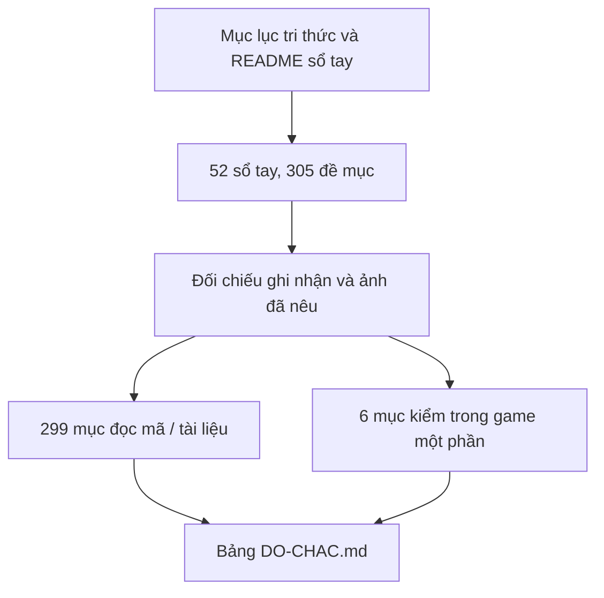

## TÓM TẮT 5 DÒNG
1. [NGUỒN] PARTIAL — đã gắn nhãn cho 52/52 sổ tay, gồm 305 đề mục lớn theo phạm vi hiện có (299 đọc tĩnh, 6 kiểm trong game một phần).
2. [NGUỒN] Bảng có 299 mục ĐỌC MÃ/TÀI LIỆU và 6 mục ĐÃ KIỂM TRONG GAME (một phần), với bằng chứng cùng giới hạn từng ca.
3. [NGUỒN] Đầu ra: JX1_OPS/HIEU-GAME/DO-CHAC.md; báo cáo: JX1_OPS/REPORTS/KT-05.md. Không sửa nội dung sổ tay.
4. [CHƯA KIỂM] Graphify chưa trả kết quả; không chạy build hoặc exe/gs001 của game, VM hay mạng; không chạy test runtime.
5. [CHƯA KIỂM] Chưa ghi được tệp nhịp ngoài worktree; Tổng quản commit theo phân công, chưa có SHA.

# KT-05 — Gắn nhãn độ chắc cho sổ tay JX1

Loại: tổng hợp
Chủ đề: Phân biệt căn cứ đọc tĩnh và phần được kiểm trong game cho từng mục lớn của sổ tay.
Từ khóa: JX1, KT-05, độ chắc, ĐỌC MÃ, TÀI LIỆU, kiểm trong game, HIEU-GAME, DO-CHAC
Trạng thái: PARTIAL. Bảng tổng đã tạo; Graphify chưa hoàn tất và không ghi được tệp nhịp ngoài worktree.
Độ phủ: 52/52 sổ tay; 305/305 đề mục nội dung được gắn nhãn.
liên quan: JX1_OPS/DESIGN/MUC-LUC-TRI-THUC.md, JX1_OPS/HIEU-GAME/README.md, JX1_OPS/HOP-THU/TU-SONNET.md, JX1_OPS/REPORTS/HG-03c.md, JX1_OPS/REPORTS/HG-04.md.
Cần tôi quyết định: không

## Phạm vi và độ phủ

Đếm từ danh mục trong JX1_OPS/HIEU-GAME/README.md và các nhánh sổ tay được liệt kê ở JX1_OPS/DESIGN/MUC-LUC-TRI-THUC.md:6–15. Bảng chi tiết từng sổ tay, mục, nhãn, bằng chứng và nhu cầu kịch bản kiểm động nằm trong JX1_OPS/HIEU-GAME/DO-CHAC.md:1–315.

| Nhánh | Sổ tay | Đề mục đã gắn nhãn | Kết quả |
|---|---:|---:|---|
| Trang bị, cường hóa | 9 | 63 | Đã phủ |
| Nhân vật, thuộc tính | 5 | 25 | Đã phủ |
| Kỹ năng, chiến đấu | 7 | 47 | Đã phủ |
| Quái, NPC, bản đồ | 8 | 40 | Đã phủ |
| Nhiệm vụ, kinh tế | 7 | 49 | Đã phủ |
| Mạng, gói tin | 8 | 27 | Đã phủ |
| Server, lưu trữ | 3 | 18 | Đã phủ |
| Giao diện, tài nguyên | 3 | 23 | Đã phủ |
| Công cụ, GM | 2 | 13 | Đã phủ |
| Tổng | 52 | 305 | 52/52 sổ tay |

ĐÃ KIỂM TRONG GAME (một phần) chỉ gắn cho các đề mục có ca thử liên quan: không suy rộng từ một món, một giao diện hoặc vài mốc cường hóa sang mọi nội dung trong đề mục. Nhật ký nguồn nêu cả kết quả không đạt và sai lệch ở JX1_OPS/HOP-THU/TU-SONNET.md:1313–1343; ảnh được dẫn ngay trong từng hàng bảng. Những khẳng định tĩnh vẫn giữ nhãn tài liệu/đọc mã, không nâng thành xác minh trong game.

## Giải mã tên

Không có tên riêng của kỹ năng, trang bị, quái, NPC hoặc bản đồ cần giải mã trong báo cáo. Các mã sổ tay và đường dẫn được giữ nguyên.

## Sắp theo cấu trúc game

Bảng được xếp theo chín nhánh trong mục lục tri thức, từ trang bị, nhân vật, chiến đấu, bản đồ, kinh tế, mạng, lưu trữ, giao diện tới công cụ GM. Mỗi sổ tay và đề mục có hàng riêng trong DO-CHAC.md.

## ĐÃ TRA ĐỒ THỊ

- Thử graphify.exe query --root D:\JX-build\src18 "item enchantment player attributes" từ worktree: báo không tìm thấy D:\JX-wt\KT-05\graphify-out\graph.json.
- Thử lại graphify.exe query từ gốc D:\JX-build\src18, nơi có graph sẵn: không có kết quả sau hơn 120 giây; đã ngắt lệnh. Chưa có kết quả truy vấn để dùng. Chưa truy vấn graph client. Không đọc mã nguồn.

## ĐÃ ĐỌC KIẾN THỨC

Đã đọc CHUAN-BAO-CAO.md, MUC-LUC-TRI-THUC.md, HIEU-GAME/README.md, MA-NGUON/README.md, các mục liên quan trong TU-SONNET.md và BAO-CAO-CHU.md, cùng ảnh liên quan được dẫn ở ANH-NGHIEM-THU. Đã dùng bản JX1_OPS/BAO-CAO-CHU.md hiện có làm nguồn tổng quan. Mục lục tri thức đánh dấu các nhánh sổ tay là khảo sát tĩnh (JX1_OPS/DESIGN/MUC-LUC-TRI-THUC.md:6–15).

## ĐÃ XÁC MINH

- Danh mục ánh xạ trong README cho ra 52 đường dẫn; bảng tổng ghi 52 sổ tay và 305 đề mục (JX1_OPS/HIEU-GAME/README.md:1–57; JX1_OPS/HIEU-GAME/DO-CHAC.md:1–315).
- Ghi nhận cường hóa, tooltip và một số chỉ số có ca thử trong game cùng sai lệch/chưa đạt: JX1_OPS/HOP-THU/TU-SONNET.md:1306–1350. Bảng chỉ gắn nhãn kiểm một phần cho các mục liên quan, gồm UI/cường hóa/thuộc tính (DO-CHAC.md:57,59,67,68,280); nạp Lua nóng trong phiên (DO-CHAC.md:306); không đổi kết luận trong sổ tay.
- Đã tạo bảng tổng UTF-8 không BOM trong vùng đầu ra được giao. Không chạy kiểm thử game hoặc đo runtime.

## CHƯA XÁC MINH

- Graphify chưa cho kết quả sử dụng được; cần chạy lại truy vấn ở phiên có thể đọc graph nhanh, gồm cả gốc client trước khi đánh dấu yêu cầu này hoàn tất.
- Không thể ghi D:\JX-wt\KT-05.nhip: lần ghi bị từ chối quyền truy cập vì tệp nằm ngoài worktree được phép. Không thử vượt giới hạn ghi.
- Không chạy build hoặc exe/gs001 của game, VM, mạng hoặc test runtime theo phạm vi task. Các nội dung chưa có ca game tương ứng cần kịch bản kiểm động nếu muốn xác nhận trong game.
- Không commit; Tổng quản nhận commit hộ. Không có SHA/push để báo.

## Kiểm tra và lỗi

Đã kiểm kê 52 đường dẫn, đếm 305 hàng mục, 299 nhãn tĩnh và 6 nhãn kiểm trong game một phần; đã kiểm các dòng đầu/cuối và các hàng có chứng cứ. rg không có trên máy, nên dùng Select-String và lệnh PowerShell giới hạn tệp/thư mục. Không chạy bộ test tự động; chỉ kiểm tra văn bản và cấu trúc bảng. Lỗi Graphify và ghi tệp nhịp được ghi đúng tại các mục trên; không sửa ngoài phạm vi.

## Bàn giao

Trạng thái PARTIAL: bảng nhãn đã hoàn thành, còn yêu cầu Graphify và tệp nhịp bị chặn bởi kết quả/quyền môi trường. Tổng quản commit hộ theo task; không push tay.
Kỹ năng đã dùng: jx1-retrofit, jx1-read-server, jx1-read-client, jx1-parameters, jx1-knowledge, jx1-report.