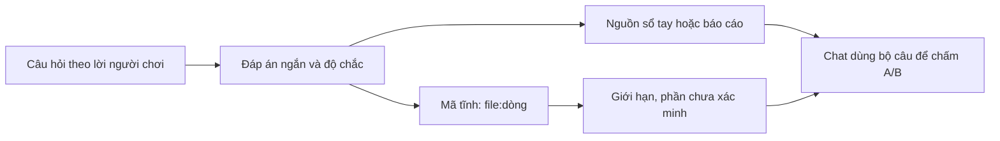

TÓM TẮT 1: [NGUỒN] DONE — đã lập đủ 40 câu theo lời người chơi; 10 câu chuyên về cường hóa, thuộc tính, tài phú, trang sức và phi phong.
TÓM TẮT 2: [NGUỒN] Mỗi câu có đáp án ngắn, tài liệu dẫn, file:dòng mã và độ chắc; phần chưa biết/ chưa thử giữ nguyên nhãn.
TÓM TẮT 3: [NGUỒN] Đầu ra: JX1_OPS/KIEM-TRA/BO-CAU-HOI-01.md; đã cập nhật mục Kết quả của KT-06.
TÓM TẮT 4: [CHƯA KIỂM] Chưa kiểm runtime, build, exe, VM hay mạng theo phạm vi; file nhịp ngoài worktree bị từ chối quyền ghi.
TÓM TẮT 5: [NGUỒN] Không commit/push theo yêu cầu; chưa có SHA. Tổng quan nhận commit hộ.

# KT-06 — Bộ câu hỏi kiểm hiểu biết JX1 bằng lời người chơi

Loại: tổng hợp
Chủ đề: Bộ câu hỏi sơ bộ để kiểm tra Chat dẫn đúng tri thức JX1 và phân biệt tài liệu/mã với điều đã thử trong game.
Từ khóa: kiểm hiểu biết, câu hỏi người chơi, JX1, KT-06, cường hóa, EnChance, thuộc tính, tài phú, phi phong
Trạng thái: DONE — hoàn tất 40 câu và nguồn; không có câu trả lời người chơi để chấm trong phạm vi đầu ra này.
Độ phủ: 40/40 câu; trong đó 10 câu về cường hóa, thuộc tính, tài phú, trang sức/phi phong.
Liên quan: JX1_OPS/DESIGN/KIEM-TRA-KIEN-THUC.md; MUC-LUC-TRI-THUC.md; H-01, H-02, H-03, H-05, H-06, H-07, H-08, H-10, H-11, H-12; I-01, I-02, I-03, I-04, I-05, I-07, I-08; A-02, A-08a, A-08d, A-16.
Cần tôi quyết định: không.

## Sơ đồ chính

## Phạm vi và độ phủ

Danh sách 40 câu hoàn chỉnh ở BO-CAU-HOI-01.md; mọi câu có đáp án, nguồn và độ chắc. Các câu 9–18 là 10 câu chuyên đề trang bị.

| # | Nội dung câu hỏi | Kết quả |
|---:|---|---|
| 1 | Lên cấp nhận thêm gì? | Đã phủ |
| 2 | Cộng sức mạnh có trừ điểm tiềm năng? | Đã phủ |
| 3 | Điểm kỹ năng có dùng được mọi chiêu? | Đã phủ |
| 4 | Đăng nhập có về vị trí cũ? | Đã phủ |
| 5 | Có 16 phái nghĩa là chọn đủ 16? | Đã phủ |
| 6 | Vì sao tên chiêu/menu khác mô tả? | Đã phủ |
| 7 | Lên cấp có tự tăng chiêu? | Đã phủ |
| 8 | Chiêu cấp 120 học được ở nhân vật cấp 120? | Đã phủ |
| 9 | Áo +139 sinh lực tăng trần ở đâu; tháo có trừ? | Đã phủ — trang bị |
| 10 | Cường hóa tính lãi kép hay từ gốc? | Đã phủ — cường hóa |
| 11 | Dòng yêu cầu mặc đồ có phải dòng thưởng? | Đã phủ — thuộc tính |
| 12 | Sáu dòng ma pháp có áp giống nhau? | Đã phủ — thuộc tính |
| 13 | Vũ khí thêm kỹ năng ở +12 hay +14? | Đã phủ — cường hóa |
| 14 | Tài phú tooltip có cộng vào bảng giàu? | Đã phủ — tài phú |
| 15 | Tooltip lấy yêu cầu tài phú phi phong ở đâu? | Đã phủ — phi phong |
| 16 | Ngọc bội kích hoạt giống nhau client/server? | Đã phủ — trang sức |
| 17 | Phi phong cấp 11 dùng hình cấp nào? | Đã phủ — phi phong |
| 18 | Mặt nạ biến mất do tháo hay do tùy chọn ẩn? | Đã phủ — trang sức |
| 19 | Có bạc trong rương sao mua báo thiếu? | Đã phủ |
| 20 | Gửi bạc túi sang rương có tăng top giàu? | Đã phủ |
| 21 | Mua shop có chắc trừ bạc và nhận đúng món? | Đã phủ |
| 22 | Giao dịch khi túi đầy có đổi một phần? | Đã phủ |
| 23 | Kim đánh Mộc trừ thẳng bao nhiêu máu? | Đã phủ |
| 24 | Damage âm do kháng có nghĩa hồi máu? | Đã phủ |
| 25 | Buff hết giờ ảnh hưởng sync/icon ra sao? | Đã phủ |
| 26 | Dịch chuyển map an toàn có tắt chế độ đánh? | Đã phủ |
| 27 | ReviveFrame 2400 có phải 2400 giây? | Đã phủ |
| 28 | Nhiều mẫu quái sao map có ít con? | Đã phủ |
| 29 | SetPos Lua nhận tọa độ pixel? | Đã phủ |
| 30 | RandRate bảo đảm rơi món sau 100 lần? | Đã phủ |
| 31 | State 0–3 có áp dụng mọi nhiệm vụ? | Đã phủ |
| 32 | Túi đầy thì vật phẩm thưởng chắc được trao? | Đã phủ |
| 33 | 10.000 key task nghĩa là 10.000 quest? | Đã phủ |
| 34 | Thanh vật phẩm nhanh VN có 9 ô? | Đã phủ |
| 35 | Tắt nhạc có đồng bộ sang máy khác? | Đã phủ |
| 36 | Gõ #gm? có chắc lệnh chạy trên server? | Đã phủ |
| 37 | Chọn nhân vật là đã vào bản đồ? | Đã phủ |
| 38 | Client báo vào game có chứng minh GS thêm nhân vật? | Đã phủ |
| 39 | Có đoán nghĩa từ comment lỗi mã hóa? | Đã phủ |
| 40 | Thiếu bản ghi item/skill/map thì Chat trả lời sao? | Đã phủ |
| **Tổng** | **40 câu; câu 9–18 gồm 10 câu trang bị** | **Đã phủ 40/40** |

## Giải mã tên

Không đưa tên riêng Hán/TCVN3 lấy từ bảng dữ liệu thô vào câu hỏi. Tên riêng kỹ thuật được dùng dưới đây đều là ASCII; giữ nguyên tên gốc và diễn giải tiếng Việt.

| Tên gốc | Mã hóa | Chữ đúng / diễn giải | Nguồn file:dòng |
|---|---|---|---|
| KT-06 | ASCII | Mã task kiểm hiểu biết | JX1_OPS/TASKS/KT-06.md:1-20 |
| HIEU-GAME | ASCII | Nhóm tài liệu hiểu game cho người chơi | JX1_OPS/DESIGN/HIEU-GAME-CHO-NGUOI-KHONG-LAP-TRINH.md:1-8 |
| EnChance / nEnChance | ASCII | Hàm và trường cấp cường hóa | D:/JX-build/src18/jxOnline/gameserver/Sources/Core/Src/KItem.cpp:3800-3818 |
| magic_lifemax_v | ASCII | Thuộc tính cộng điểm trần sinh lực | D:/JX-build/src18/jxOnline/gameserver/Sources/Core/Src/KNpcAttribModify.cpp:1621-1627 |
| g_qhWealth | ASCII | Biến tài phú được tooltip client đọc | D:/JX-build/qh9A/Classes/vn/gameui/KuiItemdescVN.cpp:651-667 |
| ReviveFrame | ASCII | Bộ đếm frame hồi sinh trong template quái | D:/JX-build/src18/jxOnline/gameserver/Sources/Core/Src/KNpcTemplate.cpp:731-734 |
| TASKSYS | ASCII | Tên thư viện nhiệm vụ trong script | C:/Jx1CocoV3/Folder/ServerNew-20260116T043145Z-3-001/ServerNew/_bin_v2_/gs/script/task/system/task_function.lua:2-9 |
| GUID / AttachPlayer | ASCII | Mã phiên và hàm ghép kết nối/hồ sơ chờ | D:/JX-build/src18/jxOnline/gameserver/Sources/Core/Src/KPlayerSet.cpp:1723-1745 |
| c2s_gmcommand / GMCommand | ASCII | Mã gói yêu cầu và handler server | D:/JX-build/qh9A/Classes/gamecore/KProtocol.cpp:1301-1309; D:/JX-build/src18/jxOnline/gameserver/Sources/Core/Src/KProtocolProcess.cpp:8185-8187 |

## Sắp theo cấu trúc game

Câu hỏi đi theo luồng người chơi: đăng nhập và phát triển nhân vật → môn phái/kỹ năng → trang bị/chỉ số → tiền/giao dịch → chiến đấu/trạng thái → quái/bản đồ/nhiệm vụ → giao diện và độ tin cậy. Nhóm trang bị sắp theo chỉ số/dòng ma pháp → cường hóa → hiển thị → tài phú → trang sức/phi phong. Không dựng danh sách món/bộ khi nguồn cụ thể chưa có.

## Đã tra đồ thị

- Client root theo task là D:\JX-build\qh9A\Classes. Graphify explain KItem báo nhiều node cùng tên và trả đường dẫn định vị; explain theo node cụ thể không trả kết quả hữu ích trong thời gian chờ. GRAPH_REPORT.md có mặt, dùng để định vị tệp.
- Task nêu server root D:\JX-build\src18; sentinel Graphify trỏ root con D:\JX-build\src18\jxOnline. GRAPH_REPORT.md không có ở root ngoài. Graphify explain KPlayer báo nhiều node cùng tên. Query EnChance không trả dữ liệu hữu ích và đã dừng; không cập nhật/tạo lại đồ thị.
- README và các bản đồ mã/gói tự sinh trong JX1_OPS/MA-NGUON dùng để định vị; mọi khẳng định mã được đối chiếu tệp thật. Không dùng graph/map làm bằng chứng.

## Đã đọc kiến thức

- Đọc DESIGN/CHUAN-BAO-CAO.md trước khi làm; đã nạp sáu skill được giao.
- Đọc DESIGN/MUC-LUC-TRI-THUC.md và DESIGN/KIEM-TRA-KIEN-THUC.md; dùng các HIEU-GAME-CHO-NGUOI-KHONG-LAP-TRINH, HIEU-MON-PHAI, HIEU-CAP-KINH-NGHIEM, HIEU-CAP-CUONG-HOA-LUA, HIEU-CAP-CUONG-HOA-LUA-2, HIEU-BUFF-TRANG-THAI, HIEU-CONG-THUC-SAT-THUONG, HIEU-TRANG-THAI-CHIEN-DAU, HIEU-BAN-DO-TRAP, HIEU-NAP-VA-CHUYEN-BAN-DO, HIEU-QUAI-HOI-SINH-VAT-PHAM-ROI, HIEU-GIAO-DICH-KHO-DO, HIEU-LENH-GM, HIEU-HIEU-UNG-VU-KHI và trích đoạn SO-TAY-TRANG-BI, SO-TAY-THUOC-TINH-MA-PHAP, SO-TAY-KY-NANG, SO-TAY-GODDESS-LUU-NHAN-VAT.
- Đọc theo chủ đề phần cần thiết trong H-01, H-02, H-03, H-05, H-06, H-07, H-08, H-10, H-11, H-12; I-01, I-02, I-03, I-04, I-05, I-07, I-08; A-02, A-08a, A-08d, A-16. Phần chỉ dẫn lại giữ nhãn tài liệu, không coi là xác minh runtime.
- Dùng MA-NGUON README, ban-do-client, ban-do-server, và các dòng trùng khớp trong goi-tin.md để định vị. Không quét bảng dữ liệu game.

## Đã xác minh / Chưa xác minh

### Đã xác minh
- BO-CAU-HOI-01.md có 40 số thứ tự liên tục; câu 9–18 đúng 10 câu trang bị.
- Mỗi câu có đáp án, nguồn tài liệu, file:dòng mã hoặc nêu rõ khi mã chỉ được dẫn gián tiếp, và độ chắc.
- Đối chiếu trực tiếp các đoạn được đánh dấu mã tại D:/JX-build/qh9A/Classes và D:/JX-build/src18/jxOnline. Không suy từ source sang binary đang chạy.

### Chưa xác minh
- Chưa có câu trả lời người chơi/Chat để chấm A/B; bộ sẵn sàng làm đầu vào lượt chấm sau theo DESIGN/KIEM-TRA-KIEN-THUC.md.
- Chưa kiểm dữ liệu thực nạp, binary đang chạy hoặc hành vi runtime. Không build/chạy exe, GS001, VM, mạng hoặc game.
- Không đọc bảng dữ liệu rộng; câu hỏi về item/skill/NPC/map cụ thể cần nguồn riêng.

## Lỗi, cách thử và kết quả

| Lỗi hoặc giới hạn | Cách thử | Kết quả |
|---|---|---|
| rg không có trong môi trường | Dùng Select-String/PowerShell giới hạn file | Tìm kiếm xong; không cài công cụ |
| Graphify có node trùng tên | Dùng kết quả định vị rồi kiểm source thật | Không dùng cạnh graph làm bằng chứng |
| Graphify query EnChance chờ lâu | Chờ hữu hạn rồi dừng | Không có dữ liệu hữu ích; không cập nhật graph |
| Ghi D:\JX-wt\KT-06.nhip | Thử theo yêu cầu một lần | Access denied; không bypass. Mốc ghi trong báo cáo |
| Kiểm số câu | Đếm heading dạng số và dải câu 9–18 sau khi ghi | Kết quả sẽ được ghi ở phần validation |

## Bàn giao

- Đầu ra: JX1_OPS/KIEM-TRA/BO-CAU-HOI-01.md.
- Dòng mục lục đề xuất để Tổng quan gộp: Kiểm hiểu biết bằng câu hỏi người chơi | JX1_OPS/KIEM-TRA/BO-CAU-HOI-01.md | KT-06 | 40 câu; 10 câu trang bị | DONE | 40/40 | KIEM-TRA-KIEN-THUC.md.
- Không tạo chỉ mục TSV vì nằm ngoài vùng file được giao.
- Không stage/commit/push; Tổng quan commit hộ. Chưa có SHA.
- Kỹ năng đã dùng: jx1-retrofit, jx1-read-server, jx1-read-client, jx1-parameters, jx1-knowledge, jx1-report.

## Kiểm chứng và trạng thái cuối

### TOM TAT 5 DONG
1. DONE — hoàn tất 40 câu, đáp án ngắn, nguồn và độ chắc.
2. Đã phủ 10 câu về cường hóa, thuộc tính, tài phú, trang sức và phi phong.
3. Đã đọc kiến thức task, tra Graphify trong giới hạn và đối chiếu source tĩnh qh9A/src18.
4. Chưa kiểm runtime/build/game; file nhịp ngoài worktree bị hệ thống từ chối ghi.
5. Không commit/push; Tổng quan commit hộ, chưa có SHA.

### DA XAC MINH
- JX1_OPS/TASKS/KT-06.md:1-34 — mục tiêu, nguồn, phạm vi.
- JX1_OPS/DESIGN/CHUAN-BAO-CAO.md:1-28 — chuẩn báo cáo.
- JX1_OPS/DESIGN/KIEM-TRA-KIEN-THUC.md — tiêu chí hỏi/đáp/chấm.
- JX1_OPS/KIEM-TRA/BO-CAU-HOI-01.md — bộ câu hỏi.
- Kiểm đếm sau khi ghi: 40 số thứ tự liên tục (1–40), đúng 10 câu ở dải 9–18; tệp UTF-8 không BOM, 65 dòng.

### CHUA XAC MINH
- Chưa nhận câu trả lời để chấm A/B.
- Không quan sát game/dữ liệu thực nạp; không chạy build, executable, VM hoặc mạng.
- Không ghi được D:\JX-wt\KT-06.nhip do quyền hệ thống từ chối; không bypass.

Test thực chạy: kiểm tra văn bản và số mục bằng PowerShell; chưa chạy test game/build.
Lỗi/cách thử/kết quả: rg thiếu nên dùng Select-String; Graphify node trùng/timeout; .nhip bị Access denied một lần.
Trạng thái: DONE — tiêu chí tạo bộ câu và báo cáo đạt; phần runtime tiếp tục được ghi rõ là chưa xác minh.

### Nhịp sống
- 2026-11-20 12:38:28 +07:00 — thời điểm sớm nhất có dấu giờ trong lượt: task/nguồn/skill đã đọc và phạm vi chốt — 20%.
- 2026-11-20 12:47:42 +07:00 — kiến thức liên quan và nguồn mã chính đã được đối chiếu — 55%.
- 2026-11-20 12:48:52 +07:00 — đối chiếu mã cho các nhánh chính hoàn tất, chuyển sang biên soạn — 70%.
- 2026-11-20 13:09:49 +07:00 — file đầu ra, task result và kiểm đếm hoàn tất — 100%.
- Phần trăm là ước lượng. Ghi D:\JX-wt\KT-06.nhip bị Access denied; không bypass.
