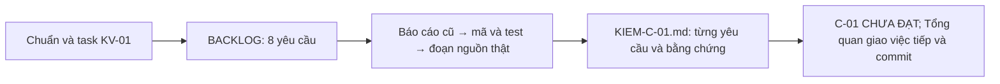

TÓM TẮT 1: [NGUỒN] DONE — hoàn tất kiểm tra tĩnh 8/8 yêu cầu C-01 trên nhánh task/KV-01.
TÓM TẮT 2: [NGUỒN] C-01 CHƯA ĐẠT: công cụ có 7 lệnh chỉ sinh kế hoạch; thiếu xem nhân vật và các phần thực hiện chức năng.
TÓM TẮT 3: [NGUỒN] Đầu ra chính là JX1_OPS/REPORTS/KIEM-C-01.md; đã ghi Kết quả cuối task, giữ nguyên báo cáo/mã cũ.
TÓM TẮT 4: [CHƯA KIỂM] Không chạy lại 22 test lịch sử; tệp nhịp ngoài writable root chưa ghi được; không có SHA mới, Tổng quan commit.
TÓM TẮT 5: [CHƯA KIỂM] Không build, chạy CLI/game/exe, VM, SQL hoặc mạng; không đọc dữ liệu tài khoản, mật khẩu, khóa hoặc dump.

# KV-01 — Bàn giao kiểm C-01

Loại: tổng hợp
Chủ đề: Bàn giao đánh giá tám chức năng công cụ tài khoản C-01 bằng đọc tĩnh.
Từ khóa: KV-01, C-01, jxadm, tài khoản, account, nhân vật, online, is_bot, sao lưu
Trạng thái: DONE — hoàn tất phạm vi kiểm tra tĩnh; nhịp ở đường dẫn ngoài sandbox chưa thực hiện được.
Độ phủ: đã phủ 8 trên tổng 8 yêu cầu; 0/8 đủ bằng chứng hoàn thành chức năng CLI; 0 lượt kiểm thử vận hành mới.
Liên quan: `JX1_OPS/REPORTS/KIEM-C-01.md`; `JX1_OPS/REPORTS/C-01-jxadm.md`; `JX1_OPS/REPORTS/A-02-luong-dang-nhap.md`; `JX1_OPS/TASKS/KV-01.md`; `JX1_OPS/TASKS/BACKLOG.md`.
Cần tôi quyết định: không — phần triển khai/vận hành tiếp theo để Tổng quan giao riêng.

## Sơ đồ chính

## Phạm vi và độ phủ

| Phần tử | Độ phủ / kết quả | Nguồn |
|---|---|---|
| Tạo tài khoản | Đã phủ tĩnh; CHƯA ĐẠT vì CLI chỉ xuất kế hoạch | `JX1_OPS/TOOLS/jxadm/jxadm.py:114-130,314-321` |
| Khóa tài khoản | Đã phủ tĩnh; CHƯA ĐẠT vì CLI chưa thực hiện thay đổi | `JX1_OPS/TOOLS/jxadm/jxadm.py:131-136,314-321` |
| Mở tài khoản | Đã phủ tĩnh; CHƯA ĐẠT vì CLI chưa thực hiện thay đổi | `JX1_OPS/TOOLS/jxadm/jxadm.py:131-136,314-321` |
| Đặt lại mật khẩu | Đã phủ tĩnh; CHƯA ĐẠT vì CLI chưa thực hiện thay đổi | `JX1_OPS/TOOLS/jxadm/jxadm.py:131-134,314-321` |
| Đánh dấu bot | Đã phủ tĩnh; CHƯA ĐẠT, còn đường ghi và nơi lưu đã triển khai | `JX1_OPS/TOOLS/jxadm/jxadm.py:143-154,314-321` |
| Xem online | Đã phủ tĩnh; CHƯA ĐẠT, chưa trả dữ liệu thật/xác định ai online | `JX1_OPS/TOOLS/jxadm/jxadm.py:137-142,314-321` |
| Xem nhân vật | Đã phủ tĩnh; CHƯA ĐẠT, thiếu lệnh | `JX1_OPS/TOOLS/jxadm/jxadm.py:271-293,296-332` |
| Sao lưu nhân vật | Đã phủ tĩnh; CHƯA ĐẠT, chỉ có giao diện bộ thực hiện | `JX1_OPS/TOOLS/jxadm/jxadm.py:244-258,314-321` |

Tiêu chí lấy từ `JX1_OPS/TASKS/BACKLOG.md:44-46`; bảng C-01 chỉ có cột Việc/Phụ thuộc, không có Xong khi riêng. Bảng chi tiết, ý nghĩa nhãn và giới hạn nằm trong báo cáo kiểm tra chính; không thêm điều kiện trang quản trị web hoặc chính sách bot trong game.

## Giải mã tên

| Tên gốc | Mã hóa | Chữ đúng / nghĩa | Nguồn file:dòng |
|---|---|---|---|
| `jxadm`, `dry-run` | ASCII | Công cụ tài khoản; chế độ chỉ xuất kế hoạch | `JX1_OPS/TOOLS/jxadm/jxadm.py:271-278` |
| `is_bot`, `Account_BotMetadata` | ASCII | Nhãn bot và bảng metadata đề xuất | `JX1_OPS/TOOLS/jxadm/jxadm.py:143-154` |
| `C-01`, `KV-01` | ASCII | Việc triển khai công cụ; việc kiểm tra | `JX1_OPS/TASKS/BACKLOG.md:46`; `JX1_OPS/TASKS/KV-01.md:2,20` |

Không có tên nhân vật/NPC/kỹ năng/trang bị/bản đồ cần chuyển GBK hoặc TCVN3. Báo cáo tiếng Việt lưu UTF-8 không BOM; mã hóa chú thích C++ cũ chưa xác minh, chỉ dùng phần mã ASCII.

## Sắp theo cấu trúc game

Nhóm tài khoản và phân loại bot → quan sát phiên → tra cứu/bảo toàn nhân vật. Bảng bao phủ đủ tám yêu cầu, không xếp theo thứ tự tệp.

## Nguồn đã đọc và kết quả

Danh sách đọc xuất phát từ chuẩn/task và chuỗi dẫn nguồn C-01, không quét thư mục lớn:

- `JX1_OPS/DESIGN/CHUAN-BAO-CAO.md`; `JX1_OPS/TASKS/KV-01.md`; các dòng tiêu chí C-01 trong `JX1_OPS/TASKS/BACKLOG.md`.
- `JX1_OPS/REPORTS/C-01-jxadm.md:1-98`; toàn bộ `JX1_OPS/TOOLS/jxadm/jxadm.py:1-332` và `test_jxadm.py:1-303`.
- `JX1_OPS/REPORTS/A-02-luong-dang-nhap.md:1-183` để giải các alias/nguồn mà báo cáo cũ dẫn; mục liên quan trong `JX1_OPS/CONTEXT-PACK/GS001-MAP.md:2-3` và `JX1_OPS/DESIGN/MUC-LUC-TRI-THUC.md:17-22` để định vị theo skill, không dùng thay source.
- `C:/Jx1CocoV3/SwordOnline/SwordOnline/jxOnline/gateway/Sources/Sword3PaySys/S3AccServer/S3PAccount.cpp:35-130,582-647` — đối chiếu điều kiện tài khoản/thời hạn và giới hạn suy luận online.
- `C:/Jx1CocoV3/SwordOnline/SwordOnline/jxOnline/gateway/Sources/MultiServer/Goddess/IDBRoleServer.cpp:910-970` — nguồn có đường danh sách nhân vật và hai nhánh backend.
- `C:/Jx1CocoV3/SwordOnline/SwordOnline/jxOnline/gateway/Sources/MultiServer/Goddess/DBBackup.cpp:353-424` — đường dump game riêng, không phải bộ sao lưu đã nối vào CLI.
- `D:/JX-build/qh9A/Classes/gameui/Klogin.cpp:471-495` — kiểm lời gọi băm ở `:485`, không suy hiệu lực runtime hoặc theo tiếp hàm không cần thiết.
- Sáu `SKILL.md` được chỉ định trong `.agents/skills/`; chỉ dùng phần phù hợp kiểm tra tĩnh và viết báo cáo.

**[ĐÃ XÁC MINH]** Công cụ có kế hoạch cho bảy lệnh và API nhận bộ thực hiện từ bên ngoài; `main()` chỉ in JSON. Không có lệnh xem nhân vật trong mã đã giao (`JX1_OPS/TOOLS/jxadm/jxadm.py:202-219,244-258,271-332`). Các khoảng trống chức năng đã đủ để kết luận C-01 chưa đạt; không cần chạy môi trường thật trong phạm vi này.

**[ĐÃ XÁC MINH]** Báo cáo cũ ghi PARTIAL và giới hạn runtime (`JX1_OPS/REPORTS/C-01-jxadm.md:3,67,78`). Các số dòng dẫn A-02 ở `:61-63` đã lệch sau chuẩn hóa; báo cáo kiểm tra ghi riêng phát hiện, không sửa nguồn cũ.

## Mục sổ thông số

| Nhóm | Tên/hằng số | file:dòng | Giá trị | Đơn vị | Ảnh hưởng | Đổi an toàn | Nguồn đo |
|---|---|---|---|---|---|---|---|
| Tiêu chí | Yêu cầu C-01 | `JX1_OPS/TASKS/BACKLOG.md:46` | 8 | chức năng | Mẫu số kiểm tra | KHÔNG | Đọc tĩnh |
| Công cụ | Lệnh CLI | `JX1_OPS/TOOLS/jxadm/jxadm.py:274` | 7 | lệnh | Thiếu xem nhân vật | CẨN THẬN | Đọc tĩnh |
| Kiểm thử | Định nghĩa `test_*` | `JX1_OPS/TOOLS/jxadm/test_jxadm.py:62-299` | 22 | ca khai báo | Chỉ kiểm ngoại tuyến theo mã | CẨN THẬN | Đếm định nghĩa, không chạy |

## Đã xác minh / Chưa xác minh

### Đã xác minh

- Git status/branch đầu lượt sạch, nhánh `task/KV-01`; hai báo cáo đầu ra chưa có, nên không có phần hoàn thành sẵn phải làm lại.
- Đối chiếu đủ tám mục với mã thật và các đoạn nguồn được dẫn. Mã nguồn/báo cáo cũ được giữ nguyên.
- Đầu ra chỉ trong ba tệp được task/prompt chỉ định: `JX1_OPS/REPORTS/KIEM-C-01.md`, `JX1_OPS/REPORTS/KV-01.md`, `JX1_OPS/TASKS/KV-01.md`.

### Chưa xác minh

- Không chạy test, CLI, build, game/exe, VM, mạng hoặc SQL; không đọc dữ liệu nhạy cảm. “22 test đạt, 0,097 giây” tại `JX1_OPS/REPORTS/C-01-jxadm.md:71` là kết quả lịch sử dẫn lại, không phải kết quả mới.
- Chưa có bằng chứng thao tác tài khoản thật, online chính xác, lưu nhãn bot hoặc tạo/phục hồi bản sao bằng công cụ.
- Chưa ghi tệp nhịp `D:/JX-wt/KV-01.nhip` vì ngoài writable root `D:/JX-wt/KV-01`. Không thử vượt sandbox. Mốc bắt đầu/đối chiếu xong/sắp ghi bàn giao đã thông báo trong hội thoại.

## Lỗi / cách thử / kết quả

| Lỗi hoặc giới hạn | Cách xử lý | Kết quả |
|---|---|---|
| Chuẩn/task hiển thị sai bảng mã ở lượt đầu | Đọc lại đúng hai tệp bằng UTF-8, đặt output UTF-8 | Nội dung rõ; không đổi tệp gốc |
| `rg` không được nhận diện | Dùng `Select-String` trên tệp cụ thể và đọc từng đoạn | Lấy được nguồn/dòng; không cài thêm, không quét cây lớn |
| Chú thích C++ không giải mã đúng bằng UTF-8 | Dùng câu lệnh và định danh ASCII; ghi giới hạn | Không suy tên riêng/bảng mã từ chữ lỗi |
| Nhịp nằm ngoài vùng ghi | Không ghi, không sửa ACL/config | Phần kiểm tra vẫn hoàn tất; giới hạn nhịp bàn giao Tổng quan |

## Đề xuất tối ưu và bàn giao

Tổng quan dùng `KIEM-C-01.md` để giao phần còn thiếu: đường thực hiện từ CLI, xem nhân vật, online, nơi lưu nhãn bot, bộ sao lưu và bằng chứng chức năng. Việc triển khai và vận hành cần phạm vi riêng; KV-01 chỉ đánh giá.

Không stage/commit/push theo yêu cầu; không có SHA mới, Tổng quan commit hộ. Không sửa `BAI_HOC.md`, mục lục hoặc tạo tệp chỉ mục ngoài vùng được giao. Dòng đề xuất để PM gộp mục lục/chỉ mục: **KV-01 | kiểm thử C-01 | 8/8 yêu cầu đã đối chiếu tĩnh, C-01 CHƯA ĐẠT | JX1_OPS/REPORTS/KIEM-C-01.md | C-01-jxadm.md; A-02-luong-dang-nhap.md**.

Kỹ năng đã dùng: `jx1-retrofit`, `jx1-read-server`, `jx1-read-client`, `jx1-parameters`, `jx1-knowledge`, `jx1-report` (đã nạp từ `.agents/skills`).

KẾT LUẬN: KV-01 DONE trong phạm vi kiểm tra tĩnh; C-01 CHƯA ĐẠT. Tệp nhịp ngoài sandbox chưa ghi được. Bước tiếp theo: Tổng quan giao phần thiếu theo bảng kiểm và commit ba tệp tài liệu.
