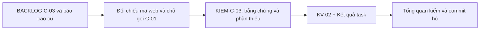

TÓM TẮT 1: [NGUỒN] DONE phần kiểm tĩnh KV-02: đã đối chiếu đủ 4/4 phần tử yêu cầu và phụ thuộc của C-03; báo cáo chính tại JX1_OPS/REPORTS/KIEM-C-03.md.
TÓM TẮT 2: [NGUỒN] Có mã trang quản trị, thiết kế màn hình hẹp và lời gọi C-01 mô phỏng; nguồn: JX1_OPS/TOOLS/jxweb/app.py:73–105,198–264,301–315.
TÓM TẮT 3: [CHƯA KIỂM] C-03 chưa đạt đủ tiêu chí: thiếu bằng chứng mở trang trên điện thoại qua Tailscale và nghiệm thu đầy đủ C-01; không sửa kết luận cũ.
TÓM TẮT 4: [NGUỒN] Không stage/commit/push theo yêu cầu; chưa có SHA KV-02, Tổng quan commit hộ. Ghi nhịp ngoài workspace bị từ chối truy cập.
TÓM TẮT 5: [CHƯA KIỂM] Không chạy build, test mã, exe, VM hoặc mạng; 6/6 là kết quả lịch sử được báo cáo cũ ghi, không chạy lại trong KV-02.
# KV-02 — Bàn giao kiểm C-03

Loại: kiểm thử
Chủ đề: Bàn giao kiểm tĩnh trang quản trị nội bộ theo tiêu chí BACKLOG.
Từ khóa: KV-02, C-03, C-01, jxweb, jxadm, kiểm tĩnh, điện thoại, Tailscale
Trạng thái: DONE — nội dung kiểm tĩnh và báo cáo hoàn tất; ghi nhịp bị giới hạn sandbox, nêu rõ bên dưới.
Độ phủ: đã đối chiếu 4/4 phần tử yêu cầu/phụ thuộc; 1 ĐẠT về mã, 3 CHƯA KIỂM về nghiệm thu.
Liên quan: JX1_OPS/TASKS/KV-02.md; JX1_OPS/TASKS/BACKLOG.md; JX1_OPS/TASKS/C-03.md; JX1_OPS/REPORTS/C-03-jxweb.md; JX1_OPS/REPORTS/KIEM-C-03.md
Cần tôi quyết định: có — chỉ khi tiếp tục nghiệm thu điện thoại/Tailscale, cần giao phạm vi vận hành riêng.

Ngày: 19/11/2026. Worktree `D:\JX-wt\KV-02`, nhánh `task/KV-02`, Git sạch ở lần kiểm đầu. Chưa có báo cáo KIEM-C-03/KV-02 khi bắt đầu; đã tạo hai đầu ra và chỉ bổ sung mục Kết quả ở task theo yêu cầu trực tiếp.

## Phạm vi và độ phủ

| Phần tử | Độ phủ | Kết quả và nguồn |
|---|---|---|
| Trang quản trị nội bộ | Đã phủ tĩnh | ĐẠT về mã: `JX1_OPS/TOOLS/jxweb/app.py:198–264,301–315`. |
| Xem bằng điện thoại | Đã phủ thiết kế; chưa phủ thực tế | CHƯA KIỂM: có HTML/CSS tại `JX1_OPS/TOOLS/jxweb/app.py:227–239`; test chỉ kiểm chuỗi HTML tại `JX1_OPS/TOOLS/jxweb/test_jxweb.py:70–75`. |
| Truy cập qua Tailscale | Đã đối chiếu giới hạn; chưa phủ thực tế | CHƯA KIỂM: báo cáo cũ `JX1_OPS/REPORTS/C-03-jxweb.md:39,55–56`; mã chỉ cho địa chỉ vòng nội bộ tại `JX1_OPS/TOOLS/jxweb/app.py:40–53,368–386`. |
| Phụ thuộc C-01 | Đã phủ lời gọi mô phỏng; chưa phủ nghiệm thu toàn mục | CHƯA KIỂM: yêu cầu `JX1_OPS/TASKS/BACKLOG.md:46,48`; lời gọi `JX1_OPS/TOOLS/jxweb/app.py:76–103`; kế hoạch `JX1_OPS/TOOLS/jxadm/jxadm.py:95–99,137–142,155`. |

## Giải mã tên

Không có tên riêng dữ liệu game cần giải mã GBK/TCVN3. Tên công cụ/ID giữ nguyên; bảng chi tiết trong mục cùng tên ở `JX1_OPS/REPORTS/KIEM-C-03.md`.

| Tên gốc | Mã hóa | Chữ đúng UTF-8 / ý nghĩa | Nguồn file:dòng |
|---|---|---|---|
| C-03 / Tailscale | UTF-8 | Trang quản trị trên điện thoại qua Tailscale | `JX1_OPS/TASKS/BACKLOG.md:48` |
| C-01 | UTF-8 | Công cụ dòng lệnh quản lý tài khoản | `JX1_OPS/TASKS/BACKLOG.md:46` |
| jxweb / jxadm | UTF-8 | Trang quản trị / công cụ tài khoản mô phỏng | `JX1_OPS/REPORTS/C-03-jxweb.md:1,14–16`; `JX1_OPS/TOOLS/jxweb/app.py:56–65,73–103` |

## Sắp theo cấu trúc game

Đây là nhóm quản trị tài khoản: công cụ C-01 → trang C-03 → điện thoại qua Tailscale. Không có dữ liệu phái, kỹ năng hoặc bản đồ; không đọc thêm nguồn game để lấp biểu mẫu.

## Nguồn đã đọc và kết quả

Nguồn từ task: chuẩn báo cáo, task KV-02, dòng C-01/C-03 của BACKLOG và báo cáo C-03-jxweb. Từ báo cáo/lời gọi trong mã, mở thêm task C-03, `JX1_OPS/TOOLS/jxweb/app.py:1–417`, `JX1_OPS/TOOLS/jxweb/test_jxweb.py:1–118` và phần liên quan `JX1_OPS/TOOLS/jxadm/jxadm.py:20–167`. Nạp sáu skill theo chỉ định. Chỉ đọc theo đoạn dưới khoảng 400 dòng/lần; không quét cây nguồn lớn, không đọc tài khoản thật, khóa hoặc cấu hình bí mật.

**ĐÃ XÁC MINH:** yêu cầu tại `JX1_OPS/TASKS/BACKLOG.md:48`; mã giao diện và lời gọi mô phỏng như bảng trên; sáu ca kiểm thử tồn tại tại `JX1_OPS/TOOLS/jxweb/test_jxweb.py:33,40,47,58,93,109`. Báo cáo cũ ghi PARTIAL và tự nêu Tailscale chưa kiểm tại `JX1_OPS/REPORTS/C-03-jxweb.md:3,53–57`; giữ nguyên tệp đó và mã nguồn.

**CHƯA XÁC MINH:** vận hành trên điện thoại/Tailscale, nghiệm thu toàn C-01 và test mới. Báo cáo cũ ghi 6/6 tại `JX1_OPS/REPORTS/C-03-jxweb.md:43–51`, chỉ là nguồn dẫn lại. Test mã có mở máy chủ HTTP (`JX1_OPS/TOOLS/jxweb/test_jxweb.py:58–64,93–98,109–114`) nên không chạy trong KV-02 cấm mạng. Không lấy thiếu kiểm thử vận hành làm bằng chứng phần mềm đã chạy thất bại.

**Sổ thông số và đề xuất tối ưu:** nằm trong báo cáo chính, gồm địa chỉ/cổng mặc định, cỡ giao diện và hạn xác nhận đọc từ mã. Bước hữu ích tiếp theo là bổ sung bằng chứng nghiệm thu sau phê duyệt vận hành riêng; không sửa cấu hình hay mở mạng trong KV-02.

## Lỗi, cách thử và kết quả

| Vấn đề | Cách thử / xử lý | Kết quả và bước tiếp tục |
|---|---|---|
| Lượt hiển thị đầu bị sai dấu | Đọc lại hai tệp đầu vào bằng UTF-8, đặt mã hóa đầu ra UTF-8 | Đọc đúng tiếng Việt; đầu ra mới lưu UTF-8 không BOM. Không sửa tệp nguồn vì lỗi hiển thị không chứng minh lỗi nội dung nguồn. |
| Không có `rg` trong PATH | Đã thử một lần; dùng `Select-String`/`Get-Content` giới hạn đúng tệp | Hoàn tất tìm dòng; không cài thêm công cụ. |
| Không ghi được nhịp `D:\JX-wt\KV-02.nhip` | Thử `WriteAllText` ở mốc bắt đầu, nhận `Access to the path ... is denied` | Đường dẫn ngoài vùng sandbox được ghi; không đổi quyền/đi vòng giới hạn, không ghi được các mốc lớn tiếp theo. Tổng quan cần lưu ý hạn chế theo dõi nhịp. |

## Bàn giao

- Đầu ra: `JX1_OPS/REPORTS/KIEM-C-03.md`, báo cáo này và mục Kết quả cuối `JX1_OPS/TASKS/KV-02.md`. Các chỉnh sửa ngoài tệp đầu ra chính là hai bổ sung được người giao việc chỉ định trực tiếp. Không tạo TSV chỉ mục vì ngoài vùng_file.
- Đề xuất hàng chỉ mục để Tổng quan gộp: file `JX1_OPS/REPORTS/KIEM-C-03.md`; loại `kiểm thử`; chủ đề `Kiểm C-03 trang quản trị`; từ khóa `C-03, C-01, jxweb, jxadm, điện thoại, Tailscale`; trạng thái `DONE kiểm tĩnh / C-03 CHƯA ĐẠT`; độ phủ `4/4 đối chiếu, 1 ĐẠT về mã, 3 CHƯA KIỂM`; liên quan `KV-02, C-03-jxweb, BACKLOG`.
- Kiểm tài liệu sau ghi: đọc lại đầu ra, kiểm UTF-8 không BOM, cấu trúc bắt buộc, mục Kết quả, đường dẫn/dòng dẫn và diff đúng ba tệp. Đây là kiểm tài liệu, không phải chạy kiểm thử mã.
- Không stage/commit/push; chưa có SHA KV-02, không thử ghi metadata Git. Tổng quan commit hộ theo yêu cầu. Không gửi thông báo ra ngoài.
- Kỹ năng đã dùng: jx1-retrofit, jx1-read-server, jx1-read-client, jx1-parameters, jx1-knowledge, jx1-report; đã nạp từ `.agents/skills`. Chỉ áp dụng phần phù hợp phạm vi; không mở source server/client game, Graphify hoặc mục lục ngoài danh sách nguồn cần thiết.

Kết quả kiểm: **C-03 CHƯA ĐẠT** vì thiếu bằng chứng mở và đọc trang trên điện thoại qua Tailscale, cùng bằng chứng nghiệm thu đầy đủ phụ thuộc C-01. Nội dung kiểm tĩnh KV-02 đã hoàn tất; hạn chế ghi nhịp được bàn giao rõ ở trên.
