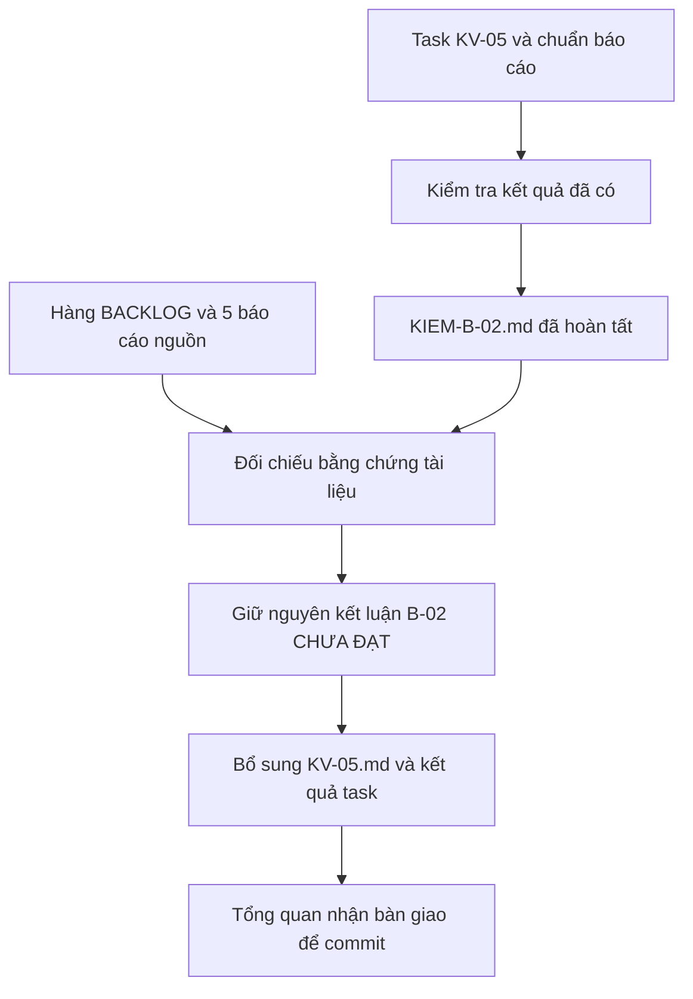

TÓM TẮT 1. [NGUỒN] DONE phần tài liệu KV-05: tiếp tục từ báo cáo kiểm tra đã có, hoàn tất báo cáo bàn giao còn thiếu.
TÓM TẮT 2. [NGUỒN] Giữ nguyên kết luận B-02 CHƯA ĐẠT; chưa có bằng chứng review Opus và nghiệm thu chức năng trong nguồn được giao.
TÓM TẮT 3. [NGUỒN] Đầu ra kiểm tra: `JX1_OPS/REPORTS/KIEM-B-02.md`; đầu ra bàn giao: `JX1_OPS/REPORTS/KV-05.md`; bổ sung kết quả vào task.
TÓM TẮT 4. [CHƯA KIỂM] Chưa đối chiếu trực tiếp source/binary của lần thử VM; nhịp ngoài worktree bị giới hạn quyền ghi, đã được ghi nhận ở checkpoint cũ.
TÓM TẮT 5. [NGUỒN] Lượt tiếp tục không build/test game, chạy exe/VM hay mạng; không commit/push theo yêu cầu, Tổng quan nhận bàn giao để commit.

# KV-05 — Bàn giao kiểm tra bộ lọc hiển thị B-02

Loại: tổng hợp
Chủ đề: Hoàn tất phần bàn giao còn thiếu của KV-05, bảo toàn báo cáo kiểm tra B-02 đã có.
Từ khóa: bộ lọc hiển thị, visibility filter, gs001, KV-05, B-02, Enabled, review Opus, nghiệm thu
Trạng thái: DONE — hoàn tất tài liệu; thao tác ghi nhịp ngoài vùng được phép còn bị chặn, nêu riêng ở phần bàn giao.
Độ phủ: 5/5 báo cáo B-02 được task chỉ định; 1/1 hàng BACKLOG B-02; 1/1 báo cáo kiểm tra và mục kết quả task đã có. Không tính độ phủ mã nguồn hay runtime.
Liên quan: `JX1_OPS/TASKS/KV-05.md`; `JX1_OPS/TASKS/BACKLOG.md`; `JX1_OPS/REPORTS/KIEM-B-02.md`; năm báo cáo B-02 trong danh sách nguồn dưới đây.
Cần tôi quyết định: có — theo báo cáo kiểm tra cũ, PM/chủ dự án cần chốt tiêu chí hoàn tất và bổ sung bằng chứng review Opus; worker không tự thêm điều kiện nghiệm thu.

## Sơ đồ đối chiếu và tiếp tục



## Phạm vi và độ phủ

| Phần tử trong phạm vi | Độ phủ của lượt tiếp tục | Bằng chứng / giới hạn |
|---|---|---|
| Chuẩn báo cáo và quyền task | Đã phủ | `JX1_OPS/DESIGN/CHUAN-BAO-CAO.md:6–30`; `JX1_OPS/TASKS/KV-05.md:19–28`. |
| Báo cáo kiểm tra đã có | Đã phủ; giữ nguyên | `JX1_OPS/REPORTS/KIEM-B-02.md:1–101`; không viết lại phần đã hoàn tất. |
| Yêu cầu gốc B-02 | Đã phủ về văn bản | `JX1_OPS/TASKS/BACKLOG.md:34–37`: cài đặt trên nhánh riêng, dựng, chạy VM thử; người làm gồm Codex và Opus review. |
| Năm báo cáo B-02 được chỉ định | Đã phủ 5/5 về văn bản | Danh sách nguồn ở mục sau; không thay thế kiểm tra source/binary/runtime. |
| Source/binary đã dùng trong lần chạy VM | Chưa phủ trực tiếp | Giữ giới hạn của `JX1_OPS/REPORTS/KIEM-B-02.md:82–90`; lượt tiếp tục không tìm lại mã hoặc artifact. |
| Review Opus và nghiệm thu chức năng | Chưa có bằng chứng xác nhận trong nguồn được giao | `JX1_OPS/REPORTS/KIEM-B-02.md:38–50,87–89`; `JX1_OPS/REPORTS/B-02d-review-tinh.md:84,108`. |
| Báo cáo bàn giao và kết quả task | Đã phủ | Tạo báo cáo này; thêm một dòng vào mục kết quả hiện có của task, không đổi kết luận trước. |
| Tệp nhịp tại `D:/JX-wt/KV-05.nhip` | Chưa ghi được | Nằm ngoài vùng ghi được cấp; checkpoint trước ghi lỗi `Access denied` tại `JX1_OPS/REPORTS/KIEM-B-02.md:96`. Không thử vượt quyền hoặc ghi tệp thay thế. |

## Giải mã tên

| Tên gốc | Mã hóa | Chữ đúng | Nguồn file:dòng |
|---|---|---|---|
| Không có tên kỹ năng, trang bị, quái, NPC hay bản đồ cụ thể cần giải mã | Không áp dụng GBK/TCVN3; tài liệu đọc bằng UTF-8 | Không phát sinh danh mục tên game trong báo cáo bàn giao kỹ thuật | `JX1_OPS/TASKS/KV-05.md:20–22`; `JX1_OPS/REPORTS/KIEM-B-02.md:53–61` |

## Sắp theo cấu trúc game

Không có danh mục kỹ năng, trang bị, quái, NPC hoặc bản đồ để sắp theo cấu trúc game. Theo phạm vi task, bảng kiểm được xếp theo luồng triển khai bộ lọc trên gs001: cài đặt → dựng → thử VM → review. Không gom dữ liệu game mới hoặc tự chọn phiên bản client.

## Danh sách nguồn cần đọc và đã dùng

Danh sách được chốt từ `JX1_OPS/TASKS/KV-05.md:20–22`, cùng chuẩn báo cáo, task và báo cáo checkpoint hiện có. Chỉ đọc các đoạn cần đối chiếu, tối đa 400 dòng mỗi lần; không quét thư mục nguồn lớn. Sáu skill trong `.agents/skills` được nạp theo yêu cầu để áp dụng quy tắc đọc tĩnh, giữ kết luận, ghi thông số và bàn giao.

| Nguồn | Dòng dùng | Nội dung được xác nhận từ tài liệu |
|---|---|---|
| `JX1_OPS/TASKS/BACKLOG.md` | 34–37 | Hàng B-02 nêu việc và người review; bảng tại đây không có cột “Xong khi”. |
| `JX1_OPS/REPORTS/B-02-loc-hien-thi.md` | 4–8,77–82 | Báo cáo P1 trên nhánh riêng; ghi đã build và các phần chưa kiểm, chưa chặn tương tác hoàn chỉnh. |
| `JX1_OPS/REPORTS/B-02-tom-tat-diff.md` | 2,25,30 | Ghi nhánh và tóm tắt thay đổi P1; nêu chưa có P2, chưa chạy ở thời điểm báo cáo đó. |
| `JX1_OPS/REPORTS/B-02b-build-tren-a07e.md` | 4–8,13–14 | Ghi năm dự án build exit 0, vị trí bản sao artifact và giới hạn quét/chạy lúc đó. |
| `JX1_OPS/REPORTS/B-02c-build-va-thu.md` | 4–8 | Ghi build-check, chạy VM ở `Enabled=0`, các kiểm thử còn thiếu. |
| `JX1_OPS/REPORTS/B-02d-review-tinh.md` | 2–6,18–61,67–84,108 | Review tĩnh nêu F1–F5 và chưa đủ nghiệm thu; không xác nhận đây là review của Opus. |
| `JX1_OPS/REPORTS/KIEM-B-02.md` | 33–50,75–101 | Kết quả kiểm tra đã hoàn tất; các giới hạn source/runtime và lỗi ghi nhịp đã được ghi lại. |

Hai tài liệu B-01 và O-01 được báo cáo kiểm tra cũ dẫn đã kiểm tra tồn tại tại đúng đường dẫn; lượt tiếp tục không đọc lại nội dung hoặc xác nhận độc lập các điều kiện trong đó. Các mô tả thiết kế/duyệt liên quan chỉ được dẫn gián tiếp từ báo cáo cũ, không tính là bằng chứng source.

## Bảng kết quả từng yêu cầu con B-02

Đây là bàn giao lại bảng kiểm đã có, giữ nguyên mức xác minh tại `JX1_OPS/REPORTS/KIEM-B-02.md:33–39`.

| Yêu cầu con | Kết quả giữ nguyên | Bằng chứng | Cách hiểu và giới hạn |
|---|---|---|---|
| Cài bộ lọc trong gs001 trên nhánh riêng | CHƯA KIỂM độc lập | `JX1_OPS/REPORTS/B-02-tom-tat-diff.md:2`; `JX1_OPS/REPORTS/B-02c-build-va-thu.md:4` | Có mô tả nhánh và commit trong báo cáo; chưa trực tiếp xác nhận đúng cây mã/bản chạy. |
| Dựng | ĐẠT theo báo cáo | `JX1_OPS/REPORTS/B-02b-build-tren-a07e.md:4–8`; `JX1_OPS/REPORTS/B-02c-build-va-thu.md:4` | Báo năm dự án thành công; worker không build hoặc kiểm log trực tiếp trong lượt này. |
| Chạy VM thử | ĐẠT giới hạn theo báo cáo | `JX1_OPS/REPORTS/B-02c-build-va-thu.md:6,8` | Chỉ có bằng chứng tài liệu về lần chạy khi tắt bộ lọc; không xác nhận chức năng khi bật. |
| Opus review | CHƯA ĐẠT — chưa có bằng chứng | `JX1_OPS/TASKS/BACKLOG.md:37`; `JX1_OPS/REPORTS/KIEM-B-02.md:38,80` | Không tự coi review tĩnh đã có là review Opus. |

Bảng BACKLOG tại `JX1_OPS/TASKS/BACKLOG.md:34–37` không ghi cột “Xong khi”. Đây là khoảng trống mô tả đã được báo cáo cũ nêu; không tự bổ sung một tiêu chí mới để đổi kết quả. Các bài nghiệm thu chức năng và hiệu năng còn thiếu được giữ nguyên theo `JX1_OPS/REPORTS/KIEM-B-02.md:41–50,87–89` và `JX1_OPS/REPORTS/B-02d-review-tinh.md:84`.

## Mục sổ thông số

| Nhóm | Tên/hằng số | file:dòng | Giá trị | Đơn vị | Ảnh hưởng | Đổi an toàn | Nguồn đo |
|---|---|---|---|---|---|---|---|
| Bộ lọc hiển thị | `Enabled` | `JX1_OPS/REPORTS/B-02c-build-va-thu.md:6,8` | 0 trong lần thử được báo cáo; giá trị 1 chưa được thử theo nguồn này | Cờ cấu hình | Lần chạy được dẫn không chứng minh hành vi lọc khi bật | CẨN THẬN — không được sửa trong KV-05 | Nguồn gián tiếp từ báo cáo; chưa đo hoặc đọc cấu hình thực tế |

Không thêm số đo runtime. Các con số build/thời gian chạy trong báo cáo nguồn không được nhận là test do worker chạy trong lượt tiếp tục.

## Đã xác minh / Chưa xác minh

**ĐÃ XÁC MINH về tài liệu:** nhánh worktree là `task/KV-05`, trạng thái Git ban đầu sạch; báo cáo kiểm tra và mục kết quả task đã có. Nội dung hàng BACKLOG và năm báo cáo nguồn được đối chiếu như bảng trên. Kiểm tra hiện diện tệp không được tính là xác minh nội dung mã hay điều kiện chạy.

**CHƯA XÁC MINH độc lập:** mã nguồn B-02c, nhánh/commit trong cây source thực tế, binary và log dùng cho VM, các hành vi khi `Enabled=1`, đối chứng khi tắt, các bài kiểm thử và số đo hiệu năng, review Opus. Giới hạn giữ nguyên tại `JX1_OPS/REPORTS/KIEM-B-02.md:85–90`.

## Kiểm tra thực chạy, lỗi và cách xử lý

- Đã chạy: `git status --short --branch` một lần trước ghi; đọc tệp cụ thể bằng `Get-Content -Encoding UTF8`, kiểm tra tồn tại bằng `Test-Path`; kiểm tra SHA-256 báo cáo kiểm tra trước/sau ghi; kiểm tra diff, whitespace và mã hóa các tệp thuộc lượt tiếp tục.
- Chưa chạy: build, test logic game, exe/DLL game, VM, client/server, kết nối mạng. Không dùng source để suy rằng runtime đã đạt.
- Lỗi đọc đầu: PowerShell mặc định hiển thị UTF-8 sai. Đã đọc lại đúng hai tệp chuẩn/task bằng `-Encoding UTF8`; đây là sửa cách hiển thị, không sửa nội dung tệp nguồn.
- `rg` không có trong môi trường; sau một lần thử đã chuyển sang `Get-Content` trên tệp cụ thể. Không cài công cụ hay tạo parser/script phụ.
- Nhịp: checkpoint cũ ghi lỗi `Access denied` ở `JX1_OPS/REPORTS/KIEM-B-02.md:96`. Quyền ghi lượt này vẫn chỉ cấp trong `D:/JX-wt/KV-05`; tệp yêu cầu `D:/JX-wt/KV-05.nhip` nằm ngoài vùng đó. Không thử ghi lại, không đổi quyền hoặc tạo đường dẫn thay thế; nhịp bắt đầu/các phần/sắp xong chưa được lưu ra tệp. PM cần xử lý trong môi trường có quyền hợp lệ.

## Phát hiện khi chuẩn hóa

Báo cáo kiểm tra đã có và kết luận cũ được bảo toàn. Chỉ thiếu báo cáo bàn giao mang mã KV-05 theo yêu cầu hiện tại; lượt tiếp tục bổ sung tệp này và ghi nhận vào mục kết quả task. Không chỉnh các báo cáo B-02, không thêm nhận định lỗi source mới hoặc thay mức nghiệm thu đã nêu.

## Đề xuất tối ưu và bàn giao

1. Tổng quan nhận hai tệp bàn giao của lượt tiếp tục: `JX1_OPS/REPORTS/KV-05.md` và `JX1_OPS/TASKS/KV-05.md`. Báo cáo kiểm tra `JX1_OPS/REPORTS/KIEM-B-02.md` giữ nguyên.
2. Giữ các bước tiếp theo đã nêu tại `JX1_OPS/REPORTS/KIEM-B-02.md:69–73`: chốt tiêu chí, bổ sung bằng chứng source/binary, review Opus và nghiệm thu bằng quyền test riêng. KV-05 không thực hiện những bước runtime đó.
3. Không stage/commit/push theo yêu cầu; không có SHA commit mới. Không có lỗi Git ghi/push trong lượt này; blocker là đường dẫn nhịp ngoài quyền ghi, không phải thao tác push đã thử.
4. Không tạo tệp chỉ mục riêng ngoài vùng được giao. Dòng chỉ mục đề xuất bên dưới để PM gộp; không sửa `MUC-LUC-TRI-THUC.md`, `BAI_HOC.md` hoặc tài liệu nguồn.

```tsv
file	loại	chủ đề	từ khóa	trạng thái	độ phủ	liên quan
JX1_OPS/REPORTS/KV-05.md	tổng hợp	Bàn giao kiểm tra B-02	bộ lọc hiển thị, visibility filter, gs001, KV-05, B-02	DONE tài liệu; nhịp ngoài quyền ghi	5/5 báo cáo nguồn; 1 hàng BACKLOG; chưa xác minh source/runtime	JX1_OPS/REPORTS/KIEM-B-02.md; JX1_OPS/TASKS/KV-05.md
```

Kỹ năng đã dùng: `jx1-retrofit`, `jx1-read-server`, `jx1-read-client`, `jx1-parameters`, `jx1-knowledge`, `jx1-report`. Quy tắc đọc server/client được áp dụng để giữ ranh giới bằng chứng; không mở rộng khảo sát mã hoặc tự chọn root client.

KẾT LUẬN: B-02 CHƯA ĐẠT, thiếu: bằng chứng review Opus; tiêu chí “Xong khi” chưa được ghi trong BACKLOG; chưa đối chiếu trực tiếp source/binary dùng cho lần thử VM và chưa có bằng chứng nghiệm thu chức năng.
