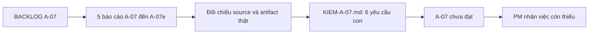

TÓM TẮT 1: [NGUỒN] DONE KV-06: đã kiểm điều kiện đóng A-07 theo JX1_OPS/TASKS/BACKLOG.md:30.
TÓM TẮT 2: [NGUỒN] A-07 CHƯA ĐẠT: đã có tệp symbol, nhưng chưa chứng minh dòng gây lỗi T1 và chưa đủ các bằng chứng bắt buộc.
TÓM TẮT 3: [NGUỒN] Bảng kiểm chi tiết ở JX1_OPS/REPORTS/KIEM-A-07.md; tệp này là báo cáo bàn giao KV-06 theo prompt trực tiếp.
TÓM TẮT 4: [CHƯA KIỂM] Không tái hiện runtime; nhịp D:/JX-wt/KV-06.nhip bị Access denied; thiếu bằng chứng vận hành được ghi rõ, không làm thay.
TÓM TẮT 5: [CHƯA KIỂM] Không chạy build/exe/VM/mạng, không commit/push theo prompt; chưa có SHA mới; PM tổng quan nhận tài liệu và quyết định task bằng chứng tiếp theo.

# KV-06 — Bàn giao kiểm A-07

Loại: khảo sát
Chủ đề: Kiểm gốc rễ crash gs001 tự dựng sau public net IP, không thay kết luận các báo cáo gốc.
Từ khóa: KV-06, A-07, gs001, T1, A2T2, Debug, PDB, crash, /RTC1
Trạng thái: DONE — hoàn tất kiểm tĩnh và tài liệu; A-07 chưa đủ điều kiện đóng.
Độ phủ: 6/6 yêu cầu con đã được xem xét trong KIEM-A-07.md; 1 ĐẠT về tệp symbol, 5 CHƯA ĐẠT.
Liên quan: JX1_OPS/REPORTS/KIEM-A-07.md; JX1_OPS/TASKS/KV-06.md; JX1_OPS/TASKS/BACKLOG.md:30; JX1_OPS/REPORTS/A-07-goc-re-crash-gs001.md; JX1_OPS/REPORTS/A-07b-ep-con-tro.md; JX1_OPS/REPORTS/A-07c-link-gs001.md; JX1_OPS/REPORTS/A-07d-breakpoint.md; JX1_OPS/REPORTS/A-07e-rtc.md.
Cần tôi quyết định: không — không xin quyền chạy hoặc thay tiêu chí trong KV-06.

## Sơ đồ chính

## Phạm vi và độ phủ

| Thành phần | Độ phủ | Kết quả |
|---|---|---|
| Chuẩn báo cáo, task và dòng A-07 trong BACKLOG | Đã phủ | Giữ tiêu chí nguyên văn: Debug có symbol, dump/debugger, so cờ/thư viện với A2T2, tìm dòng lỗi |
| Năm báo cáo A-07…A-07e được chỉ định | Đã phủ các phần liên quan | Phân biệt T1 thoát sớm, lỗi A2T2 và breakpoint khoảng 225 giây; không sửa thân cũ |
| Source cụ thể do báo cáo dẫn | Đã phủ các điểm quyết định | Kiểm dòng hiện tại ở KSOServer, CoreServerShell, KCore, KSortScript và bốn sửa P1 của snapshot E |
| Log/map/PDB/exe theo đường dẫn báo cáo | Đã phủ phần tìm thấy | Đọc kết quả build cũ và đo hash; có GameServer.pdb, không coi tên gs001.pdb thiếu là thiếu mọi symbol |
| VM/debugger/dump T1 và bộ A2T2 thực chạy | Chưa kiểm vận hành | Ngoài quyền KV-06; hồ sơ giao chưa chứng minh dòng T1 |
| Đầu ra | Đã phủ | KIEM-A-07.md là sản phẩm theo task; KV-06.md là biên bản theo prompt; mục Kết quả ghi cuối task |

## Giải mã tên

| Tên gốc | Mã hóa | Chữ đúng UTF-8 | Nguồn file:dòng |
|---|---|---|---|
| gs001 / GameServer | ASCII | Tiến trình máy chủ trò chơi và tên tệp symbol của bộ dựng | JX1_OPS/TASKS/BACKLOG.md:30; BC/out/gs001-headers.txt:101, ký hiệu BC trong KIEM-A-07.md |
| T1 / A2T2 | ASCII | Hai phép thử lịch sử cần phân biệt khi kiểm crash | C:/Jx1CocoV3/docs-analysis/reports/44-dieu-tra-a2-thoat-som.md:17–18,44–45 |

Không có tên kỹ năng, trang bị, quái, NPC hoặc bản đồ cần giải mã GBK/TCVN3. Không sửa đoạn mã hóa lỗi của báo cáo 44.

## Sắp theo cấu trúc game

Theo tiến trình máy chủ: bản dựng → khởi động mạng → khởi tạo lõi trò chơi → thu ngoại lệ → so bộ đối chứng. Chi tiết nguồn và bảng sáu yêu cầu nằm trong KIEM-A-07.md.

## Kết quả chính và mức chắc

**ĐÃ XÁC MINH, đọc tĩnh:** BC/logs/commands.jsonl:1–5 và E/logs/commands.jsonl:1–5 ghi Release/Server Release x64; BC/logs/results.json:2–6 và E/a07e/build-results.json:2–6 ghi năm project trả 0. Có GameServer.pdb thật; PDB E có SHA-256 01f5dd00f56a15a1e037c6c35df45e9198dc602e3828cc5ea31a72d741d79b41, khớp E/a07e/SHA256SUMS.txt:9. Các ký hiệu đường dẫn đầy đủ được khai báo trong KIEM-A-07.md. Đọc kết quả cũ không có nghĩa KV-06 đã build.

**NGUỒN GIÁN TIẾP:** A-07e-rtc.md:163–167 ghi bộ mới chạy qua mốc khoảng 40 giây và 225 giây. Cùng đợt đã bỏ /RTC1, sửa bốn P1 và đổi lựa chọn CRT Engine (A-07e-rtc.md:80–92). Không thể chọn một dòng là nguyên nhân T1 chỉ từ kết quả nhiều thay đổi này.

**CHƯA XÁC MINH:** chưa có bằng chứng ghép ngoại lệ T1 → module đúng hash → PDB đúng GUID/age → dòng nguồn; chưa xác thực đầy đủ cờ và thư viện của đúng A2T2 đã chạy. A-07-goc-re-crash-gs001.md:188 thiếu dump T1; A-07d-breakpoint.md:73 cũng thiếu dữ liệu ngoại lệ của lần dừng sau. Không lấy lỗi _findfirst của A2T2 ở báo cáo 44:44–45 thay cho T1.

## Mục sổ thông số

| Nhóm | Tên/hằng số | file:dòng | Giá trị | Đơn vị | Ảnh hưởng | Đổi an toàn | Nguồn đo |
|---|---|---|---|---|---|---|---|
| Build | Configuration | BC/logs/commands.jsonl:1–5; E/logs/commands.jsonl:1–5 | Release / Server Release x64 | Cấu hình | Chưa đạt nguyên văn Debug | KHÔNG trong KV-06 | Đọc log cũ |
| Ngoại lệ | T1 / bộ A-07c sau | Báo cáo 44:17; A-07c-link-gs001.md:139 | 0xC0000005 / 0x80000003 | Mã | Không gộp hai lần lỗi | KHÔNG — dữ liệu quan sát | Nguồn gián tiếp |

## Lỗi, cách thử và kiểm tra thực chạy

| Việc | Thực chạy / kết quả |
|---|---|
| Git lúc nhận task | git status --short --branch: đúng task/KV-06, sạch; chưa có hai tệp báo cáo đầu ra |
| Tìm kiếm | rg không có; đã chuyển Select-String theo tệp xác định, không cài thêm |
| Đọc/đối chiếu | Get-Content theo đoạn; Test-Path/Get-Item; Get-FileHash SHA-256 cho artifact được dẫn; không chạy sản phẩm |
| Nhịp bắt đầu | Set-Content D:/JX-wt/KV-06.nhip bị UnauthorizedAccessException / Access denied; tệp nằm ngoài vùng ghi, không sửa quyền; các mốc sau cập nhật hội thoại |
| Build/test vận hành | Chưa chạy, do task cấm build/exe/VM/mạng; không chạy verifier hoặc dumpbin |
| Soát tài liệu cuối | Kiểm UTF-8 không BOM, đủ khuôn và dòng kết luận; xem diff một lượt, không stage |

## Đề xuất tối ưu và bàn giao

Đề xuất tập trung vào gói bằng chứng còn thiếu cho T1, không mở thêm đợt sửa nguồn theo giả thuyết. Task vận hành riêng phải có quyền và môi trường phù hợp; KV-06 không chạy các bước đó. Từng yêu cầu thiếu và bằng chứng hỗ trợ nằm trong bảng kiểm KIEM-A-07.md, dòng cuối chốt A-07 CHƯA ĐẠT.

Đã nạp đủ sáu skill từ .agents/skills. Dùng jx1-retrofit để giữ khuôn và kết luận; jx1-read-server để kiểm source; jx1-parameters lập sổ; jx1-knowledge gắn mức chắc; jx1-report bàn giao. jx1-read-client chỉ nạp theo prompt, không đọc client vì không thuộc câu hỏi. Không tạo chỉ mục TSV hoặc sửa mục lục ngoài vùng được giao.

Không commit, stage hay push theo yêu cầu tổng quan commit hộ; chưa có SHA mới. Bàn giao hai tài liệu và mục Kết quả cuối task. Việc ghi nhịp ngoài worktree bị chặn bởi sandbox; PM cần phiên có quyền ghi đích nếu cần khôi phục tệp nhịp. Không có thao tác thay quyền/credential/config.

Kỹ năng đã dùng: jx1-retrofit, jx1-read-server, jx1-parameters, jx1-knowledge, jx1-report; jx1-read-client đã nạp nhưng không áp dụng đọc client.

KẾT LUẬN: A-07 CHƯA ĐẠT, thiếu: bản Debug thành công, dump/debugger đúng lỗi T1 và bộ symbol/module tương ứng, đối chiếu đủ cờ/thư viện A2T2, dòng mã gây T1 được chứng minh.
