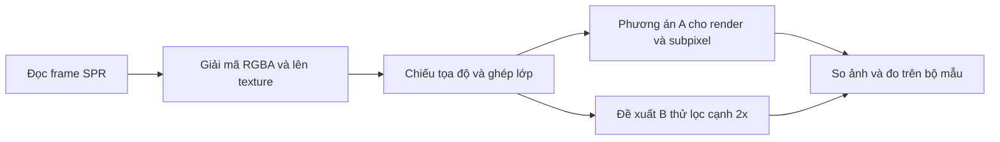

TÓM TẮT 1 [NGUỒN] Cocos2d-x hiện khởi tạo texture với lọc tuyến tính (`GL_LINEAR`); đường tải `.spr` giải mã mỗi frame thành RGBA rồi dùng làm texture.\
TÓM TẮT 2 [NGUỒN] Client đặt thiết kế 1040 × 603,2 với `EXACT_FIT`; phép chiếu world dùng số nguyên và có canvas map 512 × 512, là các điểm cần xét trước khi tăng độ phân giải.\
TÓM TẮT 3 [NGUỒN] Phương án an toàn để thử là lọc tuyến tính có chọn lọc + render/subpixel, sau đó mới so sánh bộ upscale xBRZ ở nhánh vẽ sprite `.spr`; không upscale offline hay vẽ lại asset.\
TÓM TẮT 4 [CHƯA KIỂM] Chưa áp dụng patch. Cần xác định trước đường hiệu ứng vũ khí cụ thể vì không tìm thấy `g_jxAdditive` hoặc `jxDrawBolts` trong `Classes` đã khảo sát.\
TÓM TẮT 5 [NGUỒN] Chưa chạy client/build/đo FPS-RAM; đây là kết quả đọc source tĩnh, không phải xác nhận runtime. Trong R-07a chưa build, chạy exe hay VM.

# L-01 — Làm mượt hình ảnh, giữ nét gốc

Loại: khảo sát
Chủ đề: Khảo sát đường vẽ và đề xuất làm mượt hình ảnh client.
Từ khóa: làm mượt hình ảnh, nội suy, hiệu ứng vũ khí, L-01, GL_LINEAR, EXACT_FIT, SPR, xBRZ
Trạng thái: DONE — Hoàn tất giai đoạn đọc tĩnh và thiết kế thử theo báo cáo gốc.
Độ phủ: đã phủ 9 trên tổng 12 hạng mục đọc tĩnh, thiết kế và hạng mục thử đã nêu trong báo cáo.
Liên quan: [L-02](L-02.md), [L-03](L-03-quy-trinh-dung-apk.md), [H-14](H-14-mat-khung-hieu-ung.md), [Tối ưu 120 FPS](../DESIGN/TOI-UU-120FPS.md).
Cần tôi quyết định: không



## Phạm vi và độ phủ

Tóm tắt dẫn từ báo cáo gốc. Bảng đếm các hạng mục và phần thử đã nêu trong L-01. Đường dẫn source mới tương đối với client bản A `D:/JX-build/qh9A`. Tệp C++ có cả UTF-8 và tệp giải mã được bằng GBK. Bằng chứng gốc vẫn theo thư mục nêu ở mục Phạm vi và trạng thái.

| Hạng mục | Độ phủ | Căn cứ và giới hạn |
|---|---|---|
| Kích thước thiết kế, chính sách và zoom | Đã phủ | `Classes/AppDelegate.cpp:56` và `Classes/AppDelegate.cpp:129` có kích thước và `EXACT_FIT`. `Classes/gameui/KuiOptions.cpp:163` ghi dải zoom. |
| Lọc texture và mipmap | Đã phủ | `cocos2d/cocos/renderer/CCTexture2D.cpp:643` và `cocos2d/cocos/renderer/CCTexture2D.cpp:1334`. |
| Frame SPR và alpha | Đã phủ | `Classes/engine/Kgetinidata.cpp:101`, `Classes/engine/Kgetinidata.cpp:268` và `Classes/engine/Kgetinidata.cpp:378`. Khâu lên texture RGBA tại `cocos2d/cocos/renderer/CCTextureCache.cpp:557`. |
| Chiếu tọa độ và subpixel | Đã phủ | Bản A có hai phép chiếu tại `Classes/gamecore/KSubWorld.cpp:191` và `Classes/gamecore/KSubWorld.cpp:197`. Hai macro tại `cocos2d/cocos/base/ccConfig.h:145` và `cocos2d/cocos/base/ccConfig.h:154`. |
| Nhân vật, quái và các lớp hình | Đã phủ | `Classes/gamecore/KNpcRes.cpp:247` và điểm vẽ `Classes/gamescene/KgameWorld.cpp:11476`. |
| Bản đồ và vật thể | Đã phủ | `Classes/gamescene/KScenePlaceRegionC.cpp:1046` và `Classes/gamescene/KScenePlaceRegionC.cpp:1134` gọi vẽ bản đồ. `Classes/gamescene/KgameWorld.cpp:7462` tạo canvas và `Classes/gamescene/KgameWorld.cpp:7914` là đường vẽ vật thể. |
| PNG/JPG và UI | Đã phủ | `Classes/engine/Kgetinidata.cpp:580` là nhánh ảnh riêng. Chưa chọn icon vào bộ mẫu. |
| A. Thiết kế render và tọa độ lẻ | Đã phủ | `L-01-lam-muot-hinh-anh.md:76` ghi đề xuất. `L-01-lam-muot-hinh-anh.md:82` ghi vị trí dự kiến. |
| B. Thiết kế thử lọc cạnh 2× | Đã phủ | `L-01-lam-muot-hinh-anh.md:123`. Thiết kế còn ở mức thử nghiệm dự kiến. |
| Glow và sét cho +6, +12, +15 trong nguồn gốc | Chưa phủ | `L-01-lam-muot-hinh-anh.md:211`. Bản A có điểm tương ứng tại `Classes/vn/gamecore/KNpcResVN.cpp:517` và `Classes/vn/gamecore/KNpcResVN.cpp:618`. |
| Bộ mẫu cụ thể và patch A/B của L-01 | Chưa phủ | `L-01-lam-muot-hinh-anh.md:210` ghi chưa chọn asset. Patch trong báo cáo chỉ là đề xuất. |
| Ảnh so sánh và số đo FPS/RAM | Chưa phủ | `L-01-lam-muot-hinh-anh.md:214` ghi chưa chạy phép thử. |

## Phạm vi và trạng thái

**DONE — phạm vi giai đoạn 1 tĩnh: khảo sát, đề xuất patch dự kiến, rủi ro và kế hoạch đo.** Thử nghiệm và xác nhận hiệu ứng thuộc giai đoạn sau, chưa thực hiện. Chỉ đọc bản source tại `C:\Jx1CocoV3\Folder\Client2912-20260116T044348Z-3-001\Client2912\Client`; không sửa source, không dựng APK, không chạy game/công cụ đóng gói, không kết nối mạng hoặc VM. Không đọc/ghi nội dung credential. Workspace task ban đầu sạch ngoài file task chưa được Git theo dõi. Không đọc hoặc sửa `D:\Android\b\Client` hay `D:\JX-backup\qh7`.

Tên báo cáo: L-01 — Làm mượt hình ảnh, giữ nét gốc. Ngày đọc: 17/11/2026. Mọi đường dẫn source tương đối bên dưới lấy root client nói trên. Số dòng là bằng chứng ở source trên đĩa tại lượt đọc, không khẳng định APK đang dùng đúng source này. Không có commit source được ghim trong task; không đối chiếu binary.

## ĐÃ XÁC MINH

| Hạng mục | Bằng chứng tĩnh |
|---|---|
| Chọn scene và độ phân giải | `Classes/AppDelegate.cpp:53-56, 127-130, 183-185`: thiết kế 1040 × (1040 × `curSalx`), `EXACT_FIT`, sau đó scene khởi đầu là `KUpdateLayerVN::scene()`. `curSalx` được cập nhật từ tỷ lệ khung hình tại dòng 130. |
| Hành vi `EXACT_FIT` | `cocos2d/cocos/platform/CCGLView.cpp:131-163`: scale X và Y tính độc lập; `EXACT_FIT` không đưa hai scale về cùng một giá trị. Tùy thiết bị, hình có thể bị kéo không đồng đều; đổi chính sách có thể đổi vùng nhìn/gameplay nên không ghép vào thử lọc ảnh đầu tiên. |
| Lọc texture mặc định | `cocos2d/cocos/renderer/CCTexture2D.cpp:443-446, 641-649`: `_antialiasEnabled` khởi tạo `true`; texture một mip dùng `GL_LINEAR` cho min/mag; có mip dùng `GL_LINEAR_MIPMAP_NEAREST` cho min và `GL_LINEAR` cho mag. Đây là lọc texture khi lấy mẫu, không phải tăng chi tiết asset. |
| Mipmap | `cocos2d/cocos/renderer/CCTexture2D.cpp:1334-1345`: `generateMipmap()` là lời gọi riêng, yêu cầu kích thước POT; không thấy lời gọi trong đường `.spr` được khảo sát. Texture thường không có mipmap thì không tạo chi tiết mới. Chưa rà mọi loại texture/package để khẳng định toàn client không có mipmap. |
| Đường giải mã `.spr` | `Classes/engine/Kgetinidata.cpp:100-121, 142-165, 184-216, 240-371, 373-380`: `findinidata_one` đọc header/frame, palette và RLE alpha; giải mã ra buffer RGBA, truyền qua `addImageWihtData` và cache theo texture key. Nhánh `alpha == 0` ghi pixel trong suốt; vùng alpha dương ghi RGB palette cùng alpha (hoặc nhánh clear đặc biệt). |
| Đường gắn sprite nhân vật | `Classes/gamescene/KgameWorld.cpp:8115-8140` lấy texture/frame qua `findinidata_one` trong `ccgetTxtData`; `:8152-8182` đổi tọa độ world sang local và cộng center/frame offset; `:11344-11405` gắn/cập nhật sprite các phần nhân vật. Không thấy `round/floor` tường minh ở vị trí được đọc, nhưng phép chiếu và biến int đã làm mất phần lẻ như phân tích dưới. |
| Map, vật thể, UI | `KgameWorld.cpp` có các đường riêng `DrawPrimitives_map` (`:6922`), `Draw_Part_map` (`:7434`), `Draw_Full_map` (`:7631`), `DrawPrimitives_obj` (`:7913`) và `DrawPrimitives` (`:11344`). PNG/JPG trong `Kgetinidata.cpp:576-586` đi qua `getpicPath`, khác nhánh `.spr`; do đó không nên áp cùng một thay đổi toàn cục lên mọi texture/UI. Cần xác nhận route map và texture UI cụ thể trong vòng mẫu. |
| Subpixel | `cocos2d/cocos/base/ccConfig.h:139-155`: `CC_NODE_RENDER_SUBPIXEL` và `CC_SPRITEBATCHNODE_RENDER_SUBPIXEL` mặc định bằng 1. Giữ subpixel tránh rung/nhảy khi vị trí có phần thập phân; kết quả phụ thuộc scale và sampler, cần so ảnh chuyển động. |
| Blend và alpha | `cocos2d/cocos/renderer/CCTextureCache.cpp:539-573` nạp SPR bằng `initWithData(...RGBA8888...)`, không thay sampler hoặc cờ alpha; `CCTexture2D.cpp:563-571,714-715` tạo đúng 1 mip và đặt `_hasPremultipliedAlpha=false`. `CCSprite.cpp:1728-1743` chọn blend theo cờ này. `Classes/engine/Kgetinidata.cpp:289-299` lại premultiply RGB trong nhánh `nIsClear`, trong khi nhánh thường `:360-363` giữ RGB thẳng: có bất nhất dữ liệu/cờ alpha ở source của nhánh đặc biệt, nguy cơ bị nhân alpha lần hai. Chưa xác nhận asset nào thực tế đi nhánh đó. `KgameWorld.cpp:14860` đặt blend thẳng ở đường GL thủ công. |

### Tỷ lệ phóng, làm tròn và các đường vẽ đã lần ra

- `Classes/gameui/KuiOptions.cpp:163-180` có slider zoom 0,75–1,5, đọc mặc định 1,0 rồi ẩn slider; callback `:435-437` gọi `scaleKgameWorld`. `KgameWorld.cpp:15376-15380` gán `__scaleFactor` và `this->setScale(scale)`: đây là phóng node, không phải tăng độ phân giải texture. Giá trị đang lưu trên máy/điện thoại chưa đọc. Cần khóa zoom như nhau khi so ảnh.
- Macro subpixel bằng 1 không giữ phần lẻ đã mất từ trước: `Classes/gamecore/KSubWorld.cpp:188-192` nhận `int&` và tính `nY / 2`, `((nZ * 887) >> 10)`; `ccgetTxtData` trả `int*` (`KgameWorld.cpp:8115,8149-8180`) và `DrawPrimitives` dùng `int NewscrX/NewscrY` (`:11362`). Dòng đảo Y `:11379` còn gán biểu thức có `visibleSize.height` float về int. Bản `GetLocalPositionByMps` khác ở `KSubWorld.cpp:274` nằm trong comment bắt đầu `:260`, không dùng làm bằng chứng active.
- Nhân vật/quái dùng hệ `KNpcRes::Draw` (`Classes/gamecore/KNpcRes.cpp:241`), phần đầu/thân/tay/vũ khí/ngựa/phi phong chuyển sang `KgameWorld::DrawPrimitives` tại `:890-902`, state qua `:453,609,616,922`. Thay đổi theo layer/phần hình, không chỉ dựa đuôi `.spr`: vũ khí cũng đi đường chung (`KgameWorld.cpp:11660-11695`). Cần chọn riêng `EQ_PART_BODY`/đầu đã duyệt, loại `EQ_PART_HAND_W`, shadow/state/missile khỏi shader B ban đầu.
- Map có call-site thật: `Classes/gamescene/KScenePlaceRegionC.cpp:1046,1134,1289-1292` gọi `Draw_Part_map`/`Draw_Full_map`. Hai hàm tạo `RenderTexture` 512 × 512 RGBA8888 tại `KgameWorld.cpp:7461,7665`; part lấy hình qua `ccgetTxtData_p` (`:7485`), tính offset float nhưng có chia nguyên trong biểu thức Y (`:7506-7508`). `setInRect_temp` cũng có caller `:7428,7625`, dùng chương trình gắn với Texture và blend thẳng, không chỉ Sprite material.
- `cocos2d/cocos/2d/CCRenderTexture.cpp:223-224` nhân kích thước với `CC_CONTENT_SCALE_FACTOR()`; `:292-305` bật linear và đặt sprite đầu ra blend premultiplied. Vì thế đường map có hai lần lấy mẫu và hợp đồng alpha khác SPR thô. `512 × 512` là kích thước logic, kích thước GPU còn tùy content scale/NPOT; không tuyên bố đã đo framebuffer.
- `AppDelegate.cpp:52-56` khởi tạo `curSalx=0.58` rồi tạo các `Size` tĩnh. Gán lại `curSalx` ở `:130` không tính lại `mediumResolutionSize`; chiều cao ban đầu vẫn khoảng 603,2. Các `setContentScaleFactor` ở `:143,149,155` đều comment; không được coi `__scaleFactor` tính tại đó là mật độ render thực tế.
- `AppDelegate.cpp:82` là `GLContextAttrs {...,3}`: trường cuối là số multisample theo chú thích `:80`, không phải bằng chứng đã bật OpenGL ES 3.0 dù comment tại dòng đó ghi như vậy. Không dùng MSAA làm thay thế lọc cạnh alpha trong kế hoạch này.

## ĐỀ XUẤT A — LỌC TUYẾN TÍNH + RENDER Ở ĐỘ PHÂN GIẢI THIẾT BỊ + SUBPIXEL

Linear đã là mặc định của `Texture2D` và loader RGBA đã lần ra không ghi đè sampler, nên bật lại `setAntiAliasTexParameters()` cho toàn bộ texture không phải cải thiện mới và có thể không đổi gì. Giữ nguyên sampler tuyến tính hiện có cho nhánh thử đối chứng. Thực hiện bản thử riêng, có cờ/whitelist theo loại asset: sprite nhân vật/quái và một tập asset map; không đổi PNG UI, font, minimap, bóng hoặc hiệu ứng trước khi có ảnh kiểm chứng. Nếu một texture được cache và dùng chung nhiều vai trò, tránh đổi sampler tại chỗ trên texture dùng chung; dùng cache/key riêng hoặc chỉ đổi trong bộ thử.

Vẽ trên framebuffer độ phân giải thực là cách để rasterizer lấy mẫu ở mật độ hiển thị, nhưng riêng việc đổi `EXACT_FIT` hoặc design resolution có thể đổi scale X/Y, vùng nhìn, vị trí và kích thước UI. Chưa đề xuất thay policy hoặc kích thước thiết kế ở vòng đầu. Tách hai biến: (1) sampler/loại texture; (2) resolution policy/render target. Chỉ xét render target cao hơn nếu phép đo cho thấy target hiện tại thấp hơn màn hình; RAM màu tăng xấp xỉ theo diện tích pixel, và chi phí fill/bandwidth cũng tăng. Giữ hai macro subpixel ở giá trị 1 cho A; không bật/tắt giữa runtime nếu chưa đo rung và FPS.

### Vị trí patch dự kiến (CHỈ ĐỀ XUẤT, chưa áp dụng)

Đầu mối hẹp cho sprite `.spr`: `Classes/gamescene/KgameWorld.cpp`, tại `KgameWorld::ccgetTxtData` (khoảng dòng 8115; sau lời gọi `findinidata_one` ở dòng 8132 và khi đã biết `sprPath`/frame). Thêm bộ chọn chất lượng theo whitelist/cờ thí nghiệm rồi áp sampler cho texture riêng của thử nghiệm; không thay toàn bộ mặc định trong `CCTexture2D.cpp`, vì ảnh hưởng texture dùng chung. Các sprite nhân vật/quái vào đường này qua `DrawPrimitives`; map có đường vẽ khác và cần theo dõi lần gọi đến `ccgetTxtData`/loader trước khi thêm vào whitelist. PNG UI qua `getpicPath`, không đưa vào cùng nhánh chỉ dựa trên sampler toàn cục.

Pseudopatch dự kiến, không phải mã đã kiểm thử:

```diff
// KgameWorld::ccgetTxtData, sau khi đã lấy bgCur thành công
if (isInVisualFilterTrial(sprPath)) {
    bgCur->setAntiAliasTexParameters();  // linear; dùng texture/cache riêng nếu sampler đang dùng chung
}
```

Pseudopatch sampler trên chủ yếu mô tả điểm kiểm soát, không hứa cải thiện vì linear đã có. Hai thay đổi tạo khác biệt của A cần làm trên bản copy thử ở giai đoạn sau:

1. **Vị trí lẻ chỉ ở render:** `Classes/gamecore/KSubWorld.h:107` và `KSubWorld.cpp:188-192`: bổ sung một API chiếu hình float bên cạnh API int, không sửa phép đổi tọa độ dùng cho input/world. `KgameWorld.cpp:8002,8066,8115` thêm biến thể render cho ba wrapper `ccgetTxtData_g/_p/(thường)`; `:11362,11379` và các nhánh tạo/cập nhật sprite giữ X/Y float đến `setPosition`. Không chỉ đổi `int` cuối chuỗi khi phép chia upstream đã mất 0,5. Các node ghép thân/vũ khí/bóng vẫn phải cùng phép chiếu render để không tách lớp; trường hợp chưa migrate đầy đủ phải giữ projection cũ cho cả nhân vật.

```diff
// DỰ KIẾN: hàm mới trong KSubWorld, chỉ phục vụ renderer; tên helper mới chưa tồn tại
+ Vec2 projectVisual(float x, float y, float z) const {
+     return Vec2(x - m_nLeft, y * 0.5f - m_nTop - z * (887.0f / 1024.0f));
+ }
// KgameWorld.cpp:11362/11379 và các nhánh cập nhật: wrapper render mới trả float
- int NewscrX = 0, NewscrY = 0, ...;
+ float NewscrX = 0.0f, NewscrY = 0.0f; // các kích thước/cờ giữ kiểu hiện tại
```

Đây là thay đổi phép chiếu hiển thị có thể làm lệch nhỏ so baseline, cần bật theo cờ cho bộ sample, giữ nguyên MPS/va chạm/pathfinding và kiểm điểm neo. Không thay trực tiếp `GetLocalPositionByMps(int&,int&,int)` toàn hệ thống; phần giả lập trên chưa bao gồm migration call-site và không phải patch có thể áp ngay.

2. **Render map mật độ cao hơn, giữ footprint:** các canvas part/full tại `KgameWorld.cpp:7461,7665` thử mật độ `q=2` cho đúng một region. Helper dự kiến phải tạo target GPU có mật độ gấp 2 hiện tại, projection logic vẫn 512 × 512, viewport tăng tương ứng; khi hiển thị, sprite vẫn phủ 512 × 512 logic, giữ vị trí `+256/-256` (`:7473`) và offsets/crop cũ. Không đơn thuần đổi `create(512,512)` thành `create(1024,1024)` vì sẽ đổi footprint/projection/crop. Cần xử lý đồng bộ cache/repaint ở `:7396-7430,7592-7627`; texture cũ không được dùng nhầm khi chuyển mode. Không đổi global content scale hay design size vì chúng tác động cả UI.

```diff
// DỰ KIẾN KgameWorld.cpp:7461 và :7665; helper mới phải giữ hợp đồng viewport/projection/footprint trên
- CCRenderTexture* nRegCanvas = CCRenderTexture::create(512, 512, Texture2D::PixelFormat::RGBA8888, 0);
+ CCRenderTexture* nRegCanvas = createVisualTrialCanvas(512, 512, trialRegion ? 2 : 1);
```

Mục tiêu là rasterize lại geometry/SPR vào target mật độ cao trước khi thu về footprint, không phóng ảnh screenshot đã rasterize ở 512. Chưa thiết kế helper thành mã chạy; chỉ triển khai sau khi chứng minh đường visit/GL thủ công dùng đúng transform và không vẽ lặp. Với một color target RGBA8888, 512² là 1 MiB, 1024² là 4 MiB ở content scale 1 và không POT padding; tăng thêm 3 MiB mỗi target, chưa tính bản copy QCOM/depth/CPU buffer. RenderTexture có nhánh texture copy tại `CCRenderTexture.cpp:263-268`. Các con số này là tính toán, không đo RAM thiết bị. Với sprite trực tiếp, design resolution không phải kích thước FBO: chỉ ưu tiên target màn hình thực, không hứa tăng độ nét từ việc đổi 1040 thành 2080.

Không thêm `setPosition(round(...))` diện rộng: nó có thể làm animation, camera, map và điểm neo SPR giật hoặc lệch; chỉ cân nhắc pixel snapping cho đối tượng đứng yên, tọa độ sau transform có scale nguyên, rồi chụp chuyển động để so.

## ĐỀ XUẤT B — UPSCALE THỜI GIAN THỰC xBRZ TƯƠNG ĐƯƠNG QUA SHADER

Không sửa pixel file nguồn, không AI, không tạo bộ asset phóng lớn lưu ra đĩa. **Đề xuất B là prototype bộ lọc cạnh 2× tương đương về mục tiêu, không khẳng định đã có port xBRZ hay chất lượng tương đương xBRZ.** Trong phạm vi không mạng, chưa tải hoặc thẩm định triển khai/license xBRZ. Bộ lọc dự kiến lấy mẫu lân cận theo tâm texel gốc, quyết định nối cạnh theo góc/quadrant của pixel đầu ra, giữ pixel trung tâm khi không đủ bằng chứng cạnh. Điều này khác linear vốn chỉ trộn mẫu; có thể làm biến dạng nét nhỏ nên phải có đối chứng.

Đối với `findinidata_one` đã đọc, mỗi frame là một texture riêng `width × height`, không phải atlas nhiều frame: `Kgetinidata.cpp:157,200-211,375`, `CCTextureCache.cpp:539-563`. Nguy cơ lấy lẫn frame chủ yếu áp dụng khi dùng atlas/texture map đã ghép hoặc route khác, không được suy là có sẵn ở tất cả SPR. Shader phải nhận kích thước texture, biên frame/crop thực, clamp mẫu lân cận và alpha. Mọi alpha nội suy phải tương thích loại blend của texture; tránh lọc RGB độc lập trên pixel alpha 0 vì sẽ sinh fringe. Bản đầu chỉ prototype trên sprite frame riêng có alpha thẳng đã xác định, loại nhánh `nIsClear` bất nhất khỏi B.

### Vị trí patch dự kiến (CHỈ ĐỀ XUẤT, chưa áp dụng)

Điểm thử tối thiểu: `Classes/gamescene/KgameWorld.cpp`, sau nơi tạo/cập nhật `CCSprite` từ `bgCur` bên trong `KgameWorld::DrawPrimitives` (`:11344` trở đi). Tạo material/program riêng chỉ cho texture/frame trong whitelist và một node thử; giữ shader mặc định cho shadow, state/effect và phần nhân vật còn lại. Nếu đường atlas không cho shader biết ranh frame an toàn, dừng B ở prototype texture đứng riêng, không áp lên atlas. Không đặt shader trong `CCTexture2D::setAntiAliasTexParameters`: phương thức đó chỉ đặt sampler GL, không thực hiện xBRZ.

API hook của engine đã xác minh: `cocos2d/cocos/2d/CCNode.h:1110` có `setGLProgramState`; `cocos2d/cocos/renderer/CCGLProgramState.h:260,326` có `create(GLProgram*)`, `setUniformVec2`. Gắn state riêng cho từng sprite/frame, không sửa chương trình chung trên texture để tránh ảnh hưởng caller GL thủ công; cập nhật uniform sau mỗi `setTexture`, không chỉ lúc sprite được tạo. Điểm tham chiếu create/update cùng mẫu ở `KgameWorld.cpp:11374,11386`; triển khai whitelist thực tế vào nhánh thân/đầu đã kiểm, loại shadow/vũ khí. Đường GL thủ công `:14857` gọi `Texture->getGLProgram()` nên **không được coi việc set state cho Sprite là đã áp B cho map/hiệu ứng**.

Pseudopatch về vị trí/điều kiện, helper/program mới chưa tồn tại và chưa thể biên dịch trực tiếp:

```diff
// KgameWorld::DrawPrimitives, sau khi create/setTexture vào nPartSpr thành công
if (isIsolatedFilterTrialFrame(pPrimitives[nPos])) {
    auto state = GLProgramState::create(trialEdgeProgram);
    state->setUniformVec2("u_texelSize", Vec2(1.0f/bgCur->getPixelsWide(), 1.0f/bgCur->getPixelsHigh()));
    nPartSpr->setGLProgramState(state); // đặt SAU create/setTexture, áp cho cả nhánh update
} else {
    // giữ sprite và pipeline hiện tại
}
```

Hợp đồng shader dự kiến: lấy mẫu tại `(floor(uv*size)+0.5)/size`, đọc lân cận qua `u_texelSize` bằng sampler nguồn nearest ở **texture thử riêng** (tránh linear làm thay đổi đầu vào phát hiện cạnh); clamp tọa độ theo frame, nếu cần vùng ngoài frame thì trả RGBA 0. Các màu dùng để trộn phải đổi sang `rgb * alpha` trước khi trộn cùng alpha; nếu đầu ra dùng blend thẳng thì chia lại RGB cho alpha khi alpha > epsilon, alpha 0 trả RGBA 0. Không premultiply cả shader đầu ra rồi dùng lại `SRC_ALPHA`, không áp quy tắc này mù vào nhánh `nIsClear` đã premultiply. Để so A+B ở tỉ lệ 2× nguyên trước; nếu thu về tỉ lệ lẻ phải kiểm thêm pass linear và budget RAM. Shader chưa viết, chưa kiểm compile, chưa đo số texture fetch/GPU; đây là thiết kế thử nghiệm và điểm patch, không báo đã triển khai xBRZ.

## MỤC SỔ THÔNG SỐ

Theo yêu cầu thư #061. Các file dưới đây tương đối root source; `CÓ` nghĩa là có thể giữ/đặt đúng như thiết kế trong bản thử được duyệt, không tự cấp quyền sửa client ở giai đoạn này. Nguồn đo `source` là đọc tĩnh, `tính toán` là phép tính từ giá trị source, `dự kiến` chưa nằm trong code; không ô nào là đo runtime.

| nhóm | tên/hằng số | file:line | giá trị | đơn vị | ảnh hưởng | đổi an toàn (CÓ/CẨN THẬN/KHÔNG) | nguồn đo |
|---|---|---|---|---|---|---|---|
| Thiết kế | `curSalx` ban đầu | `Classes/AppDelegate.cpp:52` | 0,58 | tỷ lệ H/W | Dùng khi khởi tạo Size tĩnh | CẨN THẬN | source |
| Thiết kế | `mediumResolutionSize` | `Classes/AppDelegate.cpp:55` | 1040 × 603,2 | đơn vị thiết kế | Chi phối layout và scale sang màn hình | CẨN THẬN | source + tính toán |
| Thiết kế | `designResolutionSize` | `Classes/AppDelegate.cpp:53` | 480 × 320 | đơn vị thiết kế | Mẫu số tính `__scaleFactor`; không phải kích thước GLView đang đặt | CẨN THẬN | source |
| Thiết kế | `smallResolutionSize`, `largeResolutionSize` | `Classes/AppDelegate.cpp:54,56` | 900 × 540; 1200 × 696 | đơn vị thiết kế | Các nhánh chọn `__scaleFactor` | CẨN THẬN | source + tính toán |
| Chiếu | `ResolutionPolicy` | `Classes/AppDelegate.cpp:128` | `EXACT_FIT` | enum | Scale X/Y độc lập | CẨN THẬN | source |
| Chiếu | `_scaleX`, `_scaleY` | `cocos2d/cocos/platform/CCGLView.cpp:136-137` | frameW/1040; frameH/603,2 | pixel/đơn vị | Phụ thuộc framebuffer; chưa có số thiết bị | CẨN THẬN | công thức source |
| Phóng | `ScaleZoom` | `Classes/gameui/KuiOptions.cpp:163-180` | range 0,75–1,5; default đọc 1,0; slider ẩn | lần | Scale node toàn `KgameWorld` qua `:437`; giá trị lưu chưa xác minh | CẨN THẬN | source |
| Phóng | `scaleKgameWorld` | `Classes/gamescene/KgameWorld.cpp:15378-15380` | `setScale(__scaleFactor)` | lần | Không tăng độ phân giải asset | CẨN THẬN | source |
| Sampler | `_antialiasEnabled` | `cocos2d/cocos/renderer/CCTexture2D.cpp:446` | true | bool | Chọn linear khi tạo texture | CÓ (giữ) | source |
| Sampler | min/mag và wrap SPR | `cocos2d/cocos/renderer/CCTexture2D.cpp:641-651` | `GL_LINEAR`, `GL_LINEAR`; `GL_CLAMP_TO_EDGE` S/T | enum | Mép ảnh/độ mờ | CẨN THẬN | source + chuỗi loader |
| Mipmap | `mipmapsNum` đường raw | `cocos2d/cocos/renderer/CCTexture2D.cpp:571,715` | 1; `hasMipmaps=false` | mức | Không có chuỗi mip khi tạo SPR raw | CẨN THẬN | source |
| Mipmap | `generateMipmap` | `cocos2d/cocos/renderer/CCTexture2D.cpp:1334-1339` | assert POT; gọi riêng | pixel | Không bật đại trà cho atlas/NPOT | KHÔNG (bật đại trà) | source |
| Subpixel | `CC_NODE_RENDER_SUBPIXEL` | `cocos2d/cocos/base/ccConfig.h:145` | 1 mặc định, có thể bị override build | bool | Cho phép float ở Node | CÓ (giữ) | source; build chưa kiểm |
| Subpixel | `CC_SPRITEBATCHNODE_RENDER_SUBPIXEL` | `cocos2d/cocos/base/ccConfig.h:154` | 1 mặc định | bool | Float cho batch node | CÓ (giữ) | source; build chưa kiểm |
| Lượng tử | `GetLocalPositionByMps` | `Classes/gamecore/KSubWorld.cpp:188-192` | int; Y/2; Z×887 >>10 | đơn vị màn hình | Mất phần lẻ trước khi đến Node | KHÔNG (đổi API logic chung) | source |
| SPR | RGBA raw | `Classes/engine/Kgetinidata.cpp:211,375` | W×H×4; một frame/texture | byte | RAM CPU/GPU tùy W,H | CẨN THẬN | source |
| Alpha | `nIsClear`, alpha RGB | `Classes/engine/Kgetinidata.cpp:130-136,289-299` | header Reserved[1]=1 hoặc 2; RGB×alphaVer/255 | 0–255 | Có dữ liệu premultiplied trong nhánh đặc biệt | CẨN THẬN | source; asset chưa xác định |
| Alpha | raw texture flag | `cocos2d/cocos/renderer/CCTexture2D.cpp:714` | false | bool | Sprite chọn non-premultiplied | CẨN THẬN | source |
| Blend | PMA / thẳng / additive engine | `cocos2d/cocos/base/ccTypes.cpp:318-320` | ONE,ONE_MINUS_SRC_ALPHA / SRC_ALPHA,ONE_MINUS_SRC_ALPHA / SRC_ALPHA,ONE | hệ số GL | Cường độ sáng, viền; additive định nghĩa sẵn không chứng minh vũ khí dùng | CẨN THẬN | source |
| Map | part/full `RenderTexture` | `Classes/gamescene/KgameWorld.cpp:7461,7665` | 512 × 512 RGBA8888 | đơn vị logic | Cache map trước khi lên màn hình | CẨN THẬN | source |
| Map | density và NPOT | `cocos2d/cocos/2d/CCRenderTexture.cpp:223-244` | nhân content scale, có thể padding POT | pixel | Kích thước GPU có thể khác 512² | CẨN THẬN | source |
| Map | blend sprite đầu ra | `cocos2d/cocos/2d/CCRenderTexture.cpp:304-305` | PMA; opacityModifyRGB=true | bool/GL | Khác hợp đồng SPR raw | CẨN THẬN | source |
| GPU | `GLContextAttrs` | `Classes/AppDelegate.cpp:80-83` | RGBA 8/8/8/8, depth24, stencil8, samples3 | bit/mẫu yêu cầu | Không phải chọn ES3; giá trị driver nhận chưa đo | CẨN THẬN | source |
| Nhịp | animation interval | `Classes/AppDelegate.cpp:119` | 1/60 | giây | Mục tiêu lúc khởi tạo; không phải FPS thực | CẨN THẬN | source |
| A dự kiến | density `q` | hook `Classes/gamescene/KgameWorld.cpp:7461,7665` | 1 → 2 cho region mẫu | lần mỗi chiều | Color memory 1 → 4 MiB khi CSF=1, tăng 3 MiB/target | CẨN THẬN | dự kiến + tính toán, chưa đo |
| B dự kiến | `u_texelSize`, scale | hook `Classes/gamescene/KgameWorld.cpp:11374,11386`; `cocos2d/cocos/renderer/CCGLProgramState.h:326` | (1/W,1/H); thử 2× | UV/lần | Neighborhood filter; state riêng từng texture/frame | CẨN THẬN | dự kiến |
| Hiệu ứng | `g_jxAdditive`, `jxDrawBolts` | không tìm thấy trong `Classes` `.cpp/.h` | CHƯA XÁC MINH | — | Không có vị trí patch tin cậy, giữ nguyên và loại B | KHÔNG (suy đoán sửa) | tìm kiếm tĩnh, không phải đo |

## RỦI RO VÀ ĐIỂM BẮT BUỘC

| Điểm | Nguy cơ khi thay đổi | Đánh giá an toàn tĩnh | Điều kiện để thử |
|---|---|---|---|
| Vũ khí +6/+12/+15, phát sáng và sét | Shader/linear có thể làm glow nhạt, dày hoặc tràn silhouette; nhầm premultiplied alpha gây viền tối/sáng; draw order/blend đổi cường độ additive. | **CẦN THẬN**; `Select-String` trên toàn bộ `.cpp/.h` của `Classes` không có `g_jxAdditive`, `jxDrawBolts`. Đã thấy route `EQ_PART_HAND_W` tại `KgameWorld.cpp:11660` nhưng chưa ánh xạ được cấp +6/+12/+15 vào effect. Không thể khẳng định hiệu ứng khác không tồn tại trong asset, nhánh khác, macro hoặc binary. | Trước khi duyệt B phải lần ra nơi vẽ vũ khí/skill và xác định blend func, texture alpha, draw order; chụp kiểm tra +6/+12/+15 và sét trên nền sáng/tối, xem viền ở 100% và phóng lớn. Dừng nếu shader không bảo toàn additive. |
| Viền alpha `.spr` | Interpolate màu RGB của pixel trong suốt hoặc premultiply không khớp có thể làm viền đen/trắng. | **CẦN THẬN**. Loader có vùng alpha 0 và alpha một phần; sprite mặc định chọn blend dựa theo `hasPremultipliedAlpha()`. | So kiểm tra silhouette/viền trên nền trắng, đen, map có màu; chỉ xử lý RGB theo alpha khi biết format và blend. |
| Vị trí nhân vật/quái | Làm tròn tọa độ hoặc policy scale khác nhau có thể làm lệch điểm neo/frame offset, rung hoạt ảnh, đổi va chạm cảm nhận hoặc che ô map. | **CẦN THẬN**. `ccgetTxtData` dùng `pHCenter*`, `pFoffset*`; phép chiếu int đã lượng tử trước khi đến Node. | Chỉ thử tọa độ hình ảnh, không đổi logic world position; kiểm frame chân/điểm chạm qua nhiều frame và hướng di chuyển; migrate projection đồng bộ các phần của cùng NPC. |
| Map/tile/ô ghép | Lọc cạnh có thể tạo seam giữa tile hoặc blur vùng chi tiết nhỏ. | **CẦN THẬN**. Có các đường map riêng; chưa chốt một asset/tile thử. | Chọn một ô liền bốn cạnh với vùng kế bên; chụp toàn seam khi đứng yên và cuộn camera. Không tạo mipmap atlas tùy tiện. |
| Icon/UI và chữ | Linear làm icon pixel mờ; design resolution đổi sẽ đổi layout/chữ và mục tiêu chạm. | **CẦN THẬN**. UI PNG đi qua `getpicPath`, không đồng nhất với `.spr`. | Thử một icon trên node UI cô lập cho cả 3 cấu hình; không áp shader cho font hoặc cả layer UI. Giữ vùng hitbox và footprint gốc. |
| Bộ nhớ/hiệu năng | Render target lớn tăng RAM theo diện tích, băng thông và fill-rate; xBRZ kernel thêm texture fetch và shader cost; texture upscale/copy có thể tăng RAM đáng kể. | **CHƯA ĐO**. Không suy hiệu năng từ source. | Đo trên điện thoại chủ và LDPlayer đúng bộ cảnh, cùng FPS cap/độ sáng/đường chạy; ghi FPS trung bình và thấp, frame-time nếu có, RAM tiến trình trước-sau. |

## KẾ HOẠCH THỬ MẪU — CHƯA CHẠY

Giữ một commit/build gốc và ba cấu hình chụp cố định: (0) gốc; (A) linear + projection render float + map target mật độ cao cho sample; (A+B) thêm shader cạnh chỉ trên sample đã cô lập. Dùng đúng một nhân vật, một quái, một ô map, một icon UI; cố định thiết bị, độ phân giải, zoom/camera, hoạt ảnh, vị trí, nền, thời gian chụp và kích cỡ crop. Lưu asset ID/hash/frame/direction, kích thước/crop gốc, mip/sampler/blend và phiên bản cấu hình để chụp lại được. Không chọn giả tên asset khi chưa giải nén/nhận diện.

Chụp tối thiểu 12 ô so sánh = 4 loại sample × 3 cấu hình trên **mỗi** nền tảng, thêm frame chuyển động và nền trắng/đen. Giữ ảnh ở tỷ lệ 1:1 và crop phóng 4× nearest-neighbor để soi viền. Icon UI thử trên node cô lập giữ footprint/hitbox gốc; UI xung quanh và chữ là đối chứng âm không được thay đổi. Với nhân vật/quái chụp ít nhất một frame đứng và các frame chuyển động cùng pha; map chụp toàn bốn cạnh của ô và lúc cuộn. Đối với B trên map đã ghép, chỉ thử nếu shader biết biên/crop và hợp đồng PMA của RenderTexture; nếu chưa đáp ứng thì chụp cấu hình A+B với B bị bypass trên map và ghi rõ bypass, không nhận đã kiểm B cho tile. Lưu ảnh và định danh cấu hình ngoài source gốc trong vùng thử nghiệm được duyệt trước khi triển khai.

Trên điện thoại chủ và LDPlayer, đề xuất warm-up 30 giây, ghi 60 giây/kịch bản, lặp 3 lần cho (0), A, A+B: FPS trung bình, FPS 1% thấp (nếu đủ frame-time), p95 frame-time, RAM tiến trình/PSS trước tải và sau warm-up, peak nếu đo được. Ghi model/GPU/OS, độ phân giải framebuffer, content scale, mức zoom, FPS cap, app build, nhiệt độ/trạng thái tiết kiệm pin; LDPlayer ghi riêng phiên bản, độ phân giải/DPI, CPU/RAM cấp cho máy ảo và GPU renderer. Không so RAM tiến trình LDPlayer host với PSS app điện thoại như cùng một đại lượng. Tắt overlay đo khi chụp chất lượng; dùng cùng cấu hình khi đo FPS. Đây chỉ là kế hoạch, không bật LDPlayer hoặc điện thoại ở lượt này.

Ma trận hồi quy bắt buộc cho **từng cấp +6, +12, +15**: ba cấu hình gốc/A/A+B × nền sáng/tối × đứng/đánh/di chuyển × các pha glow/sét quan sát được. Không suy cấp nào có loại sét nào từ tên cấp; phải ghi đúng effect thấy ở baseline. +6 kiểm độ dày/độ sáng viền và điểm gắn vũ khí; +12 thêm so các pha sáng và đường sét nếu có; +15 kiểm chồng nhiều lớp, vùng sáng bão hòa và đuôi hiệu ứng nếu baseline có. Tất cả cấp đều kiểm đủ phát sáng và sét khi hiệu ứng đó hiện diện, cùng thời điểm hoạt ảnh. `g_jxAdditive` và `jxDrawBolts` là hai checkpoint phải ánh xạ vào source/build thực trước khi bật shader cho vũ khí; hiện chưa có vị trí đáng tin để patch chúng.

Chưa có số đo. Tiêu chí chất lượng: giữ palette/chi tiết gốc khi không cần nội suy, không đổi silhouette/điểm neo có chủ ý, không fringe/seam, không mất frame/sét/glow; chủ dự án duyệt ảnh 1:1. Ngân sách hiệu năng đề xuất để thảo luận sau baseline: FPS trung bình giảm không quá 5%, p95 frame-time tăng không quá 10%, RAM tăng được giải thích bằng số target/texture thay đổi và không tăng dần qua 3 vòng. Các ngưỡng là đề xuất, chưa được phê duyệt hoặc đo đạt. Bypass B nếu không cải thiện chất lượng hoặc vượt budget; quay về cờ 0 và giải phóng cache/target thử, không sửa asset gốc.

## CHƯA XÁC MINH / VIỆC CẦN LÀM TIẾP

- Đã truy được loader SPR raw theo frame và sampler/alpha flag ở source. Chưa kiểm cache sau context-loss, build macro override, mọi route asset khác hoặc trạng thái GL runtime; chưa có bằng chứng texture nào thuộc nhánh `nIsClear` ở thiết bị thật.
- Đã lần ra call-site phần NPC/vũ khí và map; chưa chọn asset ID/frame cụ thể cho nhân vật/quái/map/UI và chưa có danh sách whitelist đủ để triển khai ngay. Đây là nội dung chốt bộ mẫu ở giai đoạn sau, không tự tải/chạy công cụ giải nén.
- Chưa tìm được `g_jxAdditive`/`jxDrawBolts` trong `Classes`; blend additive vũ khí +6/+12/+15 chưa xác minh.
- Chưa xác định bộ lọc xBRZ shader phù hợp/hiện diện, chưa kiểm tra tương thích OpenGL ES/GLSL của mọi thiết bị.
- Chưa kiểm tra hoặc sửa lỗi có sẵn ở decoder (ví dụ khởi tạo buffer) vì ngoài mục tiêu chất lượng hình và không sửa source trong giai đoạn này.
- Chưa chụp ảnh, build, chạy APK, kiểm trên điện thoại/LDPlayer, đo FPS/RAM hoặc kiểm runtime. Không tuyên bố các mục này đạt.
- `rg` không khả dụng trong PowerShell (`The term 'rg' is not recognized...`); tiếp tục bằng `Get-ChildItem` + `Select-String` cho các đường/symbol cần thiết. Không thử cài thêm công cụ.
- Hai đường dò dự kiến `Classes/scene/KScenePlaceC.cpp`, `Classes/scene/KSceneRegionC.cpp` báo `Could not find a part of the path`; đã tìm lại tên source liên quan trong `Classes`: file thật là `gamescene/KScenePlaceC.cpp` và `gamescene/KScenePlaceRegionC.cpp`, đọc được và dùng số dòng thật phía trên. Một số truy vấn ban đầu quá rộng bị cắt output; đã chuyển sang đọc đích danh file/symbol, không dùng output bị cắt để nhận đã rà hết engine.
- Không có test/build được task cho phép chạy; chưa commit/push, không có commit SHA. Push không được yêu cầu.

## Bàn giao

DONE cho giai đoạn tĩnh L-01. Đã ghi một báo cáo tổng hợp và mục kết quả task, không ghi source/asset hay script phụ. Đã kiểm cấu trúc tóm tắt 5 dòng, các mục bắt buộc và diff whitespace của hai file đầu ra; không chạy test game/build. Các diff minh họa là thiết kế cần hoàn thiện trên bản copy được duyệt, không phải patch đã build. Chưa có ảnh so sánh hoặc số đo FPS/RAM; không kết luận cải thiện hình/hiệu năng thực tế. Bước tiếp tục: chốt asset mẫu, chuẩn hóa alpha và phép chiếu render trong bản copy, triển khai A trước rồi mới prototype B và chạy ma trận kiểm. Chưa commit, chưa push: không được yêu cầu trong task này, không có SHA/link commit để công bố.

## Phát hiện khi chuẩn hóa

- Bản A có `g_jxAdditive` ở `Classes/vn/gamecore/KNpcResVN.cpp:560`, lời gọi `jxDrawBolts` ở `Classes/vn/gamecore/KNpcResVN.cpp:618` và định nghĩa ở `Classes/gamescene/KgameWorld.cpp:15025`. L-01 ghi chưa tìm được trên bản source của lượt cũ (`L-01-lam-muot-hinh-anh.md:211`). Hai lượt dùng hai thư mục source khác nhau.
- `Classes/gamecore/KSubWorld.cpp:191` ở bản A có thêm phép chiếu float. Mô tả đường chiếu nguyên trong L-01 vẫn là bằng chứng của bản gốc.
