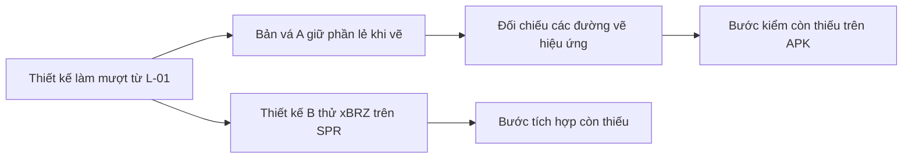

TÓM TẮT 1 [NGUỒN] Đã sửa bước A trong bản có sẵn qh7copy; patch thật tại qh7copy/L02/A-subpixel.patch, mặc định JX_L02_SUBPIXEL=0.\
TÓM TẮT 2 [NGUỒN] Giữ GL_LINEAR sẵn có; thêm chiếu float và giữ phần lẻ qua thân/tay/ngựa/bóng/state cùng đường vẽ glow/mask/occlusion; chưa xác minh runtime.\
TÓM TẮT 3 [NGUỒN] jxDrawBolts giữ nguyên bytes từ định nghĩa đến cuối file; KNpcResVN.cpp và glow.fsh/vsh khớp SHA-256 mốc cũ, giữ mã +6/+12/+15.\
TÓM TẮT 4 [CHƯA KIỂM] Java/Gradle không có trên PATH, JAVA_HOME chưa đặt; wrapper có sẵn nhưng chưa chạy, chưa build APK hoặc đo FPS/RAM 60/90.\
TÓM TẮT 5 [CHƯA KIỂM] B xBRZ mới có thiết kế, chưa tích hợp dependency/whitelist; trạng thái PARTIAL, chưa compile/test thiết bị, chưa commit/push. Trong R-07a chưa build, chạy exe hay VM.

# L-02 — Thử nghiệm tọa độ lẻ và thiết kế xBRZ

Loại: thiết kế
Chủ đề: Ghi bản vá thử A cho tọa độ lẻ, thiết kế B và các phép kiểm còn thiếu.
Từ khóa: tọa độ lẻ, làm mượt hình ảnh, hiệu ứng vũ khí, L-02, JX_L02_SUBPIXEL, GL_LINEAR, xBRZ, FPS
Trạng thái: PARTIAL — Báo cáo gốc đã giao bản vá A và thiết kế B. Chưa dựng hoặc chạy thử.
Độ phủ: đã phủ 6 trên tổng 9 hạng mục triển khai, thiết kế và kiểm chứng đã nêu trong báo cáo.
Liên quan: [L-01](L-01-lam-muot-hinh-anh.md), [L-03](L-03-quy-trinh-dung-apk.md), [J-05](J-05-cat-khung-animation.md), [H-14](H-14-mat-khung-hieu-ung.md).
Cần tôi quyết định: không

## Phạm vi và độ phủ

Tóm tắt dẫn từ báo cáo gốc. Đường dẫn source và tài liệu thử mới tương đối với bản A `D:/JX-build/qh9A`. Mã nguồn đối chiếu có cả UTF-8 và tệp giải mã được bằng GBK. Bản vá ở bản A được đọc qua các dòng chỉ tên tệp.

| Hạng mục | Độ phủ | Căn cứ và giới hạn |
|---|---|---|
| Công tắc A, FPS mục tiêu và sampler | Đã phủ | `L-02.md:65` và `L-02.md:66` ghi mốc cũ. Bản A có `Classes/L02RenderTrial.h:6` và `Classes/L02RenderTrial.h:9`. `Classes/AppDelegate.cpp:120` dùng mục tiêu FPS. Sampler ở `cocos2d/cocos/renderer/CCTexture2D.cpp:643`. |
| Phép chiếu float và API số nguyên | Đã phủ | `Classes/gamecore/KSubWorld.cpp:191` là bản float. API số nguyên ở `Classes/gamecore/KSubWorld.cpp:197`. |
| Tọa độ trong các đường vẽ sprite và hiệu ứng | Đã phủ | Hai hàm lấy texture tại `Classes/gamescene/KgameWorld.cpp:8186` và `Classes/gamescene/KgameWorld.cpp:8206`. Các nhánh vẽ liên quan tại `Classes/gamescene/KgameWorld.cpp:8791`, `Classes/gamescene/KgameWorld.cpp:9290` và `Classes/gamescene/KgameWorld.cpp:11494`. |
| Kiểm byte và hash hiệu ứng ở bản thử gốc | Đã phủ | `L-02.md:50` và `L-02.md:57` ghi kết quả cũ. Ở bản A, `Classes/vn/gamecore/KNpcResVN.cpp:517` và `Classes/gamescene/KgameWorld.cpp:15025` có đường tương ứng. Đối chiếu hash xem mục cuối. |
| Bản vá A và tài liệu thử | Đã phủ | Báo cáo gốc liệt kê ở `L-02.md:46` và `L-02.md:47`. Bản A có các tệp cùng tên tại `L02/A-subpixel.patch:1` và `L02/TRIAL_DESIGN.md:5`. |
| Thiết kế B, xBRZ 2× cho SPR | Đã phủ | `L-02.md:51` ghi điểm tích hợp dự kiến. `L02/TRIAL_DESIGN.md:13` và `L02/TRIAL_DESIGN.md:19` ghi thiết kế ở bản A. |
| Tích hợp thuật toán B và whitelist | Chưa phủ | `L-02.md:51` ghi chưa có diff thuật toán hoàn chỉnh. |
| Biên dịch, APK mẫu và kiểm tra shader | Chưa phủ | `L-02.md:81` ghi các phép thử còn thiếu. |
| Chất lượng ảnh, 60/90 FPS và RAM trên thiết bị | Chưa phủ | `L-02.md:72` ghi chưa đo. `L-02.md:81` ghi kế hoạch thử. |

## Bằng chứng và đầu ra

Chỉ ghi source và artefact thử trong D:/JX-wt/L-02/qh7copy cùng báo cáo này. Không tạo lại copy, không đọc/sửa các client khác. Nhánh worktree task/L-02; copy có Git riêng, sạch trước sửa, HEAD nền 74541a69859c5878bc4544af8a0aca9101926900. Prompt đọc từ file local, không có commit ghim được cung cấp.

- 5 file sửa: Classes/AppDelegate.cpp; Classes/gamecore/KSubWorld.cpp/.h; Classes/gamescene/KgameWorld.cpp/.h.
- Header mới: Classes/L02RenderTrial.h. Thiết kế A/B và đo: qh7copy/L02/TRIAL_DESIGN.md. Patch A đã áp dụng, gồm cả header mới, có thể review/hoàn tác riêng.
- KSubWorld.cpp:191 thêm overload float; API int gameplay/input giữ nguyên. KgameWorld.cpp:8186/8206 thêm wrapper float giữ metadata và cộng sai khác chiếu; :8791/9290/11494 đổi riêng biến tọa độ render sang typedef có công tắc. Phần đảo Y không gán ngược về int khi A bật.
- getIniDataForGame dùng chung tọa độ cho vẽ thường/glow/mask/occlusion. DrawPrimitives bao gồm bóng và các part, DrawPrimitives_State dùng cùng kiểu. Các đường render khác vẫn baseline; chưa xác nhận tất cả caller thực tế trong APK.
- KgameWorld.cpp:15025 jxDrawBolts và phần sau không đổi bytes so trước sửa; không thay g_jxAdditive hoặc logic shader/blend.
- B chưa có diff thuật toán xBRZ hoàn chỉnh. Điểm tích hợp dự kiến findinidata_one sau giải mã RGBA/trước upload (:378 nền); cần dependency/version/license, exact suffix .spr, whitelist/exclusion, key cache tách mode trước lookup, logical size/UV/crop, alpha và ngân sách fallback. PNG/JPG không được đi qua B.

SHA-256 giữ nguyên:

| File trong copy | SHA-256 |
|---|---|
| Classes/vn/gamecore/KNpcResVN.cpp | 69A2789ABB6BE0ACBE3F3DCAF0A72048894B5FA4651B1F3988DF157723DD6311 |
| Resources/Shaders/glow.fsh | A4574B1E5C769E05674D8777CDA25E494B4FC3A6125D34656EC655254CF56448 |
| Resources/Shaders/glow.vsh | 57A488145EA1031F9E5556D466B754D70B21D023B23085632ED3C94801820940 |

## SỔ THÔNG SỐ

| Thông số | Giá trị / trạng thái |
|---|---|
| A / FPS mặc định | OFF / 60; build thử bật JX_L02_SUBPIXEL=1, JX_L02_TARGET_FPS=60 hoặc 90, thống nhất toàn target |
| Sampler | GL_LINEAR có sẵn, CCTexture2D.cpp:643/649; không sửa engine |
| Design / policy | 1040 × 603,2; EXACT_FIT giữ nguyên; scaleX=W/1040, scaleY=H/603,2, vẫn có thể méo tỷ lệ |
| Chiếu A | Y×0,5 − top − Z×887/1024; camera left/top vẫn int, không nội suy tick |
| Glow +6/+12/+15 | s=0,35/0,65/1,0; giữ nguyên nguồn, chưa kiểm chứng hiển thị |
| Nhịp / ngân sách tính | 60/90 mục tiêu; 16,667/11,111 ms, không phải FPS đo |
| xBRZ B | 2× dự kiến, chưa triển khai; RGBA gốc=4wh, output=16wh, đồng thời=20wh byte chưa gồm scratch/cache |
| FPS/RAM thực | CHƯA ĐO, không có thiết bị/build chạy trong lượt này |
| APK dự kiến | jx-L02-A-60.apk, jx-L02-A-90.apk; B tương tự sau A đạt; chưa tạo, không dùng jx-qh7.apk |

## Kiểm chứng, lỗi và bước tiếp tục

Đã review diff; git diff --check đạt và git apply --reverse --check L02/A-subpixel.patch đạt (exit 0). Đây là kiểm tra patch, không phải compile. Git cảnh báo LF sẽ đổi CRLF khi Git ghi lại; không đổi Git config. Hash/byte so sánh chỉ chứng minh nguồn hiệu ứng giữ nguyên.

Lỗi đã xử lý: rg không có nên dùng PowerShell/Node; J-05.md/H-14.md không tồn tại nên đọc đúng J-05-cat-khung-animation.md/H-14-mat-khung-hieu-ung.md; một lệnh Filter nhận mảng sai kiểu được đổi sang Where-Object. Hai kiểm tra anchor thay thế phát hiện trùng chuỗi (hàm trong comment và indent substring), dừng trước ghi ở các lần lỗi rồi sửa anchor cụ thể và áp dụng thành công. Không có lỗi build vì chưa chạy build.

Theo J-05, SPR lấy frame từ tick nguyên nên float/90 FPS không khôi phục frame bị bỏ. Theo H-14, clip2 có thể bỏ lượt vẽ sét; A không sửa lỗi đó. Cần máy build Java/Android toolchain, build baseline/A 60/90 tên riêng; so neo/che lớp/lem viền nền sáng tối và +6/+12/+15, đo FPS/frame time/PSS cùng cảnh trước khi triển khai B. Chưa chạy compiler, shader validation, hồi quy hoặc đo thiết bị; không có tuyên bố PASS runtime.

Commit SHA mới: không có; chưa commit/push vì lượt này chỉ giao diff và thiết kế local, không có yêu cầu công bố. Không sửa exclude: Git ngoài ban đầu vẫn liệt kê qh7copy/ là untracked dù prompt nói đã exclude; không stage copy hoặc metadata .git của copy.

## Đã xác minh / Chưa xác minh

- **ĐÃ XÁC MINH** các mốc đọc tĩnh ghi trong bảng và đối chiếu SHA-256 của ba tệp hiệu ứng tại bản A với số liệu đã ghi trong báo cáo gốc.
- **CHƯA XÁC MINH** byte của phần đuôi `KgameWorld.cpp` ở bản thử gốc. Chưa biên dịch, chạy APK, kiểm shader hoặc đo ảnh và hiệu năng.

## Bàn giao

R-07a bàn giao phần chuẩn hóa và [chỉ mục](./_CHIMUC/R-07a.tsv). Việc thử thiết bị tiếp tục theo phần Kiểm chứng, lỗi và bước tiếp tục của báo cáo gốc.

## Phát hiện khi chuẩn hóa

- `JX_L02_SUBPIXEL` ở báo cáo gốc là `0` (`L-02.md:65`). Giá trị mặc định khi không được định nghĩa trước ở bản A là `1` (`Classes/L02RenderTrial.h:6`). `JX_L02_TARGET_FPS` mặc định ở bản A là `60` (`Classes/L02RenderTrial.h:9`). Chưa xác định cờ của APK đã dựng.
- SHA-256 của `Resources/Shaders/glow.fsh` và `Resources/Shaders/glow.vsh` bản A trùng hai giá trị đã ghi tại `L-02.md:58` và `L-02.md:59`. SHA-256 của `Classes/vn/gamecore/KNpcResVN.cpp` bản A khác giá trị cũ ở `L-02.md:57`. Kết quả giữ byte của lần thử gốc vẫn thuộc bản copy lúc đó.
