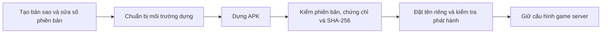

TÓM TẮT 1 [NGUỒN] Máy thật dựng được APK; mất khoảng vài chục phút ở mức ưu tiên BelowNormal.\
TÓM TẮT 2 [NGUỒN] APK ký bằng khóa debug trong `D:\Android\user` (cert SHA-256 bắt đầu `a48601f7…`). Không tạo khóa mới, không in/ghi mật khẩu, không commit khóa hay APK.\
TÓM TẮT 3 [NGUỒN] Cài đè cần: cùng package `com.jxclient.hoiuctruyenky`, cùng khóa, versionCode cao hơn (jx-qh7 = 17).\
TÓM TẮT 4 [NGUỒN] Luôn build từ BẢN COPY của `D:\JX-backup\Client-qh7`, không build trên `D:\Android\b\Client`.\
TÓM TẮT 5 [NGUỒN] Phát APK: đặt vào `D:\JX1_U003_build\serve` (cổng 8091 đã chạy sẵn trên địa chỉ Tailscale máy thật, không đụng forwarder 56722/51189). Trong R-07a chưa build, chạy exe hay VM.

# L-03 — Quy trình dựng APK client (17/11/2026)

Loại: công cụ
Chủ đề: Quy trình sao chép, dựng, kiểm tra và phát hành APK client.
Từ khóa: quy trình dựng APK, bản sao client, ký APK, L-03, Gradle, versionCode, applicationId, arm64-v8a
Trạng thái: DONE — Đã ghi quy trình dùng trên máy thật theo báo cáo gốc.
Độ phủ: đã phủ 7 trên tổng 8 hạng mục, gồm bảy bước quy trình và một phép thử tái lập.
Liên quan: [L-02](L-02.md), [L-01](L-01-lam-muot-hinh-anh.md), [Tối ưu 120 FPS](../DESIGN/TOI-UU-120FPS.md).
Cần tôi quyết định: không

## Phạm vi và độ phủ

Tóm tắt dẫn từ báo cáo gốc. Bảy bước lấy theo mục Các bước. Đường dẫn cấu hình đối chiếu mới tương đối với bản A `D:/JX-build/qh9A` và đọc được ở UTF-8. Thông tin dựng và phát hành tại máy thật dẫn từ báo cáo gốc.

| Hạng mục | Độ phủ | Căn cứ và giới hạn |
|---|---|---|
| 1. Tạo bản sao và tăng số phiên bản | Đã phủ | `L-03-quy-trinh-dung-apk.md:42`. Bản A có `applicationId` tại `proj.android/app/build.gradle:10` và `versionCode` tại `proj.android/app/build.gradle:13`. |
| 2. Chuẩn bị môi trường | Đã phủ | `L-03-quy-trinh-dung-apk.md:43`. Môi trường và cấu hình ký lần dựng cũ chưa đối chiếu trong R-07a. |
| 3. Dựng và nhận diện tệp APK | Đã phủ | `L-03-quy-trinh-dung-apk.md:44` đến `L-03-quy-trinh-dung-apk.md:46`. Bản A khai báo Gradle 8.7 ở `proj.android/gradle/wrapper/gradle-wrapper.properties:4` và đọc tham số ABI ở `proj.android/app/build.gradle:54`. |
| 4. Kiểm phiên bản, chứng chỉ và SHA-256 | Đã phủ | `L-03-quy-trinh-dung-apk.md:47`. Các thao tác được mô tả trong quy trình. Chưa đọc APK trong R-07a. |
| 5. Đặt tên riêng và đưa vào thư mục phát hành | Đã phủ | `L-03-quy-trinh-dung-apk.md:48`. Bằng chứng là quy trình gốc. |
| 6. Kiểm tra phát hành | Đã phủ | `L-03-quy-trinh-dung-apk.md:49`. Giữ dẫn chiếu tới quy trình gốc. Chưa kiểm tra qua mạng. |
| 7. Giữ cấu hình máy chủ game | Đã phủ | `L-03-quy-trinh-dung-apk.md:50`. Đây là yêu cầu của quy trình gốc. |
| Tái lập bản dựng trên máy khác | Chưa phủ | `L-03-quy-trinh-dung-apk.md:55` ghi chưa kiểm tra. |

## Các bước
1. Sao chép: `robocopy <bản vá> D:\JX-build\<tên> /E /XD .git`. Sửa `proj.android\app\build.gradle`: `versionCode` lớn hơn 17.
2. Biến môi trường (chỉ trong phiên): `JAVA_HOME=D:\Android\jdk`, `ANDROID_HOME=D:\Android\sdk`, `ANDROID_USER_HOME=D:\Android\user` (bắt buộc, nếu thiếu Gradle tạo khóa mới và cài đè hỏng), `GRADLE_USER_HOME=D:\Android\gradle`, `GRADLE_OPTS=-Xmx512m`.
3. Build từ `<bản copy>\proj.android`:
   `D:\Android\gradle-8.7\bin\gradle.bat assembleDebug --offline --no-daemon -PPROP_APP_ABI=arm64-v8a -Dorg.gradle.jvmargs=-Xmx12g`
   Đặt `PriorityClass=BelowNormal` cho tiến trình. Kết quả: `app\build\outputs\apk\debug\projectdebug-debug.apk`. Chú ý: thư mục `build` được copy theo, nên kiểm tra thời gian file, tránh lấy nhầm bản cũ.
4. Kiểm tra: `aapt2 dump badging` (versionCode), `apksigner verify --print-certs` (cert `a48601f7…`), ghi SHA-256.
5. Đổi tên riêng (vd `jx-qh9-smooth-A.apk`), chép vào `D:\JX1_U003_build\serve`. Không ghi đè `jx-qh7.apk`.
6. Link: `http://100.95.186.86:8091/<tên>.apk` (chỉ điện thoại Tailscale `100.123.183.6` vào được).
7. Máy chủ APK trỏ tới: giữ nguyên cấu hình client qh7 (chưa đổi `package.ini`).

## Lưu ý
- Mã nguồn client là GBK: vá bằng Python latin-1 với mỏ neo duy nhất.
- Hoàn tác bản vá L-02: `git apply -R L02/A-subpixel.patch`.
- Chưa kiểm tra: build lại khi xây từ máy khác.

## Đã xác minh / Chưa xác minh

- **ĐÃ XÁC MINH** đủ bảy bước trong tài liệu cũ và các khai báo ứng với package, `versionCode`, Gradle và ABI của bản A.
- **CHƯA XÁC MINH** kết quả dựng lại trên máy khác, cài đè, chứng chỉ APK và đường phát hành trong lượt này.

## Bàn giao

R-07a bàn giao phần chuẩn hóa và [chỉ mục](./_CHIMUC/R-07a.tsv). Tài liệu gốc vẫn ghi mốc của lần dựng ngày 17/11/2026.

## Phát hiện khi chuẩn hóa

- `versionCode` của bản A là `20` tại `proj.android/app/build.gradle:13`. Mốc `17` trong tóm tắt và bước 1 được báo cáo cũ ghi cho APK `jx-qh7`. Cặp số này thuộc hai đối tượng khác nhau.
- Yêu cầu `arm64-v8a` ở lệnh dựng gốc (`L-03-quy-trinh-dung-apk.md:45`) là tham số của lần dựng. `proj.android/gradle.properties:37` ở bản A liệt kê các ABI mặc định của dự án.
