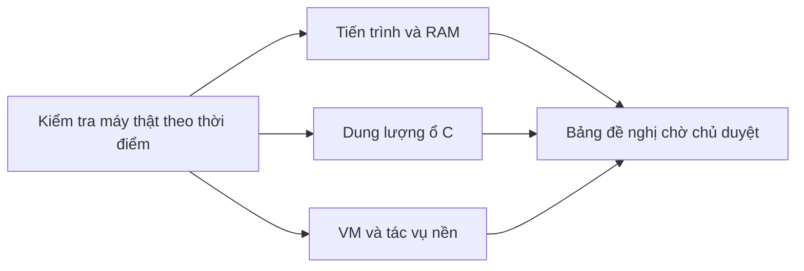

TÓM TẮT 1 [NGUỒN] RAM: tổng working set ~16 GB (máy thật; WMI lỗi nên không đọc được tổng RAM vật lý). Nhóm lớn: Chrome 24 tiến trình ~4,7 GB; Claude desktop + Claude Code 16 tiến trình ~3,1 GB; ChatGPT/Codex app 12 tiến trình ~1,1 GB; Memory Compression ~1 GB; codex (worker) 8 tiến trình ~0,8 GB; node 11 ~0,45 GB; VBoxHeadless 6 ~0,14 GB.\
TÓM TẮT 2 [NGUỒN] Hai VM đang chạy: JX-Server-D (VM chính) và JX-Test-36 (VM thử). Hợp lệ theo quy tắc hiện tại (Q-18/Q-19), không phải VM cũ JX-Server.\
TÓM TẮT 3 [NGUỒN] Ổ C: 476 GB, trống 138 GB. Lớn nhất: LDPlayer 21,4 GB, Thùng rác 20 GB, Temp\claude 9,5 GB, Documents\SHAREit 9,6 GB, Downloads (ISO Win10 5,7 GB), C:\Jx1CocoV3 14,2 GB, C:\JX1 10 GB, Chrome data 4,7 GB.\
TÓM TẮT 4 [NGUỒN] Tự khởi động đáng ngờ về tốn tài nguyên: Run key có Steam, RiotClient, Grass, IDMan, CocCoc, Iriun Webcam, UniKey, OSLink; dịch vụ không phải Windows: CloudflareWARP, MySQL57, Sentinel x3, SHAREit, UltraViewer, HP Print Scan Doctor, Foxit x2, Corel.\
TÓM TẮT 5 [NGUỒN] Không thấy tiến trình codex mồ côi của task đã giết: mọi tiến trình codex của worker đều thuộc một task đang chạy (8 tiến trình; 2 tiến trình cũ từ 16/11 và ChatGPT/Codex app 15/11 là của app, không phải worker). Trong R-07a chưa build, chạy exe hay VM.

# M-01 — Kiểm tra máy thật: tiến trình ẩn, RAM, ổ C (17/11/2026 13:35)

Loại: khảo sát
Chủ đề: Kiểm tra tiến trình nền, bộ nhớ, dung lượng ổ C và các mục tự khởi động trên máy thật.
Từ khóa: máy thật, tiến trình nền, bộ nhớ, ổ C, M-01, Get-Process, Working Set, WMI, Task Scheduler
Trạng thái: PARTIAL — Báo cáo gốc có số liệu theo thời điểm đo và còn bốn nhóm chưa kiểm tra.
Độ phủ: đã phủ 7 trên tổng 11 nhóm kiểm tra có trong báo cáo gốc.
Liên quan: [M-02](M-02.md), [Môi trường thật](../ENVIRONMENT.md).
Cần tôi quyết định: có

## Phạm vi và độ phủ

Tóm tắt dẫn từ báo cáo gốc. Các nhóm dưới đây lấy từ tóm tắt, bảng đề nghị và mục Chưa kiểm tra của M-01. Số liệu lịch sử lấy từ báo cáo UTF-8. R-07a chưa đối chiếu với dữ liệu đo gốc của máy thật.

| Hạng mục | Độ phủ | Căn cứ và giới hạn |
|---|---|---|
| RAM theo Working Set | Đã phủ | `M-01-kiem-tra-may-that.md:1` ghi tổng ước tính và các nhóm tiến trình tại thời điểm đo. |
| Trạng thái VM và phần tiến trình host nhìn thấy | Đã phủ | `M-01-kiem-tra-may-that.md:2` ghi hai VM. `M-01-kiem-tra-may-that.md:68` nêu giới hạn về RAM. |
| Ổ C và các thư mục lớn đã ghi | Đã phủ | `M-01-kiem-tra-may-that.md:3` và bảng đề nghị từ `M-01-kiem-tra-may-that.md:50`. |
| Mục tự khởi động Run | Đã phủ | `M-01-kiem-tra-may-that.md:4` và `M-01-kiem-tra-may-that.md:59`. |
| Dịch vụ ngoài Windows | Đã phủ | `M-01-kiem-tra-may-that.md:4` và `M-01-kiem-tra-may-that.md:61`. |
| Tiến trình Codex mồ côi | Đã phủ | `M-01-kiem-tra-may-that.md:5` ghi kết quả lần kiểm lịch sử. |
| Tác vụ đặt lịch của JX | Đã phủ | `M-01-kiem-tra-may-that.md:62` và `M-01-kiem-tra-may-that.md:63`. |
| RAM vật lý và Private Bytes | Chưa phủ | `M-01-kiem-tra-may-that.md:66` ghi lỗi WMI. |
| Kích thước hiberfil và pagefile | Chưa phủ | `M-01-kiem-tra-may-that.md:67` ghi không đọc được. |
| RAM VM dùng thật | Chưa phủ | `M-01-kiem-tra-may-that.md:68` phân biệt phần tiến trình host và lượng dùng thật của VM. |
| Chi tiết 20 thư mục lớn bên trong Program Files | Chưa phủ | `M-01-kiem-tra-may-that.md:69` chỉ ghi tổng dung lượng của hai thư mục Program Files. |

Chỉ đọc/đo, không tắt, gỡ hay xóa gì. Không đưa PID hay khóa vào báo cáo. Mọi con số bên dưới là đo lúc 13:30-13:35.

## Bảng đề nghị (chủ duyệt từng mục; chưa làm gì)
| Mục | Đang làm gì | RAM/Dung lượng | An toàn tắt/gỡ? | Cách tắt/gỡ | Rủi ro |
|---|---|---|---|---|---|
| Temp\claude (bộ đệm phiên Claude Code) | file tạm/đầu ra tác vụ nền | 9,5 GB | HỎI (chỉ sau khi đóng phiên) | xóa thư mục con cũ khi không có phiên | phiên đang mở có thể mất đầu ra tác vụ |
| Documents\SHAREit | thư mục nhận file SHAREit | 9,6 GB | HỎI (có thể là dữ liệu của chủ) | chủ xem rồi xóa/dời sang D | mất file nếu không sao lưu |
| Downloads\Win10_22H2 ISO | ảnh cài Windows | 5,7 GB | HỎI | dời sang D | cần lại nếu dựng VM mới |
| Thùng rác ổ C | file đã xóa | 20 GB | CÓ (chủ quyết) | Empty Recycle Bin | xóa vĩnh viễn |
| LDPlayer | giả lập Android | 21 GB | KHÔNG (đang dùng test) | giữ | dự án dùng |
| C:\Jx1CocoV3 | kho làm việc chính | 14,2 GB | KHÔNG | giữ | - |
| C:\JX1 | bản cũ/dữ liệu JX | 10 GB | HỎI | xem nội dung rồi dời sang D | chưa rõ nội dung |
| Chrome data (AppData\Local\Google) | hồ sơ/trình duyệt | 4,7 GB | HỎI | Chrome > xóa dữ liệu duyệt | đăng xuất site |
| CocCoc | trình duyệt Cốc Cốc + task cập nhật | 2,1 GB + tự chạy | CÓ nếu không dùng | gỡ ứng dụng hoặc tắt khởi động cùng Windows | mất hồ sơ Cốc Cốc |
| Steam, RiotClient, Grass, IDMan, Iriun, UniKey, OSLink (Run) | tự mở khi đăng nhập | Iriun 157 MB đang chạy | CÓ (tắt khởi động cùng Windows) | Task Manager > Startup > Disable | mất tiện ích khi không mở tay; Grass là app chia sẻ băng thông, nên rà lại |
| MySQL57 (dịch vụ) | cơ sở dữ liệu | chưa đo | HỎI (có thể dự án cần) | đặt Manual | nếu client/server dùng thì hỏng |
| Sentinel x3, Corel, Foxit x2, HP Doctor, SHAREit, CloudflareWARP, UltraViewer | dịch vụ nền của phần mềm khác | nhỏ | HỎI từng mục | đặt Manual | UltraViewer/WARP có thể đang dùng để điều khiển từ xa |
| Task Scheduler JX-*: ADMIN-firewall/kill-test-vm/service/trustedhosts | tác vụ ADMIN của dự án (đang Ready) | không | KHÔNG | giữ | dùng cho vận hành |
| Task JX-codex-<ID> | worker Codex | ~100 MB mỗi worker | KHÔNG khi đang chạy | tự gỡ khi task xong | - |

## Chưa kiểm tra
- Tổng RAM vật lý và RAM theo Private Bytes chính xác (WMI lỗi; dùng Get-Process).
- Kích thước hiberfil/pagefile (không đọc được bằng Get-Item).
- VBoxHeadless dùng RAM của VM thật (chỉ thấy phần tiến trình máy chủ; RAM cấp cho VM do VirtualBox giữ, đo bằng `VBoxManage showvminfo` nếu cần).
- Chi tiết top 20 thư mục trong Program Files (47 GB) và Program Files (x86) (17,7 GB).
- Hoàn tác: các thay đổi trên đều chưa làm; khi làm sẽ ghi lệnh hoàn tác cạnh từng mục.

## Đã xác minh / Chưa xác minh

- **ĐÃ XÁC MINH** các mục và giới hạn được ghi trong M-01.
- **CHƯA XÁC MINH** số liệu độc lập hoặc trạng thái máy và VM hiện tại. R-07a chỉ đọc báo cáo và không kiểm lại máy thật.

## Bàn giao

R-07a bàn giao phần chuẩn hóa và [chỉ mục](./_CHIMUC/R-07a.tsv). Các đề nghị trong M-01 vẫn chờ chủ duyệt từng mục.

## Phát hiện khi chuẩn hóa

- Tổng Working Set ở dòng tóm tắt 1 và RAM vật lý trong mục Chưa kiểm tra là hai đại lượng khác nhau. M-01 ghi thiếu số đo RAM vật lý và Private Bytes do lỗi WMI.
- Nhóm ổ C có số đo dung lượng tổng và ghi nhận một số thư mục. Chi tiết 20 thư mục bên trong Program Files còn thiếu ở `M-01-kiem-tra-may-that.md:69`.
