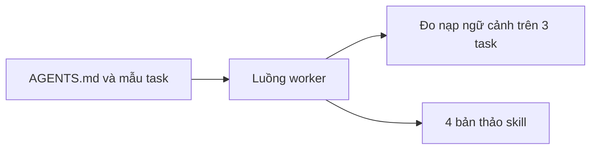

## TÓM TẮT 5 DÒNG

1. PARTIAL [NGUỒN]: đã sửa AGENTS.md và mẫu task; sandbox chặn tạo skill trong `.agents/skills`.
2. [NGUỒN] Đã bỏ đọc STATE mặc định, bỏ chặn do thiếu backlog_ref, làm rõ quyền commit/push và mốc 5–10 phút.
3. [NGUỒN] Có bốn bản thảo skill ngắn bên dưới để PM triển khai; không sửa mã game, không ghi khóa.
4. [NGUỒN] Đo nạp ngữ cảnh trên I-06/H-09/L-01: 6 xuống 5 lần đọc, giảm 10.732 ký tự mỗi ca; [CHƯA KIỂM] chưa đo token hoặc thời gian toàn task.
5. [NGUỒN] BỊ CHẶN – CHƯA PUSH: Git không tạo được index.lock; chưa có SHA, PM cần triển khai skill và commit trong môi trường có quyền. Giới hạn: không chạy build/test game, exe hoặc VM.

# M-02 — Tăng tốc worker Codex
Loại: công cụ
Chủ đề: Điều chỉnh hướng dẫn và mẫu task để worker Codex nạp ngữ cảnh gọn hơn.
Từ khóa: worker Codex, JX1, AGENTS.md, _MAU-TASK.md, backlog_ref, STATE, skill, commit, push
Trạng thái: PARTIAL — báo cáo gốc chưa đo token/toàn task và lần commit ban đầu bị chặn.
Độ phủ: đã phủ 9/13 hạng mục tài liệu, bản thảo và phép đo; 4/13 chưa phủ gồm token, thời gian toàn task, hành vi worker và commit lịch sử.
Liên quan: JX1_OPS/REPORTS/I-06.md, JX1_OPS/REPORTS/H-09.md, JX1_OPS/REPORTS/L-01-lam-muot-hinh-anh.md, JX1_OPS/REPORTS/I-02-vat-pham-ban.md, JX1_OPS/REPORTS/H-10-phim-tat-thanh-nut.md
Cần tôi quyết định: không



## Phạm vi và độ phủ

| Phần tử phạm vi | Độ phủ trong báo cáo gốc | Đối chiếu R-07b |
|---|---|---|
| Quy tắc `AGENTS.md` | Đã phủ | Quy tắc hiện tại có thật: `AGENTS.md:7-18`; không chạy lại phép đo cũ |
| Mẫu `JX1_OPS/TASKS/_MAU-TASK.md` | Đã phủ | Các trường/quy tắc có thật: `JX1_OPS/TASKS/_MAU-TASK.md:10-33` |
| Bản thảo `jx1-read-server` | Đã phủ bản thảo | Tệp hiện có: `.agents/skills/jx1-read-server/SKILL.md:1`; không suy trạng thái cài tại thời điểm M-02 |
| Bản thảo `jx1-read-client` | Đã phủ bản thảo | Tệp hiện có: `.agents/skills/jx1-read-client/SKILL.md:1`; không suy trạng thái cài tại thời điểm M-02 |
| Bản thảo `jx1-report` | Đã phủ bản thảo | Tệp hiện có: `.agents/skills/jx1-report/SKILL.md:1`; không suy trạng thái cài tại thời điểm M-02 |
| Bản thảo `jx1-parameters` | Đã phủ bản thảo | Tệp hiện có: `.agents/skills/jx1-parameters/SKILL.md:1`; không suy trạng thái cài tại thời điểm M-02 |
| Ca đo nạp ngữ cảnh I-06 | Đã phủ | Giữ số đo ở bảng ba task bên dưới; báo cáo `JX1_OPS/REPORTS/I-06.md` tồn tại; chưa đo lại |
| Ca đo nạp ngữ cảnh H-09 | Đã phủ | Giữ số đo ở bảng ba task bên dưới; báo cáo `JX1_OPS/REPORTS/H-09.md` tồn tại; chưa đo lại |
| Ca đo nạp ngữ cảnh L-01 | Đã phủ | Giữ số đo ở bảng ba task bên dưới; báo cáo `JX1_OPS/REPORTS/L-01-lam-muot-hinh-anh.md` tồn tại; chưa đo lại |
| Usage token thực | Chưa phủ | Báo cáo gốc ghi chưa đo; không dùng số ký tự thay token |
| Thời gian toàn task | Chưa phủ | Báo cáo gốc chỉ đo nạp ngữ cảnh |
| Hành vi/độ chính xác worker | Chưa phủ | Chưa có phiên đối chứng trước/sau toàn task |
| Stage/commit lần M-02 | Chưa phủ | Giữ lỗi quyền `index.lock` lịch sử và trạng thái PARTIAL |

Mã hóa báo cáo: UTF-8 không BOM. Bảng này kiểm kê tài liệu/bản thảo và các ca đo đã nêu trong M-02, không mở rộng thành khảo sát server/client hay đo lại benchmark.

## ĐÃ XÁC MINH

- Đọc task `JX1_OPS/TASKS/M-02.md` và prompt `D:\JX-wt\M-02.prompt.txt` một lần; task không ghim commit. Git ban đầu đúng `task/M-02`, chỉ có `?? JX1_OPS/TASKS/M-02.md`; giữ nguyên và không stage file giao việc này.
- Chỉ sửa `AGENTS.md`, `JX1_OPS/TASKS/_MAU-TASK.md` và báo cáo này. Các prompt ngoài worktree chỉ đọc.
- Đã đọc `skill-creator` tại `C:/Users/PC/.codex/skills/.system/skill-creator/SKILL.md`; thiết kế mỗi skill một việc, không thêm helper script, hook hoặc cấu hình.

### Vấn đề tìm thấy và cách sửa

| Vấn đề trước sửa / bằng chứng | Xử lý trong phạm vi |
|---|---|
| Mẫu cũ buộc có backlog_ref và kiểm STATE; task thật I-06/H-09/M-02 không có backlog_ref | `JX1_OPS/TASKS/_MAU-TASK.md:10`: trường tùy chọn; `:23`: STATE chỉ đọc khi có quyết định được dẫn/mâu thuẫn. Không bỏ yêu cầu giải mâu thuẫn thật |
| AGENTS cũ có câu giới hạn resume 5–10 phút, đồng thời yêu cầu hoàn tất toàn phạm vi | `AGENTS.md:15`: mốc thiết kế công việc, không phải hạn buộc bỏ dở; vẫn dừng khi ngoài quyền/rủi ro/blocker |
| Phạm vi mẫu chưa bao gồm đường dẫn báo cáo rõ ràng; quyền commit dễ bị suy thành push | Mẫu mới liệt kê báo cáo trong vùng được sửa, quyền build/test/kết nối/commit/push riêng |
| Prompt I-06/H-09 dòng 1 chứa root cũ `D:\jx1-ops-wt` nhưng đã đính chính ngay thành worktree riêng | Mẫu mới dùng root task hiện tại; không sửa prompt ngoài worktree, không coi đoạn cảnh báo root cũ là lệnh thực thi |
| Prompt L-01 dòng 1 yêu cầu nháp mỗi 15 phút; AGENTS yêu cầu một báo cáo cuối | Giữ checkpoint vào cùng file nếu task yêu cầu; không sinh báo cáo/commit từng bước. Không sửa prompt chỉ đọc |
| Mẫu dùng L0–L5/active, task gần đây dùng green/doing/done | Không ép chuyển trạng thái/mức cũ; mức không tự cấp quyền |
| Bản chuẩn cũ liệt kê nhiều tài liệu dễ bị nạp hết mỗi task | AGENTS mới chỉ đọc theo nhu cầu, kiểm file tồn tại, không tự tìm repo khác; không khẳng định đường dẫn chuẩn thiếu khi chưa kiểm |
| Bản đồ số dòng gần đúng, Graphify có thể cũ/trích thiếu | Draft skill buộc kiểm file thật/dòng hiện tại trước kết luận, không tự update graph/cài hook |

AGENTS đã rút từ 31 xuống 27 dòng, giữ rào chắn exe/VM/snapshot/Admin/bảo mật/local và quy tắc không vượt quyền. Chi tiết vận hành vẫn ở AGENTS vì chưa thể tạo tài liệu tham chiếu trong `.agents`; không để liên kết tới skill chưa tồn tại.

### Đo trước/sau trên 3 task thật — chỉ bước nạp ngữ cảnh

Phép đo trực tiếp bằng `Diagnostics.Stopwatch` và `Get-Content -Encoding UTF8`, một lượt mỗi ca mỗi phía, cùng phiên máy; không tạo script benchmark. Đầu vào mỗi ca: prompt thật, task thật và 35 dòng đầu báo cáo tương ứng. Trước sửa nạp thêm AGENTS cũ, mẫu cũ và STATE/QUYET-DINH theo yêu cầu mẫu cũ; sau sửa nạp AGENTS/mẫu mới, bỏ STATE vì các ca này không dẫn quyết định cụ thể. Không thực thi lại công việc game hoặc sửa đầu ra ba task.

| Task / báo cáo thật | Trước: ms / lần đọc / ký tự | Sau: ms / lần đọc / ký tự | Token trước/sau |
|---|---|---|---|
| I-06 / REPORTS/I-06.md | 84,062 / 6 / 20.643 | 70,268 / 5 / 9.911 | Chưa đo / chưa đo |
| H-09 / REPORTS/H-09.md | 4,292 / 6 / 20.289 | 3,866 / 5 / 9.557 | Chưa đo / chưa đo |
| L-01 / REPORTS/L-01-lam-muot-hinh-anh.md | 4,339 / 6 / 26.247 | 3,910 / 5 / 15.515 | Chưa đo / chưa đo |

Số ký tự là độ dài chuỗi Unicode đã ghép, không phải token; mức giảm lần lượt khoảng 52,0%, 52,9%, 40,9%. Thời gian là I/O và ghép chuỗi, có nhiễu khởi động/cache, không chứng minh worker/model nhanh hơn. Chưa có usage token và phiên chạy đối chứng trước/sau toàn task; không cài tokenizer hay đổi model. Các draft skill chưa được nạp trong phép đo vì chưa triển khai; chưa thể tính chi phí skill hoặc lợi ích hành vi. Đây là phần đo còn thiếu của M-02, không nhận DONE toàn task.

Đối chiếu tài liệu thật mà tóm tắt dẫn tới: đã mở `JX1_OPS/REPORTS/I-02-vat-pham-ban.md:31` (2.644 ô/474 ID), `JX1_OPS/REPORTS/H-10-phim-tat-thanh-nut.md:3` (3 ô). Đã đọc báo cáo L-01 thật có đường dẫn root và dẫn source Cocos; không mở source game để xác nhận lại kết luận client, không biến dẫn lại thành kiểm chứng runtime.

## CHƯA XÁC MINH

- Bốn skill chưa tồn tại/chưa được discovery hoặc `quick_validate.py` kiểm; sandbox từ chối ghi `.agents/skills`. Nội dung dưới là bản thảo, không phải skill đã cài.
- Chưa đo token thực, thời gian hoàn tất toàn task, hành vi worker trước/sau hoặc độ chính xác runtime. PM cần cho chạy đối chứng 2–3 task sau khi triển khai, ghi usage token/thời gian/lần đọc thực từ session.
- Không chạy build/test game, exe, VM, Graphify update, mạng hoặc push; task chỉ cho sửa tài liệu/prompt/skill. Nguồn vị trí Graphify là `JX1_OPS/TOOLS/CONG-CU.md:9`, không phải kiểm tra graph hiện tại.

## Bản thảo skill để PM triển khai

Mỗi khối lưu thành đường dẫn được ghi khi môi trường cho phép. Không tự tạo thư mục thay thế để lách chặn `.agents`. Không cần file tham chiếu vận hành riêng ở phiên này.

### .agents/skills/jx1-read-server/SKILL.md

```markdown
---
name: jx1-read-server
description: Định vị và đọc source server JX1 cho câu hỏi tĩnh qua GS001 và Graphify có sẵn; không tự build hay chạy server.
---
# Đọc server JX1
- Lấy root/version từ task; không mặc định bản đồ là bản đang chạy.
- Đọc mục liên quan trong JX1_OPS/CONTEXT-PACK/GS001-MAP.md; dòng chỉ là gợi ý.
- Cần caller/callee: tra phần liên quan trong <root>/graphify-out/GRAPH_REPORT.md hoặc
  graph.json đúng root. Xem dòng Graphify tại JX1_OPS/TOOLS/CONG-CU.md nếu cần vị trí/hạn chế.
  Không tự update graph, cài hook, sửa CLAUDE.md hoặc tạo lại graph trong task chỉ đọc.
- Graph có thể cũ/trích thiếu do encoding/cú pháp. Thiếu thì dùng rg -n giới hạn thư mục;
  thiếu rg báo một lần, dùng Select-String, không cài. Không đọc toàn graph/source.
- Mở file thật ở root được giao, kiểm symbol và dòng hiện tại, lần caller/callee cần thiết.
  Tóm tắt/cạnh graph không thay bằng chứng source.
- Trả root/version + file:dòng + symbol + giới hạn. Không suy runtime từ source;
  build/exe/VM/sửa mã cần quyền task, skill không cấp quyền.
```

### .agents/skills/jx1-read-client/SKILL.md

```markdown
---
name: jx1-read-client
description: Đọc source client JX1/Cocos theo root task để giải thích UI, render hoặc gamecore; không tự build APK hay chạy client.
---
# Đọc client JX1
- Ghi root/version task cho phép. Folder/Client2912... và D:\Android\b\Client là hai
  nguồn khác nhau, không thay thế lẫn nhau. Root thiếu thì tra task/nguồn được dẫn;
  vẫn không rõ thì hỏi, không quét ổ đĩa.
- Tìm đúng symbol trong Classes/gameui, gamescene, gamecore hoặc engine; chỉ sang Cocos
  khi cần chứng minh API/framework.
- Có Graphify đúng root thì tra phần liên quan graphify-out/GRAPH_REPORT.md hoặc graph.json;
  dòng Graphify ở JX1_OPS/TOOLS/CONG-CU.md là gợi ý lịch sử. Không tự update/cài hook.
- Dùng rg -n giới hạn thư mục; thiếu báo một lần, dùng Select-String, không cài.
  Mở file thật tóm tắt/graph trỏ tới, kiểm symbol, caller và dòng hiện tại.
- Tách active code/comment, mặc định/source và giá trị lưu/runtime, source trên đĩa/APK cài.
  FPS/RAM, ACK, chất lượng ảnh chưa đo phải ghi CHUA XAC MINH.
- Trả root + file:dòng + symbol; build/APK/LDPlayer/VM/exe/sửa mã cần quyền cụ thể từ task.
```

### .agents/skills/jx1-report/SKILL.md

```markdown
---
name: jx1-report
description: Viết báo cáo cuối task JX1 đúng đường dẫn với tóm tắt 5 dòng, mức xác minh và bàn giao commit; không tự gửi thông báo ngoài.
---
# Báo cáo cuối JX1
- Chỉ ghi đường dẫn task/prompt; không tự sửa task/BAI_HOC hoặc báo cáo từng bước.
- TOM TAT 5 DONG: đúng 5 dòng nêu (1) trạng thái/phạm vi, (2) kết quả,
  (3) đầu ra, (4) chưa xác minh/test/blocker, (5) SHA/push hoặc lý do và bước PM cần làm.
- DA XAC MINH: file:dòng, symbol/lệnh, kết quả thực; nguồn gián tiếp ghi báo cáo dẫn lại.
  Kiểm file thật tóm tắt dẫn tới trong vùng được đọc; thiếu/ngoài quyền ghi chưa đối chiếu.
- CHUA XAC MINH: giới hạn, test/build chưa chạy, lý do. Khảo sát có MUC SO THONG SO
  (jx1-parameters) và DE XUAT TOI UU. Chấp nhận tên mục có dấu tương đương ở báo cáo cũ.
- Gộp mọi lỗi/cách thử/kết quả/nguyên nhân/bước tiếp tục; tối đa 3 lần/cùng lỗi.
  Trạng thái DONE/PARTIAL/BLOCKED/FAILED đúng phạm vi đã đạt, không bịa số đo/runtime.
- Chỉ stage/commit/push khi task yêu cầu; chọn đúng file. SHA có sau commit ghi phản hồi cuối,
  không vòng amend để ghi SHA của chính báo cáo. Push cần bằng chứng GitHub.
- Git bị chặn: giữ local, ghi BỊ CHẶN – CHƯA PUSH, lỗi thật, chưa có SHA, việc PM cần làm;
  không đổi quyền/credential/config hoặc tự gửi tin ngoài.
```

### .agents/skills/jx1-parameters/SKILL.md

```markdown
---
name: jx1-parameters
description: Ghi sổ thông số trong báo cáo khảo sát JX1 với giá trị, đơn vị, nguồn và mức đổi an toàn; không sửa cấu hình hoặc mã game.
---
# Ghi sổ thông số JX1
Thêm vào đúng báo cáo task, không tự tạo sổ/file khác:
## MUC SO THONG SO
| Nhóm | Tên/hằng số | file:dòng | Giá trị | Đơn vị | Ảnh hưởng | Đổi an toàn (CÓ/CẨN THẬN/KHÔNG) | Nguồn đo |
|---|---|---|---|---|---|---|---|
- Chỉ ghi thông số liên quan; kiểm file thật/dòng hiện tại mà map/tóm tắt dẫn tới.
  Thiếu file/quyền thì ghi nguồn gián tiếp, CHUA XAC MINH, không đoán.
- Tách mặc định source/cấu hình/dữ liệu mẫu/số đo runtime. Nguồn đo ghi đọc tĩnh hoặc
  lệnh/điều kiện đo thực chạy; chưa đo ghi chưa đo, không dùng 0 thay dữ liệu thiếu.
- Giữ đơn vị/phạm vi/version; suy đổi ghi công thức và giả định (tick sang giây…).
- CÓ cần bằng chứng giới hạn và kiểm an toàn; chưa đủ dùng CẨN THẬN.
  Đánh giá không cấp quyền sửa/chạy; không ghi khóa/mật khẩu/truy cập nội bộ.
```

## MUC SO THONG SO

| Nhóm | Tên/hằng số | file:dòng | Giá trị | Đơn vị | Ảnh hưởng | Đổi an toàn | Nguồn đo |
|---|---|---|---|---|---|---|---|
| Worker | Mốc đơn vị việc | AGENTS.md:15 | 5–10 | phút | Thiết kế task, không buộc bỏ dở | CẨN THẬN | Đọc tĩnh quy tắc |
| Worker | Giới hạn thử cùng lỗi | AGENTS.md:16 | 3 | lần | Không thử vô hạn/vượt quyền | KHÔNG | Đọc tĩnh quy tắc |
| Đo ngữ cảnh | Đọc file trước/sau | M-02, bảng đo bên trên | 6/5 | lần/ca | Bỏ STATE mặc định | CẨN THẬN | PowerShell Stopwatch/Get-Content |

## DE XUAT TOI UU

- PM triển khai bốn skill từ bản thảo trên tại đúng `.agents/skills`, chạy validator của skill-creator, rồi kiểm discovery và bổ sung link trực tiếp trong AGENTS.
- Đo lại toàn task với cùng input/version/model và quyền; ghi token thực, thời gian và số lần đọc từ session, không dùng ký tự hoặc ms I/O làm kết quả thay thế.
- Giữ prompt khởi chạy ngắn, dùng root/branch từ task, không thêm đọc STATE/backlog/workflow toàn bộ; không sửa các prompt cũ chỉ để xóa lời cảnh báo đường dẫn đã được đính chính.

## Lỗi, kiểm tra và bàn giao PM

- `rg : The term 'rg' is not recognized ...`: một lần; dùng Select-String/Get-ChildItem cục bộ, không cài.
- Đọc AGENTS lần đầu thiếu `-Encoding UTF8` làm console hiển thị sai dấu; đọc lại UTF-8 thành công, không coi là file hỏng. Truy vấn thư mục `.agents` và `docs-analysis` báo `Cannot find path ... because it does not exist`; không tìm toàn ổ đĩa, tiếp tục trên JX1_OPS.
- Patch đầu dùng Delete/Add cùng đích bị `apply_patch verification failed: invalid patch: multiple operations target D:\JX-wt\M-02\AGENTS.md`; chuyển ghi hai tài liệu được phép bằng PowerShell UTF-8, thành công.
- Tạo `.agents/skills` bị `patch rejected: writing outside of the project; rejected by user approval settings`. Không thử ghi bằng công cụ khác, không đổi quyền/config. Giữ bản thảo tại báo cáo này để PM triển khai ở môi trường có quyền.
- `git diff --check` đạt (exit 0, không thông báo lỗi khoảng trắng); đã xem diff AGENTS/mẫu một lần. Báo cáo là file mới được kiểm tra khoảng trắng riêng sau khi ghi bàn giao. Không chạy test/build game vì không thuộc phạm vi.
- Thử quy trình stage/commit trên nhánh `task/M-02`, chỉ chọn `AGENTS.md`, `JX1_OPS/TASKS/_MAU-TASK.md`, `JX1_OPS/REPORTS/M-02.md`. `git add` thất bại: `fatal: Unable to create 'D:/jx1-reports/.git/worktrees/M-02/index.lock': Permission denied`. Bước `git commit` phụ thuộc stage thành công nên chưa chạy; không có SHA. Đây là lỗi quyền Git metadata ngoài writable root; không đổi quyền/config, không thử lại hoặc chuyển Git dir.
- **BỊ CHẶN – CHƯA PUSH.** Không có yêu cầu push nên không thử push, không có bằng chứng GitHub. Giữ ba file local và task có sẵn nguyên trạng.
- PM tiếp tục: triển khai/validate bốn skill trong môi trường được phép ghi `.agents`, đo token/thời gian toàn task đối chứng, rồi stage đúng ba file local cùng skill đã triển khai và commit trên `task/M-02`. Không stage file giao việc `M-02.md` có sẵn chỉ vì đang untracked. Trạng thái cuối **PARTIAL**, không nhận hoàn thành triển khai skill/đo toàn task/commit.

## Phát hiện khi chuẩn hóa

- Báo cáo gốc ghi bốn skill là bản thảo chưa triển khai tại thời điểm M-02. Tại thời điểm R-07b, bốn tệp `jx1-read-server`, `jx1-read-client`, `jx1-report`, `jx1-parameters` hiện có trong `.agents/skills`; đây là trạng thái hiện tại, không thay đổi kết luận lịch sử của M-02.
