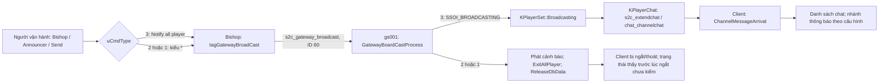

TÓM TẮT 1/5 [NGUỒN] DONE: khảo sát tĩnh nút Announcer của Bishop, ba kiểu lệnh và đường đi tới client.
TÓM TẮT 2/5 [NGUỒN] Gói Bishop→GS là s2c_gateway_broadcast (ID 60); AP_NOTIFY_ALL_PLAYER=3, AP_NOTIFY_GAMESERVER_SAFECLOSE=2, AP_WARNING_ALL_PLAYER_QUIT=1.
TÓM TẮT 3/5 [NGUỒN] Lệnh thường được GS phát thành chat extension; client đưa vào danh sách chat/toàn bộ và thông báo theo nhánh UI phù hợp.
TÓM TẮT 4/5 [CHƯA KIỂM] Không chạy build, exe, VM hay mạng; chưa đối chiếu source với binary và chưa quan sát UI trong lượt này.
TÓM TẮT 5/5 [TÀI LIỆU] Không commit theo chỉ thị; không push. Khuyến nghị PM chỉ ghi nhận đúng giới hạn runtime nêu dưới đây.

# N-01 — Bishop Announcer (Notify all / kiểu *)

Loại: khảo sát
Chủ đề: Đường đi của ba kiểu Announcer từ Bishop qua gs001 tới thông báo hoặc thao tác lên người chơi client.
Từ khóa: Bishop, Announcer, Thông báo toàn, Notify all player, gs001, Client2912, s2c_gateway_broadcast, AP_NOTIFY_ALL_PLAYER, AP_NOTIFY_GAMESERVER_SAFECLOSE, AP_WARNING_ALL_PLAYER_QUIT
Trạng thái: DONE — hoàn tất lập bản đồ tĩnh theo phạm vi giao; không xác nhận trạng thái binary/runtime.
Độ phủ: đã phủ 7/7 phần tử khảo sát tĩnh được liệt kê tại mục Phạm vi và độ phủ.
Liên quan: `JX1_OPS/DESIGN/BANG-NUT-EXE-SERVER.md`, `JX1_OPS/DESIGN/HUONG-DAN-EXE-SERVER.md`, `JX1_OPS/DESIGN/TRUYEN-TAI-VA-EXE-SERVER.md`, `JX1_OPS/REPORTS/U-02.md`, `JX1_OPS/REPORTS/A-01-ban-do-tien-trinh.md`, `JX1_OPS/REPORTS/A-06-bang-goi-tin.md`, `JX1_OPS/REPORTS/K-01-ban-do-truyen-tin-hieu.md`.
Cần tôi quyết định: không.

## Tóm tắt kết quả

Nút Send trong Bishop mặc định đặt `AP_NOTIFY_ALL_PLAYER`; hai lựa chọn có dấu * thay kiểu lệnh. Tùy lựa chọn đích, Bishop gửi cấu trúc `tagGatewayBroadCast` tới một GS hoặc vòng qua các GS đã kết nối. Trường `cProtocol` là `s2c_gateway_broadcast`, giá trị số 60 trong enum client; `uCmdType` là 3, 2 hoặc 1 tương ứng ba lựa chọn trên.

GS nhận gói ở `GatewayBoardCastProcess`. Kiểu 3 yêu cầu GS phát nội dung tới người chơi qua `SSOI_BROADCASTING`. Kiểu 2 và 1 trước hết phát dòng cảnh báo tương tự, rồi gọi `ExitAllPlayer()` và `ReleaseDbData()`; cờ `iSavePai` có thể gọi lưu dữ liệu Pai Shop. Đọc đoạn xử lý này không cho thấy lệnh gọi tắt tiến trình GS: nhãn giao diện “close safely” không đủ để kết luận exe đã tự thoát.

Đường gửi nội dung kiểu thường tới client là gói chat mở rộng `s2c_extendchat` chứa tiểu gói `chat_channelchat`; client chuyển qua `ChannelMessageArrival`/`NewChannelMessageArrival`. Mã UI có nhánh đưa thông báo phù hợp vào danh sách chat tổng và danh sách thông báo. Source không chứng minh một banner giữa màn hình; cũng chưa kiểm giá trị bản địa hóa đang nạp để xác nhận nhánh so khớp tên người gửi trong mọi bản client.

### Sơ đồ luồng chính

## Bốn câu trả lời theo từng lựa chọn

### Notify all player — `AP_NOTIFY_ALL_PLAYER` (3)

1. **Ghi/gửi tới đâu?** Nội dung lấy từ ô `IDC_EDIT_ANNOUNCE_MSG` trong Bishop. Trong luồng này không có bước ghi vào cfg hay DB: Bishop đóng gói vào `tagGatewayBroadCast.szData` và gửi qua kết nối Bishop–GS. Tại GS, nội dung được đưa vào đường phát chat, đóng gói thành `s2c_extendchat`/`chat_channelchat` rồi gửi cho người chơi đang kết nối.
2. **Exe nào nhận và làm gì?** Bishop xử lý nút gửi, chọn một GS hoặc gọi `CGameServer::SendToAll`; gs001 nhận `s2c_gateway_broadcast` và gọi `OperationRequestInfo(SSOI_BROADCASTING, ...)`; `KPlayerSet::Broadcasting` tạo thông báo hệ thống gửi cho toàn bộ người chơi online. Client xử lý gói chat mở rộng và phân loại nội dung.
3. **Ảnh hưởng server?** GS đi vào nhánh phát thông báo. Mã đồng thời đặt lại `m_nGameLoop` và gọi `m_Timer.Passed(1)` trước khi phát; tác động runtime của hai lệnh này chưa đo. Nhánh này không ghi cfg/DB theo đoạn mã đã đọc và không gọi thoát người chơi.
4. **Ảnh hưởng client?** Source client nhận tin qua `s2c_extendchat` (251), tiểu gói `chat_channelchat` (33), rồi đi tới `ChannelMessageArrival`. Với kênh GM và nhãn gửi được phân loại là thông báo, `Kuiplayerfun::NewChannelMessageArrival` thêm tin vào danh sách tổng và danh sách thông báo. Chưa xác minh bằng UI runtime rằng mọi cấu hình hiện tại hiển thị đúng hai nơi này; source được đọc không cho thấy đường hiện banner giữa màn hình cho lệnh này.

### Notify game server to close safely * — `AP_NOTIFY_GAMESERVER_SAFECLOSE` (2)

1. **Ghi/gửi tới đâu?** Ô nội dung được gửi trong `tagGatewayBroadCast.szData` tới GS; không thấy ghi cấu hình. Nếu `iSavePai` bật, nhánh GS gọi `SavePaiShopData()`.
2. **Exe nào nhận và làm gì?** Bishop gửi kiểu 2; gs001 phát nội dung cảnh báo qua `SSOI_BROADCASTING`, gọi `ExitAllPlayer()`, rồi `ReleaseDbData()`. Đoạn xử lý tĩnh không có lời gọi `OnShutdown()` hay kết thúc tiến trình.
3. **Ảnh hưởng server?** Mọi người chơi trong GS bị đưa qua đường thoát và dữ liệu DB được giải phóng; có thể lưu Pai Shop theo cờ. Không suy ra tiến trình GS đã dừng chỉ từ tên lựa chọn hoặc mã nhánh này.
4. **Ảnh hưởng client?** Client nhận cùng đường chat thông báo trước thao tác thoát ở phía GS; sau đó kết nối/người chơi bị thoát. Việc thông báo kịp hiện trước khi ngắt chưa xác minh runtime.

### Notify and warning all player to quit this game * — `AP_WARNING_ALL_PLAYER_QUIT` (1)

1. **Ghi/gửi tới đâu?** Cùng trường `szData` và đường Bishop→GS; không thấy ghi cấu hình. Nếu `iSavePai` bật, GS gọi `SavePaiShopData()`.
2. **Exe nào nhận và làm gì?** Bishop gửi kiểu 1; nhánh tương ứng tại gs001 phát cảnh báo, gọi `ExitAllPlayer()` và `ReleaseDbData()`.
3. **Ảnh hưởng server?** Thao tác mã nguồn đọc được gần như cùng chuỗi với kiểu 2: thoát toàn bộ người chơi và giải phóng DB, có thể lưu Pai Shop. Khác biệt thấy được ở đoạn đã đọc chủ yếu là nhãn/log; không kết luận tác dụng runtime của toàn hệ thống chỉ từ đây.
4. **Ảnh hưởng client?** Cùng đường nhận chat thông báo rồi thoát/ngắt do hành động GS. Chưa xác minh liệu client kịp hiện tin cuối hay UI phân biệt riêng hai kiểu *.

## Phạm vi và độ phủ

| Phần tử trong phạm vi | Kết quả | Bằng chứng chính |
|---|---|---|
| Ba lựa chọn Announcer và giá trị mặc định | Đã phủ: mặc định kiểu 3; kiểu đóng an toàn là 2; cảnh báo thoát là 1 | `Application.cpp:1059-1089` |
| Chọn một GS hay toàn bộ GS | Đã phủ: radio toàn bộ chuyển `bAllGS`; nếu không, chọn server theo mã khu/GS | `Application.cpp:1061-1067`, `1373-1403` |
| Đóng gói và gửi từ Bishop | Đã phủ: `s2c_gateway_broadcast`, `uCmdType`, `iSavePai`, `szData`; phát tới từng GS | `GameServer.cpp:1581-1628` |
| ID packet và command | Đã phủ: `s2c_gateway_broadcast=60`; `AP_WARNING_ALL_PLAYER_QUIT=1`, `AP_NOTIFY_GAMESERVER_SAFECLOSE=2`, `AP_NOTIFY_ALL_PLAYER=3` | `KProtocolDef.h:37-54`, `KProtocol.h:1523-1535` |
| GS xử lý kiểu thông báo thường | Đã phủ: chuyển qua `SSOI_BROADCASTING` và phát cho client | `KSOServer.cpp:4207`, `4276-4288`, `4334-4345`; `CoreServerShell.cpp:1954-1956`; `KPlayerSet.cpp:587-601` |
| GS xử lý hai kiểu * | Đã phủ: cảnh báo, thoát người chơi, giải phóng DB; cờ lưu Pai Shop | `KSOServer.cpp:4290-4332` |
| Client nhận và vị trí UI theo code | Đã phủ đường chat extension và các list UI; nhánh phân loại phụ thuộc kênh/nhãn localization | `KProtocolProcess.cpp:204`, `4303-4312`; `KgameWorld.cpp:13130-13184`; `Kuiplayerfun.cpp:3338-3363` |

## Giải mã tên

Các tên dưới đây là tên giao diện/chương trình hoặc symbol giao thức tiếng Anh, không phải tên Hán/TCVN3 của kỹ năng, NPC, quái hay bản đồ. Giữ nguyên identifier để tra source; không phát sinh bước giải mã GBK/TCVN3 cho các mục này.

| Tên gốc | Mã hóa | Chữ đúng / ý nghĩa | Nguồn |
|---|---|---|---|
| Bishop / Announcer | Chuỗi giao diện tiếng Anh | Bishop; nhóm gửi thông báo | `Bishop.rc:170-230` |
| Notify all player | Chuỗi giao diện tiếng Anh | Thông báo toàn bộ người chơi | `Bishop.rc:188-229` |
| Notify game server to close safely * | Chuỗi giao diện tiếng Anh | Yêu cầu GS đóng an toàn (nhãn giao diện; không xác nhận tiến trình thực sự dừng) | `Bishop.rc:210-211`; `KSOServer.cpp:4312-4332` |
| Notify and warning all player to quit this game * | Chuỗi giao diện tiếng Anh | Cảnh báo người chơi thoát game | `Bishop.rc:212-213`; `KSOServer.cpp:4290-4310` |
| `gs001`, `Client2912` | Alias/tên thư mục, không phải chuỗi mã hóa trong game | GS thế giới; cây client được giao | Task N-01; root nguồn dưới đây |
| `s2c_gateway_broadcast`, `AP_*`, `chat_channelchat` | Identifier ASCII trong header | Tên gói/kiểu lệnh; giữ nguyên | `KProtocolDef.h:37-54`, `KProtocol.h:1523-1535` |

## Sắp theo cấu trúc game

Đây là luồng quản trị–truyền tải, không phải bảng kỹ năng/trang bị/quái/NPC/bản đồ. Sắp theo trình tự kiến trúc: giao diện Bishop → gateway/Bishop → GS → chat protocol client → danh sách UI. Ba lệnh được nhóm theo tác dụng ở GS: phát tin (3), phát tin rồi thoát (2), phát tin rồi thoát (1).

## Mục sổ thông số

Các số 60, 1, 2, 3 là mã giao thức/command trong source, không phải thông số cân bằng hay cấu hình game; không có tham số gameplay phù hợp để ghi vào sổ thông số. Giữ các mã trong bảng phạm vi để tra cứu.

## Phát hiện khi khảo sát / điểm cần giữ rõ

- Nhãn giao diện của kiểu 2 nói “close safely”, nhưng nhánh GS đọc được gọi thoát toàn bộ người chơi và giải phóng DB; trong chính đoạn này không thấy lệnh dừng tiến trình. Đây là chênh lệch giữa nhãn và bằng chứng tĩnh, không sửa kết luận hay tài liệu cũ.
- Hai lựa chọn có dấu * đều gây thao tác lên toàn bộ người chơi của GS nhận lệnh. Không dùng chúng như tin nhắn thuần.
- `KPlayerSet::Broadcasting` từ chối chuỗi có độ dài lớn hơn hoặc bằng `MAX_SENTENCE_LENGTH`; giá trị hiệu lực và giới hạn theo build/client chưa đối chiếu. Không suy giới hạn thực từ dòng ghi “260” trên cửa sổ Bishop.
- Source cho biết tuyến hiển thị chat, không xác nhận server/client source này khớp binary đang chạy, bản dịch đang nạp, hay người chơi có nhìn thấy tin cuối trước khi bị thoát.

## Đề xuất tối ưu / bước theo dõi

Không đề xuất sửa code hoặc cấu hình trong task khảo sát. Nếu cần xác nhận vận hành, task riêng cần đối chiếu đúng build Bishop/GS/client và theo dõi một lần gửi kiểu thường trên môi trường thử đã được duyệt; hai kiểu * chỉ kiểm tra sau khi có phê duyệt cụ thể vì chúng thoát người chơi và giải phóng DB. Việc này nằm ngoài N-01.

## Đã xác minh / Chưa xác minh

**ĐÃ XÁC MINH — source tĩnh:** `Application.cpp:1059-1089`, `1373-1403`; `GameServer.cpp:1581-1628`; `KSOServer.cpp:4207`, `4276-4345`; `CoreServerShell.cpp:1933-1956`; `KPlayerSet.cpp:587-601`; `KPlayerChat.cpp:1912-1951`; client `KProtocolDef.h:37-54, 211-213`, `KProtocol.h:1523-1535`, `KProtocolProcess.cpp:204, 4303-4312`, `KgameWorld.cpp:13130-13184`, `Kuiplayerfun.cpp:3338-3363`. Source server và client thuộc đúng root được task chỉ định; file legacy có chú thích/chuỗi hiển thị mã hóa cũ, được đọc theo mã mặc định của Windows để lấy symbol và dòng.

**TÀI LIỆU CÓ SẴN:** `BANG-NUT-EXE-SERVER.md:37` ghi Notify all player đã thử ở JX-Test-36 trong đợt #161; `HUONG-DAN-EXE-SERVER.md:56-57` cũng ghi Notify all player chạy được, không lỗi. Đây là kết quả đã ghi trong tài liệu trước, không phải phép thử do N-01 thực hiện lại.

**CHƯA XÁC MINH:** Source–binary correspondence; gói và nội dung thực trên socket; giá trị ID khi chạy của đúng binary; giá trị localization để chọn nhánh UI; thông báo có hiển thị trước khi client bị ngắt; tiến trình GS sau hai kiểu * có còn chạy hay không. Task không cho chạy exe/VM/mạng/build nên không đo các điểm này.

**Kiểm tra trong task:** `git status --short --branch` ban đầu cho thấy `task/N-01` sạch. `rg` không có trong môi trường; báo một lần và dùng `Select-String` giới hạn đúng cây source. Không chạy build, test runtime, exe, VM hoặc mạng.

## Phát hiện khi chuẩn hóa

Không có báo cáo N-01 cũ trong worktree tại thời điểm tiếp tục, nên đây là báo cáo mới chứ không phải retrofit nội dung có sẵn. Không có kết luận cũ của N-01 để thay đổi. Kết quả runtime #161 được trích đúng như tài liệu hiện có, không mở rộng thành xác minh của source hoặc binary.

## Bàn giao

Commit: không tạo theo chỉ thị của task; push: không thực hiện. Tiếp theo: PM có thể gộp dòng mục lục cho chủ đề Bishop Announcer/gateway broadcast → GS → chat client vào `JX1_OPS/DESIGN/MUC-LUC-TRI-THUC.md`.

Kỹ năng đã dùng: jx1-retrofit, jx1-read-server, jx1-read-client, jx1-parameters, jx1-knowledge, jx1-report.

KẾT QUẢ CUỐI: DONE — đã ghi báo cáo N-01 theo phạm vi khảo sát tĩnh. Không cập nhật trực tiếp `JX1_OPS/TASKS/N-01.md` vì `vung_file` task chỉ cho phép sửa `JX1_OPS/REPORTS/N-01.md`; trạng thái và kết quả được ghi tại đây để PM cập nhật khi gộp task.