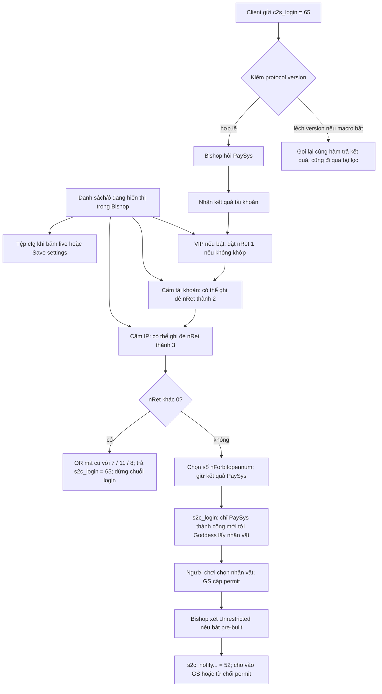

TÓM TẮT 1 — [NGUỒN] DONE về khảo sát tĩnh 9/9 nhóm Bishop: lọc tài khoản/IP, VIP, Unrestricted, thao tác danh sách và giới hạn mở nhiều client (B/Bishop.rc:179-241; bảng phạm vi bên dưới).
TÓM TẮT 2 — [NGUỒN] Luồng thường lọc sau PaySys, trước danh sách nhân vật; khi PaySys thành công: VIP loại ra → 7, cấm tài khoản → 11, cấm IP → 9 do 1 OR 8, client báo lỗi chung (B/GamePlayer.cpp:1016-1115,1175-1399; O/gameui/Klogin.cpp:995-1009).
TÓM TẮT 3 — [NGUỒN] Giới hạn nhiều client chỉ gửi nForbitopennum ở đường đang hoạt động; đoạn đếm phía Bishop bị comment, đoạn nhận phía client rỗng (B/GamePlayer.cpp:1324-1377; O/gameui/Klogin.cpp:923-925).
TÓM TẮT 4 — [CHƯA KIỂM] Đầu ra N-02.md kèm nguồn dòng, bảng bốn câu/nút, sổ thông số; chưa kiểm tra binary, cấu hình hiệu lực và câu Việt cuối cùng trong bảng ngôn ngữ nạp động.
TÓM TẮT 5 — [CHƯA KIỂM] Không chạy build, exe, VM, mạng; không commit/push theo giao việc mới nhất, Tổng quan commit hộ; file nhịp ngoài writable root bị chặn theo phạm vi ghi của phiên.

# N-02 — Bishop: danh sách lọc, VIP, Forbid và giới hạn IP

Loại: khảo sát
Chủ đề: Nơi lưu, nơi thi hành, thứ tự chặn đăng nhập và phản hồi client của nhóm lọc tài khoản/IP trong Bishop.
Từ khóa: Bishop, lọc tài khoản, VIP, Forbid, accforbitlist.cfg, acclist_vip.cfg, ipforbitlist.cfg, c2s_login, giới hạn IP
Trạng thái: DONE — hoàn tất phạm vi đọc tĩnh; không tuyên bố đã thử trên binary.
Độ phủ: đã phủ 9 trên tổng 9 nhóm trong bảng phạm vi; đã kiểm 3/3 cơ chế đọc/ghi tệp danh sách ở source, chưa đọc cấu hình đang chạy.
Liên quan: JX1_OPS/DESIGN/CHUAN-BAO-CAO.md; JX1_OPS/DESIGN/HUONG-DAN-EXE-SERVER.md; JX1_OPS/DESIGN/BANG-NUT-EXE-SERVER.md; JX1_OPS/DESIGN/TRUYEN-TAI-VA-EXE-SERVER.md.
Cần tôi quyết định: không — các phép thử runtime chỉ là đề xuất cho task được duyệt riêng.

[TÀI LIỆU] Nhãn [NGUỒN] dưới đây chỉ xác minh mã/tài liệu đã mở tại dòng hiện có; [TÀI LIỆU] là bằng chứng kế thừa, không lặp thử; [GIẢ THUYẾT] là hệ quả cần kiểm thêm. Nhãn và cột nguồn của một hàng áp dụng cho cả bốn câu trả lời trong hàng. Chuẩn phân biệt nguồn với binary: JX1_OPS/DESIGN/TRUYEN-TAI-VA-EXE-SERVER.md:9-13.



[NGUỒN B/GamePlayer.cpp:734-738,839-864,1016-1115,1175-1399,1421-1452; B/GameServer.cpp:991-1081; GH/KProtocolDef.h:37-41,53-54,250-251] Sơ đồ là luồng đọc tĩnh. Bộ lọc không nằm ở chỗ mở TCP; nó được xét trong hàm tạo phản hồi đăng nhập.

## 1. Phạm vi và độ phủ

| Nhóm lấy từ giao diện/mục tiêu | Độ phủ đọc tĩnh | Bằng chứng |
|---|---|---|
| 1. Filter account list: danh sách, ô nhập, +, -, guide, live, clear | Đã phủ | [NGUỒN B/Bishop.rc:179-186; B/Application.cpp:718-738,998-1055] |
| 2. VIP: danh sách, ô nhập, +, -, guide, live, clear, turn on | Đã phủ | [NGUỒN B/Bishop.rc:233-241; B/Application.cpp:930-996; B/GamePlayer.cpp:1175-1191] |
| 3. Filter IP list: danh sách, ô nhập, +, -, guide, live, clear | Đã phủ | [NGUỒN B/Bishop.rc:187-194; B/Application.cpp:740-794,914-928] |
| 4. Client IP information: danh sách, Add to filter list, clear, check | Đã phủ; check chỉ xác nhận có resource, chưa thấy handler | [NGUỒN B/Bishop.rc:196-200; B/Application.cpp:609-1129; B/GamePlayer.cpp:1222-1239] |
| 5. Limit IP multiple opening list: danh sách, thêm IP, xóa IP | Đã phủ | [NGUỒN B/Bishop.rc:201-204; B/Application.cpp:812-828,888-901] |
| 6. limiting: ô bật và ô số | Đã phủ | [NGUỒN B/Bishop.rc:205-206; B/GamePlayer.cpp:1324-1365,2369-2370] |
| 7. all IPs are prohibited from opening multiple clients | Đã phủ | [NGUỒN B/Bishop.rc:195; B/GamePlayer.cpp:1367-1377] |
| 8. Save settings và ba tệp cfg danh sách | Đã phủ cơ chế source; không mở tệp cấu hình hiệu lực | [NGUỒN B/Application.cpp:700-716; B/Network.cpp:79-100,133-263] |
| 9. Unrestricted, Turn on pre-built, All servers | Đã phủ để phân biệt với VIP và chỉ ra chặng permit | [NGUỒN B/Bishop.rc:215-220,231; B/Application.cpp:858-875; B/GameServer.cpp:1023-1077] |

[TÀI LIỆU JX1_OPS/DESIGN/BANG-NUT-EXE-SERVER.md:40,59,62] #162 chỉ thử thêm/xóa một mục cấm tài khoản rồi lưu và hoàn tác; chưa thử VIP/IP. #161 ghi ipforbitlist.cfg không tồn tại trên VM thử. N-02 giữ nguyên các kết luận đó và không suy thành ba tệp đang tồn tại hoặc bộ lọc đã hoạt động trên client thật.

## 2. Gốc nguồn và giải mã tên

### 2.1. Gốc đọc và cách dẫn dòng

| Ký hiệu | Gốc tuyệt đối đã đọc |
|---|---|
| B | C:/Jx1CocoV3/SwordOnline/SwordOnline/jxOnline/gateway/Sources/MultiServer/Bishop |
| GH | C:/Jx1CocoV3/SwordOnline/SwordOnline/jxOnline/gateway/Headers — header giao thức được đọc bổ trợ cho source Bishop |
| O | C:/Jx1CocoV3/Folder/Client2912-20260116T044348Z-3-001/Client2912/Client/Classes |
| C | C:/Jx1CocoV3/Folder/Client2912-20260116T044348Z-3-001/Client2912/Client |
| D | JX1_OPS/DESIGN trong worktree D:/JX-wt/N-02 |

[NGUỒN B/Network.cpp:6-9; B/LoginDef.h:48; O/gameui/Uiglobaldata.h:56] B/…:dòng, GH/…:dòng và O/…:dòng bên dưới mở rộng theo bảng này; không dùng cây D:/JX-source thay cho cây C:/Jx1CocoV3 của task. Đã đối chiếu header phụ thuộc để nối tên ID hai phía.

[NGUỒN B/Bishop.rc:179-241; O/gameui/Klogin.cpp:965-1010; O/vn/Translate.cpp:37-59] Resource/nguồn server và comment Hán liên quan được đọc bằng GBK/CP936; nhãn tiếng Anh và ID là ASCII. Klogin.cpp và gamescene/LoginDef.h không hợp lệ UTF-8 toàn tệp khi giải mã nghiêm ngặt; đọc GBK giải được comment Hán. Translate.cpp có đoạn Việt UTF-8; không áp một bảng mã cho toàn bộ cây client. Báo cáo xuất UTF-8 không BOM.

[CHƯA KIỂM] Không có bản ghim commit/hash source trong task. Chưa kiểm tra source–exe/DLL/APK có khớp nhau hay không; chưa xác định nhánh UI thực sự được đóng gói trong app đang dùng. Không có graphify-out tại hai root Sources gateway và Classes đã kiểm; dùng tìm symbol và mở file thật. GS001-MAP là bản đồ định vị, không có mục lọc Bishop tương ứng.

### 2.2. Giải mã tên

[NGUỒN B/Bishop.rc:179-241] Phạm vi này không có tên riêng kỹ năng, trang bị, quái, NPC hoặc bản đồ cần giải mã. Bảng dưới giữ nhãn gốc để nhận diện đúng ô; không đổi tên trong nguồn.

| Tên gốc | Mã hóa | Chữ đúng/diễn giải UTF-8 | Nguồn file:dòng |
|---|---|---|---|
| Bishop; Goddess; Sword3PaySys; gs001 | ASCII trong tài liệu/source | Bishop: cổng đăng nhập; Goddess: dịch vụ nhân vật; PaySys: tài khoản; gs001: máy chủ game | [TÀI LIỆU D/TRUYEN-TAI-VA-EXE-SERVER.md:30-35] |
| Filter account list | ASCII, resource đọc GBK | Danh sách cấm tài khoản | [NGUỒN B/Bishop.rc:179-186; B/GamePlayer.cpp:1194-1207] |
| VIP account, no restrictions after opening | ASCII, resource đọc GBK | Danh sách cho phép qua cửa kiểm VIP khi bật; không miễn mọi bộ lọc | [NGUỒN B/Bishop.rc:233-241; B/GamePlayer.cpp:1175-1255] |
| Filter IP list | ASCII, resource đọc GBK | Danh sách cấm IP | [NGUỒN B/Bishop.rc:187-194; B/GamePlayer.cpp:1241-1255] |
| Client IP information | ASCII, resource đọc GBK | Danh sách IP được ghi khi tạo phản hồi login | [NGUỒN B/Bishop.rc:196-200; B/GamePlayer.cpp:1222-1239] |
| Whether to enable limiting the number of clients: | ASCII, resource đọc GBK | Bật xét danh sách IP cần hạn chế mở nhiều client | [NGUỒN B/Bishop.rc:205-206; B/GamePlayer.cpp:1324-1365] |
| Whether to enable: all IPs are prohibited from opening multiple clients | ASCII, resource đọc GBK | Áp số giới hạn cho mọi IP, không phải cấm mọi IP đăng nhập | [NGUỒN B/Bishop.rc:195; B/GamePlayer.cpp:1367-1377] |
| Limit IP multiple opening list | ASCII, resource đọc GBK | Danh sách IP được gắn số giới hạn nhiều client; khác danh sách cấm IP | [NGUỒN B/Bishop.rc:201-204; B/GamePlayer.cpp:1354-1377] |
| Unrestricted account; Turn on pre-built; All servers | ASCII, resource đọc GBK | Danh sách ngoại lệ của cửa kiểm permit/pre-built, không phải danh sách VIP | [NGUỒN B/Bishop.rc:215-220,231; B/GameServer.cpp:1023-1077] |
| guide; live; clear | ASCII, resource đọc GBK | Nạp tệp; lưu tệp; xóa trên danh sách đang hiển thị | [NGUỒN B/Application.cpp:750-794,930-987,998-1039] |
| 账号被冻结; 登录失败; 账号IP被冻结！ | GBK ở comment client | Tài khoản bị khóa; đăng nhập thất bại; IP tài khoản bị khóa. Chỉ là comment, không phải câu Việt đang hiển thị | [NGUỒN O/gameui/Klogin.cpp:976,987,1004] |
| 本服务器为收费服务,非VIP禁止进入！ | GBK ở comment client | Máy chủ dùng dịch vụ trả phí, người ngoài VIP không được vào; chỉ là comment giải thích nhánh | [NGUỒN O/gameui/Klogin.cpp:998] |

## 3. Sắp theo cấu trúc game

[NGUỒN B/GamePlayer.cpp:734-738; B/GameServer.cpp:991-1081] Báo cáo xếp theo hành trình người chơi: quản trị tạo bộ lọc → nhận/yêu cầu đăng nhập → PaySys → lọc → danh sách/chọn nhân vật → permit vào gs001. Đây không phải danh mục kỹ năng/trang bị nên không chia theo phái, bộ đồ hay bản đồ.

### 3.1. Chặn ở đâu, ai thi hành?

1. [NGUỒN O/gameui/Klogin.cpp:476-495; O/gamecore/KProtocolDef.h:248-249; GH/KProtocolDef.h:250-251; B/Intercessor.cpp:684-706] Client gửi c2s_login = 65. Server dùng tên c2s_login_fhgyrinhkmvnsheypo nhưng enum cũng là 65; Bishop đưa yêu cầu vào tác vụ login.
2. [NGUỒN B/GamePlayer.cpp:734-738,934-945,1016-1043] Luồng thường hỏi PaySys trước: c2s_accountlogin, rồi chờ s2c_accountfdfsglogin. Vì vậy danh sách cấm ở đây không ngăn kết nối TCP ban đầu hay tránh lượt hỏi PaySys.
3. [NGUỒN B/GamePlayer.cpp:1175-1255,1284-1318] Kiểm VIP trước; nếu bật và không khớp đặt nRet=1. Danh sách cấm tài khoản có thể ghi đè thành 2; IP khớp có thể ghi đè tiếp thành 3. Cả tài khoản lẫn IP đều dùng strstr, tức khớp chuỗi con, phân biệt hoa/thường theo phép so chuỗi C; không phải so chính xác, CIDR hoặc dải IP.
4. [NGUỒN B/GamePlayer.cpp:1284-1318,1384-1402,1111-1115,582-584] Nếu nRet khác 0, Bishop tạo phản hồi lỗi, trả false cho VerifyAccount, dừng chuỗi login và gửi yêu cầu logout tài khoản về PaySys. enumError chỉ về enumNone trong đoạn Run đã đọc; không gọi ShutdownClient trực tiếp tại cửa lọc này. Không gọi đây là chặn socket tức thì.
5. [NGUỒN B/GamePlayer.cpp:1320-1379,1018-1115,1421-1452] Nếu không bị danh sách cấm/VIP loại, Bishop xét số giới hạn nhiều client và gửi phản hồi. Chỉ kết quả PaySys thành công mới đi tiếp tác vụ lấy nhân vật từ Goddess. Các handler danh sách không sửa dữ liệu nhân vật, không gửi lệnh sửa đồ/tiền/bản đồ tới gs001.
6. [NGUỒN B/GameServer.cpp:991-1081] Sau chọn nhân vật và nhận permit từ GS, danh sách Unrestricted mới được dùng nếu bật pre-built. Nó không thay ba danh sách cfg kể trên.

[NGUỒN B/GamePlayer.cpp:839-864] Ngoại lệ cần giữ rõ: nếu USE_KPROTOCOL_VERSION được bật và yêu cầu lệch version, WaitForAccPwd gọi cùng hàm _VerifyAccount_ToPlayer trước PaySys. Cửa VIP/tài khoản/IP trong hàm đó vẫn có thể ghép thêm mã vào lỗi version. Không khẳng định mọi đường gọi hàm lọc đều đã đi qua PaySys.

### 3.2. Ghi đâu và khi nào có hiệu lực?

[NGUỒN B/Application.cpp:718-794,930-1039; B/GamePlayer.cpp:1175-1255] Bộ lọc đọc trực tiếp nội dung listbox và trạng thái checkbox ở lần tạo phản hồi login. Thêm/xóa trên màn hình có thể ảnh hưởng lần xét tiếp theo ngay cả khi chưa lưu tệp. Nút live dùng để giữ danh sách qua tệp; không phải công tắc duy nhất làm bộ lọc có hiệu lực.

[NGUỒN B/Network.cpp:133-263] accforbitlist.cfg và acclist_vip.cfg dùng các section accname_N, khóa name. ipforbitlist.cfg dùng section ip_N, khóa ip. Đường dẫn do GetAppFullPath(NULL) cộng tên file, không phải tên thư mục worktree hay bảng DB.

[NGUỒN B/Application.cpp:700-716,1270-1295; B/Network.cpp:79-100] Save settings ghi số ForBitOpenCount vào Bishop.cfg [Network]. Trong handler này không có lời gọi lưu ba checkbox lọc, VIP hay danh sách hạn chế nhiều client. Các lệnh đọc ba tệp danh sách xuất hiện ở handler guide; không thấy tự nạp chúng trong InitMainDlg đã đọc. Trạng thái sau khởi động của binary thực chưa kiểm tra.

## 4. Bốn câu trả lời cho từng nút/ô

[NGUỒN B/Application.cpp:700-1055; B/GamePlayer.cpp:1175-1399] Bốn cột giữa trả lời lần lượt: (1) ghi đâu; (2) exe nào nhận/làm gì; (3) tác động server; (4) client thấy gì/gói gì. “Lần xét sau” là lần tạo phản hồi login tiếp theo, không phải cam kết tác động lên phiên đã ở trong GS. Tác động mã số chi tiết xem mục 5; không có gói quản trị riêng gửi cho người chơi ở các thao tác chỉ sửa listbox.

### 4.1. Filter account list — accforbitlist.cfg

| Nút/ô | (1) Ghi đâu? | (2) Exe nhận/làm gì? | (3) Server bị tác động? | (4) Client thấy gì/gói gì? | Nguồn |
|---|---|---|---|---|---|
| Danh sách và ô nhập IDC_ACC_EDIT | Danh sách nằm trong bộ nhớ UI; gõ ô nhập chưa thêm vào list | Bishop giữ chuỗi; lúc xác thực duyệt hAccCheckList | Mục đã ở list được xét cấm; chỉ gõ chưa làm đổi cửa lọc | Không gửi gói do gõ; kết quả lần login sau theo hàng cấm tài khoản mục 5 | [NGUỒN B/Application.cpp:718-725; B/GamePlayer.cpp:1194-1207] |
| + IDC_ACC_ADD_BTN | Chép ô nhập vào list; chưa ghi cfg | Bishop gọi AddOutputStringA | Lần xét sau có thể bị cấm; không sửa role DB | s2c_login=65 nếu lần login sau bị loại; không có thông báo tức thì cho người đang chơi | [NGUỒN B/Application.cpp:718-727; B/GamePlayer.cpp:1194-1207,1394-1399] |
| - IDC_ACC_DEL_BTN | Xóa mục đang chọn khỏi list | Bishop LB_DELETESTRING; không chọn mục thì hộp cảnh báo quản trị | Bỏ mục khỏi cửa lọc trong bộ nhớ; cfg cũ vẫn còn tới lúc lưu | Không có gói riêng; lần login sau có thể qua cửa này, vẫn còn VIP/IP/PaySys | [NGUỒN B/Application.cpp:1040-1055; B/GamePlayer.cpp:1175-1255] |
| guide IDC_DAORUACC_BTN | Đọc accforbitlist.cfg vào list; có bước xóa list trước | Bishop dùng GetAccListCount/GetAccString | Nạp lại điều kiện cấm; lưu ý vòng xóa/nạp ở mục 6 | Không gửi riêng; lần login sau dùng danh sách vừa nạp | [NGUỒN B/Application.cpp:998-1017; B/Network.cpp:168-197] |
| live IDC_SAVEACC_BTN | Xóa section accname_N cũ rồi ghi name từng mục | Bishop/CNetwork ghi accforbitlist.cfg | Lưu trạng thái list ra đĩa; không ghi DB tài khoản/nhân vật | Không gửi riêng; không phải nút kick hoặc mở khóa toàn server | [NGUỒN B/Application.cpp:1019-1039; B/Network.cpp:133-163] |
| clear IDC_CLEARACC_BTN | Yêu cầu xóa từng mục khỏi list, chưa ghi cfg | Bishop xóa theo chỉ số tăng dần | Ý định làm trống cửa lọc; có nguy cơ còn mục, xem mục 6 | Không có gói riêng; chưa được bảo đảm mọi tài khoản đã được bỏ cấm | [NGUỒN B/Application.cpp:728-738; B/GamePlayer.cpp:1194-1207] |

### 4.2. VIP — acclist_vip.cfg

| Nút/ô | (1) Ghi đâu? | (2) Exe nhận/làm gì? | (3) Server bị tác động? | (4) Client thấy gì/gói gì? | Nguồn |
|---|---|---|---|---|---|
| Danh sách và ô nhập IDC_ACC_EDIT_VIP | List trong bộ nhớ; ô nhập chưa được xét trước khi bấm + | Bishop giữ danh sách riêng hAccCheckList_VIP | Chỉ dùng cho cửa VIP nếu bật; khác m_nVipType từ PaySys | Gõ không gửi; tài khoản không khớp khi bật nhận nhánh mã 7, mục 5 | [NGUỒN B/Application.cpp:942-947; B/GamePlayer.cpp:1047,1175-1191] |
| + IDC_ACC_ADD_BTN_VIP | Ô nhập → list VIP, không ghi cfg | Bishop thêm chuỗi | Tài khoản khớp qua cửa VIP, vẫn chịu cấm tài khoản/IP | Không gửi riêng; lần login sau có thể đi tiếp hoặc bị cửa khác loại | [NGUỒN B/Application.cpp:942-949; B/GamePlayer.cpp:1175-1255] |
| - IDC_ACC_DEL_BTN_VIP | Xóa mục chọn trong bộ nhớ | Bishop; không chọn mục thì cảnh báo quản trị | Khi cửa VIP bật, tài khoản mất điều kiện khớp có thể bị loại | Lần login sau có thể nhận mã 7/G_LOGIN_NO_IN_PROGRESS | [NGUỒN B/Application.cpp:989-996; B/GamePlayer.cpp:1175-1191,1294-1298; O/gameui/Klogin.cpp:995-999] |
| guide IDC_DAORUACC_VIP | Đọc acclist_vip.cfg sau vòng xóa list | Bishop dùng GetAccListCount/GetAccString | Thay/nạp list VIP; không đổi loại hội viên trong DB PaySys | Không gửi riêng; xét lại ở lần login sau; lưu ý dòng rỗng mục 6 | [NGUỒN B/Application.cpp:950-966; B/Network.cpp:168-197] |
| live IDC_SAVEACC_VIP | Ghi accname_N/name vào acclist_vip.cfg | Bishop/CNetwork lưu list | Lưu tệp; không gửi gói nạp VIP tới PaySys | Không gửi riêng; không xác nhận đã cấp VIP trả phí trong game | [NGUỒN B/Application.cpp:968-987; B/Network.cpp:133-163] |
| clear IDC_CLEARACC_VIP | Xóa theo chỉ số tăng trong list; không ghi cfg | Bishop yêu cầu bỏ các mục | Khi bật cửa VIP, list hết mục sẽ không cho ai khớp; chưa bảo đảm clear xóa hết | Lần login sau có thể nhận nhánh mã 7; không tự kick phiên GS | [NGUỒN B/Application.cpp:930-941; B/GamePlayer.cpp:1175-1191] |
| turn on IDC_CHECK_OPEN_ALL_VIP | Trạng thái checkbox của cửa sổ | Bishop đọc trực tiếp trạng thái mỗi lần phản hồi login | Bật: mặc định loại nRet=1 rồi chỉ cho tài khoản khớp list qua; tắt: bỏ cửa VIP | Mã 7 nếu bị cửa này loại và không bị IP ghi đè; nhận s2c_login=65 | [NGUỒN B/Bishop.rc:241; B/GamePlayer.cpp:1175-1191,1294-1298,1394-1399] |

### 4.3. Filter IP list — ipforbitlist.cfg

| Nút/ô | (1) Ghi đâu? | (2) Exe nhận/làm gì? | (3) Server bị tác động? | (4) Client thấy gì/gói gì? | Nguồn |
|---|---|---|---|---|---|
| Danh sách và ô nhập IDC_IP_EDIT | Ô nhập và list khác nhau; chỉ nội dung list được xét | Bishop lấy Address của socket và strstr với từng mục list | Cấm đăng nhập theo chuỗi IP; không phải rule tường lửa | Khi bị loại trả s2c_login=65; mã nhận phụ thuộc kết quả PaySys, mục 5 | [NGUỒN B/Application.cpp:740-748; B/GamePlayer.cpp:1222-1255,1304-1308] |
| + IDC_IP_ADD_BTN | Ô nhập → hIpCheckList, không ghi tệp | Bishop thêm chuỗi | Có thể cấm lần login sau; không đóng cổng hay sửa role DB | Với PaySys thành công: mã 9, khóa G_LOGIN_FAIL | [NGUỒN B/Application.cpp:740-749; B/GamePlayer.cpp:1250-1253,1305; O/gameui/Klogin.cpp:1007-1009] |
| - IDC_IP_DEL_BTN | Bỏ mục đang chọn khỏi list | Bishop; không chọn thì hộp cảnh báo quản trị | Bỏ điều kiện đó khỏi bộ nhớ; cfg chưa đổi | Không gửi riêng; lần login sau vẫn chịu các cửa khác | [NGUỒN B/Application.cpp:914-928; B/GamePlayer.cpp:1175-1255] |
| guide IDC_DAORUIP_BTN | Đọc ipforbitlist.cfg, thêm vào list hiện có | Bishop dùng GetIpListCount/GetIpString; handler này không xóa list trước | Có thể cộng thêm mục/trùng/rỗng, không phải thay list sạch đã được chứng minh | Không gửi riêng; tác động ở lần xét login sau | [NGUỒN B/Application.cpp:762-773; B/Network.cpp:235-263] |
| live IDC_SAVEIP_BTN | Xóa section ip_N cũ, ghi ip_N/ip | Bishop/CNetwork ghi ipforbitlist.cfg | Lưu tệp; không cập nhật firewall/DB nhân vật | Không gửi riêng; không có mã riêng báo “đã lưu IP” cho người chơi | [NGUỒN B/Application.cpp:774-794; B/Network.cpp:200-232] |
| clear IDC_CLEARIP_BTN | Xóa theo chỉ số tăng trong list; không ghi cfg | Bishop yêu cầu làm trống list | Có nguy cơ còn mục do cách xóa; không thay đổi socket hiện có bằng handler này | Không có gói riêng; không hứa đã mở lại toàn bộ IP | [NGUỒN B/Application.cpp:750-761; B/GamePlayer.cpp:1241-1255] |

### 4.4. Client IP information và Add to filter list

| Nút/ô | (1) Ghi đâu? | (2) Exe nhận/làm gì? | (3) Server bị tác động? | (4) Client thấy gì/gói gì? | Nguồn |
|---|---|---|---|---|---|
| List IDC_LIST_CLIENTIPINFO | Bishop thêm Address khi tạo phản hồi login | Bishop gọi GetClientInfo và AddOutputStringPlayer | Là dữ liệu hiển thị; không chứng minh là bộ đếm phiên đang online, vì được thêm cả trước nhánh từ chối | Không gửi riêng ngoài phản hồi login đang xử lý | [NGUỒN B/GamePlayer.cpp:1222-1239,1284-1318] |
| Add to filter list IDC_CLIENTIP_ADD_BTN | Chép IP đang chọn từ list này sang hIpCheckList; chưa ghi cfg | Bishop; không chọn mục thì cảnh báo quản trị | Đưa IP vào cửa cấm IP, khác danh sách hạn chế mở nhiều client | Lần login sau dùng mã cấm IP ở mục 5; không có lệnh kick hiện tại | [NGUỒN B/Application.cpp:795-811; B/GamePlayer.cpp:1241-1255] |
| Clear customer single IP information IDC_CLIENTIP_DEL_BTN | Xóa các mục hiển thị ở hClientIpList | Bishop LB_DELETESTRING theo chỉ số tăng | Không xóa hIpCheckList hay hForBitOpenIpList; không mở khóa tài khoản/IP | Không gửi gói quản trị cho client; chỉ thay màn hình quản trị | [NGUỒN B/Application.cpp:902-913] |
| check IDC_FINDIP_BTN | Chưa xác định nơi ghi | Có nút trong resource; tìm toàn Application.cpp không có case IDC_FINDIP_BTN | Chưa kiểm tra tác dụng thật; không suy từ nhãn | Chưa kiểm tra; chưa có bằng chứng gói hay thông báo người chơi | [NGUỒN B/Bishop.rc:200; B/Application.cpp:609-1129] |

### 4.5. Giới hạn mở nhiều client

| Nút/ô | (1) Ghi đâu? | (2) Exe nhận/làm gì? | (3) Server bị tác động? | (4) Client thấy gì/gói gì? | Nguồn |
|---|---|---|---|---|---|
| List IDC_LIST_FORBITOPEN_INFO | List trong bộ nhớ Bishop; không phải ipforbitlist.cfg | Bishop duyệt khi limiting bật | Chọn IP nào được gắn số hạn chế; không đặt nRet cấm login | Nhận nForbitopennum trong s2c_login=65; khối client xử lý hiện rỗng | [NGUỒN B/GamePlayer.cpp:1320-1379; O/gameui/Klogin.cpp:923-925] |
| Add to restricted multi-open list | Chép IP đang chọn ở Client IP information sang hForBitOpenIpList | Bishop; không chọn thì cảnh báo quản trị | Thêm mục xét hạn chế; handler không ghi tệp hay DB | Không gửi riêng; lần phản hồi login sau có thể có số hạn chế khác 0 | [NGUỒN B/Application.cpp:812-828; B/GamePlayer.cpp:1354-1377] |
| Delete restricted IP information | Xóa mục chọn khỏi hForBitOpenIpList | Bishop; không chọn thì cảnh báo quản trị | Bỏ điều kiện theo-IP; nếu all IPs bật thì IP vẫn được gắn số | Không gửi riêng; không bảo đảm giảm số client đang chạy | [NGUỒN B/Application.cpp:888-901; B/GamePlayer.cpp:1367-1377] |
| limiting IDC_CHECK_FORBITIP | Trạng thái checkbox; không thấy lưu ở Save settings | Bishop đọc trực tiếp checkbox | Bật để xét hForBitOpenIpList; đoạn đếm/số phiên để chặn phía server đã bị comment | Chỉ quyết định nForbitopennum, không sinh mã “quá số cửa” ở nhánh hoạt động này | [NGUỒN B/GamePlayer.cpp:1324-1365; B/Application.cpp:700-716] |
| Ô số IDC_EDIT_FORBITOPENUM | Giá trị UI; sao vào m_nForBitOpenNum mỗi lần xét; Save settings giữ vào cfg | Bishop GetDlgItemInt(...,FALSE) → trường unsigned short | Không có đoạn đếm hoạt động dùng nó để ngăn kết nối thứ N trong hàm này | Gửi số đó nếu IP được chọn; 0 được gửi khi không áp hoặc số nhập là 0; client chưa thi hành | [NGUỒN B/GamePlayer.cpp:2369-2370,1372-1377; B/GamePlayer.h:131; O/gameui/Klogin.cpp:923-925] |
| all IPs are prohibited IDC_CHECK_FORBITALL | Trạng thái checkbox | Bishop đặt mReg=1 độc lập với checkbox limiting | Áp cho mọi IP nếu chưa bị cửa cấm/VIP loại; không phải chặn mọi IP đăng nhập | Trường nForbitopennum; không có mã lỗi riêng hay thông báo quá số cửa trong nhánh client đã đọc | [NGUỒN B/GamePlayer.cpp:1319-1379; O/gameui/Klogin.cpp:923-925] |
| Save settings IDC_BUTTON_SAVE | Bishop.cfg [Network] ForBitOpenCount | Bishop/CNetwork SaveOpenCount | Lưu số; không lưu list hạn chế hoặc trạng thái các checkbox trong handler này | Không phát gói riêng; số đọc trực tiếp từ ô UI ở lần phản hồi sau | [NGUỒN B/Application.cpp:700-716; B/Network.cpp:89-100; B/GamePlayer.cpp:2369-2370] |

[NGUỒN B/GamePlayer.cpp:1327-1353; O/gameui/Klogin.cpp:923-925] Dòng so nHaveConnetNum >= (m_nForBitOpenNum-1), gán LOGIN_R_FREEZE và AddOutputIpList đều nằm trong block comment. Không lấy chúng làm bằng chứng server đang đếm/chặn. Tìm nForbitopennum trong toàn Classes chỉ thấy khai báo ở LoginDef.h và if rỗng ở Klogin.cpp; chưa có bằng chứng nhánh client này hạn chế được nhiều cửa sổ.

### 4.6. Unrestricted — cửa riêng sau chọn nhân vật

| Nút/ô | (1) Ghi đâu? | (2) Exe nhận/làm gì? | (3) Server bị tác động? | (4) Client thấy gì/gói gì? | Nguồn |
|---|---|---|---|---|---|
| List/ô nhập IDC_LIST_YUJIAN / IDC_ACC_EDIT_YUJIAN | Bộ nhớ UI; gõ chưa thêm list | Bishop giữ list hYuJianCheckList | List được xét tại _NotifyPlayerLogin nếu pre-built bật; không bỏ qua cấm login trước đó | Có thể nhận permit hợp lệ hoặc từ chối ở gói s2c_notifypl_ayerlogin_hfkqotivbhd=52 | [NGUỒN B/Bishop.rc:215-220; B/GameServer.cpp:1023-1077; GH/KProtocolDef.h:37-41] |
| + IDC_ACC_ADD_BTN_YUJIAN | Ô nhập → list | Bishop thêm chuỗi; không ghi cfg trong handler | Tài khoản khớp chuỗi con được giữ endpoint GS tại cửa permit | Không gửi riêng; có hiệu lực ở lượt xét permit sau | [NGUỒN B/Application.cpp:859-865; B/GameServer.cpp:1031-1044] |
| - IDC_ACC_DEL_BTN_YUJIAN | Bỏ mục chọn trong list | Bishop LB_DELETESTRING | Có thể mất điều kiện ngoại lệ tại cửa permit; không chỉnh dữ liệu role | Nếu rơi vào vùng bị hạn chế, permit false/IP=0/port=3; nhánh UI mới dùng G_NEW_PLAYER_INVALID_BUSY | [NGUỒN B/Application.cpp:867-875; B/GameServer.cpp:1045-1063; O/gameui/KuiSelPlayer_new.cpp:993-1004] |
| Turn on pre-built IDC_CHECK_OPEN_YUJIAN | Trạng thái checkbox | Bishop bật/tắt việc xét Unrestricted ở _NotifyPlayerLogin | Bật: người không khớp bị xét hạn chế toàn server hoặc khu/GS chỉ định; tắt: dùng endpoint GS bình thường | Bị từ chối qua gói 52, không phải s2c_login=65 và không phải lỗi VIP=7 | [NGUỒN B/GameServer.cpp:1023-1077; GH/KProtocolDef.h:37-41] |
| All servers IDC_CHECK_OPEN_ALLSERVER | Trạng thái checkbox | Bishop chọn áp cho mọi khu/GS hay chỉ cặp số UI | Khi pre-built bật và không khớp list, all servers bật thì từ chối toàn bộ; tắt thì so cặp m_serVerNoIndex/m_serGsNumber với IDC_EDIT_FU/IDC_EDIT_QUYU | Khi bị từ chối: bPermit=false, nIPAddr=0, nPort=3 trong gói 52; câu chữ tùy nhánh UI | [NGUỒN B/GameServer.cpp:1045-1077; O/gameui/KuiSelPlayer_new.cpp:993-1004] |
| Hai ô khu/GS IDC_EDIT_FU và IDC_EDIT_QUYU | Số nằm ở UI; resource hiện để WS_DISABLED | Bishop vẫn gọi GetDlgItemInt để đọc khi pre-built bật, all servers tắt và tài khoản không khớp list | Chỉ khi cặp số bằng m_serVerNoIndex/m_serGsNumber mới đặt permit từ chối; không sửa dữ liệu nhân vật | Kết quả qua gói 52, IP=0/port=3 nếu bị loại; chưa kiểm tra khả năng nhập số trên binary | [NGUỒN B/Bishop.rc:209,229; B/GameServer.cpp:1055-1067] |

[NGUỒN B/Bishop.rc:209,229; B/GameServer.cpp:1055-1063] Hai ô chọn khu/GS phụ thuộc IDC_EDIT_QUYU và IDC_EDIT_FU có WS_DISABLED ở resource đã đọc; nguồn vẫn gọi GetDlgItemInt. Chưa kiểm tra binary có cho chỉnh các ô đó hay không. Đây là điều kiện của cửa Unrestricted, không phải tham số giới hạn IP.

## 5. Gói tin, mã lỗi và thông báo người chơi

### 5.1. ID giao thức đã nối hai đầu

| Chặng/hướng | ID / tên | Căn cứ |
|---|---|---|
| Client → Bishop: login | 65; client c2s_login, server c2s_login_fhgyrinhkmvnsheypo | [NGUỒN O/gamecore/KProtocolDef.h:248-249; GH/KProtocolDef.h:250-251; O/gameui/Klogin.cpp:476-495] |
| Bishop → client: phản hồi tài khoản/bộ lọc | 65; s2c_login, kèm KLoginAccountInfo, Param, nForbitopennum | [NGUỒN GH/KProtocolDef.h:53-54; O/gamecore/KProtocolDef.h:52-53; B/GamePlayer.cpp:1384-1399; B/LoginDef.h:84-103] |
| Bishop ↔ PaySys: hỏi/trả login | 33 ở từng chiều: c2s_accountlogin / s2c_accountfdfsglogin | [NGUỒN GH/KProtocolDef.h:30-31,229-230; B/GamePlayer.cpp:934-940,1016-1024] |
| Bishop → client: kết quả permit sau GS | 52; s2c_notifypl_ayerlogin_hfkqotivbhd | [NGUỒN GH/KProtocolDef.h:37-41; O/gamecore/KProtocolDef.h:36-40; B/GameServer.cpp:1007-1024] |

[NGUỒN B/LoginDef.h:59-81; O/gamescene/LoginDef.h:59-81; O/gameui/Klogin.cpp:841,867-870,945-946] Param có phần hành động LOGIN_A_LOGIN=0x050000 và phần kết quả. Client lấy kết quả bằng Param & ~LOGIN_ACTION_FILTER, mask là 0xff0000. Bộ lọc Bishop dùng OR để thêm giá trị kết quả vào mã đã có; đây là các số enum, không phải các cờ độc lập.

### 5.2. Khi PaySys xác thực thành công, đã qua kiểm version và kích thước phản hồi

| Điều kiện cuối cùng | Phép ghép và kết quả client đọc | Nhánh client / ý nghĩa | Căn cứ |
|---|---|---|---|
| Không khớp VIP khi cửa VIP bật, không bị blacklist/IP ghi đè | 1 OR 7 = 7, Param=0x050007 | LOGIN_R_NO_IN_PROGRESS → G_LOGIN_NO_IN_PROGRESS; từ chối ngoài danh sách VIP, về chờ nhập tài khoản | [NGUỒN B/GamePlayer.cpp:1175-1191,1294-1298; O/gameui/Klogin.cpp:995-999] |
| Khớp cấm tài khoản, không bị cấm IP ghi đè | 1 OR 11 = 11, Param=0x05000b | LOGIN_R_FREEZE → G_LOGIN_FREEZE; về chờ nhập tài khoản | [NGUỒN B/GamePlayer.cpp:1194-1207,1299-1303; O/gameui/Klogin.cpp:973-977] |
| Khớp cấm IP, dù trước đó nRet là VIP hay tài khoản | 1 OR 8 = 9, Param=0x050009 | LOGIN_R_INVALID=9 không có case riêng; default → G_LOGIN_FAIL. Không vào case LOGIN_R_VALID=8/G_LOGIN_INVALID_IP | [NGUỒN B/GamePlayer.cpp:1241-1255,1304-1308; B/LoginDef.h:70-81; O/gameui/Klogin.cpp:1001-1009] |
| Chỉ gắn giới hạn mở nhiều client | Vẫn kết quả 1; nForbitopennum=N hoặc 0 | Khối if xử lý số rỗng; thành công chuyển LL_S_WAIT_ROLE_LIST, hiện chuỗi source “Dang lay thong tin nhan vat” | [NGUỒN B/GamePlayer.cpp:1372-1377; O/gameui/Klogin.cpp:923-925,945-955] |
| Chỉ bị cửa Unrestricted ở chặng sau | Gói 52: bPermit=false, IP=0, port=3 | KuiSelPlayer_new: G_NEW_PLAYER_INVALID_BUSY và return; không dùng mã 7/11/9 của login | [NGUỒN B/GameServer.cpp:1045-1063; O/gameui/KuiSelPlayer_new.cpp:993-1004] |

[NGUỒN O/gameui/Klogin.cpp:881-943] Trước switch mã thành công/lỗi, client còn nạp tệp version và kiểm ProtocolVersion; lỗi ở đây có thể hiện cảnh báo version và chặn việc hiển thị các thông báo trong bảng. Bảng không phải cam kết người chơi luôn thấy đúng một câu duy nhất khi có nhiều lỗi đồng thời.

[NGUỒN O/gameui/Klogin.cpp:973-977,995-1018] Nhánh 7/8/11 có gán trạng thái chờ nhập lại; default cho mã 9 chỉ hiện G_LOGIN_FAIL và không có phép gán trạng thái tương ứng trong nhánh này. Chưa thử để kết luận người chơi có phải thao tác lại màn hình hay chờ timeout hay không.

### 5.3. Tại sao không thể lấy tên hằng số làm mã trả cuối?

[NGUỒN B/GamePlayer.cpp:1032-1106,1294-1312; B/LoginDef.h:70-81] Phép tính dưới đây đã chạy bằng PowerShell -bor với các giá trị đọc từ nguồn; chỉ kiểm số học, không giả lập server/client. Trường hợp nhiều bộ lọc cùng khớp chỉ dùng nRet cuối (IP ưu tiên sau tài khoản, tài khoản sau VIP), không OR đồng thời cả ba cột.

| Kết quả PaySys đã đổi sang LOGIN_R_* | OR 7 do ngoài VIP | OR 11 do cấm tài khoản | OR 8 do cấm IP |
|---|---:|---:|---:|
| SUCCESS=1 | 7 | 11 | 9 |
| FAILED=2 | 7 | 11 | 10 |
| ACCOUNT_OR_PASSWORD_ERROR=3 | 7 | 11 | 11 |
| ACCOUNT_EXIST=4 | 7 | 15 | 12 |
| TIMEOUT=5 | 7 | 15 | 13 |
| FREEZE=11 | 15 | 11 | 11 |

[NGUỒN O/gameui/Klogin.cpp:961-1009] Client có nhánh 3,4,11,10,2,5,7,8 và default; 9/12/13/15 về lỗi chung. Ví dụ PaySys báo sai thông tin đăng nhập=3 cộng cấm IP=8 sẽ thành 11 và hiện nhánh khóa tài khoản, còn FAILED=2 cộng cấm IP=8 thành 10 và đi nhánh version. Không tự sửa phép OR hay kết luận báo cáo cũ; đây là phát hiện tĩnh mới của N-02.

### 5.4. Chốt được thông báo tới mức nào?

[NGUỒN O/gameui/Klogin.cpp:973-1009; O/gamecore/KCore.cpp:278-317; O/vn/Translate.cpp:37-59] Mã đang hoạt động gọi translate(strCoreInfo[key]). Với ngôn ngữ không phải Hán, KCore nạp đường ảo /update10/stringtable_core.txt; đường /settings/lang/vn/stringtable_core.txt bên cạnh là comment. KCore lấy cột key/value rồi đưa vào strCoreInfo. Nhánh Hán dùng /settings/lang/zh/stringtable_core.txt. Vì vậy câu Việt cuối cùng phụ thuộc bảng dữ liệu nạp động và hàm chuyển mã, không phải các câu Hán đang nằm trong comment Klogin.cpp.

[CHƯA KIỂM] Đã kiểm các vị trí trực tiếp update10/stringtable_core.txt, Resources/update10/stringtable_core.txt và data/update10/stringtable_core.txt dưới C: đều không có. Ba Resources/string*.xml có thật nhưng tìm các khóa lỗi nêu trên không ra. Không mở gói tài nguyên hay dữ liệu trên thiết bị, không suy một câu dịch tự đặt là nguyên văn app.

[NGUỒN O/gameui/Klogin.cpp:973-1009] Điều có thể bàn giao chính xác là khóa thông báo: G_LOGIN_FREEZE (nhánh tài khoản bị khóa), G_LOGIN_NO_IN_PROGRESS (ngoài VIP), G_LOGIN_INVALID_IP (chỉ case 8), G_LOGIN_FAIL (lỗi chung). Phần trong ngoặc là diễn giải tiếng Việt, không phải trích nguyên văn bản dịch runtime.

[NGUỒN O/gameui/Klogin.cpp:517-519; O/gameui/KuiSelPlayer_new.cpp:993-1004; O/gameui/KSelPlayer.cpp:1051-1069] Source Klogin chuyển tới KuiSelPlayer_new, nhánh này nhận diện port=3 bằng G_NEW_PLAYER_INVALID_BUSY. Nhánh KSelPlayer cũ kiểm IP=0 trước và hiện G_LOGIN_SERVER_BUSY. Chưa xác định binary dùng nhánh nào; không gộp hai cách hiển thị thành một kết quả runtime.

## 6. Phát hiện khi đối chiếu và giới hạn kết luận cũ

1. [NGUỒN B/GamePlayer.cpp:1175-1255] “VIP, no restrictions” không nghĩa miễn mọi hạn chế: VIP chỉ mở cửa kiểm VIP; danh sách cấm tài khoản/IP vẫn chạy sau. Loại hội viên m_nVipType nhận từ PaySys là trường khác, không được cửa VIP này dùng để quyết định.
2. [NGUỒN B/GamePlayer.cpp:1184,1203,1250,1359; B/GameServer.cpp:1034] So khớp là chuỗi con. Một chuỗi ngắn có thể khớp nhiều tài khoản/IP; không áp diễn giải “một dòng là đúng một tài khoản/IP” nếu chưa kiểm giá trị cụ thể.
3. [NGUỒN B/Application.cpp:759-771,950-965,998-1015,1429-1439; B/Network.cpp:178-181,258-261] Nạp dùng i<=mCount; giá trị không có trả mặc định chuỗi rỗng; AddOutputStringA không có kiểm tra rỗng trước LB_INSERTSTRING. [GIẢ THUYẾT] Nếu list có mục rỗng, strstr(x,"") khớp mọi chuỗi: blacklist/IP có thể loại hàng loạt, VIP có thể cho mọi tài khoản qua cửa VIP. Chưa thử UI, chưa khẳng định tệp hiệu lực chứa mục rỗng.
4. [NGUỒN B/Application.cpp:728-738,750-761,930-941,950-956,998-1005] Các vòng xóa theo chỉ số tăng dần có nguy cơ bỏ sót vì danh sách dồn mục sau xóa. [GIẢ THUYẾT] Clear/nạp lại nhiều mục có thể còn mục cũ; cần kiểm runtime riêng. Thử #162 với một mục không chứng minh trường hợp nhiều mục.
5. [NGUỒN B/Application.cpp:781-789] Lưu IP dùng i<=nCount, buf không khởi tạo và không kiểm LB_GETTEXT thất bại trước đọc buf[0]. Đây là dấu hiệu xử lý biên cần rà trong task sửa riêng; chưa chứng minh cfg thật bị ghi rác.
6. [NGUỒN B/GamePlayer.cpp:1294-1305; O/gameui/Klogin.cpp:995-1009] Cấm IP không chắc hiện thông báo IP: với tài khoản hợp lệ mã thực là 9. Không sửa mã trong task này.
7. [NGUỒN B/GamePlayer.cpp:1327-1353,1367-1377; O/gameui/Klogin.cpp:923-925] Ô “all IPs are prohibited” thực tế gắn số hạn chế cho mọi IP ở nhánh đọc được; không phải cấm sạch mọi kết nối, và không có chặn đếm nhiều client hoạt động ở cặp hàm đã đọc.
8. [TÀI LIỆU D/BANG-NUT-EXE-SERVER.md:33,40,59,62] Tài liệu cũ gom thao tác danh sách với ghi cfg. N-02 bổ sung rõ hai lớp bộ nhớ/tệp; giữ nguyên kết quả thử “live mới đổi file”, không sửa tài liệu cũ hay coi thử lưu file là thử từ chối login.

## 7. Mục sổ thông số

[NGUỒN theo cột file:dòng] Giá trị là khai báo source hoặc ảnh/tài liệu ghi riêng, không phải cấu hình runtime đã đo. “CẨN THẬN/KHÔNG” là đánh giá phạm vi thay đổi, không cấp quyền sửa.

| Nhóm | Tên/hằng số | file:dòng | Giá trị | Đơn vị | Ảnh hưởng | Đổi an toàn | Nguồn đo |
|---|---|---|---|---|---|---|---|
| Giao thức | c2s_login / tên server dài | O/gamecore/KProtocolDef.h:248-249; GH/KProtocolDef.h:250-251 | 65 | ID theo chiều client→Bishop | Chọn handler login | KHÔNG đổi một phía | Đọc tĩnh |
| Giao thức | s2c_login | GH/KProtocolDef.h:53-54; O/gamecore/KProtocolDef.h:52-53 | 65 | ID theo chiều Bishop→client | Trả bộ lọc/tài khoản | KHÔNG đổi một phía | Đọc tĩnh |
| Giao thức | s2c_notifypl_ayerlogin_hfkqotivbhd | GH/KProtocolDef.h:37-41; O/gamecore/KProtocolDef.h:36-40 | 52 | ID Bishop→client | Kết quả permit, cửa Unrestricted | KHÔNG đổi một phía | Đọc tĩnh |
| Kết quả | LOGIN_ACTION_FILTER / LOGIN_A_LOGIN | B/LoginDef.h:59-64; O/gamescene/LoginDef.h:59-64 | 0xff0000 / 0x050000 | bit mask / phần hành động | Tách hành động và kết quả | KHÔNG đổi riêng lẻ | Đọc tĩnh |
| Kết quả | SUCCESS / ngoài VIP | B/LoginDef.h:70,76 | 1 / 7 | mã kết quả | 1 OR 7 vẫn là 7 | KHÔNG coi là cờ độc lập | Đọc tĩnh + -bor |
| Kết quả | VALID / INVALID / FREEZE | B/LoginDef.h:77-81 | 8 / 9 / 11 | mã kết quả | Cấm IP ghép 1 OR 8 thành 9; cấm tài khoản 1 OR 11 thành 11 | KHÔNG sửa trong N-02 | Đọc tĩnh + -bor |
| Cấu hình | [Network] ForBitOpenCount | B/Network.cpp:79,89-100 | Mặc định source 0; Save ghi số UI | số client dự định hạn chế | Nạp vào ô số, gửi qua nForbitopennum khi áp | CẨN THẬN; chưa có bằng chứng hiệu lực runtime | Đọc tĩnh, chưa đo |
| Bộ nhớ | m_nForBitOpenNum | B/GamePlayer.h:131; B/GamePlayer.cpp:2369-2370 | unsigned short, nhận GetDlgItemInt không kiểm bTranslated sau đọc | số nguyên, miền biểu diễn 0..65535 | Giá trị rộng hơn bị thu hẹp theo kiểu; miền hợp lệ nghiệp vụ chưa kiểm tra | CẨN THẬN; không đề xuất số vận hành | Đọc tĩnh |
| Gói tin | nForbitopennum | B/LoginDef.h:84-88; B/GamePlayer.cpp:1372-1377; O/gamescene/LoginDef.h:84-88 | N hoặc 0 | số dự định hạn chế | Truyền số, khối nhận hiện rỗng | KHÔNG coi là cơ chế chặn đã hoạt động | Đọc tĩnh |
| Ảnh lịch sử | Ô limiting | D/HUONG-DAN-EXE-SERVER.md:31; JX1_OPS/ANH/exe-server/4-Bishop.png | 3 trên ảnh/tài liệu | giá trị hiển thị | Không suy là số hiệu lực trong phiên hiện tại | CẨN THẬN | Ảnh có sẵn, không chụp VM |
| Permit | nPort khi ngoài Unrestricted | B/GameServer.cpp:1049-1051,1060-1062 | 3 cùng IP=0, bPermit=false | dấu hiệu từ chối, không phải cổng kết nối thật | Nhánh client mới hiện G_NEW_PLAYER_INVALID_BUSY | KHÔNG đổi một phía | Đọc tĩnh |

## 8. Đã xác minh / Chưa xác minh

### Đã xác minh

- [NGUỒN B/Application.cpp:700-1055; B/Network.cpp:79-100,133-263] Đã đọc các handler thật và hàm đọc/ghi cfg; phân biệt rõ listbox trong bộ nhớ, nút lưu và đường dẫn tệp.
- [NGUỒN B/Intercessor.cpp:684-706; B/GamePlayer.cpp:734-738,1016-1452; O/gameui/Klogin.cpp:923-1009] Đã nối đường nhận login, PaySys, thứ tự bộ lọc, phản hồi và nhánh hiện thông báo.
- [NGUỒN B/GameServer.cpp:1023-1081; O/gameui/KuiSelPlayer_new.cpp:993-1004] Đã phân biệt cửa Unrestricted tại permit với VIP lúc login.
- [NGUỒN B/LoginDef.h:70-81; B/GamePlayer.cpp:1294-1305] Đã chạy phép -bor trên 6 mã đầu vào × 3 giá trị lọc, được bảng 18 ô ở mục 5.3; đây là phép kiểm số học duy nhất liên quan hành vi.
- [TÀI LIỆU D/BANG-NUT-EXE-SERVER.md:40,59,62] Đã đọc kết quả thử kế thừa #161/#162 và xem ảnh Bishop có sẵn; không nhận các phép thử đó là do N-02 chạy.

### Chưa xác minh

- [CHƯA KIỂM] Không build, chạy exe/server/client, VM, mạng, SQL, kết nối hay bắt gói; task cấm các thao tác này. Không có kết quả runtime hoặc đo hiệu năng mới.
- [CHƯA KIỂM] Chưa kiểm tra binary/DLL/APK khớp source, macro build và ABI thực, cấu hình hiệu lực, đường UI thực đóng gói.
- [CHƯA KIỂM] Chưa có bảng value ngôn ngữ nạp động /update10/stringtable_core.txt để chốt nguyên văn câu Việt; đã bàn giao chính xác khóa và nhánh source.
- [CHƯA KIỂM] Chưa thử trường hợp nhiều mục, mục rỗng, trùng chuỗi, clear, khởi động lại/tự nạp list, thứ N+1, hoặc tác động tới phiên đang ở GS. Không suy đã kick người chơi từ việc thêm mục lọc.
- [CHƯA KIỂM] Không đọc cấu hình chứa dữ liệu đăng nhập thực; không ghi khóa/mật khẩu hoặc sao chép payload nhạy cảm vào báo cáo.

## 9. Đề xuất tối ưu và phép thử cho task riêng

[GIẢ THUYẾT; căn cứ B/GamePlayer.cpp:1294-1305; O/gameui/Klogin.cpp:923-925] Ưu tiên xác định đúng cặp source/binary trước khi sửa. Sau đó cân nhắc mã kết quả cuối rõ ràng thay OR enum, so khớp tài khoản/IP có quy tắc cụ thể, kiểm dòng rỗng và kiểm lỗi đọc/ghi list. Không sửa mã hay cfg trong N-02.

[GIẢ THUYẾT; căn cứ B/GamePlayer.cpp:1327-1377] Nếu yêu cầu nghiệp vụ là chống mở nhiều client có hiệu lực, cần task riêng thiết kế điểm thi hành đáng tin cậy phía server; gửi một số về client và dựa vào client tự tuân thủ chưa đủ căn cứ. Không khuyến nghị bật ô để coi như đã được bảo vệ.

| Ca đề xuất, chưa chạy | Dữ liệu/điều kiện cần giữ | Quan sát cần có |
|---|---|---|
| Ngoài VIP / trong VIP / trong VIP nhưng bị blacklist | Tài khoản thử, thông tin đúng, các cửa khác tắt | Param, thứ tự nRet, nhánh 7/11, list nhân vật có/không |
| Cấm IP với PaySys thành công và thất bại | Chỉ IP thử đã duyệt; mỗi lần một điều kiện | 9/10/11 theo bảng OR; khóa thông báo, không ghi thông tin đăng nhập |
| limiting theo IP / all IPs / số 0 và N | Cùng cặp binary, không thay dịch vụ ngoài phạm vi | nForbitopennum và thực tế phiên N+1; có kiểm đếm server hay chỉ field |
| +/− chưa live, live, guide, clear với ≥2 mục | Sao lưu cấu hình thử; không dùng tài khoản/IP vận hành | Khác biệt bộ nhớ/tệp, mục dư/rỗng, tồn tại tệp sau khởi động lại |
| Unrestricted/pre-built bật/tắt | Tài khoản thử và khu/GS xác định | Permit 52, IP=0/port=3, nhánh UI mới/cũ thực đóng gói |

[CHƯA KIỂM] Bảng là bàn giao để Tổng quan xin duyệt task thử riêng, không phải chỉ dẫn cho phép chạy trong N-02.

## 10. Lỗi, cách xử lý và bàn giao

| Vấn đề thực gặp | Cách xử lý trong lượt | Kết quả / bước tiếp |
|---|---|---|
| Lần đọc đầu bằng encoding mặc định làm tiếng Việt lỗi hiển thị | Đọc lại đúng các file chuẩn/task bằng UTF-8, đặt OutputEncoding UTF-8 | Đã đọc đúng; không sửa nội dung tài liệu gốc |
| rg không có, lệnh báo CommandNotFoundException | Báo một lần, chuyển Select-String/Get-ChildItem giới hạn thư mục | Đọc được symbol/file thật, không cài công cụ |
| Không có graphify-out ở hai root đã kiểm | Dùng caller/callee thật và mở khoảng dòng hẹp | Không tạo/cập nhật graph |
| D:/JX-wt/N-02.nhip nằm ngoài writable root D:/JX-wt/N-02 | Không thử vượt sandbox; ghi các mốc tại báo cáo này | CHƯA GHI ĐƯỢC FILE NHỊP ở đường yêu cầu; Tổng quan cần lưu ý khi theo dõi |
| Không có stringtable_core.txt tại các vị trí trực tiếp đã kiểm | Đọc đường nạp/key và giữ giới hạn câu chữ | Đã chốt mã/khóa, nguyên văn câu Việt runtime chưa kiểm tra |

### Mốc tiến độ

- Bắt đầu, 18/11/2026: đọc chuẩn/task trước, Git sạch trên task/N-02, N-02.md chưa có; đã ghi bản báo cáo sớm; ước tính 5%. Giờ bắt đầu riêng không được lưu trước khi có mốc giờ bên dưới.
- 18/11/2026 18:25 +07:00: hoàn tất lần luồng chính server/client, đã bổ sung kết quả nguồn vào báo cáo; ước tính 60%.
- 18/11/2026 18:32:39 +07:00: sắp xong, đủ 9 nhóm, mã/khóa lỗi, sổ thông số và giới hạn; ước tính 95%.
- 18/11/2026 18:35:50 +07:00: hoàn tất khảo sát và kiểm hình thức/nguồn dẫn; 100% phạm vi đọc tĩnh, bàn giao Tổng quan.

### Phạm vi ghi và bàn giao

[TÀI LIỆU D/CHUAN-BAO-CAO.md:25-30] Chuẩn chung yêu cầu thêm TSV chỉ mục. Task này giới hạn vung_file ở báo cáo, nên không tạo REPORTS/_CHIMUC/N-02.tsv và không sửa MUC-LUC-TRI-THUC.md; đề xuất nội dung để Tổng quan gộp bên dưới. Yêu cầu trực tiếp hiện tại cho phép ghi mục Kết quả cuối JX1_OPS/TASKS/N-02.md; chỉ bổ sung mục đó, không đổi front matter/phạm vi task.

- Không sửa mã nguồn, cấu hình game, VM, báo cáo cũ hay BAI_HOC.md.
- Không stage/commit/push theo yêu cầu mới nhất “Tổng quan commit hộ”; không có SHA của worker, không có tuyên bố đã push.
- Kiểm tra thực chạy: UTF-8 nghiêm ngặt đạt, không BOM, không ký tự thay thế U+FFFD; đúng 5 dòng TÓM TẮT; hai khối mã có đủ cặp hàng rào. Đã kiểm 308 khoảng dòng dẫn chiếu dùng bí danh B/GH/O/D trên 21 tệp: tệp tồn tại và khoảng dòng không vượt giới hạn. Đây là kiểm hình thức/phạm vi, không thay xác minh ngữ nghĩa source hay runtime.
- Đã đọc lại các điểm quyết định ở handler thật; sửa một dẫn chiếu của nhánh KSelPlayer cũ về đúng dòng vật lý 1051-1069. Bước bàn giao cuối đọc diff task và diff báo cáo mới; không stage/commit/push.
- Bước tiếp theo của Tổng quan: đọc phát hiện OR/giới hạn nhiều client, gộp chỉ mục, commit hai file bàn giao; chỉ tổ chức thử binary nếu có nhiệm vụ được duyệt riêng.

Hàng TSV đề xuất, không phải tệp đã tạo:

```tsv
file	loại	chủ đề	từ khóa	trạng thái	độ phủ	liên quan
JX1_OPS/REPORTS/N-02.md	khảo sát	Bishop: lọc tài khoản/VIP/Forbid và giới hạn IP	Bishop; VIP; Forbid; accforbitlist.cfg; acclist_vip.cfg; ipforbitlist.cfg; c2s_login; giới hạn IP	DONE	9/9 nhóm đọc tĩnh; runtime chưa kiểm tra	JX1_OPS/DESIGN/BANG-NUT-EXE-SERVER.md; JX1_OPS/DESIGN/TRUYEN-TAI-VA-EXE-SERVER.md
```

Hàng đề xuất cho MUC-LUC-TRI-THUC.md:

| Bishop: lọc tài khoản/IP, cửa VIP, Unrestricted, giới hạn nhiều client; mã OR và khóa lỗi | N-02 | Application.cpp; GamePlayer.cpp::_VerifyAccount_ToPlayer; GameServer.cpp::_NotifyPlayerLogin; Klogin.cpp | Khảo sát tĩnh; chưa xác minh binary/runtime |

Kỹ năng đã dùng: jx1-retrofit, jx1-read-server, jx1-read-client, jx1-parameters, jx1-knowledge, jx1-report.
