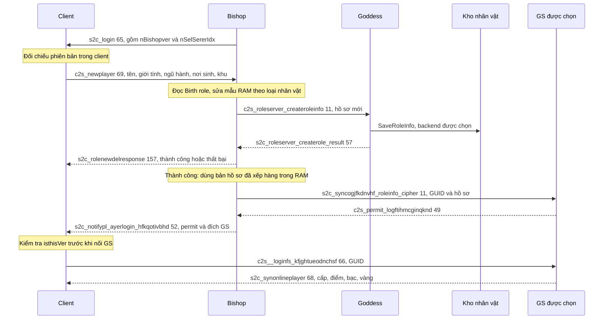

TÓM TẮT 1 — [NGUỒN] Đã khảo sát tĩnh đủ 6/6 ô chính, 3/3 ô kèm và luồng tạo nhân vật; bàn giao PARTIAL vì tệp nhịp yêu cầu nằm ngoài sandbox ghi.
TÓM TẮT 2 — [NGUỒN B/PlayerCreator.cpp:201–217] Birth role gán cấp, điểm còn lại, bạc và vàng vào hồ sơ gửi Goddess; thiết lập UI không lưu Bishop.cfg, nhưng hồ sơ được lưu khi tạo thành công. Ghi nhận thử #162 được giữ nguyên trong mục Ghi nhận sớm.
TÓM TẮT 3 — [NGUỒN B/GamePlayer.cpp:2241–2263; O/gameui/Klogin.cpp:879–920] Reset là mã bản đồ dự phòng chọn GS; Send là số phiên bản cho client đối chiếu, ô 0 cạnh nó là phạm vi khu.
TÓM TẮT 4 — [NGUỒN] Đầu ra là báo cáo này và mục Kết quả cuối task; không commit/push theo yêu cầu mới nhất. Tổng quan tiếp nhận tài liệu và xử lý tệp nhịp ngoài worktree.
TÓM TẮT 5 — [CHƯA KIỂM] Không chạy build, exe, VM, client, thử mạng hay đo runtime; chưa xác minh source khớp binary, backend hiệu lực và giá trị thực sau tạo nhân vật.

# N-03 — Bishop Birth role setting và các ô liên quan

Loại: khảo sát
Chủ đề: Ý nghĩa, nơi lưu, tác động server và biểu hiện client của các ô khởi tạo nhân vật mới và hai ô Bishop liên quan.
Từ khóa: Bishop, nhân vật mới, Birth role setting, Cap, Silver, gold, rebirth, Goddess, client
Trạng thái: PARTIAL — đã xong nội dung khảo sát tĩnh; chưa ghi được tệp nhịp ngoài vùng sandbox cho phép.
Độ phủ: đã phủ tĩnh 6/6 ô chính, 3/3 ô kèm và 1/1 luồng tạo/vào game; 0 phép thử runtime trong lượt này theo phạm vi task.
Liên quan: JX1_OPS/DESIGN/HUONG-DAN-EXE-SERVER.md; JX1_OPS/DESIGN/BANG-NUT-EXE-SERVER.md; JX1_OPS/DESIGN/TRUYEN-TAI-VA-EXE-SERVER.md; JX1_OPS/REPORTS/K-01-ban-do-truyen-tin-hieu.md
Cần tôi quyết định: không



[NGUỒN] Sơ đồ là luồng source, không phải bản ghi mạng: `B/GamePlayer.cpp:762–764`, `:1967–2007`, `:1754–1767`, `:2158`, `B/GameServer.cpp:1423–1446`, `GS/KSOServer.cpp:3972–3992`, `O/gameui/KuiNewPlayer.cpp:1032–1049`, `:1139–1179`, `S/KPlayer.cpp:1003–1036`. Gốc các ký hiệu được định nghĩa ở mục Nguồn và cách kiểm.

## Phạm vi và độ phủ

| Phần tử | Độ phủ tĩnh | Bằng chứng chính / giới hạn |
|---|---|---|
| Birth: turn on | Đã phủ | [NGUỒN B/PlayerCreator.cpp:201–218] Điều kiện gán, đọc lúc tạo; có lưu mẫu RAM dùng lại. |
| Birth: Cap | Đã phủ | [NGUỒN B/PlayerCreator.cpp:205–210] Cấp và hai loại điểm còn lại. |
| Birth: Silver | Đã phủ | [NGUỒN B/PlayerCreator.cpp:212–214] Gán số bạc cầm theo vào `iservermon`. |
| Birth: gold | Đã phủ | [NGUỒN B/PlayerCreator.cpp:215–217] Gán tiền vàng/xu vào `iclientx`. |
| Reset character rebirth m | Đã phủ | [NGUỒN B/Bishop.rc:173–174; B/GamePlayer.cpp:2241–2263] Mã bản đồ dự phòng để tìm GS. |
| Send to client to detect ve | Đã phủ | [NGUỒN B/Bishop.rc:176–177; B/GamePlayer.cpp:1162; O/gameui/Klogin.cpp:879–920] Số phiên bản đối chiếu tại client. |
| Checkbox cạnh Reset: IDC_CHECK_REVIVE | Đã phủ phạm vi Bishop | [NGUỒN B/Application.cpp:627; B/GamePlayer.cpp:2366–2367] Được tích khi Startup; đường đọc số và chọn GS không đọc trạng thái checkbox. |
| Checkbox cạnh Send: IDC_CHECK_REVIVE2 | Đã phủ phạm vi Bishop | [NGUỒN B/Bishop.rc:175; B/resource.h:46] Tìm trong `.cpp/.h/.rc` Bishop chỉ thấy khai báo/resource, không thấy nhánh xử lý đọc trạng thái. |
| Ô 0, district: IDC_EDIT_SERVER | Đã phủ | [NGUỒN B/Bishop.rc:213–214; B/GamePlayer.cpp:2371–2372; O/gameui/Klogin.cpp:903–920] Phạm vi khu đối chiếu phiên bản; chưa kiểm tác động thực. |
| Luồng tạo→lưu→GS→client | Đã phủ | [NGUỒN B/GamePlayer.cpp:1967–2007; D/ClientNode.cpp:407–461; GS/KSOServer.cpp:3937–3992; O/gameui/KuiNewPlayer.cpp:1032–1179] Chưa xác minh cùng bộ binary/ABI. |

[CHƯA KIỂM] Chưa có ca runtime nào cho 6 ô chính và 3 ô kèm trong N-03; số “đã phủ” ở trên chỉ đếm đối chiếu source. `Save settings` được đọc làm bằng chứng lưu cấu hình, không mở rộng sang các chức năng quản trị ngoài nhóm.

## Giải mã tên

| Tên gốc | Mã hóa | Chữ đúng | Nguồn file:dòng |
|---|---|---|---|
| Bishop | ASCII, không cần đổi GBK/TCVN3 | Bishop, cổng đăng nhập/điều phối | [NGUỒN B/GamePlayer.cpp:1562–1599] |
| Goddess | ASCII, không cần đổi GBK/TCVN3 | Goddess, dịch vụ lưu nhân vật | [NGUỒN D/ClientNode.cpp:407–461] |
| gs001 / GS | ASCII, tên triển khai / viết tắt | Máy chủ thế giới; source chọn GS theo bản đồ và khu, không cố định mọi role vào gs001 | [TÀI LIỆU JX1_OPS/DESIGN/TRUYEN-TAI-VA-EXE-SERVER.md:35]; [NGUỒN B/GameServer.cpp:1494–1531] |
| Sword3PaySys / PaySys; S3Relay | ASCII, tên tiến trình | Dịch vụ tài khoản; dịch vụ chuyển GS/liên lạc | [TÀI LIỆU JX1_OPS/DESIGN/TRUYEN-TAI-VA-EXE-SERVER.md:31–33] |
| Birth role setting → Birth role settings: | ASCII, nhãn ảnh → resource | Thiết lập nhân vật mới | [NGUỒN B/Bishop.rc:222] |
| turn on | ASCII | Bật áp dụng giá trị nhập khi tạo role | [NGUỒN B/Bishop.rc:221; B/PlayerCreator.cpp:201–218] |
| Cap: | ASCII, giữ nguyên chữ gốc | Cấp chiến đấu (`ifightlevel`); không dịch thành sức chứa | [NGUỒN B/Bishop.rc:162,225; B/PlayerCreator.cpp:205–210] |
| Silver → Silver coins: | ASCII, nhãn ảnh → resource | Bạc cầm theo, khác bạc trong kho | [NGUỒN B/Bishop.rc:223,226; B/PlayerCreator.cpp:212–214,278–280] |
| gold: | ASCII | Vàng/xu của nhân vật (`iclientx`), khác điểm tài khoản | [NGUỒN B/Bishop.rc:224,227; S/KPlayerDBFuns.cpp:685–687] |
| Reset character rebirth m → Reset character rebirth map number: | ASCII; phần bị cắt phục hồi từ resource | Mã bản đồ dự phòng chọn GS lúc đăng nhập | [NGUỒN B/Bishop.rc:173–174; B/GamePlayer.cpp:2260–2263] |
| Send to client to detect ve → Send to client to detect version number: | ASCII; phần bị cắt phục hồi từ resource | Số phiên bản gửi cho client đối chiếu | [NGUỒN B/Bishop.rc:176–177; B/GamePlayer.cpp:1162] |
| Second rebirth point; district | ASCII | Nhãn hai checkbox dùng lại cùng chữ; district là khu, không phải bản đồ | [NGUỒN B/Bishop.rc:172–177,213–214] |

[NGUỒN/TÀI LIỆU] Không có tên riêng kỹ năng, trang bị, quái, NPC hay bản đồ cần giải mã Hán/Việt cũ trong phạm vi này. Giữ `53` là ID, chưa gán tên bản đồ. Source server đọc chú thích/chuỗi Hán bằng GBK (CP936); client có chuỗi UTF-8 lẫn chú thích đã lỗi sẵn; báo cáo ghi UTF-8 không BOM. Không coi việc chọn UTF-8 để đọc là đã khôi phục được mọi chú thích hỏng.

## Sắp theo cấu trúc game

1. Tạo nhân vật mới: Birth role setting bật/tắt và các giá trị Cap, Silver, gold.
2. Lưu nhân vật: Bishop tạo hồ sơ → Goddess lưu theo backend → phản hồi kết quả.
3. Vào thế giới: ưu tiên bản đồ chỉ định/điểm hồi sinh/bản đồ thoát; Reset cung cấp bản đồ dự phòng tìm GS.
4. Đăng nhập client: Send truyền số phiên bản; district giới hạn khu phải so khớp.

## Nguồn và cách kiểm

[NGUỒN] Các ký hiệu `file:dòng` bên dưới mở rộng theo bảng này; chỉ đối chiếu cây được task chỉ định, không thay bằng cây `D:/JX-source` từng được tài liệu U-02 dùng.

| Ký hiệu | Gốc tuyệt đối |
|---|---|
| B | `C:/Jx1CocoV3/SwordOnline/SwordOnline/jxOnline/gateway/Sources/MultiServer/Bishop` |
| D | `C:/Jx1CocoV3/SwordOnline/SwordOnline/jxOnline/gateway/Sources/MultiServer/Goddess` |
| S | `C:/Jx1CocoV3/SwordOnline/SwordOnline/jxOnline/gameserver/Sources/Core/Src` |
| GS | `C:/Jx1CocoV3/SwordOnline/SwordOnline/jxOnline/gameserver/Sources/MultiServer/GameServer` |
| GH / SH | `C:/Jx1CocoV3/SwordOnline/SwordOnline/jxOnline/gateway/Headers` / `C:/Jx1CocoV3/SwordOnline/SwordOnline/jxOnline/gameserver/Headers` |
| O | `C:/Jx1CocoV3/Folder/Client2912-20260116T044348Z-3-001/Client2912/Client/Classes` |

[NGUỒN] `B/Bishop.vcxproj:127` dẫn include về `gateway/Headers`; mở header tương ứng để đối chiếu enum gói tin. Đã tra mục liên quan của `JX1_OPS/CONTEXT-PACK/GS001-MAP.md:1–9` và `JX1_OPS/DESIGN/MUC-LUC-TRI-THUC.md:17`; map không có chi tiết Birth role. Không có `.graphify_root` tại các vị trí `gateway/graphify-out`, `gateway/Sources/graphify-out`, `gameserver/graphify-out`, `Client/graphify-out`, `Client/Classes/graphify-out` đã kiểm; dùng tìm symbol giới hạn thư mục, không tạo lại graph.

[CHƯA KIỂM] Chưa chứng minh source này dựng ra exe/APK đã chụp/thử #162; chưa kiểm ABI, định dạng blob theo binary, cấu hình hiệu lực hoặc backend đang dùng. Nhãn `[NGUỒN]` xác nhận đường code trên đĩa; `[TÀI LIỆU]` dẫn ghi nhận cũ, không lặp lại phép thử; `[GIẢ THUYẾT]` là suy ra có điều kiện cần kiểm chứng. Không dùng nghiên cứu Internet, kết nối mạng hay dịch vụ ngoài cho task.

## Ghi nhận sớm

Ảnh Bishop cho thấy nhóm Birth role setting nằm ở phần dưới cửa sổ; các ô Cap, Silver, gold và nút turn on hiển thị riêng. Nút save setting nằm ở khung Status, không nên đồng nhất với việc Birth role setting được ghi vào Bishop.cfg. Bảng thử #162 ghi nhận bật turn on, đặt Cap=2, Silver=100, gold=1 rồi save setting nhưng Bishop.cfg không đổi; thử nghiệm đó chưa kiểm tra dữ liệu của nhân vật mới sau khi tạo (`JX1_OPS/DESIGN/BANG-NUT-EXE-SERVER.md:41`). Đây là bằng chứng tài liệu/thử nghiệm cũ, chưa phải đối chiếu source cho N-03.

## 1. Tạo nhân vật mới: trả lời 4 câu cho từng ô Birth role

### 1.1. turn on — IDC_CHECK_ROLESET

1. **Ghi vào đâu?** [NGUỒN B/PlayerCreator.cpp:201–218; B/Application.cpp:700–716] Trạng thái checkbox nằm ở cửa sổ/bộ nhớ Bishop. Khi có yêu cầu tạo, `GetRoleData` đọc checkbox rồi mới xét ba ô số. Handler Save settings chỉ gọi lưu phiên bản, bản đồ dự phòng và giới hạn mở client; không lưu checkbox Birth hoặc ba ô Birth vào Bishop.cfg. Đây là ý nghĩa hẹp của “chỉ nằm trong bộ nhớ” trong thử #162; hồ sơ sinh ra có đường lưu riêng ở Goddess.
2. **Exe nào nhận và làm gì?** [NGUỒN B/GamePlayer.cpp:1967–2007; D/ClientNode.cpp:422–461] Bishop áp các giá trị vào `TRoleData`, gửi `c2s_roleserver_createroleinfo=11` tới Goddess. Goddess không nhận một lệnh bật Birth riêng; nó nhận hồ sơ đã được Bishop chuẩn bị, gọi `SaveRoleInfo(..., TRUE)` rồi trả kết quả.
3. **Tác động SERVER?** [NGUỒN B/PlayerCreator.cpp:166–218; B/GamePlayer.h:268] Tác động lên yêu cầu tạo mới dùng bộ tạo này, không có vòng sửa hàng loạt nhân vật cũ. Tắt checkbox chỉ bỏ qua nhánh gán; không có lệnh nạp lại mẫu ở nhánh tắt. Bộ tạo là đối tượng static, dùng chung trong tiến trình; xem rủi ro giữ giá trị ở mục 1.5.
4. **Tác động CLIENT?** [NGUỒN O/gameui/KuiNewPlayer.cpp:1032–1068] Checkbox không tạo một thông báo riêng cho người chơi. Client nhận `s2c_rolenewdelresponse=157`: thành công báo “Tạo nhân vật thành công, đang vào game!”, thất bại về trạng thái danh sách và dùng chuỗi `G_NEW_PLAYER_CREATE_FAIL`. Giá trị Birth xuất hiện qua hồ sơ/đồng bộ sau đó, không phải một gói “bật Birth”.

### 1.2. Cap — IDC_EDIT_ROLELEVEL

1. **Ghi vào đâu?** [NGUỒN B/PlayerCreator.cpp:205–210] Bishop đọc số không dấu từ ô. Nếu `L > 0`, gán cấp chiến đấu `ifightlevel=L`, điểm tiềm năng chưa cộng `ileftprop=(L−1)×5`, điểm kỹ năng chưa cộng `ileftfight=L−1` vào mẫu hồ sơ RAM. Không có phép cộng cấp vào nhân vật đã tồn tại ở nhánh này.
2. **Exe nào nhận và làm gì?** [NGUỒN B/GamePlayer.cpp:1967–2007; D/ClientNode.cpp:440; S/KPlayerDBFuns.cpp:455,581,608–609] Bishop gửi hồ sơ sang Goddess lưu; GS được chọn nạp cấp cùng hai loại điểm vào nhân vật từ hồ sơ đó.
3. **Tác động SERVER?** [NGUỒN B/PlayerCreator.cpp:205–210,268–269,286–292] Đây là gán cấp/điểm khởi đầu; nhánh UI không gọi chuỗi tăng từng cấp, không tự tính lại kinh nghiệm hoặc toàn bộ máu/nội lực/chỉ số theo cấp. Những trường khác đã được đọc từ mẫu ini. Giá trị 0/rỗng không phải lệnh đưa về cấp 1; điều kiện chỉ gán khi lớn hơn 0. Giới hạn cấp an toàn thực tế chưa kiểm tra.
4. **Tác động CLIENT?** [NGUỒN S/KPlayer.cpp:1003–1036; O/gamecore/KPlayer.cpp:4959,4964–4965] GS đồng bộ `s2c_synonlineplayer=68`, gồm cấp, điểm tiềm năng và điểm kỹ năng; client nạp chúng vào trạng thái nhân vật. Không có thông báo “tăng cấp bởi Bishop” ở luồng tạo này. Ví dụ điều kiện từ source: Cap=2 cho hồ sơ cấp 2, 5 điểm tiềm năng, 1 điểm kỹ năng; đây là tính từ code, chưa phải kết quả thử nhân vật của #162.

### 1.3. Silver — IDC_EDIT_ROLEMONEY

1. **Ghi vào đâu?** [NGUỒN B/PlayerCreator.cpp:212–214,278–280] Nếu giá trị lớn hơn 0, gán trực tiếp `BaseInfo.iservermon` trong hồ sơ RAM. Ô này là bạc cầm theo; bạc kho là trường `isavemoney` riêng. Không nhân hệ số và không cộng thêm vào số cũ ở câu lệnh gán này.
2. **Exe nào nhận và làm gì?** [NGUỒN B/GamePlayer.cpp:1980–2007; D/ClientNode.cpp:440; S/KPlayerDBFuns.cpp:693,699–702] Goddess nhận/lưu hồ sơ; GS nạp `iservermon` và bạc kho vào danh sách tiền của nhân vật. Dữ liệu Birth không được gửi cho PaySys như một lệnh nạp tài khoản.
3. **Tác động SERVER?** [NGUỒN B/PlayerCreator.cpp:201–218; D/IDBRoleServer.cpp:760,876] Khi tạo thành công, số bạc trong hồ sơ có đường lưu vào kho dữ liệu nhân vật; “không lưu Bishop.cfg” không có nghĩa bạc chỉ tồn tại tạm thời ở Bishop. Nhập 0/rỗng không ghi đè về 0. Backend đang dùng và số bạc sau các script đăng nhập chưa kiểm tra.
4. **Tác động CLIENT?** [NGUỒN S/KPlayer.cpp:1031–1036; O/gamecore/KPlayer.cpp:4997–4998; O/gameui/KuiItem.cpp:1632–1638] Gói đồng bộ bản thân `68` chứa `m_nMoney1`; client nạp bạc cầm theo, giao diện túi đọc `GDI_PLAYER_HOLD_MONEY` rồi hiển thị số nguyên. Silver=100 là 100 đơn vị bạc theo phép gán nguồn, không có bằng chứng phải nhập “vạn” hoặc nhân 10.000. Giá trị thật ở client của lần thử #162 chưa kiểm tra.

### 1.4. gold — IDC_EDIT_ROLEXU

1. **Ghi vào đâu?** [NGUỒN B/PlayerCreator.cpp:215–217] Nếu giá trị lớn hơn 0, gán trực tiếp `BaseInfo.iclientx` của hồ sơ RAM. Không ghi một khóa Birth trong Bishop.cfg, không dùng trường điểm/hạn chơi tài khoản ở nhánh này.
2. **Exe nào nhận và làm gì?** [NGUỒN B/GamePlayer.cpp:1980–2007; D/ClientNode.cpp:440; S/KPlayerDBFuns.cpp:685–687] Bishop gửi hồ sơ tới Goddess; GS đọc `iclientx`, đưa vào số vàng/xu của danh sách tiền bằng `SetServer`.
3. **Tác động SERVER?** [NGUỒN B/PlayerCreator.cpp:215–217; D/IDBRoleServer.cpp:760,876] Đây là giá trị tiền vàng/xu khởi đầu được gán vào hồ sơ, không phải thao tác cộng tiền offline của cửa sổ Goddess. Giá trị 0/rỗng bỏ qua câu gán; chưa có bằng chứng về hạn mức đổi an toàn hoặc quy đổi với tiền/tài khoản ngoài game.
4. **Tác động CLIENT?** [NGUỒN S/KPlayer.cpp:1033–1036; O/gamecore/KPlayer.cpp:4999; O/gamecore/CoreShell.cpp:2343–2345; O/gameui/KuiItem.cpp:1633,1640–1644] Gói `68` chứa `m_nXu`; client lưu số vàng/xu, giao diện túi đọc `GDI_PLAYER_HOLD_XU` và hiển thị số nguyên. gold=1 đi theo phép gán là 1 đơn vị trong trường đó; chưa xác minh số dư runtime của nhân vật thử.

### 1.5. Giá trị mẫu trong RAM và giới hạn hoàn tác

[NGUỒN B/PlayerCreator.h:16–18; B/PlayerCreator.cpp:62–70,166–177,201–218; B/GamePlayer.h:268] Khi khởi tạo, bộ tạo giữ 10 mẫu đọc từ `settings/player/newplayerini%02d.ini`. Mỗi yêu cầu chọn mẫu theo `ngũ hành × ROLE_NO + giới tính`, rồi dùng trực tiếp con trỏ `m_pRoleData[nIndex]`. Nhánh Birth sửa chính mẫu này, không tạo bản sao mới hoặc phục hồi ba trường khi tắt checkbox.

[GIẢ THUYẾT — suy ra trực tiếp từ đường code trên, chưa thử runtime] Sau một lần gán Cap/Silver/gold dương, yêu cầu tiếp theo cùng loại mẫu có thể kế thừa các giá trị đã sửa dù bỏ tích hoặc nhập 0. Việc này có thể xảy ra cả sau yêu cầu tạo bị Goddess từ chối, vì sửa mẫu diễn ra trước phản hồi lưu. Không suy rằng mọi loại mẫu đều đổi đồng loạt. Ghi nhận #162 đã bỏ tích/xóa ô là hoàn tác UI và kiểm cfg, chưa chứng minh đã phục hồi mẫu RAM hoặc hồ sơ đã tạo. Giữ nguyên kết luận cũ về cfg; bổ sung giới hạn hoàn tác này để PM biết.

[CHƯA KIỂM] Chưa thử việc nạp lại mẫu/khởi động lại Bishop, chưa kiểm file ini hiệu lực, chưa đo số dư/cấp sau script đăng nhập. Task này không sửa code, cấu hình hoặc dữ liệu nhân vật và không thực hiện cách hoàn tác runtime nào.

## 2. Vào thế giới: Reset character rebirth map number

1. **Ghi vào đâu?** [NGUỒN B/Application.cpp:710–711; B/Network.cpp:104–115; B/GamePlayer.cpp:1131–1136,2359–2367] Ô `IDC_EDIT_TWO_REVIVE` ghi vào `Bishop.cfg`, mục `[Network]`, khóa `TwoRevivePos` khi bấm Save settings. Khi trả kết quả xác thực tài khoản, Bishop đọc ô hiện thời vào `m_nTwoRevivePos` của phiên người chơi. Lưu cfg và chụp giá trị cho phiên là hai việc khác nhau; không có câu lệnh ghi trực tiếp bản đồ nhân vật vào Goddess ở đường này.
2. **Exe nào nhận và làm gì?** [NGUỒN B/GamePlayer.cpp:2241–2263; B/GameServer.cpp:1494–1531] Chính Bishop dùng số này để tìm GS dự phòng: thử bản đồ chỉ định `m_enterMapIdx`; nếu không có, dùng bản đồ hồi sinh khi `cUseRevive` bật, hoặc bản đồ lúc thoát khi không bật; nếu GS trả về NULL thì thử `TwoRevivePos` trong cùng khu của hồ sơ. `QueryServer` tra bảng bản đồ→GS và đối chiếu chỉ số khu. Không phải gói yêu cầu Goddess “reset chuyển sinh”.
3. **Tác động SERVER?** [NGUỒN B/GamePlayer.cpp:2260–2263,2324–2330; B/GameServer.cpp:1423–1446; S/KPlayerDBFuns.cpp:464–474] Có thể giúp định tuyến tiếp khi không tìm được GS cho bản đồ ưu tiên. Source đang đọc không gán `TwoRevivePos` vào `irevivalid`, `ientergameid` hoặc cấp/tiền trong hồ sơ trước khi gửi. GS vẫn nạp điểm hồi sinh từ hồ sơ theo logic riêng; không đủ căn cứ hứa ô này sẽ chuyển người chơi tới đúng bản đồ nhập, sửa kẹt map hay sửa toàn bộ DB. Chưa kiểm bản đồ 53 có thuộc GS đang hoạt động không.
4. **Tác động CLIENT?** [NGUỒN B/GamePlayer.cpp:2158–2190; O/gameui/KuiNewPlayer.cpp:1092–1104,1164–1179] Không gửi một gói Reset riêng cho client; client nhận permit `52` và đích GS. Nếu không định tuyến được trong nhánh đã đọc, Bishop trả `bPermit=false`, IP=0, mã `nPort=2`; client tạo mới đi vào nhánh dùng `G_NEW_PLAYER_INVALID_BUSY`. Mã 2 tại đây là dấu hiệu lỗi, không phải cổng kết nối thực. Nội dung bản dịch đang đóng gói và thông báo thật chưa kiểm tra; không coi chú thích “đầy server” là chẩn đoán chắc chắn quá tải.

[NGUỒN B/GamePlayer.cpp:1136,2366–2367; B/Network.cpp:75] Giá trị được đọc từ UI ở lúc xác thực; đổi ô sau thời điểm đó không có bằng chứng cập nhật hồi tố mọi phiên đã xác thực. Đọc cfg mặc định là 0 nếu thiếu khóa; số 53 trong ảnh và giá trị constructor không chứng minh cấu hình hiệu lực của một lần chạy khác.

## 3. Đăng nhập client: Send to client to detect version number

1. **Ghi vào đâu?** [NGUỒN B/Application.cpp:704–706; B/Network.cpp:118–128; B/GamePlayer.cpp:2379–2381,1162] Ô `IDC_EDIT_BISHOPVER` ghi chuỗi vào `Bishop.cfg [Network] BishopVer` khi Save settings. Khi xác thực, Bishop đọc ô sang `double`, rồi định dạng hai chữ số thập phân vào `KLoginAccountInfo.nBishopver`. Giá trị đọc mặc định khi thiếu cấu hình là chuỗi `7.0` (`B/Network.cpp:81–83`); `50.50` chỉ là giá trị ảnh.
2. **Exe nào nhận và làm gì?** [NGUỒN B/GamePlayer.cpp:1162,1384–1397; O/gameui/Klogin.cpp:879–920] Bishop gửi trường này cho client trong `s2c_login=65`. Client đọc `Settings/Ver/Xfsverjx.ini`, đúng tên mục gốc `[CilentVer]`, khóa `ver`, mặc định đọc số `0.1`, rồi so sánh bằng/khác số phiên bản nhận được. Đây là kiểm phía client trong đường đã đọc, không phải yêu cầu ghi DB cho Goddess/gs001.
3. **Tác động SERVER?** [NGUỒN B/GamePlayer.cpp:1384–1397; O/gameui/KuiNewPlayer.cpp:616–646,1032–1049,1139–1144] Ô này không chỉnh cấp, tiền hay hồ sơ lưu. Client dùng cờ đối chiếu để quyết định có nối GS tiếp không. **[GIẢ THUYẾT — suy ra từ thứ tự source]** Trong luồng tạo mới, có thể đã lưu thành công và báo tạo thành công rồi mới bị chặn ở bước permit do cờ phiên bản sai; không nên đồng nhất lỗi phiên bản khi vào game với “Goddess chưa tạo nhân vật”. Chưa thử tình huống đó.
4. **Tác động CLIENT?** [NGUỒN O/gameui/Klogin.cpp:881–920,928–942; O/gameui/KuiNewPlayer.cpp:1139–1144] Thiếu file phiên bản: báo qua khóa `G_TEXT_WRONG_VERSION`, đặt lỗi `LL_R_INVALID_PROTOCOLVERSION`, lên lịch đếm ngược thoát. Lệch giá trị `BishopVer`: đặt `isthisVer=false` theo phạm vi khu; ở luồng tạo mới, đến permit sẽ báo khóa lỗi phiên bản rồi dừng nối GS. Kiểm `ProtocolVersion != KPROTOCOL_VERSION` là một kiểm khác; ô BishopVer không sửa hằng `KPROTOCOL_VERSION`. Chưa đối chiếu chuỗi dịch lỗi hiệu lực hoặc APK đã cài.

### 3.1. Ba ô kèm: cũng trả lời đủ 4 câu

| Ô | (1) Ghi vào đâu? | (2) Ai nhận/làm gì? | (3) Tác động SERVER? | (4) Tác động CLIENT? |
|---|---|---|---|---|
| Checkbox cạnh Reset, `IDC_CHECK_REVIVE` | [NGUỒN B/Application.cpp:627] Trạng thái UI; được tích khi Startup. Handler lưu `:700–716` không lưu trạng thái này. | [NGUỒN B/GamePlayer.cpp:2366–2367] Bishop đọc ô số mà không hỏi checkbox. | [NGUỒN B/GamePlayer.cpp:2241–2263] Fallback không có điều kiện checkbox; chưa thấy cơ chế bật/tắt nghiệp vụ bằng checkbox trong `.cpp/.h` Bishop đã tra. | [NGUỒN B/GamePlayer.cpp:2158–2190] Không thấy trường/gói riêng truyền trạng thái checkbox; kết quả đi theo permit. Hiệu lực binary chưa kiểm tra. |
| Checkbox cạnh Send, `IDC_CHECK_REVIVE2` | [NGUỒN B/Bishop.rc:175; B/resource.h:46] Chỉ thấy resource/ID; chưa thấy đường lưu trạng thái. | [NGUỒN B/GamePlayer.cpp:2379–2381,1162] Việc đọc và gửi phiên bản không xét checkbox này. | [NGUỒN B/Application.cpp:700–716] Không thể coi bỏ tích là tắt gửi/kiểm phiên bản theo code đã đọc. Không thấy handler đọc ID trong `.cpp/.h` Bishop. | [NGUỒN O/gameui/Klogin.cpp:879–920] Client quyết định bằng dữ liệu phiên bản/khu, không bằng trạng thái checkbox này. Chưa thử thực tế. |
| `IDC_EDIT_SERVER`, nhãn district, ảnh bằng 0 | [NGUỒN B/Application.cpp:1287; B/GamePlayer.cpp:2371–2372,1161] UI khởi tạo 0; đọc vào `m_nForBitOpenSer`, gửi `nSelSererIdx`. Save settings `:700–716` không lưu ô này. | [NGUỒN O/gameui/Klogin.cpp:903–920] Client nhận trong login `65`: `<=0` đối chiếu mọi khu; `>0` chỉ đối chiếu khi khu đang chọn bằng giá trị nhận; khu khác cho cờ hợp lệ. | [NGUỒN B/GamePlayer.cpp:1161,2371–2372] Là số khu, không phải phần thập phân của phiên bản và không phải mã bản đồ. Cùng biến còn liên quan nhóm giới hạn mở client; chức năng nhóm đó ngoài N-03. | [NGUỒN O/gameui/Klogin.cpp:903–920; O/gameui/KuiNewPlayer.cpp:1139–1144] Quyết định khu nào bị cờ phiên bản chặn trước nối GS; không thay số phiên bản trong file client. Runtime chưa kiểm tra. |

## 4. Luồng nhân vật mới từ Bishop qua Goddess tới client

| Chặng | Đường đi đã đối chiếu | Kết quả / giới hạn |
|---|---|---|
| 1. Client gửi tạo | [NGUỒN O/gameui/KuiNewPlayer.cpp:616–646] `c2s_newplayer` chứa tên, giới tính, ngũ hành, ID nơi sinh và khu. | Không gửi Cap/Silver/gold trong lệnh tạo; các giá trị đó do Bishop quyết định từ UI/mẫu. |
| 2. Bishop kiểm và tạo hồ sơ | [NGUỒN B/GamePlayer.cpp:1562–1599,1942–1967; B/PlayerCreator.cpp:166–235] Kiểm tên theo hàm TCVN3, chọn mẫu, gán Birth khi bật, lấy điểm sinh. | Nơi sinh mới dùng `nMapID` yêu cầu; nếu `<=0` nguồn gán `irevivalid=53`, `irevivalx=19`. Đây là nhánh khác với ô Reset dự phòng chọn GS. |
| 3. Bishop gửi lưu và giữ bản hồ sơ | [NGUỒN B/GamePlayer.cpp:1980–2007] Gửi `c2s_roleserver_createroleinfo`; đồng thời xếp bản hồ sơ vào hàng nội bộ bằng ID `s2c_rolehjdkalritopq_getroleinfo_result`. | ID nội bộ này không chứng minh Goddess đã gửi lại blob hoặc GS đã nạp xong. |
| 4. Goddess lưu | [NGUỒN D/ClientNode.cpp:422–461; D/IDBRoleServer.cpp:681–705,760,790–825,876] Nhận hồ sơ, gọi `SaveRoleInfo`, có nhánh SQL và nhánh DB; kiểm tên trùng/số nhân vật rồi lưu. | Nhánh SQL gọi `updateBlobData_n`; nhánh DB gọi `db_table->add`. Không khẳng định backend đang chạy là SQL/MySQL hoặc tên tệp DB cụ thể khi chưa kiểm cấu hình hiệu lực. |
| 5. Bishop trả kết quả tạo | [NGUỒN B/GamePlayer.cpp:1730–1772] Goddess trả 1 mới coi thành công; Bishop gửi `s2c_rolenewdelresponse`, rồi chuyển bước; thất bại gửi false và về chờ chọn/tạo. | [NGUỒN O/gameui/KuiNewPlayer.cpp:1043–1068] Thông báo tạo thành công hoặc lỗi tạo không bảo đảm đã vào thế giới. |
| 6. Bishop chọn GS và gửi hồ sơ | [NGUỒN B/GamePlayer.cpp:762–764,2140–2158,2241–2263,2330; B/GameServer.cpp:1423–1446] Sau thành công dùng blob nội bộ, định tuyến, gửi GUID+hồ sơ tới GS. | Goddess là bên lưu/xác nhận; trong luồng tạo mới này Bishop là bên gửi hồ sơ tới GS, không phải một kết nối Goddess→GS tự đẩy role mới. |
| 7. GS chấp nhận và client đổi kết nối | [NGUỒN GS/KSOServer.cpp:3937–3992; B/GameServer.cpp:991–1021; B/GamePlayer.cpp:2411–2433; O/gameui/KuiNewPlayer.cpp:1139–1197] GS gọi `AddCharacter`; có chỉ số hợp lệ thì trả permit. Bishop chuyển permit; client kiểm phiên bản, nối đích được trả, gửi GUID và đóng đường gateway. | Không mặc định mọi nhân vật đều vào gs001; GS nào được chọn phụ thuộc bản đồ/khu đăng ký. Chưa kiểm binary và kết nối thực. |
| 8. Nạp và hiển thị trạng thái | [NGUỒN S/KPlayerDBFuns.cpp:455,581,608–609,685–702; S/KPlayer.cpp:1003–1041; O/gamecore/KPlayer.cpp:4959–4999; O/gameui/KuiItem.cpp:1632–1644] GS nạp cấp/điểm/tiền và đồng bộ bản thân; client cập nhật số dư/cấp. | Source còn gọi `script/system/online.lua` sau khi đóng gói đồng bộ; chưa đọc/chạy script hiệu lực, nên không hứa đây là trạng thái cuối cùng người chơi quan sát được. |

### ID gói tin liên quan, tách theo hướng

[NGUỒN] Các số dưới tính theo enum ở đúng header đã mở, không phải ID bắt được trên mạng; cùng số khác hướng/ngữ cảnh không phải cùng gói. Không kết luận ABI tương thích chỉ từ ID.

| Hướng / vai trò | Symbol = ID thập phân | Bằng chứng enum và nơi dùng |
|---|---|---|
| Client→Bishop, tạo | `c2s_newplayer = 69` | `GH/KProtocolDef.h:250–255`; `O/gamecore/KProtocolDef.h:248–253`; `O/gameui/KuiNewPlayer.cpp:640–646` |
| Bishop→Goddess, lưu mới | `c2s_roleserver_createroleinfo = 11` | `GH/KProtocolDef.h:222–223`; `B/GamePlayer.cpp:1980–2007` |
| Goddess→Bishop, kết quả lưu mới | `s2c_roleserver_createrole_result = 57` | `GH/KProtocolDef.h:37–46`; `D/ClientNode.cpp:455–461` |
| Bishop→client, kết quả tạo/xóa | `s2c_rolenewdelresponse = 157` | `GH/KProtocolDef.h:53–146`; `O/gamecore/KProtocolDef.h:52–145`; `B/GamePlayer.cpp:1743–1766` |
| Hàng nội bộ Bishop, bản hồ sơ chờ xử lý | `s2c_rolehjdkalritopq_getroleinfo_result = 10` | `GH/KProtocolDef.h:23`; `B/GamePlayer.cpp:1998,2140` — không phải bước đọc DB lại trong luồng tạo này |
| Bishop→GS, GUID+hồ sơ | `s2c_syncogjfkdnvhf_roleinfo_cipher = 11` | `GH/KProtocolDef.h:23–24`; `SH/KProtocolDef.h:23–24`; `B/GameServer.cpp:1423–1446` |
| GS→Bishop, giấy phép | `c2s_permit_logftihmcginqknd = 49` | `SH/KProtocolDef.h:237–238`; `GS/KSOServer.cpp:3973–3992` |
| Bishop→client, đích GS/giấy phép | `s2c_notifypl_ayerlogin_hfkqotivbhd = 52` | `GH/KProtocolDef.h:37–41`; `O/gamecore/KProtocolDef.h:36–40`; `B/GamePlayer.cpp:2433` |
| Client→GS, đăng nhập GUID | `c2s__loginfs_kfjghtueodnchsf = 66` | `O/gamecore/KProtocolDef.h:248–250`; `O/gameui/KuiNewPlayer.cpp:1173–1179` |
| Bishop→client, trả đăng nhập/phiên bản | `s2c_login = 65` | `GH/KProtocolDef.h:53–54`; `O/gamecore/KProtocolDef.h:52–53`; `B/GamePlayer.cpp:1162,1394–1397` |
| GS→client, trạng thái bản thân | `s2c_synonlineplayer = 68` | `SH/KProtocolDef.h:53–57`; `O/gamecore/KProtocolDef.h:52–56`; `S/KPlayer.cpp:1003–1036`; `O/gamecore/KProtocolProcess.cpp:48,2150–2153` |

## Đã xác minh / Chưa xác minh

### Đã xác minh

- [TÀI LIỆU] Giữ nguyên ghi nhận #162: Birth role setting không được lưu vào Bishop.cfg và chỉ nằm trong bộ nhớ Bishop; tác dụng khi tạo nhân vật chưa thử (`JX1_OPS/DESIGN/BANG-NUT-EXE-SERVER.md:41`). Phần bổ sung phân biệt trạng thái thiết lập với hồ sơ nhân vật được gửi đi lưu.
- [NGUỒN B/Bishop.rc:162–177,213–227] Đã đọc nhãn đầy đủ và ID điều khiển; xem ảnh có sẵn `JX1_OPS/ANH/exe-server/4-Bishop.png`, không chụp mới hoặc thao tác ứng dụng.
- [NGUỒN B/PlayerCreator.cpp:166–236; B/GamePlayer.cpp:1967–2007; D/ClientNode.cpp:407–461] Đã đối chiếu chỗ gán Birth, đóng gói gửi Goddess và phản hồi lưu.
- [NGUỒN B/GamePlayer.cpp:1136,2241–2263,2359–2381; O/gameui/Klogin.cpp:879–920] Đã đối chiếu lúc đọc hai ô Status, fallback chọn GS và đối chiếu phiên bản/phạm vi khu ở client.
- [NGUỒN GS/KSOServer.cpp:3937–3992; S/KPlayerDBFuns.cpp:455,581,608–609,685–702; O/gameui/KuiNewPlayer.cpp:1032–1197] Đã lần GS tiếp nhận hồ sơ, client nhận kết quả tạo và nối GS theo permit.
- [NGUỒN] Các kiểm tra tài liệu đã chạy: `git status --short --branch` một lần trước ghi, đọc UTF-8/GBK có số dòng, tìm symbol bằng `Select-String`, kiểm nội dung/định dạng báo cáo và diff tài liệu. Đây không phải build/test game.

### Chưa xác minh

- [CHƯA KIỂM] Source có khớp bộ exe/APK đã chạy/chụp ảnh không; ABI/packing/blob tương thích và header thực dùng trong binary. ID trùng không chứng minh cấu trúc trùng.
- [CHƯA KIỂM] File mẫu ini/Bishop.cfg hiệu lực, backend DB/SQL đang chọn, tên tệp DB thực và độ bền ghi sau mất điện; khảo sát này chỉ lần đường gọi lưu, không kiểm dữ liệu thật.
- [CHƯA KIỂM] Giá trị cấp/bạc/vàng thực sau tạo, tải lại hoặc script đăng nhập; mức cấp/số tiền tối đa an toàn. Chưa thử rủi ro mẫu RAM giữ lại giá trị theo mục 1.5.
- [CHƯA KIỂM] Tên và trạng thái nạp bản đồ ID 53, vị trí cuối sau GS xử lý, thông báo dịch đúng APK, hiệu lực thao tác hai checkbox và district trên binary.
- [CHƯA KIỂM] Không chạy build, game executable, client, VM, kết nối mạng hoặc bắt gói theo phạm vi task; không có kết luận runtime mới. Ghi nhận #162 là phép thử cũ được dẫn lại.
- [GIỚI HẠN GHI] Chưa tạo/cập nhật được `D:\JX-wt\N-03.nhip` vì đường dẫn là tệp ngang hàng ngoài writable root `D:\JX-wt\N-03`; không có lần thử vượt sandbox hoặc yêu cầu thay quyền. Phần nội dung khảo sát đã hoàn tất, yêu cầu nhịp ngoài worktree chưa hoàn tất.

## Sổ thông số

| Nhóm | Tên/hằng số | file:dòng | Giá trị | Đơn vị | Ảnh hưởng | Đổi an toàn (CÓ/CẨN THẬN/KHÔNG) | Nguồn đo |
|---|---|---|---|---|---|---|---|
| Birth | turn on / IDC_CHECK_ROLESET | `B/PlayerCreator.cpp:201–218` | Tích mới vào nhánh gán; trạng thái hiệu lực chưa đo | Bật/tắt | Gán lên mẫu dùng để tạo nhân vật | CẨN THẬN | Đọc tĩnh, không có mặc định chạy được xác minh |
| Birth | Cap / ifightlevel | `B/PlayerCreator.cpp:205–210,269` | Chỉ gán L>0; mặc định đọc mẫu khi thiếu khóa là 1 | Cấp chiến đấu | Đổi cấp khởi đầu; chưa biết trần an toàn | CẨN THẬN | Đọc tĩnh, mẫu hiệu lực chưa đọc |
| Birth | ileftprop | `B/PlayerCreator.cpp:209` | (L−1)×5 | Điểm tiềm năng chưa cộng | Gán cùng Cap | CẨN THẬN | Công thức source; Cap=2 → 5, chưa đo nhân vật |
| Birth | ileftfight | `B/PlayerCreator.cpp:210` | L−1 | Điểm kỹ năng chưa cộng | Gán cùng Cap | CẨN THẬN | Công thức source; Cap=2 → 1, chưa đo nhân vật |
| Birth | Silver / iservermon | `B/PlayerCreator.cpp:212–214,279–280` | S>0 thì gán S; mặc định đọc imoney thiếu khóa là 0 | Đơn vị bạc cầm theo | Khác isavemoney trong kho; không có hệ số đổi ở phép gán | CẨN THẬN | Đọc tĩnh; chưa đo số dư cuối |
| Birth | gold / iclientx | `B/PlayerCreator.cpp:215–217; S/KPlayerDBFuns.cpp:685–687` | X>0 thì gán X | Đơn vị vàng/xu nhân vật | Không dùng 0 để xóa số dư trong nhánh này | CẨN THẬN | Đọc tĩnh; mặc định tiền hiệu lực chưa đo |
| Birth | MAX_PLAYERTYPE_VALUE | `B/PlayerCreator.h:16; B/PlayerCreator.cpp:62–70,168` | 10 mẫu; chọn bằng ngũ hành×ROLE_NO+giới tính | Mẫu trong RAM | Giá trị sửa có thể giữ theo từng loại mẫu | CẨN THẬN | Đọc tĩnh; không kiểm 10 bộ dữ liệu ini |
| Thử cũ #162 | Cap/Silver/gold | `JX1_OPS/DESIGN/BANG-NUT-EXE-SERVER.md:41` | 2 / 100 / 1 | Cấp / bạc / vàng theo đối chiếu source | Chỉ thử UI+cfg; chưa thử tạo role | CẨN THẬN | Tài liệu cũ; không tái thử, không coi là số dư đã đo |
| Chọn GS | TwoRevivePos | `B/Network.cpp:75,115; B/GamePlayer.cpp:2262` | 53 trên ảnh; reader mặc định 0 khi thiếu khóa | ID bản đồ | Fallback tìm GS cùng khu | CẨN THẬN | Ảnh cũ + đọc tĩnh; cấu hình hiệu lực chưa kiểm |
| Tạo nơi sinh | nMapID / irevivalid, irevivalx | `B/PlayerCreator.cpp:221–233` | nMapID<=0 → 53 và 19; khác thì lấy bản đồ yêu cầu/điểm từ bảng | ID bản đồ / ID điểm sinh | Khác đường TwoRevivePos | CẨN THẬN | Mặc định nhánh nguồn, không gán tên map hoặc tọa độ từ trí nhớ |
| Phiên bản | BishopVer | `B/Network.cpp:81–83,118–128; B/GamePlayer.cpp:1162` | 50.50 trên ảnh; reader mặc định "7.0"; truyền định dạng %.2lf | Số phiên bản, không có đơn vị thời gian | Client đối chiếu bằng/khác | CẨN THẬN | Ảnh cũ + đọc tĩnh; không phải kết quả so khớp thực |
| Phiên bản | district / nSelSererIdx | `B/Application.cpp:1287; O/gameui/Klogin.cpp:903–920` | UI khởi tạo 0; <=0 áp mọi khu, >0 chỉ khu trùng | Chỉ số khu | Giới hạn phạm vi so phiên bản | CẨN THẬN | Đọc tĩnh; 0 cạnh 50.50 trên ảnh là ô riêng |
| Phiên bản client | [CilentVer] ver | `O/gameui/Klogin.cpp:881,900–901` | Đọc từ Xfsverjx.ini; fallback số 0.1 | Số phiên bản client | Nguồn đối chiếu nBishopver | CẨN THẬN | Đọc tĩnh; chưa đọc file đóng gói hiệu lực |
| Tương thích giao thức | KPROTOCOL_VERSION | `GH/KProtocolDef.h:8–9; B/GamePlayer.cpp:1384; O/gameui/Klogin.cpp:928–942` | Header server đã đọc = 1; client so với hằng của build | Mã phiên bản giao thức | Kiểm khác với ô BishopVer | CẨN THẬN | Source, chưa kiểm binary/ABI; không đề xuất thay hằng |

[CHƯA KIỂM] Không có hàng nào được đánh giá CÓ đổi an toàn vì chưa có kiểm thử biên hoặc xác minh đúng binary. Số 0 chỉ ghi khi thật sự là mặc định/điều kiện source, không dùng thay dữ liệu đo còn thiếu. Bảng không cấp phép thay cấu hình.

## Đề xuất tối ưu

[GIẢ THUYẾT — đề xuất, chưa triển khai] Chưa đề xuất đổi giá trị cấu hình. Nếu có task sửa riêng, ưu tiên làm rõ cơ chế phục hồi mẫu Birth trong RAM, kiểm tra giá trị nhập và phân biệt gán 0 với giữ nguyên; bằng chứng là con trỏ mẫu dùng lại và ba điều kiện >0 (`B/PlayerCreator.cpp:166–218`). Không sửa source ở N-03.

[GIẢ THUYẾT — đề xuất cho đợt được duyệt sau] Trước khi thử cần chốt cặp source–binary, backend và dữ liệu nhân vật thử; sau đó tách các ca bật Birth, tắt Birth, nhập 0, cùng/khác loại mẫu, lưu/tải lại, lệch phiên bản theo khu và thiếu bản đồ ưu tiên. Riêng mỗi ca ghi hồ sơ trước/sau và kết quả client, không dùng cfg giống byte để kết luận đã hoàn tác hồ sơ/RAM. Đây là đề xuất kiểm chứng, chưa chạy và không xin mở rộng phạm vi hiện tại.

## Bàn giao

- Trạng thái nội dung: DONE đối với khảo sát tĩnh 6 ô chính + 3 ô kèm + luồng; trạng thái bàn giao chung PARTIAL vì yêu cầu tệp nhịp ngoài worktree chưa hoàn tất. Không coi thiếu runtime là lỗi task vì task cấm chạy.
- Commit/SHA: chưa tạo, không stage/commit/push theo chỉ dẫn mới nhất “Không cần commit: Tổng quan commit hộ”. Không có SHA hoặc bằng chứng push để báo thành công.
- Vùng sửa: báo cáo `JX1_OPS/REPORTS/N-03.md`; thêm mục Kết quả cuối `JX1_OPS/TASKS/N-03.md` theo yêu cầu trực tiếp mới nhất. Không đổi YAML task, source, cấu hình, DESIGN hoặc kết luận thử #162.
- Tổng quan tiếp nhận tài liệu và phần nhịp ngoài writable root. Muốn kiểm chứng binary/RAM/DB/client cần task runtime được duyệt riêng; N-03 không tự thực hiện.
- Không tạo `_CHIMUC/N-03.tsv` hoặc sửa mục lục vì ngoài vùng file được giao. Hàng đề xuất để PM gộp (tab giữa cột):

```tsv
file	loại	chủ đề	từ khóa	trạng thái	độ phủ	liên quan
JX1_OPS/REPORTS/N-03.md	khảo sát	Bishop Birth role, bản đồ dự phòng và phiên bản client	Bishop; Birth role; cấp; bạc; vàng; TwoRevivePos; BishopVer; Goddess	PARTIAL — xong khảo sát tĩnh, thiếu nhịp ngoài sandbox	6/6 ô chính; 3/3 ô kèm; 1/1 luồng	HUONG-DAN-EXE-SERVER; BANG-NUT-EXE-SERVER; TRUYEN-TAI-VA-EXE-SERVER; K-01
```

### Lỗi / cách thử / kết quả

| Vấn đề | Cách xử lý đã thực hiện | Kết quả / bước còn lại |
|---|---|---|
| Lần đọc PowerShell đầu không chỉ định UTF-8 làm đầu ra tiếng Việt vỡ | Đọc lại chuẩn/task bằng `-Encoding UTF8`, đặt OutputEncoding UTF-8; server dùng CP936 khi cần đọc Hán | Đọc được; không sửa tệp nguồn chỉ vì lỗi hiển thị ở terminal. |
| Không có rg trong phiên | Không cài; dùng `Select-String`, `Get-ChildItem` trong đúng thư mục cần thiết | Tìm được symbol và kiểm dòng thật; không tạo parser/script phụ. |
| Đầu ra một số lần gộp đọc bị cắt | Chuyển trích đoạn nhỏ và kết quả symbol có số dòng; đọc lại các anchor cần kết luận | Đủ bằng chứng ở các bảng/đường gọi; không suy từ đoạn bị cắt. |
| Đường dẫn heartbeat ngoài writable root | Không thử vượt sandbox; ghi mốc có giờ trong chính báo cáo | `D:\JX-wt\N-03.nhip` chưa ghi; Tổng quan xử lý bên ngoài phạm vi ghi của worker. Đây là giới hạn quyền đã biết, không phải lỗi ghi đã được thử rồi báo thành công. |
| Thử runtime/build/VM/mạng | Không thực hiện theo task | Chưa chạy; không có log/test đạt giả lập. |

## Phát hiện khi chuẩn hóa

- Bản nháp đã tồn tại khi tiếp tục; `git status --short --branch` đầu lượt cho nhánh `task/N-03` và báo cáo untracked. Giữ đoạn Ghi nhận sớm và kết quả #162; bổ sung phần source còn thiếu, cập nhật các trạng thái “đang/chưa đọc” theo bằng chứng mới.
- Ghi nhận lịch sử của bản nháp là “Chưa có báo cáo N-03 trước khi bắt đầu; bản này được tạo sớm theo yêu cầu task rồi sẽ tiếp tục bổ sung” và “Chưa đối chiếu source cho các kết luận cũ về Birth role setting; không sửa hoặc mở rộng kết luận cũ trước khi kiểm source”. Hai câu đó mô tả mốc soạn nháp cũ, không phải trạng thái tiếp nhận hoặc kết luận cuối lượt tiếp tục.
- [TÀI LIỆU JX1_OPS/DESIGN/BANG-NUT-EXE-SERVER.md:41] Không đổi kết luận thử Birth không ghi cfg, tác dụng tạo nhân vật chưa thử. [NGUỒN B/GamePlayer.cpp:1980–2007; D/ClientNode.cpp:440] Bổ sung phân biệt rõ: thiết lập ở RAM Bishop; hồ sơ sinh ra có đường lưu DB tại Goddess. [GIẢ THUYẾT] Bỏ tích/xóa ô chưa chứng minh hoàn tác mẫu RAM, xem mục 1.5.
- [NGUỒN B/Bishop.rc:173,176,213–214] Bản nháp ghi “50.50 và 0” trong hàng phiên bản, đơn vị chưa rõ. Nay xác định hai ô tách biệt: 50.50 là phiên bản, 0 là district. Bản nháp chưa biết nhãn đủ; nay bổ sung từ resource, không tự đoán từ ảnh. Nguồn cũ dẫn `HUONG-DAN-EXE-SERVER.md:30` là đầu mục; các giá trị nằm ở dòng 31, nhóm Birth ở dòng 34 của file thật hiện tại.
- [NGUỒN B/GamePlayer.cpp:762–764,1998,2158; D/ClientNode.cpp:455–461] Sơ đồ nháp vẽ Goddess→GS quá gộp; sơ đồ hoàn thiện chỉ rõ Goddess trả kết quả về Bishop, Bishop gửi hồ sơ/GUID sang GS. Đây là chi tiết source bổ sung cho vùng trước đó ghi chờ đối chiếu, không sửa kết luận runtime cũ.

## Nhật ký tiếp tục N-03

- 18/11/2026 18:59:31 +07:00 — mốc ghi nhận đầu, ước tính 25%: đã tiếp nhận bản nháp, kiểm đúng nhánh, đọc chuẩn/task/sáu skill và đối chiếu resource; đây là giờ đọc được trong phiên, không hồi dựng giờ bắt đầu từ trí nhớ.
- 18/11/2026 19:03:40 +07:00 — xong phần đọc nguồn chính, ước tính 70%: đã lần Birth→Goddess→GS→client, hai ô Status và ba ô kèm; kiểm ảnh có sẵn, không thao tác VM/exe.
- 18/11/2026 19:06:58 +07:00 — xong phần trả lời chi tiết, ước tính 85%: đã ghi đủ 4 câu/ô, sơ đồ và bảng ID gói tin; đang hoàn thiện thông số và bàn giao.
- 18/11/2026 19:09:13 +07:00 — sắp xong, ước tính 95%: đã hoàn thiện sổ thông số, mục Kết quả cuối task; kiểm đọc UTF-8 nghiêm ngặt đạt, không BOM/ký tự thay thế, đủ 5 dòng tóm tắt, fence cân bằng và bảng thông số đủ 8 cột. Chuẩn bị rà diff và bàn giao.
- Giới hạn công cụ: không có `rg`, chuyển sang PowerShell giới hạn thư mục. Đường dẫn nhịp `D:\JX-wt\N-03.nhip` nằm ngoài vùng được phép ghi `D:\JX-wt\N-03`; chưa ghi được tệp nhịp ngoài worktree, không thử vượt sandbox. Các mốc được ghi trong báo cáo này.

Kỹ năng đã dùng: jx1-retrofit, jx1-read-server, jx1-read-client, jx1-parameters, jx1-knowledge, jx1-report (đã đọc từ `.agents/skills` của worktree).
