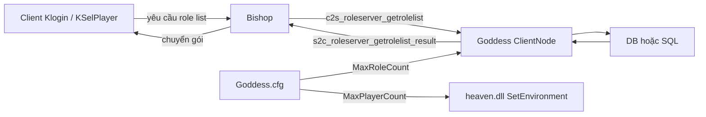

TÓM TẮT 1: [NGUỒN] Đã khảo sát tĩnh đủ ba phần tử: Goddess Max char create, Goddess MAX Player và danh sách nhân vật.
TÓM TẮT 2: [NGUỒN] MaxRoleCount đi từ Goddess.cfg vào lớp DB; MaxPlayerCount được truyền vào tham số môi trường Goddess/heaven.dll.
TÓM TẮT 3: [NGUỒN] Bishop hỏi Goddess lấy danh sách; Goddess lọc DB/SQL rồi trả s2c_roleserver_getrolelist_result qua Bishop tới client.
TÓM TẮT 4: [CHƯA KIỂM] Bishop và client còn giới hạn danh sách 3; chưa xác nhận hard cap MAX Player hoặc cặp exe/source đang chạy.
TÓM TẮT 5: [CHƯA KIỂM] Không build, không chạy exe/VM/mạng; không commit theo yêu cầu, PM tổng hợp commit hộ.

# N-04 — Goddess Max char create, MAX Player và danh sách nhân vật

Loại: khảo sát
Chủ đề: Xác định nơi lưu, exe xử lý và tác động server/client của MaxRoleCount, MaxPlayerCount, cùng danh sách vai ở màn chọn nhân vật.
Từ khóa: Goddess, Max char create, MaxRoleCount, MAX Player, MaxPlayerCount, Bishop, KSelPlayer, KuiSelPlayer_new, role list
Trạng thái: PARTIAL — hoàn tất đối chiếu source tĩnh; chưa xác minh runtime và cặp exe/source.
Độ phủ: đã phủ 3 trên 3 phần tử chính (Max char create, MAX Player, danh sách nhân vật).
Liên quan: JX1_OPS/DESIGN/HUONG-DAN-EXE-SERVER.md; JX1_OPS/DESIGN/BANG-NUT-EXE-SERVER.md; JX1_OPS/DESIGN/TRUYEN-TAI-VA-EXE-SERVER.md; JX1_OPS/REPORTS/U-02.md; JX1_OPS/REPORTS/A-06-bang-goi-tin.md; JX1_OPS/REPORTS/K-01-ban-do-truyen-tin-hieu.md
Cần tôi quyết định: không

Nguồn và giới hạn: server source `C:\Jx1CocoV3\SwordOnline\SwordOnline\jxOnline\{gateway,gameserver}\Sources`; client source thực tế `C:\Jx1CocoV3\Folder\Client2912-20260116T044348Z-3-001\Client2912\Client\Classes`. Đã đọc tĩnh; chưa ghép source với exe/APK.

## Sơ đồ luồng

## Phạm vi và độ phủ

| Phần tử | Nơi/đường đi | Độ phủ | Bằng chứng và giới hạn |
|---|---|---|---|
| Max char create — nhãn và ô | Goddess resource | Đã phủ, đọc tĩnh | C:\Jx1CocoV3\SwordOnline\SwordOnline\jxOnline\gateway\Sources\MultiServer\Goddess\Goddess.rc:68-72. |
| MaxRoleCount — cấu hình và bộ nhớ | Goddess.cfg → g_nMaxRoleCount | Đã phủ, đọc tĩnh | Goddess.cpp:71, :1521-1535, :1543-1561. |
| MaxRoleCount — giới hạn tạo vai | DB/SQL | Đã phủ, đọc tĩnh | IDBRoleServer.cpp:33, :187-189, :688-696, :812-826; chưa thử tạo vai thứ tư. |
| Kết quả tạo vai | Goddess → Bishop | Đã phủ, đọc tĩnh | ClientNode.cpp:407-461, ID s2c_roleserver_createrole_result. |
| MAX Player — ô/cấu hình | Goddess.cfg và resource | Đã phủ; ý nghĩa hard cap chưa đủ | Goddess.rc:79-81 có WS_DISABLED; Goddess.cpp:73, :1535, :1561. |
| MAX Player — môi trường server | Goddess → heaven.dll | Đã phủ; hiệu lực runtime chưa kiểm | Goddess.cpp:1443-1451, SetEnvironment(g_nMaxPlayerCount,...); chưa đọc implementation heaven.dll. |
| Bishop gửi truy vấn | Bishop → Goddess | Đã phủ, đọc tĩnh | Bishop\GamePlayer.cpp:1404-1428, ID c2s_roleserver_getrolelist; Bishop cố định s_nRoleListCount=3 ở :61. |
| Goddess đọc danh sách | DB/SQL theo tài khoản và khu | Đã phủ, đọc tĩnh | Goddess\ClientNode.cpp:337-397; IDBRoleServer.cpp:923-975 lọc isWaiGua==nThisServer và trả tên, giới tính, hệ, cấp. |
| Gói trả về client | Goddess → Bishop → client | Đã phủ, đọc tĩnh | Goddess\ClientNode.cpp:381-397; Bishop\GamePlayer.cpp:1459-1505 chuyển buffer. |
| Client parse và màn chọn vai | Klogin → UI | Đã phủ, tách active/legacy | Klogin.cpp:1033-1075 nạp dữ liệu; scene active là KuiSelPlayer_new ở :513-520; KSelPlayer.cpp:327-363 là UI cũ tương ứng. |

## Giải mã tên

Các tên dưới đây là identifier hoặc nhãn ASCII, giữ nguyên chữ gốc. Không dùng comment Hán làm bằng chứng vì lần đọc source này không giải mã comment GBK ổn định.

| Tên gốc | Mã hóa | Chữ đúng | Nguồn file:dòng |
|---|---|---|---|
| Goddess | ASCII (tập con UTF-8) | Goddess | Goddess.cpp:66; Goddess.rc:68 |
| Max char create | ASCII (tập con UTF-8) | Max char create | Goddess.rc:69-70 |
| MAX Player | ASCII (tập con UTF-8) | MAX Player | Goddess.rc:79-81 |
| MaxRoleCount | ASCII (tập con UTF-8) | MaxRoleCount | Goddess.cpp:1531, :1557 |
| MaxPlayerCount | ASCII (tập con UTF-8) | MaxPlayerCount | Goddess.cpp:1535, :1561 |
| Bishop | ASCII (tập con UTF-8) | Bishop | Bishop\Network.cpp:54-77 |
| heaven.dll | ASCII (tập con UTF-8) | heaven.dll | Goddess.cpp:66, :1443 |
| Klogin | ASCII (tập con UTF-8) | Klogin | Klogin.cpp:1033 |
| KSelPlayer | ASCII (tập con UTF-8) | KSelPlayer | KSelPlayer.cpp:43, :654 |
| KuiSelPlayer_new | ASCII (tập con UTF-8) | KuiSelPlayer_new | Klogin.cpp:519 |
| RoleBaseInfo | ASCII (tập con UTF-8) | RoleBaseInfo | KProtocol.h:1809-1815 |
| s2c_roleserver_getrolelist_result | ASCII (tập con UTF-8) | s2c_roleserver_getrolelist_result | KProtocolDef.h:43-45 |
| c2s_roleserver_getrolelist | ASCII (tập con UTF-8) | c2s_roleserver_getrolelist | KProtocolDef.h:235-245 |

## Sắp theo cấu trúc game

| Thứ tự cấu trúc | Nội dung | Kết quả |
|---|---|---|
| 1. Cấu hình Goddess | Goddess.cfg và hai ô UI | MaxRoleCount nhập/ghi được theo source; ô MaxPlayerCount bị khóa trong resource. |
| 2. Dịch vụ dữ liệu nhân vật | InitDBInterface và SaveRoleInfo | MaxRoleCount vào nMaxRoleCount_InAccount; tạo mới bị từ chối khi số vai đạt ngưỡng. |
| 3. Gateway Bishop/Goddess | Truy vấn và trả danh sách | Bishop giới hạn truy vấn 3; Goddess lọc theo tài khoản/khu và trả các trường tóm tắt. |
| 4. Client đăng nhập/chọn vai | Klogin, KuiSelPlayer_new, mã cũ KSelPlayer | Client kẹp dữ liệu về tối đa 3 rồi dựng tên, cấp, giới tính, hệ và ảnh. |

## 1. Goddess “Max char create” / MaxRoleCount

1. **Ghi vào đâu?** Ô nằm trong resource Goddess. Giá trị được đọc từ Goddess.cfg vào biến g_nMaxRoleCount, hiển thị lúc khởi tạo cửa sổ và được ghi bởi SaveSetting [NGUỒN Goddess.rc:68-72; Goddess.cpp:71, :550-557, :1521-1535, :1543-1561]. Khi tạo engine dữ liệu, giá trị được truyền vào InitDBInterface [NGUỒN Goddess.cpp:1422-1426].
2. **Exe nào nhận và làm gì?** Goddess nhận giá trị; CreateDatabaseEngine gọi InitDBInterface. ClientNode đăng ký c2s_roleserver_createroleinfo vào _CreateRole; hàm này gọi SaveRoleInfo rồi gửi s2c_roleserver_createrole_result về Bishop [NGUỒN Goddess.cpp:1422-1426; Goddess\ClientNode.cpp:118-128, :407-461].
3. **Tác động SERVER?** Với SQL, nMaxRoleCount_InAccount nhận giá trị ở InitDBInterface. Khi tạo vai mới, code đếm số vai tài khoản rồi trả lỗi nếu nCount >= ngưỡng [NGUỒN IDBRoleServer.cpp:33, :187-189, :688-696]. Nhánh DB cũng đếm và chặn ở :812-826; nếu qua kiểm tra, ghi vai vào DB ở :876-910. Đây là kết luận source; chưa xác minh binary đang chạy.
4. **Tác động CLIENT?** Kết quả tạo vai dùng ID s2c_roleserver_createrole_result, nhưng handler tạo vai trong Klogin::AcceptNetMsg đang comment [NGUỒN KProtocolDef.h:43-45; Klogin.cpp:755-770]. Mã UI cũ chỉ mở màn tạo khi GetRoleCount(nSel) < MAX_PLAYER_PER_ACCOUNT [NGUỒN KSelPlayer.cpp:654-672]; scene active được Klogin gọi là KuiSelPlayer_new [NGUỒN Klogin.cpp:513-520; KuiSelPlayer_new.cpp:533-540]. Thông báo cụ thể khi server từ chối tạo vai: chưa kiểm tra.

## 2. Goddess “MAX Player” / MaxPlayerCount

1. **Ghi vào đâu?** MaxPlayerCount được đọc từ [Setting] trong Goddess.cfg vào g_nMaxPlayerCount; resource đánh dấu ô WS_DISABLED nên không thể kết luận nó sửa được từ UI [NGUỒN Goddess.rc:79-81; Goddess.cpp:73, :1535, :1561].
2. **Exe nào nhận và làm gì?** Goddess đưa biến vào tham số đầu của SetEnvironment trên factory lấy từ heaven.dll khi dựng dịch vụ [NGUỒN Goddess.cpp:1422-1451]. Mã triển khai bên trong heaven.dll không nằm trong source đã đọc.
3. **Tác động SERVER?** Tham số đi vào I/O server mà Goddess mở cho các GS kết nối [NGUỒN Goddess.cpp:1443-1469]. Tên biến/nhãn gợi ý sức chứa tối đa, nhưng ý nghĩa chính xác, hard cap và tác động tới gs001 chưa được chứng minh; ghi chưa kiểm tra.
4. **Tác động CLIENT?** Không tìm thấy MaxPlayerCount được đưa vào gói role list hay trường client; client có giới hạn riêng MAX_PLAYER_PER_ACCOUNT [NGUỒN KProtocolDef.h:29-53, :235-245; Uiglobaldata.h:60-63]. Nếu chạm giới hạn kết nối thì thông báo/đường lỗi client chưa đo.

## 3. Danh sách nhân vật trả về màn chọn nhân vật

1. **Ghi vào đâu?** Nguồn danh sách là DB/SQL của Goddess. Bishop tạo TProcessData chứa tài khoản, khu, identity và số lượng yêu cầu rồi gửi c2s_roleserver_getrolelist [NGUỒN Bishop\GamePlayer.cpp:1404-1428]. Không thấy ghi danh sách thành cfg.
2. **Exe nào nhận và làm gì?** Goddess ClientNode xử lý _QueryRoleList, gọi GetRoleListOfAccount, đóng gói s2c_roleserver_getrolelist_result rồi gửi về Bishop [NGUỒN Goddess\ClientNode.cpp:337-397]. Bishop nhận, ghi log và chuyển nguyên gói tới client [NGUỒN Bishop\GamePlayer.cpp:1459-1505].
3. **Tác động SERVER?** GetRoleListOfAccount hạ chữ hoa tài khoản, chọn DB/SQL, lọc isWaiGua==nThisServer rồi trả szName, Sex, Series, Level [NGUỒN IDBRoleServer.cpp:923-975]. Bishop đặt s_nRoleListCount=3 [NGUỒN Bishop\GamePlayer.cpp:61, :1421-1425], vì vậy tăng MaxRoleCount riêng không khiến source này trả hơn 3 vai.
4. **Tác động CLIENT?** Klogin nhận ID s2c_roleserver_getrolelist_result, đọc count ở byte đầu, kẹp vào MAX_PLAYER_PER_ACCOUNT=3 rồi chép tên, hệ, giới tính, cấp vào m_RoleList [NGUỒN Klogin.cpp:548-553, :1033-1075; Uiglobaldata.h:60-63]. Scene active là KuiSelPlayer_new, nơi tạo nhãn và ảnh từ dữ liệu [NGUỒN Klogin.cpp:513-520; KuiSelPlayer_new.cpp:384-416]. KSelPlayer.cpp có cách dựng tương tự ở :327-363, nhưng Klogin hiện gọi scene mới; không gộp hai đường thành một runtime path.

## MỨC SỔ THÔNG SỐ

| Nhóm | Tên/hằng số | file:dòng | Giá trị | Đơn vị | Ảnh hưởng | Đổi an toàn (CÓ/CẨN THẬN/KHÔNG) | Nguồn đo |
|---|---|---|---:|---|---|---|---|
| Goddess | g_nMaxRoleCount / MaxRoleCount | Goddess.cpp:71, :1531, :1557 | mặc định 3 | vai/tài khoản | giới hạn tạo vai DB/SQL | CẨN THẬN | đọc tĩnh; chưa chạy |
| Goddess | g_nMaxPlayerCount / MaxPlayerCount | Goddess.cpp:73, :1535, :1561 | mặc định 500 | theo tên biến, đơn vị runtime chưa xác nhận | tham số đầu SetEnvironment | CẨN THẬN | đọc tĩnh; chưa đọc heaven.dll |
| Bishop | s_nRoleListCount | GamePlayer.cpp:61, :1425 | 3 | vai/truy vấn | số phần tử Bishop yêu cầu | CẨN THẬN | đọc tĩnh; chưa chạy |
| Client | MAX_PLAYER_PER_ACCOUNT | Uiglobaldata.h:61 | 3 | vai/tài khoản | kẹp danh sách và điều kiện nút tạo | CẨN THẬN | đọc tĩnh; chưa build/APK |

## Đề xuất tối ưu

- Giữ ba giới hạn 3 (Goddess, Bishop, client) đồng nhất cho source đang đọc; không nâng riêng MaxRoleCount vì Bishop/client còn giới hạn 3.
- Nếu cần hơn 3 vai, giao task riêng để đối chiếu MaxRoleCount, s_nRoleListCount, MAX_PLAYER_PER_ACCOUNT, cấu trúc gói và handler tạo vai.
- Với MaxPlayerCount, xác định implementation heaven.dll, cặp exe/source và phép đo số kết nối trước khi kết luận sức chứa; không suy từ nhãn UI.

## Đã xác minh

- Đã mở source thật tại server Goddess/Bishop và client Client2912; anchor trong báo cáo đã được kiểm lại.
- Đã đọc các tài liệu chung yêu cầu trong task và đối chiếu cột THỬ #161/#162 trong bảng nút server.
- Source có hai giới hạn danh sách 3 (Bishop và client), và Klogin chuyển sang scene KuiSelPlayer_new; chưa xác nhận runtime.

## Chưa xác minh

- Chưa build, chạy exe/VM, mạng hoặc client APK.
- Chưa xác nhận MaxPlayerCount là hard cap, số người tối đa thực tế, thông báo lỗi, hay cặp exe/source đang chạy.
- Chưa thử tạo vai thứ tư. Chưa coi kết quả #161 về đổi cấu hình là phép thử tạo vai thứ tư.
- Comment Hán trong source không được dùng vì lần đọc này chưa giải mã ổn định encoding GBK; không sửa source.

## Phát hiện khi chuẩn hóa

1. MaxRoleCount có thể khác 3 ở Goddess, nhưng Bishop cố định s_nRoleListCount=3 và client cố định MAX_PLAYER_PER_ACCOUNT=3; không kết luận tăng MaxRoleCount sẽ hiện vai thứ tư.
2. MAX Player bị khóa trong resource và chỉ thấy truyền vào SetEnvironment; hard cap cần đọc heaven.dll hoặc phép thử riêng.
3. Klogin gọi KuiSelPlayer_new::scene; KSelPlayer.cpp là đường UI cũ có callback/render. Đây là khác biệt source cần giữ rõ.
4. Ghi tiến độ D:\JX-wt\N-04.nhip bị hệ thống từ chối quyền ghi ngoài worktree ngay ở mốc đầu; không tạo/ghi file ngoài vùng quyền được cấp. Các mốc sau được báo trong phiên.

## Bàn giao

- File: JX1_OPS/REPORTS/N-04.md.
- Commit: không tạo theo yêu cầu của caller; PM tổng hợp commit hộ, không push.
- Bước tiếp theo: nếu cần triển khai >3 vai hoặc đo MAX Player, PM giao task riêng với cặp source–exe/APK và phạm vi test.
- Trạng thái cuối: PARTIAL.

## Kết quả cuối

Đã hoàn tất báo cáo khảo sát tĩnh cho 3/3 phần tử chính; trạng thái PARTIAL vì chưa chạy build/exe/VM/mạng và chưa xác nhận MaxPlayerCount runtime. File bàn giao: JX1_OPS/REPORTS/N-04.md. Không commit/push theo yêu cầu; PM tổng hợp commit hộ.

- Kỹ năng đã dùng: jx1-retrofit, jx1-read-server, jx1-read-client, jx1-parameters, jx1-knowledge, jx1-report.
