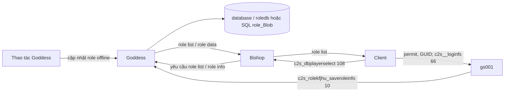

TÓM TẮT 1: [NGUỒN] Đã khảo sát 6/6 nhóm nút Goddess và tách Backup thành hai thao tác (JX1_OPS/TASKS/N-05.md:17-22).
TÓM TẮT 2: [NGUỒN] Role nằm trong backend DB/SQL Goddess; Bishop yêu cầu role list và dữ liệu role (G/MultiServer/Goddess/IDBRoleServer.cpp:187-201, 334-344; Bishop/GamePlayer.cpp:1421-1452).
TÓM TẮT 3: [NGUỒN] GS gửi role save về Goddess; Add Money và EnterMap cập nhật role offline trong DB, không gửi packet quản trị client (S/Core/Src/KPlayerDBFuns.cpp:59-94; G/MultiServer/Goddess/IDBRoleServer.cpp:985-1021, 1376-1408).
TÓM TẮT 4: [CHƯA KIỂM] Chưa đo ảnh hưởng tới client đang chơi; task cảnh báo source có thể khác binary hiện hành (JX1_OPS/TASKS/N-05.md:20).
TÓM TẮT 5: [NGUỒN] Không build, chạy exe, VM, client, server hay mạng theo giới hạn task (JX1_OPS/TASKS/N-05.md:20, 22).

# N-05 — Nghiên cứu các nút Goddess và vòng đời dữ liệu nhân vật
Loại: khảo sát
Chủ đề: Truy vết sáu nhóm thao tác Goddess từ nơi lưu role đến Bishop, gs001 và client.
Từ khóa: Goddess, Bishop, gs001, nhân vật, Add Money, EnterMap, Remove Role, c2s_dbplayerselect
Trạng thái: PARTIAL — nội dung khảo sát và báo cáo đã hoàn tất; chưa ghi được checkpoint .nhip ngoài writable root và mục kết quả của task ngoài vung_file.
Độ phủ: đã phủ 6/6 nhóm theo task và 7 nút/thao tác giao diện (Backup gồm Manual backup và Backup phần đồ); tác động runtime lên client đang chơi chưa đo.
Liên quan: JX1_OPS/DESIGN/HUONG-DAN-EXE-SERVER.md; JX1_OPS/DESIGN/BANG-NUT-EXE-SERVER.md; JX1_OPS/DESIGN/TRUYEN-TAI-VA-EXE-SERVER.md; JX1_OPS/REPORTS/A-06-bang-goi-tin.md; JX1_OPS/REPORTS/K-01-ban-do-truyen-tin-hieu.md; JX1_OPS/REPORTS/U-02.md
Cần tôi quyết định: có — task chỉ cho sửa báo cáo nhưng prompt đồng thời yêu cầu thêm Kết quả vào cuối file task.

## Phạm vi và độ phủ
| Nhóm nút | Nơi ghi / exe nhận | Tác động server | Tác động client và gói tin | Độ phủ |
|---|---|---|---|---|
| Add Money | Goddess sửa role trong DB; nhánh offline | Cộng vàng hoặc bạc vào bản ghi role | Không gửi gói quản trị; role được đọc lại qua tuyến chọn nhân vật; chưa đo giá trị hiển thị thực tế | [NGUỒN] source; [TÀI LIỆU] kết quả thử #161 |
| EnterMap / IDMap | Goddess gọi ChangeRoleInfo | Source bỏ qua mã map nhập vào, ghi vị trí hồi sinh cố định | Không push tới client; vị trí dùng ở lần nạp role sau chưa thử | [NGUỒN] source; [TÀI LIỆU] thử #162 bỏ dở do thiếu mã map gốc |
| Remove Role | Goddess gọi MoveRoleLevel | Xóa khỏi DB mọi role có cấp thấp hơn ngưỡng | Lần lấy role list sau không còn role đã xóa; tác động lên client đang chơi chưa thử | [NGUỒN] source; [TÀI LIỆU] nút bị cấm bấm |
| Manual backup | Goddess tạo bản sao DB trong DB mode hoặc copy bảng backup trong SQL mode | Tác động bản sao dữ liệu backend, không sửa role gốc theo đường quan sát này | Không gửi packet gameplay | [NGUỒN] source; [TÀI LIỆU] #161 tạo .bak và .txt |
| Backup phần đồ | Goddess gọi helper cho role và các phần hành trang chọn | Source chỉ có gọi helper khi sqlitel_table tồn tại | Không gửi packet gameplay | [NGUỒN] source; [TÀI LIỆU] #161 không thấy tệp mới |
| Pause | Goddess tạm dừng/tiếp tục timer backup | Tác động thread sao lưu, không đổi role | Không gửi packet gameplay; nhãn trạng thái UI đổi | [NGUỒN] source; [TÀI LIỆU] kết quả thử #161 |
| Restart / tắt Goddess | Restart gọi dừng node, đóng/mở DB interface; thoát tiến trình dừng dịch vụ | Bishop mất nối DB khi Goddess bị dừng; lưu/đọc role phụ thuộc kết nối | Kết nối client-GS trực tiếp; hiện tượng client đang chơi chưa được quan sát | [NGUỒN] source; [TÀI LIỆU] ghi nhận #161 |

## Gốc nguồn và vòng đời dữ liệu
[NGUỒN] Các alias trong báo cáo: G = C:\Jx1CocoV3\SwordOnline\SwordOnline\jxOnline\gateway\Sources; S = C:\Jx1CocoV3\SwordOnline\SwordOnline\jxOnline\gameserver\Sources; C = C:\Jx1CocoV3\Folder\Client2912-20260116T044348Z-3-001\Client2912\Client\Classes. Đây là source trên đĩa; task không cung cấp commit/version của executable đang chạy, nên không đồng nhất source với binary.

[ĐÃ XÁC MINH — NGUỒN] Trong DB mode, IDBRoleServer tạo ZDBTable với thư mục database và tên DB roledb (G/MultiServer/Goddess/IDBRoleServer.cpp:334-344). DBTable lấy thư mục làm việc hiện tại, mở môi trường dưới database và mở bảng roledb (G/MultiServer/Goddess/DBTable.cpp:18-40, 97-125). Không khẳng định tên file vật lý cụ thể của Berkeley DB. Source cũng có nhánh SQL: mở database và tạo bảng role_Blob (G/MultiServer/Goddess/IDBRoleServer.cpp:187-201). Goddess đọc dataOpenModel từ Goddess.cfg; giá trị thật của instance chưa được kiểm tra (G/MultiServer/Goddess/Goddess.cpp:1525-1539).

[ĐÃ XÁC MINH — NGUỒN] Goddess đọc role theo tên và trả nguyên buffer role từ cursor; nhánh SQL đọc BLOB theo khóa (G/MultiServer/Goddess/IDBRoleServer.cpp:486-535). SaveRoleInfo ghi role vào DB bằng db_table->add; nhánh SQL cập nhật BLOB (G/MultiServer/Goddess/IDBRoleServer.cpp:760, 876). Đây là backend role; DB tài khoản/PaySys là tuyến riêng.

[ĐÃ XÁC MINH — NGUỒN] Bishop lấy role list từ Goddess bằng c2s_roleserver_getrolelist; khi client chọn role, Bishop nhận c2s_dbplayerselect rồi yêu cầu c2s_roleserver_getroleinfo kèm tên role/tài khoản (G/MultiServer/Bishop/GamePlayer.cpp:1421-1452, 1523-1546, 1903-1918). Các ID được lập trong bảng gói tin: c2s_dbplayerselect = 108, c2s_roleserver_getroleinfo = 57, c2s_rolekfjhu_saveroleinfo = 10, c2s__loginfs_kfjghtueodnchsf = 66 (JX1_OPS/REPORTS/A-06-bang-goi-tin.md:393, 413, 420, 462). Client gửi chọn role (C/gameui/KSelPlayer.cpp:1184-1187), nhận thông tin permit/GUID, nối thẳng đến GS rồi gửi login GUID (C/gameui/KSelPlayer.cpp:1116-1150). Vì vậy thao tác quản trị của Goddess không phải packet client; thay đổi offline chỉ có thể đến client qua lần đọc role tiếp theo. Hiển thị và thời điểm refresh chính xác chưa được chạy thử.

[ĐÃ XÁC MINH — NGUỒN] GS tạo buffer lưu role và gửi c2s_rolekfjhu_saveroleinfo tới Goddess (S/Core/Src/KPlayerDBFuns.cpp:44-94, 108-118). Mã xử lý mất kết nối tạo yêu cầu lưu khi role còn trong trạng thái có thể lưu; nếu data client/database không còn, hàm lưu trả false (S/MultiServer/GameServer/KSOServer.cpp:4553-4559, 4938-4957). KPlayerSet có hàm AutoSave với ngưỡng 60*5*18 game ticks, nhưng lời gọi thấy được tại KSubWorldSet.cpp:610 đang bị comment; không thể kết luận chu kỳ đó đang chạy trong binary. Không có số liệu độ bền/lần lưu cuối hoặc thử ngắt dịch vụ.

## Các nút Goddess
### Add Money
1. [NGUỒN] Ghi vào đâu: với role offline, tìm theo tên trong db_table, cộng vào trường tiền tương ứng rồi ghi lại cùng bản ghi; SQL mode không có nhánh tương đương trong hàm này (G/MultiServer/Goddess/IDBRoleServer.cpp:985-1021).
2. [NGUỒN] Exe nhận và xử lý: nút Goddess lấy kiểu tiền, trạng thái Check online, tên role và số tiền rồi gọi AddMoneyRoleCount (G/MultiServer/Goddess/Goddess.cpp:796-847).
3. [NGUỒN] Server: kind 0 cộng vàng vào iclientx, kind 1 cộng bạc vào iservermon; đây là cập nhật DB, không phải dữ liệu live trong GS. Nhánh online trong source để trống nên trả thất bại.
4. [CHƯA KIỂM] Client / packet: không phát packet tới client hoặc GS từ event này. Khi role được đọc lại ở lần chọn/đăng nhập tiếp theo, dữ liệu mới có thể được nạp; chưa xác minh UI có phản ánh đúng.
5. [TÀI LIỆU] Thử thật kế thừa: #161 ghi nhận cộng 1000 bạc cho role offline và bản backup sau đó cho thấy số bạc tăng 1000 (JX1_OPS/DESIGN/BANG-NUT-EXE-SERVER.md:25, 56-58).

### EnterMap / IDMap
1. [NGUỒN] Ghi vào đâu: Goddess đọc mã map nhập, từ chối giá trị không dương rồi gọi ChangeRoleInfo (G/MultiServer/Goddess/Goddess.cpp:942-958).
2. [NGUỒN] Exe nhận và xử lý: trong DB mode, hàm tìm role offline, đặt cUseRevive=1, ghi irevivalid=53 và irevivalx=19 rồi db_table->add; tham số nMapidx chỉ được kiểm tra dương, không được dùng làm giá trị ghi. SQL mode hiện trả 1 mà không cập nhật (G/MultiServer/Goddess/IDBRoleServer.cpp:1376-1422).
3. [NGUỒN] Server: dữ liệu hồi sinh trong bản ghi DB bị đổi; source không đổi bản đồ của role đang nằm trong bộ nhớ GS.
4. [CHƯA KIỂM] Client / packet: không có packet trực tiếp. Dự kiến chỉ ảnh hưởng dữ liệu lần đọc role sau; chưa xác minh vị trí nhân vật khi vào lại game.
5. [TÀI LIỆU] Thử thật kế thừa: #162 không thực hiện vì backup .txt không có mã map hiện tại để đối chiếu (JX1_OPS/DESIGN/BANG-NUT-EXE-SERVER.md:24).

### Remove Role
1. [NGUỒN] Ghi vào đâu: không yêu cầu tên role; Goddess đọc ngưỡng level rồi gọi MoveRoleLevel (G/MultiServer/Goddess/Goddess.cpp:985-1005).
2. [NGUỒN] Exe nhận và xử lý: duyệt toàn bộ db_table; mỗi role có ifightlevel < ngưỡng bị gọi db_table->remove (G/MultiServer/Goddess/IDBRoleServer.cpp:1426-1454).
3. [NGUỒN] Server: xóa hàng loạt role khỏi backend đang mở, không có bước xác nhận trong handler này. Hàm dùng db_table, nên hỗ trợ ở SQL mode chưa được chứng minh.
4. [CHƯA KIỂM] Client / packet: không có packet quản trị; role đã xóa sẽ không còn trong danh sách nếu Goddess trả kết quả mới. Role đang online và trường hợp GS ghi lại role sau khi bị xóa đều chưa thử.
5. [TÀI LIỆU] An toàn: bảng nút hiện ghi cấm bấm vì đây là xóa toàn bộ role dưới ngưỡng, không phải xóa một role (JX1_OPS/DESIGN/BANG-NUT-EXE-SERVER.md:26).

### Backup
Task có hai nút cùng nhãn nghĩa sao lưu:
- [NGUỒN] Manual backup: trong SQL mode gọi copySqldataTobakSql; DB mode gọi DoManualBackup nếu backup timer tồn tại (G/MultiServer/Goddess/Goddess.cpp:1108-1124; G/MultiServer/Goddess/IDBRoleServer.cpp:137-143, 1701-1704). DB mode tạo thư mục database\<timestamp>, tệp .bak và .txt theo thư mục làm việc hiện tại (G/MultiServer/Goddess/IDBRoleServer.cpp:1648-1663; G/MultiServer/Goddess/DBBackup.cpp:285-304, 331-408). Nhánh SQL chỉ thể hiện copy sang bảng backup trong source.
- [NGUỒN] Backup phần đồ: Goddess gọi getItemData với Account, Role và các checkbox; source chỉ gọi findRoleITemInSql khi sqlitel_table tồn tại, rồi vẫn trả true (G/MultiServer/Goddess/Goddess.cpp:780-794; G/MultiServer/Goddess/IDBRoleServer.cpp:130-134).
- [TÀI LIỆU] #161 xác nhận Manual backup đã tạo tệp .bak và .txt; nút Backup phần đồ báo “All” cần chọn một mục, còn chọn Body không thấy file mới trong lần thử (JX1_OPS/DESIGN/BANG-NUT-EXE-SERVER.md:15, 27). Không suy ra thành công từ giá trị trả về.
- [NGUỒN] Server và client: backup đọc/copy dữ liệu, không sửa trạng thái role trong GS và không phát packet gameplay.

### Pause
1. [NGUỒN] Ghi vào đâu: thay đổi trạng thái thread backup trong bộ nhớ; không ghi role hoặc Goddess.cfg.
2. [NGUỒN] Exe nhận và xử lý: Goddess gọi SuspendBackupTimer hoặc ResumeBackupTimer; lớp DBBackup dùng SuspendThread/ResumeThread và đổi trạng thái/nội dung nút (G/MultiServer/Goddess/Goddess.cpp:1309-1337; G/MultiServer/Goddess/IDBRoleServer.cpp:1677-1686; G/MultiServer/Goddess/DBBackup.cpp:246-267).
3. [NGUỒN] Server: chỉ timer backup tự động bị tạm dừng/tiếp tục; không phải lệnh pause gs001.
4. [TÀI LIỆU] Client / packet: không có packet gameplay hay thay đổi trực tiếp trên client. #161 ghi nhãn chuyển qua lại giữa Pause/Resume và không có hộp lỗi (JX1_OPS/DESIGN/BANG-NUT-EXE-SERVER.md:14).

### Restart / tắt Goddess
1. [NGUỒN] Ghi vào đâu: Restart gọi CClientNode::End, ReleaseDBInterface, InitDBInterface rồi CClientNode::Start; ReleaseDBInterface commit DB, dừng timer backup và đóng DB (G/MultiServer/Goddess/Goddess.cpp:1166-1171; G/MultiServer/Goddess/IDBRoleServer.cpp:386-422).
2. [NGUỒN] Exe nhận và xử lý: Restart gọi khởi tạo lại database interface bên trong Goddess; đây không đồng nhất với thoát hẳn rồi chạy lại process. Bishop nhận event đóng kết nối bằng cách cập nhật trạng thái UI, không gọi reconnect trong callback. Nút Reconnect DB gọi RetConnnetGoddess để nối lại tới RoleSvrIP/Port (G/MultiServer/Goddess/Goddess.cpp:1166-1171; G/MultiServer/Bishop/Intercessor.cpp:172-188, 391-407; G/MultiServer/Bishop/Application.cpp:683-694).
3. [NGUỒN] Server: GS có nhánh thử nối lại database và ghi log thành công/thất bại (S/MultiServer/GameServer/KSOServer.cpp:5457-5469). Nếu database client vắng mặt, SavePlayerData trả false (S/MultiServer/GameServer/KSOServer.cpp:4553-4559). [GIẢ THUYẾT] Khi Goddess process dừng, phiên Bishop→Goddess cũ bị đóng; vì handler close không reconnect, các yêu cầu role không dùng lại được cho tới khi có kết nối mới. Điều này phù hợp với ghi nhận #161, không chứng minh mọi lần bấm Restart gây rớt socket.
4. [CHƯA KIỂM] Client / packet: client nối trực tiếp GS sau permit; source không cho thấy Goddess gửi packet tới client khi mất kết nối. Khi người chơi gọi EnterGame mà role list chưa sẵn sàng, client gán LL_R_CONNECT_TIMEOUT (C/gameui/KSelPlayer.cpp:1181-1195); draw dọn kết nối và quay về cảnh Klogin_f, nhưng chỉ hiển thị hộp thoại riêng cho lỗi version (C/gameui/KSelPlayer.cpp:776-803). Đây là đường timeout có điều kiện, chưa xác minh sẽ xảy ra khi Goddess dừng. Nếu chính kết nối GS thất bại, client có nhánh G_ERROR_GAMESERVER_CONNECT_FAILED (C/gameui/KSelPlayer.cpp:1122-1159). Ảnh hưởng lên người đang chơi chưa ghi nhận trong #161/#162.
5. [TÀI LIỆU] Phân biệt lần thử: #161 ghi việc dừng/chạy lại Goddess làm Bishop mất nối DB, cần Reconnect DB; sau đó gs001 tự ghi “Database server reconnect OK”. Riêng nút Restart được thử lúc 17:30, các kết nối Bishop/S3Relay/gs001 vẫn hiện còn, nhưng Manual backup bị khóa và trạng thái backup dừng sau 90 giây; không thể gộp hai kết quả này thành một (JX1_OPS/DESIGN/BANG-NUT-EXE-SERVER.md:9, 17, 56-58).

## Sắp theo cấu trúc vận hành
Không có kỹ năng, trang bị, quái hoặc bản đồ trong phạm vi N-05. Nội dung được xếp theo chuỗi vận hành: (1) Goddess/backend role DB, (2) Bishop lấy role list và dữ liệu khi chọn, (3) GS giữ trạng thái phiên và gửi bản lưu về Goddess, (4) client nối GS sau permit. Sáu nhóm nút được phân thành cập nhật/xóa role (Add Money, EnterMap, Remove Role) và bảo trì backend (Backup, Pause, Restart).

## Giải mã tên
| Tên gốc | Mã hóa | Chữ đúng | Nguồn file:dòng |
|---|---|---|---|
| Goddess, Bishop, gs001, S3Relay | ASCII | Giữ nguyên tên tiến trình | JX1_OPS/DESIGN/HUONG-DAN-EXE-SERVER.md:16-19 |
| Add Money, EnterMap, Remove Role, Manual backup, Backup, Pause, Restart | ASCII | Giữ nguyên nhãn UI tiếng Anh | G/MultiServer/Goddess/Goddess.rc:73-76, 116, 132, 147 |
| Goddess.cfg, database, roledb, role_Blob | ASCII | Giữ nguyên tên tệp/thư mục/bảng | G/MultiServer/Goddess/Goddess.cpp:1525-1539; G/MultiServer/Goddess/IDBRoleServer.cpp:196-201, 334-344 |
| c2s_dbplayerselect, c2s_roleserver_getroleinfo, c2s_rolekfjhu_saveroleinfo, c2s__loginfs_kfjghtueodnchsf | ASCII | Giữ nguyên symbol giao thức | G/MultiServer/Bishop/GamePlayer.cpp:1421-1452, 1903-1918; S/Core/Src/KPlayerDBFuns.cpp:59-94; C/gameui/KSelPlayer.cpp:1128-1134, 1184-1187 |

## MỤC SỔ THÔNG SỐ
| Nhóm | Tên/hằng số | file:dòng | Giá trị | Đơn vị | Ảnh hưởng | Đổi an toàn | Nguồn đo |
|---|---|---|---|---|---|---|---|
| Backend | dataOpenModel | G/MultiServer/Goddess/Goddess.cpp:1539; G/MultiServer/Goddess/IDBRoleServer.h:34-35; IDBRoleServer.cpp:48 | Mặc định source 0 = DATA_KIND_DB; mode hiện tại chưa biết | mã chế độ | Chọn backend role | CẨN THẬN | Đọc tĩnh |
| Sao lưu | BackupSleepTime | G/MultiServer/Goddess/Goddess.cpp:1533; DBBackup.cpp:198-205, 307-325 | Mặc định 3; code lấy modulo 24 và so với giờ hệ thống | giờ trong ngày | Giờ chạy backup tự động | CẨN THẬN | Đọc tĩnh; chưa chạy |
| Tiền | nMoneyKind | G/MultiServer/Goddess/Goddess.cpp:809-817; IDBRoleServer.cpp:997-1000 | 0 vàng; 1 bạc | loại tiền; Money là lượng cộng | Cập nhật tiền role offline | CẨN THẬN | Đọc tĩnh; #161 đã thử offline |
| Lưu role | AutoSave threshold | S/Core/Src/KPlayerSet.cpp:1776-1789; KSubWorldSet.cpp:610 | 60*5*18 game ticks | vòng GameTime | Ngưỡng trong hàm AutoSave; lời gọi tìm được đang comment | CẨN THẬN | Đọc tĩnh; chưa xác nhận active/runtime |

## ĐỀ XUẤT TỐI ƯU
- [ĐỀ XUẤT] Giữ Remove Role ngoài quy trình vận hành thông thường: source xóa toàn bộ role dưới ngưỡng và không có xác nhận; nếu cần điều tra tiếp, chỉ xem code hoặc dùng bản sao dữ liệu được duyệt.
- [ĐỀ XUẤT] Chưa dùng EnterMap để cứu role cho đến khi đối chiếu được hành vi mong muốn với source: mã map nhập hiện không được dùng, còn lần thử #162 không có mã map gốc để so.
- [ĐỀ XUẤT] Với Add Money, chỉ coi nhánh offline là có bằng chứng source; kiểm tra backup và số dư trước/sau trên môi trường bản sao trước mọi thử nghiệm tiếp theo.
- [ĐỀ XUẤT] Dùng kết quả Manual backup #161 làm căn cứ tốt hơn nút Backup phần đồ; phần đồ chưa tạo được file trong lần thử và source hiện chỉ gọi helper ở nhánh SQL.
- [ĐỀ XUẤT] Sau khi Goddess bị dừng/chạy lại, xác nhận Bishop đã nối lại DB và gs001 ghi nhận DB reconnect trước thao tác role; đây là bước vận hành đã ghi ở tài liệu thử, không phải yêu cầu thay cấu hình.
- [CHƯA XÁC MINH] Chưa có căn cứ đổi chu kỳ AutoSave/BackupSleepTime, hay kết luận Restart an toàn cho phiên client; cần đối chiếu đúng binary và thử có duyệt trên bản sao.

## Đã xác minh / Chưa xác minh
### Đã xác minh
- Source trên đĩa: Goddess chọn DB/SQL và đọc role theo cấu hình; đường DB dùng database/roledb, SQL có role_Blob (G/MultiServer/Goddess/IDBRoleServer.cpp:187-201, 334-344).
- Source trên đĩa: Bishop hỏi Goddess role list/info; client gửi chọn role rồi nối trực tiếp tới GS bằng permit/GUID (G/MultiServer/Bishop/GamePlayer.cpp:1421-1452, 1523-1546, 1903-1918; C/gameui/KSelPlayer.cpp:1122-1150, 1184-1187).
- Source trên đĩa: thao tác Add Money chỉ có nhánh DB role offline; EnterMap ghi 53/19 thay vì mã nhập; Remove Role xóa tất cả role dưới ngưỡng (G/MultiServer/Goddess/IDBRoleServer.cpp:985-1021, 1376-1422, 1426-1454).
- Tài liệu thử #161/#162: JX1_OPS/DESIGN/BANG-NUT-EXE-SERVER.md:9, 14-17, 24-27, 56-59; đây là kết quả đã ghi trong tài liệu, không phải lần thử lại của N-05.
### Chưa xác minh
- Source trên đĩa có khớp từng executable đang chạy hay không; task cấm chạy exe/VM và không cấp hash/commit của binary.
- Mode DB/SQL hiện hành, việc dữ liệu role đã commit tới disk tại mọi thời điểm, và cấu hình/tần suất hiệu lực ngoài source.
- AutoSave có được gọi trong build/runtime hay không; call site tìm thấy tại KSubWorldSet.cpp:610 đang bị comment.
- Màn hình client khi role offline thay tiền/map/xóa, ảnh hưởng của Restart lên client đang chơi, và cứu dữ liệu nếu GS mất Goddess trước lần lưu kế tiếp.
- Kết quả thử cũ phản ánh runtime; không lặp lại để xác nhận.

## Phát hiện và bàn giao
- Không sửa kết luận ở tài liệu cũ. Đối chiếu mới cho thấy BANG-NUT-EXE-SERVER.md:24 mô tả ChangeRoleInfo(tên, mã bản đồ), trong khi source gán cố định irevivalid=53 và irevivalx=19, không dùng nMapidx (G/MultiServer/Goddess/IDBRoleServer.cpp:1395-1400). Để PM xem xét cập nhật ở task khác.
- BANG-NUT-EXE-SERVER.md:10 ghi đơn vị Backup time chưa rõ; code hiện tại cho thấy giá trị modulo 24 được so với giờ địa phương mỗi 30 phút (G/MultiServer/Goddess/DBBackup.cpp:198-205, 307-325). Đây là đọc source, chưa đo lần chạy.
- TÓM TẮT và kết luận chỉ áp dụng cây source nêu trên. Không dùng source để khẳng định hành vi binary/runtime.
- Báo cáo/chỉ sửa: JX1_OPS/REPORTS/N-05.md. Không commit, không push theo yêu cầu trực tiếp của task owner; chưa có SHA.
- Chưa ghi D:\JX-wt\N-05.nhip: file chưa tồn tại và đường dẫn nằm ngoài writable root D:\JX-wt\N-05 của phiên này.
- Chưa thêm dòng vào REPORTS/_CHIMUC/N-05.tsv hoặc sửa TASKS/N-05.md: vung_file của task chỉ cho phép báo cáo; prompt đồng thời yêu cầu sửa file task nên cần chốt phạm vi.
- Dòng mục lục đề nghị PM gộp: | Mạng, gói tin, tiến trình, đăng nhập | N-05; BANG-NUT-EXE-SERVER.md | Goddess, Bishop, gs001, vòng đời role, Add Money, EnterMap, Remove Role | khảo sát source tĩnh; client/runtime còn chưa xác minh |
- Kỹ năng đã dùng: jx1-retrofit, jx1-read-server, jx1-read-client, jx1-parameters, jx1-knowledge, jx1-report.
- Cách thử: đối chiếu tĩnh source trong hai root đã nêu, đọc tài liệu #161/#162, kiểm tra bố cục và mã hóa báo cáo. Kết quả: không chạy build, VM, exe, client, server hoặc mạng theo task.
- Bước tiếp tục: cần môi trường cho phép ghi `D:\JX-wt\N-05.nhip`; cần PM xác nhận phạm vi nếu muốn ghi mục kết quả vào `JX1_OPS/TASKS/N-05.md`, vì `vung_file` hiện chỉ liệt kê báo cáo.
- Kết quả task: PARTIAL — báo cáo được tạo; checkpoint .nhip và mục kết quả task chưa ghi do nằm ngoài writable root/vùng file được giao.
