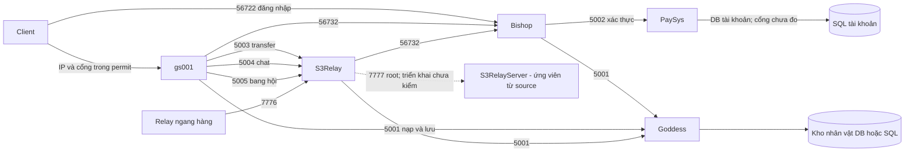

TÓM TẮT 1 — [NGUỒN] Hoàn thành khảo sát tĩnh sáu thành phần PaySys–Bishop–Goddess–S3Relay–gs001–client, 14 luồng kết nối và 24 nhóm điều khiển/chỉ báo liên kết.
TÓM TẮT 2 — [NGUỒN] Đây là đồ thị nhiều nhánh: client đổi từ Bishop sang GS theo permit; GS nối riêng kho nhân vật và ba cổng Relay; có nguồn ứng viên root S3RelayServer:7777.
TÓM TẮT 3 — [NGUỒN] Báo cáo có bảng bốn câu cho từng nhóm, sổ cổng, điều kiện bật/tắt, ca thử LDPlayer/APK và đoạn đề xuất để Tổng quan bổ sung tài liệu truyền tải.
TÓM TẮT 4 — [CHƯA KIỂM] Cặp source–exe/APK, cổng hiệu lực, độ bền lưu nhân vật và hành vi client chưa kiểm tra; ghi nhịp ngoài worktree bị sandbox từ chối.
TÓM TẮT 5 — [CHƯA KIỂM] Không build, chạy exe/VM, LDPlayer/APK hay mạng; không commit/push theo lời giao mới nhất, Tổng quan nhận bàn giao và duyệt phép thử sau.

# N-06 — Liên kết tổng PaySys–Bishop–Goddess–S3Relay–gs001–client

Loại: khảo sát

Chủ đề: Đọc tĩnh quan hệ dịch vụ, cổng, điều khiển liên kết và đề xuất ca thử client.

Từ khóa: đăng nhập, cổng mạng, tài khoản, nhân vật, PaySys, Bishop, Goddess, S3Relay, gs001, client

Trạng thái: DONE — hoàn thành phần khảo sát tĩnh; không nhận đã xác minh runtime hoặc quy trình tắt an toàn.

Độ phủ: 6/6 thành phần chính; 14/14 luồng định vị; 24/24 nhóm điều khiển/chỉ báo trong phạm vi liên kết đã có bốn câu; runtime tự chạy 0 ca.

Liên quan: JX1_OPS/DESIGN/HUONG-DAN-EXE-SERVER.md; JX1_OPS/DESIGN/BANG-NUT-EXE-SERVER.md; JX1_OPS/DESIGN/TRUYEN-TAI-VA-EXE-SERVER.md; JX1_OPS/REPORTS/K-01-ban-do-truyen-tin-hieu.md.

Cần tôi quyết định: không — hoàn thành khảo sát trong phạm vi đã duyệt; phép thử runtime dành cho task riêng.

## Sơ đồ quan hệ chính

[NGUỒN] Mũi tên là bên chủ động mở kết nối; phản hồi về cùng socket. Cổng là hằng số/mặc định hoặc giá trị lịch sử có nhãn trong bảng, không phải cấu hình hiệu lực đã đo. Nguồn chi tiết cho từng cạnh ở mục 3.



## 1. Phạm vi và độ phủ

[TÀI LIỆU] Phạm vi lấy từ `JX1_OPS/TASKS/N-06.md:17-23`, ba tài liệu bắt buộc và ảnh đã có. N-06 phụ trách liên kết tổng, vận hành phụ thuộc và đường ra client; không nhận khảo sát lại toàn bộ nghiệp vụ tiền, xóa/hợp khu, lọc tài khoản/IP hay sửa dữ liệu của các nhóm khác. Bảng 24 nhóm ở mục 4 liệt kê cụ thể nút, ô và chỉ báo nào thuộc phạm vi, không phải tuyên bố đã kiểm mọi nút của năm cửa sổ.

| Phần tử cần trả lời | Độ phủ đọc tĩnh | Runtime/hành động thực | Bằng chứng chính |
|---|---|---|---|
| PaySys: đầu nghe, tài khoản/SQL, chỉ báo và thoát | Đã phủ | Chưa phủ; không chạy | [NGUỒN G/Sword3PaySys/S3AccServer/main.cpp:108-117,198-211,564-615] |
| Bishop: hai đầu ra, hai đầu nghe, nối lại, thông báo và thoát | Đã phủ | Chỉ dẫn lại #161/#162, không lặp thử | [NGUỒN G/MultiServer/Bishop/Intercessor.cpp:274,323-341,392-407]; [TÀI LIỆU JX1_OPS/DESIGN/BANG-NUT-EXE-SERVER.md:37-42,56-64] |
| Goddess: đầu nghe, nhận nạp/lưu, khởi động/đóng, sao lưu và Restart | Đã phủ | Chỉ dẫn lại #161/#162 | [NGUỒN G/MultiServer/Goddess/ClientNode.cpp:120-124,469-504]; [TÀI LIỆU JX1_OPS/DESIGN/BANG-NUT-EXE-SERVER.md:8-17] |
| S3Relay: ba dịch vụ GS, Bishop/Goddess/root/peer, menu liên kết | Đã phủ | Chưa phủ; ảnh chỉ là bằng chứng cửa sổ | [NGUỒN G/MultiServer/S3Relay/Global.cpp:390-491]; [TÀI LIỆU JX1_OPS/ANH/exe-server/README.md:11] |
| gs001: năm đầu ra dịch vụ, đầu nghe client, kick/lưu và console | Đã phủ | Chưa phủ | [NGUỒN S/MultiServer/GameServer/KSOServer.cpp:722-736,1004,1057,1111,1162,1221,4288-4344] |
| Client: chọn server, login, chọn nhân vật, permit và lỗi | Đã phủ một tuyến `gameui` cụ thể | APK cài/nhánh UI thực chưa kiểm tra | [NGUỒN O/gameui/KuiSelserver.cpp:572-607; O/gameui/KLogin.cpp:476-495; O/gameui/KSelPlayer.cpp:1066-1187] |
| SQL tài khoản và root: phụ thuộc ngoài sáu thành phần chính | Đã định vị; không kiểm hết triển khai | Chưa phủ | [NGUỒN G/Sword3PaySys/S3AccServer/main.cpp:198; G/Sword3PaySys/S3RELAYSERVER/main.cpp:100-109,186-197] |
| Bật/tắt có điều kiện, checklist xác nhận lưu | Đã đề xuất; chưa là runbook đã kiểm | Không thao tác | Mục 6; nhánh tắt ở [NGUỒN S/MultiServer/GameServer/KSOServer.cpp:4290-4331] |
| Ca thử client, tài khoản test, rủi ro/hoàn tác | Đã đề xuất đầy đủ ở mục 7 | 0 ca tự chạy | [GIẢ THUYẾT] kế hoạch cần phê duyệt riêng |
| Mã nguồn, cấu hình, tài liệu thiết kế cũ | Chỉ đọc, không sửa | Không đổi trạng thái | Phạm vi ghi chỉ báo cáo và mục Kết quả cuối task theo lời giao trực tiếp |

### 1.1. Giải mã tên

[NGUỒN] Báo cáo này không khảo sát tên kỹ năng, trang bị, quái, NPC hoặc bản đồ cụ thể. Các tên thành phần dưới đây là chuỗi ASCII, giữ nguyên tên gốc; không gán GBK/TCVN3 cho tên ASCII. Nhãn Trung được đối chiếu bằng GBK; chú thích client có đoạn đã hỏng/mixed encoding, không đoán câu thông báo hiển thị từ chữ vỡ.

| Tên gốc | Mã hóa | Chữ đúng/diễn giải UTF-8 | Nguồn file:dòng |
|---|---|---|---|
| Sword3PaySys / PaySys | ASCII | Dịch vụ tài khoản/quyền chơi, giữ tên PaySys | G/MultiServer/Bishop/SmartClient.cpp:178-179; G/Sword3PaySys/S3AccServer/main.cpp:198-211 |
| Bishop | ASCII | Cổng đăng nhập và điều phối GS | G/MultiServer/Bishop/Application.cpp:639 |
| Goddess | ASCII | Dịch vụ dữ liệu nhân vật | G/MultiServer/Goddess/Goddess.cpp:635-638 |
| S3Relay | ASCII | Dịch vụ chuyển tiếp/liên lạc | G/MultiServer/S3Relay/S3Relay.cpp:694-715 |
| S3RelayServer | ASCII | Ứng viên root ở source; chưa xác nhận binary | G/Sword3PaySys/S3RELAYSERVER/S3RelayServer.vcxproj:291 |
| gs001 | ASCII | Tên instance thế giới trong tài liệu/ảnh | JX1_OPS/DESIGN/HUONG-DAN-EXE-SERVER.md:19,37-38 |
| client / Client2912 | ASCII | Ứng dụng người chơi; cây nguồn được task giao | JX1_OPS/TASKS/N-06.md:20 |
| LDPlayer / APK | ASCII | Môi trường/gói ứng dụng được đề xuất để kiểm sau | JX1_OPS/TASKS/N-06.md:17 |
| 暂停 / 恢复 | GBK | Tạm dừng / tiếp tục **sao lưu**, không phải dừng thế giới | G/MultiServer/Goddess/Goddess.cpp:1316-1331 |
| 数据库重连成功 / 数据库重连失败或已经连接 | GBK | Nối lại DB thành công / thất bại hoặc đã nối | G/MultiServer/Bishop/Application.cpp:689-693 |
| 管理 / 帮助 / 任务 | GBK, đọc nhãn ảnh theo tài liệu | Quản lý / trợ giúp / tác vụ; không tự suy tác dụng menu con chưa thấy | JX1_OPS/ANH/exe-server/README.md:7,11 |
| Các chú thích client bị vỡ | Chưa giải mã hoàn chỉnh | Không dùng làm lời thông báo chính xác; dùng khóa `G_LOGIN_*`, `G_ERROR_*` trong code | O/gameui/KSelPlayer.cpp:1073-1087,1140-1157 |

### 1.2. Sắp theo cấu trúc game

[NGUỒN] Nội dung xếp theo trải nghiệm và quyền sở hữu dữ liệu: **chọn máy chủ → xác thực tài khoản → danh sách/chọn nhân vật → giấy phép vào GS → thế giới và liên lạc → lưu/rời game → vận hành phụ thuộc**. Không xếp theo thứ tự file. Số thứ tự các exe trong tên task không biểu thị một chuỗi socket nối tiếp. Căn cứ: O/gameui/KuiSelserver.cpp:592; O/gameui/KLogin.cpp:476-495; O/gameui/KSelPlayer.cpp:1122-1187; G/MultiServer/Goddess/ClientNode.cpp:120-124; S/MultiServer/GameServer/KSOServer.cpp:722-736.

## 2. Cách đọc bằng chứng và gốc nguồn

| Ký hiệu | Gốc thực sự đã đọc, không thay cây |
|---|---|
| G | `C:/Jx1CocoV3/SwordOnline/SwordOnline/jxOnline/gateway/Sources` |
| GH | `C:/Jx1CocoV3/SwordOnline/SwordOnline/jxOnline/gateway/Headers` — header nội bộ do source gateway dẫn tới |
| S | `C:/Jx1CocoV3/SwordOnline/SwordOnline/jxOnline/gameserver/Sources` |
| SH | `C:/Jx1CocoV3/SwordOnline/SwordOnline/jxOnline/gameserver/Headers` — header source gameserver dẫn tới |
| O | `C:/Jx1CocoV3/Folder/Client2912-20260116T044348Z-3-001/Client2912/Client/Classes` |
| Đường dẫn JX1_OPS/... | Tài liệu/ảnh trong worktree `D:/JX-wt/N-06` |

- **[NGUỒN file:dòng]**: đã mở file thật; xác minh mã trên đĩa, không xác minh binary hay runtime. Nhãn ở đầu đoạn/hàng áp dụng cho các mệnh đề trong đoạn/hàng đó.
- **[TÀI LIỆU file:dòng]**: nội dung kế thừa từ tài liệu đã đọc, kể cả kết quả #161/#162. Đây không phải phép thử do N-06 thực hiện.
- **[GIẢ THUYẾT]**: tác động dự kiến hoặc ca thử/đề xuất chưa thực hiện. “Chưa kiểm tra” được ghi rõ khi chưa có kiểm chứng.
- [NGUỒN] Đọc định danh ASCII và dùng GBK cho nguồn legacy; giữ số dòng theo byte LF trước khi giải mã từng dòng. Thử giải mã cả file `KSelPlayer.cpp` bằng GBK làm số dòng lệch so với đọc UTF-8 (ví dụ call `FsGameServerConnectTo` thành 1097 thay vì dòng vật lý 1122); đã đọc lại theo LF và dùng 1122. Không sửa encoding source.
- [TÀI LIỆU JX1_OPS/DESIGN/TRUYEN-TAI-VA-EXE-SERVER.md:17-21] Tài liệu U-02 dùng cây server `D:/JX-source/...`; N-06 dùng cây C: được giao. Vì vậy đã xác nhận lại symbol và dòng, ví dụ cổng GS hiện ở S/MultiServer/GameServer/KSOServer.cpp:722-736, không chép số dòng 725-739 của cây khác.
- [NGUỒN] Chưa thấy `graphify-out/GRAPH_REPORT.md` tại root jxOnline và gateway/Sources đã kiểm; client không có `Classes/graphify-out/.graphify_root`. Không tạo graph hay dùng graph cây khác thay bằng chứng. GS001-MAP không có mục định vị login trong phần đã đọc.
- [CHƯA KIỂM] Không có manifest/hash ghép source với exe, DLL và APK đang triển khai. Không đọc giá trị xác thực thực, không ghi mật khẩu/khóa, không dùng địa chỉ LAN của ảnh làm cấu hình đề xuất.

## 3. Cổng, ai chủ động nối ai và dữ liệu đi đâu

[NGUỒN GH/ServerPort.h:4-13] Header chung đặt các hằng số 5001/5002/5003/5004/5005/56722/56732/56766/7776/7777. Bảng phân biệt **hằng số**, **cấu hình source đọc**, **ảnh/tài liệu lịch sử**, **cổng hiệu lực chưa kiểm tra**. TCP được thể hiện bằng API socket/server của source; không phát lệnh kiểm cổng hoặc mở mạng.

| Mã luồng | Bên chủ động → bên nghe | Cổng/nguồn giá trị | Dữ liệu, tác động và mức chắc |
|---|---|---|---|
| L01 | Client → Bishop | `56722` được hardcode trong tuyến chọn server đã đọc; ảnh Bishop cũng ghi 56722 | Chọn khu rồi mở socket đăng nhập. [NGUỒN O/gameui/KuiSelserver.cpp:572-607]; [TÀI LIỆU JX1_OPS/DESIGN/HUONG-DAN-EXE-SERVER.md:31]. APK dùng tuyến này chưa kiểm tra. |
| L02 | Client → gs001 | `nIPAddr`, `nPort` trong permit; GS default 56766, có override `g_nPort`; 51189 chỉ là lịch sử | Gửi GUID/`tagLogicLogin`, bỏ kết nối Bishop khi gửi thành công. [NGUỒN O/gameui/KSelPlayer.cpp:1117-1153; S/MultiServer/GameServer/KSOServer.cpp:722-725]; [TÀI LIỆU JX1_OPS/DESIGN/TRUYEN-TAI-VA-EXE-SERVER.md:35,125]. |
| L03 | Bishop → PaySys | `AccSvrIP/AccSvrPort` từ Bishop.cfg; hằng số/ảnh 5002 | Bộ nhớ SmartClient giữ đích; `_Connect` chủ động nối PaySys để xác thực. [NGUỒN G/MultiServer/Bishop/Network.cpp:54-73; G/MultiServer/Bishop/SmartClient.cpp:60-89,255]; [TÀI LIỆU JX1_OPS/DESIGN/BANG-NUT-EXE-SERVER.md:33]. |
| L04 | PaySys → SQL tài khoản | Pool đọc `acc_setup.ini`, section `account`; 1433 chỉ là lịch sử, không xác nhận hiện tại | Xử lý dữ liệu tài khoản/quyền chơi, không nhập chung kho role. [NGUỒN G/Sword3PaySys/S3AccServer/main.cpp:108,198-211; G/Sword3PaySys/S3AccServer/S3PAccount.cpp:74-83,186-190]; [TÀI LIỆU JX1_OPS/DESIGN/TRUYEN-TAI-VA-EXE-SERVER.md:30]. |
| L05 | Bishop → Goddess | `RoleSvrIP/RoleSvrPort` từ Bishop.cfg; default Goddess 5001 | Lấy danh sách và dữ liệu nhân vật. [NGUỒN G/MultiServer/Bishop/Network.cpp:60-63; G/MultiServer/Bishop/Intercessor.cpp:270-277; G/MultiServer/Bishop/GamePlayer.cpp:1421; G/MultiServer/Goddess/ClientNode.cpp:120-124]. |
| L06 | gs001 → Bishop | `[Gateway] Ip/Port`, default 56732; Bishop nghe `GameSvrOpenPort` | Đăng ký/điều phối GS, role/permit, nhận Announcer. [NGUỒN S/MultiServer/GameServer/KSOServer.cpp:727-728,1221,4207-4208; G/MultiServer/Bishop/Intercessor.cpp:323]. |
| L07 | gs001 → Goddess | `[Database] Ip/Port`, default 5001 | Nạp/lưu role trực tiếp, nhận kết quả lưu. [NGUỒN S/MultiServer/GameServer/KSOServer.cpp:729-730,1004,2916-2946]; Goddess `_SaveRoleInfo` ở G/MultiServer/Goddess/ClientNode.cpp:469-504. |
| L08 | gs001 → S3Relay transfer | `[Transfer] Ip/Port`, default 5003 | Luồng transfer; không phải đường tất cả đòn đánh. [NGUỒN S/MultiServer/GameServer/KSOServer.cpp:731-732,1057; G/MultiServer/S3Relay/Global.cpp:464-466; GH/ServerPort.h:9]. |
| L09 | gs001 → S3Relay chat | `[Chat] Ip/Port`, default 5004 | Luồng chat, header ghi standard. [NGUỒN S/MultiServer/GameServer/KSOServer.cpp:733-734,1111; G/MultiServer/S3Relay/Global.cpp:489-491; GH/ServerPort.h:10]. |
| L10 | gs001 → S3Relay tong | `[Tong] Ip/Port`, default 5005 | Luồng bang hội, header ghi extended. [NGUỒN S/MultiServer/GameServer/KSOServer.cpp:735-736,1162; G/MultiServer/S3Relay/Global.cpp:476-478; GH/ServerPort.h:11]. |
| L11 | S3Relay → Goddess | Địa chỉ `sec_dbrole/key_address` trong cấu hình Relay; cổng hằng 5001 | Relay cũng phụ thuộc kho dữ liệu. [NGUỒN G/MultiServer/S3Relay/Global.cpp:425-438]. Không suy phải có GS mới cần Goddess. |
| L12 | S3Relay → Bishop | Địa chỉ `sec_gateway/key_address`; cổng hằng 56732 | Nối gateway; startup truyền thống Relay trước Bishop cần bước kiểm nối lại. [NGUỒN G/MultiServer/S3Relay/Global.cpp:442-456]. |
| L13 | Relay ngang hàng → S3Relay | Listener hằng 7776, `g_RelayServer.Startup` | Liên kết sibling giữa Relay. [NGUỒN G/MultiServer/S3Relay/Global.cpp:390-405; GH/ServerPort.h:12]. Có peer đang triển khai hay không chưa kiểm tra. |
| L14 | S3Relay → root | Đích hằng 7777; địa chỉ `sec_root/key_address`. Source ứng viên root đọc `relay_setup.ini [Local] port`, default 7777 | [NGUỒN G/MultiServer/S3Relay/Global.cpp:408-421; G/Sword3PaySys/S3RELAYSERVER/main.cpp:100-109,186-197; G/Sword3PaySys/S3RELAYSERVER/S3RelayServer.vcxproj:291]. Chưa xác nhận binary root, cổng ghi đè hay việc có cần root cho mô hình một khu đang dùng. |

[NGUỒN G/MultiServer/Bishop/Intercessor.cpp:323-335] `56732` là cổng **đích của GS/Relay ở Bishop**, không phải cổng client gameplay. [TÀI LIỆU JX1_OPS/DESIGN/HUONG-DAN-EXE-SERVER.md:24,31,33] Các số 50674/50677/50678/50722/50726 hiện trong danh sách nối trên ảnh là endpoint kết nối đã được tài liệu ghi; không dùng chúng thay cổng dịch vụ cấu hình. [GIẢ THUYẾT] Chúng có thể là cổng nguồn tạm của các tiến trình, cần ánh xạ PID/socket trong phiên thử riêng trước khi kết luận danh tính.

[NGUỒN G/MultiServer/Goddess/Goddess.cpp:1539; G/MultiServer/Goddess/IDBRoleServer.cpp:681-698] Backend role có nhánh DB/SQL theo `dataOpenModel`; tên nút Copy DB/MySQL không đủ chứng minh role nằm trong cùng SQL Server tài khoản của PaySys. Không đọc hoặc thay cấu hình backend thực trong task này.

## 4. Bốn câu cho từng nút/ô/chỉ báo thuộc nhóm liên kết

[NGUỒN/TÀI LIỆU theo từng ô] 24 nhóm bên dưới bao gồm mọi thành phần giao diện được N-06 dùng để giải thích khởi động, kết nối, quan sát, thông báo và tắt. Các ID menu chỉ thấy trong source được ghi rõ; chưa xác nhận chúng có mặt/được bật ở exe triển khai. Mỗi nhóm trả đúng bốn câu: **Q1 ghi đâu → Q2 ai nhận/làm gì → Q3 server → Q4 client/ID**. “Không có ID riêng đã xác định” nghĩa là chưa tìm được ID cho thao tác đó, không có nghĩa khẳng định không thể phát sinh gói gián tiếp.

| Nhóm nút/ô | Q1 — Ghi vào đâu? | Q2 — Exe nào nhận và làm gì? | Q3 — Tác động SERVER? | Q4 — Tác động CLIENT, thông báo/ID? |
|---|---|---|---|---|
| U01 PaySys: cửa sổ log Ping, không có ô nghiệp vụ trong ảnh | [TÀI LIỆU JX1_OPS/ANH/exe-server/README.md:7] Log hiển thị `Gateway ... Ping 10(s)`; không chứng minh ghi cấu hình. | [TÀI LIỆU cùng nguồn] PaySys hiển thị nhịp gateway. | [GIẢ THUYẾT] Cho biết có hoạt động heartbeat; không thay bằng xác thực tài khoản/SQL đã đạt. Chưa kiểm tra. | [GIẢ THUYẾT] Không có thao tác client tương ứng trực tiếp; ping không chứng minh login thành công. ID ping nội bộ chưa kiểm tra. |
| U02 PaySys: Exit/đóng cửa sổ | [NGUỒN G/Sword3PaySys/S3AccServer/main.cpp:585-615,240-247] Gửi WM_CLOSE; sau thoát giải phóng pool và đóng service. | [NGUỒN cùng nguồn] Sword3PaySys hỏi xác nhận rồi hủy cửa sổ/thoát. | [GIẢ THUYẾT] Cắt dịch vụ tài khoản cho Bishop; không dùng như nút lưu toàn bộ role. | [GIẢ THUYẾT] Login/phiên có thể lỗi hoặc bị ảnh hưởng; câu lỗi/timeout đúng APK chưa kiểm tra. Không có ID “Exit PaySys” client được xác định. |
| U03 PaySys: menu source `IDM_SHOWINFO`, `ID_GET_AJJ_DBINFO`, `IDM_CLEARLOG` | [NGUỒN G/Sword3PaySys/S3AccServer/main.cpp:574-595] Chỉ gọi hiển thị pool/client hoặc xóa trace màn hình. | [NGUỒN cùng nguồn] PaySys nhận; không tự chứng minh thay cấu hình hay DB. | [GIẢ THUYẾT] Chẩn đoán cục bộ; trạng thái pool runtime chưa kiểm tra. | [GIẢ THUYẾT] Không có thay đổi trực tiếp/ID riêng đã xác định; chưa kiểm tra exe. |
| U04 PaySys: menu source `ID_FREE_ALL_NET`, `ID_FREE_ALLDB` | [NGUỒN G/Sword3PaySys/S3AccServer/main.cpp:570-580] Gọi `unlockAllUserClient` / `ReturnAllDBCon`, tác động đối tượng pool bộ nhớ; không nhận đã kiểm hết hàm con. | [NGUỒN cùng nguồn] PaySys xử lý. | [GIẢ THUYẾT] Có thể đổi trạng thái phiên/pool đang phục vụ; không dùng để “sửa mất nối” khi chưa có task riêng. | [GIẢ THUYẾT] Có thể ảnh hưởng đăng nhập/tài khoản; thông báo/ID cuối client chưa kiểm tra. |
| U05 Bishop: ô PaySys IP/Port + dấu chọn trạng thái | [NGUỒN G/MultiServer/Bishop/Network.cpp:67-70; G/MultiServer/Bishop/SmartClient.cpp:75-89] Đọc cfg rồi giữ đích trong SmartClient; đường nối là L03. | [NGUỒN G/Sword3PaySys/S3AccServer/main.cpp:211] PaySys nhận tại cổng nghe; Bishop không phải nơi giữ toàn bộ DB tài khoản. | [NGUỒN G/MultiServer/Bishop/GamePlayer.cpp:1016-1041,1111] Kết quả xác thực được Bishop dùng trong quy trình login. | [NGUỒN O/gameui/KLogin.cpp:961-1008] Các nhánh UI có khóa sai tài khoản, đóng băng, timeout, IP không hợp lệ; không quy một lỗi riêng cho chỉ một đích mất nối. ID chính `c2s_login`/`s2c_login`; câu chữ thực chưa kiểm tra. |
| U06 Bishop: ô Goddess IP/Port + dấu chọn | [NGUỒN G/MultiServer/Bishop/Network.cpp:60-63; G/MultiServer/Bishop/Application.cpp:1311-1318] Đọc cfg, Startup cập nhật biến; không chứng minh nút save ghi lại hai ô này. | [NGUỒN G/MultiServer/Bishop/Intercessor.cpp:270-277] Bishop nối Goddess. | [NGUỒN G/MultiServer/Goddess/ClientNode.cpp:120-124] Kho nhân vật nhận yêu cầu danh sách/tạo/nạp/lưu/xóa theo ID. | [GIẢ THUYẾT] Mất tuyến có thể dừng ở danh sách/chọn role; ID `c2s_roleserver_getrolelist`, `s2c_roleserver_getrolelist_result`. Lỗi hiển thị đúng APK chưa kiểm tra. |
| U07 Bishop: Client Port + dấu chọn | [NGUỒN G/MultiServer/Bishop/Application.cpp:1320-1321; G/MultiServer/Bishop/Intercessor.cpp:335] Ô vào biến, mở đầu nghe. | [NGUỒN cùng nguồn] Bishop nhận client; tuyến client đã đọc dùng 56722. | [GIẢ THUYẾT] Đổi không đồng bộ có thể chặn login mới, chưa kiểm tra. | [NGUỒN O/gameui/KuiSelserver.cpp:592-607] Lỗi nối chọn server đi tới khóa `G_TEXT_CANNOT_CONNECT`; không có gói lỗi nếu chưa mở được socket. |
| U08 Bishop: game Server Port + dấu chọn | [NGUỒN G/MultiServer/Bishop/Application.cpp:1323-1324; G/MultiServer/Bishop/Intercessor.cpp:323] Ô vào biến, mở đầu nghe GS/Relay. | [NGUỒN cùng nguồn; G/MultiServer/S3Relay/Global.cpp:445-453] Bishop nhận L06/L12. | [GIẢ THUYẾT] Sai đích có thể làm GS không đăng ký/không cấp permit dù client nối Bishop được. | [NGUỒN O/gameui/KSelPlayer.cpp:1073-1087] Permit bị từ chối có nhánh `G_LOGIN_SERVER_BUSY`/`G_LOGIN_ACCOUNT_LOCKED`; không khẳng định mọi sai cổng đều ra đúng lỗi đó. Chưa kiểm tra. |
| U09 Bishop: Startup | [NGUỒN G/MultiServer/Bishop/Application.cpp:613-640] Khóa các ô, `UpdateVariable`, gọi `Create`; thành công lập timer 5000 ms. | [NGUỒN G/MultiServer/Bishop/Intercessor.cpp:341,388] Bishop yêu cầu ba kết quả player listener + DB connect + GS listener đều đạt cho Create. | [NGUỒN cùng nguồn] `[enable]` không phải kiểm đầy đủ PaySys/SQL/Relay/GS và lưu bền; PaySys có SmartClient riêng. | [GIẢ THUYẾT] Client mới có thể nối sau mở listener, nhưng vào game còn nhiều chặng. Không có ID Startup riêng gửi client. |
| U10 Bishop: GameServer Information, chọn hàng, Update, Content, Task và Information output | [NGUỒN G/MultiServer/Bishop/Application.cpp:600-605,1093-1123; G/MultiServer/Bishop/GameServer.cpp:1573-1578] Hiển thị đếm container tài khoản của GS được chọn và working/capability; không ghi cfg. | [NGUỒN cùng nguồn] Bishop cập nhật màn hình cục bộ. | [NGUỒN cùng nguồn] `Update` không phải nút nạp lại cấu hình toàn chuỗi; số hàng không chứng minh số người thật. | [GIẢ THUYẾT] Không có thay đổi trực tiếp/ID riêng đã xác định; muốn chứng minh client vào cần thử login/world. |
| U11 Bishop: Reconnect DB | [NGUỒN G/MultiServer/Bishop/Intercessor.cpp:392-407] Shutdown client DB hiện có rồi ConnectTo đích role trong bộ nhớ. | [NGUỒN G/MultiServer/Bishop/Application.cpp:683-697] Bishop xử lý, Goddess nhận nối mới; hộp thành công/thất bại ở **Bishop**. | [TÀI LIỆU JX1_OPS/DESIGN/BANG-NUT-EXE-SERVER.md:58,63] Sau khởi lại Goddess đã phải dùng nút này; gs001 báo DB reconnect OK. | [GIẢ THUYẾT] Khôi phục khả năng nạp/lưu qua dịch vụ chưa chứng minh phiên cũ sống tiếp hay không mất role. Không nhầm hộp Bishop thành lỗi client; ID riêng chưa xác định. |
| U12 Bishop: Reconnect Pay | [NGUỒN G/MultiServer/Bishop/Application.cpp:678-681; G/MultiServer/Bishop/SmartClient.cpp:165-170,195-204] Đặt trạng thái enumClientConnect; worker sẽ cleanup/nối lại đích PaySys đang giữ. | [NGUỒN cùng nguồn; G/MultiServer/Bishop/SmartClient.cpp:255] Bishop nối PaySys. | [NGUỒN cùng nguồn] Đoạn handler này không ghi cổng cfg; khác cách diễn đạt “đổi cổng PaySys” của tài liệu cũ, xem phát hiện mục 8. | [GIẢ THUYẾT] Có thể gián đoạn xác thực/phiên dịch vụ; không dùng thay Reconnect DB. Thông báo client/ID riêng chưa kiểm tra. |
| U13 Bishop: save setting; ô rebirth/version/giới hạn liên quan | [NGUỒN G/MultiServer/Bishop/Application.cpp:700-714; G/MultiServer/Bishop/Network.cpp:89-128] Ghi ba khóa `BishopVer`, `TwoRevivePos`, `ForBitOpenCount`. Khối ghi các IP/cổng tại G/MultiServer/Bishop/Network.cpp:276-293 đang comment. | [NGUỒN cùng nguồn] Bishop ghi cfg cục bộ; không suy mọi ô cùng cửa sổ được lưu. | [TÀI LIỆU JX1_OPS/DESIGN/BANG-NUT-EXE-SERVER.md:39] Lần thử không đổi giá trị cho byte cfg giống bản sao; không chứng minh thay cổng được lưu. | [GIẢ THUYẾT] Version/giới hạn có thể ảnh hưởng login; tác dụng các ô nghiệp vụ do nhóm tương ứng khảo sát. Chưa kiểm tra thay giá trị, không gán ID mới. |
| U14 Bishop: Announcer Notify all player + ô tin + Send | [NGUỒN G/MultiServer/Bishop/Application.cpp:1059-1089; G/MultiServer/Bishop/GameServer.cpp:1613-1628] Tin vào `tagGatewayBroadCast`, `uCmdType=AP_NOTIFY_ALL_PLAYER(3)`, gửi Bishop→GS. | [NGUỒN S/MultiServer/GameServer/KSOServer.cpp:4334-4344; S/Core/Src/CoreServerShell.cpp:1954-1955] gs001 reset m_nGameLoop/timer ở nhánh này rồi phát thông báo qua Core. | [NGUỒN cùng nguồn] Có tác động bộ đếm ngoài việc gửi chữ; runtime/ảnh hưởng gameplay chưa kiểm tra. [TÀI LIỆU JX1_OPS/DESIGN/BANG-NUT-EXE-SERVER.md:37] Thử cũ chỉ xác nhận không lỗi, GS vẫn chạy. | [NGUỒN S/Core/Src/KPlayerSet.cpp:587-600; S/Core/Src/KPlayerChat.cpp:1929-1948; O/gamecore/KProtocolProcess.cpp:4305-4312] Ra `s2c_extendchat` + `chat_channelchat` tới ChannelMessageArrival; vị trí/chữ hiển thị trên APK chưa kiểm tra. |
| U15 Bishop: Announcer Notify game server to close safely * | [NGUỒN G/MultiServer/Bishop/Application.cpp:1074-1076; G/MultiServer/Bishop/GameServer.cpp:1615-1628] Gửi cùng gói, `uCmdType=2`. | [NGUỒN S/MultiServer/GameServer/KSOServer.cpp:4312-4331] GS phát tin, tùy chọn lưu shop, ExitAllPlayer, ReleaseDbData. | [NGUỒN cùng nguồn] `SetRunningStatus(FALSE)` bị comment. Không nhận GS thoát hoặc mọi save hoàn tất/bền. | [NGUỒN S/Core/Src/CoreServerShell.cpp:2495-2501; S/Core/Src/KPlayer.cpp:6711-6719; O/gamecore/KProtocolProcess.cpp:726-733] Nhánh mobile gửi `s2c_kickoutgame`, client gọi KickOutGame nếu cờ đúng; desktop đóng socket. Hiển thị/độ bền chưa kiểm tra. |
| U16 Bishop: Announcer Notify and warning all player to quit * | [NGUỒN G/MultiServer/Bishop/Application.cpp:1079-1081; G/MultiServer/Bishop/GameServer.cpp:1615-1628] Gửi `uCmdType=1`. | [NGUỒN S/MultiServer/GameServer/KSOServer.cpp:4290-4309] GS phát tin rồi ExitAllPlayer/ReleaseDbData, có TODO lưu/thoát theo timeout. | [NGUỒN cùng nguồn] Không phải “chỉ cảnh báo” theo tên; là nhánh mạnh. Không bấm trong N-06. | [GIẢ THUYẾT dựa nguồn U15] Có thể hiện thông báo rồi bị đưa ra/đứt nối; thứ tự nhận tin/kick và câu lỗi chưa kiểm tra. |
| U17 Bishop: Delivered to all / vùng cụ thể, ô khu/GS, archive auctio | [NGUỒN G/MultiServer/Bishop/Application.cpp:1061-1069,1386-1396] Đích/cờ nằm trong biến; all gọi SendToAll có `nIsSavePai`, nhánh GS cụ thể gọi SendText không truyền cờ này. | [NGUỒN G/MultiServer/Bishop/IGServer.h:33; G/MultiServer/Bishop/GameServer.cpp:1581-1593] Default cờ nhánh riêng là FALSE; Bishop chọn GS, không dựa đơn thuần hàng đang chọn. | [NGUỒN S/MultiServer/GameServer/KSOServer.cpp:4297-4301,4319-4324] Cờ chỉ gọi SavePaiShopData ở hai lệnh mạnh; không chứng minh sao lưu mọi role. | [GIẢ THUYẾT] Chọn nhầm đích có thể phát tin/kick sai khu; client nào nhận phải kiểm bằng hai GS/tài khoản test. ID gói như U14-U16. |
| U18 Bishop: Exit; dấu X/Information | [NGUỒN G/MultiServer/Bishop/Application.cpp:646-664,574-590] Exit hỏi xác nhận rồi Destroy/thoát; WM_CLOSE có đoạn xử lý comment nên không đồng nhất dấu X. | [NGUỒN cùng nguồn] Bishop đóng tài nguyên, không phải nút tắt cả chuỗi. [TÀI LIỆU JX1_OPS/DESIGN/BANG-NUT-EXE-SERVER.md:57] Information là nhãn tĩnh. | [GIẢ THUYẾT] Mất cửa login/điều phối; không coi thoát Bishop là đảm bảo lưu GS. | [GIẢ THUYẾT] Login mới/phiên có thể lỗi; câu lỗi/ID cuối chưa kiểm tra. Information không chứng minh có màn hình cấu hình thứ hai. |
| U19 Goddess: Open port, Start, hai chỉ báo thread và danh sách nối | [NGUỒN G/MultiServer/Goddess/Goddess.cpp:623-641,1462-1486,1525-1539] Đọc port cfg, Start khởi tạo engine/service, nghe default 5001. | [NGUỒN cùng nguồn; G/MultiServer/Goddess/ClientNode.cpp:120-124] Goddess nhận Bishop/GS/Relay; chỉ báo không thay kết quả nạp/lưu. | [GIẢ THUYẾT] Không nối được thì đăng nhập/chuyển/lưu có thể bị chặn; từng caller cần kiểm. | [GIẢ THUYẾT] Client không nối thẳng Goddess trong tuyến đã đọc, lỗi đi qua Bishop/GS; ID role ở mục 5, chữ hiển thị chưa kiểm tra. |
| U20 Goddess: Restart và Close (hai đường khác nhau) | [NGUỒN G/MultiServer/Goddess/Goddess.cpp:1166-1170,730-748] Restart dừng ClientNode, release/init DB rồi Start; Close đóng engine, SaveSetting ghi Goddess.cfg rồi thoát sau xác nhận. | [NGUỒN cùng nguồn] Goddess tự xử lý; Close không phải Restart. | [TÀI LIỆU JX1_OPS/DESIGN/BANG-NUT-EXE-SERVER.md:17,58] Restart thử cũ chưa hồi phục sau 90 giây; khởi lại thật từng cần Bishop Reconnect DB. Không khuyến nghị thao tác này lúc có người chơi. | [GIẢ THUYẾT] Role đang nạp/lưu có rủi ro; việc quay lại client, khóa phiên và save cuối chưa kiểm tra. Không có ID Restart gửi client được xác định. |
| U21 Goddess: Manual backup, Pause/Resume, Save nhat ky | [NGUỒN G/MultiServer/Goddess/Goddess.cpp:1108-1130,1309-1335] Lần lượt yêu cầu backup, suspend/resume timer backup, archive log; không phải lệnh pause GS. | [NGUỒN cùng nguồn] Goddess xử lý cục bộ. | [TÀI LIỆU JX1_OPS/DESIGN/BANG-NUT-EXE-SERVER.md:14-16] Đợt trước đã đổi nhãn pause/resume, sinh `.bak`/`.txt`, archive log; chưa xác minh khôi phục. | [GIẢ THUYẾT] Không có ID UI trực tiếp đã xác định; có thể tốn I/O, độ trễ với người chơi chưa đo. Không coi hộp thành công là backup phục hồi được. |
| U22 S3Relay: log, menu Trace/Update Trace/Clear Trace liên kết | [NGUỒN G/MultiServer/S3Relay/S3Relay.cpp:597-613,639-641] Hiển thị/xóa trace; Trace Host/Chat/Tong/Relay/Root/Gateway/DBRole gọi các đối tượng tương ứng. | [NGUỒN cùng nguồn] S3Relay xử lý cục bộ; ảnh chỉ có `update friend DB succeed`. | [GIẢ THUYẾT] Một dòng friend succeed không kiểm đủ 5003/5004/5005/root hoặc lưu role; nội dung trace thực chưa kiểm tra. | [GIẢ THUYẾT] Không có ID client riêng đã xác định; cần ca chat/bạn/bang/chuyển GS để xác nhận từng luồng. |
| U23 S3Relay: Startup, Shutdown, Exit/dấu X; ô root-login trong source | [NGUỒN G/MultiServer/S3Relay/S3Relay.cpp:203-204,688-750; G/MultiServer/S3Relay/Global.cpp:518-552] Init/uninit dịch vụ và client; source có hộp root login, không trích trường/giá trị xác thực. | [NGUỒN cùng nguồn] S3Relay xử lý; hai menu startup/shutdown khai báo GRAYED tại G/MultiServer/S3Relay/S3Relay.rc:46-47, chưa chắc exe cho bấm. | [NGUỒN G/MultiServer/S3Relay/Global.cpp:539-552] Shutdown đóng host/chat/tong và nối Bishop/Goddess/root/peer; không phải cách tắt riêng chat an toàn đã xác minh. | [GIẢ THUYẾT] Có thể hỏng chat/bang/bạn/chuyển; gameplay trực tiếp GS chưa đủ bảo đảm phiên sống. ID mở rộng ở mục 5; timeout/thông báo chưa kiểm tra. |
| U24 gs001: console NetCount/GameLoop/SvrFPS/Online, đóng cửa sổ; client chọn server/login/role | [TÀI LIỆU JX1_OPS/DESIGN/HUONG-DAN-EXE-SERVER.md:37-38] Console chỉ báo, không có nút nghiệp vụ. [NGUỒN O/gameui/KuiSelserver.cpp:579-583; O/gameui/KLogin.cpp:476-495; O/gameui/KSelPlayer.cpp:1184-1187] Client lưu lựa chọn cục bộ và gửi login/select; không ghi khóa vào báo cáo. | [NGUỒN cùng nguồn] Bishop xử lý login/role, GS nhận permit login và gameplay; đóng console không có cơ chế lưu an toàn được chứng minh ở đây. | [GIẢ THUYẾT] Online=0 hoặc GameLoop tăng không chứng minh không còn save chờ; không force-close. | [NGUỒN O/gameui/KSelPlayer.cpp:1122-1157] Nối GS thành công mới chuyển trạng thái entering game; lỗi có G_ERROR_GAMESERVER_CONNECT_FAILED. Gói 65/108/66 phân tách ở mục 5; chưa chạy client. |

## 5. Gói tin và chuỗi người chơi

[NGUỒN] Các tên ID là theo đúng source đang đọc; số thứ tự enum được tách khỏi việc ghép ABI. `s2c_` trên giao diện nội bộ không có nghĩa mọi gói đó gửi đến ứng dụng người chơi. Header client và server có tên obfuscation khác nhau; chưa ghép sizeof/packing/DLL/APK. Không chép payload chứa thông tin tài khoản, GUID phiên hoặc khóa.

| Chặng | ID/tên gói và xử lý đọc được | Người chơi có thể thấy; điều chưa kiểm tra |
|---|---|---|
| Chọn khu/máy chủ | [NGUỒN O/gameui/KuiSelserver.cpp:572-607] Đọc địa chỉ theo Region/server, lưu lựa chọn, mở tới 56722. | Có khóa G_TEXT_CANNOT_CONNECT nếu socket không nối được; câu tiếng Việt từ tài nguyên APK chưa kiểm tra. |
| Tài khoản → Bishop → PaySys | [NGUỒN O/gamecore/KProtocolDef.h:248-250; O/gameui/KLogin.cpp:476-495] `c2s_login=65`; Bishop chờ tên server `c2s_login_fhgyrinhkmvnsheypo` tại G/MultiServer/Bishop/GamePlayer.cpp:818. `s2c_login` nhận trong O/gameui/KLogin.cpp:552. | [NGUỒN O/gameui/KLogin.cpp:961-1008] Khóa invalid account/no account/freeze/fail/timeout/invalid IP. Không sửa nhãn “account exist” thành một nghĩa suy đoán; cần so kết quả PaySys với UI thực. |
| Danh sách nhân vật | [NGUỒN G/MultiServer/Bishop/GamePlayer.cpp:1421; G/MultiServer/Goddess/ClientNode.cpp:120,379-385] `c2s_roleserver_getrolelist` → `s2c_roleserver_getrolelist_result`. | Danh sách còn phụ thuộc tài khoản/khu và backend; không coi đã thử tạo nhân vật thứ tư khi mới đổi MaxRoleCount. [TÀI LIỆU JX1_OPS/DESIGN/BANG-NUT-EXE-SERVER.md:9] |
| Chọn role / cấp permit | [NGUỒN O/gameui/KSelPlayer.cpp:1066-1087,1184-1187] `c2s_dbplayerselect`, nhận `s2c_notifypl_ayerlogin_hfkqotivbhd`; kiểm bPermit/địa chỉ/cổng và tên role/tài khoản. [TÀI LIỆU JX1_OPS/REPORTS/K-01-ban-do-truyen-tin-hieu.md:118-119] ID chọn role 108, Bishop↔GS điều phối GUID/blob. | Có nhánh busy/locked hoặc connect failed; chưa xác định thời gian chờ và lỗi ứng với từng dịch vụ mất. |
| Permit → GS | [NGUỒN O/gamecore/KProtocolDef.h:248-250; O/gameui/KSelPlayer.cpp:1117-1153] `c2s__loginfs_kfjghtueodnchsf=66`, payload `tagLogicLogin`; IP/cổng theo permit. Sau gửi được, dọn socket Bishop. | Có permit chưa đủ chứng minh đã sync/ACK và vào game. [TÀI LIỆU JX1_OPS/REPORTS/K-01-ban-do-truyen-tin-hieu.md:120-121] |
| Chat/bạn/bang/chuyển GS | [NGUỒN GH/ServerPort.h:9-11; O/gamecore/KProtocolDef.h:386-390] Các lớp `c2s_extendchat`, `c2s_extendfriend`, `c2s_extendchat_new`, `c2s_extendtong`; ba cổng GS→Relay riêng. | [GIẢ THUYẾT] Cần ca riêng cho từng chức năng; chat thành công không chứng minh transfer/bang hoặc root đúng. Không ép mọi chat thành cùng ID con. |
| Thông báo từ Bishop | [NGUỒN G/MultiServer/Bishop/GameServer.cpp:1613-1628; SH/KProtocolDef.h:37-49] `s2c_gateway_broadcast` là enum nội bộ 60 (48 + 12), `uCmdType` 1/2/3 tại SH/KProtocol.h:1583-1587. GS chuyển qua Core → `s2c_extendchat` (`251`, O/gamecore/KProtocolDef.h:211) + `chat_channelchat`. | [NGUỒN O/gamecore/KProtocolProcess.cpp:204,4305-4312] Gọi ChannelMessageArrival. Không chốt vị trí banner/hộp chat, dấu tiếng Việt hay số client nhận từ thử không có client. |
| Đuổi mobile | [NGUỒN S/Core/Src/CoreServerShell.cpp:2495-2501; S/Core/Src/KPlayer.cpp:6711-6719; O/gamecore/KProtocolProcess.cpp:192,726-733] `s2c_kickoutgame` → cờ m_isout → KickOutGame. | Chưa kiểm thứ tự tin/kick, màn hình quay về và thời gian; không khẳng định `SendPack` đã tới client hoặc role đã bền. |
| GS lưu → Goddess → GS | [NGUỒN G/MultiServer/Goddess/ClientNode.cpp:122,469-504] `c2s_rolekfjhu_saveroleinfo` → SaveRoleInfo; nếu bLeave và identity phù hợp, trả `s2c_roleserver_saverole_result`, marker nDataLen=791030 và byte kết quả 1/-1. [NGUỒN S/MultiServer/GameServer/KSOServer.cpp:2916-2946] GS xét marker và trạng thái save. | Đây là ACK nội bộ, không phải UI client xác nhận ghi đĩa. Đoạn handler GS đã đọc không xét `pDataBuffer[0]` trước khi log “Archive successfully”; không lấy riêng dòng log làm bằng chứng lưu thành công. Độ bền và nhánh xử lý lỗi cần ca riêng. |

## 6. Bật/tắt an toàn theo điều kiện — đề xuất chưa chạy

[TÀI LIỆU JX1_OPS/DESIGN/TRUYEN-TAI-VA-EXE-SERVER.md:39; JX1_OPS/DESIGN/HUONG-DAN-EXE-SERVER.md:21] Thứ tự từng dùng là **SQL → PaySys → Goddess → S3Relay → Bishop → GS**. Giữ nguyên ghi nhận lịch sử này. [NGUỒN G/MultiServer/S3Relay/Global.cpp:442-456] Relay còn nối Bishop, vì vậy thứ tự bật lịch sử không chứng minh mọi liên kết đã sẵn sàng. Không có thứ tự tắt đã xác minh trong tài liệu được giao.

### 6.1. Bật: chờ điều kiện sẵn sàng, không chỉ nhìn cửa sổ

[GIẢ THUYẾT — kế hoạch cho task được duyệt riêng, N-06 không thao tác]

1. Chuẩn bị bản sao thử, bộ cấu hình/dữ liệu hoàn tác và danh tính cặp exe/DLL/APK đã kiểm soát; chỉ định rõ mô hình một GS/hai GS và root có dùng không. Không tự chụp snapshot hoặc chạy thêm exe.
2. SQL tài khoản sẵn sàng → PaySys nối DB thành công rồi có listener đúng cổng; không dùng chỉ log Ping thay kiểm chứng login. Căn cứ source: G/Sword3PaySys/S3AccServer/main.cpp:198-211.
3. Goddess mở đúng backend và listener; xác nhận đọc được role test, backup sinh ra và khôi phục được trên bản sao trước thử lỗi dịch vụ. Căn cứ: G/MultiServer/Goddess/Goddess.cpp:1425-1466; G/MultiServer/Goddess/ClientNode.cpp:120-124.
4. Bishop có PaySys đã xác thực, Goddess đã nối, hai listener sẵn sàng. Source Create kiểm ba điều kiện, nhưng PaySys nằm tuyến SmartClient riêng nên `[enable]` chưa đủ. Căn cứ: G/MultiServer/Bishop/Intercessor.cpp:341-388; G/MultiServer/Bishop/SmartClient.cpp:87-98.
5. S3Relay cần ba listener 5003/5004/5005 và các đầu ra Goddess/Bishop; nếu triển khai root thì xác minh riêng root/peer. Có thể thiết kế bật Bishop trước Relay để tránh đợi gateway, hoặc giữ thứ tự cũ rồi kiểm Relay nối lại; **cả hai cách chưa được N-06 chạy/chứng minh**. Không thêm S3RelayServer.exe vào danh sách tự chạy từ phát hiện source.
6. GS lên sau khi dịch vụ phụ thuộc sẵn sàng, nối đủ năm đích và nạp bản đồ xong; sau đó client thật đi qua login → role list → permit → thế giới/sync → chat → thoát/lưu → vào lại. Không dùng riêng SvrFPS 18/18 hay Online=0 để thay các điều kiện này.

### 6.2. Tắt: giữ đường lưu sống đến khi có bằng chứng hoàn tất

[GIẢ THUYẾT — đề xuất có điều kiện, **chưa là thao tác được phép chạy**]

1. Trong cửa sổ bảo trì đã được duyệt, thông báo trước và ngăn login mới bằng cơ chế đã được kiểm chứng của đúng build. N-06 chưa xác định nút chặn login mới an toàn; không dùng Exit Bishop hoặc filter-all để tự thay thế.
2. Cho tài khoản test thoát bình thường; giữ **Bishop + PaySys/SQL + Goddess + Relay** chạy khi GS xử lý rời mạng/lưu/chuyển phiên. Chờ điều kiện không còn phiên/login/transfer/save chờ, không chỉ Online=0. Nếu chưa quan sát được các điều kiện này thì dừng kế hoạch, chưa tắt phụ thuộc.
3. Chỉ dùng đường graceful-stop GS của đúng build sau khi ca thử xác nhận: yêu cầu lưu → Goddess nhận → kết quả thành công thật → đọc lại role không đổi mất dữ liệu. Không chốt “nhấn Announcer close safely là xong”: hai nhánh mạnh gọi ExitAllPlayer/ReleaseDbData nhưng `SetRunningStatus(FALSE)` bị comment; đoạn đợi save trong ExitAllPlayer cũng nằm trong block comment. Căn cứ: S/MultiServer/GameServer/KSOServer.cpp:4290-4331,5255-5320.
4. Khi GS đã dừng và dữ liệu đã xác nhận, mới đóng Relay để nó nhả nối tới Bishop/Goddess/root, rồi Bishop; giữ Goddess tới khi không còn writer và backup cuối đã được kiểm chứng. PaySys đóng sau Bishop, SQL tài khoản cuối. Nếu có root/peer khác còn dùng thì không đóng root theo riêng ca một GS. Đây là thứ tự phụ thuộc đề xuất, chưa thử.
5. **Nếu Goddess đã bị khởi lại ngoài kế hoạch:** ghi nhận sự cố, chưa nhận save/phiên bình thường; nối lại DB ở Bishop theo bằng chứng #161/#162 rồi xác nhận riêng GS/Relay/client và đọc lại role. Không nhấn nhầm Reconnect Pay, không dùng Restart như thao tác khôi phục mặc định. Căn cứ: JX1_OPS/DESIGN/BANG-NUT-EXE-SERVER.md:17,58,63; S/MultiServer/GameServer/KSOServer.cpp:5461-5468.

[NGUỒN G/MultiServer/Goddess/Goddess.cpp:1493-1501] Close Goddess chờ thread 50.000 ms rồi có nhánh TerminateThread khi timeout; không vì có nút Close mà coi mọi trường hợp đã dừng sạch. [GIẢ THUYẾT] Trước khi dùng runbook thực cần phép thử lỗi/chờ/lưu và rollback trên bản sao, không đoán một khoảng ngủ cố định là đủ.

## 7. Điều CHƯA KIỂM cần client thật và các ca thử đề xuất

[GIẢ THUYẾT] Tất cả ca dưới đây **chưa chạy**, không phải yêu cầu thực hiện ngay. Chỉ chạy trong task tiếp theo được chủ duyệt rõ VM/exe/client/kết nối và thao tác đổi trạng thái. Dùng LDPlayer/APK đã chọn, ghi version/hash APK và exe/DLL trong hồ sơ thử; không tự build hoặc cài APK để “khớp” nguồn.

### 7.1. Điều kiện và dữ liệu thử

- [GIẢ THUYẾT] Hai tài khoản chuyên thử, gọi bằng bí danh **TEST-A/TEST-B**; ghi riêng trạng thái hoạt động, quyền chơi, số role/khu và nhân vật offline/online. Đây là bí danh kế hoạch, không phải tài khoản đã tồn tại. Không ghi mật khẩu, khóa, hash xác thực, GUID hay nội dung gói login vào báo cáo.
- [GIẢ THUYẾT] Hai client/phiên được duyệt cho ca liên lạc; một GS đủ cho login/chat cơ bản, ca chuyển liên GS cần GS thứ hai và tuyến/bản đồ hợp lệ đã được nhóm quản lý map xác nhận. Không tạo tên NPC/bản đồ hoặc ID tự đoán.
- [GIẢ THUYẾT] Thu trước/sau các trường tối thiểu: thời điểm, bí danh tài khoản/role, bước UI, kết quả/mã lỗi, PID/port đã lọc theo quyền, trạng thái nối, chỉ số role kiểm tra được và kết quả đọc lại sau thoát. Không dump DB/payload/log nhạy cảm ra ngoài. Không coi ảnh screenshot chung là đủ chứng minh lưu bền.
- [TÀI LIỆU JX1_OPS/DESIGN/BANG-NUT-EXE-SERVER.md:9,25,27,41] Đợt trước chưa thử tạo role thứ tư, chưa xác nhận Birth role setting bằng nhân vật mới, Add Money mới đọc backup offline, Backup Body không tìm được tệp mới. Không biến các ca chưa xong đó thành kết quả client đã đạt.

| Ca / ưu tiên | Thao tác dự kiến | Bằng chứng cần thu và tiêu chí đạt | Rủi ro / hoàn tác / điều chưa kiểm tra |
|---|---|---|---|
| C01 — P0, đường chuẩn | TEST-A chọn khu → login → danh sách role → chọn role → vào thế giới; không đổi cấu hình | Ghi đủ 5 mốc UI; nối 56722 rồi endpoint permit, role đúng khu, sync/ACK hoàn tất; không lộ thông tin phiên. Căn cứ O/gameui/KSelPlayer.cpp:1122-1187. | Đăng nhập tạo trạng thái phiên; thoát bình thường, kiểm online và khóa role. Chưa kiểm tra bất kỳ mốc thực nào. |
| C02 — P0, lỗi phân tầng | Với tài khoản test được chủ cấp trạng thái, lần lượt sai thông tin đăng nhập/không đủ quyền chơi/khác version; không chỉnh DB tùy tiện | Ghi mã trả PaySys/Bishop đã lọc và khóa UI tương ứng; phân biệt lỗi socket, xác thực và permit. Căn cứ O/gameui/KLogin.cpp:961-1008. | Giới hạn số lần để tránh khóa/bẫy chống lạm dụng; không ghi thông tin đăng nhập đã nhập. Câu thông báo thực/chính sách khóa chưa kiểm tra. |
| C03 — P0, permit/đích GS | Đường chuẩn vào GS đã đăng ký; đối chiếu đích do permit cấp với listener GS được duyệt | Chứng minh không nhầm 56732 là gameplay; không mặc định 51189 hoặc 56766 hiệu lực. Căn cứ S/MultiServer/GameServer/KSOServer.cpp:722-736, O/gameui/KSelPlayer.cpp:1117-1122. | Chỉ đọc endpoint, không đổi IP/port trên máy đang phục vụ. NAT/host-only/địa chỉ permit có tới được LDPlayer chưa kiểm tra. |
| C04 — P1, Notify all player | Sau duyệt riêng, gửi câu ASCII ngắn có mã sự kiện thử tới một GS rồi all-GS; hai client đang online | Cả hai ghi đúng nội dung/phạm vi/thời điểm; quan sát GameLoop/timer vì source nhánh này reset; kiểm client không disconnect. Căn cứ S/MultiServer/GameServer/KSOServer.cpp:4334-4344. | Có tác động timer tiềm tàng, chưa gọi “thấp rủi ro tuyệt đối”. Không thử chuỗi dài/mã điều khiển trước; không thay bằng kết quả #161 không có client. |
| C05 — P1, văn bản Việt | Sau C04 đạt, câu tiếng Việt có dấu ngắn trên đúng codepage/build | Ghi chữ input, chữ ở hai client, vị trí hiển thị và lỗi cắt; đối chiếu s2c_extendchat/chat_channelchat. | Encoding có thể vỡ; nội dung vô hại, không thử sát giới hạn 260. Giới hạn theo byte/ký tự thực chưa kiểm tra. |
| C06 — P1, chat/bạn/bang | TEST-A↔TEST-B gửi kênh đã duyệt, thêm/xem trạng thái bạn; dùng bang test có sẵn nếu được cấp | Kiểm 5004 và các ID con, trạng thái offline/online; ca bang kiểm riêng 5005; ghi không suy chat đạt thành bang đạt. | Tạo trạng thái xã hội; ghi trước/sau và xóa quan hệ thử nếu được duyệt; không dùng bang/người chơi thật. Chưa kiểm tra. |
| C07 — P1, chuyển GS | Hai GS và tuyến chuyển hợp lệ đã duyệt; chuyển đi/về với role test | Kiểm tuyến 5003, đích/permit mới, trạng thái role không nhân đôi, không kẹt khóa; xác nhận đồ/tiền/map đã chọn trước và sau. | Có ghi/nạp role và rủi ro mất/nhân đôi/khóa. Cần backup phục hồi đã thử; nếu chưa có GS thứ hai thì ghi chưa phủ, không dùng chuyển map cùng GS thay thế. |
| C08 — P0 trước bảo trì, thoát/lưu/đọc lại | Thay đổi vô hại đã duyệt trên role test, thoát bình thường, vào lại | Liên hệ yêu cầu save, byte thành công thật, trạng thái SAVE và giá trị đọc lại. Ghi riêng restart sau save nếu được duyệt. Không dùng riêng “Archive successfully” làm bằng chứng. | Rủi ro dữ liệu; phục hồi bản sao role theo kế hoạch đã thử, không sửa DB trực tiếp. ACK/flush/độ bền chưa kiểm tra. |
| C09 — P2, Goddess gián đoạn và Reconnect DB | Chỉ sau C08 đạt và được duyệt riêng từng bước, thử có kiểm soát ở trạng thái không còn save chờ; bấm đúng Reconnect DB | Bishop→Goddess, GS reconnect, Relay DB và client login/role/readback đều đạt; phân biệt hộp lỗi cũ ở Bishop. Căn cứ JX1_OPS/DESIGN/BANG-NUT-EXE-SERVER.md:58,63. | Cao: có thể hỏng role/khóa phiên. Không lặp Restart gây treo, không dùng Reconnect Pay thay; dừng nếu trạng thái dữ liệu không rõ. |
| C10 — P2, mất PaySys/Bishop/Relay | Mỗi dịch vụ một ca riêng trên bản sao sau duyệt; so client đã online và login mới | Ghi chính xác chức năng còn/mất, timeout, message/kick, khả năng hồi phục; không suy từ topology rằng client online chắc chắn không ảnh hưởng. | Cao; có tài khoản/phụ thuộc SQL/root. Không tắt nhiều tiến trình cùng lúc; hoàn tác theo runbook đã kiểm, không force-kill. Chưa kiểm tra. |
| C11 — P2, hai lệnh Announcer dấu * | Chỉ chạy sau khi có backup/readback và lệnh được duyệt riêng; mỗi lần một lệnh/GS test | Đo thứ tự notice/kick/save, còn listener/process không, có vòng chạy GS không, role vào lại đúng. Hai nhánh uCmdType 1/2 phải tách. | Rất cao: đuổi người chơi/giải phóng dữ liệu; không coi tên “safe” là đảm bảo. Không nằm quyền N-06. |
| C12 — P1, nối lại/đăng nhập đồng thời | Hai phiên test thử kết nối lại hoặc mở cùng role theo chính sách đã cấp, không ép tải | Một role chỉ vào một phiên hợp lệ, thông báo rõ, không treo khóa; ghi tuyến permit/PaySys/Goddess. | Có thể khóa tài khoản/role; số lần hạn chế, không mở bot/stress. Chính sách thực và cleanup sau lỗi chưa kiểm tra. |
| C13 — P2, root/peer | Chỉ khi Tổng quan xác nhận triển khai và cấp quyền riêng root/peer, thử luồng nghiệp vụ thật cần chúng | Ghép đúng S3RelayServer binary/source/config và listener 7777; so chức năng một GS/hai GS, không chỉ nhìn cửa sổ. | Không tự chạy S3RelayServer.exe hoặc mở 7777. Chưa biết root bắt buộc trong mô hình hiện tại; source ứng viên không đủ thành kết quả runtime. |

## 8. Phát hiện bổ sung, không sửa kết luận cũ

| Phát hiện khi đối chiếu | Bằng chứng cũ giữ nguyên | Bổ sung được phép kết luận từ lần đọc N-06 |
|---|---|---|
| Root 7777 có ứng viên source | [TÀI LIỆU JX1_OPS/DESIGN/TRUYEN-TAI-VA-EXE-SERVER.md:37,131] U-02 chưa rõ exe root | [NGUỒN G/Sword3PaySys/S3RELAYSERVER/main.cpp:100-109,186-197; G/Sword3PaySys/S3RELAYSERVER/S3RelayServer.vcxproj:291] Có dự án xuất S3RelayServer.exe, listener mặc định 7777. Chưa xác nhận exe đang dùng, listener hôm nay hoặc login root đúng build. |
| “Close safely” không chứng minh GS đã thoát/lưu bền | [TÀI LIỆU JX1_OPS/DESIGN/HUONG-DAN-EXE-SERVER.md:21,32] Tắt ngược thứ tự là giả thuyết; nút mạnh chưa thử | [NGUỒN S/MultiServer/GameServer/KSOServer.cpp:4290-4331,5255-5320] Nhánh dừng vòng chạy và đoạn đợi save bị comment; chưa chứng minh nguyên nhân/ảnh hưởng runtime. Không biến đề xuất đảo thứ tự thành thao tác an toàn đã kiểm. |
| “Notify all player” còn reset timer trong source | [TÀI LIỆU JX1_OPS/DESIGN/BANG-NUT-EXE-SERVER.md:37] Thử cũ không lỗi, gs001 còn chạy | [NGUỒN S/MultiServer/GameServer/KSOServer.cpp:4338-4344] Có gán m_nGameLoop=0 và m_Timer.Passed(1). Chưa đo tác động timing/combat; không sửa đánh giá cũ lặng lẽ, yêu cầu quan sát trong ca thử mới. |
| Reconnect Pay không có lệnh ghi cổng ở handler đã đọc | [TÀI LIỆU JX1_OPS/DESIGN/HUONG-DAN-EXE-SERVER.md:58; JX1_OPS/DESIGN/BANG-NUT-EXE-SERVER.md:58] Có mô tả “đổi cổng PaySys” và cảnh báo không bấm nhầm | [NGUỒN G/MultiServer/Bishop/Application.cpp:678-681; G/MultiServer/Bishop/SmartClient.cpp:165-204,255] Handler đặt trạng thái reconnect, worker nối đích đã giữ. Chưa biết exe có thêm dialog/nhánh khác; không phủ định quan sát cũ và giữ cảnh báo bấm đúng Reconnect DB. |
| Update và save setting không nên giải thích là “áp dụng mọi cổng” | [TÀI LIỆU JX1_OPS/DESIGN/BANG-NUT-EXE-SERVER.md:39] Bấm save không đổi giá trị có SHA trùng | [NGUỒN G/MultiServer/Bishop/Application.cpp:700-714,1093-1123; G/MultiServer/Bishop/Network.cpp:276-293] Update lấy số tài khoản GS, save ghi ba khóa riêng; khối ghi IP/cổng đang comment. Chưa thử đổi cổng/lưu/khởi lại. |
| Log lưu thành công chưa đủ | [TÀI LIỆU JX1_OPS/DESIGN/TRUYEN-TAI-VA-EXE-SERVER.md:79] Không nhận ACK/save là dữ liệu bền | [NGUỒN G/MultiServer/Goddess/ClientNode.cpp:495-503; S/MultiServer/GameServer/KSOServer.cpp:2916-2946] Goddess trả byte 1/-1 nhưng handler GS đã đọc không xét byte trước log success. Đây là phát hiện tĩnh, chưa kết luận mất dữ liệu đã xảy ra. |
| Restart Goddess: nguồn và kết quả chạy khác nhau | [TÀI LIỆU JX1_OPS/DESIGN/BANG-NUT-EXE-SERVER.md:17] Sau 90 giây nút backup vẫn xám; khôi phục bằng Goddess mới rồi Reconnect DB | [NGUỒN G/MultiServer/Goddess/Goddess.cpp:1166-1170] Có chuỗi End/release/init/Start trong source; không bảo đảm chuỗi return ở runtime, không dùng nguồn phủ nhận thử cũ. |
| MaxRoleCount/Birth setting chưa có kết quả client | [TÀI LIỆU JX1_OPS/DESIGN/BANG-NUT-EXE-SERVER.md:9,41] Thay cfg/memory đã thử, tạo role mới chưa thử | Chỉ giữ làm ca bổ sung cần client, không công bố đã thay số nhân vật hoặc đồ/tiền khởi tạo thành công trên APK. |

## 9. Mục sổ thông số

[NGUỒN/TÀI LIỆU theo cột nguồn] Tất cả là đọc tĩnh hoặc dẫn lại tài liệu; **không có số đo runtime do N-06 thực hiện**. “CẨN THẬN/KHÔNG” là đánh giá thay đổi về sau, không cấp quyền sửa cấu hình/chạy thử. Không ghi IP triển khai hay giá trị xác thực.

| Nhóm | Tên/hằng số | file:dòng | Giá trị | Đơn vị | Ảnh hưởng | Đổi an toàn | Nguồn đo |
|---|---|---|---|---|---|---|---|
| Đăng nhập | ACCSVR_ACCOUNT_VERIFY_PORT; acc_setup.ini Local/port | GH/ServerPort.h:4; G/Sword3PaySys/S3AccServer/main.cpp:108-117 | 5002 default, cfg có override | Cổng TCP | Bishop→PaySys | CẨN THẬN | Đọc tĩnh, chưa đo |
| Role | Goddess.cfg Setting/Port | G/MultiServer/Goddess/Goddess.cpp:1525-1529 | 5001 default | Cổng TCP | Bishop/GS/Relay→Goddess | CẨN THẬN | Đọc tĩnh |
| Bishop | ClientOpenPort | G/MultiServer/Bishop/Network.cpp:72; GH/ServerPort.h:6; O/gameui/KuiSelserver.cpp:592 | Cfg fallback 0 trong CNetwork; hằng/tuyến client 56722 | Cổng TCP | Phải đồng bộ client/Bishop, không coi fallback 0 là cổng production | CẨN THẬN | Đọc tĩnh |
| Bishop | GameSvrOpenPort | G/MultiServer/Bishop/Network.cpp:73; GH/ServerPort.h:7 | Cfg fallback 0; hằng 56732 | Cổng TCP | GS và Relay→Bishop | CẨN THẬN | Đọc tĩnh |
| Gameplay | GameServer/Port + g_nPort | S/MultiServer/GameServer/KSOServer.cpp:722-725 | Default 56766; g_nPort khác 0 ghi đè; hiệu lực chưa biết | Cổng TCP | Client dùng permit; không thay bằng cổng gateway | CẨN THẬN | Đọc tĩnh |
| Gameplay lịch sử | Listener GS | JX1_OPS/DESIGN/TRUYEN-TAI-VA-EXE-SERVER.md:35,125 | 51189 chỉ lịch sử | Cổng TCP | Không là mặc định source | CẨN THẬN | TÀI LIỆU, không đo lại |
| Relay | Transfer / Chat / Tong | S/MultiServer/GameServer/KSOServer.cpp:731-736; GH/ServerPort.h:9-11 | 5003 / 5004 / 5005 default | Cổng TCP | Ba chức năng khác nhau | CẨN THẬN | Đọc tĩnh |
| Relay | Sibling / Root | G/MultiServer/S3Relay/Global.cpp:395,411; GH/ServerPort.h:12-13 | 7776 listener / 7777 đích root | Cổng TCP | Peer/root; không thêm vào chuỗi chạy tự động | CẨN THẬN | Đọc tĩnh |
| Root ứng viên | relay_setup.ini Local/port | G/Sword3PaySys/S3RELAYSERVER/main.cpp:100-109,197 | Default 7777, cfg có override | Cổng TCP | Root có listener ứng viên | CẨN THẬN | Đọc tĩnh, chưa ghép binary |
| SQL tài khoản | Cổng lịch sử | JX1_OPS/DESIGN/TRUYEN-TAI-VA-EXE-SERVER.md:30 | 1433 lịch sử; hiện tại chưa kiểm tra | Cổng TCP | PaySys→DB tài khoản | CẨN THẬN | TÀI LIỆU, không đọc cấu hình bí mật |
| Announcer | AP_WARNING / SAFECLOSE / NOTIFY | SH/KProtocol.h:1583-1587 | 1 / 2 / 3 | Mã lệnh con | Kick, giải phóng hoặc broadcast/timer | KHÔNG đổi trong N-06 | Đọc tĩnh |
| Announcer | MAX_GATEWAYBROADCAST_LEN; GetDlgItemText | SH/KProtocol.h:1596-1601; G/MultiServer/Bishop/Application.cpp:1086 | Buffer 260; lời gọi UI cchMax=256 | char/phần tử buffer, không mặc định ký tự Unicode | Nhãn ảnh max260 khác giới hạn đọc; chưa đo byte/encoding | CẨN THẬN | Đọc tĩnh |
| Theo dõi Bishop | SetTimer | G/MultiServer/Bishop/Application.cpp:638 | 5000 | ms | Nhịp cập nhật chỉ báo, không phải ping gameplay | CẨN THẬN | Đọc tĩnh |
| Đóng Goddess | WaitForSingleObject | G/MultiServer/Goddess/Goddess.cpp:1497-1501 | 50000 trước nhánh terminate | ms trên API Windows | Timeout dừng thread, không bảo đảm save bền | KHÔNG tự chỉnh | Đọc tĩnh |
| Kick GS | ExitAllPlayer Sleep | S/MultiServer/GameServer/KSOServer.cpp:5259-5263 | 4000 trên nhánh Windows; nhánh khác gọi Sleep(4) | ms với Windows; nhánh Linux chưa xác minh hàm | Chờ cố định không chứng minh hết save | KHÔNG tự chỉnh | Đọc tĩnh, không quy đổi nhánh Linux |
| Save role | Marker + byte kết quả | G/MultiServer/Goddess/ClientNode.cpp:498-503; S/MultiServer/GameServer/KSOServer.cpp:2920-2927 | 791030; 1 hoặc -1 | Mã marker / kết quả | Marker không thay kết quả thành công/độ bền | KHÔNG đổi | Đọc tĩnh |

## 10. Đề xuất tối ưu và đoạn bổ sung tài liệu truyền tải

[GIẢ THUYẾT — chưa triển khai] Ưu tiên **giảm sai vận hành và đo đúng chặng**, chưa có số liệu để hứa giảm ms, tăng người chơi hay đổi cổng/timer. Căn cứ là các chỗ chưa kiểm và mâu thuẫn ở mục 8.

| Ưu tiên | Đề xuất | Bằng chứng cần trước khi làm | Rủi ro/giới hạn |
|---|---|---|---|
| P0 | Gắn build/source/exe/DLL/APK và đánh dấu version schema khi thu kết quả thử | Manifest/hash do chủ cấp, đường nạp DLL, cặp header/packing | Chưa có, không xây lại chỉ để khớp |
| P0 | Tách trạng thái sẵn sàng từng liên kết thay chỉ `[enable]`, Ping hoặc friend succeed | C01/C03/C06/C08 và kiểm tối thiểu 14 luồng có dùng trong mô hình | Chỉ đề xuất tiêu chí; không sửa GUI/log/source |
| P0 | Xác nhận giá trị kết quả save và đọc lại role trước soạn runbook tắt | C08/C11, phân biệt marker 791030 với byte 1/-1 và flush bền | Có rủi ro dữ liệu, cần bản sao/phục hồi đã thử |
| P1 | Rà ảnh hưởng reset timer trong Notify trước dùng thông báo vận hành thường xuyên | C04, GameLoop/timer trước/sau, hành vi gameplay của đúng binary | Chưa kết luận là lỗi runtime hoặc cấp quyền sửa |
| P1 | Hoàn thiện bảng “nút này ghi gì” và hướng dẫn Reconnect DB/Pay theo đúng build | C09 và source U11/U12/U13 | Giữ quan sát cũ, bổ sung riêng khác biệt |
| P2 | Định danh root/peer chỉ khi mô hình thực dùng | C13, cấu hình đã lọc, binary candidate và trace liên kết được duyệt | Không tự khởi S3RelayServer hoặc mở mạng |

### Đoạn đề xuất để Tổng quan bổ sung `TRUYEN-TAI-VA-EXE-SERVER.md`

> **[NGUỒN — khảo sát N-06, chưa ghép binary]** Không coi thứ tự PaySys–Bishop–Goddess–S3Relay–gs001–client là chuỗi chuyển tiếp nối tiếp. Client vào Bishop:56722 rồi nhận permit để nối trực tiếp IP/cổng GS; GS có năm đầu ra riêng tới Bishop, Goddess và ba dịch vụ transfer/chat/tong của Relay. S3Relay cũng nối Bishop/Goddess, có listener sibling 7776 và đầu ra root 7777. N-06 tìm thêm dự án `Sword3PaySys/S3RELAYSERVER` xuất `S3RelayServer.exe`, đọc `relay_setup.ini [Local] port` default7777; đây là ứng viên từ source, chưa xác nhận exe triển khai. Nguồn: N-06 mục 3 và G/Sword3PaySys/S3RELAYSERVER/main.cpp:100-109,186-197; G/Sword3PaySys/S3RELAYSERVER/S3RelayServer.vcxproj:291.
>
> **[TÀI LIỆU — #161/#162, không lặp thử]** Sau khởi lại Goddess, Bishop từng phải Reconnect DB; Restart Goddess từng không hồi phục sau 90 giây. Notify all player trước đây mới xác nhận bấm không lỗi/GS còn chạy, chưa xác nhận người chơi nhận tin. **[NGUỒN]** Nhánh broadcast source còn reset GameLoop/timer; hai lệnh Announcer dấu * gọi ExitAllPlayer/ReleaseDbData nhưng `SetRunningStatus(FALSE)` đang comment, nên chưa được mô tả là đã dừng GS/lưu role an toàn. Log “Archive successfully” cũng không thay byte kết quả save và phép đọc lại dữ liệu. Nguồn: JX1_OPS/DESIGN/BANG-NUT-EXE-SERVER.md:17,37,58,63; S/MultiServer/GameServer/KSOServer.cpp:2916-2946,4290-4344.
>
> **[GIẢ THUYẾT — kế hoạch cần duyệt riêng]** Bật theo điều kiện sẵn sàng từng phụ thuộc; tắt chỉ sau khi chặn login bằng cách đã kiểm, hoàn tất rời game/lưu, đọc lại role và dừng GS qua đường đã thử. Giữ Goddess/Bishop/PaySys/Relay sống trong giai đoạn GS lưu; không force-close hoặc nhấn nút có chữ safe theo suy đoán. Cần ca LDPlayer/APK thật cho login–role–permit–sync, thông báo, chat/bạn/bang, chuyển liên GS, thoát/lưu/đọc lại và hồi phục sau mất dịch vụ; không dùng tài khoản thật hay ghi bí mật.

[TÀI LIỆU] Chỉ đặt đề xuất trong N-06 theo task, **không sửa** tài liệu truyền tải hay bảng nút cũ.

## 11. Đã xác minh / Chưa xác minh

### ĐÃ XÁC MINH trong giới hạn đọc tĩnh

- [NGUỒN] Đã mở các file thật của sáu thành phần và các header liên quan; đối chiếu các cạnh L01-L14, bốn câu U01-U24, tuyến notice/kick/save và candidate root. Symbol và file:dòng nằm ngay từng hàng, không dùng bản đồ/Graphify làm bằng chứng thay source.
- [TÀI LIỆU] Đã đọc chuẩn báo cáo, task, MUC-LUC-TRI-THUC, HUONG-DAN, BANG-NUT (cột THỬ #161/#162), TRUYEN-TAI và phần liên quan K-01. Đã xem trực tiếp ảnh Bishop/Goddess/S3Relay; ảnh PaySys/gs001 dùng mô tả có sẵn trong README, không nhận đã xem trực tiếp hai ảnh đó.
- [NGUỒN] Worktree ban đầu `task/N-06`, Git sạch; N-06 chưa có nên viết mới, không làm lại báo cáo đã tồn tại. Chỉ ghi báo cáo và mục Kết quả cuối task theo lời giao trực tiếp; không sửa nguồn/cfg/tài liệu cũ.

### CHƯA XÁC MINH, không suy thành kết quả đạt

- [CHƯA KIỂM] Cặp source–exe/DLL/APK; ABI, enum/packing thực, nhánh UI được APK cài sử dụng; literal thông báo/encoding đúng tiếng Việt.
- [CHƯA KIỂM] PID/listener/cổng hiệu lực, địa chỉ permit có tới được LDPlayer, SQL port, binary root/peer có chạy/cần thiết không; không đo mạng.
- [CHƯA KIỂM] Startup đủ phụ thuộc, thời gian nối lại, phiên cũ sau lỗi, nội dung thông báo tới client, trạng thái chat/bạn/bang/chuyển GS, kết quả role thứ tư/Birth setting.
- [CHƯA KIỂM] Save thành công thật và bền trên đĩa, khả năng restore backup, hết pending save/transfer trước tắt, hành vi hai lệnh dấu *, tác động reset GameLoop/timer, Restart chờ lâu hơn 90 giây.
- [CHƯA KIỂM] Hiệu năng, băng thông, độ trễ, giới hạn người chơi; không dùng số trong ảnh làm benchmark mới. Không build, test runtime, chạy exe, VM, APK/LDPlayer, mạng hoặc bắt gói.

### Lỗi gặp, cách thử và kết quả

| Lỗi/khác biệt | Cách thử đã thực hiện | Kết quả và xử lý |
|---|---|---|
| Không ghi được `D:\JX-wt\N-06.nhip` ngoài root được ghi | Một lần Set-Content ở mốc bắt đầu | `UnauthorizedAccessException / Access to the path ... is denied`. Không đổi quyền/credential, không viết đường khác giả làm nhịp. Các mốc sau ghi trong báo cáo; Tổng quan cần biết heartbeat ngoài worktree không có. |
| Không có `rg` | Một lần gọi theo hướng dẫn | CommandNotFoundException; báo một lần và chuyển Select-String/Get-ChildItem giới hạn thư mục, không cài. |
| Tìm file client tên dự đoán `Klogin_f.cpp` không có | Một lần tìm theo ba tên login, hai tên đúng trả kết quả | Dùng file có thật `KLogin.cpp`, `KSelPlayer.cpp`, `KuiSelserver.cpp`, không quét ổ đĩa hoặc sang root khác. |
| Chênh dòng khi decode client cả file bằng GBK | So UTF-8/GBK và vị trí symbol; đọc lại theo byte LF | Giữ line anchor vật lý 1122/1185, decode từng dòng; không sửa source hoặc suy câu chữ lỗi. |
| Không thấy Graphify ở gốc đã kiểm | Kiểm đường tương ứng một lần | Dùng symbol/caller/callee file thật; không update/install graph và không nhận graph cây khác làm cùng phiên bản. |
| Git kiểm khoảng trắng báo CR ở các dòng vừa định dạng | `git diff --no-index --check -- /dev/null JX1_OPS/REPORTS/N-06.md` | Phát hiện báo cáo trộn LF/CRLF do bước ghi metadata; chuẩn hóa riêng báo cáo về LF, giữ UTF-8 không BOM và kiểm lại. Không sửa source hay Git config. |

### Kiểm tra tài liệu thực sự đã chạy

[NGUỒN — kiểm cục bộ bằng PowerShell, không tạo script phụ] Đã đọc lại báo cáo và mục Kết quả cuối task. Kết quả: đúng 5 dòng TÓM TẮT đầu tệp, 1 khối Mermaid chính, 14 hàng luồng L01-L14, 24 hàng U01-U24 và 13 ca C01-C13; các hàng bảng có số cột đồng nhất. Kiểm 242 tham chiếu có prefix trên 37 file: file đều tồn tại và số dòng không vượt chiều dài file. Đây là kiểm sự tồn tại/phạm vi dòng, không thay việc đọc nội dung bằng chứng và không chứng minh runtime. Báo cáo UTF-8 không BOM, không có ký tự thay thế U+FFFD; kiểm mẫu gán password/secret/api-key không phát hiện giá trị. Không chạy test game/build/VM/mạng.

## 12. Bàn giao

[NGUỒN] **DONE trong phạm vi khảo sát tĩnh**. Không commit/stage/push theo lời giao mới nhất “Tổng quan commit hộ”; chưa có SHA mới. Đây không phải lỗi Git hay tình trạng “đã push”. Mục Kết quả cuối task chỉ ghi tình trạng và đường dẫn; không đổi metadata status/branch/vùng file của task.

[GIẢ THUYẾT] Bước tiếp theo: Tổng quan rà các khác biệt mục 8, gộp đoạn mục 10 và dòng chỉ mục dưới đây; chọn manifest/cặp build và phê duyệt riêng ca C01/C03/C08 trước mọi phép thử gián đoạn. Chỉ sau bằng chứng readback/restore mới duyệt C09-C11. Không xin quyền chạy trong N-06.

### Dòng chỉ mục đề xuất, Tổng quan gộp

[TÀI LIỆU JX1_OPS/DESIGN/CHUAN-BAO-CAO.md:30] Chuẩn muốn `_CHIMUC`, nhưng task chỉ cấp file báo cáo và lời giao trực tiếp thêm mục Kết quả cuối task. Vì vậy không tạo file ngoài vùng. Dữ liệu TSV để Tổng quan gộp:

```tsv
file	loại	chủ đề	từ khóa	trạng thái	độ phủ	liên quan
JX1_OPS/REPORTS/N-06.md	khảo sát	Liên kết dịch vụ, cổng, điều khiển và ca thử client JX1	đăng nhập; nhân vật; PaySys; Bishop; Goddess; S3Relay; gs001; client; permit; save	DONE khảo sát tĩnh	6/6 thành phần; 14/14 luồng; 24/24 nhóm điều khiển; runtime 0 ca	DESIGN/HUONG-DAN-EXE-SERVER.md; DESIGN/BANG-NUT-EXE-SERVER.md; DESIGN/TRUYEN-TAI-VA-EXE-SERVER.md; REPORTS/K-01-ban-do-truyen-tin-hieu.md
```

### Nhật ký mốc lớn

- [NGUỒN] Bắt đầu: kiểm Git/chuẩn/task, tạo báo cáo sớm; ghi heartbeat ngoài worktree bị từ chối, giữ nguyên hạn chế sandbox.
- [NGUỒN] Hoàn tất phần nguồn liên kết — 40%: sáu thành phần, header cổng, tài liệu thử cũ; chưa chạy runtime.
- [NGUỒN] 2026-11-18 18:33:31 +07:00 — Hoàn tất đọc đối chiếu client/Announcer/save/root — 75%: thêm U01-U24, các phát hiện riêng, kế hoạch ca thử.
- [NGUỒN] 2026-11-18 18:41:07 +07:00 — Sắp xong — 95%: rà format UTF-8, nguồn/dòng, đường dẫn viết và nội dung cuối task; không thử ghi nhịp ngoài quyền lần nữa.

- [NGUỒN] 2026-11-18 18:42:27 +07:00 — Hoàn tất — 100% phần khảo sát tĩnh và bàn giao tài liệu; runtime chưa chạy, heartbeat ngoài worktree bị chặn.

Kỹ năng đã dùng: jx1-retrofit, jx1-read-server, jx1-read-client, jx1-parameters, jx1-knowledge, jx1-report.

liên quan: JX1_OPS/DESIGN/HUONG-DAN-EXE-SERVER.md; JX1_OPS/DESIGN/BANG-NUT-EXE-SERVER.md; JX1_OPS/DESIGN/TRUYEN-TAI-VA-EXE-SERVER.md; JX1_OPS/REPORTS/K-01-ban-do-truyen-tin-hieu.md.
