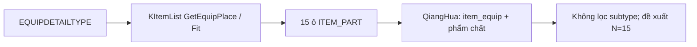

## TÓM TẮT 5 DÒNG

1. PARTIAL — Khảo sát tĩnh đã chốt 15 ô mặc (`KItem.h:85-103`, `GameDataDef.h:211-229`); tệp nhịp ngoài worktree không ghi được.
2. [ĐỀ XUẤT] N=15 theo mapping `KItemList.cpp:2462-2655` và predicate `KItemList.cpp:5393-5398`.
3. Đầu ra: `JX1_OPS/DESIGN/QH-01-O-TRANG-BI.md`; báo cáo này và mục kết quả task đã cập nhật.
4. [CHƯA KIỂM] Giá trị config (`KItemList.cpp:5425-5433`), item cụ thể, tên `equip_yinjian` (`KItem.h:100`), UI và runtime.
5. Chỉ đọc tĩnh; không chạy build/exe/VM/mạng; không commit theo task; PM tổng hợp commit.

# QH-01 — Khảo sát ô trang bị cường hóa được

Loại: khảo sát
Chủ đề: Liệt kê các ô mặc từ enum và ánh xạ server, rồi xác định độ phủ điều kiện cường hóa.
Từ khóa: ô mặc, trang bị, cường hóa, EQUIPDETAILTYPE, ITEM_PART, KItemList::Fit, QiangHua, N=15
Trạng thái: PARTIAL — khảo sát tĩnh hoàn tất; tệp nhịp ngoài worktree bị từ chối quyền ghi.
Độ phủ: 15/15 ô mặc; 15/15 loại vị trí không bị cổng QiangHua loại theo detail type.
Liên quan: `JX1_OPS/DESIGN/QH-01-O-TRANG-BI.md`, `H-03-cuong-hoa.md`, `JX1_OPS/DESIGN/MUC-LUC-TRI-THUC.md`.
Cần tôi quyết định: không

## Phạm vi và độ phủ

| Phần tử | Kết quả | Bằng chứng |
|---|---|---|
| 15 loại trang bị trong `EQUIPDETAILTYPE` | Đã phủ; sentinel loại riêng | Server `KItem.h:85-103`; client `gamecore/KItem.h:52-70` |
| 15 ô mặc trong `ITEM_PART` | Đã phủ; `itempart_num` là sentinel | Client `GameDataDef.h:211-229` |
| Ánh xạ loại chi tiết sang ô | Đã phủ; nhẫn vào ring1 mặc định và Fit nhận ring2 | Server `KItemList.cpp:2462-2655` |
| Cổng cường hóa server | Đã phủ; check `item_equip` + vàng/tím/xanh, không lọc detail type | Server `KItemList.cpp:5393-5514` |
| Điểm gọi từ Lua | Đã phủ wrapper gọi `QiangHua` | Server `ScriptFuns.cpp:7926-7935` |
| Config/data item `D:\JX-source` | Chưa có giá trị hoặc danh mục item được kiểm trong root task | `QiangHuaRank` được đọc tại `KItemList.cpp:5425-5433`; giá trị nạp chưa xác minh |
| Runtime/UI/build | Chưa kiểm theo quyền task | Không chạy build, exe, VM hoặc mạng |

## Kết luận

`N = 15` ô mặc, gồm một ô vũ khí nhận hai loại vũ khí và hai ô nhẫn nhận cùng một loại nhẫn. Server `KItemList::QiangHua` chấp nhận item `item_equip` có `GoldId`, `IsPurple` hoặc `IsBlue`; nhánh này không phân biệt detail type. Vì thế, từ source đã chỉ định, đề xuất hỗ trợ cường hóa cả 15 ô khi item thỏa predicate đó. Cổng nhận item index, không kiểm tra item đang mặc ở vị trí nào; kết luận không khẳng định UI/runtime hoặc có item phù hợp cho từng slot trong dữ liệu thật.

## MỤC SỔ THÔNG SỐ

| Tên/hằng số | Giá trị | Nguồn | Ảnh hưởng / mức đổi an toàn |
|---|---|---|---|
| `itempart_num` | 15 ô (0–14; sentinel 15) | Client `GameDataDef.h:211-229` | Kích thước slot; CẨN THẬN khi đổi |
| `QiangHuaRank[2]` | Giá trị cấu hình chưa đọc | Server `KItemList.cpp:5425-5433` | Trần API; CẨN THẬN khi đổi |
| `nEnChance` | Helper kẹp 0–30 | Server `KItem.cpp:3800-3818` | Cấp ghi trên item; không quyết định slot; CẨN THẬN khi đổi |

## ĐỀ XUẤT TỐI ƯU

- Giữ một predicate cường hóa cho cả 15 vị trí theo `item_equip` và phẩm chất đã có; source không có nhánh loại theo detail type.
- Nếu giao diện cần lọc theo vị trí, dùng mapping `GetEquipPlace/Fit`; giữ hai ô nhẫn là hai vị trí.
- Đối chiếu dữ liệu item/tên UI cho `equip_yinjian` và `equip_shiping` trong task dữ liệu riêng trước khi chuẩn hóa nhãn sản phẩm.

## Đã xác minh

- `EQUIPDETAILTYPE` phía server: `D:\JX-source\server\jxOnline\gameserver\Sources\Core\Src\KItem.h:85-103`.
- Enum 15 vị trí mặc phía client: `D:\JX-source\client\Classes\gamecore\GameDataDef.h:211-229`.
- Mapping `GetEquipPlace`/`Fit`, bao gồm `ring1` và `ring2`: server `D:\JX-source\server\jxOnline\gameserver\Sources\Core\Src\KItemList.cpp:2462-2655`.
- Điều kiện QiangHua: cùng file `:5393-5398`; wrapper Lua: `D:\JX-source\server\jxOnline\gameserver\Sources\Core\Src\ScriptFuns.cpp:7926-7935`.
- Báo cáo cường hóa cũ H-03 đã được đọc làm tài liệu liên quan; không sửa và không thay kết luận của báo cáo đó.

## Chưa xác minh

- Giá trị `QiangHuaRank` thực tế được nạp, bộ item cụ thể, chuỗi tên UI và khả năng sử dụng tại runtime. Các thư mục cấu hình/script có tên trực tiếp được dò trong `D:\JX-source` nhưng không tìm thấy thư mục phù hợp để đọc giá trị; không suy ra config từ H-03 vì root/phiên bản khác.
- Tính đồng nhất enum server/client ở các build khác: server có tham chiếu `itempart_num`; khai báo enum đọc trực tiếp trong nguồn task nằm phía client.
- Không chạy test, build, exe, VM hoặc mạng theo quyền task.

## Lỗi, cách thử và kết quả

- `rg` không có trong PATH. Dùng `Select-String` trên đúng thư mục server/client và đọc các đoạn source cần thiết; kết quả xác định enum, mapping, predicate QiangHua và Lua wrapper.
- Ghi `D:\JX-wt\QH-01.nhip` tại mốc đầu bị `Access is denied`. Không thử vượt giới hạn sandbox; do đó không có log nhịp cho các mốc tiếp theo.
- Không có lỗi source hoặc test cần sửa; không chạy test/build do phạm vi chỉ đọc tĩnh.

## Bàn giao

- File chính và kết quả task đã cập nhật. Không stage/commit theo yêu cầu; tổng quan commit do PM thực hiện. Chưa push.
- Trạng thái **PARTIAL** vì yêu cầu ghi `.nhip` bị chặn bởi quyền filesystem; phần khảo sát và đầu ra nội dung đã hoàn thành.
- Kỹ năng đã dùng: jx1-retrofit, jx1-read-server, jx1-read-client, jx1-parameters, jx1-knowledge, jx1-report.

liên quan: JX1_OPS/DESIGN/QH-01-O-TRANG-BI.md; H-03-cuong-hoa.md; JX1_OPS/DESIGN/MUC-LUC-TRI-THUC.md.
