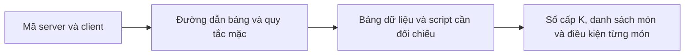

TÓM TẮT 1 [NGUỒN] — [THẤY] QH-02 đạt PARTIAL. Đã xác minh 4/7 hạng mục khảo sát tĩnh theo bảng độ phủ.
TÓM TẮT 2 [NGUỒN] — [THẤY] Định vị bảng phi phong và xác minh mã loại `12`, ô mặc, các trường chỉ số, điều kiện mặc và cơ chế khóa chung.
TÓM TẮT 3 [NGUỒN] — [THẤY] Kết quả chi tiết ở `JX1_OPS/DESIGN/QH-02-PHI-PHONG.md`. Đã ghi mục Kết quả của task.
TÓM TẮT 4 [CHƯA KIỂM] — Thiếu Settings/script đúng phiên bản nên chưa chốt K, tên, chỉ số và khóa từng món.
TÓM TẮT 5 [CHƯA KIỂM] — Chưa chạy build, exe, VM, mạng hoặc kiểm thử trong game. Tổng quan thực hiện commit theo yêu cầu.

# QH-02 — Báo cáo khảo sát phi phong

Loại: khảo sát\
Chủ đề: Đường nạp, cấp vật phẩm, điều kiện mặc và trạng thái khóa của phi phong.\
Từ khóa: phi phong, áo choàng, 披风, pifeng, equip_pifeng, Pifeng.txt, điều kiện mặc, khóa vật phẩm\
Trạng thái: PARTIAL — thiếu bảng dữ liệu và script trong nguồn được giao.\
Độ phủ: 4/7 hạng mục khảo sát tĩnh. Chưa đếm được số cấp và số món.\
Liên quan: `JX1_OPS/TASKS/QH-02.md`, `JX1_OPS/DESIGN/QH-02-PHI-PHONG.md`, `JX1_OPS/DESIGN/MUC-LUC-TRI-THUC.md:12`.\
Cần tôi quyết định: có — cung cấp đường dẫn bản sao Settings/script đúng phiên bản để tiếp tục đọc tĩnh.

## Phạm vi và độ phủ

`S/` là `D:/JX-source/server/jxOnline/gameserver/Sources/Core/Src/`, `C/` là `D:/JX-source/client/Classes/`, theo `JX1_OPS/TASKS/QH-02.md:21`. Đã tra thêm `gameserver/Headers` để định vị khai báo. Hai nguồn chưa có revision ghim.

| Hạng mục | Độ phủ | Bằng chứng hoặc nguồn thiếu |
|---|---|---|
| Bảng phi phong cơ bản server/client | Đã phủ [THẤY] ở mức định vị | `S/KBasPropTbl.CPP:16,38,801`, `C/gamecore/KBasPropTbl.CPP:16,38,830` |
| Bảng hoàng kim/bạch kim cần đối chiếu mã loại 12 | Đã phủ [THẤY] ở mức định vị | `S/KBasPropTbl.CPP:36,41,1486,1636` |
| Điều kiện mặc chung và ô phi phong | Đã phủ [THẤY] | `S/KItemList.cpp:1153–1180,2576–2578,5599–5601`, `C/gamecore/KItemList.cpp:869–893` |
| Khóa vật phẩm và ngoại hình ở mức mã | Đã phủ [THẤY] | `S/KItem.h:413–460`, `S/KItemList.cpp:1673–1703,10965–10985`, `C/gamecore/KItemList.cpp:1290–1317` |
| Danh mục từng món, cấp và K | Chưa phủ [CHƯA KIỂM] | Thiếu `Pifeng.txt`, `GoldItem.txt`, `platinaequip.txt`, dự kiến tại `S/KBasPropTbl.CPP:16,36–41` |
| Tên, chỉ số và ngưỡng mặc từng món | Chưa phủ [CHƯA KIỂM] | Bảng thiếu nên chỉ xác nhận được dạng trường tại `S/KBasPropTbl.CPP:1353–1399` |
| Khóa khi cấp/nhận và điều kiện bổ sung từng món | Chưa phủ [CHƯA KIỂM] | Thiếu nội dung Settings/script để đối chiếu với `S/KItem.h:413–460` |

## Giải mã tên

| Tên gốc | Mã hóa | Chữ đúng | Nguồn file:dòng |
|---|---|---|---|
| 披风 | GBK (đọc chú thích server bằng CP936) | Phi phong, áo choàng (披风) | `S/KBasPropTbl.CPP:38` |
| `Mantle` | ASCII, tương thích UTF-8 | Áo choàng, tên ô giao diện | `C/gameui/KuiRoleState.cpp:58` |
| `Ao choang` | ASCII, tương thích UTF-8 | Áo choàng, tên loại giao diện tiếng Việt | `C/vn/gameui/KuiItemdescVN.cpp:1130` |
| Tên từng vật phẩm | Chưa giải mã | Chưa có bản ghi gốc | `S/KBasPropTbl.CPP:1353` chỉ xác nhận trường tên |

## Sắp theo cấu trúc game

[THẤY] Có bảng phi phong cơ bản `Pifeng.txt` và hai bảng trang bị chung cần lọc mã loại `12` khi có dữ liệu. [CHƯA KIỂM] Chưa thể liệt kê từng món theo nhóm, loại con và cấp vì thiếu ba bảng. `S/KItem.h:87–99`, `S/KBasPropTbl.CPP:36–41,71,1486,1636`.

## Sổ thông số

Các giá trị có số dưới đây lấy từ mã đọc tĩnh. Mức đổi chỉ đánh giá theo bằng chứng hiện có.

| Nhóm | Tên/hằng số | file:dòng | Giá trị | Đơn vị | Ảnh hưởng | Đổi an toàn | Nguồn đo |
|---|---|---|---|---|---|---|---|
| Phân loại | `equip_pifeng` | `S/KItem.h:87–99` | 12 | mã loại | Nhận diện trang bị phi phong | KHÔNG | Đọc enum server |
| Tra dòng | `nParticularType * 10 + nLevel - 1` | `S/KItemGenerator.CPP:662–710`, `C/gamecore/KItemGenerator.CPP:775,823–824` | 10 | vị trí mỗi bước loại con | Tính chỉ số bản ghi từ loại con và cấp | KHÔNG | Đọc công thức, chưa có bảng |
| Nạp bảng | `GetPifengRecordNumber()` | `S/KBasPropTbl.CPP:634–636,809–818` | Số dòng trừ 1 dòng tiêu đề | bản ghi | Số bản ghi mà bảng chứa | CẨN THẬN | Đọc bộ nạp, chưa đếm dòng thật |
| Dữ liệu gốc | `m_aryPropBasic`, `m_aryPropReq` | `S/KBasPropTbl.CPP:1367–1399`, `S/KItem.cpp:456–466` | 7 ô chỉ số, 6 ô yêu cầu | ô mỗi dòng | Chứa mã và khoảng giá trị hoặc ngưỡng | CẨN THẬN | Đọc ánh xạ cột |
| Điều kiện mặc | `magic_requirelevel` | `S/KItemList.cpp:1253–1260` | Theo `nValue[0]`, chưa biết từng món | cấp nhân vật | Đặt cấp nhân vật tối thiểu | CẨN THẬN | Đọc nhánh kiểm tra, thiếu bảng |
| Ngoại hình | `m_PifengType` | `S/KItemList.cpp:1673–1703`, `C/gamecore/KItemList.cpp:1290–1317` | Ngưỡng 10, các nhánh trên ngưỡng dùng `% 10` khi không có mã tài nguyên ưu tiên | cấp vật phẩm đầu vào | Chọn ngoại hình trên nhân vật | CẨN THẬN | Đọc điều kiện trong mã |
| Danh mục | K | `S/KBasPropTbl.CPP:16,36–41,1364`, `JX1_OPS/TASKS/QH-02.md:17` | Chưa xác định | cấp phân biệt | Quy mô danh mục | CẨN THẬN | Thiếu bảng đúng phiên bản |
| Khóa | `LockItem` | `S/KItem.h:413–460`, `S/KItemList.cpp:4580,10965–10985` | Chưa biết trạng thái lúc nhận từng món | trạng thái | Thao tác khóa/mở và kiểm tra ở đường bán hàng | CẨN THẬN | Đọc mã, thiếu dữ liệu cấp/nhận |
| Buộc vật phẩm | `nIsBang` | `S/KItem.h:291–292`, `S/KItem.cpp:765`, `S/KItemGenerator.CPP:384–392`, `S/KItemList.cpp:4578` | Mặc định `0` trong phép gán món cơ bản. Một nhánh cửa hàng nhận giá trị từ tham số tạo món. | cờ | Ghi và đồng bộ cờ buộc riêng của món | CẨN THẬN | Đọc mã, thiếu dữ liệu cấp/nhận |

## Đề xuất tối ưu

[CHƯA KIỂM] Khi có đúng bản dữ liệu, lập một danh mục theo nhóm, loại con và cấp. Giữ cột nguồn `file:dòng`, tên gốc và cách giải mã. Đếm số món và K riêng. Dùng cặp `(mã loại con, cấp vật phẩm)` để đối chiếu hai bên, giữ mã bản ghi đối với bảng hoàng kim/bạch kim và đánh dấu các món có cấp trùng nhau. Kiểm tra script cấp/nhận trước khi ghi trạng thái khóa. Chưa có căn cứ để đề xuất đổi chỉ số hoặc điều kiện mặc. Căn cứ tra dòng và phân loại tại `S/KItemGenerator.CPP:662–710` và `S/KBasPropTbl.CPP:1353–1399,1486,1636`.

## Đã xác minh / Chưa xác minh

- Đã xác minh [THẤY] mã loại, bảng nguồn, công thức tra dòng, cấu trúc dữ liệu, ô mặc, nhánh kiểm tra yêu cầu, khóa chung và đường chọn ngoại hình bằng đọc mã server/client. Vị trí cụ thể nằm trong bảng độ phủ và sổ thông số.
- Đã chạy [THẤY] `git status --short --branch` đầu lượt. Kết quả là `task/QH-02`, worktree sạch, hai đầu ra chưa tồn tại. Kiểm tra theo tên/đuôi tệp bằng `Get-ChildItem` trong `D:/JX-source` không tìm thấy thư mục `Settings`, `Script`/`Scripts`, các bảng nêu trên hoặc tệp `.lua` và gói dữ liệu có đuôi đã kiểm. Không có `graphify-out` trong nguồn được giao. Dùng `Select-String` để lần ký hiệu và đọc mã theo khoảng dòng. `GS001-MAP.md:5` và `MUC-LUC-TRI-THUC.md:12` chỉ dùng làm điểm định vị [TÀI LIỆU].
- Đã chạy [THẤY] kiểm tra diff và khoảng trắng cho ba tệp bàn giao, kiểm tra UTF-8 không BOM, năm dòng tóm tắt và một sơ đồ Mermaid trong mỗi tài liệu mới. Các kiểm tra đạt.
- Chưa xác minh [CHƯA KIỂM] K, danh mục, giá trị và khóa của từng món. Chưa chạy build, exe, VM, mạng hay kiểm thử game theo `JX1_OPS/TASKS/QH-02.md:24`.

## Lỗi, cách thử và kết quả

| Vướng mắc | Cách thử và kết quả |
|---|---|
| Thiếu `rg` | PowerShell báo không tìm thấy lệnh. Đã dùng `Select-String` và `Get-ChildItem` theo phạm vi nguồn. |
| Thiếu dữ liệu phi phong | Tìm theo thư mục, tên bảng và đuôi dữ liệu trong root được giao. Chưa tìm thấy. Giữ trạng thái PARTIAL và chuyển giao yêu cầu bản sao đúng phiên bản. |
| Không ghi được tệp nhịp | `Add-Content` báo `Access to the path 'D:\JX-wt\QH-02.nhip' is denied.` Tệp nằm ngoài worktree được phép ghi. Ghi các mốc dưới đây trong báo cáo. |

| Giờ địa phương 20/11/2026 (+07:00), gần đúng | Mốc | Tiến độ ước tính |
|---|---|---:|
| 02:07 | Bắt đầu. Đã kiểm tra worktree và chuẩn báo cáo. | 10% |
| 02:08 | Đã định vị hai đường nạp và kiểm tra tệp dữ liệu trong nguồn. | 45% |
| 02:09 | Đã đối chiếu điều kiện mặc, khóa và ngoại hình. | 70% |
| 02:11 | Đã soạn tài liệu và phần bàn giao. Kiểm tra định dạng và phạm vi thay đổi. | 90% |

## Bàn giao

PM cần chỉ định đường dẫn bản sao `settings/item/004` của server, `update10/settings/item/004` của client và script cấp/nhận phi phong đúng phiên bản. Ưu tiên `Pifeng.txt`, `GoldItem.txt`, `platinaequip.txt` và bảng thuộc tính mà các bản ghi tham chiếu. Tổng quan thực hiện commit theo yêu cầu của người giao việc. Chưa stage, commit hay push.

Hàng đề xuất cho mục lục tri thức để PM gộp:

| Chủ đề | Báo cáo/tài liệu | Ký hiệu nguồn | Mức xác minh |
|---|---|---|---|
| Phi phong, số cấp, chỉ số, điều kiện mặc và khóa | `REPORTS/QH-02.md`, `DESIGN/QH-02-PHI-PHONG.md` | `equip_pifeng`, `Pifeng.txt`, `CanEquip`, `LockItem` | PARTIAL, khảo sát tĩnh 4/7, thiếu dữ liệu để chốt K |

Kỹ năng đã dùng: `jx1-retrofit`, `jx1-read-server`, `jx1-read-client`, `jx1-parameters`, `jx1-knowledge`, `jx1-report`.
