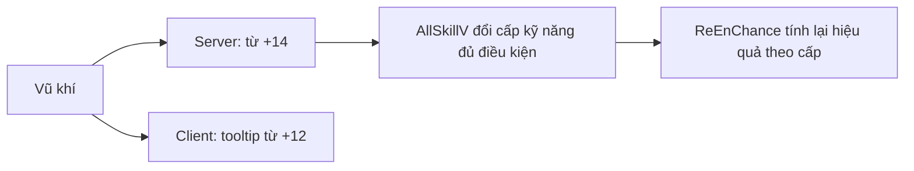

TÓM TẮT 1 [NGUỒN][THẤY]: PARTIAL; đã xác minh cách cộng cấp, đường tính lại hiệu quả và tooltip trong mã (`../DESIGN/QH-03-THUOC-TINH-KY-NANG.md`).
TÓM TẮT 2 [NGUỒN][THẤY]: `allskill_v` có ID 139; nhánh hàng loạt cộng cấp kỹ năng đang có cấp dương, trừ ID 1, 2, 53 (`S/KMagicAttrib.h:154`, `S/KNpcAttribModify.cpp:743`).
TÓM TẮT 3 [NGUỒN][THẤY]: Vũ khí +12 hoặc +13 hiện dòng +1 ở client, trong khi nhánh thưởng server bắt đầu ở +14 (`C/gameui/KuiItemdesc.cpp:235`, `S/KItem.cpp:183`).
TÓM TẮT 4 [CHƯA KIỂM]: Chưa có tệp Settings để đối chiếu mẫu `[Descript] allskill_v` và bản ghi vật phẩm (`S/KMagicDesc.cpp:9`, `C/gamecore/KMagicDesc.cpp:11`).
TÓM TẮT 5 [CHƯA KIỂM]: Chỉ đọc tĩnh; chưa chạy build, game, exe, VM hoặc mạng. Không commit; Tổng quan tiếp nhận (`JX1_OPS/TASKS/QH-03.md:22`).

# QH-03 — Bàn giao khảo sát thuộc tính +N tất cả kỹ năng

Loại: khảo sát  
Chủ đề: Xác minh cơ chế tăng cấp kỹ năng và chênh lệch ngưỡng tooltip.  
Từ khóa: cường hóa, tất cả kỹ năng, `magic_allskill_v`, `allskill_v`, ID 139, `ReEnChance`, tooltip  
Trạng thái: PARTIAL – thiếu tệp Settings gốc trong nguồn được giao.  
Độ phủ: Đã phủ 4 trên 5 hạng mục khảo sát tĩnh.  
Liên quan: [tài liệu thiết kế](../DESIGN/QH-03-THUOC-TINH-KY-NANG.md), [task](../TASKS/QH-03.md).  
Cần tôi quyết định: có, nếu mở task riêng để chốt ngưỡng hiển thị và áp dụng.

## Phạm vi và độ phủ

`S/` = `D:/JX-source/server/jxOnline/gameserver/Sources/Core/Src/`; `C/` = `D:/JX-source/client/Classes/`.

| Hạng mục | Độ phủ | Nguồn |
|---|---|---|
| Mã thuộc tính và `ModifyAttrib` | Đã phủ [THẤY] | `S/KMagicAttrib.h:154`, `S/KNpcAttribModify.cpp:120`, `S/KNpcAttribModify.cpp:322` |
| Đổi cấp và lọc danh sách kỹ năng | Đã phủ [THẤY] | `S/KNpcAttribModify.cpp:765`, `S/KSkillList.cpp:186` |
| Cộng hiệu quả và tính lại | Đã phủ [THẤY] | `S/KNpcAttribModify.cpp:3584`, `S/KItemList.cpp:1832`, `S/KSkillList.cpp:1009` |
| Tooltip | Đã phủ [THẤY] | `C/gameui/KuiItemdesc.cpp:235`, `C/gameui/KuiItemdesc.cpp:1244` |
| Bản ghi và mẫu từ Settings | Chưa phủ đủ [CHƯA KIỂM] | `S/KMagicDesc.cpp:9`, `C/gamecore/KMagicDesc.cpp:11` |

## Giải mã tên

| Tên gốc | Mã hóa | Chữ đúng | Nguồn |
|---|---|---|---|
| `allskill_v` | ASCII | Cộng cấp kỹ năng | [THẤY] `S/KMagicDesc.cpp:162` |
| `+%d tất cả kỹ năng vốn có` | UTF-8 | `+N tất cả kỹ năng vốn có` | [THẤY] `C/gameui/KuiItemdesc.cpp:239` |
| ID `1`, `2`, `53` | ID số | Chưa giải mã tên; chưa có bảng kỹ năng để đối chiếu | [CHƯA KIỂM] `S/KNpcAttribModify.cpp:765` |

## Sắp theo cấu trúc game

[THẤY] Nhân vật → danh sách kỹ năng đã học → kỹ năng đủ điều kiện; trang bị → vũ khí → thưởng theo mức cường hóa. Không chia theo phái vì hàm duyệt danh sách chung. Xem bảng chi tiết trong [tài liệu thiết kế](../DESIGN/QH-03-THUOC-TINH-KY-NANG.md) (`S/KNpcAttribModify.cpp:743`, `S/KItem.cpp:183`).

## Đã xác minh / Chưa xác minh

- [THẤY] Đối chiếu tĩnh ở hai cây nguồn: ID 139 trùng chỉ số trong enum và bảng tên; server đổi `CurrentSkillLevel` bằng `IncreaseLevel`, còn cộng hiệu quả đòn đánh trái đi qua `AddEnChance` (`S/KMagicAttrib.h:154`, `C/gamecore/KMagicDesc.cpp:163`, `S/KSkillList.cpp:202`, `S/KItemList.cpp:1839`). Sổ thông số và các điều kiện lọc nằm trong [tài liệu thiết kế](../DESIGN/QH-03-THUOC-TINH-KY-NANG.md).
- [CHƯA KIỂM] Tìm theo tên dưới `D:/JX-source` không có các tệp `MagicDesc*.ini` hoặc `GoldMagic.txt` để so nguyên văn mẫu và bản ghi vật phẩm. Chưa kiểm thử mặc/tháo, UI thực tế hay đồng bộ trong game; không chạy build, exe, VM hoặc mạng (`S/KMagicDesc.cpp:9`, `C/gamecore/KMagicDesc.cpp:11`, `JX1_OPS/TASKS/QH-03.md:22`).

## Bàn giao

Không stage, commit hay push; Tổng quan tiếp nhận theo yêu cầu. Đề xuất mục lục: `Trang bị → Cường hóa → +N cấp kỹ năng | QH-03 | magic_allskill_v (139), allskill_v | khảo sát tĩnh, thiếu Settings`. Không tạo tệp chỉ mục riêng vì ngoài vùng ghi.

Kỹ năng đã dùng: `jx1-retrofit`, `jx1-read-server`, `jx1-read-client`, `jx1-parameters`, `jx1-knowledge`, `jx1-report`.

## Phát hiện khi chuẩn hóa

- [THẤY] Chênh lệch chỉ ra từ điều kiện trong mã: +12 và +13 hiện +1 nhưng không nhận thưởng từ nhánh server được khảo sát (`S/KItem.cpp:183`, `C/gameui/KuiItemdesc.cpp:235`). Đề xuất chốt ngưỡng trước khi mở task đồng bộ; kiểm thử riêng các mức +12 đến +15 nếu được duyệt.
- [THẤY] `rg` không có; dùng `Select-String` và `Get-Content` để đối chiếu. Hai lỗi lệnh khi gom đường dẫn và in số dòng đã được xử lý bằng đọc theo tệp và định dạng `-f`; không ảnh hưởng kết quả.
- [THẤY] Ghi `D:/JX-wt/QH-03.nhip` bị từ chối vì nằm ngoài project (`writing outside of the project; rejected by user approval settings`). Không ghi sang vị trí khác; Tổng quan có thể bổ sung nhịp ngoài worktree nếu cần.
