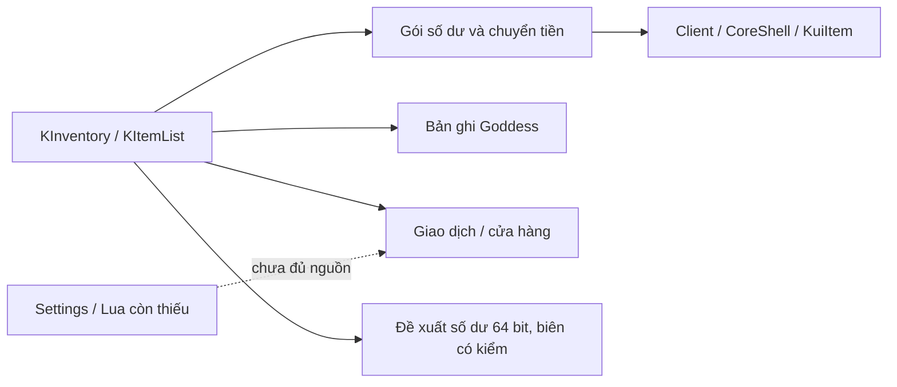

TÓM TẮT 1 [NGUỒN] PARTIAL: đã khảo sát đường chính tiền server → gói tin → Goddess → client, giao dịch và cửa hàng; 8/9 nhóm có bằng chứng source (JX1_OPS/DESIGN/QH-04-CHUOI-TIEN.md:63).
TÓM TẮT 2 [NGUỒN] Tiền bị hẹp ở nhiều lớp, gồm bản ghi nhị phân BLOB, API UI và biến trung gian; đề xuất số dư 64 bit trước, giữ trần từng lệnh/giá món để giảm sửa (JX1_OPS/DESIGN/QH-04-CHUOI-TIEN.md:91).
TÓM TẮT 3 [NGUỒN] Đầu ra chính là JX1_OPS/DESIGN/QH-04-CHUOI-TIEN.md; báo cáo này ghi bàn giao, kiểm tra và giới hạn; task được bổ sung Kết quả, không đổi mục tiêu/kết luận cũ.
TÓM TẮT 4 [CHƯA KIỂM] Thiếu goods.txt, buysell.txt, loggiaodich.lua và chưa phủ mọi caller/nhánh phụ; chưa build/test game, chạy exe/VM/mạng hoặc đo runtime.
TÓM TẮT 5 [NGUỒN] Không commit/push theo yêu cầu, chưa có SHA mới; file nhịp ngoài worktree bị từ chối truy cập, PM nhận tài liệu và bổ sung nguồn để chốt độ phủ.

# QH-04 — Bàn giao khảo sát chuỗi kiểu dữ liệu tiền

Loại: khảo sát
Chủ đề: Bàn giao các điểm 32 bit trong chuỗi tiền và đề xuất mở 64 bit ít đụng nhất.
Từ khóa: tiền, ngân lượng, KInventory, KProtocol, Goddess, KuiItem, giao dịch, cửa hàng, int64_t
Trạng thái: PARTIAL — hoàn tất bản khảo sát đường chính; chưa đủ nguồn để nhận đã liệt kê mọi điểm 32 bit.
Độ phủ: 8/9 nhóm source/dữ liệu có đối chiếu; tổng mọi caller toàn dự án chưa đếm được.
Liên quan: JX1_OPS/TASKS/QH-04.md; JX1_OPS/DESIGN/QH-04-CHUOI-TIEN.md; JX1_OPS/DESIGN/CHUAN-BAO-CAO.md.
Cần tôi quyết định: có — ở task triển khai, chọn số dư 64 bit hay cả mỗi giao dịch/giá món 64 bit; không cần quyết định thêm để giữ bản khảo sát này.

[NGUỒN] Sơ đồ tóm lược khảo sát tĩnh; bằng chứng từng cạnh nằm trong bảng nguồn của DESIGN: JX1_OPS/DESIGN/QH-04-CHUOI-TIEN.md:41. Không biểu diễn một phiên chạy game đã kiểm thử.

## Phạm vi và độ phủ

| Phần tử phạm vi | Kết quả | Nguồn trong tài liệu bàn giao |
|---|---|---|
| Kho tiền server | Đã phủ đường chính | JX1_OPS/DESIGN/QH-04-CHUOI-TIEN.md:95 |
| Gói vào game/cập nhật tiền | Đã phủ khai báo và gửi/nhận | JX1_OPS/DESIGN/QH-04-CHUOI-TIEN.md:108 |
| Gửi/rút rương | Đã phủ UI → lệnh → server | JX1_OPS/DESIGN/QH-04-CHUOI-TIEN.md:69 |
| Goddess | Đã phủ trường tiền và nhánh lưu BLOB/DBTable | JX1_OPS/DESIGN/QH-04-CHUOI-TIEN.md:121 |
| Client KInventory/KuiItem | Đã phủ số dư, API và định dạng hiển thị | JX1_OPS/DESIGN/QH-04-CHUOI-TIEN.md:135 |
| Trao đổi | Đã phủ tiền đặt, backup, quyết toán, biên log | JX1_OPS/DESIGN/QH-04-CHUOI-TIEN.md:143 |
| Cửa hàng | Đã phủ giá, số lượng, thuế, bán lại, sửa đồ, quầy | JX1_OPS/DESIGN/QH-04-CHUOI-TIEN.md:148 |
| Script/API và gói phụ | Đã phủ điểm nối; chưa lần hết hệ thống phụ | JX1_OPS/DESIGN/QH-04-CHUOI-TIEN.md:163 |
| Settings/script dữ liệu | Chưa phủ — ba file đích danh không tìm thấy dưới root đã giao | JX1_OPS/DESIGN/QH-04-CHUOI-TIEN.md:75 |

### Giải mã tên và sắp theo cấu trúc game

| Tên gốc | Mã hóa | Chữ đúng UTF-8 | Nguồn |
|---|---|---|---|
| KInventory / KProtocol / KuiItem | ASCII, giữ nguyên | Kho tiền / gói tin / giao diện hành trang | JX1_OPS/DESIGN/QH-04-CHUOI-TIEN.md:79 |
| Goddess | ASCII, giữ nguyên | Thành phần lưu nhân vật | JX1_OPS/DESIGN/QH-04-CHUOI-TIEN.md:85 |

[NGUỒN] Không đưa tên NPC, kỹ năng, bản đồ hoặc trang bị vào báo cáo. Nội dung được xếp theo tiền nhân vật → gói tin/lưu → UI → giao dịch → cửa hàng → nhánh phụ; bảng tên đầy đủ, giới hạn mã hóa và nguồn trực tiếp nằm tại JX1_OPS/DESIGN/QH-04-CHUOI-TIEN.md:79.

## Kết quả chính và đề xuất tối ưu

- [THẤY] Không có một điểm đổi kiểu duy nhất: ô tiền, getter/setter, biến tổng, backup trade, bản ghi lưu và client đều dùng trường hẹp. Đường bằng chứng trực tiếp: D:/JX-source/server/jxOnline/gameserver/Sources/Core/Src/KInventory.h:10; D:/JX-source/server/jxOnline/gameserver/Sources/Core/Src/KItemList.cpp:3370; D:/JX-source/client/Classes/gameui/KuiItem.h:116.
- [THẤY] Goddess lưu bản ghi nhị phân ở nhánh SQL BLOB và DBTable; source có cả phép tự trừ/cộng tiền. Không có căn cứ nói chỉ ALTER một cột money là đủ: D:/JX-source/server/jxOnline/gateway/Sources/MultiServer/Goddess/IDBRoleServer.cpp:760; D:/JX-source/server/jxOnline/gateway/Sources/MultiServer/Goddess/IDBRoleServer.cpp:876; D:/JX-source/server/jxOnline/gateway/Sources/MultiServer/Goddess/IDBRoleServer.cpp:1000.
- [TÀI LIỆU] Mức ít sửa đề xuất: Money=int64_t cho số dư và phép tính; version hóa bản ghi/gói số dư; payload UI tiền riêng; giữ giá món/lệnh 32 bit có kiểm trần. Nếu cần một lần trao đổi hoặc một món vượt INT32_MAX thì phải mở thêm các biên giá/lệnh, dữ liệu đồ và parser. Chi tiết và danh sách việc: JX1_OPS/DESIGN/QH-04-CHUOI-TIEN.md:184.
- [CHƯA KIỂM] Chưa chốt “mọi chỗ 32 bit” vì thiếu dữ liệu và chưa lần toàn bộ nhặt/rơi tiền, bang hội, xếp hạng, ký gửi, callback. Không nhận các nhánh phụ đã tương thích 64 bit: JX1_OPS/DESIGN/QH-04-CHUOI-TIEN.md:163.

## Mục sổ thông số

[NGUỒN] Sổ chính có giá trị, đơn vị, nguồn, mức đổi an toàn và tình trạng đo: JX1_OPS/DESIGN/QH-04-CHUOI-TIEN.md:172. Số bit/layout được nêu theo giả định ABI, không gắn nhãn số đo runtime. Không sửa thông số game.

## ĐÃ XÁC MINH / CHƯA XÁC MINH

ĐÃ XÁC MINH: đọc task/chuẩn báo cáo và sáu skill được chỉ định; kiểm Git đầu lượt thấy `task/QH-04`, không có local thay đổi; kiểm hai đầu ra chưa tồn tại; đọc tĩnh các khai báo/callsite nêu trong DESIGN; tìm đích danh ba tệp thiếu; kiểm tài liệu UTF-8 không BOM và các file nguồn được trích dẫn đều tồn tại. Kiểm 393 tham chiếu đầy đủ trong DESIGN tới 51 file nguồn: không có đường dẫn nguồn thiếu. Dòng nguồn được đối chiếu lúc đọc từng đoạn, không biên dịch để kiểm ABI.

CHƯA XÁC MINH: sizeof/offset của binary, include thực từng cấu hình, backend DB đang chạy, dữ liệu thật/backup, Lua_Number, nguyên tử/lưu bền của giao dịch và lỗi tràn khi chạy. Chưa build/test game, chạy exe, VM, kết nối mạng. Chỉ thực hiện kiểm tra tài liệu; không dùng chúng để nhận source/build/test game đạt.

## Lỗi, cách thử và kết quả

| Lỗi/giới hạn | Cách thử hoặc xử lý | Kết quả |
|---|---|---|
| Không có rg | Thử tìm theo tên và symbol; chuyển sang Select-String/Get-ChildItem có lọc | Tiếp tục đọc nguồn, không cài công cụ |
| Ký tự Việt bị hiển thị sai ở lượt đọc mặc định | Đặt Console OutputEncoding UTF-8 cho các lượt sau; tạo tài liệu bằng UTF-8 không BOM; chỉ suy luận code ASCII | Tài liệu có dấu, không sửa hay “giải mã đoán” source |
| PowerShell -Include cùng -LiteralPath không lọc như mong đợi ở lần tìm client đầu | Dừng cách liệt kê đó, chuyển đường file trực tiếp và Where-Object theo tên | Không đọc nội dung toàn thư mục, không lặp quét rộng |
| Đường include gameserver/header/CoreUseNameDef.h không tồn tại | Dùng bản H/CoreUseNameDef.h và client/CoreUseNameDef.h có thật, đánh dấu include build chưa xác minh | Có tên Settings để tìm, không tự sửa source/path |
| goods.txt, buysell.txt, loggiaodich.lua thiếu | Tìm đúng từng tên dưới D:/JX-source, không đọc thư mục lớn không lọc | Không có kết quả; ghi chưa phủ, không lấy dữ liệu root khác thay |
| Ghi D:/JX-wt/QH-04.nhip bị chặn | Một lần Set-Content ở mốc bắt đầu | UnauthorizedAccessException / Access denied; không thay quyền, không tạo đường vòng |

Các mốc thay nhịp được ghi ở đây: bắt đầu đã kiểm task/Git và thử ghi nhịp nhưng giờ không lưu được; 20/11/2026 01:09:47 +07:00 hoàn tất đối chiếu các nhánh chính (~75%); 01:15:09 +07:00 đã ghi DESIGN, kiểm nguồn/UTF-8, chuẩn bị bàn giao (~90%). 20/11/2026 01:17:38 +07:00 sắp xong: hai tài liệu và Kết quả task đã ghi, kiểm cấu trúc/UTF-8 đạt, đang xem diff (~98%). Trạng thái file nhịp ngoài worktree: **chưa ghi được**, không nhận đã đáp ứng NHỊP đầy đủ.

## Phát hiện khi chuẩn hóa

[NGUỒN] Không có bản DESIGN/REPORT cũ để đổi kết luận. Đã phân biệt header S3DBInterface cũ/mới và code trong comment, ghi tại JX1_OPS/DESIGN/QH-04-CHUOI-TIEN.md:227. Không sửa tài liệu khác để hợp thức hóa kết quả.

## Bàn giao

- Trạng thái: PARTIAL. Hai tài liệu đã tạo; chỉ bổ sung Kết quả cuối task. Không sửa source, cấu hình, BAI_HOC, mục lục hoặc chỉ mục TSV ngoài vùng được giao.
- Commit/push: không thực hiện theo yêu cầu “Tổng quan commit hộ”; chưa có SHA mới, không có bằng chứng push và không tuyên bố đã push. Lỗi nhịp là lỗi quyền ghi file ngoài worktree, không phải lỗi Git/push.
- PM bổ sung bộ Settings/script đúng phiên bản và mở phạm vi nhánh phụ nếu cần kiểm kê toàn bộ; sau đó chốt mức A/B. Các phép thử và phương án hoàn tác chỉ là đề xuất trong DESIGN, chưa được phép chạy ở task này.
- Hàng đề xuất để PM gộp chỉ mục, không ghi thêm file ngoài phạm vi: `JX1_OPS/DESIGN/QH-04-CHUOI-TIEN.md | khảo sát | Chuỗi tiền và mở 64 bit | tiền, KInventory, Goddess, Money64, giao dịch | PARTIAL | 8/9 nhóm, thiếu Settings/script | JX1_OPS/REPORTS/QH-04.md`.

Kỹ năng đã dùng: jx1-retrofit, jx1-read-server, jx1-read-client, jx1-parameters, jx1-knowledge, jx1-report. Đã nạp .agents/skills; không dùng sub-agent, không gửi thông báo ngoài.
