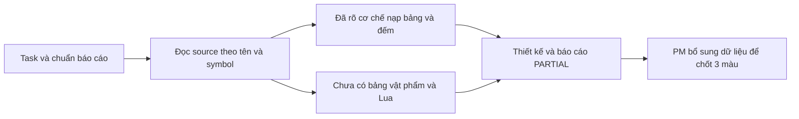

TÓM TẮT 1 [NGUỒN] [THẤY] PARTIAL: đã khảo sát tĩnh QH-05 trong đúng root nguồn; chưa đủ bảng để chốt 3 loại thủy tinh (JX1_OPS/TASKS/QH-05.md:17-24).
TÓM TẮT 2 [NGUỒN] [THẤY] GetItemCountWithName dùng chuỗi con; cách đếm theo bộ ID có bộ lọc vị trí, level và series (S/KItemList.cpp:10328-10343,10504-10530).
TÓM TẮT 3 [NGUỒN] [THẤY] Đã tạo JX1_OPS/DESIGN/QH-05-THUY-TINH.md, báo cáo này và cập nhật phần Kết quả cuối task; không sửa source hay kết luận cũ.
TÓM TẮT 4 [CHƯA KIỂM] Chưa xác định tên gốc/ID/rơi/mua/vật phẩm thay thế; 6 tên bảng và mẫu *.lua đều không tìm thấy dưới D:\JX-source; nhịp ngoài worktree bị từ chối ghi (thiết kế:134).
TÓM TẮT 5 [CHƯA KIỂM] Không build/game/exe/VM/mạng; không commit/push theo yêu cầu, chưa có SHA; PM bổ sung Settings/script để hoàn tất (JX1_OPS/TASKS/QH-05.md:24; thiết kế:150).

# QH-05 — Bàn giao khảo sát thủy tinh làm nguyên liệu cường hóa

Loại: khảo sát
Chủ đề: Bàn giao bằng chứng mã nguồn và phần dữ liệu còn thiếu của thủy tinh hồng/lục/lam.
Từ khóa: thủy tinh hồng, thủy tinh lục, thủy tinh lam, GetItemCountWithName, GetItemCount, CountBagItemExact, mine.txt, questkey.txt, GBK, TCVN3
Trạng thái: PARTIAL — phần mã đã có bằng chứng; phần bản ghi vật phẩm còn thiếu đầu vào.
Độ phủ: đã đối chiếu 1/1 API đếm tên được hỏi, 2/2 bộ nạp server/client; chốt đầy đủ 0/3 loại vật phẩm; tổng số bản ghi chưa đếm được do thiếu bảng.
Liên quan: JX1_OPS/DESIGN/QH-05-THUY-TINH.md; JX1_OPS/TASKS/QH-05.md; JX1_OPS/DESIGN/CHUAN-BAO-CAO.md
Cần tôi quyết định: có — PM cần bổ sung hoặc chỉ định bản sao dữ liệu phù hợp trước khi chọn nguyên liệu.
liên quan: JX1_OPS/DESIGN/QH-05-THUY-TINH.md; JX1_OPS/TASKS/QH-05.md.

[TÀI LIỆU] `thiết kế:dòng` viết tắt cho `JX1_OPS/DESIGN/QH-05-THUY-TINH.md:dòng`. `S/` và `C/` là root server/client đã khai báo tại thiết kế:20. Bằng chứng code là đọc file thật, không phải kết luận từ index/Graphify.



## Phạm vi và độ phủ

| Nội dung | Kết quả | Bằng chứng |
|---|---|---|
| [CHƯA KIỂM] Thủy tinh hồng | Chưa có byte tên, bộ ID, cách rơi/mua | thiết kế:37,53; JX1_OPS/TASKS/QH-05.md:17 |
| [CHƯA KIỂM] Thủy tinh lục | Chưa có byte tên, bộ ID, cách rơi/mua | thiết kế:37,53; JX1_OPS/TASKS/QH-05.md:17 |
| [CHƯA KIỂM] Thủy tinh lam | Chưa có byte tên, bộ ID, cách rơi/mua | thiết kế:37,53; JX1_OPS/TASKS/QH-05.md:17 |
| [THẤY] Bộ nạp hai phía | Server đọc settings/item/004; client đọc update10/settings/item/004 | S/KBasPropTbl.CPP:16-18; C/KBasPropTbl.CPP:16-18 |
| [THẤY] Cách đếm tên / ID | Đã đối chiếu mã và đăng ký Lua; chưa thử game | S/ScriptFuns.cpp:14415-14424,25994,26075,26077; thiết kế:99 |
| [THẤY] Cơ chế rơi / mua | Đã chỉ ra cách đọc; chưa có dòng cho ba màu | S/KNpcTemplate.cpp:95-112; S/KBuySell.cpp:89-117,223-225 |
| [CHƯA KIỂM] Vật phẩm thay thế có sẵn | Chưa có ứng viên được dữ liệu chứng minh; chỉ nêu tiêu chí lựa chọn | thiết kế:150; S/KBasPropTbl.CPP:790-810 |

## Giải mã tên

[TÀI LIỆU] Bảng đầy đủ ở thiết kế:53. Cả ba tên trong task là tiếng Việt UTF-8 để mô tả yêu cầu; chưa có byte gốc trong bảng để xác nhận GBK/TCVN3 hoặc tên Hán tương ứng. Không tự đặt tên gốc thay cho dữ liệu chưa thu được (`JX1_OPS/TASKS/QH-05.md:17`; `S/KBasPropTbl.CPP:16-18`).

## Sắp theo cấu trúc game

[TÀI LIỆU] Theo công dụng nguyên liệu cường hóa → hồng/lục/lam → bản ghi. Chưa gán từng màu vào mine hay quest khi không có dòng bảng. Dữ liệu thiếu ghi “chưa biết”, không dùng số 0 (`JX1_OPS/TASKS/QH-05.md:17`; bảng phạm vi tại thiết kế:37).

## ĐÃ XÁC MINH

- [THẤY] Git ban đầu ở nhánh `task/QH-05`, sạch; hai tệp đầu ra chưa có. Chỉ cập nhật ba tệp được prompt cho phép: thiết kế, báo cáo này và mục Kết quả của task.
- [THẤY] `GetItemCountWithName` gọi `GetCountWithName`; C++ dùng `strstr`, cộng số cộng dồn và không lọc vị trí trong hàm (`S/ScriptFuns.cpp:14415-14424`; `S/KItemList.cpp:10328-10343`).
- [THẤY] `GetItemCount` lọc chính xác genre/detail/particular, thêm level/series khi > -1; chỉ lọc vị trí khi mã room hợp lệ (`S/KItemList.cpp:10514-10527`). Không nhận -1 là wildcard particular.
- [THẤY] `CountBagItemExact` đã có wrapper/đăng ký trong source; so tên đầy đủ nhưng chỉ loại vị trí đang mặc, không lọc riêng túi (`S/ScriptFuns.cpp:10917-10927,26041`; `S/KItemList.cpp:10347-10361`).
- [THẤY] Loader mine/quest và nhánh tạo có phân biệt chỉ số bản ghi, dữ liệu ID và level truyền vào (`S/KBasPropTbl.CPP:95-118,865-879,998-1021`; `S/KItem.cpp:1184-1186`; `S/KItemGenerator.CPP:3608-3615,3740-3749`).
- [THẤY] Tìm theo tên mine.txt, questkey.txt, ItemMine.txt, ItemQuest.txt, buysell.txt, goods.txt, *.lua dưới `D:\JX-source`: mỗi mẫu 0 tệp. Tìm tên thủy tinh trong 62 tệp source đã lọc với ba cách đọc: 0 kết quả. Phạm vi/mẫu lọc lưu ở thiết kế:134; không suy vật phẩm không tồn tại.
- [THẤY] Đã đọc lại thiết kế bằng UTF-8 nghiêm ngặt và kiểm tra không BOM, đúng 5 dòng tóm tắt, đúng 1 sơ đồ Mermaid, không có ký tự thay thế U+FFFD; kết quả PASS trước khi ghi báo cáo bàn giao.

## CHƯA XÁC MINH

[CHƯA KIỂM] Tên gốc GBK/TCVN3 của 3 màu; genre/detail/particular/level/series cụ thể; nguồn rơi/mua; vật phẩm thay thế được chứng minh có sẵn; enum vị trí bằng số; binary/runtime đang dùng và tính đồng nhất giữa đếm và tiêu hao. Những phần này không được ghi nhận DONE (`JX1_OPS/TASKS/QH-05.md:17,24`; thiết kế:53,99).

[CHƯA KIỂM] Không chạy build, exe/game, VM, mạng, kết nối server hay kiểm thử runtime vì không thuộc quyền task. Kiểm tra thực chạy chỉ gồm đọc tĩnh, lọc tên/symbol và kiểm tra tài liệu cục bộ (`JX1_OPS/TASKS/QH-05.md:24`).

## MỤC SỔ THÔNG SỐ

| Nhóm | Tên/hằng số | file:dòng | Giá trị | Đơn vị | Ảnh hưởng | Đổi an toàn (CÓ/CẨN THẬN/KHÔNG) | Nguồn đo |
|---|---|---|---|---|---|---|---|
| [THẤY] Loại chung | item_mine / item_task | S/KItem.h:61-70 | 2 / 4, chưa gán cho ba màu | Mã loại | Phân loại vật phẩm | KHÔNG — không sửa enum | Đọc tĩnh |
| [THẤY] Lọc đếm | level / series | S/KItemList.cpp:10521-10525 | -1 bỏ lọc; > -1 so bằng | Giá trị lọc | Phân biệt biến thể | CẨN THẬN — chưa có ID thật | Đọc tĩnh |
| [THẤY] Vị trí | room | S/KItemList.cpp:10518-10519 | Chỉ lọc trong [pos_hand, pos_count) | Mã vị trí | Phạm vi đếm | CẨN THẬN — chưa chốt mã số | Đọc tĩnh |
| [CHƯA KIỂM] Ba nguyên liệu | Bộ ID và level | JX1_OPS/TASKS/QH-05.md:17; S/KBasPropTbl.CPP:16-18 | Chưa biết | Bộ định danh | Chưa được đưa vào cấu hình | CẨN THẬN | Thiếu bảng |
| [CHƯA KIỂM] Rơi/mua | Tỷ lệ / giá | S/KNpcTemplate.cpp:99-112; S/KBuySell.cpp:113-118 | Chưa biết | Tỷ lệ / tiền | Cân bằng nguyên liệu | CẨN THẬN | Chưa đo runtime |

## Lỗi, cách thử và kết quả

| Lỗi hoặc giới hạn | Cách thử thực tế | Kết quả / xử lý |
|---|---|---|
| [THẤY] Hiển thị tiếng Việt lỗi ở lượt đọc đầu | Đọc mặc định PowerShell; sau đó đổi console và Get-Content sang UTF-8 | Đọc đúng chuẩn/task/skill; không sửa các file gốc. Đây là lý do duy nhất đọc lại cùng nội dung. |
| [THẤY] Không có rg | Gọi rg khi định vị lần đầu | CommandNotFoundException; báo một lần, chuyển Select-String/Get-ChildItem có lọc; không cài công cụ. |
| [THẤY] -Include không lọc như mong đợi khi dùng nhiều LiteralPath | Lượt định vị tên bảng trả cả tệp header | Bỏ kết quả đó; kiểm tra lại bằng bộ lọc Name, rồi dùng -Filter riêng từng tên. Kết quả chính thức L02 là mỗi mẫu 0 tệp. |
| [THẤY] Thiếu bảng / Lua trong root được giao | L01-L04 ở thiết kế:134 | Không có dữ liệu để chốt ID hay vật phẩm thay thế; giữ PARTIAL, không mở rộng sang VM/ổ khác. |
| [THẤY] Tệp nhịp ngoài writable root | Ghi UTF-8 một lần vào D:\JX-wt\QH-05.nhip ở mốc bắt đầu | “Access to the path 'D:\JX-wt\QH-05.nhip' is denied.” Không thử lại cùng lỗi, không đổi quyền hoặc ghi đường vòng; ghi các mốc trong báo cáo này. |

## Nhịp tiến độ

[TÀI LIỆU] Các mốc dưới đây thay thông tin bàn giao khi không ghi được tệp nhịp; tỷ lệ là ước tính công việc khảo sát/soạn báo cáo trong lượt, không phải độ phủ dữ liệu vật phẩm.

| Giờ địa phương (+07:00), ngày 20/11/2026 | Bước | Ước tính |
|---|---|---|
| [THẤY] Mốc bắt đầu; giờ không được lưu vào tệp nhịp | Kiểm Git, chuẩn/task/skill; ghi nhịp bị từ chối | 2% |
| [THẤY] 01:32:02 | Xong đối chiếu cơ chế lõi server/client, đã xác định thiếu bảng | 60% |
| [THẤY] 01:33:28 | Xong lượt lọc chính thức 6 tên bảng và Lua, chốt giới hạn dữ liệu | 80% |
| [THẤY] 01:36:23 | Sắp xong: thiết kế đã ghi và đọc lại; chuẩn bị báo cáo và Kết quả task | 95% |

## ĐỀ XUẤT TỐI ƯU

[TÀI LIỆU] PM bổ sung bản sao Settings/script đúng phiên bản, tối thiểu mine.txt, questkey.txt ở hai phía; bảng hàng hóa/shop và cấu hình/script cấp vật phẩm liên quan. Sau đó chỉ bổ sung phần còn thiếu trong thiết kế:150, không làm lại phần hàm đếm đã có bằng chứng.

[TÀI LIỆU] Khi có dữ liệu, ưu tiên bộ định danh đầy đủ và vị trí hợp lệ để kiểm nguyên liệu; đối chiếu cùng quy tắc cho thao tác tiêu hao. Chưa chọn vật phẩm thay thế chỉ vì thấy tên loại trong mã (`S/KItemList.cpp:10514-10527`; `S/KBasPropTbl.CPP:790-810`).

## Chỉ mục đề nghị PM gộp

[TÀI LIỆU] Prompt chỉ cho ghi thiết kế, báo cáo này và Kết quả task; vì vậy không tạo thêm `REPORTS/_CHIMUC/QH-05.tsv` ngoài vùng được giao. Hai hàng 7 cột dưới đây dành PM gộp chỉ mục; không sửa `MUC-LUC-TRI-THUC.md`.

```tsv
file	loại	chủ đề	từ khóa	trạng thái	độ phủ	liên quan
JX1_OPS/DESIGN/QH-05-THUY-TINH.md	khảo sát	Thủy tinh hồng/lục/lam làm nguyên liệu	thủy tinh;GetItemCountWithName;GetItemCount;mine.txt;questkey.txt	PARTIAL	1/1 API đếm tên;2/2 bộ nạp;0/3 vật phẩm chốt đủ	JX1_OPS/TASKS/QH-05.md;JX1_OPS/REPORTS/QH-05.md
JX1_OPS/REPORTS/QH-05.md	khảo sát	Bàn giao QH-05 và dữ liệu còn thiếu	GBK;TCVN3;GetItemCountWithName;CountBagItemExact	PARTIAL	3/3 tên yêu cầu ghi rõ phần thiếu;0/3 bộ ID chốt đủ	JX1_OPS/DESIGN/QH-05-THUY-TINH.md;JX1_OPS/TASKS/QH-05.md
```

## Bàn giao

[TÀI LIỆU] Không stage/commit/push theo yêu cầu; chưa có SHA. Không có lỗi Git/push để ghi nhận, vì không thực hiện các thao tác đó. Không gửi thông báo ra ngoài.

[TÀI LIỆU] Trạng thái cuối PARTIAL. Ba tệp bàn giao: `JX1_OPS/DESIGN/QH-05-THUY-TINH.md`, `JX1_OPS/REPORTS/QH-05.md`, mục `Kết quả` tại `JX1_OPS/TASKS/QH-05.md`. Phần cần tiếp tục là dữ liệu vật phẩm, không phải thay source hoặc đổi kết luận cũ.

Kỹ năng đã dùng: jx1-retrofit, jx1-read-server, jx1-read-client, jx1-parameters, jx1-knowledge, jx1-report.

