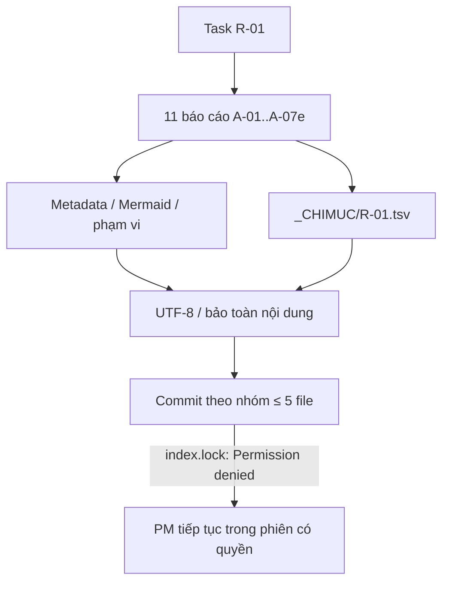

TÓM TẮT 1/5: [NGUỒN] Đã chuẩn hóa đủ 11 báo cáo từ A-01 đến A-07e, giữ phần thân và kết luận cũ.
TÓM TẮT 2/5: [NGUỒN] Mỗi báo cáo có metadata, một sơ đồ Mermaid, bảng phạm vi, xác minh/chưa xác minh và bàn giao.
TÓM TẮT 3/5: [NGUỒN] Chỉ mục `JX1_OPS/REPORTS/_CHIMUC/R-01.tsv` gồm 11 báo cáo đích và báo cáo R-01.
TÓM TẮT 4/5: [CHƯA KIỂM] Chưa đọc mọi file trong dữ liệu server; runtime, source lịch sử ngoài hai gốc được giao và kết quả build cũ chưa tái hiện.
TÓM TẮT 5/5: [CHƯA KIỂM] Không chạy build, exe, VM hoặc mạng; Git chặn stage tại index.lock, chưa có commit SHA, chưa push.

# R-01 — Chuẩn hóa báo cáo A-01..A-07e

Loại: tổng hợp
Chủ đề: Chuẩn hóa cấu trúc 11 báo cáo theo chuẩn JX1, lập phạm vi có căn cứ và chỉ mục TSV.
Từ khóa: chuẩn hóa, retrofit, A-01, A-07e, phạm vi, độ phủ, chỉ mục, JX1
Trạng thái: PARTIAL — 11 báo cáo, chỉ mục và báo cáo cuối đã ghi; commit bị chặn bởi quyền Git metadata ngoài workspace.
Độ phủ: đã chuẩn hóa 11 trên tổng 11 báo cáo mục tiêu; 3 nhóm commit chưa tạo được.
Liên quan: `JX1_OPS/TASKS/R-01.md`; `JX1_OPS/DESIGN/CHUAN-BAO-CAO.md`; `JX1_OPS/DESIGN/MUC-LUC-TRI-THUC.md`; `JX1_OPS/DESIGN/HUONG-DAN-TRA-CUU.md`; các báo cáo `A-01` đến `A-07e`.
Cần tôi quyết định: có (cần phiên có quyền ghi Git metadata để hoàn tất commit đã duyệt).

## Sơ đồ chính

## Phạm vi và độ phủ

| Báo cáo | Phạm vi chính được liệt kê | Kết quả chuẩn hóa | Trạng thái kiểm chứng R-01 |
|---|---|---|---|
| `A-01-ban-do-tien-trinh.md` | 6 dịch vụ và các nhóm kết nối | Metadata, sơ đồ, 6 dòng bảng phủ | Đã đối chiếu tên section trong gs001_cfg.ini; chưa kiểm listener/VM |
| `A-02-luong-dang-nhap.md` | 6 chặng login, SQL, roledb, sao lưu, is_bot | Metadata, sơ đồ, 10 dòng bảng phủ | Đối chiếu client qh9A; không đọc DB hoặc source server lịch sử |
| `A-03-kiem-ke-cau-hinh.md` | INI, bảng, script, map và mã hóa | Metadata, sơ đồ, 19 dòng bảng phủ | Đếm 3 thư mục dữ liệu GS; không sửa số liệu source cũ |
| `A-04-kien-truc-tong.md` | 6 mảng kiến trúc tổng hợp | Metadata, sơ đồ, 6 dòng bảng phủ | Đối chiếu có giới hạn trên GS và qh9A |
| `A-05-diem-tuong-tac-gs001.md` | 8 nhóm tương tác và đường gửi | Metadata, sơ đồ, 8 dòng bảng phủ | Bảo toàn khảo sát server cũ; chưa tái đọc source server |
| `A-06-bang-goi-tin.md` | 7 enum chính, 5 ID phụ, struct, độ dài, handler | Metadata, sơ đồ, 21 dòng bảng phủ | Đối chiếu phía client qh9A; server/gateway/ABI chưa tái kiểm |
| `A-07-goc-re-crash-gs001.md` | 5 giả thuyết, PE, build, WER/cdb và phụ lục VM | Metadata, sơ đồ, 11 dòng bảng phủ | Chỉ đọc hash/kích thước binary gốc; không chạy binary |
| `A-07b-ep-con-tro.md` | 23 file sửa, inventory, build và giới hạn | Metadata, sơ đồ, 32 dòng bảng phủ | Giữ bằng chứng snapshot lịch sử; không đọc snapshot ngoài gốc được giao |
| `A-07c-link-gs001.md` | Shim, 5 project, artifact và thử VM PM | Metadata, sơ đồ, 12 dòng bảng phủ | Không trộn hash bản dựng với binary gốc hiện có |
| `A-07d-breakpoint.md` | Assertion, P1/P2, timer, pointer, WER và inventory | Metadata, sơ đồ, 16 dòng bảng phủ | Đối chiếu symbol ASCII của 2 Lua; chưa gắn chúng với lần thử cũ |
| `A-07e-rtc.md` | Sửa P1, build, tiêu chí map, artifact và thử VM PM | Metadata, sơ đồ, 8 dòng bảng phủ | Giữ nguyên việc tiêu chí literal map chưa đạt |

## Phương pháp và phát hiện khi chuẩn hóa

- Đọc `CHUAN-BAO-CAO.md` trước; sau đó đọc đúng task, mục lục, hướng dẫn tra cứu và sáu skill JX1 được giao. Không gọi VM, exe, mạng, build hoặc test game.
- Đọc trực tiếp các cấu trúc và dòng nguồn được dùng để lập bảng. Mọi dòng trong cột đối chiếu mới nằm trong hai gốc chỉ đọc: `GS/` = `C:\Jx1CocoV3\Folder\ServerNew-20260116T043145Z-3-001\ServerNew\_bin_v2_\gs`; `CA/` = `D:\JX-build\qh9A\Classes`.
- 11 thân báo cáo gốc được so sánh theo nội dung và giữ nguyên. Ba file đầu vào có BOM UTF-8; đầu ra đã bỏ BOM. Phần thân tiếng Việt không dấu trong A-07b/c/e vẫn được giữ.
- Dữ liệu GS không cùng gốc với cây source mà một số báo cáo cũ trích dẫn. A-03 ghi 0 INI/Lua/TAB/PAK tại cây source cũ; ba thư mục GS hiện đếm riêng 2022 file Settings, 4085 file script và 503 file maps. Hai kết quả có phạm vi khác nhau, không thay thế lẫn nhau.
- `GS/script/system/serverscript.lua` và `GS/script/servertimer.lua` không giải mã nghiêm ngặt được bằng UTF-8 hoặc GBK/CP936. R-01 chỉ đối chiếu symbol ASCII, không đoán mã hóa và không sửa byte dữ liệu.
- A-04 dẫn đính chính ở E-01 cho mục sync trong A-06; A-07, A-07c, A-07d và A-07e có cập nhật về sau với mốc và binary khác nhau. Các phát hiện cũ được ghi rõ, không chọn nguyên nhân hoặc trạng thái runtime mới.
- `rg` không có trong PATH; sau một lần báo lỗi, dùng `Get-ChildItem` và `Select-String` giới hạn theo thư mục. Không cài công cụ và không tạo script phụ.

## Đã xác minh / Chưa xác minh

**ĐÃ XÁC MINH:** Tiêu đề chuẩn có ở `A-01-ban-do-tien-trinh.md:7`, `A-02-luong-dang-nhap.md:7`, `A-03-kiem-ke-cau-hinh.md:7`, `A-04-kien-truc-tong.md:7`, `A-05-diem-tuong-tac-gs001.md:7`, `A-06-bang-goi-tin.md:7`, `A-07-goc-re-crash-gs001.md:7`, `A-07b-ep-con-tro.md:7`, `A-07c-link-gs001.md:7`, `A-07d-breakpoint.md:7`, `A-07e-rtc.md:7`; từng báo cáo có một Mermaid và bảng phạm vi. `JX1_OPS/REPORTS/_CHIMUC/R-01.tsv:1` có tiêu đề đủ bảy cột. So sánh nội dung gốc xác nhận 11 thân được giữ; đầu ra UTF-8 nghiêm ngặt, không BOM. `GS/gs001_cfg.ini:1,5,9,13,17,21` có các nhóm dịch vụ được dẫn; `GS/maps/WorldSet_gs001.ini:1,2,3` có Init/Count/World và 872 khóa World; `CA/gamecore/KProtocolDef.h:20,218,394,410,431,440,453,474,498,524` có các enum đã đối chiếu.

**CHƯA XÁC MINH:** trạng thái listener, đăng nhập, schema hoặc DB; toàn bộ nội dung PAK/script/bảng; source server và gateway lịch sử; khớp nguồn với binary runtime; hiệu quả sửa crash; build, test hoặc chạy lại VM. Các nội dung này không thuộc thao tác R-01 được phép.

**Kiểm tra tài liệu đã chạy:** đọc UTF-8 nghiêm ngặt và đối chiếu nội dung gốc của 11 báo cáo; `git diff --check` không còn báo lỗi khoảng trắng. Build/test game không chạy theo task.

## Bàn giao

Đã thử stage nhóm đầu gồm A-01 đến A-05 trên nhánh `task/R-01`. Git trả lỗi nguyên văn: `fatal: Unable to create 'D:/jx1-reports/.git/worktrees/R-01/index.lock': Permission denied`. Git metadata nằm ngoài writable root `D:\JX-wt\R-01`; không đổi ACL, config hoặc credential. Nhóm đầu chưa stage, cả 3 nhóm chưa commit; không có SHA.

Nhóm dự kiến: (1) A-01..A-05; (2) A-06, A-07, A-07b, A-07c, A-07d; (3) A-07e, `_CHIMUC/R-01.tsv`, `R-01.md`, `TASKS/R-01.md`. Tiếp tục stage và commit đúng ba nhóm trong phiên được phép ghi Git metadata. **BỊ CHẶN – CHƯA PUSH.**

### Tiếp tục ngày 18/11/2026

- Đã chạy `git status --short --branch` và `git log --oneline jx1-ops..HEAD` trước khi ghi. Nhánh đúng `task/R-01`; 11 báo cáo A-01..A-07e và task đang sửa, báo cáo R-01 cùng chỉ mục đang chưa được Git theo dõi. Log chỉ có `5fde414` (commit chuẩn báo cáo/task có sẵn), chưa có commit kết quả R-01.
- Dùng báo cáo bàn giao và kết quả kiểm tra đã lưu ở lượt trước để tiếp tục; không làm lại 11 báo cáo hoặc khảo sát nguồn. Chỉ bổ sung ghi nhận tiếp tục vào báo cáo này và mục Kết quả của task.
- Đã thử lại đúng một lần `git add --` với năm file A-01..A-05; lệnh trả mã 1 và lỗi `fatal: Unable to create 'D:/jx1-reports/.git/worktrees/R-01/index.lock': Permission denied`. Lỗi cũ vẫn tồn tại; chưa thể chạy bước commit phụ thuộc vào stage.
- Trạng thái vẫn **PARTIAL**: tài liệu đủ 11/11, commit 0/3 nhóm. Giữ nguyên thay đổi local; PM cần tiếp tục ba nhóm nêu trên trong phiên được phép ghi Git metadata. Không đổi quyền, credential hoặc config. **BỊ CHẶN – CHƯA PUSH.**

## Phát hiện khi chuẩn hóa

- Khác biệt đường dẫn ở A-03 là khác biệt cây source và dữ liệu GS, không phải mâu thuẫn số liệu có thể gộp.
- A-06 có phạm vi body chưa chứng minh endpoint/ABI; cảnh báo sync do A-04 dẫn lại được giữ để PM xử lý ở nhiệm vụ riêng.
- Tóm tắt build/runtime cũ không đồng nhất vì A-07b..e ghi các snapshot khác nhau. Không xem hash GS hiện tại là hash bản dựng A-07b/c/e.
