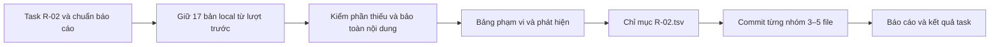

TÓM TẮT 1: [NGUỒN] R-02 đang tiếp tục chuẩn hóa 17 báo cáo A-08..A-17 và AMOLX trên nhánh task/R-02; trạng thái PARTIAL.
TÓM TẮT 2: [NGUỒN] Đã nhận diện 17 file có thay đổi từ lượt trước và giữ lại nội dung đang làm; chưa làm lại phần đối chiếu đã ghi bằng chứng.
TÓM TẮT 3: [CHƯA KIỂM] Chỉ mục _CHIMUC/R-02.tsv và kết quả cuối task chưa hoàn tất tại checkpoint này.
TÓM TẮT 4: [CHƯA KIỂM] Cần kiểm cấu trúc, bảo toàn nội dung gốc, phạm vi Võ Đang, liên kết và mã hóa trước khi bàn giao.
TÓM TẮT 5: [NGUỒN] Không build, chạy exe/VM hoặc mạng; chưa có commit chuẩn hóa R-02 tại lúc tiếp tục, không push.

# R-02 — Chuẩn hóa báo cáo A-08..A-17 và AMOLX

Loại: tổng hợp
Chủ đề: Tiếp tục chuẩn hóa tài liệu cũ, giữ nguyên kết luận và lập chỉ mục tra cứu.
Từ khóa: chuẩn hóa, retrofit, báo cáo, độ phủ, Võ Đang, wudang, R-02, UTF-8
Trạng thái: PARTIAL — đang hoàn thiện tài liệu; commit bị chặn vì Git không tạo được index.lock ngoài worktree.
Độ phủ: nhận diện 17/17 báo cáo có thay đổi kế thừa; kiểm tra bàn giao và chỉ mục chưa hoàn tất.
Liên quan: TASKS/R-02.md, DESIGN/CHUAN-BAO-CAO.md, DESIGN/MUC-LUC-TRI-THUC.md, DESIGN/HUONG-DAN-TRA-CUU.md
Cần tôi quyết định: không

## Phạm vi và độ phủ

[ĐÃ XÁC MINH] Danh sách dưới lấy từ các file thực có trong `JX1_OPS/REPORTS`, khớp vùng giao ở `JX1_OPS/TASKS/R-02.md:10`. Cả 17 file đã có thay đổi local tại đầu lượt tiếp tục; chưa có chỉ mục R-02. Trạng thái bên dưới là kiểm tra chuẩn hóa, không phải mức hoàn tất nội dung khảo sát cũ.

| File | Phạm vi chuẩn hóa | Độ phủ bàn giao |
|---|---|---|
| A-08a-mon-phai-ky-nang.md | Môn phái và kỹ năng | Chưa phủ kiểm tra cuối |
| A-08b-dong-ban.md | Đồng bạn | Chưa phủ kiểm tra cuối |
| A-08c-lua-trai-nuong-ca.md | Lửa trại và nướng cá | Chưa phủ kiểm tra cuối |
| A-08d-kinh-nghiem.md | Kinh nghiệm | Chưa phủ kiểm tra cuối |
| A-09-dong-ban-nhieu-slot.md | Đồng bạn nhiều slot | Chưa phủ kiểm tra cuối |
| A-10-lua-trai-boss.md | Lửa trại và boss | Chưa phủ kiểm tra cuối |
| A-11-sol-vs-astra.md | Đối chiếu mô hình qua báo cáo cũ | Chưa phủ kiểm tra cuối |
| A-11c-toc-do-token.md | Tốc độ token | Chưa phủ kiểm tra cuối |
| A-12-hao-huu-mac-do.md | Hảo hữu mặc đồ | Chưa phủ kiểm tra cuối |
| A-13-lien-lac-phien.md | Liên lạc phiên | Chưa phủ kiểm tra cuối |
| A-14-hao-huu-trang-bi-thiet-ke.md | Thiết kế hảo hữu và trang bị | Chưa phủ kiểm tra cuối |
| A-15a-ky-nang-phai-1-4.md | Kỹ năng nhóm phái 1–4 | Chưa phủ kiểm tra cuối |
| A-15b-ky-nang-phai-5-8.md | Kỹ năng nhóm phái 5–8 | Chưa phủ kiểm tra cuối |
| A-15c-ky-nang-phai-9-cuoi.md | Kỹ năng nhóm phái 9 đến cuối; chỗ sót Võ Đang | Chưa phủ kiểm tra cuối |
| A-16-tong-kim.md | Tống Kim | Chưa phủ kiểm tra cuối |
| A-17-roi-do-boss-trang-bi.md | Rơi đồ boss và trang bị | Chưa phủ kiểm tra cuối |
| AMOLX-DONG.md | Đóng báo cáo AMOLX | Chưa phủ kiểm tra cuối |

## Tiếp tục từ checkpoint

- Đã chạy `git status --short --branch`: đúng `task/R-02`, 17 báo cáo sửa local, không có file khác sửa tại đầu lượt.
- Đã chạy `git log --oneline jx1-ops..HEAD`: chỉ có `5fde414` về chuẩn báo cáo và giao task; chưa có commit chuẩn hóa R-02.
- Đã đọc chuẩn trước task, mục lục, hướng dẫn tra cứu và sáu skill người dùng chỉ định. Không nạp lại lịch sử khảo sát hay đọc ngoài phạm vi nguồn được giao.
- Nguồn kế thừa trong từng báo cáo được giữ nguyên; bằng chứng R-02 của lượt trước được rà theo phần bổ sung, không coi là phép thử mới của lượt tiếp tục.
- Gốc dữ liệu được phép chỉ đọc: `C:/Jx1CocoV3/Folder/ServerNew-20260116T043145Z-3-001/ServerNew/_bin_v2_/gs` và client A `D:/JX-build/qh9A`. Các root lịch sử khác chỉ là dẫn chứng gián tiếp.

## Kiểm tra và lỗi

| Kiểm tra / lỗi | Cách thực hiện | Kết quả hiện tại |
|---|---|---|
| Tiếp tục đúng worktree/nhánh | Git status và log một lần trước ghi | Đã xác nhận |
| Không có rg | Một lần gọi rg thất bại; chuyển sang Select-String/Get-ChildItem giới hạn thư mục | Đã có cách tiếp tục; không cài công cụ |
| Cấu trúc, nội dung gốc, TSV, UTF-8 | Kiểm tra trực tiếp tài liệu và so sánh Git | Chưa hoàn tất |
| Build/test game, exe, VM, mạng | Không chạy theo phạm vi task | Chưa chạy |

## Đã xác minh / Chưa xác minh

- **ĐÃ XÁC MINH:** chuẩn, task, vùng báo cáo và trạng thái checkpoint như trên.
- **CHƯA XÁC MINH:** kiểm tra bàn giao cuối; hành vi runtime, binary, PAK, DB và nguồn ngoài hai root được giao.
- Đây là task tổng hợp/chuẩn hóa tài liệu; không tạo thông số game mới và không nâng độ chắc của các số liệu cũ.

## Bàn giao

BỊ CHẶN – CHƯA PUSH. Một lần `git add` nhóm A-08a..d và R-02.md thất bại (exit 128): `fatal: Unable to create 'D:/jx1-reports/.git/worktrees/R-02/index.lock': Permission denied`. Git metadata ngoài writable root; không đổi quyền, credential hoặc cấu hình, không thử vượt sandbox. Chưa có SHA mới; không chạy commit sau stage thất bại. Phần tài liệu tiếp tục hoàn thiện local, PM cần phiên có quyền hợp lệ để stage/commit từng nhóm 3–5 file trên task/R-02, không push.

## Phát hiện khi chuẩn hóa

Đang tổng hợp từ 17 phần bổ sung có sẵn. Riêng A-15c phải hiện đầy đủ phạm vi môn phái và nêu riêng Võ Đang chưa được khảo sát trong thân bài cũ, theo `JX1_OPS/TASKS/R-02.md:18`.
