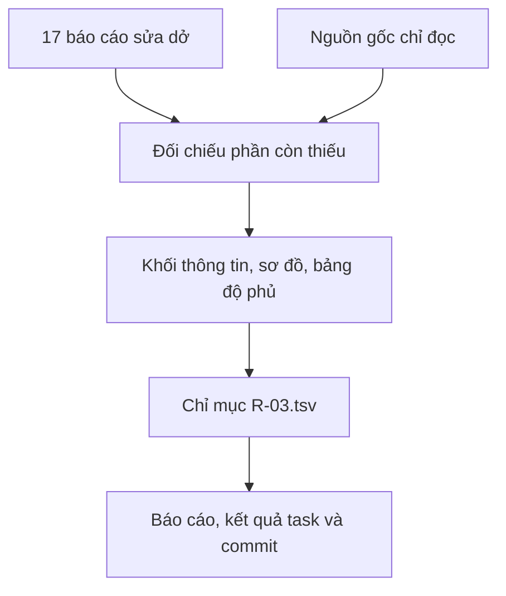

TÓM TẮT 1: [NGUỒN] PARTIAL — R-03 tiếp tục chuẩn hóa 17 báo cáo B, C, D, F, G, K, O, P từ phần sửa có sẵn.
TÓM TẮT 2: [NGUỒN] Đã kiểm tra nhánh task/R-03; giữ nguyên 17 file sửa dở, chưa có commit riêng của lượt chuẩn hóa.
TÓM TẮT 3: [CHƯA KIỂM] Đang hoàn thiện kiểm tra phạm vi, chỉ mục JX1_OPS/REPORTS/_CHIMUC/R-03.tsv và mục Kết quả của task.
TÓM TẮT 4: [CHƯA KIỂM] Chưa kết thúc kiểm tra UTF-8, liên kết và bảo toàn nội dung gốc; chưa có kết quả commit lượt tiếp tục.
TÓM TẮT 5: [NGUỒN] Chỉ đọc tài liệu/source cho phép; không build, chạy exe, VM, mạng hoặc push. SHA sẽ ghi khi commit thành công.

# R-03 — Chuẩn hóa báo cáo B, C, D, F, G, K, O, P

Loại: tổng hợp
Chủ đề: Bổ sung cấu trúc tra cứu cho các báo cáo cũ, giữ nguyên kết luận, số liệu và bằng chứng.
Từ khóa: chuẩn hóa, retrofit, R-03, visibility, hoạt động, client, giao thức, chỉ mục
Trạng thái: PARTIAL — checkpoint sớm; đang hoàn thiện phần còn thiếu từ lượt trước.
Độ phủ: đã nhận diện 17/17 báo cáo trong phạm vi; 17 bản sửa có sẵn chưa bàn giao xong.
Liên quan: JX1_OPS/TASKS/R-03.md, JX1_OPS/DESIGN/CHUAN-BAO-CAO.md, JX1_OPS/DESIGN/MUC-LUC-TRI-THUC.md, JX1_OPS/DESIGN/HUONG-DAN-TRA-CUU.md
Cần tôi quyết định: không

## Phạm vi và độ phủ

Danh sách lấy trực tiếp từ thư mục `JX1_OPS/REPORTS`, theo mẫu tên của task; không dùng số lượng báo cáo làm độ phủ source hay runtime.

| Báo cáo | Độ phủ chuẩn hóa tại checkpoint | Còn phải hoàn tất |
|---|---|---|
| B-02-loc-hien-thi.md | Có bản sửa từ lượt trước | Kiểm tra và bàn giao |
| B-02-tom-tat-diff.md | Có bản sửa từ lượt trước | Kiểm tra và bàn giao |
| B-02b-build-tren-a07e.md | Có bản sửa từ lượt trước | Kiểm tra và bàn giao |
| B-02c-build-va-thu.md | Có bản sửa từ lượt trước | Kiểm tra và bàn giao |
| B-02d-review-tinh.md | Có bản sửa từ lượt trước | Kiểm tra và bàn giao |
| B-03-test-visibility.md | Có bản sửa từ lượt trước | Kiểm tra và bàn giao |
| B-04a-bo-do-tick-bang-thong.md | Có bản sửa từ lượt trước | Kiểm tra và bàn giao |
| C-01-jxadm.md | Có bản sửa từ lượt trước | Kiểm tra và bàn giao |
| C-02-co-is-bot.md | Có bản sửa từ lượt trước | Kiểm tra và bàn giao |
| C-03-jxweb.md | Có bản sửa từ lượt trước | Kiểm tra và bàn giao |
| D-01-bang-hoat-dong.md | Có bản sửa từ lượt trước | Kiểm tra và bàn giao |
| F-01-client-hao-huu-ui-ngoai-hinh.md | Có bản sửa từ lượt trước | Kiểm tra và bàn giao |
| F-02-api-nhanh.md | Có bản sửa từ lượt trước | Kiểm tra và bàn giao |
| G-01-campfire-design.md | Có bản sửa từ lượt trước | Kiểm tra và bàn giao |
| K-01-ban-do-truyen-tin-hieu.md | Có bản sửa từ lượt trước | Kiểm tra và bàn giao |
| O-01-duyet-B-02.md | Có bản sửa từ lượt trước | Kiểm tra và bàn giao |
| P-02-bench.md | Có bản sửa từ lượt trước | Kiểm tra và bàn giao |

## Cách tiếp tục và nguồn

- Đọc chuẩn trước task và sáu skill được chủ dự án chỉ định. Chuẩn bắt buộc giữ kết luận/số liệu/bằng chứng cũ; chỉ ghi phát hiện mới vào mục riêng.
- Đã chạy `git status --short --branch` và `git log --oneline jx1-ops..HEAD` trước ghi. Nhánh đúng `task/R-03`, 17 file sửa dở; commit đã có là `5fde414` về chuẩn/skill/task, không phải kết quả R-03.
- Root dữ liệu server được phép: `C:\Jx1CocoV3\Folder\ServerNew-20260116T043145Z-3-001\ServerNew\_bin_v2_\gs`; client bản A: `D:\JX-build\qh9A`. Đã xác nhận cả hai thư mục tồn tại.
- Không mở qh7, `D:\Android\b\Client`, VM hoặc source lịch sử ngoài root task. Các kết quả lịch sử chỉ có trong báo cáo được đánh dấu nguồn gián tiếp.

## Đã xác minh / Chưa xác minh

**ĐÃ XÁC MINH:** trạng thái Git đầu lượt, danh sách 17 file sửa có sẵn, chuẩn báo cáo, task và skill đã đọc. Báo cáo này được ghi sớm để giữ checkpoint.

**CHƯA XÁC MINH:** kiểm tra hoàn chỉnh cấu trúc, nguồn, UTF-8 và bảo toàn bản gốc đang tiếp tục. Không tái chạy build, test game, exe, VM, benchmark hay mạng.

## Lỗi, cách thử và kết quả

| Lỗi / giới hạn | Cách thử | Kết quả / bước tiếp tục |
|---|---|---|
| Không có `rg` trong phiên | Gọi `rg --files` một lần | Chuyển sang `Select-String`/`Get-ChildItem` giới hạn thư mục, không cài thêm |
| Bản sửa cũ nhắc lỗi stage Git | Chưa thử commit trong lượt tiếp tục | Sẽ thử đúng nhóm file đã kiểm, không sửa quyền/config |

## Bàn giao

- Trạng thái checkpoint: PARTIAL; chưa nhận bàn giao hoàn tất.
- Chưa có SHA mới. Không push theo quyền task.
- Tiếp tục kiểm phần còn thiếu, tạo TSV, ghi Kết quả task và commit theo nhóm 3–5 file nếu Git cho phép.

## Phát hiện khi chuẩn hóa

- Bản sửa từ lượt trước đã có nội dung chuẩn hóa ở cả 17 file; không làm lại phần đã có bằng chứng.
- Một số phần bàn giao cũ đang nhắc lỗi stage Git của lượt trước; cần tách khỏi kết quả commit của lượt tiếp tục.
