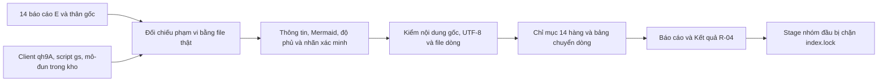

TÓM TẮT 5 DÒNG
1. [NGUỒN] PARTIAL bàn giao: đã chuẩn hóa đủ 14/14 báo cáo E, giữ kết luận và thân gốc; Git chưa cho stage/commit.
2. [NGUỒN] Mỗi báo cáo có khối thông tin, một Mermaid, bảng độ phủ, sổ thông số liên quan, xác minh, bàn giao và phát hiện.
3. [NGUỒN] Đã lập chỉ mục R-04.tsv đủ 14 dòng/7 cột, bảng chuyển dòng bằng chứng và cập nhật Kết quả của task R-04.
4. [NGUỒN] Giữ 10 DONE/4 PARTIAL của các lượt E; đối chiếu tĩnh qh9A, script gs và mô-đun trong kho, không nhận test cũ là chạy lại.
5. [CHƯA KIỂM] Không chạy suite/build, exe game/server, VM hoặc mạng; index.lock Permission denied, chưa có SHA, BỊ CHẶN – CHƯA PUSH.

# R-04 — Chuẩn hóa báo cáo nhóm E về Bot và điều phối

Loại: tổng hợp
Chủ đề: Chuẩn hóa toàn bộ báo cáo E theo chuẩn báo cáo mới và giữ nguyên giới hạn kết luận lịch sử.
Từ khóa: Bot, chuẩn hóa, retrofit, giao thức, tester, population, dispatcher, watchdog, độ phủ
Trạng thái: PARTIAL — tài liệu đã hoàn tất; commit theo nhóm 5 file bị chặn quyền ghi Git metadata.
Độ phủ: Đã chuẩn hóa 14 trên tổng 14 báo cáo E; chỉ mục 14/14 hàng; 17/17 file đầu ra tài liệu kể cả báo cáo này và mục Kết quả task; chưa có commit.
Liên quan: `JX1_OPS/TASKS/R-04.md`; `JX1_OPS/REPORTS/_CHIMUC/R-04.tsv`; `JX1_OPS/DESIGN/CHUAN-BAO-CAO.md`; `JX1_OPS/DESIGN/MUC-LUC-TRI-THUC.md`; `JX1_OPS/DESIGN/HUONG-DAN-TRA-CUU.md`
Cần tôi quyết định: không



## Phạm vi và độ phủ

[NGUỒN] Danh sách lấy từ 14 file E-*.md thực có trong REPORTS, không suy từ dải tên E-01..E-13b. Đã tiếp tục 5 thay đổi local có sẵn, giữ nguyên chúng ngoài các bổ sung làm rõ giới hạn R-04. Độ phủ hạng mục trong mỗi báo cáo là độ phủ nội dung tĩnh/fixture đã nêu, không phải tỷ lệ gameplay/runtime đạt.

| File đầu ra / bằng chứng | Độ phủ chuẩn hóa | Trạng thái và độ phủ nội dung của lượt E |
| --- | --- | --- |
| `JX1_OPS/REPORTS/E-01-thieu-giao-thuc.md:8` | Đã phủ | PARTIAL; 5 trên tổng 13 hạng mục theo báo cáo gốc; chi tiết phần chưa phủ ở bảng dưới. |
| `JX1_OPS/REPORTS/E-01b-thieu-giao-thuc.md:8` | Đã phủ | PARTIAL; 75 trên tổng 156 ID S2C trong dải 65..220; 81 ID chưa hỗ trợ. Đây là độ phủ bộ tách theo mã BOT, không phải độ phủ semantic hoặc runtime. |
| `JX1_OPS/REPORTS/E-02-hanh-vi-bot.md:8` | Đã phủ | DONE; 5 trên tổng 8 hạng mục theo báo cáo gốc; chi tiết phần chưa phủ ở bảng dưới. |
| `JX1_OPS/REPORTS/E-03-dieu-phoi-dan-so.md:8` | Đã phủ | DONE; 7 trên tổng 8 hạng mục theo báo cáo gốc; chi tiết phần chưa phủ ở bảng dưới. |
| `JX1_OPS/REPORTS/E-05a-khung-tester.md:8` | Đã phủ | PARTIAL; 6 trên tổng 8 hạng mục theo báo cáo gốc; chi tiết phần chưa phủ ở bảng dưới. |
| `JX1_OPS/REPORTS/E-05b-kich-ban-full-cycle.md:8` | Đã phủ | DONE; 6 trên tổng 10 bước trong fixture có role; 4 bước BỎ QUA. Khi chưa có role: 1 PASS, 9 BỎ QUA. |
| `JX1_OPS/REPORTS/E-07-goi-tao-nhan-vat-logout.md:8` | Đã phủ | PARTIAL; 5 trên tổng 8 hạng mục hợp đồng tĩnh; ACK logout ứng dụng, full blob và ABI/runtime chưa phủ. |
| `JX1_OPS/REPORTS/E-08-goi-danh-quai-xac-nhan-kill.md:8` | Đã phủ | DONE; 6 trên tổng 8 hạng mục: 5 record S2C và 1 request C2S; kill credit và ABI/runtime chưa phủ. |
| `JX1_OPS/REPORTS/E-09a-real-login-allowlist.md:8` | Đã phủ | DONE; 6 trên tổng 7 hạng mục code/offline; đăng nhập và lưu dữ liệu trên server thật chưa phủ. |
| `JX1_OPS/REPORTS/E-10-bot-tao-role-logout-offline.md:8` | Đã phủ | DONE; 6 trên tổng 8 hạng mục offline; tích hợp tạo role và ABI/runtime/DB chưa phủ. |
| `JX1_OPS/REPORTS/E-11-hoi-mau-vat-pham-doi-ban-do.md:8` | Đã phủ | DONE; 12 trên tổng 15 hạng mục tĩnh: 7 hợp đồng gói, bùa hồi thành và 4 cổng Ba Lăng; 3 nhóm dữ liệu/runtime chưa phủ. |
| `JX1_OPS/REPORTS/E-12-khao-sat-goi-tuong-tac.md:8` | Đã phủ | DONE; 11 trên tổng 13 hạng mục: 9 opcode legacy và 2 dạng relay; quyền Bot và ABI/codec/runtime chưa phủ. |
| `JX1_OPS/REPORTS/E-13-dispatcher-p1.md:8` | Đã phủ | DONE; 7 trên tổng 9 hạng mục P1; vận hành hai task thật và P2 chưa phủ. |
| `JX1_OPS/REPORTS/E-13b-watchdog.md:8` | Đã phủ | DONE; 8 trên tổng 10 hạng mục code/offline; cây tiến trình và endpoint/API thật chưa phủ. |
| `JX1_OPS/REPORTS/_CHIMUC/R-04.tsv:1` | Đã phủ | 14 hàng dữ liệu, đúng 7 cột theo chuẩn; không thêm R-04 vào 14 báo cáo E. |
| `JX1_OPS/REPORTS/R-04.md:8` | Đã phủ | Báo cáo bàn giao, chuyển dòng, lỗi và việc tiếp tục. |
| `JX1_OPS/TASKS/R-04.md:30` | Đã phủ | Chỉ cập nhật mục Kết quả theo lệnh trực tiếp của người dùng. |

## Cách giữ nguyên nội dung lịch sử

[NGUỒN] Đọc chuẩn trước tại `JX1_OPS/DESIGN/CHUAN-BAO-CAO.md:5`, mục lục và hướng dẫn tra cứu được task chỉ định. Đã dùng sáu skill jx1-retrofit, jx1-read-server, jx1-read-client, jx1-parameters, jx1-knowledge, jx1-report trong .agents/skills. Git status/branch được kiểm một lần trước ghi: đúng task/R-04, có sẵn thay đổi ở E-01, E-01b, E-02, E-03, E-05a.

[NGUỒN] Thân từng báo cáo, từ điểm bắt đầu ở bảng dưới tới hết phần gốc, được đối chiếu nguyên văn với blob HEAD của chính file đó. Giữ nguyên mọi kết luận, số liệu, vector, lệnh test, lịch sử lỗi và Git cũ. Mười hai báo cáo có tóm tắt được giữ nguyên năm câu, chỉ gắn nhãn và giới hạn R-04; E-01/E-01b chưa có tóm tắt thì thêm từ thân gốc. Tiêu đề ID/chủ đề thiếu được bổ sung hoặc chuyển về đúng thứ tự chuẩn.

[NGUỒN] Nguồn đối chiếu mới chỉ ở `D:/JX-build/qh9A`, `C:/Jx1CocoV3/Folder/ServerNew-20260116T043145Z-3-001/ServerNew/_bin_v2_/gs` và mô-đun BOT/TESTER/dispatcher trong kho. Các bí danh nguồn C/C++ server/client canonical ở thân cũ được giữ như bằng chứng lịch sử; không dùng cây đó thay nguồn task R-04. Không đọc dữ liệu tài khoản, log vận hành, cấu hình DB hoặc nội dung khóa.

### Bảng chuyển dòng phần thân gốc

[NGUỒN] Chỉ áp dụng cho dòng thuộc khoảng thân gốc dưới đây: dòng hiện tại = dòng lịch sử + độ dịch. Tóm tắt/tiêu đề đã chuyển vị trí không thuộc công thức này. Các dẫn dòng cũ bên trong thân được giữ nguyên; dùng bảng để tra lại, không coi chúng là dòng hiện tại.

| Báo cáo trong REPORTS | Dòng thân gốc ở HEAD | Dòng hiện tại | Độ dịch |
| --- | --- | --- | --- |
| `E-01-thieu-giao-thuc.md` | 3–111 | 55–163 | +52 |
| `E-01b-thieu-giao-thuc.md` | 3–111 | 50–158 | +47 |
| `E-02-hanh-vi-bot.md` | 8–115 | 51–158 | +43 |
| `E-03-dieu-phoi-dan-so.md` | 8–60 | 52–104 | +44 |
| `E-05a-khung-tester.md` | 10–95 | 51–136 | +41 |
| `E-05b-kich-ban-full-cycle.md` | 9–95 | 54–140 | +45 |
| `E-07-goi-tao-nhan-vat-logout.md` | 9–343 | 54–388 | +45 |
| `E-08-goi-danh-quai-xac-nhan-kill.md` | 9–370 | 53–414 | +44 |
| `E-09a-real-login-allowlist.md` | 8–115 | 53–160 | +45 |
| `E-10-bot-tao-role-logout-offline.md` | 8–98 | 53–143 | +45 |
| `E-11-hoi-mau-vat-pham-doi-ban-do.md` | 9–392 | 61–444 | +52 |
| `E-12-khao-sat-goi-tuong-tac.md` | 10–213 | 62–265 | +52 |
| `E-13-dispatcher-p1.md` | 8–74 | 56–122 | +48 |
| `E-13b-watchdog.md` | 8–114 | 58–164 | +50 |

## Đã xác minh / Chưa xác minh

### ĐÃ XÁC MINH trong R-04

- [NGUỒN] Kiểm tài liệu trực tiếp trong bộ nhớ: 14/14 thân gốc giữ nguyên; mỗi file đủ năm dòng tóm tắt có nhãn, một tiêu đề ID, bảy trường thông tin, một Mermaid, bảng phạm vi có trạng thái và nguồn, xác minh, bàn giao và phát hiện. Kiểm UTF-8 không BOM/U+FFFD, liên quan trỏ file có thật và các dòng nguồn trong phần bổ sung. Không tạo parser/script phụ trong kho.
- [NGUỒN] Bộ tách record: `JX1_OPS/BOT/worldsync.py:24` có 50 ID cố định; `JX1_OPS/BOT/worldsync.py:39` có 25 ID biến dài. Hai tập không trùng: 75/156 ID trong dải 65..220, phần bù 81 ID; chưa tương đương giải mã semantic.
- [NGUỒN] Kịch bản `JX1_OPS/TESTER/scenarios.py:171` liệt kê đúng 10 bước. `JX1_OPS/TESTER/scenarios.py:86` vẫn BỎ QUA tạo role dù API `JX1_OPS/BOT/packets.py:144` đã có; E-05b giữ 6 PASS/4 BỎ QUA ở fixture có role.
- [NGUỒN] `D:/JX-build/qh9A/Classes/gamecore/KProtocol.h:520` có nMapID trong NPC_RUN_COMMAND; `D:/JX-build/qh9A/Classes/gamecore/KProtocol.cpp:225` gán field khi gửi. Giữ phát hiện khác biệt với RUN 9 byte ở thân E-11. `D:/JX-build/qh9A/Classes/gamecore/KProtocol.h:1208` là CURPLAYER_NORMAL_SYNC int32 phía client, phân biệt GS 55 byte được E-01b dẫn lại.
- [NGUỒN] Đếm đúng bốn cong*.lua ở script/trap/thon/balang; đã mở các nhánh SetPos/FightState tại `C:/Jx1CocoV3/Folder/ServerNew-20260116T043145Z-3-001/ServerNew/_bin_v2_/gs/script/trap/thon/balang/cong10h.lua:8`, `C:/Jx1CocoV3/Folder/ServerNew-20260116T043145Z-3-001/ServerNew/_bin_v2_/gs/script/trap/thon/balang/cong2h.lua:8`, `C:/Jx1CocoV3/Folder/ServerNew-20260116T043145Z-3-001/ServerNew/_bin_v2_/gs/script/trap/thon/balang/cong4h.lua:8`, `C:/Jx1CocoV3/Folder/ServerNew-20260116T043145Z-3-001/ServerNew/_bin_v2_/gs/script/trap/thon/balang/cong8h.lua:8`. Đây là phạm vi mẫu Ba Lăng, không phải toàn bộ trap/bản đồ.
- [NGUỒN] `JX1_OPS/TOOLS/dispatcher/test_dispatcher.py:62` có 11 test P1 và lớp tại `JX1_OPS/TOOLS/dispatcher/test_dispatcher.py:228` có 15 test P1b; giữ riêng bằng chứng 11 test E-13 và 26 test E-13b. Không chạy dispatcher hoặc polling queue.
- [NGUỒN] Chỉ mục `JX1_OPS/REPORTS/_CHIMUC/R-04.tsv:1` chứa đủ 14 báo cáo, 7 cột file/loại/chủ đề/từ khóa/trạng thái/độ phủ/liên quan; trạng thái gốc là 10 DONE, 4 PARTIAL. Các trường khớp khối thông tin trong từng báo cáo.
- [NGUỒN] Kiểm whitespace của diff: __WHITESPACE__. Kiểm này chỉ áp dụng tài liệu, không phải test game.

### CHƯA XÁC MINH và test không chạy

- [CHƯA KIỂM] Không chạy lại bất kỳ suite BOT, TESTER hay dispatcher nào; không chạy đoạn dựng vector cũ. Các số pass trong thân là chứng cứ lịch sử được dẫn lại nguyên văn.
- [CHƯA KIỂM] Không build/sizeof/offsetof, không chạy exe game/server, VM, DB, socket kể cả loopback, mạng, capture hoặc API/provider. Không xác nhận source khớp binary, ABI, codec wire, gameplay, kill credit hoặc độ bền dữ liệu lưu.
- [CHƯA KIỂM] Mermaid được kiểm khối cú pháp và cấu trúc đơn giản, chưa render bằng engine Mermaid. Không cài thêm công cụ hoặc dùng dịch vụ ngoài để render.
- [CHƯA KIỂM] Git chưa stage/commit được; chưa có SHA mới, không có bằng chứng push/GitHub và không thực hiện push.

### Mã hóa

[NGUỒN] Đầu ra Markdown/TSV là UTF-8 không BOM. Header qh9A và Lua cũ không hợp lệ UTF-8 được đọc bằng GBK/CP936; chỉ dựa symbol/biểu thức ASCII và file:dòng khi đối chiếu, không chuyển encoding file nguồn. Các dòng mô tả TCVN3/UTF-8/GBK trong thân cũ vẫn là kết luận và giới hạn của lượt E tương ứng.

## Lỗi, cách thử và kết quả

| Lỗi hoặc giới hạn thực gặp | Cách xử lý | Kết quả |
| --- | --- | --- |
| rg không có: The term rg is not recognized | Chuyển Select-String/Get-ChildItem có phạm vi và đọc file trực tiếp bằng Node; không cài. | Đủ danh sách 14 báo cáo và các nguồn cần cho bảng độ phủ. |
| Đầu ra đọc gộp dài bị cắt | Tách theo file, mục và khoảng dòng; không kết luận từ phần bị cắt. | Các nguồn dùng trong phần bổ sung đã được đọc lại đúng dòng. |
| Thử Get-Content vào thư mục _CHIMUC trả exit 1 | Làm việc với đúng đường dẫn R-04.tsv, không đọc các chỉ mục task khác. | Tạo TSV 14 hàng dữ liệu thành công. |
| Lệnh đọc qua stdin Python exit 0 nhưng không xuất dữ liệu | Không coi là kiểm đạt; chuyển kiểm trực tiếp bằng Node fs và đối chiếu blob Git. | Có đầu ra xác nhận giữ nguyên thân và danh sách nguồn. |
| Một mốc tham chiếu E-13 nháp khớp câu tóm tắt thay vì thân | Đối chiếu nội dung dòng, chuyển sang dòng thân gốc 63 / hiện tại 111 trước bàn giao. | Dòng cuối trỏ đúng giới hạn hai task thật; không đổi kết luận cũ. |
| Stage nhóm đầu trả Permission denied tại index.lock | Dừng thao tác ghi Git sau một lần lỗi; không chạy commit trên index chưa stage, không sửa quyền/config/credential. | BỊ CHẶN – CHƯA PUSH; toàn bộ tài liệu giữ local. |

## Bàn giao

**BỊ CHẶN – CHƯA PUSH.** Đã thử `git add --` đúng E-01, E-01b, E-02, E-03, E-05a; exit 1 với lỗi nguyên văn:

```text
fatal: Unable to create 'D:/jx1-reports/.git/worktrees/R-04/index.lock': Permission denied
```

Chưa stage hoặc commit thành công, chưa có commit SHA mới. Git metadata ở ngoài writable root D:/JX-wt/R-04 và phiên không cho nâng quyền. Không thử lại cùng lỗi, không dùng index/object/ref khác hoặc đổi ACL/config/credential. Không dùng mạng hoặc gửi thông báo ngoài; PM nhận lỗi qua báo cáo này.

PM tiếp tục trên nhánh task/R-04 trong phiên được phép ghi Git metadata. Giữ nội dung đang có và commit theo nhóm sau; không push:

| Nhóm | Số file | File trong nhóm |
| --- | --- | --- |
| 1 | 5 | E-01-thieu-giao-thuc.md; E-01b-thieu-giao-thuc.md; E-02-hanh-vi-bot.md; E-03-dieu-phoi-dan-so.md; E-05a-khung-tester.md |
| 2 | 5 | E-05b-kich-ban-full-cycle.md; E-07-goi-tao-nhan-vat-logout.md; E-08-goi-danh-quai-xac-nhan-kill.md; E-09a-real-login-allowlist.md; E-10-bot-tao-role-logout-offline.md |
| 3 | 5 | E-11-hoi-mau-vat-pham-doi-ban-do.md; E-12-khao-sat-goi-tuong-tac.md; E-13-dispatcher-p1.md; E-13b-watchdog.md; _CHIMUC/R-04.tsv |
| 4 | 2 | REPORTS/R-04.md; TASKS/R-04.md, đều trong JX1_OPS |

Các file E và _CHIMUC ở bảng nằm trong JX1_OPS/REPORTS. Việc ghi mục Kết quả task là quyền được người dùng chỉ định trực tiếp, dù vung_file trong metadata mẫu chưa liệt kê TASKS/R-04.md. Không đổi metadata hoặc vùng khác.

### Hàng đề nghị PM gộp vào mục lục tri thức

[NGUỒN] Dùng TSV 14 hàng để cập nhật hàng Bot/tester/điều phối hiện có; có thể bổ sung hai hàng tra cứu sau. Mức chắc chỉ là đối chiếu tĩnh, chưa đo runtime.

| Chủ đề | Báo cáo / tài liệu | File, hàm chính | Độ chắc |
| --- | --- | --- | --- |
| Profile gói Bot, khác biệt RUN và HP | E-01, E-01b, E-08, E-11, R-04 | KProtocol.h: NPC_RUN_COMMAND, CURPLAYER_NORMAL_SYNC | Khảo sát tĩnh; ABI binary chưa kiểm |
| Chu kỳ tester và phần tạo role/logout còn thiếu | E-05b, E-07, E-10, R-04 | scenarios.py::FULL_CYCLE; packets.py::new_player; Session.logout | Code/fixture lịch sử; gameplay và DB chưa kiểm |

liên quan: `JX1_OPS/TASKS/R-04.md`; `JX1_OPS/REPORTS/_CHIMUC/R-04.tsv`; `JX1_OPS/DESIGN/CHUAN-BAO-CAO.md`; `JX1_OPS/DESIGN/MUC-LUC-TRI-THUC.md`.

## Phát hiện khi chuẩn hóa

- [NGUỒN] E-01/E-01b thiếu tóm tắt năm dòng; 10/14 file thiếu tiêu đề ID/chủ đề, E-05a có thứ tự tiêu đề/tóm tắt khác chuẩn. Bổ sung hoặc chuyển vị trí, giữ nguyên nội dung kết luận gốc.
- [NGUỒN] RUN 13 byte trong E-01 và qh9A khác RUN 9 byte trong E-11; HP normal client 31 byte khác profile GS 55 byte của E-01b. Ghi trong phát hiện ở các file liên quan, không tự chọn phiên bản hoặc sửa vector cũ.
- [NGUỒN] E-02 có hành vi săn và E-10 có API tạo role, nhưng các bước verify_kill/create_character của FULL_CYCLE vẫn BỎ QUA. DONE offline của một mô-đun không thay kết quả thiếu tích hợp của mô-đun khác.
- [NGUỒN] Bảo toàn khác biệt giữa target_dead và bot_kill_credit, đóng TCP và ACK lưu ứng dụng, role list và toàn bộ nhân vật, test fixture và runtime; đây là các khoảng trống có sẵn cần lộ trong độ phủ.
- [NGUỒN] E-09a có lịch sử 28/29 rồi 7/7 riêng; E-13b có 22/23, 25/25 rồi 26/26. Giữ nguyên các lần lỗi và cách sửa, không viết lại thành một lượt toàn suite đạt.
- [NGUỒN] Các đường source, SHA hoặc lỗi Git trong thân E là lịch sử lượt gốc, không phải kết quả commit R-04. Thêm bảng chuyển dòng để các dẫn chứng không mất khả năng tra cứu sau khi chèn khuôn.
- [NGUỒN] Không phát hiện byte UTF-8 lỗi/BOM/U+FFFD trong đầu ra. Chưa thể từ đó khẳng định mọi chuỗi tiếng Việt/Trung trong source hoặc trên wire dùng cùng codec.
- [NGUỒN] Chỉ bổ sung trong 14 báo cáo E, chỉ mục/báo cáo R-04 và mục Kết quả được giao. Không sửa source, BAI_HOC, mục lục, workflow hoặc cấu hình; không có push.
