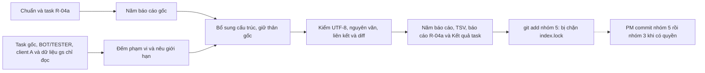

TÓM TẮT 5 DÒNG
1. [NGUỒN] PARTIAL: đã chuẩn hóa đủ 5/5 báo cáo được giao; bước commit bị chặn quyền ghi Git metadata.
2. [NGUỒN] Đã thêm metadata, Mermaid, bảng phạm vi, mức xác minh, sổ thông số và phát hiện; thân báo cáo gốc khớp HEAD.
3. [NGUỒN] Đầu ra gồm năm báo cáo, chỉ mục _CHIMUC/R-04a.tsv, báo cáo này và mục Kết quả task.
4. [NGUỒN] Kiểm tra tĩnh tài liệu đạt; các số test cũ được giữ như lịch sử, không nhận là kết quả chạy R-04a.
5. [CHƯA KIỂM] Không build, test game, exe, VM hoặc mạng; chưa có SHA, BỊ CHẶN – CHƯA PUSH; PM tiếp tục commit 5+3 file khi có quyền metadata.

# R-04a — Chuẩn hóa năm báo cáo Bot, dân số và khung tester

Loại: tổng hợp
Chủ đề: Chuẩn hóa E-01, E-01b, E-02, E-03 và E-05a theo chuẩn báo cáo ngày 17/11/2026.
Từ khóa: chuẩn hóa, retrofit, R-04a, E-01, E-01b, E-02, E-03, E-05a, UTF-8, chỉ mục
Trạng thái: PARTIAL — nội dung và kiểm tra tài liệu đã hoàn tất; chưa commit vì git add không ghi được index.lock.
Độ phủ: đã chuẩn hóa 5 trên tổng 5 báo cáo cũ; chỉ mục 5 trên tổng 5 hàng báo cáo cũ; chưa thực hiện được 2 nhóm commit dự kiến (5 file và 3 file).
Liên quan: [task R-04a](../TASKS/R-04a.md), [chuẩn báo cáo](../DESIGN/CHUAN-BAO-CAO.md), [mục lục tri thức](../DESIGN/MUC-LUC-TRI-THUC.md), [hướng dẫn tra cứu](../DESIGN/HUONG-DAN-TRA-CUU.md), [chỉ mục R-04a](_CHIMUC/R-04a.tsv).
Cần tôi quyết định: không — task đã duyệt nội dung và commit; PM cần tiếp tục trong phiên có quyền ghi metadata, không cần đổi kết luận cũ.

## Sơ đồ chính



## Phạm vi và độ phủ

[ĐÃ XÁC MINH] Phạm vi lấy từ `JX1_OPS/TASKS/R-04a.md:11`; người dùng giao thêm ghi mục Kết quả của chính file task. CWD `D:\JX-wt\R-04a`, nhánh `task/R-04a`; kiểm Git status một lần trước ghi thấy duy nhất task R-04a chưa được theo dõi. Chỉ thay đổi tám file dưới đây; giữ nguyên task ngoài Kết quả, không sửa BAI_HOC hoặc nguồn game.

| File / phần tử | Đã phủ / chưa phủ | Trạng thái nội dung gốc và bằng chứng hiện tại |
| --- | --- | --- |
| [E-01](E-01-thieu-giao-thuc.md) | Đã chuẩn hóa | PARTIAL giữ nguyên; `JX1_OPS/REPORTS/E-01-thieu-giao-thuc.md:29` có bảng phạm vi 5 mô-đun và phiên thật chưa phủ. |
| [E-01b](E-01b-thieu-giao-thuc.md) | Đã chuẩn hóa | PARTIAL giữ nguyên; `JX1_OPS/REPORTS/E-01b-thieu-giao-thuc.md:29` liệt kê đủ 75 ID hỗ trợ và 81 ID chưa hỗ trợ trong dải. |
| [E-02](E-02-hanh-vi-bot.md) | Đã chuẩn hóa | DONE offline giữ nguyên; `JX1_OPS/REPORTS/E-02-hanh-vi-bot.md:31` làm lộ hồi máu TODO. |
| [E-03](E-03-dieu-phoi-dan-so.md) | Đã chuẩn hóa | DONE offline giữ nguyên; `JX1_OPS/REPORTS/E-03-dieu-phoi-dan-so.md:30` có bốn file, ba map mẫu, đủ 24 giờ và giới hạn map thật. |
| [E-05a](E-05a-khung-tester.md) | Đã chuẩn hóa | PARTIAL giữ nguyên; `JX1_OPS/REPORTS/E-05a-khung-tester.md:30` liệt kê đủ năm mục tiêu, năm Bot và ba bước. |
| [Chỉ mục TSV](_CHIMUC/R-04a.tsv) | Đã tạo đủ 5/5 hàng | `JX1_OPS/REPORTS/_CHIMUC/R-04a.tsv:1`; đúng bảy cột, trạng thái và độ phủ khớp từng báo cáo. Báo cáo bàn giao R-04a không tính vào năm báo cáo cũ. |
| Báo cáo R-04a này | Đã viết | Tóm tắt, metadata, Mermaid, phạm vi, xác minh, bàn giao và phát hiện. |
| Kết quả task R-04a | Đã cập nhật theo chỉ thị trực tiếp | `JX1_OPS/TASKS/R-04a.md:33`; giữ nguyên frontmatter, mục tiêu và phạm vi trước mục này. |
| Commit hai nhóm 5+3 file | Chưa phủ — bị chặn | Lệnh stage năm báo cáo trả exit 1 vì không tạo được index.lock; chưa stage, chưa commit, chưa có SHA. |

## Cách chuẩn hóa và nguồn đã đối chiếu

[ĐÃ XÁC MINH] Đọc chuẩn trước khi sửa, rồi task, hai tài liệu tra cứu và sáu skill được chỉ định trong `.agents/skills`. Chỉ dùng bản đồ/Graphify để định vị; không cập nhật graph. Thêm cấu trúc theo `JX1_OPS/DESIGN/CHUAN-BAO-CAO.md:6`; nguyên tắc giữ kết luận/số liệu/bằng chứng theo `JX1_OPS/DESIGN/CHUAN-BAO-CAO.md:24`.

| Nguồn | Phần đọc / bằng chứng | Mức xác minh và giới hạn |
| --- | --- | --- |
| Task gốc E-01/E-01b/E-02/E-03/E-05a | `JX1_OPS/TASKS/E-01.md:22`, `JX1_OPS/TASKS/E-01b.md:21`, `JX1_OPS/TASKS/E-02.md:11`, `JX1_OPS/TASKS/E-03.md:16`, `JX1_OPS/TASKS/E-05a.md:22` | ĐÃ XÁC MINH phạm vi được giao; không dùng status frontmatter thay kết luận báo cáo. |
| BOT trong worktree | `JX1_OPS/BOT/worldsync.py:24`, `JX1_OPS/BOT/worldsync.py:39`, `JX1_OPS/BOT/behavior.py:200`, `JX1_OPS/BOT/population/population.example.json:3` | ĐÃ XÁC MINH bằng đọc tĩnh; đếm 50+25 ID, hồi máu TODO, 3 map và 24 giờ. Không chạy/import mã BOT. |
| TESTER và fixture đã lưu | `JX1_OPS/TESTER/scenarios.py:48`, `JX1_OPS/REPORTS/TEST/2026-11-17-smoke_login-2.md:9` | ĐÃ XÁC MINH tồn tại ba bước và bảng năm Bot/15 PASS lịch sử; không tái chạy fixture. |
| Client bản A `D:\JX-build\qh9A` | `Classes/gamecore/KProtocol.cpp:14`, `Classes/gamecore/CoreShell.cpp:2750`, `Classes/gamescene/KgameWorld.cpp:5146` | ĐÃ XÁC MINH bảng độ dài, cách tra và nhánh record biến độ dài; đọc file thật. Không đọc qh7 hoặc D:\Android\b\Client. |
| Dữ liệu server G | `G/Settings/MapList.ini:2`, `G/Settings/MapList.ini:5`; G = `C:\Jx1CocoV3\Folder\ServerNew-20260116T043145Z-3-001\ServerNew\_bin_v2_\gs` | ĐÃ XÁC MINH key số/ASCII và ranh giới mẫu/thật; không coi Count=1000 là số map hoạt động, không ánh xạ map mẫu bằng phỏng đoán. |

[ĐÃ XÁC MINH] Báo cáo mới/sửa, BOT, TESTER, `KProtocol.cpp`, `CoreShell.cpp` và `KgameWorld.cpp` đọc được bằng UTF-8; đầu ra Markdown/TSV là UTF-8 không BOM. `MapList.ini` không hợp lệ theo UTF-8, đã đọc GBK/CP936 để xem key/ASCII; tên Việt chưa xác minh mã hóa. `KProtocolDef.h` bản A có symbol ASCII đọc được nhưng comment không hợp lệ theo UTF-8; không kết luận encoding comment. Các root source cũ nằm trong thân báo cáo được giữ như dẫn nguồn lịch sử, không chuyển thành bằng chứng binary/runtime hiện tại.

## Kiểm tra thực chạy và lỗi

Chỉ chạy kiểm tra tài liệu bằng PowerShell/Node và Git chỉ đọc, sau đó thử stage theo quyền task; không chạy test ứng dụng. Không tạo script/parser phụ hoặc cài công cụ.

| Kiểm tra / lỗi | Cách thử | Kết quả |
| --- | --- | --- |
| Cấu trúc năm báo cáo | Kiểm tóm tắt đúng 5 dòng có nhãn, 1 tiêu đề ID, đủ 7 trường metadata, 1 Mermaid, bảng phạm vi, mục xác minh/bàn giao/phát hiện | Đạt 5/5; không có ký tự thay thế U+FFFD. |
| Mã hóa đầu ra | Đọc byte và decode UTF-8 nghiêm ngặt, kiểm prefix BOM | Đạt; UTF-8 không BOM. |
| Giữ nguyên thân gốc | Đọc từng blob bằng `git show HEAD:<file>`, chuẩn hóa CRLF/LF để so chuỗi thân gốc với nội dung mới | Đạt 5/5; không đổi kết luận, số liệu hay bằng chứng trong thân. Ba tóm tắt có sẵn giữ nội dung, chỉ thêm nhãn/giới hạn R-04a và đổi vị trí/tiêu đề. |
| Độ phủ | Đếm trực tiếp bảng hằng worldsync, JSON population và tên hàm test | 50 cố định + 25 biến = 75/156 ID, 81 chưa hỗ trợ; 3 map/24 giờ. 29/12/12/12/14 hàm test ở các file liên quan chỉ là đếm nguồn. |
| Liên kết | Kiểm tồn tại các đích Markdown trong năm báo cáo | 26 liên kết ngoài R-04a đã kiểm trước tạo báo cáo bàn giao; các đích R-04a được kiểm cùng chỉ mục khi hoàn tất. |
| Ba đầu ra bàn giao | Kiểm UTF-8/BOM, bảy cột TSV, trạng thái từng hàng và cấu trúc báo cáo cuối | Đạt 3/3 file UTF-8 không BOM; TSV đủ 5 hàng × 7 cột, trạng thái khớp; 11 liên kết trong báo cáo cuối và 5 đích R-04a trong báo cáo cũ đều tồn tại. |
| Diff năm báo cáo | `git diff --check -- <5 báo cáo>` và đọc `git diff --no-ext-diff -- <5 báo cáo>` một lượt sau sửa | Exit 0, không lỗi whitespace; diff chỉ bổ sung cấu trúc và nhãn/di chuyển tóm tắt. |
| Vỏ lệnh kiểm file mới | Lần đầu coi mã 1 của `git diff --no-index --check -- NUL <file>` là lỗi whitespace dù không có chẩn đoán | Vỏ lệnh dừng trước khi in diff. Điều chỉnh nhận mã 0/1 khi không có chẩn đoán; mã 1 của no-index biểu thị có khác biệt, không phải lỗi test hay nội dung TSV. |
| Whitespace có sẵn trong task chưa được theo dõi | Kiểm toàn file task bằng `--no-index --check` báo trailing whitespace tại dòng 20 | Khoảng trắng đã có trong lần đọc task trước sửa, nằm ngoài mục Kết quả nên giữ nguyên. Không nhận toàn file task đạt whitespace; phần Kết quả mới được kiểm riêng. TSV và báo cáo bàn giao không có chẩn đoán whitespace. |
| Không có rg | Một lần lệnh rg trả CommandNotFoundException | Chuyển Get-Content/Select-String/Get-ChildItem giới hạn thư mục; không cài hoặc thử lại. |
| Đầu ra gộp bị cắt | Lượt đầu đọc nhiều báo cáo quá dài | Đọc riêng đủ E-01b/E-02 và thu hẹp đoạn cần; không thiếu thân gốc trong kiểm tra nguyên văn. |
| Kiểm đường dẫn liên quan dự kiến | Hai tên A-02/JIBS dự kiến không tồn tại, phát hiện bằng Test-Path | Không mở file thiếu; lấy tên A-02 đúng từ task E-01 và kiểm tồn tại. Không tạo link JIBS suy đoán. |
| Stage nhóm năm báo cáo | `git add --` đúng năm file được giao | Exit 1: `fatal: Unable to create 'D:/jx1-reports/.git/worktrees/R-04a/index.lock': Permission denied`. Chưa stage/commit; lỗi quyền metadata ngoài writable root. |

Các số 29/41/65/53 test trong báo cáo BOT, TESTER 14 và fixture 15 PASS là kết quả của các lượt gốc. R-04a không chạy lại unittest, CLI, fixture, build, exe, VM hoặc mạng; không phát sinh số đo online/tick/gameplay mới.

## Đã xác minh / Chưa xác minh

- **ĐÃ XÁC MINH:** đủ năm báo cáo và năm hàng chỉ mục; cấu trúc chuẩn, liên kết tồn tại, mã hóa UTF-8 không BOM, thân gốc nguyên vẹn, phạm vi lấy từ task/dữ liệu thật như các bảng trên. Đã kiểm status/branch một lần trước ghi và giữ task có sẵn ngoài mục Kết quả.
- **ĐÃ XÁC MINH:** R-04a chỉ ghi năm báo cáo, TSV, báo cáo bàn giao và Kết quả task; không sửa source, JSON game, cấu hình, BAI_HOC, credential hoặc quyền Git.
- **CHƯA XÁC MINH:** render Mermaid bằng trình dựng; chỉ kiểm code fence/cấu trúc và rà sơ đồ tĩnh. Không có bằng chứng mới về test game, ABI, login, hồi máu, kill credit, online, map thật hoặc gs001 runtime.
- **CHƯA XÁC MINH:** commit SHA/push/GitHub vì stage bị chặn. Không chạy commit khi stage thất bại, không thay index/object/ref/ACL/config hoặc vượt sandbox để khắc phục.

## Bàn giao

**PARTIAL — nội dung chuẩn hóa hoàn tất, commit BLOCKED. BỊ CHẶN – CHƯA PUSH.** Chưa có SHA R-04a. Push không được yêu cầu và không thực hiện. Lỗi Git đã báo PM tại chính báo cáo này; không gửi thông báo ngoài.

PM tiếp tục trong đúng `D:\JX-wt\R-04a`, nhánh `task/R-04a`, ở phiên có quyền ghi metadata Git đã được duyệt; giữ nguyên cấu hình/quyền/credential. Dùng hai nhóm dưới đây, không gộp quá năm file một commit và chỉ commit khi lệnh add của nhóm thành công. Nếu tài liệu không đổi, không cần làm lại khảo sát hoặc các kiểm tra đã có bằng chứng.

```text
git add -- JX1_OPS/REPORTS/E-01-thieu-giao-thuc.md JX1_OPS/REPORTS/E-01b-thieu-giao-thuc.md JX1_OPS/REPORTS/E-02-hanh-vi-bot.md JX1_OPS/REPORTS/E-03-dieu-phoi-dan-so.md JX1_OPS/REPORTS/E-05a-khung-tester.md
git commit -m "R-04a: chuẩn hóa năm báo cáo Bot và tester"
git add -- JX1_OPS/REPORTS/_CHIMUC/R-04a.tsv JX1_OPS/REPORTS/R-04a.md JX1_OPS/TASKS/R-04a.md
git commit -m "R-04a: thêm chỉ mục và báo cáo bàn giao"
```

Không tự sửa mục lục tri thức. PM có thể gộp hàng đề xuất sau, lấy độ phủ/trạng thái từng báo cáo từ TSV:

| Chủ đề | Báo cáo / tài liệu | File, hàm chính | Độ chắc |
| --- | --- | --- | --- |
| Bot, đồng bộ thế giới, hành vi săn, điều phối dân số và khung tester offline | E-01, E-01b, E-02, E-03, E-05a; REPORTS/_CHIMUC/R-04a.tsv | BOT/worldsync.py, behavior.py, population/; TESTER/core.py, reporting.py | Đọc tĩnh R-04a; test là lịch sử; ABI/runtime chưa kiểm |

## Phát hiện khi chuẩn hóa

| Báo cáo / nguồn | Phát hiện | Cách ghi nhận, không đổi kết luận cũ |
| --- | --- | --- |
| E-01 | Thiếu tóm tắt/cấu trúc; code hiện đã có phần E-01b và role list bổ sung sau đó | Giữ PARTIAL và nguyên thân; `JX1_OPS/REPORTS/E-01-thieu-giao-thuc.md:173` ghi chênh lệch thời điểm. |
| E-01b | Chưa có mẫu số tổng thể; dẫn dòng nhánh biến độ dài lệch ở bản A hiện tại | Ghi 75/156 ID chỉ ranh giới, 81 chưa hỗ trợ; giữ trích dẫn cũ, thêm `KgameWorld.cpp:5146` tại `JX1_OPS/REPORTS/E-01b-thieu-giao-thuc.md:171`. |
| E-02 | DONE offline có thể che mất phần hồi máu TODO | Làm lộ 4/5 nhóm đã triển khai, giữ TODO được task cho phép; `JX1_OPS/REPORTS/E-02-hanh-vi-bot.md:171`. |
| E-03 | Map mẫu và map thật khác phạm vi; jitter mặc định và ví dụ khác nhau; dữ liệu tên Việt chưa rõ mã hóa | Giữ số liệu, tách 3 map mẫu/24 giờ, không nhận Count=1000 là độ phủ; `JX1_OPS/REPORTS/E-03-dieu-phoi-dan-so.md:118`. |
| E-05a | Frontmatter task ghi done nhưng kết quả/báo cáo PARTIAL; code có bổ sung về sau | Giữ PARTIAL, chỉ rõ CLI và Git lịch sử, không sửa task E-05a; `JX1_OPS/REPORTS/E-05a-khung-tester.md:155`. |
| R-04a | Git metadata ngoài writable root không ghi được index.lock | Hoàn tất tài liệu local; bàn giao đúng hai nhóm 5+3 file, không thử vượt quyền. |
