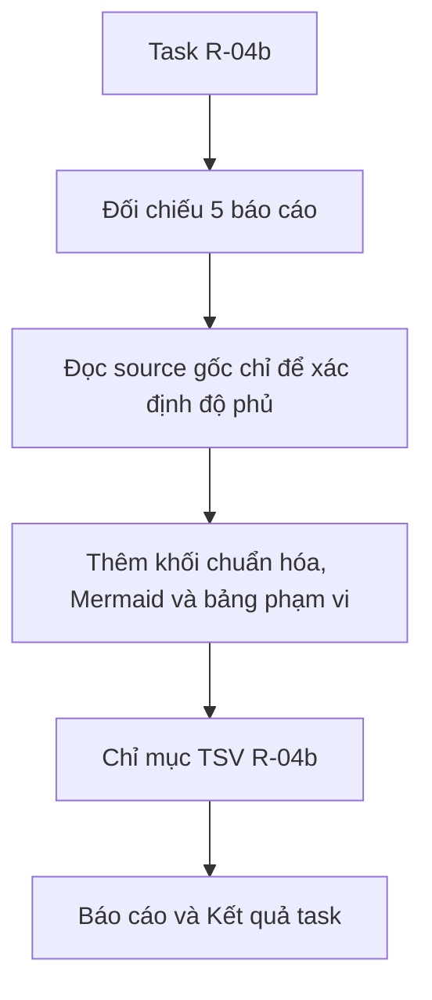

# TÓM TẮT 5 DÒNG
1. PARTIAL [NGUỒN]: đã chuẩn hóa 5/5 báo cáo và tạo chỉ mục TSV 5/5 dòng, không đổi kết luận cũ.
2. [NGUỒN]: client bản A xác nhận các symbol/giao thức client liên quan E-07/E-08; test history được giữ nguyên.
3. [CHƯA KIỂM]: mã server/DB, ABI và runtime chưa đối chiếu; root server task không có thư mục C++ source.
4. [CHƯA KIỂM]: không chạy test/build, exe, VM hoặc mạng trong task retrofit.
5. BỊ CHẶN – CHƯA PUSH: `git add` bị `Permission denied` khi tạo `index.lock`; chưa có commit SHA.

# R-04b — Chuẩn hóa báo cáo R-04 phần b
Loại: tổng hợp
Chủ đề: Chuẩn hóa năm báo cáo BOT/TESTER theo chuẩn báo cáo JX1 hiện hành.
Từ khóa: chuẩn hóa báo cáo, retrofit, BOT, TESTER, E-05b, E-07, E-08, E-09a, E-10, R-04b
Trạng thái: PARTIAL — toàn bộ nội dung trong vùng file đã cập nhật; commit bị chặn bởi quyền ghi Git metadata.
Độ phủ: 5/5 báo cáo chuẩn hóa, 5/5 dòng chỉ mục, báo cáo/task result đã ghi; 0/2 nhóm commit thành công.
Liên quan: `JX1_OPS/DESIGN/CHUAN-BAO-CAO.md`, `JX1_OPS/DESIGN/MUC-LUC-TRI-THUC.md`, `JX1_OPS/DESIGN/HUONG-DAN-TRA-CUU.md`, E-05a, E-05b, E-01b, E-07, E-08, E-09a, E-10
Cần tôi quyết định: không

## Sơ đồ công việc

## Phạm vi và độ phủ
| Báo cáo/file | Mục tiêu độ phủ | Trạng thái retrofit |
|---|---|---|
| `E-05b-kich-ban-full-cycle.md` | Các bước full-cycle, fixture loopback và test history | Đã chuẩn hóa; 10/10 bước và giới hạn fixture được lập bảng |
| `E-07-goi-tao-nhan-vat-logout.md` | Header/transport, tạo role, role list, thoát và lưu | Đã chuẩn hóa; 9/9 phần tử, client A đối chiếu, server chưa kiểm |
| `E-08-goi-danh-quai-xac-nhan-kill.md` | Gói liên quan skill/NPC/hurt/death và giới hạn xác minh | Đã chuẩn hóa; client A đối chiếu enum/dispatch |
| `E-09a-real-login-allowlist.md` | Allowlist, luồng real-login và kiểm chứng offline | Đã chuẩn hóa; test lịch sử không chạy lại |
| `E-10-bot-tao-role-logout-offline.md` | Parser, cleanup/logout, README và test offline | Đã chuẩn hóa; 7/7 phần tử, test lịch sử không chạy lại |
| `_CHIMUC/R-04b.tsv` | Mỗi báo cáo trong phần việc có một dòng chỉ mục | Đã tạo; 5 báo cáo / 5 dòng dữ liệu |
| `R-04b.md` | Tóm tắt phạm vi, nguồn, giới hạn, phát hiện và bàn giao | Đã hoàn tất; PARTIAL do commit bị chặn |
| `JX1_OPS/TASKS/R-04b.md#Kết quả` | Ghi kết quả cuối task theo chỉ dẫn trực tiếp | Đã cập nhật; nêu rõ commit bị chặn |

## Đã xác minh
- `JX1_OPS/TASKS/R-04b.md`: vùng file, nguồn được phép, giới hạn và yêu cầu commit.
- `JX1_OPS/DESIGN/CHUAN-BAO-CAO.md`: cấu trúc báo cáo, mục giải mã tên, sắp theo cấu trúc game và bảng chỉ mục.
- `JX1_OPS/DESIGN/MUC-LUC-TRI-THUC.md`, `JX1_OPS/DESIGN/HUONG-DAN-TRA-CUU.md`: quy tắc liên kết và độ chắc.
- Chuẩn bắt buộc: bảng phạm vi `CHUAN-BAO-CAO.md:18`, giải mã tên `:19`, sắp cấu trúc game `:20`, cột TSV `:30`.
- Client bản A: gán `c2s_newplayer` tại `D:\JX-build\qh9A\Classes\gameui\KuiNewPlayer.cpp:641`; response bool tại `D:\JX-build\qh9A\Classes\gamecore\KProtocol.h:1511`; role list parser tại `D:\JX-build\qh9A\Classes\gameui\Klogin.cpp:1033`; NPC dispatch tại `D:\JX-build\qh9A\Classes\gamecore\KProtocolProcess.cpp:57`.
- Báo cáo gốc ghi test history: E-05b `:109`, `:113`; E-09a `:102`; E-10 `:99`, `:103`. Không chạy lại trong task này.
- `JX1_OPS/REPORTS/_CHIMUC/R-04b.tsv`: có header và 5 dòng dữ liệu, tương ứng 5 báo cáo.

## Chưa xác minh
- Handler server/DB trên root được giao: root có data/runtime folders, không có `Sources`, `Headers` hay `Core`.
- ABI/binary, runtime, DB persistence, gameplay/kill credit và các test history trong báo cáo cũ.
- Không có danh mục entity game cần giải mã/sắp xếp trong các báo cáo; `BotAbc` và `Mob` chỉ là nhãn fixture.
- Commit trên branch task/R-04b; lỗi Git metadata được nêu ở phần bàn giao.

## Giải mã tên
| Tên gốc | Mã hóa | Chữ đúng | Nguồn file:dòng |
|---|---|---|---|
| `BotAbc` | ASCII | Tên fixture, không xác nhận nhân vật game | `JX1_OPS/REPORTS/E-07-goi-tao-nhan-vat-logout.md:336`; `JX1_OPS/REPORTS/E-10-bot-tao-role-logout-offline.md:105` |
| `Mob` | ASCII | Nhãn fixture, không xác nhận quái trong game | `JX1_OPS/REPORTS/E-08-goi-danh-quai-xac-nhan-kill.md:327` |
| Không có tên riêng kỹ năng, trang bị hoặc bản đồ | — | Không áp dụng | Phạm vi các báo cáo E-05b, E-07, E-08, E-09a, E-10 |

## Sắp theo cấu trúc game
Không áp dụng: năm báo cáo mô tả luồng BOT, protocol và test fixture; không liệt kê skill cụ thể theo phái/nhánh/cấp, trang bị theo bộ hoặc quái/NPC theo bản đồ. `BotAbc`, `Mob` và `skillID=7` không phải dữ liệu game đã xác nhận.

## Mục sổ thông số
E-07 ghi hằng số wire tĩnh: `c2s_newplayer=69` (`KProtocolDef.h:248,253`), `NAME_LENGHT=64` (`GameDataDef.h:152`), `nDataLen=5+L` (`KuiNewPlayer.cpp:641`). E-08 ghi ID gói: `s2c_syncnpc=76`, `s2c_syncnpcmin=77`, `s2c_npchurt=91`, `s2c_npcdeath=92`, `s2c_skillcast=96` (`KProtocolDef.h:52,64,65,79,80,84`), `c2s_requestnpc=73`, `c2s_npcskill=77` (`KProtocolDef.h:248,257,261`). Nguồn, đơn vị, tác động và mức đổi an toàn nằm trong từng báo cáo; đây là đọc tĩnh, không phải số đo runtime.

## Lỗi công cụ và cách xử lý
- PowerShell mặc định hiển thị sai dấu ở lần đọc chuẩn; đọc lại bằng UTF-8, không sửa nguồn.
- `rg` không có trong PATH; dùng `Select-String`/PowerShell giới hạn đúng root/file, không cài công cụ.
- Một số patch E-09a không khớp vì chọn sai dòng cuối; đọc đúng phần đuôi và cập nhật thành công, không mất nội dung.

## Bàn giao
Đã cập nhật mục `Kết quả` cuối `JX1_OPS/TASKS/R-04b.md`. `git add` trả `fatal: Unable to create 'D:/jx1-reports/.git/worktrees/R-04b/index.lock': Permission denied`; Git metadata nằm ngoài writable root. Không thử vượt sandbox hoặc đổi quyền/config. Không có commit SHA; không push.
Tiếp tục được sau khi môi trường cho phép ghi Git metadata: stage đúng các file thuộc `vung_file` và commit theo nhóm yêu cầu. Trạng thái hiện tại PARTIAL.

## Phát hiện khi chuẩn hóa
Server root được task chỉ định không có C++ source directories; các kết luận server/DB trong báo cáo gốc được giữ nguyên nhưng không được coi là tái xác minh. Báo cáo gốc E-07/E-08 dẫn cây source khác; các điểm client liên quan đã đối chiếu lại trên qh9A. Không phát hiện phần tử scope bị bỏ khỏi các bảng; các bước BỎ QUA và giới hạn cũ vẫn được nêu rõ.
Kỹ năng đã dùng: jx1-retrofit, jx1-read-server, jx1-read-client, jx1-parameters, jx1-knowledge, jx1-report.
