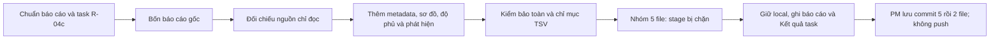

TÓM TẮT 5 DÒNG
1. [NGUỒN] PARTIAL toàn task: đã chuẩn hóa 4/4 báo cáo được giao; bước stage/commit bị chặn quyền Git metadata.
2. [NGUỒN] Đã thêm khối thông tin, Mermaid, bảng độ phủ, xác minh và phát hiện; kiểm bảo toàn tóm tắt/thân cũ đạt 4/4.
3. [NGUỒN] Đã lập chỉ mục R-04c.tsv đủ 4 hàng dữ liệu, 7 cột; kết quả được ghi vào đúng mục cuối task theo yêu cầu trực tiếp.
4. [CHƯA KIỂM] C++ server lịch sử, ABI/runtime và test vận hành chưa tái kiểm; khác biệt gói chạy bản A được ghi riêng, không đổi kết luận cũ.
5. [NGUỒN] BỊ CHẶN – CHƯA PUSH: git add trả 128, chưa có SHA mới; PM lưu commit theo nhóm 5 rồi 2 file ở phiên có quyền; không chạy build, exe, VM hoặc mạng.

# R-04c — Chuẩn hóa báo cáo E-11, E-12, E-13 và E-13b

Loại: tổng hợp
Chủ đề: Chuẩn hóa bốn báo cáo lịch sử bằng phần bổ sung có nguồn và bàn giao chỉ mục tra cứu.
Từ khóa: chuẩn hóa, báo cáo, R-04c, E-11, E-12, E-13, E-13b, NPC_RUN_COMMAND, watchdog
Trạng thái: PARTIAL — đầu ra tài liệu hoàn tất; không stage/commit được vì Git metadata nằm ngoài vùng ghi cho phép.
Độ phủ: đã phủ 4 trên tổng 4 báo cáo cũ và 6 trên tổng 6 file vung_file; cập nhật thêm 1 trên 1 mục Kết quả của task theo prompt; 0 trên 2 nhóm commit hoàn tất.
Liên quan: JX1_OPS/DESIGN/CHUAN-BAO-CAO.md; JX1_OPS/DESIGN/MUC-LUC-TRI-THUC.md; JX1_OPS/DESIGN/HUONG-DAN-TRA-CUU.md; JX1_OPS/REPORTS/_CHIMUC/R-04c.tsv; JX1_OPS/TASKS/R-04c.md
Cần tôi quyết định: không — cần phiên có quyền Git metadata để lưu kết quả; các quyết định protocol/runtime thuộc task riêng sau review.

## Sơ đồ quan hệ chính

## Phạm vi và độ phủ

[NGUỒN] Worktree thực tế `D:/JX-wt/R-04c`, nhánh đã kiểm một lần trước ghi là `task/R-04c`. Ban đầu chỉ có `JX1_OPS/TASKS/R-04c.md` untracked. Giữ nguyên phần task có sẵn, chỉ thay dòng chờ trong mục Kết quả theo chỉ thị trực tiếp của người dùng; không đổi front matter hoặc vung_file.

| File được giao | Độ phủ | Kết quả và vị trí kiểm tra |
|---|---|---|
| `JX1_OPS/REPORTS/E-11-hoi-mau-vat-pham-doi-ban-do.md` | đã phủ | Khối thông tin tại dòng 11, bảng tại `JX1_OPS/REPORTS/E-11-hoi-mau-vat-pham-doi-ban-do.md:34`, phát hiện tại dòng 454; 12/16 hạng mục nguồn hiện hành đã đối chiếu. |
| `JX1_OPS/REPORTS/E-12-khao-sat-goi-tuong-tac.md` | đã phủ | Khối thông tin tại dòng 10, bảng tại `JX1_OPS/REPORTS/E-12-khao-sat-goi-tuong-tac.md:34`, phát hiện tại dòng 272; 11/14 hạng mục đã định vị phía client. |
| `JX1_OPS/REPORTS/E-13-dispatcher-p1.md` | đã phủ | Bảng tại `JX1_OPS/REPORTS/E-13-dispatcher-p1.md:32`; 3/3 file công cụ và đủ 11 định nghĩa kiểm thử P1; phát hiện tại dòng 140. |
| `JX1_OPS/REPORTS/E-13b-watchdog.md` | đã phủ | Bảng tại `JX1_OPS/REPORTS/E-13b-watchdog.md:34`; 3/3 file công cụ và đủ 15 định nghĩa P1b; phát hiện tại dòng 186. |
| `JX1_OPS/REPORTS/_CHIMUC/R-04c.tsv` | đã phủ | `JX1_OPS/REPORTS/_CHIMUC/R-04c.tsv:1` có đúng 7 tên cột; 4 hàng dữ liệu khớp metadata của 4 báo cáo cũ. |
| `JX1_OPS/REPORTS/R-04c.md` | đã phủ | Báo cáo này ghi phạm vi, mức kiểm, lỗi thực tế và bàn giao Git. |
| `JX1_OPS/TASKS/R-04c.md` — chỉ mục Kết quả | đã phủ theo prompt | Nội dung đầu vào được giữ nguyên; thay đúng dòng `(chưa chạy)` ở mục cuối bằng kết quả R-04c. |
| Commit nhóm 1: bốn báo cáo cũ và TSV | chưa phủ | Đã thử `git add` đúng 5 file; exit 128, không tới `git commit`. |
| Commit nhóm 2: báo cáo R-04c và task | chưa phủ | Chưa thử stage vì cùng Git metadata đã bị chặn; hai file được hoàn thiện local. |

Tỷ lệ độ phủ nguồn trong từng báo cáo chỉ nói về mẫu được ghi trong bảng, không phải toàn bộ game hoặc kiểm thử runtime. Tỷ lệ 4/4 ở đây chỉ nói về số báo cáo đã bổ sung khuôn; không nâng mức xác minh của kết quả lịch sử.

## Nguồn và cách bảo toàn nội dung

- **[NGUỒN] Chuẩn và tra cứu:** đã đọc `JX1_OPS/DESIGN/CHUAN-BAO-CAO.md`, `JX1_OPS/DESIGN/MUC-LUC-TRI-THUC.md`, `JX1_OPS/DESIGN/HUONG-DAN-TRA-CUU.md`; dùng mục liên quan trong `JX1_OPS/CONTEXT-PACK/GS001-MAP.md` để định vị, không coi map/Graphify là bằng chứng runtime.
- **[NGUỒN] Skills:** đã đọc đúng 6 skill cục bộ được người dùng chỉ định: `jx1-retrofit`, `jx1-read-server`, `jx1-read-client`, `jx1-parameters`, `jx1-knowledge`, `jx1-report`; không mở rộng sang workflow hay các báo cáo không liên quan.
- **[NGUỒN] Client:** chỉ đối chiếu bản A `D:/JX-build/qh9A/Classes/gamecore/`; dùng `KProtocol.h`, `KProtocolDef.h`, `KProtocol.cpp`, `GameDataDef.h`. Không dùng qh7 hoặc `D:/Android/b/Client`, không đọc lại cây canonical C làm nguồn mới.
- **[NGUỒN] Server:** chỉ đọc 4 script trong `C:/Jx1CocoV3/Folder/ServerNew-20260116T043145Z-3-001/ServerNew/_bin_v2_/gs/script/trap/thon/balang/` và `script/system/usetownportal.lua`. C++ server cũ được dẫn trong E-11/E-12 nằm ngoài root dữ liệu được giao, nên đánh dấu chưa đối chiếu hiện hành.
- **[NGUỒN] Công cụ:** chỉ đọc source, định nghĩa test và README tại `JX1_OPS/TOOLS/dispatcher/`; không khởi chạy dispatcher, worker, launcher, polling queue hay probe.
- **[NGUỒN] Bảo toàn:** lưu 4 báo cáo và task gốc trong bộ nhớ trước sửa; so sánh tiền tố/tóm tắt và toàn bộ thân gốc sau khi chỉ chuẩn hóa CRLF/LF trong phép so. Không thay câu chữ, số liệu, vector, bằng chứng hoặc kết luận cũ. Không tạo script/parser phụ trên đĩa.
- **[NGUỒN] Mã hóa:** 4 báo cáo đầu vào là UTF-8 không BOM; các đầu ra dùng UTF-8 không BOM. Lua được đọc GBK/CP936. Comment client có mã hóa cũ, chưa xác định một code page cho toàn bộ tệp; đối chiếu kỹ thuật dùng symbol ASCII. Không kết luận wire tiếng Việt là GBK, TCVN3 hay UTF-8 chỉ từ các header.

## Mục sổ thông số — chỉ đối chiếu tĩnh

Q = `D:/JX-build/qh9A/Classes/gamecore/`. Đây là sổ đối chiếu các phát hiện/phạm vi, không cấp quyền sửa giao thức hoặc cấu hình.

| Nhóm | Tên/hằng số | file:dòng | Giá trị | Đơn vị | Ảnh hưởng | Đổi an toàn (CÓ/CẨN THẬN/KHÔNG) | Nguồn đo |
|---|---|---|---|---|---|---|---|
| Gói chạy bản A | `NPC_RUN_COMMAND.nMapID` | `Q/KProtocol.h:515`; `Q/KProtocol.h:520`; `Q/KProtocol.cpp:227` | 13 = 1 + 4 + 4 + 4, theo BYTE=1, int=4 và pack(1) tại `Q/KProtocol.h:11` | byte/record theo profile | Khác layout 9 byte mà E-11 ghi ở cây cũ; không áp vector cũ mặc định cho bản A | KHÔNG — không đổi schema trong task này | Đọc tĩnh; phép tính có giả định; chưa đo sizeof/ABI binary |
| Watchdog | `watchdog_s` | `JX1_OPS/TOOLS/dispatcher/dispatcher.py:146` | 300 với readonly, 600 với loại còn lại | giây | Ngưỡng log không tiến triển; chưa kiểm vận hành | CẨN THẬN | Đọc tĩnh; chưa đo runtime |
| Retry watchdog | `watchdog_retries` | `JX1_OPS/TOOLS/dispatcher/dispatcher.py:442` | tối đa 2 lần giao lại | lần/task | Giới hạn riêng với lỗi thường | CẨN THẬN | Đọc tĩnh; không chạy suite |
| Sự cố provider | `len(stalled)` / `next_probe_at` | `JX1_OPS/TOOLS/dispatcher/dispatcher.py:404`; `JX1_OPS/TOOLS/dispatcher/dispatcher.py:262` | ngưỡng 3 worker; khoảng 120 | worker; giây | Ngừng giao mới và chờ probe theo logic source | CẨN THẬN | Đọc tĩnh; không gọi API |
| Retry-limit 429 | `dispatch_not_before` | `JX1_OPS/TOOLS/dispatcher/dispatcher.py:448`; `JX1_OPS/TOOLS/dispatcher/dispatcher.py:581` | 20 nhân backoff_scale; mặc định scale=1 | giây | Giãn lượt giao sau lỗi retry-limit | CẨN THẬN | Đọc tĩnh; không chạy dispatcher |

## Lỗi, cách thử và kết quả thực tế

| Lỗi/điểm gặp | Cách xử lý trong R-04c | Kết quả |
|---|---|---|
| PowerShell đọc mặc định hiển thị tiếng Việt sai dấu | Đặt OutputEncoding UTF-8 và đọc lại chuẩn/task với `Get-Content -Encoding UTF8` | Nội dung đọc đúng; kiểm byte đầu vào xác nhận UTF-8 hợp lệ, không sửa file nguồn vì lỗi hiển thị. |
| `rg` không được nhận diện | Báo một lần, dùng `Select-String` và liệt kê đúng thư mục cần đọc | Định vị được các file/symbol cần thiết; không cài công cụ. |
| Đầu ra đọc dài bị cắt | Trích lại phần còn thiếu theo file/khoảng dòng cụ thể | Đọc đủ thân 4 báo cáo và các vị trí dùng trong bảng; không kết luận từ phần bị cắt. |
| `git diff --no-index -- /dev/null .../R-04c.tsv` trả 1 | Đọc diff file mới trực tiếp | Exit 1 biểu thị có khác biệt với file rỗng; không phải lỗi test tài liệu. |
| `git add` nhóm 5 file trả 128 | Thử đúng một lần; dừng chuỗi trước `git commit`, giữ local | `fatal: Unable to create 'D:/jx1-reports/.git/worktrees/R-04c/index.lock': Permission denied`. Không đổi ACL, credential, config hoặc Git index để vượt chặn. |

## Đã xác minh

- **[NGUỒN] Kiểm tài liệu thực chạy:** đoạn JavaScript nội tuyến trong Node REPL đã kiểm 4/4 tiền tố/tóm tắt và toàn bộ thân gốc không đổi; đủ 7 trường metadata, một Mermaid, bảng độ phủ, mục xác minh, bàn giao và phát hiện cho từng báo cáo. Mỗi báo cáo có 8–9 từ khóa, trong khoảng 5–10 theo chuẩn.
- **[NGUỒN] Kiểm chỉ mục thực chạy:** TSV có 4 hàng dữ liệu, 7 cột, 4 file duy nhất; các trường khớp khối thông tin. Các liên kết tới tài liệu sẵn có đã kiểm tồn tại; liên kết tới báo cáo R-04c được kiểm khi hoàn thiện đầu ra.
- **[NGUỒN] Đếm định nghĩa kiểm thử thực chạy:** đối chiếu chữ ký và số dòng source cho đủ 11 P1 + 15 P1b = 26; đây là kiểm định nghĩa, không thực thi test dispatcher.
- **[NGUỒN] Rà diff:** đã xem một lần diff nhóm bốn báo cáo và TSV; chỉ thêm khuôn/phần bổ sung. `git diff --check` của bốn file được theo dõi không báo lỗi whitespace.
- **[NGUỒN] Giới hạn phạm vi:** chỉ sửa 6 file vung_file và mục Kết quả của task được prompt chỉ định; mã/source, cấu hình, BAI_HOC và mục lục chung không bị sửa.

## Chưa xác minh

- **[CHƯA KIỂM]** Không tái chạy vector E-11/E-12, suite 11/26 test hoặc CLI giả E-13/E-13b. Các kết quả PASS cũ chỉ được giữ nguyên; không nhận là kết quả của R-04c.
- **[CHƯA KIỂM]** Binary/ABI, kết nối, hồi máu, trap/map đang nạp, codec tiếng Việt, cạnh tranh giao dịch/quyền BOT, Task Scheduler, stop cây tiến trình, probe/provider và chi phí runtime.
- **[CHƯA KIỂM]** Không render sơ đồ Mermaid bằng engine; đã kiểm đủ một khối và rà cú pháp flowchart trực tiếp. Không build, chạy exe/VM, dùng mạng hoặc đọc giá trị khóa/mật khẩu.
- **[NGUỒN]** Chưa có commit mới hoặc SHA bàn giao do `git add` bị chặn; không chạy `git commit`, không thử push.

## Bàn giao

**BỊ CHẶN – CHƯA PUSH.** Phần tài liệu đã hoàn tất local; trạng thái toàn task là **PARTIAL** vì yêu cầu commit chưa thực hiện được. Không yêu cầu thay quyền trong phiên hiện tại. PM dùng phiên có quyền ghi Git metadata để lưu đúng hai nhóm theo thứ tự:

1. Nhóm 5 file: `E-11-hoi-mau-vat-pham-doi-ban-do.md`, `E-12-khao-sat-goi-tuong-tac.md`, `E-13-dispatcher-p1.md`, `E-13b-watchdog.md` dưới `JX1_OPS/REPORTS/` và `JX1_OPS/REPORTS/_CHIMUC/R-04c.tsv`; commit gợi ý: `R-04c: chuẩn hóa E-11 đến E-13b và chỉ mục`.
2. Nhóm 2 file: `JX1_OPS/REPORTS/R-04c.md` và `JX1_OPS/TASKS/R-04c.md`; commit gợi ý: `R-04c: bàn giao kết quả chuẩn hóa báo cáo`.

Không amend vòng để ghi SHA của chính báo cáo. Chỉ ghi SHA khi Git thực sự tạo commit; không push theo yêu cầu. Việc sửa kết luận lịch sử hoặc kiểm thử game/công cụ cần task riêng, không nằm trong bước lưu tài liệu này.

Đề xuất PM gộp từ TSV vào `MUC-LUC-TRI-THUC.md` (không sửa mục lục trong R-04c):

| Chủ đề | Báo cáo / tài liệu | File, hàm chính | Độ chắc |
|---|---|---|---|
| Hồi máu, vật phẩm, cổng và đổi map | E-11; R-04c | `NPC_RUN_COMMAND`, `TownPortal`, `WORLD_SYNC` | khảo sát tĩnh; có khác profile bản A |
| Chat, tổ đội, giao dịch, xem trang bị và quyền BOT | E-12; R-04c | `KProtocol.h`, `c2s_extendchat`, `CanInteract` | khảo sát tĩnh; runtime/quyền BOT chưa kiểm |
| Dispatcher P1 và watchdog P1b | E-13; E-13b; R-04c | `dispatcher.py`, `test_dispatcher.py` | kiểm thử lịch sử theo từng báo cáo; R-04c chỉ đọc |

## Phát hiện khi chuẩn hóa

1. **[NGUỒN] Gói chạy khác root:** bản A có `nMapID` tại `D:/JX-build/qh9A/Classes/gamecore/KProtocol.h:520` và sender tại `D:/JX-build/qh9A/Classes/gamecore/KProtocol.cpp:225`. Phát hiện được ghi thêm tại `JX1_OPS/REPORTS/E-11-hoi-mau-vat-pham-doi-ban-do.md:454`; layout 9 byte và vector nguồn cũ được giữ nguyên, không coi là bằng chứng cho bản A.
2. **[NGUỒN] Nguồn server không cùng phạm vi:** root gs được giao là dữ liệu/script, không phải cây C++ S/SS/R/H lịch sử của E-11/E-12. Các bảng thể hiện rõ 4 và 3 hạng mục chưa phủ; không âm thầm thay root hay nâng mức xác minh.
3. **[NGUỒN] Bảo toàn tóm tắt tạo ngoại lệ hình thức:** 4 tóm tắt cũ vẫn đủ 5 dòng nhưng chưa gắn nhãn riêng đầy đủ; E-13/E-13b chưa đặt giới hạn build/exe/VM ở dòng 5. Giữ nguyên theo quy tắc retrofit, ghi phát hiện cuối từng file. Báo cáo R-04c mới áp dụng đủ nhãn và giới hạn dòng 5.
4. **[NGUỒN] Snapshot công cụ đã gồm P1b:** 11 test của E-13 là một phần trong 26 định nghĩa hiện có; không sửa kết quả test lịch sử và không coi nguồn mới là xác nhận vận hành.
5. **[NGUỒN] Mục Kết quả của task:** tuy không có trong mảng vung_file, người dùng đã chỉ định rõ cập nhật mục này. Chỉ sửa mục cuối, không sửa metadata/vùng ghi của task, không dùng mâu thuẫn lịch sử E-13b để bỏ bước được giao.
6. **[NGUỒN] Bàn giao Git:** lỗi quyền thực tế nêu ở trên là blocker duy nhất của việc lưu commit; không có SHA mới. Các câu “chưa commit/push” trong báo cáo cũ tiếp tục mang nghĩa lịch sử của từng task gốc.
