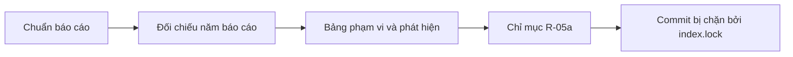

## TÓM TẮT 5 DÒNG
1. PARTIAL — đã chuẩn hóa đủ năm báo cáo trong phạm vi R-05a; kết luận cũ được giữ nguyên.
2. Đã bổ sung khối thông tin, Mermaid, phạm vi/độ phủ, giải mã tên và cấu trúc game; đã lập TSV đủ sáu dòng dữ liệu.
3. Đầu ra: năm báo cáo H-01–H-04, REPORTS/_CHIMUC/R-05a.tsv và báo cáo này; mục Kết quả task đã cập nhật.
4. Đã kiểm diff, khoảng trắng, bảng Markdown và UTF-8 không BOM; không chạy build, exe, VM, mạng hoặc test runtime.
5. BỊ CHẶN – CHƯA PUSH: commit bị index.lock: Permission denied; SHA chưa có; PM cần commit các file local tại checkout có quyền ghi Git.

# R-05a — Chuẩn hóa nhóm báo cáo H-01 đến H-04

Loại: tổng hợp
Chủ đề: Chuẩn hóa năm báo cáo về ngũ hành, thuộc tính, cường hóa và hiệu ứng vũ khí.
Từ khóa: chuẩn hóa, retrofit, ngũ hành, magic attrib, cường hóa, glow, sét, H-01, H-02, H-03, H-04
Trạng thái: PARTIAL — nội dung và chỉ mục đã hoàn tất; Git từ chối tạo index.lock nên chưa commit.
Độ phủ: 5/5 báo cáo được chuẩn hóa; 1/1 chỉ mục TSV được tạo; runtime/test không thuộc phạm vi xác minh.
Liên quan: JX1_OPS/DESIGN/CHUAN-BAO-CAO.md, JX1_OPS/DESIGN/MUC-LUC-TRI-THUC.md, JX1_OPS/DESIGN/HUONG-DAN-TRA-CUU.md, H-01, H-02, H-03, H-04, H-14.
Cần tôi quyết định: không

## Phạm vi và độ phủ

| File trong vùng được giao | Trạng thái | Độ phủ và ghi chú |
|---|---|---|
| JX1_OPS/REPORTS/H-01-ngu-hanh.md | Đã chuẩn hóa | 5/5 hệ, 15/15 ô trang bị, 6/6 kênh damage; giữ giới hạn kiểm tra source server ngoài gốc. |
| JX1_OPS/REPORTS/H-02-magic-attrib.md | Đã chuẩn hóa | 5/5 bảng local, 5/5 nhóm slot, 7 ID đại diện; PAK/runtime chưa kiểm. |
| JX1_OPS/REPORTS/H-03-cuong-hoa.md | Đã chuẩn hóa | 8/8 file cấu hình, ba nhóm đá Lua, 31 cấp số học, 12 ca test đề xuất; chưa test runtime. |
| JX1_OPS/REPORTS/H-04-hieu-ung-vu-khi.md | Đã chuẩn hóa | Bảy báo cáo lịch sử và ba mốc hiệu ứng; artifact/thiết bị chưa kiểm lại. |
| JX1_OPS/REPORTS/H-04.md | Đã chuẩn hóa | Bốn giai đoạn hiệu ứng, bảy báo cáo lịch sử và tám nhãn APK qh; provenance native/runtime chưa kiểm. |
| JX1_OPS/REPORTS/_CHIMUC/R-05a.tsv | Đã tạo | Sáu dòng dữ liệu: năm báo cáo và báo cáo bàn giao. |
| JX1_OPS/REPORTS/R-05a.md | Đã hoàn tất | Báo cáo này theo khuôn chuẩn; blocker Git được ghi rõ. |

## Giải mã tên

Các tên Hán được giải mã từ comment GBK trong client qh9A hoặc Lua của gói gs; giữ nguyên khác biệt chữ nguồn, không hiệu đính kết luận.

| Tên gốc | Mã hóa | Chữ đúng UTF-8 | Nguồn file:dòng |
|---|---|---|---|
| 金系 / 木系 / 水系 / 火系 / 土系 | GBK | Kim / Mộc / Thủy / Hỏa / Thổ hệ | D:/JX-build/qh9A/Classes/gamecore/GameDataDef.h:332-336 |
| 披风 | GBK | Phi Phong, áo choàng | D:/JX-build/qh9A/Classes/gamecore/GameDataDef.h:1516 |
| 强蓝石 | GBK | Đá cường hóa Lam, detail 403 | G/script/System/qianghua.lua:89 |
| 强纲石 | GBK | Đá cường hóa Cương; giữ nguyên chữ 纲 của nguồn | G/script/System/qianghua.lua:92 |
| 强辨石 | GBK | Đá cường hóa Biện/nhận dạng, detail 405 | G/script/System/qianghua.lua:95 |
| 辨识装 / 纹钢装 / 普通蓝装 / 黄金装 | GBK | Trang bị nhận dạng / Văn Cương / xanh thường / vàng | G/script/System/qianghua.lua:101-112,165 |

## Sắp theo cấu trúc game

| Cấu trúc | Báo cáo đã chuẩn hóa |
|---|---|
| Ngũ hành, item/NPC và sáu kênh sát thương | H-01 |
| Cấu trúc slot, nguồn bảng, roll, thuộc tính ẩn và tooltip | H-02 |
| Nguyên liệu → kiểm tra → nâng cấp → công thức theo loại item | H-03 |
| Mốc cấp glow/sét và thứ tự các snapshot/lịch sử | H-04-hieu-ung-vu-khi, H-04 |

## Phát hiện khi chuẩn hóa

- H-01/H-02 trỏ tới source server/client Client2912 ngoài hai gốc được giao; H-03 trỏ tới server C++ dưới C:\Jx1CocoV3\SwordOnline. Gói gs được giao có bảng, Lua và cấu hình nhưng không có source C++ server để xác minh lại các kết luận đó. Client qh9A chỉ được đối chiếu tĩnh tại các phần liên quan. Giữ nguyên kết luận cũ và đánh dấu giới hạn.
- H-04-hieu-ung-vu-khi ghi tình trạng kiểm kê APK cũ; H-04 ghi qh3/qh5/qh6 đã tìm thấy trong serve ở lần kiểm tra sau. Đây là khác biệt thời điểm, không chọn ngầm kết luận nào.
- Không đổi số liệu hay kết luận của báo cáo gốc. Các dòng source ngoài gốc chỉ là dẫn chứng gián tiếp; chưa xác nhận binary, dữ liệu nạp hoặc biểu hiện runtime.

## Đã xác minh

G là gốc server theo task: C:/Jx1CocoV3/Folder/ServerNew-20260116T043145Z-3-001/ServerNew/_bin_v2_/gs; client A là D:/JX-build/qh9A.

- Chuẩn và task: JX1_OPS/DESIGN/CHUAN-BAO-CAO.md; phạm vi task: JX1_OPS/TASKS/R-05a.md.
- Mục lục và hướng dẫn: JX1_OPS/DESIGN/MUC-LUC-TRI-THUC.md, JX1_OPS/DESIGN/HUONG-DAN-TRA-CUU.md.
- Bảng H-02: năm file G/Settings/item/004 tồn tại, lần lượt 370, 4.361, 5.946, 5.671 và 49 dòng; ví dụ G/Settings/item/004/magicattrib.txt:1.
- Cấu hình H-03: G/Settings/gamesetting_gs001.ini:478,480 và các file gs002–gs006 tại dòng được liệt kê trong H-03; G/script/System/qianghua.lua:89-97 có ba tên đá GBK.
- Client qh9A: enum hệ ở D:/JX-build/qh9A/Classes/gamecore/GameDataDef.h:332-337; ngưỡng glow/sét ở D:/JX-build/qh9A/Classes/vn/gamecore/KNpcResVN.cpp:514-556 và điểm gọi sét ở :618.

## Chưa xác minh và kiểm thử

- Chưa xác minh cấu hình đang nạp, tương ứng source/binary/APK, PAK client, tác động runtime hoặc kết quả trên thiết bị.
- Không chạy build, exe, VM, mạng hay test game theo giới hạn task.
- Đã chạy git diff --check thành công; kiểm tra UTF-8 không BOM và dấu đóng Mermaid/bảng Markdown trên năm báo cáo đạt. Các ca TESTER trong báo cáo nguồn chỉ là đề xuất.

## Bàn giao

- Commit: git add bị chặn khi tạo D:/jx1-reports/.git/worktrees/R-05a/index.lock: Permission denied. Không có SHA; không thử vượt quyền.
- BỊ CHẶN – CHƯA PUSH. Không chạy lệnh push.
- Bước tiếp: PM hoặc người có quyền ghi Git commit bảy file thuộc task từ worktree task/R-05a, rồi cập nhật SHA bàn giao. Các sửa đổi hiện đang local.
- Kỹ năng đã dùng: jx1-retrofit, jx1-read-server, jx1-read-client, jx1-parameters, jx1-knowledge, jx1-report.
