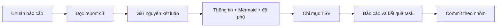

## TÓM TẮT 5 DÒNG
1. [NGUỒN] PARTIAL — đã chuẩn hóa 5 báo cáo H-05 đến H-09, tạo TSV và ghi kết quả task.
2. [NGUỒN] Đã thêm metadata, Mermaid, bảng phạm vi/độ phủ và mục phát hiện; giữ nguyên kết luận cũ.
3. [NGUỒN] Đã kiểm tra nội dung tại hai root task giao; phần kế thừa và giới hạn được đánh dấu riêng.
4. [CHƯA KIỂM] Không chạy build/test/runtime theo phạm vi; kiểm tra cấu trúc/TSV và `git diff --check` đạt.
5. [NGUỒN] Commit bị chặn quyền tạo `index.lock`, chưa có SHA; **BỊ CHẶN – CHƯA PUSH**. Giới hạn: không chạy exe/VM/mạng.

# R-05b — Chuẩn hóa báo cáo H-05 đến H-09

Loại: tổng hợp
Chủ đề: Chuẩn hóa năm báo cáo H-05 đến H-09 theo chuẩn báo cáo JX1, tạo chỉ mục và ghi bàn giao task.
Từ khóa: chuẩn hóa, retrofit, H-05, H-06, H-07, H-08, H-09, Mermaid, phạm vi, TSV
Trạng thái: PARTIAL — nội dung và chỉ mục hoàn tất; commit bị chặn bởi quyền Git metadata.
Độ phủ: đã xử lý 8/8 file được giao/cần ghi; 5/5 báo cáo mục tiêu đã chuẩn hóa.
Liên quan: H-05-ui-cuong-hoa.md; H-06-he-thong-an.md; H-07-trang-suc-mat-na-phi-phong.md; H-08-tai-phu.md; H-09.md; DESIGN/CHUAN-BAO-CAO.md
Cần tôi quyết định: không

liên quan: H-05-ui-cuong-hoa.md; H-06-he-thong-an.md; H-07-trang-suc-mat-na-phi-phong.md; H-08-tai-phu.md; H-09.md

## Phạm vi và độ phủ

| Phần tử | Độ phủ hiện tại | Bằng chứng |
|---|---|---|
| H-05 UI cường hóa | Đã chuẩn hóa; một số đối chiếu UI/Lua tại root task | `H-05-ui-cuong-hoa.md:8`; `:28`; `:178` |
| H-06 hệ thống ấn | Đã chuẩn hóa; bảng, Lua và client A đối chiếu một phần | `H-06-he-thong-an.md:8`; `:27`; `:208` |
| H-07 trang sức, mặt nạ, phi phong | Đã chuẩn hóa; bảng item/client A đối chiếu một phần | `H-07-trang-suc-mat-na-phi-phong.md:8`; `:27`; `:225` |
| H-08 tài phú | Đã chuẩn hóa; UI client A có đối chiếu, source C++ server không có trong root gs | `H-08-tai-phu.md:8`; `:27`; `:179` |
| H-09 tổng hợp | Đã chuẩn hóa; PARTIAL cũ về I-06 được giữ | `H-09.md:9`; `:27`; `:94` |
| Chỉ mục `REPORTS/_CHIMUC/R-05b.tsv` | Đã tạo; 5 báo cáo được lập chỉ mục, đủ 7 cột | `R-05b.tsv:1` |
| Kết quả cuối ở task R-05b | Đã ghi trạng thái, giới hạn và lỗi commit | `TASKS/R-05b.md:37` |
| Báo cáo R-05b | Đã hoàn thiện bản tổng kết | `R-05b.md:1`; `:14` |

## Phát hiện khi chuẩn hóa

- H-05: thiếu khối thông tin, sơ đồ Mermaid, bảng phạm vi và mục phát hiện. Gói server task có `opensysui.lua`; chi tiết Lua nghiệp vụ/runtime chưa xác minh đầy đủ. Không đổi kết luận cũ.
- H-06: thiếu tiêu đề chuẩn và các thành phần chuẩn. Giữ nguyên số liệu, bất nhất server/Coco, và kết luận khảo sát tĩnh.
- H-07: thiếu tiêu đề chuẩn và các thành phần chuẩn. Giữ nguyên bất nhất dữ liệu/slot và các giới hạn runtime.
- H-08: thiếu khối thông tin, Mermaid và bảng phạm vi. Root server task không có source C++ để đối chiếu lại nhánh DB; giữ nguyên kết luận cũ và đánh dấu giới hạn.
- H-09: tiêu đề đứng trước phần tóm tắt; đã chuyển tiêu đề xuống dưới 5 dòng tóm tắt, không đổi trạng thái PARTIAL cũ.

## Đã xác minh

- Worktree/nhánh là `task/R-05b`; lần kiểm tra Git ban đầu không có commit sau `jx1-ops`, task R-05b untracked.
- Đã đọc chuẩn báo cáo, tài liệu tra cứu/mục lục và sáu skill được task nêu.
- Gói server task có các bảng item đã dẫn; `YinJian.txt` 14 dòng, `ring.txt` 11, `Mask.txt` 967, `PiFeng.txt` 15, `ShiPin.txt` 261. Gói `gs` có `opensysui.lua` 31 dòng, `qianghua.lua` 180 dòng, script nâng phi phong 0 byte.
- Client `D:/JX-build/qh9A` có các file UI/core được dẫn trong bảng phạm vi.
- Đã thêm cấu trúc chuẩn cho năm báo cáo, chưa sửa source hay cấu hình.

## Chưa xác minh

- Không tạo được commit do `git add` trả `fatal: Unable to create 'D:/jx1-reports/.git/worktrees/R-05b/index.lock': Permission denied`; chưa có SHA. Không thử thay quyền/config hay đường vòng.
- Chưa push theo task; không có bằng chứng GitHub.
- Không chạy build, unit/integration test, game/executable, VM, kết nối mạng hay test runtime.
- Nội dung binary/PAK, dữ liệu đang được nạp, source C++ server cho H-08 và các ca TESTER chưa được xác minh tại root task.

## Lỗi và cách xử lý

- Một lệnh PowerShell tạo bảng gặp lỗi cú pháp `An empty pipe element is not allowed`; chuyển sang gom kết quả vào biến rồi định dạng, lệnh kiểm tra thành công.
- Lượt kiểm tra cấu trúc đầu tiên có lỗi cú pháp `Unexpected token '}'`; rút gọn biểu thức PowerShell rồi chạy lại, toàn bộ sáu báo cáo đạt kiểm tra cấu trúc.
- Lần đọc đầu bằng PowerShell mặc định hiển thị sai mã hóa tiếng Việt; đọc lại bằng `-Encoding utf8` thì nội dung đúng, không dùng lượt đầu làm căn cứ.
- Có một lượt kiểm tra nhầm cây source C++ ngoài root task. Đã dừng khi nhận ra; không sửa/chạy file và không dùng kết quả đó làm bằng chứng cho bảng độ phủ. Các bảng sau đó chỉ dùng báo cáo hiện có cùng gói server và client root được task giao.
- `rg` chưa được dùng; thao tác tìm giới hạn bằng `Select-String` trên đúng file/root, không cài công cụ.

## Bàn giao

- TSV `REPORTS/_CHIMUC/R-05b.tsv` đã lập chỉ mục đủ năm báo cáo H-05 đến H-09. Kết quả cuối đã ghi ở cuối `TASKS/R-05b.md`.
- Đã thử stage đúng năm báo cáo; lỗi `fatal: Unable to create 'D:/jx1-reports/.git/worktrees/R-05b/index.lock': Permission denied`. Chưa có SHA; các thay đổi vẫn local, chưa stage/commit.
- **BỊ CHẶN – CHƯA PUSH**: task không yêu cầu và cấm push; không thử mạng.
