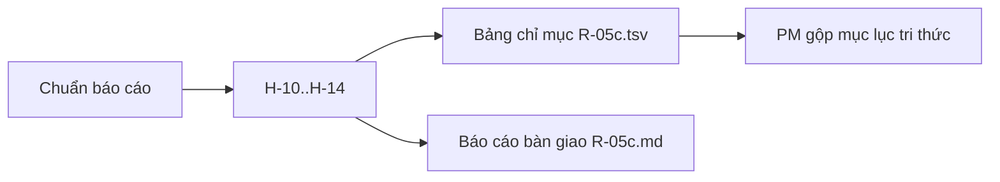

TÓM TẮT 1..5
1. BLOCKED — đã hoàn tất nội dung H-10..H-14, chỉ mục và báo cáo; commit bị chặn bởi Git. [NGUỒN]
2. Đã đối chiếu ô vật phẩm, thanh kỹ năng, cài đặt và dữ liệu auto với client A/gốc `gs`. [NGUỒN]
3. `R-05c.tsv` liệt kê đủ năm báo cáo; kết luận, số liệu và bằng chứng cũ được giữ. [NGUỒN]
4. Git từ chối tạo `D:/jx1-reports/.git/worktrees/R-05c/index.lock`; chưa có SHA, chưa push. [NGUỒN]
5. Chưa chạy build, test game, exe, VM hoặc mạng; mọi kiểm chứng runtime vẫn chưa thực hiện. [CHƯA KIỂM]

# R-05c — Chuẩn hóa báo cáo H-10 đến H-14
Loại: tổng hợp
Chủ đề: Chuẩn hóa năm báo cáo H-10..H-14 và lập chỉ mục theo chuẩn JX1 mới.
Từ khóa: chuẩn hóa báo cáo, retrofit, H-10, H-11, H-12, H-13, H-14, JX1
Trạng thái: BLOCKED — hoàn tất nội dung; chưa đạt yêu cầu commit vì Git không tạo được index trong kho chung.
Độ phủ: 7/7 đầu ra nội dung đã hoàn tất; chưa commit và chưa có SHA.
Liên quan: `JX1_OPS/DESIGN/CHUAN-BAO-CAO.md`, `JX1_OPS/DESIGN/MUC-LUC-TRI-THUC.md`, H-10..H-14.
Cần tôi quyết định: không

## Phạm vi và độ phủ

| Đầu ra | Trạng thái | Ghi chú |
|---|---|---|
| H-10 — Phím tắt và thanh nút | Đã phủ | 7/10 nhóm của H-10; chưa có mapping phím PC, bằng chứng lưu bố cục trên server và xác minh bản chạy. |
| H-11 — Nút hệ thống và cài đặt | Đã phủ | 12/12 khóa cài đặt theo mã; kiểm lại hash hai tệp `KuiOptions` trên bản A. |
| H-12 — Tự động chiến đấu | Đã phủ | 12/13 nhóm; 11/11 bảng và danh sách được đếm lại. |
| H-13 — Tick và độ trễ đòn | Đã phủ | 10/13 nhóm; kiểm dữ liệu mẫu và đường bảo vệ lệnh của bản A. |
| H-14 — Mất khung hiệu ứng | Đã phủ | 8/11 nhóm; kiểm đường vẽ và khác biệt mã A/H-14 cũ. |
| `_CHIMUC/R-05c.tsv` | Đã phủ | Năm hàng, bảy cột; TSV UTF-8. |
| `R-05c.md` | Đã phủ | Hoàn tất theo chuẩn, có kết quả, lỗi Git và việc PM cần tiếp tục. |

## Đã xác minh

- Tiếp tục từ bản nháp này. `git status --short --branch` trả nhánh `task/R-05c` với task và báo cáo R-05c chưa được theo dõi; `git log jx1-ops..HEAD` không có commit để bỏ qua.
- Đã đọc chuẩn, mục lục, hướng dẫn tra cứu và sáu skill. `rg` không có trong PATH theo mốc trước, tiếp tục dùng PowerShell trong phạm vi file được giao.
- `D:/JX-build/qh9A/Classes/gamecore/GameDataDef.h:94–96` có room 3 × 1; `Classes/gameui/KuiOptions.cpp:125–322` có 12 mục cài đặt hoạt động, không tính phần `Brightness` trong comment.
- `gs/Settings/Ai/skill.txt:1–12` có 11 dòng dữ liệu, 10 có skill và 40 ô skill khác 0. `gs/Settings/Skills.txt:1–1721` có 1.720 dòng dữ liệu và 1.719 ID khác nhau. Gốc `gs` theo task.
- Đã thêm cấu trúc và bảng độ phủ vào H-10 đến H-14, lập năm hàng chỉ mục và ghi phát hiện mới ở cuối mỗi báo cáo. Đối chiếu với `HEAD` xác nhận các tóm tắt, kết luận và nội dung lịch sử vẫn được giữ nguyên.
- Bản mã client A được giao có một số dòng/câu lệnh khác mốc lịch sử; các khác biệt đáng chú ý được nêu ở các báo cáo liên quan.

## Chưa xác minh

- Chưa kiểm lại nguồn lịch sử khác gốc được giao. Chưa chạy game, build, test, exe, VM hoặc mạng.

## Bàn giao

- Đợt đầu (ba báo cáo và báo cáo R-05c) không stage/commit được: `git add` trả `fatal: Unable to create 'D:/jx1-reports/.git/worktrees/R-05c/index.lock': Permission denied`. Không đổi quyền, không ghi Git metadata ngoài worktree.
- Đã hoàn tất nội dung, TSV và kiểm tra; cần PM chép kết quả cuối vào task R-05c. Nếu cần commit, tiếp tục từ môi trường có quyền ghi Git metadata chung.

## Phát hiện khi chuẩn hóa

- Bản A có số dòng và nội dung khác một số nguồn lịch sử; đáng chú ý là H-14 không còn nhánh bỏ sét do đổi góc nhanh tại mốc H-14 cũ. Đã ghi nhận khác biệt trong báo cáo liên quan mà không đổi kết luận cũ.
- Năm bảng `Settings` đã đếm cho H-12 có phần chữ không hợp lệ theo UTF-8 nghiêm ngặt. Đếm theo dòng, tab và cột số; không sửa dữ liệu nguồn.

liên quan: `JX1_OPS/DESIGN/CHUAN-BAO-CAO.md`, `JX1_OPS/DESIGN/MUC-LUC-TRI-THUC.md`, `JX1_OPS/DESIGN/HUONG-DAN-TRA-CUU.md`, H-10..H-14.
